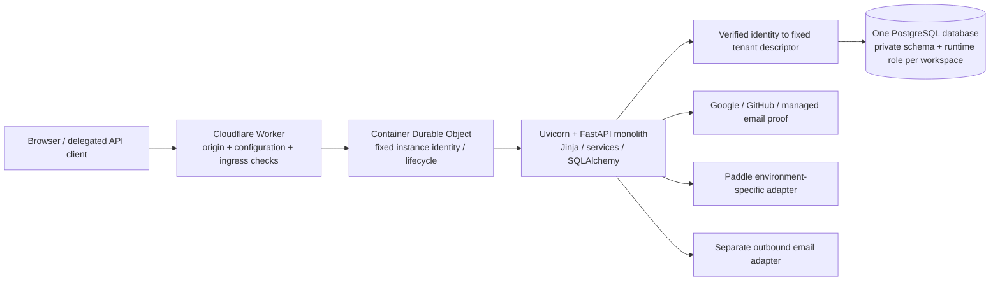

# 01 — Architecture and stack

## Snapshot and provenance

This is a dated technical review snapshot, prepared on 2026-10-16 for the HOC
pause closeout. It is not an active specification, a deployment instruction or
authorization to resume Stage improvements. Stage work remains paused until an
explicit HOC resume. Production is unchanged by this review.

The reviewed repository is
`C:/Users/edlop/OneDrive/Documents/VS Code/timeker-PH2`, branch
`codex/ph3-onboarding-auth`, verified clean at
`48e854ff2107dffb217dfe7c487b1b9d36a7f41d` before the audit. Source pointers below
are relative to that repository and use one-based line numbers at this commit.
The implementation review used tracked Python, TypeScript, templates, migrations,
lockfiles and canonical documentation. No application modules were imported to
initialize the app, and no database, provider, credential store, environment file,
private contract or actual business record was accessed. No test or hosted check
was run for this dossier.

Deployment facts are attributed to the existing `docs/STATUS.md:3–59` record,
rather than a new live verification. That record identifies Stage application
runtime source `dbf73e52ca03726e7903dc74ef27e40339c06936`, Worker
`9a1cfc5f-73ec-4856-b3bb-ea9a2817168c`, application version 20, and image SHA-256
`9b04918f1171f93c5e7b6009c114846ba8b7f36390e2e3ad3e27cc879944f426`.
The reviewed HEAD also includes subsequent documentation/integration custody.
The original production checkout is separately recorded at
`dfb2538ec81d07f1c91fdf2bdc5096d4d0313609` (`docs/STATUS.md:120–126`). Source
capability in this Stage branch must not be described as deployed production
behavior.

## 1. System shape

timeKER is one deployable Python web application with same-origin server-rendered
HTML, a small local JavaScript layer and one PostgreSQL database per environment.
Cloudflare Workers provide the public adapter; a Durable Object identifies and
manages the application Container. PostgreSQL stores business records, immutable
artifacts, operation receipts and audit history. The Durable Object's platform
SQLite declaration is Container control infrastructure; it is not a second
business datastore. There is no Redis, Celery, Kafka, separate AI backend,
frontend SPA or independently deployed business microservice in this source.



The currently documented Stage topology contains four retained workspace schemas
and five prepared signup schemas. The central admission directory lives in the
default schema in the same database. A new account consumes a preprepared slot;
request handling does not create schemas, roles or databases. A tenant is
permanently one owner/user, not a team or a client organization. Clients, Projects
and Cases are records inside that owner's workspace.

Sources: `AGENTS.md:68–103`; `app/tenancy.py:96–315`;
`app/admission.py:142–207`; `deploy/cloudflare/wrangler.jsonc:1`;
`docs/PROJECT_BRIEF.md:3–11`; `docs/design/EXPANSION_DISCOVERY.md:168–180`.

## 2. Actual declared and locked stack

The table reports repository declarations and lockfile selections. It does not
claim the version of a newly inspected running process. `pyproject.toml` declares
Python `>=3.12`; Docker builds and runs `python:3.13-slim`. The image tags are not
patch-version or base-image-digest pins. The uv build stage uses `0.13.0`, and
`uv sync --locked --no-dev` installs the runtime environment.

| Component | Selected version / policy | Source |
| --- | --- | --- |
| Application package | `timeker 0.1.0`; Hatchling build; `timeker = app.cli:main` | `pyproject.toml:1–19` |
| Python / package install | `>=3.12`; Docker 3.13 slim; uv 0.13.0 | `pyproject.toml:10`; `Dockerfile:1–9` |
| FastAPI / Starlette | 0.143.0 / 1.7.0 | `uv.lock:306`; `uv.lock:1327` |
| Uvicorn | 0.54.0 | `uv.lock:1451` |
| SQLAlchemy / Alembic | 2.1.4 / 1.20.0 | `uv.lock:1255`; `uv.lock:11` |
| psycopg / binary wheel | 3.3.6 / 3.3.6 | `uv.lock:949`; `uv.lock:967` |
| PostgreSQL | Local Compose declares PostgreSQL 18; hosted patch version was not queried | `compose.yaml:1–16` |
| Jinja2 | 3.1.6 | `uv.lock:518` |
| HTMX | Vendored 2.0.8 | `app/web/static/htmx.min.js:1` |
| Authlib | 1.8.0 | `uv.lock:56` |
| HTTPX | 0.28.1 | `uv.lock:476` |
| ItsDangerous / cryptography | 2.2.0 / 48.0.1 | `uv.lock:509`; `uv.lock:240` |
| WeasyPrint | 70.0 | `uv.lock:1464` |
| Pydantic / multipart parser | 2.14.0 / 0.0.32 | `uv.lock:1027`; `uv.lock:1221` |
| Time-zone data / dotenv | 2026.5 / 1.2.4 | `uv.lock:1442`; `uv.lock:1212` |
| pytest / Ruff / mypy | 9.1.1 / 0.17.0 / 1.20.2 | `uv.lock:1196`; `uv.lock:1230`; `uv.lock:768` |
| Playwright / PDF text inspection | 1.63.0 / pypdf 6.20.0 | `uv.lock:921`; `uv.lock:1178` |
| Cloudflare Containers SDK | 0.3.7 | `deploy/cloudflare/package.json:11–13`; `deploy/cloudflare/package-lock.json:20` |
| Wrangler / TypeScript | 4.149.0 / 7.0.2 | `deploy/cloudflare/package.json:14–20` |
| Workers types | 5.20261011.1 | `deploy/cloudflare/package.json:14–20` |
| Worker compatibility | 2026-10-13; `nodejs_compat` | `deploy/cloudflare/wrangler.jsonc:6–7` |

Docker is a two-stage Python application build after the uv tool stage. Runtime
native packages provide Pango/Harfbuzz and DejaVu fonts for WeasyPrint. The process
runs as an unprivileged system user, exposes port 8000 and disables Uvicorn access
logging. The image does not run a migration automatically on startup. Local
Compose has an explicit migration service before the app; hosted schema upgrades
are separately operated and evidenced.

Sources: `Dockerfile:1–23`; `compose.yaml:17–34`; `app/db.py:1–29`.

## 3. Public edge and Container pipeline

1. The Worker first validates its environment against an explicit Stage policy:
   canonical origin, database target/TLS shape, registry, provider flags and finite
   slot inventory. Required values are injected through named bindings; values
   and credentials are not reproduced here. Invalid configuration fails closed.
2. Requests must use the canonical HTTPS origin. Upgrade requests are rejected.
   Public Stage ingress blocks decoded `/internal*` and `/contact*` paths.
3. The adapter removes caller forwarding/IP/target-port/hop-by-hop headers and
   caller-supplied timeKER identity headers. It supplies the canonical host and
   HTTPS forwarding headers. Relevant auth POSTs receive an HMAC-derived network
   key recomputed from Cloudflare ingress information, rather than trusting a
   caller-supplied key or passing a raw address into auth logs.
4. A fixed Durable Object/Container identity receives the request. The Container
   listens on 8000, sleeps after ten minutes of inactivity, and tracks active
   requests/streams so activity is renewed during a response.
5. Startup waits for port 8000 with a 60-second port-ready budget and the request's
   abort signal. The response body is streamed; a disconnected stream is not
   replayed. Sanitized failures become 503 with no-store/retry information.
6. The private Container entrypoint enables Uvicorn proxy-header handling because
   the adapter has removed and reconstructed those headers. The standalone
   Docker default disables proxy headers. These are distinct entrypoints.

Sources: `deploy/cloudflare/src/proxy.ts:241–339`;
`deploy/cloudflare/src/index.ts:5–66`; `Dockerfile:23`.

The Stage Worker declares one basic Container and `max_instances: 1`;
`workers.dev` and preview URLs are disabled. Worker and Container observability
are disabled in the checked profile. `logSafely` is deliberately a no-op in the
Stage adapter; source tests can inject a bounded observer. No statement dispatch
cron is defined by the Stage `index.ts` handler. Production has its own adapter
and profile; its handlers must not be inferred from this Stage entrypoint.

Sources: `deploy/cloudflare/wrangler.jsonc:1–32`;
`deploy/cloudflare/src/proxy.ts:27–30`;
`deploy/cloudflare/src/index.ts:61–66`;
`deploy/cloudflare/src/production.ts:1`;
`deploy/cloudflare/wrangler.production.jsonc:1`.

## 4. FastAPI request pipeline

`create_app` constructs the immutable base settings, tenant registry,
request-scoped settings facade, database router, rate limiter, privacy preference
handler and contact router. It disables public OpenAPI/Swagger/ReDoc routes.
The lifespan validates tenant readiness when the registry or onboarding requires
it and disposes all registered engines at shutdown.

Among application-added middleware, the effective incoming order is:

```text
request_context -> SessionMiddleware -> TrustedHostMiddleware -> TenantMiddleware
  -> framework exception handling / route dependencies -> endpoint -> service
```

`request_context` is registered last and therefore wraps the other user middleware.
It assigns a request UUID, measures elapsed time, converts unexpected errors to a
bounded HTML/JSON response, emits a sanitized terminal request event and applies
response security/cache headers. Starlette's framework error wrapper is outside
this user-middleware list. Session decoding precedes tenant selection; the tenant
middleware explicitly refuses to run without session middleware.

Sources: `app/main.py:115–167`; `app/main.py:189–263`;
`app/tenancy.py:476–516`.

Hosted session cookies use `__Host-timeker-session`, Secure, HttpOnly through
Starlette SessionMiddleware, SameSite=Lax and a one-hour maximum age. This is a
signed client-side session, not a server-side session table or general encrypted
payload store. Session fields include owner/tenant/revision and short-lived flow
correlation. Principal validation rechecks the retained User and immutable method
binding on protected requests; a stale session revision is rejected.

Sources: `app/main.py:154–167`; `app/auth.py:51–100`.

The tenant middleware refreshes retained admission overlays for non-static,
non-liveness requests. Browser sessions resolve only to registered descriptors.
Integration credentials contain a tenant locator used for routing, then their
secret digest, expiry, grant and scope are authenticated before resource access.
Public paths use the default descriptor for public/authentication infrastructure;
that is not authorization to access the default owner's business records. An
anonymous protected path redirects to the public landing. ContextVar binding is
reset in `finally`, and `DBRouter` always uses the bound tenant factory.

Sources: `app/tenancy.py:292–344`; `app/tenancy.py:437–453`;
`app/tenancy.py:480–516`; `app/integration_auth.py:70–102`.

Protected application routers depend on `authorized`, which calls `owner` and
stores the verified User in request state. Enrollment can restrict a signed-in
owner to registration or subscription/security screens until acknowledgment and
first-plan requirements are met. Standard mutating forms validate same-origin
when supplied, a session-bound constant-time CSRF token, bounded body/field counts
and native no-JavaScript submission. The shared `mutate` helper runs a synchronous
service inside `sessionmaker.begin()` in a thread pool, then redirects with a
saved notice; domain/constraint/stale-version errors produce bounded feedback.
Specialized upload, OAuth, webhook and dispatch routes use their own explicit
validated transaction boundaries rather than assuming this helper covers them.

Sources: `app/main.py:355–392`; `app/main.py:692–697`;
`app/auth.py:87–126`; `app/main.py:1528–1547`.

## 5. Module and surface map

| Boundary | Main implementation and responsibility |
| --- | --- |
| App composition, public pages, core owner screens | `app/main.py:115`; router assembly `app/main.py:1528–1547` |
| Configuration and capability gates | `app/config.py:14`; frozen Settings; validation and environment-specific provider combinations; properties at `app/config.py:193–211` |
| Fixed tenant/role/session routing | `app/tenancy.py:96`; registry and factories; `app/db.py:9`; fixed-identity connect hook |
| Owner and external-method authentication | `app/auth.py:19`; `app/social_auth.py:17`; `app/email_auth.py:102`; `app/enrollment_routes.py:1` |
| Public admission and preparation operations | `app/admission.py:142`; `app/admission_operations.py:15`; `app/workspace_operations.py:241`; no privileged runtime DDL |
| Canonical acknowledgment and first-plan gates | `app/enrollment.py:90`; notice capture/receipt at `app/enrollment.py:179–245`; `app/subscriptions.py:349` |
| Clients, Projects, Cases and lookups | `app/clients.py:1`; `app/project_routes.py:1`; `app/cases.py:1`; `app/lookups.py:1`; service validation plus owned association checks |
| Timecards/import/contribution commands | `app/timecards.py:11`; `app/time_import.py:1`; `app/time_commands.py:203`; source-aware Draft changes and receipts |
| Billing/payment/credit and project charging | `app/billing.py:117`; time draft at `app/billing.py:200`; issue/pay/void at `app/billing.py:392`, `521`, `607` |
| Reports and Archive | `app/reports.py:1`; `app/archiving.py:17`; `app/archive_routes.py:1`; bounded reads/exports and retained history |
| Mail custody and private project files | `app/mail_service.py:66`; `app/mail_routes.py:1`; `app/project_attachments.py:1`; normalized bounded file capture, no inbox sync |
| Delegated OAuth/API/MCP and proposals | `app/integration_auth.py:24`; `app/integration_routes.py:312`, `515`, `666`, `1042`; `app/client_drafts.py:1` |
| Tenant plan quota and billing provider | `app/subscriptions.py:52`; `app/subscription_billing.py:400`, `726`; `app/paddle.py:1`; separate SaaS ledger from service invoices |
| Issued-statement collection sending | `app/sending.py:213`, `544`; `app/sending_transport.py:1`; payment/void/Stop-aware plans and follow-ups |
| Estimates and private documents | `app/quoting.py:210`, `309`; `app/library.py:190`, `310`; immutable publication, retained originals and revisions |
| Commercial-document sending | `app/proposal_sending.py:139`, `227`; `app/proposal_sending_transport.py:1`; separate manual outbox |
| Internal provider/scheduled entrypoints | `app/internal_routes.py:20`, `108`, `129`; protected internal secret/tenant binding; public Stage edge blocks these paths |
| Privacy/contact/optional usage | `app/privacy.py:18`; `app/contact.py:1`; `app/usage.py:43`; explicit feature/privacy gates |
| Encrypted settings, audit and diagnostics | `app/settings.py:70`; `app/audit.py:1`; `app/logging.py:32` |
| PDF | `app/pdf.py:17`; shared escaped, allowlisted templates and denied asset fetching |
| CLI, demo and seed tooling | `app/cli.py:1`; `app/demo.py:1`; `app/tenant_demo.py:1`; `app/seed.py:1`; operator/local tooling, not anonymous provisioning |

The delegated surface exposes OAuth authorization-server/resource metadata,
`/oauth/authorize`, `/oauth/token`, `/oauth/revoke`, `/mcp`, and scoped REST tool
calls under `/api/integration/tools/{name}`. Its MCP bridge is implemented in this
application; the lockfile does not add a separate agent inference runtime. Tool
schemas are bounded and scope-filtered. Delegated proposed clients are drafts;
delegation does not issue invoices or grant an assistant unrestricted owner access.

Sources: `app/integration_routes.py:50–257`, `589–647`, `666–1039`;
`app/integration_auth.py:24–44`; `docs/PROJECT_BRIEF.md:658–669`.

## 6. Persistence, rendering and operational boundaries

SQLAlchemy uses synchronous psycopg connections, `pool_pre_ping`, bounded pools,
zero overflow, a ten-second pool timeout, hidden SQL parameters and
`expire_on_commit=False`. Tenant-specific factories use pool size two and verify
the actual database role and current schema on connect. Tenant routing is
schema/role isolation, not a retrofitted shared-table RLS tenancy design. Runtime
roles cannot own/migrate objects; separate schema owners operate migrations.

Sources: `app/db.py:9–29`; `app/tenancy.py:237–238`, `272–277`;
`app/workspace_operations.py:81–124`; `scripts/postgres-runtime-grants.sql:3–28`.

Jinja templates render complete HTML or lookup fragments. HTMX and local scripts
enhance existing forms, lookups, the decorative browser-local clock, notices,
CAPTCHA and Paddle checkout integration. Native mutation routes remain the
authoritative action path. Money and contract calculations belong in Python
services rather than templates. PDF rendering permits only four named templates,
escapes HTML and refuses all resource URLs, including local-file and remote
fetches. Published financial/commercial artifacts are stored in PostgreSQL and
retrieved with integrity checks rather than silently regenerated.

Sources: `app/main.py:87–89`, `265–306`; `app/web/templates/base.html:1`;
`app/pdf.py:13–49`; `app/billing.py:454–467`;
`app/quoting.py:349–360`; `app/library.py:365–397`.

`/health/live` reports process liveness. `/health/ready` executes registry/schema,
runtime-role and admission checks and returns only ready/unavailable. It is
deliberately more expensive than liveness; a warm public page alone is not
readiness proof. The source pins migration head `ph3_006_quoting_library`.

Sources: `app/main.py:678–690`; `app/tenancy.py:346–430`; `app/db.py:6`.

Diagnostics use an event/field allowlist, internal UUIDs, route templates and
sanitized outcomes. Unknown fields and exception text are redacted; noisy library
and access logging is suppressed. Diagnostic failures are swallowed so they do
not change a committed result. Business audit records are separate database rows
and may contain protected business evidence; they must not be exported into
diagnostic logs or a public dossier. Encrypted settings use per-tenant key custody;
this review did not read the keys or encrypted values.

Sources: `app/logging.py:10–109`; `app/audit.py:1`;
`app/settings.py:70–135`; `app/models.py:359–373`.

## 7. Stage, production and unfinished designs

The Stage profile enables bounded public signup, managed email, delegated
integration and Paddle Sandbox while leaving statement jobs, public contact,
Mail capture and optional usage disabled. Commercial Quoting/Library routes are
explicitly unavailable in the production environment. Separate production
capability gates exist in source for future approved provider combinations; their
existence does not activate them in the original production deployment.

Sources: `deploy/cloudflare/wrangler.jsonc:34–61`;
`app/config.py:193–211`; `deploy/cloudflare/src/proxy.ts:93–144`;
`docs/STATUS.md:120–126`.

The current documented Stage release passed anonymous GET/assets/health checks;
authenticated hosted interaction with the new commercial workflows remains a
normal owner/UAT step. Existing local suite evidence is attributed in
`docs/STATUS.md:61–81`; it is not a new execution for this dossier. The original
Phase2 core is implemented, but real assistant OAuth allow, tool discovery,
two-tenant platform use and refresh/revocation remain actual-client validation
gates. Apple has preparation documentation but no runtime adapter/callback or
complete lifecycle implementation. Teams, memberships and a workspace switcher
are excluded by the permanent single-owner contract. Off-host recovery promises,
account lifecycle/retention policy and measured storage/mail budgets remain
separate open decisions, not hidden implemented services.

Sources: `docs/STATUS.md:35–44`, `120–124`;
`docs/design/EXPANSION_DISCOVERY.md:1–14`, `150–180`, `324–345`;
`docs/PROJECT_BRIEF.md:658–669`.
