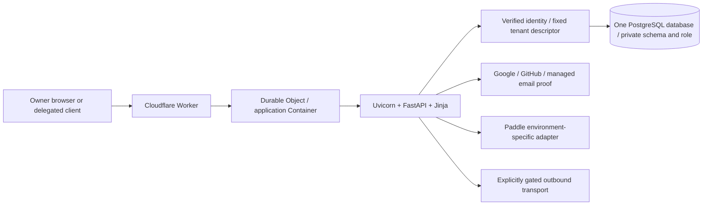

# 01 — Architecture and stack

## Review baseline

This chapter describes the source prepared for Phase 3 on 2026-10-18. The
reviewed source is `edlopezpm-ops/timeKER-Stage` commit `4bb5c424d6e7d270cdca1479283896be77d581c3`, branch
`main`, derived from the closed PH2 tag `ph2-closeout-2026-10-18`
at `39bcde0e99e8993d4de861a9c0c1da56a9e8e9a6`. Permanent repositories are timeKER-Stage and timeKER-PROD; PH3 names the next feature scope, not a temporary repository.

The owner authorized the bounded private PH2 production prelaunch. Production migration/deployment/readback are technically verified; PH3 feature prompts follow on Stage. Execution is supported by the separate release records; approval alone does not establish personal enrollment, human UAT, public/Live readiness or hosted recovery. This dossier is a source review, not an
instruction to merge, configure a provider, migrate a database or deploy.

Last retained hosted evidence identifies Stage 29, runtime source `e282985`, and
schema head `ph3_009_read_indexes`. These facts come from canonical records;
this refresh did not contact Stage or run application tests. The later reviewed prelaunch delta changes bounded configuration/provider/capability behavior; its bounded private production activation and readback are technically verified.

Sources: [continuation boundary](https://github.com/edlopezpm-ops/timeKER-Stage/blob/4bb5c424d6e7d270cdca1479283896be77d581c3/CONTINUE.md),
[closeout](https://github.com/edlopezpm-ops/timeKER-Stage/blob/4bb5c424d6e7d270cdca1479283896be77d581c3/docs/PHASE2_CLOSEOUT.md),
`docs/STATUS.md`, `HOSTING.md`.

## 1. System shape

timeKER is one deployable application and one PostgreSQL database per
environment. FastAPI serves same-origin HTML and endpoints; Jinja renders values
calculated by Python services. HTMX and small local scripts progressively enhance
native links and forms. It is not a SPA, ERP, payroll system or tax engine.



The Durable Object provides Container identity and lifecycle management. Its
platform SQLite declaration is not a second business database. There is no
Redis, Celery, Kafka, independent inference backend or business microservice split.
New owners consume finite operator-prepared schema/role slots; requests never
create databases, schemas or roles. One tenant permanently means one owner/user.
Clients, projects and cases are records inside that owner's workspace.

Sources: `AGENTS.md`, `app/tenancy.py`, `app/admission.py`,
`deploy/cloudflare/src/index.ts`, `docs/PROJECT_BRIEF.md`.

## 2. Declared stack and packaging

| Area | Layer | Current source declaration | Key details |
| --- | --- | --- | --- |
| Python | Backend | `>=3.12`; Docker build/runtime use `python:3.13-slim` | Language for application services, business rules and request handling. The minimum supported version and container version are distinct declarations. |
| Packaging | Build / tooling | `uv.lock`, Hatchling; application package `timeker` version `0.1.0` | uv locks dependencies; Hatchling builds the Python package. Deployment installs locked runtime dependencies. |
| Application | Backend / UI / frontend | FastAPI, Uvicorn, Jinja2, vendored HTMX | FastAPI handles routes; Uvicorn serves ASGI; Jinja2 renders the UI on the server; HTMX updates page fragments in the browser. Same-origin, progressively enhanced pages; no SPA. |
| Persistence | Backend / data | Synchronous SQLAlchemy 2, psycopg 3, PostgreSQL, Alembic | SQLAlchemy and psycopg access PostgreSQL; Alembic versions schema changes. Business records and immutable issued artifacts persist in the database. |
| Authentication/security | Backend / security | Authlib, HTTPX, ItsDangerous, cryptography | OAuth integration, provider HTTP requests, signed values and encryption. Identity proof, workspace authorization and provider activation remain separate controls. |
| Documents | Backend / PDF | WeasyPrint; pypdf for test text inspection | WeasyPrint renders PDFs on the server; pypdf extracts text during tests to inspect content and totals. |
| Time/configuration | Backend / configuration | tzdata, python-dotenv; explicit environment configuration | IANA time-zone data and environment loading. Business time zones remain explicit; technical timestamps use UTC. |
| Verification | QA / tooling | pytest, Ruff, mypy, Playwright and vendored axe | Backend tests, linting, static type checks, browser flows and accessibility checks. Tool availability does not establish that a test was executed. |
| Edge | Infrastructure / edge | Cloudflare Workers/Containers SDK, TypeScript, Wrangler | A TypeScript Worker proxies requests to the Python container; the Container SDK manages its lifecycle. Wrangler is the operator CLI. |
| Local development | Development environment / tooling | Docker Compose and operator/local CLI commands | Local application/database services and explicit setup or maintenance commands. Development configuration is separate from hosted Stage and production. |

Exact locked versions and configuration declarations belong to chapter 11 and
the source lockfiles. A declared or locked version is not a live-process query.
Docker copies uv `0.13.0`, installs with `uv sync --locked --no-dev`, and supplies
Pango/Harfbuzz/fonts for PDF rendering. The application runs under an
unprivileged user on port 8000 with Uvicorn access logging disabled.

The image does not migrate the database at startup. Local Compose uses a
separate migration service; hosted migrations/grants are separately operated.
The production and Stage Worker profiles are distinct. Build/package inputs
explicitly select product directories; private governance, environment files,
browser sessions, generated output and archives are outside release content.

Sources: `pyproject.toml`, `uv.lock`, `Dockerfile`, `compose.yaml`,
`.dockerignore`, `deploy/cloudflare/package.json`.

## 3. Edge and Container pipeline

The Stage Worker validates environment combinations against its canonical origin,
database/TLS target, identity registry, provider flags and prepared-slot inventory.
Missing or incompatible configuration fails closed. Secret values are neither
needed nor reproduced in this public review package.

Ingress requires the canonical HTTPS origin, rejects upgrades, and blocks public
access to decoded internal/contact surfaces in the Stage profile. The proxy
removes caller forwarding, identity and hop-by-hop headers, then constructs the
trusted origin/forwarding information itself. Relevant authentication POSTs
receive a recomputed HMAC-derived network key rather than a caller-selected key.

The fixed Container listens on 8000 and sleeps after ten idle minutes. Active
requests and streams renew activity. Startup waits for the application port with
a bounded 60-second budget and request cancellation. Responses stream; a dropped
stream cannot be replayed as a new response. Bounded failures return unavailable
without exposing provider errors or request/business content.

The Stage adapter enables proxy-header handling only behind this controlled
ingress. The standalone Docker command disables proxy headers. Stage declares
one basic Container and a maximum of one instance; deployment scaling is not
introduced by the performance changes.

Stage source now includes the Case-only `17 2 * * *` schedule. Its configured
presence does not prove an actual scheduled run. Scheduled statement Sending
remains disabled; the Case schedule is not permission to activate it.

Sources: `deploy/cloudflare/src/proxy.ts`,
[Stage entrypoint](https://github.com/edlopezpm-ops/timeKER-Stage/blob/4bb5c424d6e7d270cdca1479283896be77d581c3/deploy/cloudflare/src/index.ts#L6),
`deploy/cloudflare/src/stage-archive.ts`, `deploy/cloudflare/wrangler.jsonc`.

## 4. Request, authentication and tenant boundaries

`create_app` assembles frozen base settings, the tenant registry, request-scoped
settings/database/contact facades, public asset fingerprints, authentication,
privacy handling and routers. Public OpenAPI/Swagger/ReDoc endpoints are disabled.
Startup readiness runs outside the event loop and engines are disposed at shutdown.

Application-added incoming middleware is effectively:

```text
request_context → SessionMiddleware → TrustedHostMiddleware → TenantMiddleware
  → framework routing/dependencies → endpoint → services/data access
```

Request context assigns a UUID, records a sanitized terminal outcome/duration,
and applies security/cache headers. Hosted cookies are Secure, HttpOnly,
SameSite=Lax signed sessions with a one-hour lifetime. Signing is not encryption;
sessions carry bounded identity/flow correlation, not passwords/provider tokens.
Protected requests recheck the active owner, retained immutable provider binding
and session revision. Enrollment can restrict access until explicit acknowledgment
and first-plan requirements are satisfied.

Tenant selection follows verified server-side mappings. ContextVar state is
bound and reset per request; connection factories have fixed schema/role identity.
Default public/auth infrastructure routing grants no default-owner business
access. Delegated credentials supply only a locator before their digest,
grant, scope, expiry and revocation are authenticated.

Ordinary owner mutations validate CSRF, bounded forms and applicable origin
checks, then execute within `sessionmaker.begin()` in a worker. Specialized
webhooks, upload, OAuth and dispatch routes define their own explicit boundaries.
Business audit writes share the business transaction; diagnostics are separate.

Sources: `app/main.py:118`, `app/main.py:196`, `app/main.py:379`,
`app/auth.py`, `app/tenancy.py:469`, `app/enrollment.py`.

## 5. Persistence and performance architecture

SQLAlchemy uses synchronous connections with `pool_pre_ping`, bounded pool
sizes, zero overflow, a ten-second pool timeout, hidden SQL parameters and
`expire_on_commit=False`. Tenant factories verify actual database role/schema
on connection. Runtime roles do not own schema objects or migrate them.

The delivered performance changes reduce repeated work without caching
authorization, private pages or business decisions:

- Billing lists, reports and Dashboard reuse grouped unreversed-payment totals.
  Mutations still obtain fresh checks under their transaction/locks.
- Dashboard's enhanced request prepares only its selected detail group. Complete
  top counts/totals remain full-scope; each displayed group uses five rows.
- Quoting hydrates page-level revision, line and artifact metadata in batches;
  binary PDF columns stay deferred until an authorized artifact operation.
- Timecard history support queries use visible card IDs rather than loading
  unrelated history relationships.
- Tenant/admission readiness batches relation, role, privilege and empty-slot
  checks while retaining current database checks rather than caching decisions.
- Blocking GET, readiness and admission-directory units run in framework workers
  with request-local tenant context and Session ownership. A Session is not
  handed among concurrently executing tasks.
- Migration 009 adds stable recent-list indexes for invoices, audit events and
  active Mail. It does not rewrite business records or add a search engine.

`/health/live` is the cheap process probe used by Docker. `/health/ready` performs
explicit deeper schema/role/admission checks and reports a bounded ready or
unavailable result. Current expected head is `ph3_009_read_indexes`.

Sources: `app/db.py`, `app/main.py:739`, `app/billing.py:475`,
`app/reports.py:108`, `app/quoting.py:404`, `app/tenancy.py:348`,
`alembic/versions/ph3_009_read_indexes.py`.

## 6. Browser rendering, assets and references

Startup hashes known public assets once. Canonical `?v=<sha256>` GET/HEAD
responses with successful status use immutable public caching and no Set-Cookie.
Unversioned known assets revalidate. Incorrect versions, errors and private
responses remain no-store; owner content is never included in that public cache.
Dashboard fragments explicitly retain `private, no-store` and the appropriate
HTMX Vary headers.

Settings' Clear cache refreshes a fixed inventory of 22 versioned same-origin
public files with omitted credentials, three workers and a 20-second attempt
timeout. It drains response bodies, verifies public immutable policy, reports
accessible progress/failure and permits retry. It preserves unsaved forms and
sign-in; it neither clears all browser/CDN caches nor reloads running scripts.

Country/currency choices come from vendored ISO reference data; IANA timezone
choices come from local tzdata. Native selects preserve explicit defaults,
optional blanks, submitted errors and existing legacy values. No remote lookup,
locale-based country inference or inferred legal/tax fact is introduced.

Sources: `app/static_assets.py`, `app/reference_choices.py`,
`app/web/templates/components.html`, `app/web/templates/settings.html`,
`app/web/static/settings_cache.js`, `app/web/static/workspace.js`.

## 7. Domain modules and effects

| Domain | Principal source boundaries under `app/` |
| --- | --- |
| Clients/projects/cases | `clients.py`, `client_sources.py`, `cases.py`, `work_lifecycle.py` |
| Weekly time/import | `timecards.py`, `time_commands.py`, `time_import.py` |
| Financial statements | `billing.py`, `project_billing_routes.py`, `reports.py`, `pdf.py` |
| Estimates/private documents | `quoting.py`, `library.py`, their routes/models |
| Two outbound workflows | `sending.py` and separately `proposal_sending.py` |
| Individual plans/provider ledger | `subscriptions.py`, `subscription_billing.py`, `paddle.py` |
| Identity/admission | `auth.py`, `social_auth.py`, `email_auth.py`, `admission.py` |
| Delegated tools | `integration_auth.py`, `integration_routes.py`, `client_drafts.py` |
| Retained custody | `archiving.py`, `mail_service.py`, `project_attachments.py` |
| Shared controls | `settings.py`, `privacy.py`, `contact.py`, `logging.py`, `audit.py` |

PDF rendering uses escaped allowlisted templates and denies external/local asset
fetches. Published artifacts are retrieved from retained bytes with integrity
checks. Encrypted sensitive settings require tenant-specific key custody.
Diagnostics allow only bounded operational fields; business audit content,
identity details, notes, credentials and artifact bytes stay out of logs.

For PH3 proposals, retain these boundaries and identify the exact source path,
affected tenant/transaction, user-visible behavior and needed evidence. Residual
assistant proof, human UAT, recovery/custody, provider lifecycle rehearsal and
personal enrollment/acceptance and later public/Live readiness remain open in `docs/STATUS.md`; the bounded private prelaunch readback is verified.
