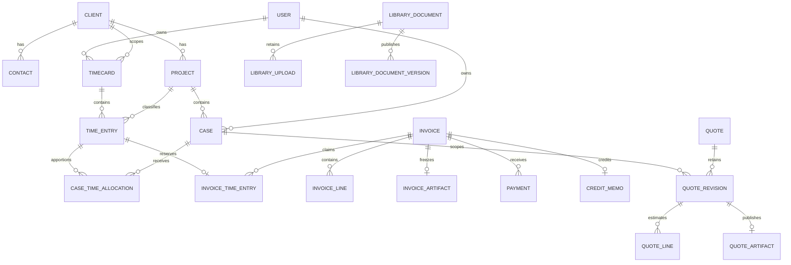

# 02 — Data model and transaction semantics

## Snapshot and provenance

This chapter is a dated review snapshot for the 2026-10-16 HOC pause closeout,
not an active schema specification or permission to execute an operation. Stage
improvements remain paused until explicit HOC resume; production is unchanged.

Source repository:
`C:/Users/edlop/OneDrive/Documents/VS Code/timeker-PH2`, branch
`codex/ph3-onboarding-auth`, reviewed at clean commit
`48e854ff2107dffb217dfe7c487b1b9d36a7f41d`. All source pointers are relative to
that repository and use one-based snapshot line numbers. This chapter was
prepared by reading model declarations, services, migrations, grant scripts and
canonical documentation. The companion schema/field appendix is derived statically from
Python AST; it does not import the application or reflect a live database.
No database, actual business data, environment/credential file or private contract
was read. No migration, test, external send or network call was performed.

## 1. Physical and ownership model

There are **53 mapped domain tables** in the reviewed source, plus Alembic's
`alembic_version` metadata table per migrated schema. The application uses one
PostgreSQL database per environment and a private schema/runtime role per owner
workspace. This is not a shared-table `tenant_id`/RLS design. For example, Clients
do not carry a universal tenant column: isolation comes from the server-resolved
fixed descriptor, restricted role, pinned schema and service authorization.
Some records also carry `owner_id` or `actor_id` for local ownership/audit.

The generic `require` repository helper looks up an ID in the bound database
session; it is not independently an owner-filtering authorization layer. Routes,
principal validation and domain services must apply their respective owner and
association checks. PostgreSQL FKs inside the tenant schema are supplemented by
cross-parent consistency guards; merely proving that two UUIDs exist is not
enough to associate them.

Sources: `app/models.py:29–66`; `app/repositories.py:12–19`;
`app/tenancy.py:237–277`, `328–344`, `445–453`;
`app/auth.py:51–100`; `scripts/postgres-runtime-grants.sql:3–28`.

`Entity` supplies UUID `id`, timezone-aware UTC `created_at` and `updated_at`.
Most domain classes inherit it. Exceptions are explicitly declared structures:
`ContactAttempt`, the entry-keyed invoice `Reservation`, the singleton integer-key
`WorkspaceSubscription`, and identity-keyed `BillingAccount`. Entity timestamps
do not mean that every row is mutable; immutable history is enforced separately.
Optimistic concurrency applies only where the model declares `version_id_col`
or a service explicitly checks a revision/version, not to every table by magic.

Sources: `app/models.py:33–66`, `330–333`;
`app/subscription_models.py:13–34`;
`app/subscription_billing_models.py:24–68`.

The three admission tables are physically installed in every schema, but their
authoritative copies are central. Only the default runtime has central
SELECT/INSERT/UPDATE; noncentral directory shadows are denied. Their tenant-local
owner/identity UUIDs are logical locators, deliberately not cross-schema FKs.
Admission performs explicit immutable identity and initialization readback across
separate transactions.

Sources: `app/admission_models.py:12–61`;
`app/admission_operations.py:79–90`; `app/admission.py:92–207`.

## 2. Entity and relationship map

The diagram omits secondary/audit links for readability; the complete 53-table
inventory and field-level FK declarations follow below and in the appendix.

### Core owner, client, work and financial records — 17 tables

| Table / class | Main relationships and semantics | Source |
| --- | --- | --- |
| `users` / User | Unique email; owner role/active flag, last login and session revision. The workspace contract permits one owner. | `app/models.py:59` |
| `clients` / Client | Root business record; profile/contract JSON, Decimal rate, currency, IANA zone, weekly cap, status and optimistic version. | `app/models.py:69` |
| `contacts` / Contact | Client FK; contact methods and explicit request-work/approve-hours metadata. | `app/models.py:95` |
| `projects` / Project | Client FK; type, active/closed/archive status, rate override, budget/currency pair, agreement reference pair and overbilling choice. | `app/models.py:108` |
| `project_agreements` / ProjectAgreement | One immutable private file per Project, uploader User FK, bytes/size/checksum. This is a project attachment, separate from Library. | `app/models.py:147` |
| `timecards` / Timecard | Owner + Client + Monday week uniqueness; entries, persisted exact total, state, archive marker, version and cap-override evidence. | `app/models.py:162` |
| `time_entries` / TimeEntry | Timecard + Project + work date; positive integer minutes, notes, billability and optional rate override. | `app/models.py:186` |
| `cases` / Case | Owner, Client and Project FKs; immutable schema-local numeric identity from 10001; type, state, optional description and archive marker. | `app/models.py:202` |
| `case_time_allocations` / CaseTimeAllocation | Entry-to-Case allocation, unique pair, integer minutes, actor and version. Allocated time cannot exceed parent time. | `app/models.py:233` |
| `invoices` / Invoice | Client; optional exclusive fixed-fee or manual-extra Project association; business dates, Decimal totals, snapshot and lifecycle/version. | `app/models.py:247` |
| `invoice_lines` / InvoiceLine | Invoice + optional Project; explicit time/fixed-fee/manual-extra basis, exact quantity/rate/amount and frozen charge metadata. | `app/models.py:306` |
| `invoice_time_entries` / Reservation | `entry_id` is the PK and FK; one entry can have only one current invoice claim. Invoice FK. | `app/models.py:330` |
| `invoice_artifacts` / Artifact | One per Invoice; retained filename, exact PDF bytes, SHA-256 and renderer version. | `app/models.py:336` |
| `payments` / Payment | Invoice and creator User FKs; positive Decimal amount and same currency; reversal timestamp rather than deletion. | `app/models.py:345` |
| `audit_events` / Audit | Actor, request and entity identifiers plus protected business details; append-only runtime grants. | `app/models.py:359` |
| `app_settings` / AppSettings | Unique key; JSON value or encrypted bytes, scoped to the current workspace. | `app/models.py:369` |
| `contact_attempts` / ContactAttempt | Durable abuse/delivery reservation using address/session/network/payload digests, timestamp and state; not a general contact mailbox. | `app/models.py:33` |

### Mail custody and credit artifacts — 4 tables

| Table / class | Main relationships and semantics | Source |
| --- | --- | --- |
| `mail_messages` / MailMessage | Owner, Client and optional Project/Case; canonical checksum, normalized bounded headers/plain text, source, receipt/archive basis and archive marker. | `app/mail_models.py:21` |
| `mail_addresses` / MailAddress | Revocable digest-only capture address bound to one owner and fixed association. | `app/mail_models.py:48` |
| `mail_attachments` / MailAttachment | Message/position uniqueness; retained inert original attachment bytes, bounded name/type/size/checksum. | `app/mail_models.py:58` |
| `credit_memos` / CreditMemo | Unique Invoice FK and number; actor, complete frozen original reference, full credit amount, reason and immutable PDF/checksum. | `app/credit_memo_models.py:14` |

### Source-aware time commands and delegated integration — 8 tables

| Table / class | Main relationships and semantics | Source |
| --- | --- | --- |
| `time_import_records` / TimeImportRecord | Unique actor/source/source-record identity and canonical payload hash. | `app/time_command_models.py:13` |
| `time_contributions` / TimeContribution | Actor/source/source-item uniqueness; optional import receipt, Timecard, Project, date, Entry and optional Case; own minutes/version. Zero is a retained tombstone. | `app/time_command_models.py:26` |
| `time_operations` / TimeOperation | Unique actor/source/idempotency key; immutable payload hash, action and result receipt. | `app/time_command_models.py:49` |
| `integration_grants` / IntegrationGrant | Owner/tenant/client/resource/scopes, expiry and revocation. | `app/integration_models.py:21` |
| `integration_codes` / IntegrationCode | Grant FK; digest-only one-use authorization code, redirect URI, S256 challenge, scope and expiry/use timestamp. | `app/integration_models.py:33` |
| `integration_tokens` / IntegrationToken | Grant FK; digest-only access/refresh credential, scope/client, expiry and use timestamp. | `app/integration_models.py:51` |
| `integration_operations` / IntegrationOperation | Unique grant/key digest; tool, payload digest and retained result. | `app/integration_models.py:69` |
| `client_drafts` / ClientDraft | Owner-scoped proposed-client JSON and optimistic version; cannot itself publish an active Client. | `app/integration_models.py:79` |

### Subscription assignment and provider billing — 5 tables

| Table / class | Main relationships and semantics | Source |
| --- | --- | --- |
| `workspace_subscriptions` / WorkspaceSubscription | Singleton `id=1`, owner, free/solo/pro assignment, catalog revision, version and optional paid-access expiry. | `app/subscription_models.py:13` |
| `subscription_operations` / SubscriptionOperation | Unique owner/key digest, payload digest, action and immutable result. | `app/subscription_models.py:37` |
| `subscription_billing_accounts` / BillingAccount | Integer identity; one current account per owner through a partial unique index. Provider customer/subscription/checkout bindings, proven paid period, pending changes and version. Retired accounts remain. | `app/subscription_billing_models.py:24` |
| `subscription_billing_operations` / BillingOperation | Unique owner/key digest and optional transaction ID; durable effect intent/result and reserved/confirmed/uncertain/failed state. | `app/subscription_billing_models.py:71` |
| `subscription_billing_events` / BillingEvent | Unique provider event ID, raw-body digest, event type, outcome and bounded verified facts. | `app/subscription_billing_models.py:89` |

These are timeKER SaaS-access records. They are not the consulting/service Invoice
and Payment ledger, and provider events cannot silently rewrite an issued service
artifact. The one current provider-account index and the local singleton plan
assignment serve different purposes.

### Local authentication, central admission and collections — 10 tables

| Table / class | Main relationships and semantics | Source |
| --- | --- | --- |
| `owner_identities` / OwnerIdentity | Owner FK; immutable issuer/subject, verified email metadata and revocation timestamp. | `app/enrollment_models.py:12` |
| `owner_registrations` / OwnerRegistration | Owner plus exact Terms/Privacy/catalog versions, selected offer and acceptance time; unique versioned receipt. Acceptance method/revision evidence lives in its Audit event. | `app/enrollment_models.py:26`; `app/enrollment.py:196` |
| `email_auth_challenges` / EmailAuthChallenge | Owner-scoped signed-session digest, signin/signup/link intent, offer, expiry, bounded attempts and retained state. | `app/enrollment_models.py:42` |
| `workspace_admissions` / WorkspaceAdmission | Central unique slot/owner/email/immutable provider anchor; reserved/active/blocked allocation. | `app/admission_models.py:12` |
| `admission_identities` / AdmissionIdentity | Central immutable issuer/subject locator to exact tenant/owner/local identity; active/pending/blocked/revoked. | `app/admission_models.py:26` |
| `public_email_challenges` / PublicEmailChallenge | Central ownerless encrypted destination context plus address/session/network digests; bounded intent/offer/security-return state. | `app/admission_models.py:43` |
| `sending_preferences` / SendingPreferences | One owner preference row; global pause and editable initial/follow-up templates. | `app/sending_models.py:21` |
| `sending_plans` / SendingPlan | One per issued Invoice; exact Artifact/checksum, recipient/frozen message and opt-in bounded follow-up policy; retained stop reason/time. | `app/sending_models.py:31` |
| `sending_deliveries` / SendingDelivery | Unique plan/sequence; original UTC schedule, pending/sent/failed/stopped/uncertain state, bounded attempts. | `app/sending_models.py:55` |
| `sending_attempts` / SendingAttempt | Unique delivery/attempt number; durable claim/result, bounded provider reference and completion time. | `app/sending_models.py:72` |

### Quoting, Library and commercial sending — 9 tables

| Table / class | Main relationships and semantics | Source |
| --- | --- | --- |
| `quotes` / Quote | Owner, generated unique number, owner-scoped create operation key/digest, soft archive and version. | `app/quoting_models.py:30` |
| `quote_revisions` / QuoteRevision | Quote and optional parent revision; unique numbered lineage, mandatory Case/Project/Client, text/preset/currency/validity and draft/published state. Partial unique index permits one Draft per Quote. | `app/quoting_models.py:45` |
| `quote_lines` / QuoteLine | Unique revision/position; task/case/project scope label, integer min/max minutes and optional exclusive T&M rate or fixed amount. | `app/quoting_models.py:77` |
| `quote_artifacts` / QuoteArtifact | One per Revision, owner, snapshot, exact PDF/size/SHA-256/renderer/publication timestamp. | `app/quoting_models.py:103` |
| `library_documents` / LibraryDocument | Owner and editable root, type/status/revision; a working document has Case/Client/Project, while a reusable template has none. Source-upload UUID is validated as same-document by service/guard. | `app/library_models.py:24` |
| `library_uploads` / LibraryUpload | Immutable document/uploading-owner original bytes, MIME/name/size/SHA-256. | `app/library_models.py:48` |
| `library_document_versions` / LibraryDocumentVersion | Unique document/number, owner, immutable snapshot/PDF and optional exact source upload. Snapshot selects PDF or original attachment format. | `app/library_models.py:64` |
| `proposal_sending_deliveries` / ProposalSendingDelivery | Owner/Case and exactly one frozen QuoteArtifact or Library version; exact generic attachment bytes/type/name/hash, message, create key, version, state and attempt/stop timestamps. | `app/proposal_sending_models.py:22` |
| `proposal_sending_attempts` / ProposalSendingAttempt | Unique delivery/number; retained claim/outcome/completion, immutable after completion. | `app/proposal_sending_models.py:58` |

## 3. State machines and derived state

Allowed database strings constrain storage. The service and triggers impose the
valid transitions and proof requirements; membership in an allowed string list
does not authorize an arbitrary transition.

| Aggregate | Storage states / transition rule |
| --- | --- |
| Client / Project | Client active/archived; Project active/closed/archived. New activation/reactivation must satisfy quota and parent checks; history remains readable. |
| Case | Open, In progress, Waiting, Resolved, Closed; archive is a separate timestamp. Case numeric identity and referenced commercial association are retained. |
| Timecard | Draft → Finalized → Invoiced. Eligible unreserved finalized time can reopen to Draft with a reason. Legacy Voided remains readable/reopenable where allowed; creating a new timecard void is refused. |
| Service Invoice | Draft → Issued → Sent; eligible cancellation → Void. Paid, Partially Paid and Overdue are calculated from unreversed payments/due date. Cancelled draft is represented by Void with no issued artifact/issued timestamp, not an extra database enum. |
| Payment | Created positive payment; an explicit reason can set `reversed_at` once. Deleting payment history is not the ordinary reversal operation. |
| Quote | One editable Draft revision → immutable Published; editing afterward creates a higher numbered draft. Root archive is one-way soft retention. |
| Library | Root draft → frozen (displayed as Published); explicit new draft increments revision. Published versions and uploads never become editable again. |
| Admission | Central reserved + pending locator → exact tenant initialization/readback → active + active. Conflicts can retain blocked state; there is no implicit reassignment. |
| Local/public email challenge | Reservation → ready → verifying → consumed or failed, with bounded attempts/expiry. Public delivery ambiguity also has uncertain. No challenge state by itself proves a new owner. |
| Owner acknowledgment | Immutable receipt for exact current document versions after verified auth and captured notice, or explicit Continue fallback. No acceptance on GET or failed proof; link mode does not auto-accept. |
| Subscription assignment | free/solo/pro with separate expiry/catalog/version. Expired paid access retains history, while capacity guards reject new growth without verified entitlement. |
| Provider billing | Account status active/canceled/past_due/paused/trialing; durable operations reserved/confirmed/uncertain/failed; effect only from validated provider evidence. |
| Delegated grant/code/token | Grant expiry/revocation timestamps, single-use code, rotating refresh credentials. Replay of consumed code/refresh can revoke the grant. |
| Collections delivery | pending → committed uncertain claim → sent/failed/uncertain, or stopped. Only definitive failure permits explicit bounded retry. Follow-up requires its predecessor sent and payment/void/pause/Stop checks. |
| Commercial delivery | draft → committed uncertain claim → sent/failed/uncertain. Failed may be explicitly retried, up to four total attempts. Stop is retained; sent/uncertain cannot be blindly replayed. A claimed send cannot be recalled. |
| Contact delivery | reserved/accepted/uncertain retains abuse/delivery reservation; ambiguous provider outcome is not an excuse to resend automatically. |

Sources: `app/models.py:88–91`, `125–142`, `178–182`, `222–229`, `297–300`;
`app/timecards.py:139–179`; `app/billing.py:471–564`, `577–682`;
`app/admission.py:142–207`; `app/enrollment.py:101–141`, `179–245`;
`app/integration_auth.py:349–419`; `app/sending.py:544–696`;
`app/proposal_sending.py:193–200`, `227–274`.

## 4. Money, minutes and business dates

Time is stored as integer minutes. Ordinary daily duration parsing accepts H:MM
or decimal-hour text only when it resolves to whole minutes; it rejects fractional
minutes, invalid minute components and values above 24 hours. Time entries require
positive minutes; weekly totals are bounded by 10,080 minutes. A Quote line uses a
separate estimate-specific integer range up to 5,256,000 minutes, not the ordinary
daily parser's maximum. Empty maximum estimate duration becomes its minimum.

Money accepts decimal text or `Decimal`, is finite/bounded, and has at most two
decimal places. Database monetary fields use `NUMERIC(14,2)`. Binary floats are
not the money representation. T&M billing groups exact minutes by Project, week
and effective rate before rounding each resulting line with ROUND_HALF_UP; it
does not round every intervention to one hour. Invoice totals sum those stored
line amounts. Quote totals accumulate exact Decimal extended values across all
priced lines before final two-decimal rounding. These are distinct documented
rounding boundaries, not an assertion that every module rounds identically.

Sources: `app/domain.py:13–60`; `app/models.py:169–197`, `261–263`, `312–314`;
`app/billing.py:236–279`; `app/quoting.py:82–120`;
`app/quoting_models.py:90–100`.

Blank price is not zero: an unpriced HLE remains Not priced with no invented
currency/rate. Explicit zero is preserved. Mixed priced/unpriced lines expose a
priced subtotal, excluding unpriced items. Priced work requires an explicit
currency or the existing selected Client currency. Project fixed fees and manual
extras use explicit line bases with zero time quantity, never fabricated worked
hours. A fixed-fee project has at most one nonvoid base-fee claim; separate manual
extras require the actual overbilling setting, amount, reason and unique reference.
Budget checks reserve/reject coherent charges rather than truncate eligible time.

Sources: `app/quoting.py:82–137`; `app/billing.py:64–198`, `249–257`;
`app/models.py:272–325`; `alembic/versions/d529b08f14a2_project_billing.py:86–212`.

Technical timestamps are UTC-aware. Work periods, issue/delivery/due/payment dates
are business dates, and client IANA zones determine business today/week/archiving
boundaries. Weekly periods start Monday. No payment operation invents FX; payment
currency must match the Invoice. Tax, withholding, bank fees or adjustments must
come from explicit saved data and validated owner input, not an external-rate or
tax-authority integration implied by the application.

Sources: `app/domain.py:52–67`; `app/billing.py:284–320`, `420`, `521–530`;
`app/archiving.py:17–56`; `app/models.py:254–258`, `348–350`.

## 5. Critical transaction boundaries

### 5.1 Ordinary owner mutations and concurrency

The shared route mutation helper opens `sessionmaker.begin()`, invokes the service
and commits only after the action returns; exceptions roll back the whole action.
Rendering an immutable PDF inside an issuing/publishing transaction can therefore
fail without committing a half-issued artifact. Services usually receive the
Session and do not unconditionally commit it. Specialized external effects have
separate reserve/claim/result transactions, described below.

Parent row locks and a consistent acquisition order protect work/financial graphs.
`lock_card` locks the Client before the Timecard; `lock_invoice` locks the Client,
associated Timecards in ID order and then the Invoice. Explicit expected versions
and SQLAlchemy optimistic versions reject stale forms. These controls do not
claim all commands run at SERIALIZABLE isolation, or that every form is inherently
idempotent.

Sources: `app/main.py:355–392`; `app/db.py:9–29`;
`app/repositories.py:22–52`; `app/timecards.py:27–44`.

### 5.2 Manual time, contributions, allocation and import

Manual save builds a whole week only after validating distinct same-client
Projects, seven days/notes, daily totals and preserved inactive-project history.
An owner cannot shrink or remove an Entry underneath retained Case allocations
or delegated/imported contributions. Finalize checks the current aggregate and
requires both reason and authorization reference for a cap override. Reopening
requires an unreserved finalized/legacy-voided card and a reason.

Contributions are source-owned portions of an aggregate Entry. Commands acquire
parent/card locks, apply a delta, preserve manual/other-source minutes and update
only the caller's contribution. Source deletion retains a zero-minute contribution
and history rather than erasing its receipt. Preview/commit imports retain
source-record identities and hashes; exact replay returns the retained operation
result, while conflicting reuse/stale context fails. Deferred allocation checks
prove contribution/Case allocation consistency at transaction completion.

Sources: `app/timecards.py:11–173`; `app/time_commands.py:40–75`, `77–169`,
`203–422`, `424–556`; `app/time_command_models.py:12–61`;
`alembic/versions/ph2_002_time_commands.py:70–145`.

### 5.3 Draft billing, issuance, payment and credit

Draft creation takes a PostgreSQL advisory transaction lock before numbering and
claiming eligible time. The reservation Entry PK prevents concurrent duplicate
billing. Effective rate and budget checks precede line insertion. Fixed-fee and
manual-extra commands use their own explicit charge invariants rather than
reusing worked-time quantities.

Issuance revalidates Project currency/type/budget and explicit commercial-source
confirmation, sets the business issue date, builds a snapshot, renders the PDF,
stores exact bytes/hash/renderer metadata, marks associated cards Invoiced and
writes Audit in the caller transaction. The issued snapshot and Artifact are
retained; downloads verify SHA-256 and return the original bytes. Only drafts
may be regenerated.

Payments lock the same financial graph, require a positive amount within the
unpaid balance and the same currency/date bounds, and stop collection sending in
that transaction. Reversing a payment adds a timestamp/audit reason; it does not
silently resume a stopped collection plan. Voiding an issued statement requires
zero unreversed payments, verifies the original PDF, creates one immutable full
credit memo referencing its original checksum, then releases time reservations
and stops sending. Draft cancellation releases claims and records Void history
without issuing a credit memo. Original issued artifacts are never rewritten.

Sources: `app/billing.py:33–51`, `117–281`, `392–467`, `521–564`, `577–682`;
`app/models.py:272–304`, `330–356`;
`alembic/versions/ph2_001_credit_memos.py:40–102`.

### 5.4 Admission and method linking are cross-transaction protocols

Public admission is not one database transaction spanning all schemas. Under the
central directory advisory lock it reserves one fixed slot plus stable owner and
identity UUIDs. A second transaction initializes exactly that empty tenant using
the slot's restricted runtime connection. Readback verifies the immutable local
User/OwnerIdentity before a final central activation transaction. Retained pending
or blocked states are reconciled through the same exact identities; retries do
not allocate a different owner or merge matching email accounts.

Existing bound issuer/subject resolves to its owner/workspace for both signin and
signup. An unknown signin does not allocate. Signup cannot claim a fixed owner's
email as a shortcut to linking. Explicit linking requires fresh proof of the
current owner and the new provider method. Revocation preserves the global
locator/tombstone and refuses removal of the final usable method.

Sources: `app/admission.py:58–207`, `210–307`;
`app/enrollment.py:30–87`, `157–175`.

The sign-in notice capture accepts only exact current revision/document-version
fields into the signed flow. Its receipt is recorded only after immutable
identity authentication succeeds. Missing/stale evidence goes to explicit
Continue fallback, with strict legacy compatibility. The Audit acceptance method
distinguishes sign-in notice, Continue and old checkboxes; catalog snapshot
reference does not mean a price/checkout agreement. Acknowledgment never implicitly
activates Free or changes a retained paid plan.

Sources: `app/enrollment.py:179–245`; `app/enrollment_routes.py:1`;
`app/enrollment_models.py:26–40`; `app/subscriptions.py:349`.

### 5.5 Quotas and subscription-provider effects

Quota checks acquire a schema-derived PostgreSQL advisory transaction lock and
count active Clients/Projects coherently inside the existing mutation. Parent
reactivation and selected downgraded inventory cannot evade these service checks.
Free/Solo/Pro limits are explicit catalog data in code; Pro's lack of a commercial
client/project cap does not imply unlimited storage, attachments or hosting.

Provider operations reserve an owner/key/payload-bound intent before contacting
Paddle. Checkout return pages or browser events are not payment proof. The
verified event handler validates environment/account/tenant/price/period and
reconciles a unique event receipt, provider account and entitlement under locks.
Uncertain effects are retained for reconciliation rather than blindly reissued.
Plan-change/retention confirmation binds a saved reviewed quote and rechecks it
before effects; cancellation/downgrade preserve the paid-period boundary.

Sources: `app/subscriptions.py:52–142`, `177–228`, `306–349`;
`app/subscription_billing.py:338–440`, `454–511`, `584–958`, `1028–1179`,
`1419–1504`, `1589`; `app/subscription_payment_routes.py:395–418`.

### 5.6 Publication and original-file custody

An HLE create key is scoped to owner and canonical request digest. Exact repeated
create returns its original first revision; a conflicting payload fails. Updates
require the expected version and editable Draft. Publish rechecks active owned
Case context, renders/validates a bounded PDF, inserts and flushes the artifact
before marking the revision Published. Database guards then see the required
artifact and freeze the revision/lines. Subsequent numbered drafts copy retained
published content rather than modifying it.

Library keeps editable roots distinct from immutable uploads and numbered
versions. Publication inserts and flushes version evidence before freezing the root.
An uploaded PDF stays exact original bytes. Other imported text can generate a
new PDF, while explicitly publishing an original file preserves that original
instead of pretending editor changes were applied to it. Frozen resolution checks
both the PDF and, when selected, same-document original bytes/hash. Templates
cannot be sent as Case-bound working documents. Case archive is allowed without
destroying access to frozen history; new working mutations require active context.

Sources: `app/quoting.py:210–279`, `294–360`;
`app/library.py:190–222`, `241–284`, `310–397`;
`alembic/versions/ph3_006_quoting_library.py:287–439`.

### 5.7 Two deliberately separate sending protocols

Collections sending binds an issued Invoice Artifact and payment-sensitive plan.
It commits an uncertain claim/attempt before provider I/O. The completing phase
reacquires the shared Invoice lock, rechecks payment/void/pause/Stop and holds the
financial serialization while making its one provider attempt and retaining the
result. Only accepted previous delivery permits the next opt-in follow-up. A
manual early follow-up additionally binds its exact reviewed digest and retains
the original schedule. Jobs remain disabled in the documented Stage profile.

Commercial sending snapshots exactly one published HLE or Library attachment
into a separate delivery row. Before claiming it validates owner/Case/source,
version-bound review digest, recipient/message, checksum/MIME and encoded email
budget. It commits uncertain before network I/O, contacts the transport outside
that claim transaction, then settles delivery/attempt in a new transaction.
Concurrent Stop remains retained even if an already claimed send subsequently
settles. It does not use Invoice/Payment rules or schedule automatic retries.

Both protocols cap four total attempts and preserve ambiguous outcomes without
replay. Sent means transport/provider acceptance, not proof of inbox placement,
recipient reading, signature, agreement or payment. Implementation/tests do not
authorize an addressed customer send.

Sources: `app/sending.py:213–285`, `347–367`, `470–544`, `544–696`;
`app/proposal_sending.py:100–163`, `193–200`, `227–274`;
`app/proposal_sending_transport.py:1`; `docs/STATUS.md:15–20`, `120–124`.

### 5.8 Archive and retained files

Archive is a six-calendar-month visibility/export policy, not physical erasure.
Timecard cutoff uses the Client's business zone and the end of its week; Mail uses
the retained archive basis. Batch marking uses bounded counts, an advisory lock
and skip-locked parent acquisition. Historical files, financial records and audit
remain in PostgreSQL. Mail capture/import normalizes reference data and inert
attachments; original MIME is not a full mailbox backup and no automatic inbox
synchronization follows from these models.

Sources: `app/archiving.py:13–95`; `app/archive_routes.py:1`;
`app/mail_service.py:66–165`, `180–279`; `app/mail_models.py:21–74`.

## 6. Database guard inventory — 32 functions at head006

These are trigger functions in each tenant schema, not public stored-procedure
APIs. Their search path is pinned to `pg_catalog`, the installed schema and
`pg_temp`; PUBLIC execution is revoked, and runtime grants do not give direct
EXECUTE. Triggers enforce the invariants when runtime writes use permitted DML.
Some invariants are deferred until transaction completion so an atomic parent/
artifact or contribution/allocation operation can finish coherently. Privileged
operators retain a distinct administrative blast radius and are not ordinary
application writers.

| Group (count) | Exact functions and principal protection | Definition / strengthening source |
| --- | --- | --- |
| Financial core (6) | `timeker_invoice_guard`, `timeker_artifact_guard`, `timeker_line_guard`, `timeker_entry_guard`, `timeker_issued_artifact_check`, `timeker_payment_guard`: freeze issued identity/lines/artifacts; protect reserved entries and payment/parent graph; deferred issued-artifact check. | `alembic/versions/c46f2f62a011_immutable_artifacts.py:13–75`; `alembic/versions/e3b42aea781a_parent_guards_and_sessions.py:19–56`; `alembic/versions/f409a1ac1700_parent_lock_guards.py:13–39`; `alembic/versions/a10d45de891c_issued_status_guard.py:1`; `alembic/versions/d529b08f14a2_project_billing.py:116–212` in the same directory |
| Cases/allocations (4) | `timeker_case_guard`, `timeker_allocation_guard`, `timeker_allocated_entry_guard`, `timeker_allocated_parent_guard`: same owner/client/project, valid day/minutes and protected parent/allocation associations. | `alembic/versions/e672c40fa912_cases_and_allocations.py:56–168`; identity extension `alembic/versions/e640ab7230cd_case_identity_and_types.py:1` |
| Archive/Mail (2) | `timeker_archive_guard`, `timeker_mail_guard`: retained archive markers and immutable normalized Mail receipt/reference basis. | `alembic/versions/3f3c0f09ecf4_mail_custody_and_six_month_archive.py:119–174` |
| Attachment/project terms (3) | `timeker_mail_attachment_guard`, `timeker_project_agreement_guard`, `timeker_project_billing_guard`: immutable same-parent files and protected charge/budget associations. | `alembic/versions/f710bc319ae2_mail_attachment_custody.py:36–65`; `alembic/versions/a82d43cf6120_project_workflow_and_agreements.py:38–63`; `alembic/versions/d529b08f14a2_project_billing.py:86–114` |
| Full cancellation (3) | `timeker_credit_memo_guard`, `timeker_credit_memo_final_guard`, `timeker_timecard_void_restriction`: one exact full credit for an issued void, deferred consistency, no new timecard void. | `alembic/versions/ph2_001_credit_memos.py:40–110` |
| Contributions/receipts (5) | `timeker_contribution_guard`, `timeker_entry_contribution_guard`, `timeker_allocation_contribution_guard`, `timeker_contribution_allocation_check`, `timeker_time_operation_guard`: source ownership, aggregate lower bounds, allocation consistency and immutable operation/import receipts. | `alembic/versions/ph2_002_time_commands.py:70–158` |
| Subscription/auth/delivery/admission (5) | `timeker_subscription_history_guard`, `timeker_subscription_billing_guard`, `timeker_registration_history_guard`, `timeker_sending_guard`, `timeker_admission_history_guard`: retained authority/effect/history transitions, immutable identity and bounded delivery semantics. | `alembic/versions/ph3_001_subscriptions.py:43–63`; `alembic/versions/ph3_002_sandbox_billing.py:97–132`; `alembic/versions/ph3_003_onboarding_auth.py:62–102`; `alembic/versions/ph3_004_sending.py:89–156`; `alembic/versions/ph3_005_public_admission.py:62–99` |
| Commercial documents (4) | `timeker_quote_guard`, `timeker_library_guard`, `timeker_commercial_case_guard`, `timeker_proposal_sending_guard`: revision/source/Case/attachment immutability and retained bounded sending claims/results. | `alembic/versions/ph3_006_quoting_library.py:287–525` |

Initial financial path pinning is also explicit in
`alembic/versions/b07c9d621a30_pin_guard_schema.py:13–33`. Later functions pin
themselves in their creating migration. Runtime grants are positive/limited DML,
not object ownership: append-only artifacts/receipts/audit get SELECT/INSERT;
retained roots get the explicitly maintained update permissions; Draft Quote
lines additionally permit DELETE. The grant file is reapplied with identifier-safe
schema/role substitution, followed by separate central-directory restrictions.

Sources: `scripts/postgres-runtime-grants.sql:3–28`;
`app/workspace_operations.py:51–124`, `178–220`;
`app/admission_operations.py:79–90`.

## 7. Migration, preservation and recovery evidence

The current source head is `ph3_006_quoting_library`. Alembic's environment loads
all model modules into one metadata registry and supports an explicitly supplied
connection so an operator can control each schema transaction. Runtime factory
startup never calls `create_all`. The newest migration contains frozen table DDL
and trigger definitions, adds Services to the Case type constraint and installs
nine commercial tables. It refuses downgrade if any commercial row or Services
Case is retained; this is not a destructive cleanup tool.

Sources: `app/db.py:6–29`; `alembic/env.py:4–47`;
`alembic/versions/ph3_006_quoting_library.py:15–281`, `528–544`.

Canonical Stage evidence records nine schemas upgraded to head006 in separate
committed transactions after a consistent encrypted custom-format backup. It
records 396 unchanged old non-Alembic table fingerprints, nine empty new tables
per schema, exact 32 guards/grants and 72 actual reciprocal role denials before
DDL plus 72 afterward. The five excluded prefix-mismatched schemas remain empty,
NOLOGIN and head005. This is attributed existing evidence, not a fresh database
inspection for this dossier. The head006 encrypted backup was verified for
custody/inventory/decrypt/hash, **not restored in a rehearsal**. Earlier synthetic
50-workspace/local-restore exercises do not convert it into current hosted restore
or RPO/RTO proof.

Sources: `docs/STATUS.md:47–59`; `docs/OPERATIONS.md:103–139`;
`docs/STATUS.md:618`; `docs/design/EXPANSION_DISCOVERY.md:809–820`.

Because migrations commit per schema, partial success must STOP rather than
blindly replay. Reconciliation must establish actual heads, preserved content,
grants, guard pins, keys/role custody, preparation markers and compatible image
before a bounded continuation. A production restore, tenant cutover, offboarding,
deletion/holds policy or new paid storage promise needs its own explicit authority;
the presence of archive/export models is not that policy.

## 8. Detailed declaration and source indexes

The separate [model, configuration and dependency appendix](11-models-configuration-and-dependencies.md)
contains the static declaration inventory, including every mapped class/table and
field. It avoids repeating that mechanically generated catalog in this analytical
chapter. `Entity` fields are inherited as described in section 1. Python
`Mapped[T | None]` denotes an optional mapped value; FK/type/default/unique/index/
deferred options must be read with the model declaration and creating/strengthening
migration. Trigger semantics in section 6 are not reducible to ORM declarations.

Use the [source map, tests and manifest](12-source-map-tests-and-manifest.md) for
the migration/module/test-file inventory and snapshot hashes, and the
[HTTP routes and templates appendix](10-http-routes-and-templates.md) to trace a
user action into its transaction entrypoint. These indexes describe the same
dated source snapshot; none executes a database operation or establishes human
acceptance.

