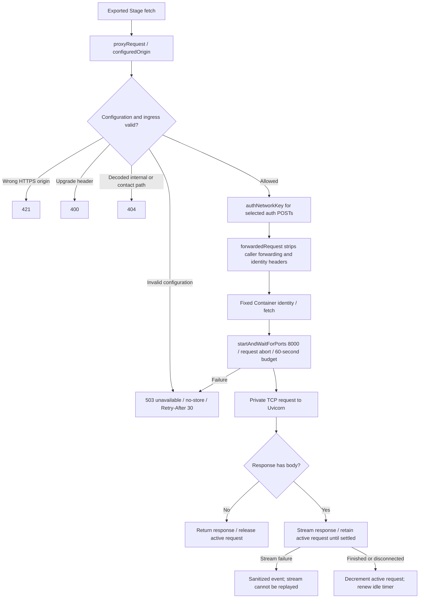
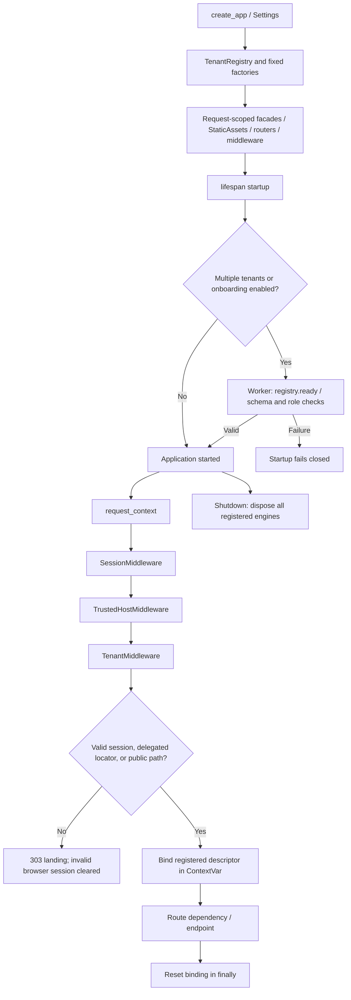
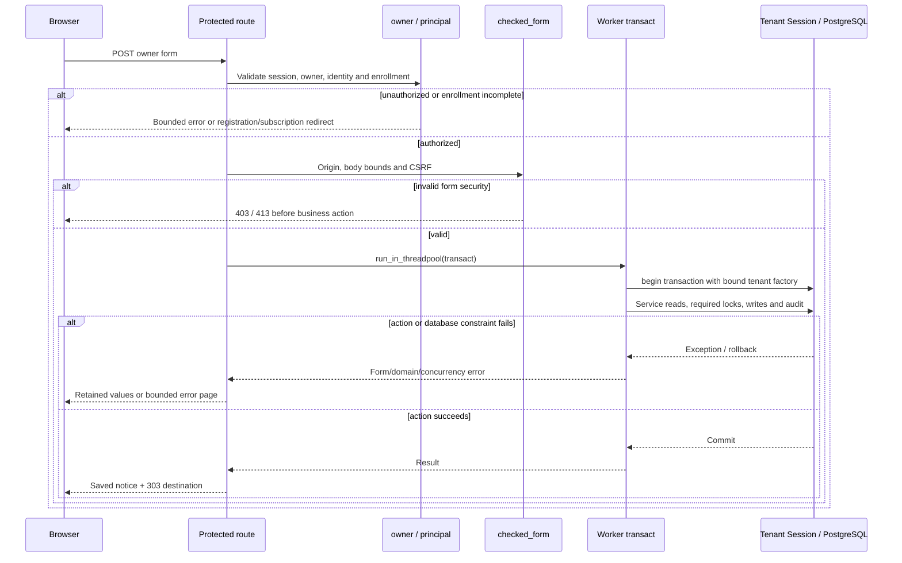

# Runtime and request flow

Source basis: `9fc9eebdaf9f52170530c8a28d34f6c8cd612c64`, prepared PH3.
These diagrams trace source behavior. They are not fresh hosted observations,
test results or permission to operate a provider/database. Retained Stage delivery
is recorded separately in [chapter 06](../06-deployment-and-operations-sop.md).
The maintained architecture is one application and one PostgreSQL database per
environment, with fixed private tenant schemas/roles.

## 1. Locate the real entrypoints

| Caller / entry | Callee / responsibility |
| --- | --- |
| Stage Worker's exported `fetch` | [proxyRequest](https://github.com/edlopezpm-ops/timeker-PH2/blob/9fc9eebdaf9f52170530c8a28d34f6c8cd612c64/deploy/cloudflare/src/proxy.ts#L296) |
| Worker forwarding closure | [TimekerPh2StageContainer.fetch](https://github.com/edlopezpm-ops/timeker-PH2/blob/9fc9eebdaf9f52170530c8a28d34f6c8cd612c64/deploy/cloudflare/src/index.ts#L28) |
| Container's Uvicorn entrypoint | [create_app](https://github.com/edlopezpm-ops/timeker-PH2/blob/9fc9eebdaf9f52170530c8a28d34f6c8cd612c64/app/main.py#L118) / module application |
| Application startup/shutdown | [lifespan](https://github.com/edlopezpm-ops/timeker-PH2/blob/9fc9eebdaf9f52170530c8a28d34f6c8cd612c64/app/main.py#L127) |
| Application request wrapper | [request_context](https://github.com/edlopezpm-ops/timeker-PH2/blob/9fc9eebdaf9f52170530c8a28d34f6c8cd612c64/app/main.py#L196) |
| Decoded browser session | [TenantMiddleware.__call__](https://github.com/edlopezpm-ops/timeker-PH2/blob/9fc9eebdaf9f52170530c8a28d34f6c8cd612c64/app/tenancy.py#L473) |
| Protected-router dependency | [authorized](https://github.com/edlopezpm-ops/timeker-PH2/blob/9fc9eebdaf9f52170530c8a28d34f6c8cd612c64/app/main.py#L716) → [owner](https://github.com/edlopezpm-ops/timeker-PH2/blob/9fc9eebdaf9f52170530c8a28d34f6c8cd612c64/app/auth.py#L87) → [principal](https://github.com/edlopezpm-ops/timeker-PH2/blob/9fc9eebdaf9f52170530c8a28d34f6c8cd612c64/app/auth.py#L51) |
| Ordinary owner form mutation | [mutate](https://github.com/edlopezpm-ops/timeker-PH2/blob/9fc9eebdaf9f52170530c8a28d34f6c8cd612c64/app/main.py#L379) |
| Tenant-scoped database factory | [DBRouter](https://github.com/edlopezpm-ops/timeker-PH2/blob/9fc9eebdaf9f52170530c8a28d34f6c8cd612c64/app/tenancy.py#L438) → [session_factory](https://github.com/edlopezpm-ops/timeker-PH2/blob/9fc9eebdaf9f52170530c8a28d34f6c8cd612c64/app/db.py#L9) |
| Existing-row lookup / lock | [require](https://github.com/edlopezpm-ops/timeker-PH2/blob/9fc9eebdaf9f52170530c8a28d34f6c8cd612c64/app/repositories.py#L12); specialized [lock_invoice](https://github.com/edlopezpm-ops/timeker-PH2/blob/9fc9eebdaf9f52170530c8a28d34f6c8cd612c64/app/repositories.py#L35) |
| HTML rendering | [page](https://github.com/edlopezpm-ops/timeker-PH2/blob/9fc9eebdaf9f52170530c8a28d34f6c8cd612c64/app/main.py#L283) → Jinja template |

The Stage adapter is this file's scope. The separate production Worker profile
has its own policy and must be reviewed independently. Framework libraries supply
the ASGI/session/threadpool machinery; no additional custom SDK is implied.

## 2. Edge → Container

1. [configuredOrigin](https://github.com/edlopezpm-ops/timeker-PH2/blob/9fc9eebdaf9f52170530c8a28d34f6c8cd612c64/deploy/cloudflare/src/proxy.ts#L241) checks the
   canonical Stage origin and allowed environment combinations before contacting
   the Container. It is configuration validation, not authentication of an owner.
2. [authNetworkKey](https://github.com/edlopezpm-ops/timeker-PH2/blob/9fc9eebdaf9f52170530c8a28d34f6c8cd612c64/deploy/cloudflare/src/proxy.ts#L286) derives a bounded
   network key only for selected authentication POSTs. [forwardedRequest](https://github.com/edlopezpm-ops/timeker-PH2/blob/9fc9eebdaf9f52170530c8a28d34f6c8cd612c64/deploy/cloudflare/src/proxy.ts#L265)
   removes caller-supplied forwarding, target-port and timeKER identity headers.
   The application never trusts a browser-selected tenant or forwarding identity.
3. [Container fetch and lifecycle](https://github.com/edlopezpm-ops/timeker-PH2/blob/9fc9eebdaf9f52170530c8a28d34f6c8cd612c64/deploy/cloudflare/src/index.ts#L6)
   renews activity while requests/streams run. Idle expiration stops the Container
   only when no request remains active. A process can restart after idle sleep;
   application state is retained in PostgreSQL, not process memory.
4. [unavailable](https://github.com/edlopezpm-ops/timeker-PH2/blob/9fc9eebdaf9f52170530c8a28d34f6c8cd612c64/deploy/cloudflare/src/proxy.ts#L336) returns a bounded
   failure. Edge logging is guarded so telemetry failure cannot change the result.
   The Stage default observer is deliberately limited; do not expect raw provider
   errors or HTTP payloads to appear in logs.
5. Edge and application generate separate request IDs. The forwarding helper
   strips a caller request ID; do not assume one ID automatically joins both
   layers. The application response's `X-Request-ID` comes from its own wrapper.

The exported Case-only scheduled handler is separate from browser `fetch`.
Its configured presence does not prove a scheduled execution, and it does not
enable scheduled statement Sending:
[scheduled handler](https://github.com/edlopezpm-ops/timeker-PH2/blob/9fc9eebdaf9f52170530c8a28d34f6c8cd612c64/deploy/cloudflare/src/index.ts#L63).

## 3. Startup, middleware and role binding

The middleware list shows application-added incoming order; Starlette also has
framework exception/error handling outside/inside that list. The registry may
refresh admission state during construction as well as during requests.

1. [TenantRegistry.__init__](https://github.com/edlopezpm-ops/timeker-PH2/blob/9fc9eebdaf9f52170530c8a28d34f6c8cd612c64/app/tenancy.py#L99) builds descriptors from
   explicit operator configuration. Runtime does not provision schemas/roles.
   [ready](https://github.com/edlopezpm-ops/timeker-PH2/blob/9fc9eebdaf9f52170530c8a28d34f6c8cd612c64/app/tenancy.py#L348) and [_check_databases](https://github.com/edlopezpm-ops/timeker-PH2/blob/9fc9eebdaf9f52170530c8a28d34f6c8cd612c64/app/tenancy.py#L357)
   check the expected migration head, required relations and role boundaries.
2. Hosted SessionMiddleware uses a Secure, HttpOnly, SameSite=Lax signed cookie
   with one-hour lifetime. Signing is not encryption of the whole session:
   [middleware assembly](https://github.com/edlopezpm-ops/timeker-PH2/blob/9fc9eebdaf9f52170530c8a28d34f6c8cd612c64/app/main.py#L160).
3. [TenantMiddleware](https://github.com/edlopezpm-ops/timeker-PH2/blob/9fc9eebdaf9f52170530c8a28d34f6c8cd612c64/app/tenancy.py#L473) refreshes the retained admission
   overlay in `run_in_threadpool` for non-static/non-liveness HTTP requests.
   Invalid signed sessions never fall back to the default owner's workspace.
4. Integration paths may initially use a credential tenant locator or public
   default descriptor. That is routing only; grant/token/scope validation remains
   mandatory before delegated resources. Anonymous public paths likewise gain no
   business-record authority from their default descriptor.
5. [bind](https://github.com/edlopezpm-ops/timeker-PH2/blob/9fc9eebdaf9f52170530c8a28d34f6c8cd612c64/app/tenancy.py#L339) sets and resets the descriptor.
   [RequestScopedSettings / DBRouter](https://github.com/edlopezpm-ops/timeker-PH2/blob/9fc9eebdaf9f52170530c8a28d34f6c8cd612c64/app/tenancy.py#L430) read that
   request-local descriptor rather than modifying global settings/search paths.
6. [session_factory](https://github.com/edlopezpm-ops/timeker-PH2/blob/9fc9eebdaf9f52170530c8a28d34f6c8cd612c64/app/db.py#L9) uses synchronous SQLAlchemy/psycopg,
   bounded pooling and hidden parameters. A newly opened connection checks its
   actual role/schema when configured; mismatch raises before business queries.

## 4. Protected read and ordinary write

A representative synchronous GET is [dashboard](https://github.com/edlopezpm-ops/timeker-PH2/blob/9fc9eebdaf9f52170530c8a28d34f6c8cd612c64/app/main.py#L739):
the protected-router dependency first validates the owner. FastAPI executes the
synchronous handler in a framework worker; its database Session stays within
that unit. It obtains exact read data and calls `page` for either full HTML or
the selected HTMX detail fragment. Dashboard fragments preserve private/no-store.

The ordinary write path is [mutate](https://github.com/edlopezpm-ops/timeker-PH2/blob/9fc9eebdaf9f52170530c8a28d34f6c8cd612c64/app/main.py#L379):

1. [owner](https://github.com/edlopezpm-ops/timeker-PH2/blob/9fc9eebdaf9f52170530c8a28d34f6c8cd612c64/app/auth.py#L87) checks `principal` and, when enrollment is active,
   current acknowledgment and workspace readiness. Subscription/security paths have the explicit
   readiness exception described in the identity flow.
2. [checked_form / verify_csrf](https://github.com/edlopezpm-ops/timeker-PH2/blob/9fc9eebdaf9f52170530c8a28d34f6c8cd612c64/app/auth.py#L109) validates an Origin
   header when supplied, bounded form size/count and a constant-time session CSRF
   comparison. Origin checking does not replace CSRF.
3. Its inner `transact` opens `with app.state.db.begin()` inside a worker.
   The service receives the verified owner ID, parsed form and request ID.
   Business audit writes share this transaction. Only successful scope exit
   commits; the action must not report success before that exit.
4. Services choose their required lock order. For example,
   [lock_invoice](https://github.com/edlopezpm-ops/timeker-PH2/blob/9fc9eebdaf9f52170530c8a28d34f6c8cd612c64/app/repositories.py#L35) locks client, related cards in
   UUID order and invoice. `require(lock=True)` uses `FOR UPDATE` and refreshes
   the entity. A generic lookup alone is not owner authorization.
5. `IntegrityError`, `StaleDataError`, form/domain/value errors roll back and
   become bounded feedback. An optional error renderer may be synchronous or
   awaitable. Success stores a notice and returns 303.
6. This helper is not universal: provider callbacks, uploads, webhooks and
   dispatch define separate transactions. Do not assume every synchronous SQL call
   in every async handler is automatically offloaded by this helper.

## 5. Rendered response, cache policy and failure paths

[page](https://github.com/edlopezpm-ops/timeker-PH2/blob/9fc9eebdaf9f52170530c8a28d34f6c8cd612c64/app/main.py#L283) adds source-versioned public asset URLs, CSRF,
current user/configuration, bounded notices and domain-prepared context to Jinja.
Services calculate money and enforce contracts; templates do not enforce them.
Native links/forms remain the action path under progressive enhancement.

[request_context](https://github.com/edlopezpm-ops/timeker-PH2/blob/9fc9eebdaf9f52170530c8a28d34f6c8cd612c64/app/main.py#L196) applies request ID, no-sniff/frame/
referrer/permissions policy, route-dependent CSP and hosted HSTS. Private content
does not inherit the public asset cache. [StaticAssets](https://github.com/edlopezpm-ops/timeker-PH2/blob/9fc9eebdaf9f52170530c8a28d34f6c8cd612c64/app/static_assets.py#L15)
recognizes only known successful GET/HEAD versions for immutable public caching;
eligible asset responses have Set-Cookie removed.

| Failure boundary | Actual source outcome / next inspection |
| --- | --- |
| Invalid owner/session | [http_error](https://github.com/edlopezpm-ops/timeker-PH2/blob/9fc9eebdaf9f52170530c8a28d34f6c8cd612c64/app/main.py#L333) clears a rejected 401 session and redirects to landing; enrollment has explicit destination. |
| CSRF or forbidden request | Bounded HTTP error page; business action not invoked. Inspect form/session/origin handling, not payload logs. |
| Domain/input failure | [domain_error](https://github.com/edlopezpm-ops/timeker-PH2/blob/9fc9eebdaf9f52170530c8a28d34f6c8cd612c64/app/main.py#L359) or [validation_error](https://github.com/edlopezpm-ops/timeker-PH2/blob/9fc9eebdaf9f52170530c8a28d34f6c8cd612c64/app/main.py#L367) gives bounded 400. |
| Unexpected application exception | Request wrapper returns bounded 500, retaining no raw exception/business content. |
| Fixed role/schema or directory failure | Fail closed; inspect configuration/readiness and migration/grants rather than retrying under another tenant. |
| Deep readiness failure | [ready route](https://github.com/edlopezpm-ops/timeker-PH2/blob/9fc9eebdaf9f52170530c8a28d34f6c8cd612c64/app/main.py#L707) returns unavailable; `/health/live` remains a distinct cheap process probe. |

Diagnostic events use fixed event names, route templates, internal UUIDs,
status/outcome and duration. [safe_fields](https://github.com/edlopezpm-ops/timeker-PH2/blob/9fc9eebdaf9f52170530c8a28d34f6c8cd612c64/app/logging.py#L32) redacts
unknown fields; [event](https://github.com/edlopezpm-ops/timeker-PH2/blob/9fc9eebdaf9f52170530c8a28d34f6c8cd612c64/app/logging.py#L104) cannot change a committed
business result. Never add email, cookie/header/query data, descriptions,
credentials, snapshots or artifact bytes to a debugging event.

## 6. Maintenance and verification map

These are test declarations to consult, not tests executed for this document.

| Change or symptom | Source verification to inspect |
| --- | --- |
| Edge policy / forged forwarding | [proxy tests](https://github.com/edlopezpm-ops/timeker-PH2/blob/9fc9eebdaf9f52170530c8a28d34f6c8cd612c64/deploy/cloudflare/test/proxy.test.mjs#L70) |
| Cross-tenant binding / concurrent requests | [same UUID and concurrent isolation](https://github.com/edlopezpm-ops/timeker-PH2/blob/9fc9eebdaf9f52170530c8a28d34f6c8cd612c64/tests/integration/test_tenancy.py#L259) |
| Invalid signed session fallback | [invalid session test](https://github.com/edlopezpm-ops/timeker-PH2/blob/9fc9eebdaf9f52170530c8a28d34f6c8cd612c64/tests/integration/test_tenancy.py#L305) |
| Wrong fixed connection identity | [role/schema test](https://github.com/edlopezpm-ops/timeker-PH2/blob/9fc9eebdaf9f52170530c8a28d34f6c8cd612c64/tests/integration/test_tenancy.py#L438) |
| Revoked session redirect loop | [recovery test](https://github.com/edlopezpm-ops/timeker-PH2/blob/9fc9eebdaf9f52170530c8a28d34f6c8cd612c64/tests/integration/test_session_recovery.py#L9) |
| Immutable-public versus private/error caching | [asset cache tests](https://github.com/edlopezpm-ops/timeker-PH2/blob/9fc9eebdaf9f52170530c8a28d34f6c8cd612c64/tests/unit/test_static_assets.py#L35) |
| Redaction and telemetry non-effect | [logging tests](https://github.com/edlopezpm-ops/timeker-PH2/blob/9fc9eebdaf9f52170530c8a28d34f6c8cd612c64/tests/unit/test_logging.py#L23) |

For an extension, identify the entrypoint, owner/tenant authority, worker/Session
boundary, lock order, commit boundary, audit event, failure outcome and native
fallback before changing a route. Source tests, native reference metadata and
retained Stage evidence answer different questions; none alone proves human UAT.
