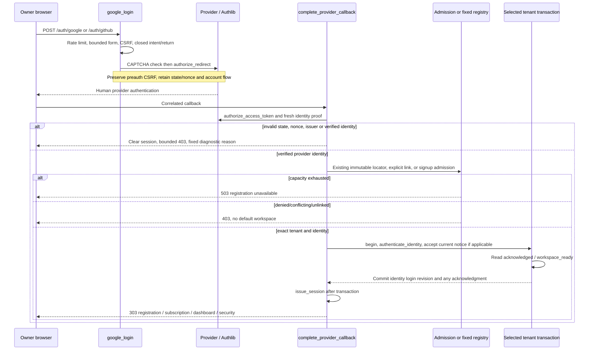
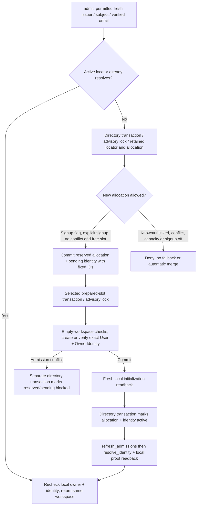
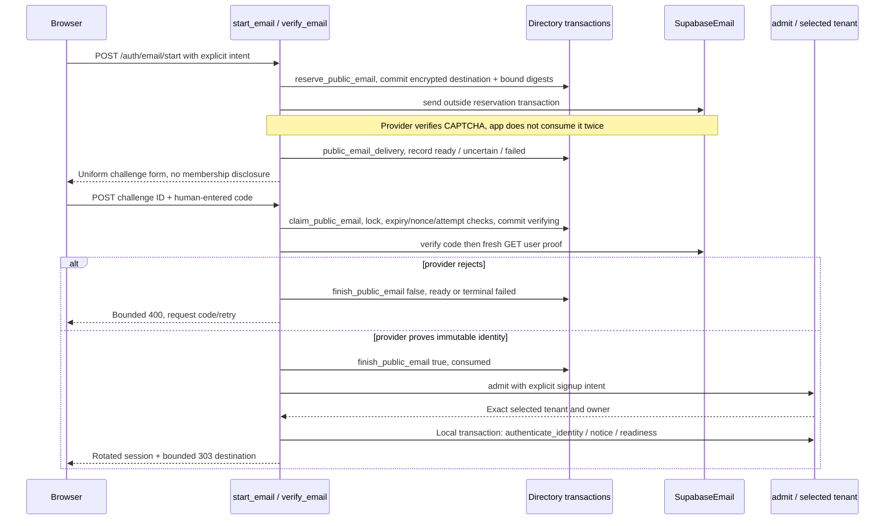
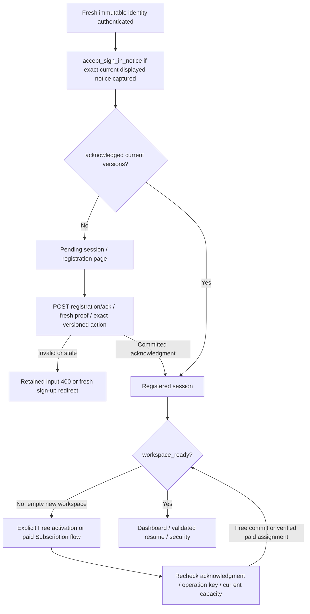

# Identity, admission and first workspace access

This is a source trace at `4bb5c424d6e7d270cdca1479283896be77d581c3`.
It separates provider proof, retained identity binding, workspace admission,
registration acknowledgment and first-plan access. No diagram is evidence of a
fresh human login, provider configuration, email delivery or successful hosted
UAT. Those residuals remain in [chapter 08](../08-PAUSE-AND-CONTINUE.md).

## 1. Entry modes and routing authority

| Entry / caller | Actual implementation |
| --- | --- |
| GET Sign in / Sign up | [sign_in / sign_up](https://github.com/edlopezpm-ops/timeKER-Stage/blob/4bb5c424d6e7d270cdca1479283896be77d581c3/app/enrollment_routes.py#L128) → [auth_page](https://github.com/edlopezpm-ops/timeKER-Stage/blob/4bb5c424d6e7d270cdca1479283896be77d581c3/app/enrollment_routes.py#L94) |
| POST Google / GitHub | Shared [google_login](https://github.com/edlopezpm-ops/timeKER-Stage/blob/4bb5c424d6e7d270cdca1479283896be77d581c3/app/main.py#L486); provider selected from the actual route |
| Provider GET callback | [google_callback](https://github.com/edlopezpm-ops/timeKER-Stage/blob/4bb5c424d6e7d270cdca1479283896be77d581c3/app/main.py#L553) → [complete_provider_callback](https://github.com/edlopezpm-ops/timeKER-Stage/blob/4bb5c424d6e7d270cdca1479283896be77d581c3/app/main.py#L566) |
| POST email start / verify | [start_email](https://github.com/edlopezpm-ops/timeKER-Stage/blob/4bb5c424d6e7d270cdca1479283896be77d581c3/app/enrollment_routes.py#L359) / [verify_email](https://github.com/edlopezpm-ops/timeKER-Stage/blob/4bb5c424d6e7d270cdca1479283896be77d581c3/app/enrollment_routes.py#L520) |
| Retained immutable identity lookup | [resolve_identity](https://github.com/edlopezpm-ops/timeKER-Stage/blob/4bb5c424d6e7d270cdca1479283896be77d581c3/app/admission.py#L77) / [bound_identity](https://github.com/edlopezpm-ops/timeKER-Stage/blob/4bb5c424d6e7d270cdca1479283896be77d581c3/app/enrollment.py#L46) |
| New workspace allocation | [admit](https://github.com/edlopezpm-ops/timeKER-Stage/blob/4bb5c424d6e7d270cdca1479283896be77d581c3/app/admission.py#L142) |
| Current registration acknowledgment | [acknowledge](https://github.com/edlopezpm-ops/timeKER-Stage/blob/4bb5c424d6e7d270cdca1479283896be77d581c3/app/enrollment_routes.py#L190) / [accept_registration](https://github.com/edlopezpm-ops/timeKER-Stage/blob/4bb5c424d6e7d270cdca1479283896be77d581c3/app/enrollment.py#L218) |
| Explicit first Free activation | [activate_free](https://github.com/edlopezpm-ops/timeKER-Stage/blob/4bb5c424d6e7d270cdca1479283896be77d581c3/app/enrollment_routes.py#L232) |
| Issued authenticated session | [issue_session](https://github.com/edlopezpm-ops/timeKER-Stage/blob/4bb5c424d6e7d270cdca1479283896be77d581c3/app/enrollment_routes.py#L36) |
| Every protected request | [owner](https://github.com/edlopezpm-ops/timeKER-Stage/blob/4bb5c424d6e7d270cdca1479283896be77d581c3/app/auth.py#L87) → [principal](https://github.com/edlopezpm-ops/timeKER-Stage/blob/4bb5c424d6e7d270cdca1479283896be77d581c3/app/auth.py#L51) |

`enrollment_active` means Stage enrollment, generic onboarding or explicit private production prelaunch is
enabled. Generic `onboarding_enabled` selects the central admission protocol.
These are different flags:
[configuration properties](https://github.com/edlopezpm-ops/timeKER-Stage/blob/4bb5c424d6e7d270cdca1479283896be77d581c3/app/config.py#L201).

In generic admission mode the issuer/subject locator selects the tenant and
the exact tenant-local immutable binding is rechecked. A locator is routing
metadata, not proof by itself. In fixed/legacy mode the server-configured verified
email registry selects a fixed descriptor; enrollment-active paths still require
the retained issuer/subject binding or explicit registration/linking.
No branch creates an email-based merge or a default-owner fallback.

GET authentication pages render fresh forms; they do not themselves consume
a challenge, authenticate an identity or activate a plan. A new explicit POST
controls its closed intent/offer/return destination. See
[auth GET session tests](https://github.com/edlopezpm-ops/timeKER-Stage/blob/4bb5c424d6e7d270cdca1479283896be77d581c3/tests/integration/test_auth_get_sessions.py#L54).

## Private production prelaunch uses the fixed-owner branch

With D076's `prelaunch_enabled=true` and `onboarding_enabled=false`, normal Google proof follows the existing non-generic callback and registration path shown below. Stage/public/email-public flags remain false. The owner supplies fresh proof and explicit acknowledgment personally; the application performs no operator identity backfill or public slot allocation. Sources: [app/config.py](https://github.com/edlopezpm-ops/timeKER-Stage/blob/4bb5c424d6e7d270cdca1479283896be77d581c3/app/config.py#L183), [app/config.py](https://github.com/edlopezpm-ops/timeKER-Stage/blob/4bb5c424d6e7d270cdca1479283896be77d581c3/app/config.py#L203), [app/main.py](https://github.com/edlopezpm-ops/timeKER-Stage/blob/4bb5c424d6e7d270cdca1479283896be77d581c3/app/main.py#L615), [app/enrollment.py](https://github.com/edlopezpm-ops/timeKER-Stage/blob/4bb5c424d6e7d270cdca1479283896be77d581c3/app/enrollment.py#L179).

The permanent PROD and Stage repositories share lineage but retain independent databases, registries, provider configuration and identities. Production migration/deployment/readback are technically verified; the personal flow remains pending; the diagrams trace source behavior only.

## 2. Google/GitHub: start, fresh proof and session

Ordered trace:

1. [google_login](https://github.com/edlopezpm-ops/timeKER-Stage/blob/4bb5c424d6e7d270cdca1479283896be77d581c3/app/main.py#L486) enforces rate limit and
   `checked_form`, duplicate/unknown-field rejection in enrollment mode, and
   a closed `return_to`. [verify_sign_in](https://github.com/edlopezpm-ops/timeKER-Stage/blob/4bb5c424d6e7d270cdca1479283896be77d581c3/app/bot_check.py#L14) checks
   Turnstile before OAuth; unavailable hosted verification fails closed.
2. Provider configuration is checked through
   [configured_providers](https://github.com/edlopezpm-ops/timeKER-Stage/blob/4bb5c424d6e7d270cdca1479283896be77d581c3/app/social_auth.py#L17). Intent is signin,
   signup or explicit link; offer is selected from the closed catalog. A link
   additionally retains fresh existing-owner proof. The handler preserves
   preauthentication CSRF while replacing the previous account flow.
3. Authlib `authorize_redirect` receives a nonce and callback. OAuth clients are
   assembled at [provider setup](https://github.com/edlopezpm-ops/timeKER-Stage/blob/4bb5c424d6e7d270cdca1479283896be77d581c3/app/main.py#L174): Google uses OIDC
   metadata; configured enrollment uses PKCE. GitHub uses the explicit OAuth
   endpoints and PKCE. State/nonce tests use mocked provider transport rather
   than asserting a live human authentication.
4. [complete_provider_callback](https://github.com/edlopezpm-ops/timeKER-Stage/blob/4bb5c424d6e7d270cdca1479283896be77d581c3/app/main.py#L566) exchanges the callback.
   Google requires ID token plus verified userinfo; generic admission additionally
   validates issuer and normalized proof. GitHub calls
   [github_identity](https://github.com/edlopezpm-ops/timeKER-Stage/blob/4bb5c424d6e7d270cdca1479283896be77d581c3/app/social_auth.py#L28), reading fresh numeric account
   ID and verified email from its API. Public admission requires one verified
   primary candidate; fixed mode uses the admitted-email set. Ambiguity fails.
5. Generic mode calls `admit` or `link_identity`; fixed mode resolves the configured
   tenant and applies its retained binding rules. The selected-tenant transaction
   calls [authenticate_identity](https://github.com/edlopezpm-ops/timeKER-Stage/blob/4bb5c424d6e7d270cdca1479283896be77d581c3/app/auth.py#L36) in generic mode.
   Legacy fixed authentication uses [authenticate](https://github.com/edlopezpm-ops/timeKER-Stage/blob/4bb5c424d6e7d270cdca1479283896be77d581c3/app/auth.py#L19)
   alongside its enrollment/binding checks.
6. Successful login increments the owner's session revision and last-login time.
   In the same local transaction, `accept_sign_in_notice` may retain the exact
   current displayed notice; readiness is computed. Only afterward does
   `issue_session` clear/rotate session state and CSRF.
7. Not registered routes to registration; registered paid-intent may route to
   Subscription; ready routes to Dashboard or a validated integration resume.
   Explicit security return/link routes to Account security. Return targets are
   closed choices, not arbitrary caller URLs.

Failures are intentionally bounded. Callback exceptions clear the session and
emit only a fixed provider/reason/outcome. Generic callback wording cannot prove
the provider was merely unlinked: inspect the actual reason branch, relevant
source and fresh proof. [callback failure handling](https://github.com/edlopezpm-ops/timeKER-Stage/blob/4bb5c424d6e7d270cdca1479283896be77d581c3/app/main.py#L553)
distinguishes the fixed `AUTH_PROVIDER_NOT_LINKED` reason only for applicable
branches; other failures use `AUTH_PROVIDER_PROOF_REJECTED`.

## 3. New owner: reserve → initialize → activate

[admit](https://github.com/edlopezpm-ops/timeKER-Stage/blob/4bb5c424d6e7d270cdca1479283896be77d581c3/app/admission.py#L142) is a cross-transaction protocol, not one
atomic transaction spanning all schemas. Its retained IDs/states make supported
retries and operator diagnosis explicit.

- First directory transaction serializes allocation with an advisory lock.
  Existing pending/reserved work must match exact retained identities. New
  allocation requires public signup plus explicit signup intent, no known-email
  collision and one unused prepared slot. Capacity exhaustion returns a distinct
  bounded failure.
- [_initialize](https://github.com/edlopezpm-ops/timeKER-Stage/blob/4bb5c424d6e7d270cdca1479283896be77d581c3/app/admission.py#L92) opens that slot's fixed factory.
  It rejects nonempty business/configuration/history state, or a mismatching
  existing owner/identity. It creates or verifies only the retained owner and
  identity IDs; no runtime DDL/admin credential is introduced.
- A caught admission conflict marks still-reserved directory records blocked;
  it never silently recycles the slot. Other interruption points retain the
  protocol state rather than claiming all work rolled back across schemas.
- [_initialization_readback](https://github.com/edlopezpm-ops/timeKER-Stage/blob/4bb5c424d6e7d270cdca1479283896be77d581c3/app/admission.py#L131) verifies local identity
  before the separate active-directory commit. `refresh_admissions` then exposes
  only retained active allocations and rejects reassignment:
  [refresh_admissions](https://github.com/edlopezpm-ops/timeKER-Stage/blob/4bb5c424d6e7d270cdca1479283896be77d581c3/app/tenancy.py#L294).
- [resolve_identity](https://github.com/edlopezpm-ops/timeKER-Stage/blob/4bb5c424d6e7d270cdca1479283896be77d581c3/app/admission.py#L77) always rechecks the exact local
  binding with [_local_identity](https://github.com/edlopezpm-ops/timeKER-Stage/blob/4bb5c424d6e7d270cdca1479283896be77d581c3/app/admission.py#L64).

This runtime path consumes operator-prepared slots. Workspace preparation and
directory reconciliation are separate operator actions; the browser cannot choose
or provision a schema, role or connection.

## 4. Managed email: external proof between durable reservations

There are two protocols. Generic non-linking sign-in/signup uses central
`PublicEmailChallenge` before any owner exists. Fixed existing-owner or email
linking uses tenant-local `EmailAuthChallenge`.

1. [start_email](https://github.com/edlopezpm-ops/timeKER-Stage/blob/4bb5c424d6e7d270cdca1479283896be77d581c3/app/enrollment_routes.py#L359) validates enabled provider,
   rate limit, bounded account form, explicit signin/signup or separate link action,
   delivery mode, offer and closed destination. Hosted public starts require the
   edge-derived network key.
2. [reserve_public_email](https://github.com/edlopezpm-ops/timeKER-Stage/blob/4bb5c424d6e7d270cdca1479283896be77d581c3/app/admission.py#L322) durably serializes
   abuse admission and stores encrypted destination plus address/session/network
   digests, expiry and intent. Session preview/routing is opaque submitted-input
   context, not proof that an account exists or mail arrived.
3. [SupabaseEmail.send](https://github.com/edlopezpm-ops/timeKER-Stage/blob/4bb5c424d6e7d270cdca1479283896be77d581c3/app/email_auth.py#L128) passes CAPTCHA to the
   managed provider exactly once. Provider signup requires the explicit configured
   switch; existing confirmation has its separate resend path. The source maps
   accepted true to ready, false to uncertain, and no attempted delivery to failed through
   [public_email_delivery](https://github.com/edlopezpm-ops/timeKER-Stage/blob/4bb5c424d6e7d270cdca1479283896be77d581c3/app/admission.py#L351).
   `ready` or `uncertain` can be claimed because fresh provider proof is still
   required; delivery state alone authenticates nobody.
4. [claim_public_email](https://github.com/edlopezpm-ops/timeKER-Stage/blob/4bb5c424d6e7d270cdca1479283896be77d581c3/app/admission.py#L378) locks the row, validates
   challenge ID, session nonce, state, expiry, decryption purpose and attempt cap,
   then commits `verifying`. [SupabaseEmail.verify](https://github.com/edlopezpm-ops/timeKER-Stage/blob/4bb5c424d6e7d270cdca1479283896be77d581c3/app/email_auth.py#L152)
   checks bounded code format, verifies it and obtains fresh `/user` proof rather
   than trusting the token response's user object. Provider token stays transient.
5. [finish_public_email](https://github.com/edlopezpm-ops/timeKER-Stage/blob/4bb5c424d6e7d270cdca1479283896be77d581c3/app/admission.py#L401) records consumed on
   successful proof, or ready/failed after rejection. Proof consumption precedes
   admission; a later capacity/binding failure does not make that code reusable.
   The caller returns generic 400 or capacity 503 without inventing successful
   admission.
6. For tenant-local challenges, [reserve](https://github.com/edlopezpm-ops/timeKER-Stage/blob/4bb5c424d6e7d270cdca1479283896be77d581c3/app/email_auth.py#L180) and
   [locked_challenge](https://github.com/edlopezpm-ops/timeKER-Stage/blob/4bb5c424d6e7d270cdca1479283896be77d581c3/app/email_auth.py#L211) enforce owner cooldown,
   session binding, expiry, state and attempts. A local transaction commits
   verifying before provider verification. Provider rejection resets ready or
   failed; the final transaction consumes the challenge, checks the exact bound
   identity and advances session revision. Other post-reservation failures can
   terminally fail the challenge. See [local verification branch](https://github.com/edlopezpm-ops/timeKER-Stage/blob/4bb5c424d6e7d270cdca1479283896be77d581c3/app/enrollment_routes.py#L574).
7. Unknown/unadmitted starts retain a uniform response. Duplicate starts can
   preserve prior still-valid proof through
   [pending_public_email](https://github.com/edlopezpm-ops/timeKER-Stage/blob/4bb5c424d6e7d270cdca1479283896be77d581c3/app/admission.py#L361); do not replace this with
   a process-memory cooldown or an account-existence response.

## 5. Explicit registration and first plan

[accept_sign_in_notice](https://github.com/edlopezpm-ops/timeKER-Stage/blob/4bb5c424d6e7d270cdca1479283896be77d581c3/app/enrollment.py#L237) records acknowledgment only
after successful provider proof and immutable binding, and only for the exact
captured current notice and allowed flow. A normal source path may therefore
already have a current registration receipt before opening Registration.
Do not incorrectly describe every account as requiring a second checkbox page.

[accept_registration](https://github.com/edlopezpm-ops/timeKER-Stage/blob/4bb5c424d6e7d270cdca1479283896be77d581c3/app/enrollment.py#L218) accepts the explicit current
Continue action or its retained legacy checkbox contract, with exact terms,
privacy and catalog versions. [_record_registration](https://github.com/edlopezpm-ops/timeKER-Stage/blob/4bb5c424d6e7d270cdca1479283896be77d581c3/app/enrollment.py#L196)
binds/verifies identity and writes the current receipt plus business audit in
the caller's transaction. It does not purchase or silently assign a paid plan.

[acknowledge route](https://github.com/edlopezpm-ops/timeKER-Stage/blob/4bb5c424d6e7d270cdca1479283896be77d581c3/app/enrollment_routes.py#L190) requires a recent
authentication (`fresh`: ten minutes), validates a closed account form, commits
the acknowledgment, then promotes pending session state. Failure leaves access
gated; stale proof clears the session and redirects for fresh sign-up.

[activate_free](https://github.com/edlopezpm-ops/timeKER-Stage/blob/4bb5c424d6e7d270cdca1479283896be77d581c3/app/enrollment_routes.py#L232) requires current
acknowledgment, its session-bound operation key, a capacity lock and no existing
records/plan. It calls explicit Free enrollment with current version and empty
selections in the transaction. Paid choice instead goes through
[checkout route](https://github.com/edlopezpm-ops/timeKER-Stage/blob/4bb5c424d6e7d270cdca1479283896be77d581c3/app/subscription_payment_routes.py#L129) and the
environment-isolated billing service; a browser return or selected offer alone
does not confer a paid entitlement.

Readiness has deliberate retained-history exceptions:
[workspace_ready](https://github.com/edlopezpm-ops/timeKER-Stage/blob/4bb5c424d6e7d270cdca1479283896be77d581c3/app/enrollment.py#L126) allows a matching Free assignment,
a prior paid assignment with an access-expiry value, or retained pre-enrollment
client history after acknowledgment. Expired paid access does not silently become
Free; capacity guards independently reject growth. A new empty workspace still
requires explicit first-plan activation. `active_plan` and `workspace_ready`
therefore answer different questions.

Every protected request rechecks [principal](https://github.com/edlopezpm-ops/timeKER-Stage/blob/4bb5c424d6e7d270cdca1479283896be77d581c3/app/auth.py#L51):
registered tenant, active local owner, allowlist mapping, session revision and,
when enrollment is active, immutable method. [owner](https://github.com/edlopezpm-ops/timeKER-Stage/blob/4bb5c424d6e7d270cdca1479283896be77d581c3/app/auth.py#L87) then gates current
acknowledgment/readiness in that mode, while permitting Subscription/security destinations
needed to resolve enrollment. Pending users do not bypass these gates.

## 6. Explicit linking and revocation

[link_identity](https://github.com/edlopezpm-ops/timeKER-Stage/blob/4bb5c424d6e7d270cdca1479283896be77d581c3/app/admission.py#L225) combines fresh existing-owner proof
with fresh proof of the new provider. [fresh_owner](https://github.com/edlopezpm-ops/timeKER-Stage/blob/4bb5c424d6e7d270cdca1479283896be77d581c3/app/admission.py#L210)
rechecks tenant, owner, revision, bound issuer/subject, acknowledgment and time
under the owner row lock. Directory reservation, local binding/readback and
directory activation are separate commits; conflicts and revoked tombstones
cannot be silently reassigned. Different verified emails do not imply an owner
merge: the independent owner proof authorizes this specific link.

Email linking uses separate `/settings/security/email/start` and verify routes.
The legacy source additionally requires the designated independent existing
provider; an email challenge cannot establish its own existing-owner authority.
Social linking retains the explicit state-bound existing proof in the account flow.

[revoke_identity](https://github.com/edlopezpm-ops/timeKER-Stage/blob/4bb5c424d6e7d270cdca1479283896be77d581c3/app/admission.py#L266) blocks global routing before local
revocation, retains tombstones and keeps an alternative usable method.
The local [revoke_identity](https://github.com/edlopezpm-ops/timeKER-Stage/blob/4bb5c424d6e7d270cdca1479283896be77d581c3/app/enrollment.py#L157) increments session
revision; the UI revoke route clears the session. Do not implement recovery by
rewriting email, subject, locator or session revision directly.

## 7. Tests and sanitized diagnosis

These are source declarations, not tests run for this documentation.

| Boundary | Targeted declaration |
| --- | --- |
| OIDC state/nonce/verified allowlist | [OIDC test](https://github.com/edlopezpm-ops/timeKER-Stage/blob/4bb5c424d6e7d270cdca1479283896be77d581c3/tests/integration/test_oauth.py#L19) |
| GitHub proof/state/PKCE | [GitHub test](https://github.com/edlopezpm-ops/timeKER-Stage/blob/4bb5c424d6e7d270cdca1479283896be77d581c3/tests/integration/test_social_auth.py#L93) |
| Two-owner admission and explicit plan | [admission test](https://github.com/edlopezpm-ops/timeKER-Stage/blob/4bb5c424d6e7d270cdca1479283896be77d581c3/tests/integration/test_public_admission.py#L186) |
| Interruptions retain allocation IDs | [allocation-boundary test](https://github.com/edlopezpm-ops/timeKER-Stage/blob/4bb5c424d6e7d270cdca1479283896be77d581c3/tests/integration/test_public_admission.py#L229) |
| Exhaustion/conflict never selects default | [capacity test](https://github.com/edlopezpm-ops/timeKER-Stage/blob/4bb5c424d6e7d270cdca1479283896be77d581c3/tests/integration/test_public_admission.py#L271) |
| Public email CAPTCHA/proof/activation | [email test](https://github.com/edlopezpm-ops/timeKER-Stage/blob/4bb5c424d6e7d270cdca1479283896be77d581c3/tests/integration/test_public_admission.py#L737) |
| Empty new workspace requires activation | [first-plan test](https://github.com/edlopezpm-ops/timeKER-Stage/blob/4bb5c424d6e7d270cdca1479283896be77d581c3/tests/integration/test_onboarding_auth.py#L391) |
| Retained expired-paid history / blocked growth | [expiry test](https://github.com/edlopezpm-ops/timeKER-Stage/blob/4bb5c424d6e7d270cdca1479283896be77d581c3/tests/integration/test_onboarding_auth.py#L162) |
| Fresh independent link proof | [link test](https://github.com/edlopezpm-ops/timeKER-Stage/blob/4bb5c424d6e7d270cdca1479283896be77d581c3/tests/integration/test_public_admission.py#L322) |
| Fixed safe failure diagnostics | [redaction test](https://github.com/edlopezpm-ops/timeKER-Stage/blob/4bb5c424d6e7d270cdca1479283896be77d581c3/tests/integration/test_social_auth.py#L256) |

For diagnosis, retain internal request ID, route template, status and fixed
provider/reason/outcome only. Inspect the corresponding durable protocol state
through separately authorized metadata/readback; never log identity values,
codes, provider tokens, cookies, encrypted destinations or raw exceptions.
Do not infer successful email delivery, valid identity, human acceptance or
provider interoperability from a visible form, generic 403, test fixture or
public GET. Real human proof and UAT remain separate work.
