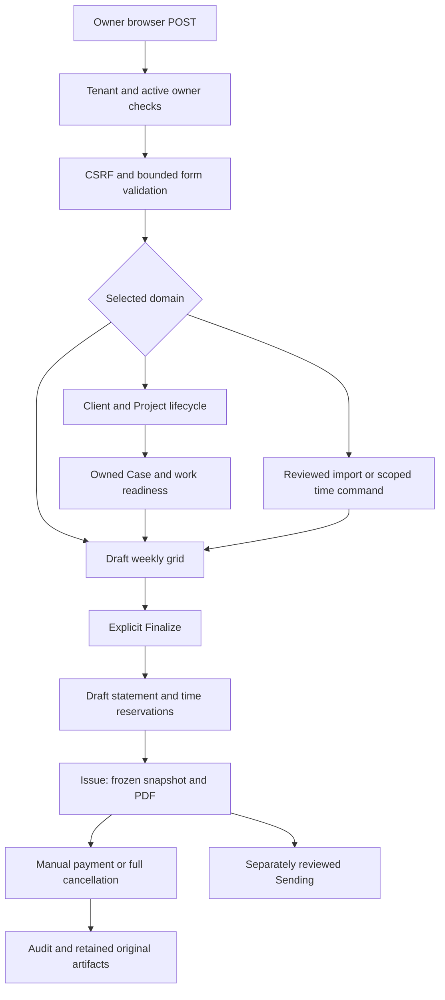
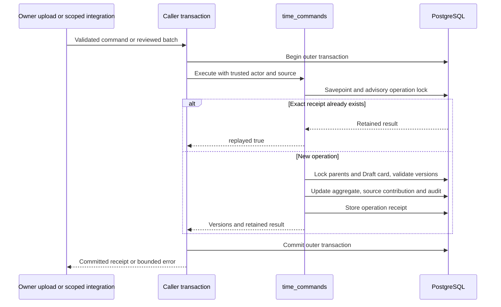
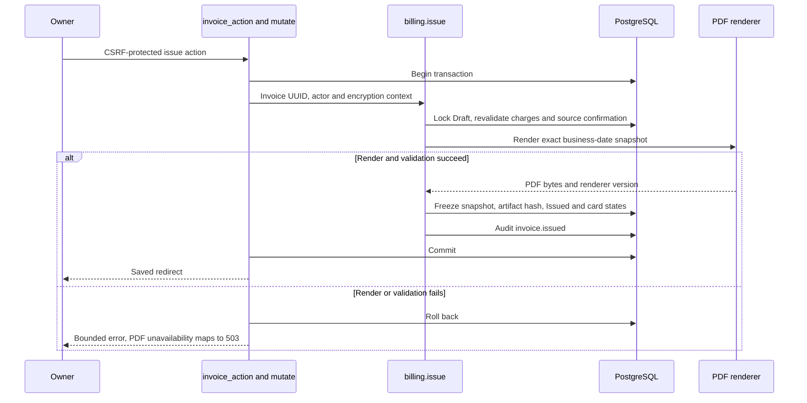

# Work records, time and billing: executable flow map

This chapter traces source `4bb5c424d6e7d270cdca1479283896be77d581c3`.
It is a maintenance/troubleshooting reference, not a new specification, public
SDK or execution authorization. No product tests, database queries, provider
operations or hosted flows were run to prepare it. PH3 awaits the owner's feature
prompts on Stage; the bounded private PH2 production prelaunch is technically verified; personal acceptance remains pending.

All function names below are existing implementation entry points. Source links
pin their actual one-based lines. Read caller and callee together before changing
a branch: a service taking `db` generally participates in its caller's transaction.

## 1. End-to-end map and transaction ownership

1. Middleware resolves the fixed tenant; protected routes require the current
   active owner. Browser mutation forms use origin/CSRF validation.
2. Most forms call `create_app.mutate()`: it opens `app.state.db.begin()` inside a
   worker, invokes the supplied domain action, commits on successful context exit,
   then sets the save notice/redirect. Domain functions do not independently
   commit the passed session.
3. `FormError`/`DomainError`, integrity/stale-version failures and malformed input
   return bounded validation feedback or propagate to the normal error handler.
   A failed transaction cannot earn a successful save notice.
4. Imports and external dispatch use their own explicit transaction wrappers;
   do not assume every POST uses `mutate()`.

[Owner/CSRF](https://github.com/edlopezpm-ops/timeKER-Stage/blob/4bb5c424d6e7d270cdca1479283896be77d581c3/app/auth.py#L87),
[mutation wrapper](https://github.com/edlopezpm-ops/timeKER-Stage/blob/4bb5c424d6e7d270cdca1479283896be77d581c3/app/main.py#L379),
[time-import transaction](https://github.com/edlopezpm-ops/timeKER-Stage/blob/4bb5c424d6e7d270cdca1479283896be77d581c3/app/time_import_routes.py#L296).

## 2. Concrete caller-to-service map

| Browser caller | Owning service | Branch or persisted result |
| --- | --- | --- |
| `/clients/new`, `/clients/{client_id}/edit` | `clients.update_client()` | Create/edit, normalized code, profile/lifecycle and capacity |
| `/clients/{client_id}/projects` | `clients.save_project()` | Owned Project terms/status and billing-history restrictions |
| Case create/edit routes | `cases.save_case()` | Active parent context, version, type/status and transition guards |
| `/cases/mass-edit` | `cases.mass_update()` | Entire selected Project snapshot; status/type only |
| `/timecards/save` | `timecards.save_week()` | Draft grid, retained entry provenance and exact integer minutes |
| `/timecards/{id}/finalize` | `timecards.finalize()` | Nonempty unchanged Draft; explicit cap override evidence if required |
| `/timecards/{id}/reopen` | `timecards.reopen()` | Eligible unreserved history with reason and active parent checks |
| `/timecards/import`, `/commit` | `preview_import()` / `commit_import()` | Reviewed hash/versions and atomic source-owned contributions |
| `/billing/create` | `billing.create_draft()` | Finalized billable time grouped/reserved into Draft lines |
| `/project-billing/{id}/{operation}` | Fixed-fee/manual-extra billing services | Separate reviewed Project charge bases |
| `/billing/{id}/{operation}` | `issue`, `adjust_draft`, `mark_sent`, `correct_due`, `pay`, `void`, `cancel_draft` | Explicit action map; unknown action rejects |
| `/payments/{id}/reverse` | `billing.reverse_payment()` | Retained reversal timestamp/reason, not provider refund |

Sources: [client callers](https://github.com/edlopezpm-ops/timeKER-Stage/blob/4bb5c424d6e7d270cdca1479283896be77d581c3/app/main.py#L893),
[Project caller](https://github.com/edlopezpm-ops/timeKER-Stage/blob/4bb5c424d6e7d270cdca1479283896be77d581c3/app/main.py#L965),
[Case router](https://github.com/edlopezpm-ops/timeKER-Stage/blob/4bb5c424d6e7d270cdca1479283896be77d581c3/app/case_routes.py#L245),
[Timecards caller](https://github.com/edlopezpm-ops/timeKER-Stage/blob/4bb5c424d6e7d270cdca1479283896be77d581c3/app/main.py#L1252),
[Project billing router](https://github.com/edlopezpm-ops/timeKER-Stage/blob/4bb5c424d6e7d270cdca1479283896be77d581c3/app/project_billing_routes.py#L59),
[statement action map](https://github.com/edlopezpm-ops/timeKER-Stage/blob/4bb5c424d6e7d270cdca1479283896be77d581c3/app/main.py#L1479).

## 3. Client, Project and Case prerequisites

### Client and Project writes

`update_client()` takes the capacity lock and checks its operation-key/payload
replay before writing. Client codes are normalized and validated; Draft/Archived
codes remain reserved. Activation validates the required profile and capacity.
Moving away from Active requires confirmation and work-readiness checks; a status
change is not a way to hide open dependent work.
[Client entry](https://github.com/edlopezpm-ops/timeKER-Stage/blob/4bb5c424d6e7d270cdca1479283896be77d581c3/app/clients.py#L48),
[lifecycle branch](https://github.com/edlopezpm-ops/timeKER-Stage/blob/4bb5c424d6e7d270cdca1479283896be77d581c3/app/clients.py#L26).

`save_project()` similarly uses capacity/replay, locks its Client and verifies
Project ownership. The Client must be Active. Existing billing freezes relevant
Project type/fee/currency relationships: an active fixed-fee statement cannot be
rewritten by editing the underlying budget; additional charge and void/replace
are separate domain decisions. Stable display numbers do not replace UUID
relationships.
[Project entry and billing restrictions](https://github.com/edlopezpm-ops/timeKER-Stage/blob/4bb5c424d6e7d270cdca1479283896be77d581c3/app/clients.py#L216).

### Case writes, close and archive

`save_case()` checks owner, Active Client, an Active owned Project, unarchived
Case and expected version. Changing Project is rejected when retained time/mail
associations prevent reassignment; further database guards protect commercial
history. Closing requires explicit confirmation and `require_case_ready()`.
Case work does not itself create time or authorize billing.
[Case service](https://github.com/edlopezpm-ops/timeKER-Stage/blob/4bb5c424d6e7d270cdca1479283896be77d581c3/app/cases.py#L49).

`mass_update()` locks the selected Project/Client and full owned Case set. Submitted
numbers must match the exact snapshot, with only version/status/type fields.
Every row is validated before applying the changes. Manual archive is a separate
versioned, confirmed operation for an eligible Closed Case; it retains history.
[Mass-edit service](https://github.com/edlopezpm-ops/timeKER-Stage/blob/4bb5c424d6e7d270cdca1479283896be77d581c3/app/cases.py#L150),
[archive service](https://github.com/edlopezpm-ops/timeKER-Stage/blob/4bb5c424d6e7d270cdca1479283896be77d581c3/app/cases.py#L136).

## 4. Weekly grid save, Finalize and reopen

The `/timecards/save` caller parses Monday/week and grid rows, passes the expected
card version and internal-time context to `save_week()`, then applies flexfields
in the same transaction. Lookup-only submissions re-render without saving.
[Save caller](https://github.com/edlopezpm-ops/timeKER-Stage/blob/4bb5c424d6e7d270cdca1479283896be77d581c3/app/main.py#L1252).

Step through `save_week()` in this order:

1. Verify active owner, Client/Case context and the six-month editable window.
2. Require Monday and an Active Client for normal work; lock/find the matching
   owner/client/week/internal card and validate Draft/version state.
3. Validate Project/day rows, daily maximum 1440 minutes, notes and retained
   archived-Project entries. Internal work is explicitly nonbillable.
4. Prevent removing/reducing a parent entry under retained Case allocations or
   imported/assistant contributions; those have their own correction flow.
5. Assign the saved entry set, integer total minutes, timestamp and transactional
   `timecard.saved` audit event.

[Save implementation](https://github.com/edlopezpm-ops/timeKER-Stage/blob/4bb5c424d6e7d270cdca1479283896be77d581c3/app/timecards.py#L55),
[retained-entry protections](https://github.com/edlopezpm-ops/timeKER-Stage/blob/4bb5c424d6e7d270cdca1479283896be77d581c3/app/timecards.py#L179).

A Draft may retain over-cap work. `finalize()` locks the card and requires an
unchanged nonempty Draft. If the noninternal weekly total exceeds the configured
Client cap, a bounded explicit reason and authorization reference are required.
It then records Finalized state/time and audit. No per-intervention hour rounding,
automatic invented approval or assistant finalization is introduced.
[Finalize](https://github.com/edlopezpm-ops/timeKER-Stage/blob/4bb5c424d6e7d270cdca1479283896be77d581c3/app/timecards.py#L236).

`reopen()` rechecks active Client/Project/Case context and reservations. Only
eligible unreserved Finalized/retained historical Voided cards may return to Draft
with a reason. New timecard voids are explicitly prohibited by `timecards.void()`.
Duplicating structure is separate from copying finalized billed work.
[Reopen and prohibited void](https://github.com/edlopezpm-ops/timeKER-Stage/blob/4bb5c424d6e7d270cdca1479283896be77d581c3/app/timecards.py#L262),
[duplicate structure](https://github.com/edlopezpm-ops/timeKER-Stage/blob/4bb5c424d6e7d270cdca1479283896be77d581c3/app/timecards.py#L319).

## 5. Source-owned commands and reviewed imports

`execute_time_command()` permits create/edit/delete contribution operations only.
The caller supplies trusted actor/source; an assistant does not select a tenant.
`_receipt()` takes an actor/source/key advisory transaction lock and compares the
payload hash. An exact replay returns the stored result; conflicting key reuse
rejects. Nested savepoints belong inside the caller's outer transaction.
[Command dispatcher](https://github.com/edlopezpm-ops/timeKER-Stage/blob/4bb5c424d6e7d270cdca1479283896be77d581c3/app/time_commands.py#L409),
[receipt lock](https://github.com/edlopezpm-ops/timeKER-Stage/blob/4bb5c424d6e7d270cdca1479283896be77d581c3/app/time_commands.py#L40).

`_parents()` checks Client/Project/Case ownership, actual Client IANA timezone and
editable week. `_card()` checks Draft/version, and `_bounds()` enforces daily and
Project-count limits. `_add()` updates/creates the aggregate entry and separately
stores `TimeContribution` provenance and Case allocation. Corrections require
contribution/card versions and the same trusted source, preserving other sources'
minutes and manual content. Deletion retains operation/source provenance.
[Parent/card checks](https://github.com/edlopezpm-ops/timeKER-Stage/blob/4bb5c424d6e7d270cdca1479283896be77d581c3/app/time_commands.py#L77),
[addition](https://github.com/edlopezpm-ops/timeKER-Stage/blob/4bb5c424d6e7d270cdca1479283896be77d581c3/app/time_commands.py#L204),
[correction](https://github.com/edlopezpm-ops/timeKER-Stage/blob/4bb5c424d6e7d270cdca1479283896be77d581c3/app/time_commands.py#L305).

For owner uploads:

1. `_bounded_form()` and `parse_upload()` enforce origin/CSRF, format, UTF-8,
   256 KiB/200-row bounds and exact canonical fields.
2. `preview_file()` calls `preview_import()` without committing contributions.
   The preview returns labels/conflicts/hash/expected versions and a signed
   owner/session binding. A retained exact receipt may be shown immediately.
3. `commit_file()` verifies the signed confirmation, 15-minute expiry and current
   owner/session; it parses the reviewed JSON and opens one outer transaction.
4. `commit_import()` checks the hash, enters a savepoint, handles receipt replay,
   locks source-record identities and Clients, and recomputes the preview.
5. Any version/payload conflict requires a new preview. Each validated allocation
   slice creates source contributions through `_add()`; the import deliberately
   passes its own `open_cases=False` policy. Do not silently substitute ordinary
   interactive Case-selection rules for that branch.
6. All rows and the batch receipt commit together. A failed later row rolls back
   earlier effects and receipt; rebatching does not erase source identity.

[Upload parser](https://github.com/edlopezpm-ops/timeKER-Stage/blob/4bb5c424d6e7d270cdca1479283896be77d581c3/app/time_import.py#L195),
[preview/commit callers](https://github.com/edlopezpm-ops/timeKER-Stage/blob/4bb5c424d6e7d270cdca1479283896be77d581c3/app/time_import_routes.py#L271),
[atomic import service](https://github.com/edlopezpm-ops/timeKER-Stage/blob/4bb5c424d6e7d270cdca1479283896be77d581c3/app/time_commands.py#L558).

## 6. Draft statements and reservation ownership

`create_draft()` locks the billing sequence/Client and relevant owner cards. It
selects normal Finalized/Invoiced billable entries in the requested period that
lack a reservation. Fixed-fee Project types are excluded from hourly selection.
Entries are grouped by Project/week/rate, exact integer minutes are aggregated,
and Decimal line amounts are rounded at the monetary boundary. The service
checks Project budget/currency, creates Draft lines and reserves each entry.
[Hourly draft service](https://github.com/edlopezpm-ops/timeKER-Stage/blob/4bb5c424d6e7d270cdca1479283896be77d581c3/app/billing.py#L201).

A reservation prevents another draft from claiming the same work and blocks
reopening reserved time. Repeated create requests do not inherit time-command
idempotency keys: inspect existing Draft/reservations after an uncertain result,
rather than assuming it is safe to recreate the charge.

`create_fixed_fee_draft()` and `create_manual_extra_draft()` are separate paths.
Manual extras require their explicit commercial permission and do not release or
convert reserved hourly entries. `adjust_draft()` permits only the reviewed Draft
adjustment contract. No exchange rate, tax, minimum or legal identifier is invented.
[Fixed fee](https://github.com/edlopezpm-ops/timeKER-Stage/blob/4bb5c424d6e7d270cdca1479283896be77d581c3/app/billing.py#L118),
[manual extra](https://github.com/edlopezpm-ops/timeKER-Stage/blob/4bb5c424d6e7d270cdca1479283896be77d581c3/app/billing.py#L150),
[Draft adjustment](https://github.com/edlopezpm-ops/timeKER-Stage/blob/4bb5c424d6e7d270cdca1479283896be77d581c3/app/billing.py#L286).

## 7. Issue and immutable artifact retrieval

`issue()` requires Draft, rechecks Project charge basis/budget/currency and
commercial-source confirmation, captures the Client-zone business issue date,
builds a factual snapshot and renders before commit. The same transaction stores
snapshot/PDF/SHA-256/renderer identity, sets Issued and marks reserved cards
Invoiced. This is commercial service-statement issuance, not a tax-authority API.
[Issue implementation](https://github.com/edlopezpm-ops/timeKER-Stage/blob/4bb5c424d6e7d270cdca1479283896be77d581c3/app/billing.py#L396),
[route error mapping](https://github.com/edlopezpm-ops/timeKER-Stage/blob/4bb5c424d6e7d270cdca1479283896be77d581c3/app/main.py#L1479).

`artifact_bytes()` regenerates Draft previews but returns retained issued bytes
only after checksum verification. A later template/settings edit cannot rewrite
the original issued artifact. Credit memo download similarly retrieves its
retained artifact. Do not replace an integrity failure with a silent re-render.
[Statement artifact](https://github.com/edlopezpm-ops/timeKER-Stage/blob/4bb5c424d6e7d270cdca1479283896be77d581c3/app/billing.py#L458),
[credit artifact](https://github.com/edlopezpm-ops/timeKER-Stage/blob/4bb5c424d6e7d270cdca1479283896be77d581c3/app/billing.py#L736).

## 8. Payments, cancellation and Sending coupling

`pay()` records a manual positive Decimal amount within the remaining issued
balance, exact invoice currency and permitted business-date range. It stores the
payment and calls `sending.stop_for_invoice(reason="payment")` in the same
transaction—even a partial recorded payment stops the plan. This is not a client
card charge. Do not assume the import/command idempotency receipt also deduplicates
manual payment submissions.
[Manual payment](https://github.com/edlopezpm-ops/timeKER-Stage/blob/4bb5c424d6e7d270cdca1479283896be77d581c3/app/billing.py#L572).

`reverse_payment()` locks the invoice/payment, requires an unreversed row and a
reason, and retains a reversal timestamp/audit. It does not refund a provider,
remove the old payment or automatically resume Sending.
[Reversal](https://github.com/edlopezpm-ops/timeKER-Stage/blob/4bb5c424d6e7d270cdca1479283896be77d581c3/app/billing.py#L608).

`void()` requires an active owner/reason, an issued statement and zero unreversed
payments. It verifies original PDF integrity and freezes a full credit memo with
original identity/hash, amount, reason and its own PDF/hash. It then releases
reservations, retains Void history, returns cards to Finalized only when no other
reservation remains, and stops Sending. The original issued bytes stay intact.
Same actor/reason replay can return the retained memo; conflicting history rejects.
[Full cancellation](https://github.com/edlopezpm-ops/timeKER-Stage/blob/4bb5c424d6e7d270cdca1479283896be77d581c3/app/billing.py#L658),
[reservation release](https://github.com/edlopezpm-ops/timeKER-Stage/blob/4bb5c424d6e7d270cdca1479283896be77d581c3/app/billing.py#L628).

`cancel_draft()` instead retains canceled Draft history/releases claims without
issuing a credit memo. `mark_sent()` and due-date correction are explicit owner
operations; provider email acceptance does not invoke them or record payment.
[Draft cancellation](https://github.com/edlopezpm-ops/timeKER-Stage/blob/4bb5c424d6e7d270cdca1479283896be77d581c3/app/billing.py#L724),
[manual delivery metadata](https://github.com/edlopezpm-ops/timeKER-Stage/blob/4bb5c424d6e7d270cdca1479283896be77d581c3/app/billing.py#L551).

## 9. Troubleshooting: problem to boundary to evidence

| Problem | First boundary to inspect | Maintained evidence source |
| --- | --- | --- |
| Client cannot activate or disappear from active work | `clients._client_transition`, required profile/capacity and readiness | [client activation tests](https://github.com/edlopezpm-ops/timeKER-Stage/blob/4bb5c424d6e7d270cdca1479283896be77d581c3/tests/integration/test_client_codes.py#L96) |
| Case mass edit loses a row or rejects stale page | Full Project snapshot/version check in `mass_update` | [Case mass-edit tests](https://github.com/edlopezpm-ops/timeKER-Stage/blob/4bb5c424d6e7d270cdca1479283896be77d581c3/tests/integration/test_case_mass_edit.py#L1) |
| Saved grid refuses deletion of a row | Retained allocation/contribution checks in `save_week` | [timecard productivity tests](https://github.com/edlopezpm-ops/timeKER-Stage/blob/4bb5c424d6e7d270cdca1479283896be77d581c3/tests/integration/test_timecard_productivity.py#L233) |
| Imported totals duplicate or correction removes manual time | Actor/source receipt, source-record locks and contribution ownership | [time command preservation/replay tests](https://github.com/edlopezpm-ops/timeKER-Stage/blob/4bb5c424d6e7d270cdca1479283896be77d581c3/tests/integration/test_time_commands.py#L71) |
| Batch partially appears or stale preview accepted | Caller outer transaction plus `commit_import` savepoint/repreview | [atomic failure test](https://github.com/edlopezpm-ops/timeKER-Stage/blob/4bb5c424d6e7d270cdca1479283896be77d581c3/tests/integration/test_time_commands.py#L213) |
| Finalized time cannot reopen | Reservation and parent lifecycle checks in `reopen` | [workflow tests](https://github.com/edlopezpm-ops/timeKER-Stage/blob/4bb5c424d6e7d270cdca1479283896be77d581c3/tests/integration/test_workflow.py#L1) |
| Billing finds no time or wrong charge basis | Status/internal/billable/date/reservation/fixed-fee predicates | [Project billing routes](https://github.com/edlopezpm-ops/timeKER-Stage/blob/4bb5c424d6e7d270cdca1479283896be77d581c3/tests/integration/test_project_billing_routes.py#L1) |
| Issue/download fails or totals drift | `build_snapshot`, renderer, immutable artifact checksum | [financial workflow tests](https://github.com/edlopezpm-ops/timeKER-Stage/blob/4bb5c424d6e7d270cdca1479283896be77d581c3/tests/integration/test_workflow.py#L1) |
| Void/pay/reverse produces unexpected state | Invoice locks, unreversed balance, full-credit and stop branches | [credit memo tests](https://github.com/edlopezpm-ops/timeKER-Stage/blob/4bb5c424d6e7d270cdca1479283896be77d581c3/tests/integration/test_credit_memos.py#L1) |

These links identify test implementations, not tests rerun for this whitepaper.
Use sanitized request/execution UUID, route template, outcome, source commit and
selected version to correlate diagnostics. Business events such as
`timecard.saved`, `time.operation_committed`, `invoice.issued`, `payment.recorded`
and `credit_memo.issued` belong to authorized private audit history; never copy
names, descriptions, payment notes, tax/bank facts or PDF bytes into logs/reports.
[Typed diagnostic boundary](https://github.com/edlopezpm-ops/timeKER-Stage/blob/4bb5c424d6e7d270cdca1479283896be77d581c3/app/logging.py#L32).

Future integration/SDK design must preserve these existing ownership, version,
receipt, reservation and transaction boundaries. This chapter adds no SDK,
arbitrary financial API, new writer, automatic charge or production authority.
