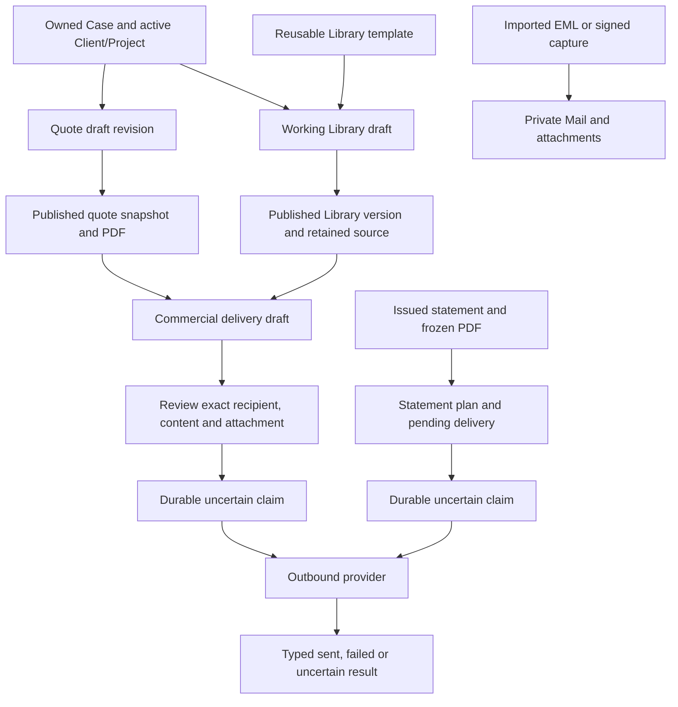
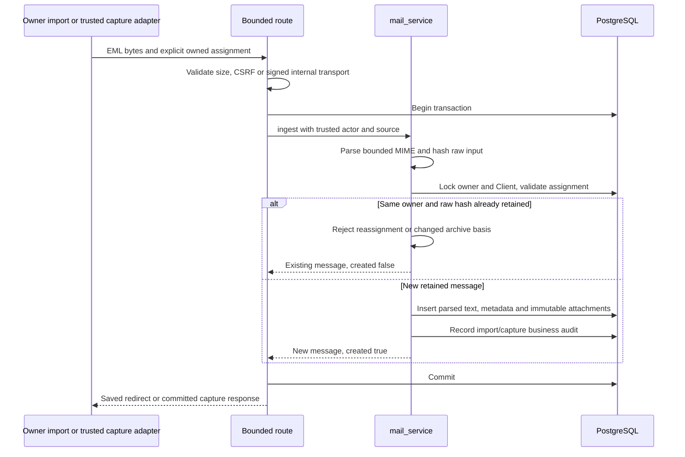
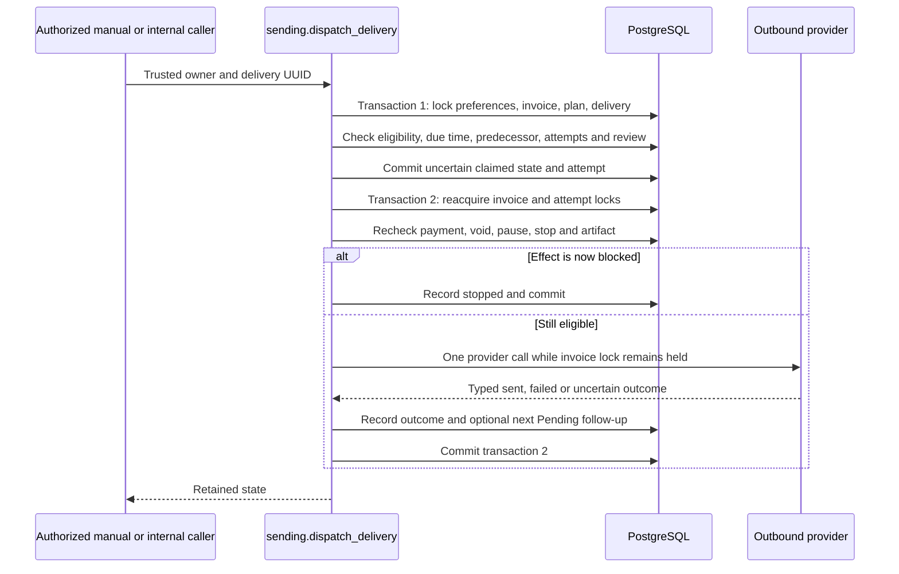

# Documents, Mail and Sending: executable flow map

This chapter traces source `4bb5c424d6e7d270cdca1479283896be77d581c3`.
It documents existing callers, service branches, transactions and effect limits
for maintenance and future troubleshooting/integration design. It creates no
SDK, new endpoint or permission to send, authenticate, query hosted data or deploy.
No product tests or provider flows were executed to prepare it. PH3 awaits owner
prompts on Stage; private PH2 production prelaunch is technically verified; personal acceptance remains pending.

## 1. Separate records and effects

Publication, dispatch, provider acceptance, human agreement, client receipt and
manual payment are different events. Quote/Library publication does not create
an invoice, log work, change a Project budget, buy a subscription or send mail.
Statement provider acceptance does not call billing's manual Sent/payment writers.
[Quote publication](https://github.com/edlopezpm-ops/timeKER-Stage/blob/4bb5c424d6e7d270cdca1479283896be77d581c3/app/quoting.py#L318),
[Library publication](https://github.com/edlopezpm-ops/timeKER-Stage/blob/4bb5c424d6e7d270cdca1479283896be77d581c3/app/library.py#L313),
[Sending service contract](https://github.com/edlopezpm-ops/timeKER-Stage/blob/4bb5c424d6e7d270cdca1479283896be77d581c3/app/sending.py#L1).

## 2. Quoting callers, revision branches and publication

| Caller | Callee | Branch/result |
| --- | --- | --- |
| `POST /quoting/new` | `quoting.create()` through shared `mutate()` | Owner operation-key replay or new quote/revision 1 |
| `POST /quoting/{id}/edit` | `quoting.update()` | Expected Draft revision/version; replace only editable lines |
| `POST /quoting/{id}/publish` | `quoting.publish()` with controlled renderer | Existing publication replay or new frozen artifact |
| `POST /quoting/{id}/revise` | `quoting.revise()` | New editable revision; retain old published revision |
| `POST /quoting/{id}/archive` | `quoting.archive()` | Versioned archive marker, not deletion |
| `GET /quoting/{id}/pdf` | Published artifact lookup or Draft render | Frozen integrity-checked bytes versus regenerable preview |

[Router](https://github.com/edlopezpm-ops/timeKER-Stage/blob/4bb5c424d6e7d270cdca1479283896be77d581c3/app/quoting_routes.py#L191),
[publish/revise/download callers](https://github.com/edlopezpm-ops/timeKER-Stage/blob/4bb5c424d6e7d270cdca1479283896be77d581c3/app/quoting_routes.py#L214),
[shared transaction wrapper](https://github.com/edlopezpm-ops/timeKER-Stage/blob/4bb5c424d6e7d270cdca1479283896be77d581c3/app/main.py#L379).

Step-by-step creation and editing:

1. `_context()` resolves the actual owned Case and locks its Client/Project/Case;
   active parents, unarchived Case and consistent associations are mandatory.
   Submitted Client/Project IDs cannot contradict the Case-derived context.
2. Normalize bounded text, exact integer estimated minutes/ranges and Decimal
   money. Duration-only HLE work stays unpriced; HLE needs no invented SOW/SLA.
3. `create()` compares owner/operation-key and normalized creation digest. Exact
   replay returns revision 1; a conflicting payload rejects.
4. `update()` rechecks context, locks quote/revision and requires editable Draft
   plus expected version. A line-only edit still advances the revision version.
5. The caller's transaction persists revision/lines/flexfields and business audit
   together. Stale, foreign, archived or published edits fail instead of changing
   a retained artifact.

[Context and editability](https://github.com/edlopezpm-ops/timeKER-Stage/blob/4bb5c424d6e7d270cdca1479283896be77d581c3/app/quoting.py#L159),
[normalization/totals](https://github.com/edlopezpm-ops/timeKER-Stage/blob/4bb5c424d6e7d270cdca1479283896be77d581c3/app/quoting.py#L61),
[create/update](https://github.com/edlopezpm-ops/timeKER-Stage/blob/4bb5c424d6e7d270cdca1479283896be77d581c3/app/quoting.py#L216).

Publication rechecks context and optimistic version, builds a JSON-safe snapshot,
renders the controlled quote template and requires bounded PDF-shaped bytes.
It stores snapshot/size/hash/renderer identity before marking the revision
published. Repeating a completed publication can return its existing artifact.
Rendering/validation failure aborts the caller transaction. Published retrieval
verifies retained size/hash; it does not silently rebuild altered bytes.
[Publish and retained retrieval](https://github.com/edlopezpm-ops/timeKER-Stage/blob/4bb5c424d6e7d270cdca1479283896be77d581c3/app/quoting.py#L318).

## 3. Private Library original, draft and version custody

Working documents require an owned unarchived Case with active Client/Project.
Reusable templates instead have no Case. `_fields()` validates that distinction;
the browser cannot attach a working document to unrelated parent IDs.
[Library fields/context](https://github.com/edlopezpm-ops/timeKER-Stage/blob/4bb5c424d6e7d270cdca1479283896be77d581c3/app/library.py#L135).

`library_routes` parses bounded forms/uploads and uses the shared mutation
transaction for create/save/upload/publish/new-draft. The service locks the
Document and compares its Draft revision; a frozen document requires a new Draft
before editing. Publication is not a signature or external acceptance writer.
[Mutation callers](https://github.com/edlopezpm-ops/timeKER-Stage/blob/4bb5c424d6e7d270cdca1479283896be77d581c3/app/library_routes.py#L111),
[Draft/version service](https://github.com/edlopezpm-ops/timeKER-Stage/blob/4bb5c424d6e7d270cdca1479283896be77d581c3/app/library.py#L222).

Upload path:

1. Bound multipart bytes before parsing; require a nonempty file at most 5 MiB.
2. `inspect_upload()` checks extension/content. PDF needs bounded header/end
   markers and yields no invented editable conversion. TXT/MD decode as bounded
   UTF-8 text.
3. DOCX inspection bounds ZIP entries, expansion/ratio/member sizes, rejects
   encryption/macros/embeddings and XML entity/DOCTYPE declarations, and extracts
   plain paragraph text without extracting files or executing relationships.
4. `upload()` retains immutable original bytes/size/hash in `LibraryUpload`,
   updates the Draft's selected source/editable text and advances revision.
   This is conservative parsing, not antivirus certification.

[Upload inspection](https://github.com/edlopezpm-ops/timeKER-Stage/blob/4bb5c424d6e7d270cdca1479283896be77d581c3/app/library.py#L243),
[retained source write](https://github.com/edlopezpm-ops/timeKER-Stage/blob/4bb5c424d6e7d270cdca1479283896be77d581c3/app/library.py#L289),
[upload caller](https://github.com/edlopezpm-ops/timeKER-Stage/blob/4bb5c424d6e7d270cdca1479283896be77d581c3/app/library_routes.py#L130).

Publication path:

1. `publish()` locks the Draft, validates revision/context/content and selected
   attachment format. Original attachment requires an available retained source.
2. It captures a numbered snapshot. Uploaded PDF is retained as PDF; other text
   renders through the controlled Library PDF template. Size limits still apply.
3. The transaction stores immutable `LibraryDocumentVersion` PDF/size/hash,
   source reference and publication metadata, then marks the Document frozen.
4. `new_draft()` advances the editable Draft without replacing earlier versions.
5. `frozen_artifact()` verifies the version PDF and, when original attachment was
   selected, the retained original source/hash. PDF preview and selected outbound
   attachment may therefore be different byte artifacts.

[Publish/new Draft](https://github.com/edlopezpm-ops/timeKER-Stage/blob/4bb5c424d6e7d270cdca1479283896be77d581c3/app/library.py#L313),
[artifact selection and checksum validation](https://github.com/edlopezpm-ops/timeKER-Stage/blob/4bb5c424d6e7d270cdca1479283896be77d581c3/app/library.py#L368).
Original/version download routes recheck owner/context and force bounded private
attachment responses; no public document bucket or editable PDF converter exists.
[Download callers](https://github.com/edlopezpm-ops/timeKER-Stage/blob/4bb5c424d6e7d270cdca1479283896be77d581c3/app/library_routes.py#L155).

## 4. Mail import, capture and attachment access

`POST /mail/import` uses `_uploaded_form()` for origin/CSRF and bounded EML
upload, then opens a transaction around `mail_service.ingest()`. Ingestion parses
at most 5 MiB raw mail with bounded headers/body/MIME depth/parts; stores parsed
text/metadata and immutable attachment bytes; and hashes raw input
for owner-scoped deduplication. It is not a mailbox synchronization or a promise
of full original-MIME download.
[Import caller](https://github.com/edlopezpm-ops/timeKER-Stage/blob/4bb5c424d6e7d270cdca1479283896be77d581c3/app/mail_routes.py#L210),
[parser](https://github.com/edlopezpm-ops/timeKER-Stage/blob/4bb5c424d6e7d270cdca1479283896be77d581c3/app/mail_service.py#L66),
[ingestion](https://github.com/edlopezpm-ops/timeKER-Stage/blob/4bb5c424d6e7d270cdca1479283896be77d581c3/app/mail_service.py#L201).

Assignment validation locks owner/Client and checks Project/Case relationships.
Exact duplicate raw bytes return the retained message only for the same
assignment. A changed assignment or historical archive receipt basis rejects;
Message-ID, sender and Date are not authentication or permission to rewrite it.
Owner import may supply a nonfuture historical receipt date; capture may not.
Archive visibility is based on retained receipt policy, not a spoofed mail Date.
[Assignment boundary](https://github.com/edlopezpm-ops/timeKER-Stage/blob/4bb5c424d6e7d270cdca1479283896be77d581c3/app/mail_service.py#L167),
[deduplication/receipt branches](https://github.com/edlopezpm-ops/timeKER-Stage/blob/4bb5c424d6e7d270cdca1479283896be77d581c3/app/mail_service.py#L219).

Optional `/internal/mail` first requires configured capture and a bounded signed
transport. `authenticated_body()` binds timestamp, exact route, recipient and
body hash with HMAC. The current handler uses the **default tenant factory**,
resolves a digest-only capture token, validates active owner/assignment, locks
against revocation/parallel quota admission and limits new captures to 100 per
owner/day. Do not infer a general arbitrary-tenant mail router from this handler.
[Signed transport](https://github.com/edlopezpm-ops/timeKER-Stage/blob/4bb5c424d6e7d270cdca1479283896be77d581c3/app/internal_routes.py#L82),
[capture handler](https://github.com/edlopezpm-ops/timeKER-Stage/blob/4bb5c424d6e7d270cdca1479283896be77d581c3/app/internal_routes.py#L133),
[address resolution/revocation](https://github.com/edlopezpm-ops/timeKER-Stage/blob/4bb5c424d6e7d270cdca1479283896be77d581c3/app/mail_service.py#L296).

Attachment routes join exact message/attachment/owner and enforce active versus
archive-export visibility; they return sanitized attachment names with
application/octet-stream, nosniff and private/no-store. The current Mail route
selects stored size/hash but directly returns selected payload; it does not call
Library's `verify_payload()`. Preserve that distinction when troubleshooting
custody rather than claiming every download runs the same integrity check.
[Mail attachment response](https://github.com/edlopezpm-ops/timeKER-Stage/blob/4bb5c424d6e7d270cdca1479283896be77d581c3/app/mail_routes.py#L357).

## 5. Statement Sending: prepare, claim, effect and completion

### Caller and preparation gates

Statement routes require owner authorization and CSRF. Current source defaults
outbound provider/jobs to disabled, and production has a separate capability.
Manual dispatch requires current configured provider; source presence/UI is not
activation or send authority. Authentication SMTP is never reused as outbound
business credentials.
[Configuration gates](https://github.com/edlopezpm-ops/timeKER-Stage/blob/4bb5c424d6e7d270cdca1479283896be77d581c3/app/config.py#L58),
[dispatch route gates](https://github.com/edlopezpm-ops/timeKER-Stage/blob/4bb5c424d6e7d270cdca1479283896be77d581c3/app/sending_dispatch_routes.py#L13).

`/sending/prepare/{invoice_id}` review/confirmation calls `sending.prepare()` in
the caller transaction. It locks preferences/invoice, rejects pause, requires
confirmation of exact recipient/immutable checksum, validates the issued artifact,
requires no recorded payment and positive balance, and rejects a second retained
plan for the same statement. It freezes rendered initial content, bounded
follow-up policy and creates sequence 0 Pending delivery plus audit.
[Preparation callers](https://github.com/edlopezpm-ops/timeKER-Stage/blob/4bb5c424d6e7d270cdca1479283896be77d581c3/app/sending_routes.py#L107),
[prepare service](https://github.com/edlopezpm-ops/timeKER-Stage/blob/4bb5c424d6e7d270cdca1479283896be77d581c3/app/sending.py#L214).

The initial manual dispatch route relies on that authorized prepared plan; its
POST still verifies CSRF/provider readiness. Manual follow-up advancement has a
fresh explicit confirmation and exact current review digest. Do not describe
both caller contracts as an identical generic checkbox.
[Initial/follow-up callers](https://github.com/edlopezpm-ops/timeKER-Stage/blob/4bb5c424d6e7d270cdca1479283896be77d581c3/app/sending_dispatch_routes.py#L33).

### Two transactions around an uncertain claim

`dispatch_delivery()` returns existing nonpending states without replay. Future
scheduled time waits unless the confirmed manual-follow-up branch applies.
Follow-ups require a Sent predecessor; attempts are bounded to four. The durable
claim commits **before** provider I/O, so process death cannot turn an unknown
acceptance into an unclaimed Pending retry.
[Claim transaction](https://github.com/edlopezpm-ops/timeKER-Stage/blob/4bb5c424d6e7d270cdca1479283896be77d581c3/app/sending.py#L513).

The second transaction rechecks current blocking state and exact PDF checksum,
then holds the invoice lock used by manual payment/void until provider outcome
commit. A stop/payment/void between claim and effect can prevent the send.
A transport exception, invalid result or ambiguous provider reply is retained as
Uncertain, not a reason to replay. A successful acceptance can schedule the next
bounded Pending row; it does not invoke billing.mark_sent/pay or alter issued PDF.
[Recheck/effect/result](https://github.com/edlopezpm-ops/timeKER-Stage/blob/4bb5c424d6e7d270cdca1479283896be77d581c3/app/sending.py#L591).

The Cloudflare transport validates address/header/PDF/hash/encoded-message bounds,
uses fixed configured destination/credentials and a bounded response. It treats
only recognized negative responses as definitive Failed; malformed/unexpected
results/timeouts remain Uncertain. Recognized queued/delivered acceptance maps to
Sent; a permanent bounce maps to Failed. The implementation assumes no provider
idempotency guarantee and promises no inbox placement or client payment.
[Response classifier](https://github.com/edlopezpm-ops/timeKER-Stage/blob/4bb5c424d6e7d270cdca1479283896be77d581c3/app/sending_transport.py#L31).

### Retry, Stop and invoice coupling

`retry()` permits an eligible definitively Failed active delivery below four
attempts; it rechecks artifact/payment/balance and restores Pending with the
original authorized schedule. It does not retry Uncertain or Sent rows.
`stop_plan()`/`stop_all()` retain stop history; `resume()` permits new plans and is
not a recall or automatic replay of completed/uncertain messages.
[Stop controls](https://github.com/edlopezpm-ops/timeKER-Stage/blob/4bb5c424d6e7d270cdca1479283896be77d581c3/app/sending.py#L288),
[retry](https://github.com/edlopezpm-ops/timeKER-Stage/blob/4bb5c424d6e7d270cdca1479283896be77d581c3/app/sending.py#L348).

`billing.pay()` stops statement plans for any recorded payment; `billing.void()`
stops them during full cancellation. Reversing a payment does not automatically
restart Sending. These are invoice-transaction effects, not provider webhooks.
[Payment coupling](https://github.com/edlopezpm-ops/timeKER-Stage/blob/4bb5c424d6e7d270cdca1479283896be77d581c3/app/billing.py#L572),
[cancellation coupling](https://github.com/edlopezpm-ops/timeKER-Stage/blob/4bb5c424d6e7d270cdca1479283896be77d581c3/app/billing.py#L716).

## 6. Commercial Sending has a separate outbox

`proposal_sending.published_source()` accepts a published Quote or Library version
and verifies the source identity/attachment. `prepare()` retains selected bytes,
hash, filename/type, addressed content and operation-key/digest. Draft editing
requires current version and no prior claim. The commercial ledger does not
reuse invoice collections/follow-up state.
[Published source and preparation](https://github.com/edlopezpm-ops/timeKER-Stage/blob/4bb5c424d6e7d270cdca1479283896be77d581c3/app/proposal_sending.py#L100),
[Draft revision/review](https://github.com/edlopezpm-ops/timeKER-Stage/blob/4bb5c424d6e7d270cdca1479283896be77d581c3/app/proposal_sending.py#L173).

`POST /sending/proposals/{id}/dispatch` requires configured commercial Sending,
CSRF, explicit confirmation, exact review digest and optional explicit Failed
retry. `dispatch_delivery()` validates encoded 5 MiB budget/artifact and four-attempt
limit, then commits an Uncertain claim/attempt before I/O. **Unlike statement
Sending**, commercial provider I/O runs between the claim and result transactions,
not under a retained invoice lock. A final transaction records actual typed outcome.
[Caller](https://github.com/edlopezpm-ops/timeKER-Stage/blob/4bb5c424d6e7d270cdca1479283896be77d581c3/app/proposal_sending_routes.py#L81),
[commercial dispatch](https://github.com/edlopezpm-ops/timeKER-Stage/blob/4bb5c424d6e7d270cdca1479283896be77d581c3/app/proposal_sending.py#L230).

Sent/Uncertain/stopped rows are not automatically dispatched again; definitive
Failed retry requires its specific branch. Stop prevents future attempts but
cannot recall an already claimed message. If Stop occurs during I/O, preserve
actual outcome plus stop history instead of pretending the provider call vanished.
[Commercial stop](https://github.com/edlopezpm-ops/timeKER-Stage/blob/4bb5c424d6e7d270cdca1479283896be77d581c3/app/proposal_sending.py#L193),
[bounded transport](https://github.com/edlopezpm-ops/timeKER-Stage/blob/4bb5c424d6e7d270cdca1479283896be77d581c3/app/proposal_sending_transport.py#L94).

## 7. Jobs and provider callbacks are separate paths

`POST /internal/sending` requires signed empty-body transport, available provider
and `sending_jobs_enabled`. Its worker batch binds trusted non-demo tenant roles,
selects due rows and shares a maximum 20-delivery budget across the batch.
The retained Stage configuration keeps scheduled Sending **off**. The existing
02:17 UTC cron invokes only Case retention; its actual scheduled execution remains
unobserved. It does not dispatch statement or commercial email.
[Sending job](https://github.com/edlopezpm-ops/timeKER-Stage/blob/4bb5c424d6e7d270cdca1479283896be77d581c3/app/internal_routes.py#L20),
[batch selection](https://github.com/edlopezpm-ops/timeKER-Stage/blob/4bb5c424d6e7d270cdca1479283896be77d581c3/app/internal_routes.py#L42),
[Case-only scheduler](https://github.com/edlopezpm-ops/timeKER-Stage/blob/4bb5c424d6e7d270cdca1479283896be77d581c3/deploy/cloudflare/src/index.ts#L63).

There is no implemented asynchronous email delivery/receipt webhook in these
Sending routers. The provider HTTP result above supplies the retained send status;
it is not a payment callback. `/subscriptions/paddle/webhook` is a **separate**
subscription handler: bounded JSON/signature verification, exact retained checkout/
tenant metadata and `handle_verified_event()`. It returns bounded 400/409/503 for
rejected/unconfirmed/retryable processing and acknowledges only completed handling.
Do not connect it to client statement payment or email receipt semantics.
[Subscription webhook caller](https://github.com/edlopezpm-ops/timeKER-Stage/blob/4bb5c424d6e7d270cdca1479283896be77d581c3/app/subscription_payment_routes.py#L392).

## 8. Troubleshooting map and safe evidence

| Problem | First branch/transaction to inspect | Maintained test source |
| --- | --- | --- |
| HLE rejects context or edit after publication | `_context`, `_editable`, creation digest/revision | [Quoting tests](https://github.com/edlopezpm-ops/timeKER-Stage/blob/4bb5c424d6e7d270cdca1479283896be77d581c3/tests/integration/test_quoting.py#L1) |
| Publication fails or attachment changes | Renderer validation, snapshot/size/hash and Library selected format | [invalid quote renderer](https://github.com/edlopezpm-ops/timeKER-Stage/blob/4bb5c424d6e7d270cdca1479283896be77d581c3/tests/integration/test_quoting.py#L240), [Library tests](https://github.com/edlopezpm-ops/timeKER-Stage/blob/4bb5c424d6e7d270cdca1479283896be77d581c3/tests/integration/test_library.py#L1) |
| EML duplicate appears under another Project | Owner/raw-hash deduplication and assignment locks | [Mail tests](https://github.com/edlopezpm-ops/timeKER-Stage/blob/4bb5c424d6e7d270cdca1479283896be77d581c3/tests/integration/test_mail.py#L1) |
| Mail attachment available through wrong view | Owner/parent join and active/archive predicate | [Mail attachment tests](https://github.com/edlopezpm-ops/timeKER-Stage/blob/4bb5c424d6e7d270cdca1479283896be77d581c3/tests/integration/test_mail_attachments.py#L1) |
| Capture redirects/fails or over-admits | HMAC binding, default-role routing, revocation/quota transaction | [internal capture tests](https://github.com/edlopezpm-ops/timeKER-Stage/blob/4bb5c424d6e7d270cdca1479283896be77d581c3/tests/integration/test_internal_jobs.py#L29) |
| Double click/timeout seems to need resend | Durable claim/result transaction and typed uncertainty | [statement dispatch tests](https://github.com/edlopezpm-ops/timeKER-Stage/blob/4bb5c424d6e7d270cdca1479283896be77d581c3/tests/integration/test_sending_dispatch.py#L185), [commercial claim tests](https://github.com/edlopezpm-ops/timeKER-Stage/blob/4bb5c424d6e7d270cdca1479283896be77d581c3/tests/integration/test_proposal_sending.py#L94) |
| Payment/Stop after follow-up review | Current eligibility and exact review digest recheck | [manual follow-up tests](https://github.com/edlopezpm-ops/timeKER-Stage/blob/4bb5c424d6e7d270cdca1479283896be77d581c3/tests/integration/test_sending_manual_followup.py#L107) |
| Stop during commercial I/O appears Sent | Already-claimed call cannot be recalled; preserve actual result/stop history | [commercial stop race](https://github.com/edlopezpm-ops/timeKER-Stage/blob/4bb5c424d6e7d270cdca1479283896be77d581c3/tests/integration/test_proposal_sending.py#L160) |
| Scheduled delivery never runs | Disabled jobs flag and Case-only cron, not payment/provider acceptance | [disabled job tests](https://github.com/edlopezpm-ops/timeKER-Stage/blob/4bb5c424d6e7d270cdca1479283896be77d581c3/tests/integration/test_sending_dispatch.py#L218) |

These are source references to test implementations, not fresh execution claims.
Use request/execution UUID, route template, source commit, internal artifact/
delivery/attempt IDs, version/hash and typed outcome to correlate authorized
private evidence. Audit events such as `quote.published`, `library.published`,
`mail.imported`, `sending.claimed` and `proposal_sending.claimed` are business audit,
not permission to log recipients, subjects/bodies, attachment/PDF bytes, raw mail,
contracts, credentials or provider exception objects.
[Sanitized logging](https://github.com/edlopezpm-ops/timeKER-Stage/blob/4bb5c424d6e7d270cdca1479283896be77d581c3/app/logging.py#L32).

Future troubleshooting/SDK work should reuse the real review, artifact, claim,
uncertainty and transaction contracts. No delivery callback, unlimited retry,
public upload, general mailbox sync, automatic collection or new SDK is invented
by these diagrams. Human UAT, actual external MCP/provider lifecycle, hosted
hosted recovery, owner acceptance and later public/Live gates remain separate pending evidence.
