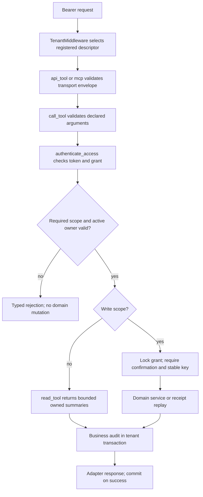
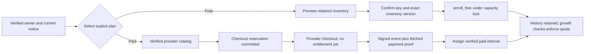
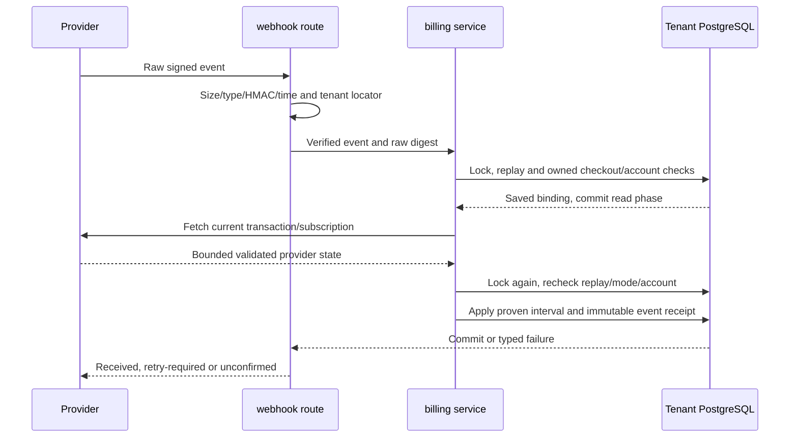

# 05 — Integration and subscription code flows

Source: `9fc9eebdaf9f52170530c8a28d34f6c8cd612c64`. These are source-traced execution paths and maintenance boundaries, not newly executed client/provider flows. The existing Stage remains the target of future authorized work; actual MCP interoperability and remaining Sandbox lifecycle acceptance remain pending in [current residuals][current residuals]. No SDK package is implemented by this chapter.

## 1. Two adapters, one delegated tool boundary

[public_router][public_router] builds discovery/OAuth, JSON tool and MCP routes. [owner_router][owner_router] builds owner connection management. [TOOLS][TOOLS] declares 15 tools under eight scopes; [tool_catalog][tool_catalog] filters discovery by granted scopes and emits strict input schemas plus annotations. An annotation is guidance; server authorization remains mandatory.

| Scope | Tools and permitted domain effect |
| --- | --- |
| `clients:read` | `search_clients`: bounded client/project summaries |
| `clients:draft` | `create_client_draft`: proposed client, without publishing an active client |
| `cases:read` | `list_open_cases`, `get_case` |
| `cases:write` | `create_case`, `edit_case`, `close_case`: explicit owned Case mutations |
| `time:read` | `list_time_entries`: current work/contribution versions |
| `time:write` | `create_time_entry`, `edit_time_entry`, `delete_time_entry`: this connection's Draft contributions |
| `bills:read` | `list_bills`, `get_bill`, `list_credit_memos` |
| `dashboard:read` | `get_week_summary`: recorded work, with no inferred time |

The adapters expose no invoice issue/payment mutation, timecard finalization, mailbox read or automatic email operation. Case mutations and proposed clients are distinct from Draft time. Business text returned by tools is untrusted data, never an instruction/authorization. Sources: [SCOPES][SCOPES], [read_tool][read_tool], [write_tool][write_tool].

The descriptor selection is routing, not authentication. The default descriptor used for an invalid/missing selector is not a business-access fallback: token authentication must still pass before data access. [request_tenant][request_tenant] parses the token selector; [TenantMiddleware][TenantMiddleware] binds a registry-owned descriptor; [authenticate_access][authenticate_access] verifies tenant UUID, credential digest/kind/expiry/unused state, grant, resource/client and scope intersection. [grant_owner][grant_owner] rechecks owner activity/role/allowlist/registry mapping, client/resource availability, revocation/expiry and enrollment readiness.

### Ordered trace: authorization, code exchange and rotation

1. Discovery publishes issuer, exact authorization/token/revocation URLs, supported scopes and S256 public-client behavior. [registered_clients][registered_clients] accepts only operator-configured exact HTTPS callbacks, unique IDs and bounded metadata. There is no dynamic client-registration endpoint here.
2. GET `/oauth/authorize` rejects duplicate/unknown/invalid fields through [validate_authorization][validate_authorization]. It requires code response, S256, bounded state and an exact resource audience. An unsigned visitor stores a bounded continuation and returns to normal login; authenticated owners see consent.
3. POST consent uses owner authorization and checked CSRF form. Its `db.begin()` owns grant/code/audit persistence. Authlib handles Allow/Decline; [CodeGrant][CodeGrant] stores a 30-day grant and five-minute code digest, callback/challenge/scope. [IntegrationAuthorizationServer][IntegrationAuthorizationServer] registers S256, rotating refresh and the configured issuer response extension.
4. POST `/oauth/token` validates form content type, bounded fields, origin when supplied and a rate limit. [token route][token route] derives a registered tenant from the code/refresh selector, binds it and opens that tenant's transaction. Authlib verifies the public client, callback/PKCE and grant; no client secret substitutes for proof.
5. `CodeGrant.query_authorization_code` locks code and grant. Reused codes revoke the grant. [RotatingRefreshGrant][RotatingRefreshGrant] locks the refresh token/grant; reuse revokes the whole connection. The route deliberately commits OAuth error responses so replay revocation survives; converting that response into an exception/rollback would change security behavior.
6. `save_token` stores digests, not returned secrets. Access lifetime is at most 600 seconds and grant expiry; refresh ends at grant expiry. Rotation marks the old refresh used. The response contains new opaque credentials, which must stay out of source/logs/prompts.
7. [revocation route][revocation route] checks matching client and credential digest, locks/revokes the grant and returns 200 for invalid/unrecognized credentials without disclosing presence. Owner Settings revocation uses the same grant-level authority. Every later access rechecks the grant, stopping existing access credentials too.

Maintain with [PKCE and MCP integration test][PKCE and MCP integration test], [rotation replay test][rotation replay test], [scope expiry owner suspension test][scope expiry owner suspension test] and [actual tenant selector test][actual tenant selector test]. These links identify maintained tests; this documentation did not run them or complete a human OAuth Allow flow.

### Ordered trace: one tool call and idempotent writes

1. `/api/integration/tools/{name}` requires JSON and header bearer, with no query credentials. `/mcp` additionally checks Accept contains JSON and event-stream, protocol version and a single valid JSON-RPC object. Supported versions are source constants, not a promise of every client's compatibility.
2. [bounded_body and transport checks][bounded_body and transport checks] cap body at 32,768 bytes, reject foreign supplied Origin and disable unavailable integration capability. [validate_arguments][validate_arguments] rejects unknown/missing fields, invalid primitive types, UUID/date/length/range/enum values; boolean is not accepted as integer minutes.
3. [call_tool][call_tool] determines required scope and reauthenticates. It locks the grant for writes, serializing that connection's idempotency and revocation boundary.
4. Read calls reuse `read_tool`; all successful calls also add `integration.tool_called` business audit in the route transaction. A read-only tool hint does not mean a database session may be globally READ ONLY, because audit is persisted.
5. Writes require `confirmed is True`. Time operations delegate to [execute_time_command][execute_time_command] with a source bound to the grant UUID. Its receipts, owned parents/card locks, expected versions, exact minutes, contract bounds and own-contribution rules remain authoritative. Never replace this with direct row mutation.
6. Other writes hash the stable idempotency key and full tool intent. Same key/same payload replays the retained result; changed payload/tool is 409. Client proposal and Case services run before receipt/audit flush in the same transaction. A rollback does not leave a successful receipt behind.
7. The JSON adapter returns the structured result or sanitized errors. MCP wraps successful text/structuredContent and `isError=false`; domain/form/stale changes roll back and return `isError=true` with reread guidance. Invalid protocol/method/argument and authentication errors use their distinct JSON-RPC/HTTP branches.

[MCP route][MCP route] supports initialize, ping, tools/list, tools/call and two accepted notifications. It is stateless: GET/DELETE authenticate then return 405/Allow POST; required event-stream Accept does not create a persistent GET stream, resumable session or server-push API. See [transport error tests][transport error tests] and [strict contract tests][strict contract tests].

## 2. Enrollment and capacity precede ordinary workspace growth

Identity proof/admission and subscription entitlement are different state machines. [admit][admit] verifies provider proof, finds an existing immutable identity or reserves one exact prepared slot in the central directory. It commits reservation, initializes the fixed tenant, reads it back, then activates the retained mapping. Failure/uncertainty retains reserved IDs; it does not create arbitrary schemas or merge accounts by email.

[acknowledgment route][acknowledgment route] calls [accept_registration][accept_registration] after fresh owner proof and exact current notice/terms/privacy/catalog acknowledgment. [workspace_ready][workspace_ready] permits acknowledged assigned Free or previously proven paid history, including after paid expiry; copied legacy history has its own explicit retained branch. It does not invent a plan. [active_plan][active_plan] is stricter about currently valid paid access. These differences preserve history while separately blocking growth.

### Free selection and quotas

1. [subscription router][subscription router] renders plan/usage and separate preview/confirm forms. Preview does not archive. [registration Free route][registration Free route] supports the first-plan journey; the Settings route reuses the same domain service.
2. [enroll_free][enroll_free] requires stable operation key and takes [capacity_lock][capacity_lock] before nested flush. The PostgreSQL advisory transaction lock is keyed by the actual fixed schema.
3. Receipt replay precedes stale-version validation. New intent locks client/project rows, checks the inventory version and selected retained records, verifies lifecycle readiness, then archives only the explicitly listed excess records. It does not delete history or partially archive if a guard fails.
4. The singleton assignment is created/updated explicitly to Free. An unexpired verified paid period cannot be silently replaced. Receipt and audit share the caller's transaction.
5. [require_capacity][require_capacity] counts active clients and active projects under active parents. Free permits 1/1, Solo 5/10, Pro has no commercial client/project cap. These source quotas are not hosting/storage/mail guarantees or authoritative tax/pricing facts.
6. Positive growth requires an assignment and valid paid interval where applicable; unassigned/expired workspaces retain zero-growth editing/history. Parent reactivation accounts for latent active projects. Actual client/project entry points reuse this guard, including [client capacity callers][client capacity callers] and [project creation capacity][project creation capacity].

Check [last-slot race test][last-slot race test], [zero-growth expiry behavior][zero-growth expiry behavior], [parent reactivation test][parent reactivation test] and [free selection service tests][free selection service tests] before changing counts or lock placement.

## 3. Paid checkout: commit intent before network

The provider adapter is existing application code, [PaddleSandbox][PaddleSandbox], selected by [provider_from_settings][provider_from_settings]. Prepared Live source is separately gated; current retained Stage is Sandbox. Adapter API methods are internal implementation, not a timeKER public SDK.

1. The owner route [checkout POST][checkout POST] validates CSRF/bounded form fields, operation key, offer and explicit renewal confirmation, then calls [start_checkout][start_checkout].
2. [verify_catalog][verify_catalog] separately validates all configured offers remotely, then stores a configuration fingerprint under a fresh local transaction. `_require_verified` checks fingerprint/mode compatibility; a catalog match is not a paid event.
3. In the first tenant transaction, `_reserve` takes the capacity lock, verifies owner/key/payload and returns an existing receipt on exact replay. It rejects a competing reserved/uncertain checkout/change/cancel/retention effect and existing active subscription/pending checkout.
4. Commit happens before `create_checkout`. The server supplies exact tenant/checkout UUID binding and validated configured offer. [provider request boundary][provider request boundary] uses bounded HTTP, no redirects and no ambient proxy trust. It does not automatically retry mutations.
5. A successful provider response is rebound and saved in a new transaction as confirmed operation with outcome PENDING. It records a transaction ID; it does not grant capacity from a browser success page.
6. [_record_failure][_record_failure] preserves failed versus uncertain state. Network/malformed successful mutation/unknown post-effect failure may be uncertain. Exact operation replay returns saved status and never sends the effect again.
7. [reconcile_checkout][reconcile_checkout] uses GET on an already bound transaction. It closes only a verified canceled checkout, never assumes a timeout canceled it. No bound transaction means operator reconciliation, not a fresh checkout.

Maintenance evidence: [checkout reservation test][checkout reservation test], [uncertain checkout test][uncertain checkout test], [provider mutation no-retry test][provider mutation no-retry test].

## 4. Webhook to paid entitlement: verify twice around network

1. [webhook route][webhook route] is public machine transport, not owner CSRF form. It checks configured mode, JSON/body bounds and [verify_webhook][verify_webhook] over unchanged raw bytes before JSON decode. HMAC timestamp tolerance is five seconds, multiple h1 signatures support rotation; malformed/unknown bindings are rejected.
2. The signed `custom_data` must be exactly checkout_id and tenant_id. A registered tenant locator is selected, then [handle_verified_event][handle_verified_event] validates event ID/type/time/digest and binding again. Supported transaction/subscription lifecycle event names are explicit.
3. First transaction locks capacity, checks mode and event replay. Same event ID/digest replays; different digest conflicts. The event must refer to an owned checkout. Closed checkout/stale historical subscription receive retained no-regrant outcomes; a different active subscription is rejected.
4. The service fetches current transaction/subscription outside the transaction. Second transaction relocks, repeats replay/mode/owner/account checks and rebinds fetched customer/subscription/custom_data. A valid signature alone is insufficient payment proof.
5. [_proof][_proof] validates exact configured offer, one quantity, IDs, currency/payment status and paid period. [_set_entitlement][_set_entitlement] applies only a newer proven interval or matching confirmed upgrade, updates assignment/paid-through and handles pending selection. Old completed events cannot extend access.
6. Failed renewal grants seven-day grace only for the exact still-unpaid period after fetched transaction and subscription both confirm past_due. The earliest verified failure is stable; retries cannot extend grace. Paused/canceled or unconverged state does not invent it.
7. Immutable BillingEvent plus business audit commit with the entitlement change. Unavailable/provider or database conflicts produce retry-required 503; unconfirmed domain state 409; rejected signatures/bindings 400. Do not collapse all responses into success or replay a provider mutation to satisfy a webhook.

Relevant checks: [payment proof/replay test][payment proof/replay test], [foreign proof test][foreign proof test], [old payment test][old payment test], [failure convergence test][failure convergence test], [grace test][grace test].

## 5. Changes, cancellation, retention and safe reads

| Entry/service | Ordered behavior and maintenance trap |
| --- | --- |
| [preview_plan_change][preview_plan_change] → [confirm_plan_change][confirm_plan_change] | Fetch/save provider quote with account/inventory version and 15-minute expiry. Confirmation replays first, then rechecks current quote/totals/selection/version. Reserve+commit before mutation. Solo→Pro uses immediate proration; other supported changes use next-period mode. Confirmed response is PENDING; matching completed payment still controls entitlement. |
| [cancel_renewal][cancel_renewal] | Explicit confirmation; reserve/commit; schedule provider cancellation at verified paid end; validate effective date; persist PENDING. No immediate entitlement removal or automatic Free. |
| [preview_retention][preview_retention] / [confirm_retention][confirm_retention] | Eligible monthly account/once-for-owner claim, exact bound quote and refreshed equality before reserve+effect. No invented universal discount. Uncertainty retains claim; [reconcile_retention][reconcile_retention] GETs current subscription without repeating mutation. |
| [check_renewal_status][check_renewal_status] | Read remains available during an uncertain effect. Fetch exact subscription/customer/checkout; persist keyed status/scheduled-action receipt. It does not extend access or activate a change. |
| [owner_portal][owner_portal] | Check verified owned account; request exact provider portal session; validate URL. Ephemeral URL is returned, never persisted/audited. |

Plan/cycle changes preserve paid history and retained records. Deferred downgrade applies a reviewed selection only when matching paid-period proof arrives and lifecycle guards still pass; failure leaves explicit selection work rather than partial archive. See [downgrade tests][downgrade tests], [upgrade payment test][upgrade payment test], [retention uncertainty test][retention uncertainty test], [renewal during uncertainty test][renewal during uncertainty test].

## 6. Existing contracts a future SDK could consume

Use these existing contracts rather than inventing endpoints: [tool schemas and limits][tool schemas and limits], discovery/OAuth routes, JSON `/api/integration/tools/{name}` and stateless MCP `/mcp`. [portable connection guide][portable connection guide] describes the private package and intended normal connection flow. JSON/API and MCP resource audiences are distinct; a token for one cannot simply be reused for the other.

A future client library would need exact static client registration/redirect and S256; owner consent; secure returned-credential handling; refresh rotation and revocation; header bearer/no-query credentials; protocol/media negotiation; strict arguments and dates/integer minutes; caller confirmation/selection; stable idempotency keys and version rereads; typed HTTP/JSON-RPC errors; and safe uncertainty handling. These are requirements inferred from current server checks, not a shipped SDK, OpenAPI promise, host eligibility or voice/dot interoperability claim. Browser subscription/registration forms and the provider webhook are not delegated integration financial APIs. A future SDK cannot bypass their owner/CSRF/provider/entitlement boundaries.

No provider activation, SDK generation, human OAuth proof or hosted execution occurred while writing this reference. Existing exact-source tests guide future changes; canonical residuals continue to control pending acceptance.

[current residuals]: https://github.com/edlopezpm-ops/timeker-PH2/blob/9fc9eebdaf9f52170530c8a28d34f6c8cd612c64/docs/STATUS.md#L27
[public_router]: https://github.com/edlopezpm-ops/timeker-PH2/blob/9fc9eebdaf9f52170530c8a28d34f6c8cd612c64/app/integration_routes.py#L668
[owner_router]: https://github.com/edlopezpm-ops/timeker-PH2/blob/9fc9eebdaf9f52170530c8a28d34f6c8cd612c64/app/integration_routes.py#L1044
[TOOLS]: https://github.com/edlopezpm-ops/timeker-PH2/blob/9fc9eebdaf9f52170530c8a28d34f6c8cd612c64/app/integration_routes.py#L61
[tool_catalog]: https://github.com/edlopezpm-ops/timeker-PH2/blob/9fc9eebdaf9f52170530c8a28d34f6c8cd612c64/app/integration_routes.py#L257
[SCOPES]: https://github.com/edlopezpm-ops/timeker-PH2/blob/9fc9eebdaf9f52170530c8a28d34f6c8cd612c64/app/integration_auth.py#L24
[read_tool]: https://github.com/edlopezpm-ops/timeker-PH2/blob/9fc9eebdaf9f52170530c8a28d34f6c8cd612c64/app/integration_routes.py#L312
[write_tool]: https://github.com/edlopezpm-ops/timeker-PH2/blob/9fc9eebdaf9f52170530c8a28d34f6c8cd612c64/app/integration_routes.py#L515
[request_tenant]: https://github.com/edlopezpm-ops/timeker-PH2/blob/9fc9eebdaf9f52170530c8a28d34f6c8cd612c64/app/integration_auth.py#L86
[TenantMiddleware]: https://github.com/edlopezpm-ops/timeker-PH2/blob/9fc9eebdaf9f52170530c8a28d34f6c8cd612c64/app/tenancy.py#L469
[authenticate_access]: https://github.com/edlopezpm-ops/timeker-PH2/blob/9fc9eebdaf9f52170530c8a28d34f6c8cd612c64/app/integration_auth.py#L254
[grant_owner]: https://github.com/edlopezpm-ops/timeker-PH2/blob/9fc9eebdaf9f52170530c8a28d34f6c8cd612c64/app/integration_auth.py#L231
[registered_clients]: https://github.com/edlopezpm-ops/timeker-PH2/blob/9fc9eebdaf9f52170530c8a28d34f6c8cd612c64/app/integration_auth.py#L147
[validate_authorization]: https://github.com/edlopezpm-ops/timeker-PH2/blob/9fc9eebdaf9f52170530c8a28d34f6c8cd612c64/app/integration_auth.py#L197
[CodeGrant]: https://github.com/edlopezpm-ops/timeker-PH2/blob/9fc9eebdaf9f52170530c8a28d34f6c8cd612c64/app/integration_auth.py#L307
[IntegrationAuthorizationServer]: https://github.com/edlopezpm-ops/timeker-PH2/blob/9fc9eebdaf9f52170530c8a28d34f6c8cd612c64/app/integration_auth.py#L453
[token route]: https://github.com/edlopezpm-ops/timeker-PH2/blob/9fc9eebdaf9f52170530c8a28d34f6c8cd612c64/app/integration_routes.py#L776
[RotatingRefreshGrant]: https://github.com/edlopezpm-ops/timeker-PH2/blob/9fc9eebdaf9f52170530c8a28d34f6c8cd612c64/app/integration_auth.py#L381
[revocation route]: https://github.com/edlopezpm-ops/timeker-PH2/blob/9fc9eebdaf9f52170530c8a28d34f6c8cd612c64/app/integration_routes.py#L811
[PKCE and MCP integration test]: https://github.com/edlopezpm-ops/timeker-PH2/blob/9fc9eebdaf9f52170530c8a28d34f6c8cd612c64/tests/integration/test_delegated_integration.py#L104
[rotation replay test]: https://github.com/edlopezpm-ops/timeker-PH2/blob/9fc9eebdaf9f52170530c8a28d34f6c8cd612c64/tests/integration/test_delegated_integration.py#L164
[scope expiry owner suspension test]: https://github.com/edlopezpm-ops/timeker-PH2/blob/9fc9eebdaf9f52170530c8a28d34f6c8cd612c64/tests/integration/test_delegated_integration.py#L204
[actual tenant selector test]: https://github.com/edlopezpm-ops/timeker-PH2/blob/9fc9eebdaf9f52170530c8a28d34f6c8cd612c64/tests/integration/test_delegated_integration.py#L376
[bounded_body and transport checks]: https://github.com/edlopezpm-ops/timeker-PH2/blob/9fc9eebdaf9f52170530c8a28d34f6c8cd612c64/app/integration_routes.py#L609
[validate_arguments]: https://github.com/edlopezpm-ops/timeker-PH2/blob/9fc9eebdaf9f52170530c8a28d34f6c8cd612c64/app/integration_routes.py#L217
[call_tool]: https://github.com/edlopezpm-ops/timeker-PH2/blob/9fc9eebdaf9f52170530c8a28d34f6c8cd612c64/app/integration_routes.py#L591
[execute_time_command]: https://github.com/edlopezpm-ops/timeker-PH2/blob/9fc9eebdaf9f52170530c8a28d34f6c8cd612c64/app/time_commands.py#L409
[MCP route]: https://github.com/edlopezpm-ops/timeker-PH2/blob/9fc9eebdaf9f52170530c8a28d34f6c8cd612c64/app/integration_routes.py#L891
[transport error tests]: https://github.com/edlopezpm-ops/timeker-PH2/blob/9fc9eebdaf9f52170530c8a28d34f6c8cd612c64/tests/integration/test_delegated_integration.py#L231
[strict contract tests]: https://github.com/edlopezpm-ops/timeker-PH2/blob/9fc9eebdaf9f52170530c8a28d34f6c8cd612c64/tests/unit/test_integration_contracts.py#L180
[admit]: https://github.com/edlopezpm-ops/timeker-PH2/blob/9fc9eebdaf9f52170530c8a28d34f6c8cd612c64/app/admission.py#L142
[acknowledgment route]: https://github.com/edlopezpm-ops/timeker-PH2/blob/9fc9eebdaf9f52170530c8a28d34f6c8cd612c64/app/enrollment_routes.py#L189
[accept_registration]: https://github.com/edlopezpm-ops/timeker-PH2/blob/9fc9eebdaf9f52170530c8a28d34f6c8cd612c64/app/enrollment.py#L218
[workspace_ready]: https://github.com/edlopezpm-ops/timeker-PH2/blob/9fc9eebdaf9f52170530c8a28d34f6c8cd612c64/app/enrollment.py#L126
[active_plan]: https://github.com/edlopezpm-ops/timeker-PH2/blob/9fc9eebdaf9f52170530c8a28d34f6c8cd612c64/app/enrollment.py#L111
[subscription router]: https://github.com/edlopezpm-ops/timeker-PH2/blob/9fc9eebdaf9f52170530c8a28d34f6c8cd612c64/app/subscription_routes.py#L50
[registration Free route]: https://github.com/edlopezpm-ops/timeker-PH2/blob/9fc9eebdaf9f52170530c8a28d34f6c8cd612c64/app/enrollment_routes.py#L231
[enroll_free]: https://github.com/edlopezpm-ops/timeker-PH2/blob/9fc9eebdaf9f52170530c8a28d34f6c8cd612c64/app/subscriptions.py#L349
[capacity_lock]: https://github.com/edlopezpm-ops/timeker-PH2/blob/9fc9eebdaf9f52170530c8a28d34f6c8cd612c64/app/subscriptions.py#L61
[require_capacity]: https://github.com/edlopezpm-ops/timeker-PH2/blob/9fc9eebdaf9f52170530c8a28d34f6c8cd612c64/app/subscriptions.py#L107
[client capacity callers]: https://github.com/edlopezpm-ops/timeker-PH2/blob/9fc9eebdaf9f52170530c8a28d34f6c8cd612c64/app/clients.py#L45
[project creation capacity]: https://github.com/edlopezpm-ops/timeker-PH2/blob/9fc9eebdaf9f52170530c8a28d34f6c8cd612c64/app/clients.py#L305
[last-slot race test]: https://github.com/edlopezpm-ops/timeker-PH2/blob/9fc9eebdaf9f52170530c8a28d34f6c8cd612c64/tests/integration/test_subscription_capacity.py#L347
[zero-growth expiry behavior]: https://github.com/edlopezpm-ops/timeker-PH2/blob/9fc9eebdaf9f52170530c8a28d34f6c8cd612c64/tests/integration/test_subscription_billing.py#L233
[parent reactivation test]: https://github.com/edlopezpm-ops/timeker-PH2/blob/9fc9eebdaf9f52170530c8a28d34f6c8cd612c64/tests/integration/test_subscription_capacity.py#L156
[free selection service tests]: https://github.com/edlopezpm-ops/timeker-PH2/blob/9fc9eebdaf9f52170530c8a28d34f6c8cd612c64/tests/integration/test_subscription_domain.py#L1
[PaddleSandbox]: https://github.com/edlopezpm-ops/timeker-PH2/blob/9fc9eebdaf9f52170530c8a28d34f6c8cd612c64/app/paddle.py#L242
[provider_from_settings]: https://github.com/edlopezpm-ops/timeker-PH2/blob/9fc9eebdaf9f52170530c8a28d34f6c8cd612c64/app/paddle.py#L667
[checkout POST]: https://github.com/edlopezpm-ops/timeker-PH2/blob/9fc9eebdaf9f52170530c8a28d34f6c8cd612c64/app/subscription_payment_routes.py#L128
[start_checkout]: https://github.com/edlopezpm-ops/timeker-PH2/blob/9fc9eebdaf9f52170530c8a28d34f6c8cd612c64/app/subscription_billing.py#L400
[verify_catalog]: https://github.com/edlopezpm-ops/timeker-PH2/blob/9fc9eebdaf9f52170530c8a28d34f6c8cd612c64/app/subscription_billing.py#L302
[provider request boundary]: https://github.com/edlopezpm-ops/timeker-PH2/blob/9fc9eebdaf9f52170530c8a28d34f6c8cd612c64/app/paddle.py#L299
[_record_failure]: https://github.com/edlopezpm-ops/timeker-PH2/blob/9fc9eebdaf9f52170530c8a28d34f6c8cd612c64/app/subscription_billing.py#L388
[reconcile_checkout]: https://github.com/edlopezpm-ops/timeker-PH2/blob/9fc9eebdaf9f52170530c8a28d34f6c8cd612c64/app/subscription_billing.py#L454
[checkout reservation test]: https://github.com/edlopezpm-ops/timeker-PH2/blob/9fc9eebdaf9f52170530c8a28d34f6c8cd612c64/tests/integration/test_subscription_billing.py#L405
[uncertain checkout test]: https://github.com/edlopezpm-ops/timeker-PH2/blob/9fc9eebdaf9f52170530c8a28d34f6c8cd612c64/tests/integration/test_subscription_billing.py#L475
[provider mutation no-retry test]: https://github.com/edlopezpm-ops/timeker-PH2/blob/9fc9eebdaf9f52170530c8a28d34f6c8cd612c64/tests/unit/test_paddle.py#L363
[webhook route]: https://github.com/edlopezpm-ops/timeker-PH2/blob/9fc9eebdaf9f52170530c8a28d34f6c8cd612c64/app/subscription_payment_routes.py#L395
[verify_webhook]: https://github.com/edlopezpm-ops/timeker-PH2/blob/9fc9eebdaf9f52170530c8a28d34f6c8cd612c64/app/paddle.py#L183
[handle_verified_event]: https://github.com/edlopezpm-ops/timeker-PH2/blob/9fc9eebdaf9f52170530c8a28d34f6c8cd612c64/app/subscription_billing.py#L739
[_proof]: https://github.com/edlopezpm-ops/timeker-PH2/blob/9fc9eebdaf9f52170530c8a28d34f6c8cd612c64/app/subscription_billing.py#L99
[_set_entitlement]: https://github.com/edlopezpm-ops/timeker-PH2/blob/9fc9eebdaf9f52170530c8a28d34f6c8cd612c64/app/subscription_billing.py#L597
[payment proof/replay test]: https://github.com/edlopezpm-ops/timeker-PH2/blob/9fc9eebdaf9f52170530c8a28d34f6c8cd612c64/tests/integration/test_subscription_billing.py#L508
[foreign proof test]: https://github.com/edlopezpm-ops/timeker-PH2/blob/9fc9eebdaf9f52170530c8a28d34f6c8cd612c64/tests/integration/test_subscription_billing.py#L535
[old payment test]: https://github.com/edlopezpm-ops/timeker-PH2/blob/9fc9eebdaf9f52170530c8a28d34f6c8cd612c64/tests/integration/test_subscription_billing.py#L552
[failure convergence test]: https://github.com/edlopezpm-ops/timeker-PH2/blob/9fc9eebdaf9f52170530c8a28d34f6c8cd612c64/tests/integration/test_subscription_billing.py#L1175
[grace test]: https://github.com/edlopezpm-ops/timeker-PH2/blob/9fc9eebdaf9f52170530c8a28d34f6c8cd612c64/tests/integration/test_subscription_billing.py#L573
[preview_plan_change]: https://github.com/edlopezpm-ops/timeker-PH2/blob/9fc9eebdaf9f52170530c8a28d34f6c8cd612c64/app/subscription_billing.py#L1041
[confirm_plan_change]: https://github.com/edlopezpm-ops/timeker-PH2/blob/9fc9eebdaf9f52170530c8a28d34f6c8cd612c64/app/subscription_billing.py#L1098
[cancel_renewal]: https://github.com/edlopezpm-ops/timeker-PH2/blob/9fc9eebdaf9f52170530c8a28d34f6c8cd612c64/app/subscription_billing.py#L1602
[preview_retention]: https://github.com/edlopezpm-ops/timeker-PH2/blob/9fc9eebdaf9f52170530c8a28d34f6c8cd612c64/app/subscription_billing.py#L1432
[confirm_retention]: https://github.com/edlopezpm-ops/timeker-PH2/blob/9fc9eebdaf9f52170530c8a28d34f6c8cd612c64/app/subscription_billing.py#L1455
[reconcile_retention]: https://github.com/edlopezpm-ops/timeker-PH2/blob/9fc9eebdaf9f52170530c8a28d34f6c8cd612c64/app/subscription_billing.py#L1582
[check_renewal_status]: https://github.com/edlopezpm-ops/timeker-PH2/blob/9fc9eebdaf9f52170530c8a28d34f6c8cd612c64/app/subscription_billing.py#L1227
[owner_portal]: https://github.com/edlopezpm-ops/timeker-PH2/blob/9fc9eebdaf9f52170530c8a28d34f6c8cd612c64/app/subscription_billing.py#L442
[downgrade tests]: https://github.com/edlopezpm-ops/timeker-PH2/blob/9fc9eebdaf9f52170530c8a28d34f6c8cd612c64/tests/integration/test_subscription_billing.py#L645
[upgrade payment test]: https://github.com/edlopezpm-ops/timeker-PH2/blob/9fc9eebdaf9f52170530c8a28d34f6c8cd612c64/tests/integration/test_subscription_billing.py#L857
[retention uncertainty test]: https://github.com/edlopezpm-ops/timeker-PH2/blob/9fc9eebdaf9f52170530c8a28d34f6c8cd612c64/tests/integration/test_subscription_retention.py#L274
[renewal during uncertainty test]: https://github.com/edlopezpm-ops/timeker-PH2/blob/9fc9eebdaf9f52170530c8a28d34f6c8cd612c64/tests/integration/test_subscription_retention.py#L607
[tool schemas and limits]: https://github.com/edlopezpm-ops/timeker-PH2/blob/9fc9eebdaf9f52170530c8a28d34f6c8cd612c64/app/integration_routes.py#L50
[portable connection guide]: https://github.com/edlopezpm-ops/timeker-PH2/blob/9fc9eebdaf9f52170530c8a28d34f6c8cd612c64/integrations/README.md#L1
