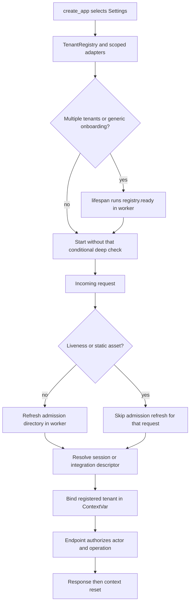
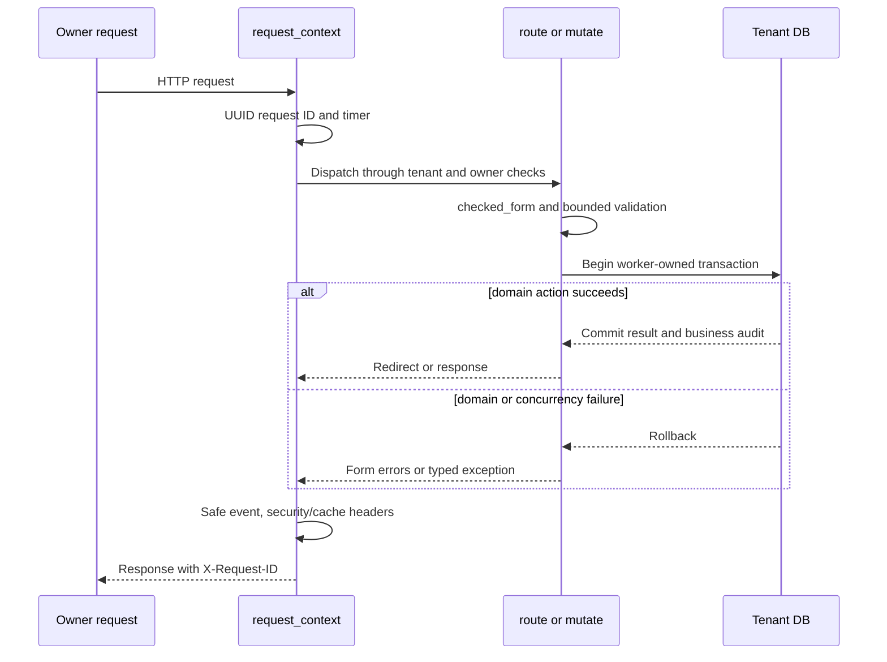

# 06 — Operations and troubleshooting code flows

Source: `4bb5c424d6e7d270cdca1479283896be77d581c3`. This is a maintenance map of actual commands, request branches, transactions and safe failure behavior. Commands and tests are described, not executed here. The last verified Stage remains version 29/source e282985/schema 009; this chapter makes no fresh runtime, provider, identity, database or production claim. Use [canonical continuation][canonical continuation], [hosting evidence][hosting evidence] and the [operational SOP](../06-deployment-and-operations-sop.md) before an authorized operation.

## 1. Locate the correct boundary first

| Question | Entry point | What it establishes |
| --- | --- | --- |
| Is the Python HTTP process serving? | [live][live] | `/health/live` returns status ok without deep tenant readiness. |
| Are selected tenant/schema/role/directory prerequisites ready? | [ready][ready] → [TenantRegistry.ready][TenantRegistry.ready] | Deep explicit check; generic 503 on failure, not a diagnostic payload. |
| Which fixed tenant owns this request/session/token? | [TenantMiddleware][TenantMiddleware] | Registry refresh/selection and request-local binding, not authorization by UUID alone. |
| Did a UI mutation commit? | [mutate][mutate] | Checked form, one worker-owned tenant transaction, redirect only after success. |
| Did a CLI action finish? | [main CLI dispatcher][main CLI dispatcher] | Selected command path plus sanitized terminal event/exit status. |
| Did a provider effect happen? | Billing/Sending durable operation state and exact provider reconciliation | A timeout or HTTP page alone cannot establish accepted versus rejected effect. |
| Does reconstructed DDL match a hosted catalog? | [Database reference](../database/README.md) and [metadata procedure](../database/07-inspect-live-metadata.md) | Empty reference is source structure; hosted parity requires separately authorized evidence. |

A maintenance action must distinguish source capability, configured activation, actual execution and human acceptance. Do not turn an old script/receipt, available tool or draft PR into authority to operate.

## 2. Application start, health and tenant binding

### Ordered trace

1. [create_app][create_app] obtains explicit config or `Settings.from_env`, constructs the registry/scoped settings/DB router/static manifest and logging. It does not implicitly migrate/create tables.
2. Lifespan performs deep readiness in a worker only when multiple tenants or generic onboarding require it; then emits application.started. Its finally disposes registry engines. Do not describe every process start as a full database audit.
3. `TenantMiddleware` requires session middleware. Except liveness/static paths it freshly refreshes admission mappings in a worker; selection remains on the request task. Invalid owner-session mapping clears the session and redirects. Anonymous public paths use the default descriptor; other anonymous workspace paths redirect.
4. Integration requests use the token's selector for registry routing, then their endpoint authenticates the complete credential/grant. The descriptor is not a caller-supplied schema/DSN or a default-owner access fallback. See [integration flow](05-integrations-and-subscriptions.md).
5. [bind][bind] rejects an unregistered descriptor, sets the ContextVar and resets it in finally. [DBRouter][DBRouter] and [RequestScopedSettings][RequestScopedSettings] resolve that current tenant; an offloaded unit must own its Session and receive the correct context.
6. [session_factory][session_factory] disables SQL echo, hides parameters, uses pre-ping/bounded pools and verifies expected role/schema on connect when configured. It is not a migration grant or unrestricted engine.
7. Deep `/health/ready` offloads `registry.ready`; `_check_databases` refreshes mappings and checks fixed/prepared descriptors, maintained `SCHEMA_HEAD`, relation access and applicable runtime privilege/foreign boundaries. [verify_admission_readiness][verify_admission_readiness] checks directory/identity coverage. Failures become a fixed RuntimeError and generic 503; never bypass the check to turn green.
8. Docker's process healthcheck uses liveness, while explicit release checks inspect both live and ready. [Docker healthcheck][Docker healthcheck] must not be relabeled as a deep database probe. Stage container port-wait/stream handling is in [Stage container][Stage container].

Maintenance checks: [readiness worker regression][readiness worker regression], [actual role isolation][actual role isolation], [prepared-slot drift tests][prepared-slot drift tests]. These tests are pointers, not new execution evidence.

## 3. HTTP transaction, error and observability trace

1. [request_context][request_context] generates a UUID and timer. Unexpected downstream exceptions become fixed HTML or integration JSON500; raw exception text is not returned/logged.
2. `mutate` obtains `checked_form` unless the caller supplied an already checked form. A nested synchronous `transact` opens `app.state.db.begin()` and invokes the domain action inside `run_in_threadpool`. The Session is created/used/closed in that worker; it is not handed between concurrent tasks.
3. Integrity/stale/version/form/domain/value errors roll back through transaction exit. Capacity errors add safe upgrade context; FormError retains field errors; controlled DomainError supplies its safe form message; database conflicts use fixed reread guidance. `on_error` re-renders, including awaitable callbacks, rather than silently committing partial work.
4. Only success stores the save notice and redirects 303. An external effect that already committed its own reservation is outside this generic UI transaction; use its dedicated reconciliation state machine.
5. [HTTP exception handler][HTTP exception handler] returns fixed integration/internal JSON shapes, redirects EnrollmentRequired to its selected enrollment destination, clears/rejects 401 sessions, or renders the controlled blocked page. [domain handler][domain handler] and [validation handler][validation handler] have separate sanitized integration versus UI branches.
6. `request_context` records request.failed for 5xx, request.completed otherwise, with FAILED outcome for any 4xx/5xx. It uses the registered route template, not actual query/path business identifiers. Response headers include X-Request-ID, CSP/security policy and no-store unless the exact versioned public-file rule permits caching. Dynamic checkout/provider/CSP branches must stay bounded to their selected route/configuration.

### Diagnostic log versus business audit

[safe_fields][safe_fields] accepts only typed/allowlisted request/execution/entity/actor UUIDs, outcomes, auth reasons/providers, registered routes, methods and integer status/duration/count. Unknown values are redacted. [SafeFormatter][SafeFormatter] allowlists event names, produces UTC JSON in hosted mode/readable development output and redacts exception information. [configure logging][configure logging] suppresses noisy raw Uvicorn/SQLAlchemy/Authlib/HTTPX/WeasyPrint/root handlers. [event][event] catches logging failures so committed business results remain intact.

[record business audit][record business audit] belongs to the domain database transaction; it is not permission to send business text to diagnostic logs. Do not add raw cookies/tokens/headers/query strings, names/emails/addresses, notes, line text, contract/tax/bank facts or PDFs to troubleshoot. Tests: [arbitrary input redaction][arbitrary input redaction], [exception contract][exception contract], [logger non-effectful failure][logger non-effectful failure].

## 4. CLI dispatcher and operational scripts

`timeker` is the [project script entry][project script entry] for `app.cli:main`. The dispatcher parses a required subcommand, creates execution ID/timer, validates Settings, configures logs and creates a lazy Session factory. A command-specific exception is caught by one terminal boundary: command.failed/FAILED, fixed stderr and exit1, with no raw exception. Success emits command.completed/SUCCEEDED and elapsed duration. Success means that command's behavior completed, not global readiness or UAT.

| Command or script | Exact source behavior | Boundary to preserve |
| --- | --- | --- |
| `timeker migrate` | [CLI migrate][CLI migrate] calls Alembic upgrade head with the configured target. | Source-driven DDL, not a dry-run. It does not invent a disposable target or grant runtime role migration authority. |
| `timeker doctor` | [CLI doctor][CLI doctor] executes SELECT1, imports WeasyPrint and prints version/environment. | Does not render PDF, validate every schema/guard, run migrations or certify hosted health. |
| `timeker admission-identities` | [identity synchronization][identity synchronization] verifies retained immutable bindings by default; `--apply` selects its write path. Registry is disposed in finally. | Existing-owner provider subject proof is operator-controlled; email equality is not account linking. |
| `timeker admission-grants` | [CLI directory grants][CLI directory grants] requires matching operator/runtime target, rejects production without explicit flag, applies directory grants in admin transaction. | Operator credential is named environment custody, never serving-runtime substitution or a logged DSN. |
| `timeker prepare-workspaces` | [prepare_workspaces][prepare_workspaces] preflights protected unallocated slots, target/head/roles/markers before bounded provisioning. | No fixed-owner tenant migration/seed; retained admissions cannot be reprovisioned. Production is separately gated. |
| `timeker seed --profile fixture/demo/alco` | [CLI seed][CLI seed] wraps selected seeding in a transaction and lets profile/domain guards run. | This is a writer. Fixture/demo are fictional; a real private source is never a public/test artifact or a release prerequisite. |
| `timeker render-invoice` | [CLI render artifact][CLI render artifact] obtains [artifact_bytes][artifact_bytes] and writes the specified file. | Issued bytes remain frozen; a file path/output can contain private data. No delivery occurs. |
| `timeker verify` | [CLI verify][CLI verify] sequentially runs pytest, Ruff and mypy with check=True. | Test fixture safety still matters; no browser/migration/hosted acceptance is supplied by its name alone. |
| [dev.ps1][dev.ps1] | Resolves uv, optional local PDF DLLs, enables dev login, syncs lock, migrates, optionally seeds fixture, then runs loopback Uvicorn. | Development-only multi-effect helper; do not use as hosted inspection or on an existing valuable target. |
| [invitation preview][invitation preview] | Validates explicit link/branding/bounded names and renders fictional preview. | It sends/provisions nothing; a rendered preview does not admit an owner. |
| [runtime grant SQL][runtime grant SQL] / [local init SQL][local init SQL] | Explicit schema privileges versus disposable development bootstrap. | Different purposes; hardcoded local/Supabase principals are not a generic hosted migration recipe. |
| [mailbox credential utility][mailbox credential utility] | Local human credential custody utility. | Not a backend integration prerequisite or normal troubleshooting read; do not extract its protected payload. |

### Ordered trace: an approved preparation action

1. Select exact environment and current protected descriptor catalog; `operation_catalog` does not infer arbitrary new slots from user input.
2. `prepare_workspaces` checks production authority first, matches operator/runtime database coordinates/TLS, verifies every slot connection and refuses a runtime operator.
3. One operator transaction takes the directory advisory lock, requires the maintained central head and rejects any retained slot admission. All descriptors are preflighted before role/schema mutations.
4. Migration/structure/guard/grant/empty-marker verification uses existing fixed-source contracts. Idempotent marked reruns must remain byte/authority compatible; unknown preexisting schemas are not adopted or reset.
5. Any failure rolls back the transaction. Finally disposes owned engine/catalog. Preserve failure receipts; do not retry by changing password/ownership or clearing admission rows.

Tests: [preparation idempotency][preparation idempotency], [late migration rollback][late migration rollback], [production before connection guard][production before connection guard]. These preparation paths differ from runtime [admit][admit], which reserves an already prepared slot without runtime DDL.

## 5. Internal jobs and schedules are distinct channels

1. [authenticated_body][authenticated_body] requires a configured strong internal key, ten-digit timestamp within 300 seconds, bounded body and constant-time HMAC over version/timestamp/exact request path/recipient/body digest. It does not trust browser cookies as machine authentication.
2. [archive_job][archive_job] chooses Case-only by exact path, rejects that Stage-specific path in production, binds each registered tenant and opens one transaction per tenant. Failure in one tenant is retained as aggregate 503; completed earlier tenant commits are not globally rolled back.
3. [run_archive][run_archive] takes a nonblocking advisory lock, processes bounded eligible records with row-lock/skip-locked behavior and retains archive markers. Case-only leaves Mail/timecards untouched; eligible Cases are Closed and beyond the reviewed retention boundary. It does not delete rows or reclaim storage.
4. Stage [scheduled handler][scheduled handler] accepts only the configured 02:17 UTC schedule and calls [archiveClosedCases][archiveClosedCases] through signed internal transport. The adapter requires expected Stage origin/profile, successful JSON response and drains/cancels response body. Source/configuration does not prove an actual scheduled run occurred.
5. [sending_job][sending_job] is a different endpoint, requires enabled provider plus jobs flag, and offloads [_sending_batch][_sending_batch]. It caps due delivery work across tenants and delegates each durable claim/send/settle to the existing Sending service. It is not reached by the Case-only cron; scheduled Sending remains off in retained Stage.
6. [receive_mail][receive_mail] separately requires capture configuration, signed bounded payload and valid capture address/owner. Do not repurpose auth SMTP or treat archive scheduling as mail transport activation.

Tests: [signed Case job][signed Case job], [retention replay boundary][retention replay boundary], [internal job tests][internal job tests], [Sending dispatch tests][Sending dispatch tests]. Manual/domain and provider-channel details are linked contracts, not newly activated jobs.

## 6. PDF, build and database recovery boundaries

[PDF render][PDF render] allocates its own execution UUID, renders an approved escaped template, blocks external asset retrieval with `deny_asset`, logs safe terminal timing and returns bytes/version. Any render exception becomes a fixed RuntimeError with no payload leak. An issued invoice download retrieves retained bytes through `artifact_bytes`; template changes must not silently regenerate an issued artifact.

Build/deploy is outside request/CLI health. The [Docker source][Docker source] and separate Stage/production profiles define explicit inputs. A Git commit/push does not deploy. Future release requires exact source/tests/config/image, compatible migration/grants and actual convergence/readback. See [deployment guide][deployment guide], [operations][operations] and current HOSTING rather than replaying archived carriers.

For a database discrepancy, separate ORM table/column metadata, migration-defined triggers/functions/ACLs, and actual installed environment. `Base.metadata.create_all()` cannot reproduce the 36 guard functions or their state/immutability protections. The [empty native reference](../database/README.md) covers 55 tables/634 columns at head 009 without hosted business rows; it is not a hosted backup or ACL installation. The [metadata collector](../database/inventory-live.sql) starts a read-only transaction and ends ROLLBACK; it is a future authorized catalog inspection, not a repair.

A restore/cutover must use a new isolated target, compatible source/image, encrypted backup and independent key custody. Verify full retained/prepared inventory, exact heads/grants/guards, immutable artifacts/balances/history and provider/revocation receipts. Reconcile already accepted emails, payments/webhooks and rotated credentials before reactivating writes. Restored Pending rows do not authorize resend/recharge. Source runbook: [capacity and recovery][capacity and recovery]; structural tests: [migration roundtrip][migration roundtrip], [private schema guards][private schema guards], [recovery rehearsal tests][recovery rehearsal tests].

## 7. Symptom → function → maintained evidence → runbook

| Symptom | First source boundary | Relevant test or runbook; bounded next interpretation |
| --- | --- | --- |
| Live 200 but ready 503 | `ready` → `TenantRegistry.ready` → `_check_databases` / admission readiness | readiness worker and private-schema tests; verify exact selected head/role/grants/directory, without bypass. |
| Workspace redirects to landing | `TenantMiddleware.session_tenant`, owner/session exception branch | [owner authentication contract][owner authentication contract] and tenancy tests; fresh normal proof, not copied session. |
| Generic provider sign-in rejection | Safe auth reason emitted by callback plus immutable binding logic | [social proof tests][social proof tests]; separate proof rejection from provider-not-linked. Generic page alone cannot name a cause. |
| Tool401/403 or missing tools | `authenticate_access`, grant scope/resource and `tool_catalog` | PKCE/scope/selector tests in integration chapter; exact client, audience, owner/readiness and revocation. |
| Tool 409 or MCP isError | `write_tool` / domain command versions/receipt | Delegated integration test263; reread versions and same-intent receipt, do not invent a fresh key to hide conflict. |
| Capacity rejected although records visible | `require_capacity` / `_assignment` / `usage` | Last-slot, parent-reactivation and unassigned tests; history access is not positive-growth entitlement. |
| Checkout/retention Pending or uncertain | Durable `_reserve` / `_record_failure` / reconciliation services | [billing uncertainty tests][billing uncertainty tests], retention tests; no automatic second provider mutation. |
| Webhook 409/503 | Raw signature/binding then `handle_verified_event` fetched-state checks | [webhook tests][webhook tests]; preserve event/digest and convergence, never log raw provider payload. |
| Duplicate/stale UI save | `mutate` integrity/version branch | [workflow feedback tests][workflow feedback tests]; transaction rollback plus controlled reread guidance. |
| PDF unavailable | `pdf.render` dependency/template/asset boundary | [PDF tests][PDF tests]; actual render needed, doctor import alone is insufficient. |
| Case cron configured but no observed run | Stage scheduled handler → signed Case path → archive job | Case retention tests and HOSTING; configuration/GET health is not scheduled execution proof. |
| Provisioning fails on head/marker/role | `prepare_workspaces` preflight, `_verify_slot` | Workspace-operation tests; do not reset password/owner or migrate fixed tenants incidentally. |
| Log backend fails or contains unsafe field | `safe_fields` / `SafeFormatter` / `event` | Logging tests; redact unknowns, preserve committed result and use DB audit separately. |
| Source/reconstruction/live schemas differ | Alembic head, actual catalog, runtime grants and compatible image | Database reference plus read-only inventory; record drift before separately scoped repair, never seed/reset. |

A test link identifies the regression surface; it does not mean it ran in this documentation task. Locate the actual test name before narrowing a new selection. No blanket live-health, recovery-time, security-certification or human-acceptance claim follows from this map.

## 8. Maintenance handoff

For any future correction, identify the concrete caller/branch and transaction/effect boundary above, reproduce only on the authorized target, reuse the existing domain service, preserve unchanged sibling evidence and failed attempts, verify the changed behavior/negative paths, and update canonical STATUS/DECISIONS/CONTINUE. Keep tests, Stage readback, product UAT and production authority distinct.

PH2 is closed administratively; PH3 awaits owner prompts. The bounded private PH2 production prelaunch is authorized; actual migration/deployment/readback are technically verified. Later PH3 prompts continue on Stage. Do not infer merge, migration, secret/provider changes, customer sends/charges or deployment from this code-flow reference.

[canonical continuation]: https://github.com/edlopezpm-ops/timeKER-Stage/blob/4bb5c424d6e7d270cdca1479283896be77d581c3/CONTINUE.md#L1
[hosting evidence]: https://github.com/edlopezpm-ops/timeKER-Stage/blob/4bb5c424d6e7d270cdca1479283896be77d581c3/HOSTING.md#L152
[live]: https://github.com/edlopezpm-ops/timeKER-Stage/blob/4bb5c424d6e7d270cdca1479283896be77d581c3/app/main.py#L703
[ready]: https://github.com/edlopezpm-ops/timeKER-Stage/blob/4bb5c424d6e7d270cdca1479283896be77d581c3/app/main.py#L707
[TenantRegistry.ready]: https://github.com/edlopezpm-ops/timeKER-Stage/blob/4bb5c424d6e7d270cdca1479283896be77d581c3/app/tenancy.py#L348
[TenantMiddleware]: https://github.com/edlopezpm-ops/timeKER-Stage/blob/4bb5c424d6e7d270cdca1479283896be77d581c3/app/tenancy.py#L469
[mutate]: https://github.com/edlopezpm-ops/timeKER-Stage/blob/4bb5c424d6e7d270cdca1479283896be77d581c3/app/main.py#L379
[main CLI dispatcher]: https://github.com/edlopezpm-ops/timeKER-Stage/blob/4bb5c424d6e7d270cdca1479283896be77d581c3/app/cli.py#L24
[create_app]: https://github.com/edlopezpm-ops/timeKER-Stage/blob/4bb5c424d6e7d270cdca1479283896be77d581c3/app/main.py#L118
[bind]: https://github.com/edlopezpm-ops/timeKER-Stage/blob/4bb5c424d6e7d270cdca1479283896be77d581c3/app/tenancy.py#L339
[DBRouter]: https://github.com/edlopezpm-ops/timeKER-Stage/blob/4bb5c424d6e7d270cdca1479283896be77d581c3/app/tenancy.py#L438
[RequestScopedSettings]: https://github.com/edlopezpm-ops/timeKER-Stage/blob/4bb5c424d6e7d270cdca1479283896be77d581c3/app/tenancy.py#L430
[session_factory]: https://github.com/edlopezpm-ops/timeKER-Stage/blob/4bb5c424d6e7d270cdca1479283896be77d581c3/app/db.py#L9
[verify_admission_readiness]: https://github.com/edlopezpm-ops/timeKER-Stage/blob/4bb5c424d6e7d270cdca1479283896be77d581c3/app/admission_operations.py#L90
[Docker healthcheck]: https://github.com/edlopezpm-ops/timeKER-Stage/blob/4bb5c424d6e7d270cdca1479283896be77d581c3/Dockerfile#L22
[Stage container]: https://github.com/edlopezpm-ops/timeKER-Stage/blob/4bb5c424d6e7d270cdca1479283896be77d581c3/deploy/cloudflare/src/index.ts#L6
[readiness worker regression]: https://github.com/edlopezpm-ops/timeKER-Stage/blob/4bb5c424d6e7d270cdca1479283896be77d581c3/tests/unit/test_readiness_worker.py#L11
[actual role isolation]: https://github.com/edlopezpm-ops/timeKER-Stage/blob/4bb5c424d6e7d270cdca1479283896be77d581c3/tests/integration/test_tenancy.py#L177
[prepared-slot drift tests]: https://github.com/edlopezpm-ops/timeKER-Stage/blob/4bb5c424d6e7d270cdca1479283896be77d581c3/tests/integration/test_workspace_operations.py#L145
[request_context]: https://github.com/edlopezpm-ops/timeKER-Stage/blob/4bb5c424d6e7d270cdca1479283896be77d581c3/app/main.py#L196
[HTTP exception handler]: https://github.com/edlopezpm-ops/timeKER-Stage/blob/4bb5c424d6e7d270cdca1479283896be77d581c3/app/main.py#L333
[domain handler]: https://github.com/edlopezpm-ops/timeKER-Stage/blob/4bb5c424d6e7d270cdca1479283896be77d581c3/app/main.py#L359
[validation handler]: https://github.com/edlopezpm-ops/timeKER-Stage/blob/4bb5c424d6e7d270cdca1479283896be77d581c3/app/main.py#L367
[safe_fields]: https://github.com/edlopezpm-ops/timeKER-Stage/blob/4bb5c424d6e7d270cdca1479283896be77d581c3/app/logging.py#L32
[SafeFormatter]: https://github.com/edlopezpm-ops/timeKER-Stage/blob/4bb5c424d6e7d270cdca1479283896be77d581c3/app/logging.py#L61
[configure logging]: https://github.com/edlopezpm-ops/timeKER-Stage/blob/4bb5c424d6e7d270cdca1479283896be77d581c3/app/logging.py#L81
[event]: https://github.com/edlopezpm-ops/timeKER-Stage/blob/4bb5c424d6e7d270cdca1479283896be77d581c3/app/logging.py#L104
[record business audit]: https://github.com/edlopezpm-ops/timeKER-Stage/blob/4bb5c424d6e7d270cdca1479283896be77d581c3/app/audit.py#L8
[arbitrary input redaction]: https://github.com/edlopezpm-ops/timeKER-Stage/blob/4bb5c424d6e7d270cdca1479283896be77d581c3/tests/unit/test_logging.py#L23
[exception contract]: https://github.com/edlopezpm-ops/timeKER-Stage/blob/4bb5c424d6e7d270cdca1479283896be77d581c3/tests/unit/test_logging.py#L36
[logger non-effectful failure]: https://github.com/edlopezpm-ops/timeKER-Stage/blob/4bb5c424d6e7d270cdca1479283896be77d581c3/tests/unit/test_logging.py#L61
[project script entry]: https://github.com/edlopezpm-ops/timeKER-Stage/blob/4bb5c424d6e7d270cdca1479283896be77d581c3/pyproject.toml#L16
[CLI migrate]: https://github.com/edlopezpm-ops/timeKER-Stage/blob/4bb5c424d6e7d270cdca1479283896be77d581c3/app/cli.py#L49
[CLI doctor]: https://github.com/edlopezpm-ops/timeKER-Stage/blob/4bb5c424d6e7d270cdca1479283896be77d581c3/app/cli.py#L53
[identity synchronization]: https://github.com/edlopezpm-ops/timeKER-Stage/blob/4bb5c424d6e7d270cdca1479283896be77d581c3/app/admission_operations.py#L15
[CLI directory grants]: https://github.com/edlopezpm-ops/timeKER-Stage/blob/4bb5c424d6e7d270cdca1479283896be77d581c3/app/cli.py#L76
[prepare_workspaces]: https://github.com/edlopezpm-ops/timeKER-Stage/blob/4bb5c424d6e7d270cdca1479283896be77d581c3/app/workspace_operations.py#L241
[CLI seed]: https://github.com/edlopezpm-ops/timeKER-Stage/blob/4bb5c424d6e7d270cdca1479283896be77d581c3/app/cli.py#L103
[CLI render artifact]: https://github.com/edlopezpm-ops/timeKER-Stage/blob/4bb5c424d6e7d270cdca1479283896be77d581c3/app/cli.py#L110
[artifact_bytes]: https://github.com/edlopezpm-ops/timeKER-Stage/blob/4bb5c424d6e7d270cdca1479283896be77d581c3/app/billing.py#L458
[CLI verify]: https://github.com/edlopezpm-ops/timeKER-Stage/blob/4bb5c424d6e7d270cdca1479283896be77d581c3/app/cli.py#L115
[dev.ps1]: https://github.com/edlopezpm-ops/timeKER-Stage/blob/4bb5c424d6e7d270cdca1479283896be77d581c3/scripts/dev.ps1#L1
[invitation preview]: https://github.com/edlopezpm-ops/timeKER-Stage/blob/4bb5c424d6e7d270cdca1479283896be77d581c3/scripts/render_invitation.py#L13
[runtime grant SQL]: https://github.com/edlopezpm-ops/timeKER-Stage/blob/4bb5c424d6e7d270cdca1479283896be77d581c3/scripts/postgres-runtime-grants.sql#L1
[local init SQL]: https://github.com/edlopezpm-ops/timeKER-Stage/blob/4bb5c424d6e7d270cdca1479283896be77d581c3/scripts/postgres-init.sql#L1
[mailbox credential utility]: https://github.com/edlopezpm-ops/timeKER-Stage/blob/4bb5c424d6e7d270cdca1479283896be77d581c3/scripts/mailbox-credential.ps1#L1
[preparation idempotency]: https://github.com/edlopezpm-ops/timeKER-Stage/blob/4bb5c424d6e7d270cdca1479283896be77d581c3/tests/integration/test_workspace_operations.py#L87
[late migration rollback]: https://github.com/edlopezpm-ops/timeKER-Stage/blob/4bb5c424d6e7d270cdca1479283896be77d581c3/tests/integration/test_workspace_operations.py#L271
[production before connection guard]: https://github.com/edlopezpm-ops/timeKER-Stage/blob/4bb5c424d6e7d270cdca1479283896be77d581c3/tests/integration/test_workspace_operations.py#L296
[admit]: https://github.com/edlopezpm-ops/timeKER-Stage/blob/4bb5c424d6e7d270cdca1479283896be77d581c3/app/admission.py#L142
[authenticated_body]: https://github.com/edlopezpm-ops/timeKER-Stage/blob/4bb5c424d6e7d270cdca1479283896be77d581c3/app/internal_routes.py#L82
[archive_job]: https://github.com/edlopezpm-ops/timeKER-Stage/blob/4bb5c424d6e7d270cdca1479283896be77d581c3/app/internal_routes.py#L110
[run_archive]: https://github.com/edlopezpm-ops/timeKER-Stage/blob/4bb5c424d6e7d270cdca1479283896be77d581c3/app/archiving.py#L60
[scheduled handler]: https://github.com/edlopezpm-ops/timeKER-Stage/blob/4bb5c424d6e7d270cdca1479283896be77d581c3/deploy/cloudflare/src/index.ts#L62
[archiveClosedCases]: https://github.com/edlopezpm-ops/timeKER-Stage/blob/4bb5c424d6e7d270cdca1479283896be77d581c3/deploy/cloudflare/src/stage-archive.ts#L4
[sending_job]: https://github.com/edlopezpm-ops/timeKER-Stage/blob/4bb5c424d6e7d270cdca1479283896be77d581c3/app/internal_routes.py#L21
[_sending_batch]: https://github.com/edlopezpm-ops/timeKER-Stage/blob/4bb5c424d6e7d270cdca1479283896be77d581c3/app/internal_routes.py#L42
[receive_mail]: https://github.com/edlopezpm-ops/timeKER-Stage/blob/4bb5c424d6e7d270cdca1479283896be77d581c3/app/internal_routes.py#L134
[signed Case job]: https://github.com/edlopezpm-ops/timeKER-Stage/blob/4bb5c424d6e7d270cdca1479283896be77d581c3/tests/integration/test_case_retention.py#L48
[retention replay boundary]: https://github.com/edlopezpm-ops/timeKER-Stage/blob/4bb5c424d6e7d270cdca1479283896be77d581c3/tests/integration/test_case_retention.py#L15
[internal job tests]: https://github.com/edlopezpm-ops/timeKER-Stage/blob/4bb5c424d6e7d270cdca1479283896be77d581c3/tests/integration/test_internal_jobs.py#L1
[Sending dispatch tests]: https://github.com/edlopezpm-ops/timeKER-Stage/blob/4bb5c424d6e7d270cdca1479283896be77d581c3/tests/integration/test_sending_dispatch.py#L1
[PDF render]: https://github.com/edlopezpm-ops/timeKER-Stage/blob/4bb5c424d6e7d270cdca1479283896be77d581c3/app/pdf.py#L17
[Docker source]: https://github.com/edlopezpm-ops/timeKER-Stage/blob/4bb5c424d6e7d270cdca1479283896be77d581c3/Dockerfile#L1
[deployment guide]: https://github.com/edlopezpm-ops/timeKER-Stage/blob/4bb5c424d6e7d270cdca1479283896be77d581c3/docs/DEPLOYMENT.md#L1
[operations]: https://github.com/edlopezpm-ops/timeKER-Stage/blob/4bb5c424d6e7d270cdca1479283896be77d581c3/docs/OPERATIONS.md#L142
[capacity and recovery]: https://github.com/edlopezpm-ops/timeKER-Stage/blob/4bb5c424d6e7d270cdca1479283896be77d581c3/docs/OPERATIONS.md#L711
[migration roundtrip]: https://github.com/edlopezpm-ops/timeKER-Stage/blob/4bb5c424d6e7d270cdca1479283896be77d581c3/tests/integration/test_migrations.py#L35
[private schema guards]: https://github.com/edlopezpm-ops/timeKER-Stage/blob/4bb5c424d6e7d270cdca1479283896be77d581c3/tests/integration/test_migrations.py#L66
[recovery rehearsal tests]: https://github.com/edlopezpm-ops/timeKER-Stage/blob/4bb5c424d6e7d270cdca1479283896be77d581c3/tests/integration/test_recovery_rehearsal.py#L1
[owner authentication contract]: https://github.com/edlopezpm-ops/timeKER-Stage/blob/4bb5c424d6e7d270cdca1479283896be77d581c3/app/auth.py#L1
[social proof tests]: https://github.com/edlopezpm-ops/timeKER-Stage/blob/4bb5c424d6e7d270cdca1479283896be77d581c3/tests/integration/test_social_auth.py#L1
[billing uncertainty tests]: https://github.com/edlopezpm-ops/timeKER-Stage/blob/4bb5c424d6e7d270cdca1479283896be77d581c3/tests/integration/test_subscription_billing.py#L475
[webhook tests]: https://github.com/edlopezpm-ops/timeKER-Stage/blob/4bb5c424d6e7d270cdca1479283896be77d581c3/tests/unit/test_paddle.py#L597
[workflow feedback tests]: https://github.com/edlopezpm-ops/timeKER-Stage/blob/4bb5c424d6e7d270cdca1479283896be77d581c3/tests/e2e/test_workflow_feedback_browser.py#L1
[PDF tests]: https://github.com/edlopezpm-ops/timeKER-Stage/blob/4bb5c424d6e7d270cdca1479283896be77d581c3/tests/test_project_billing.py#L39
