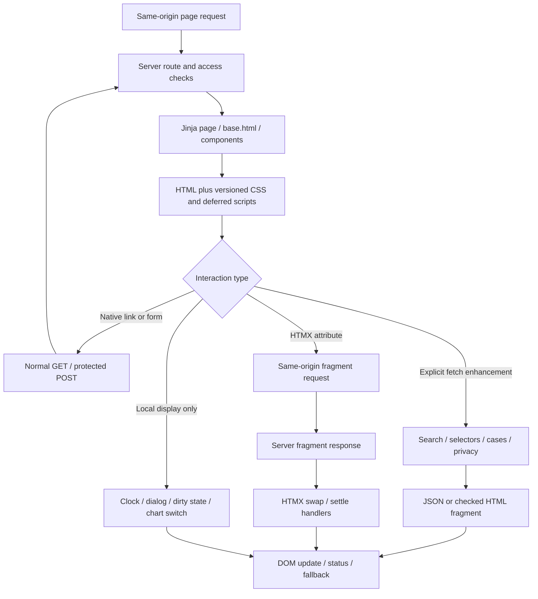
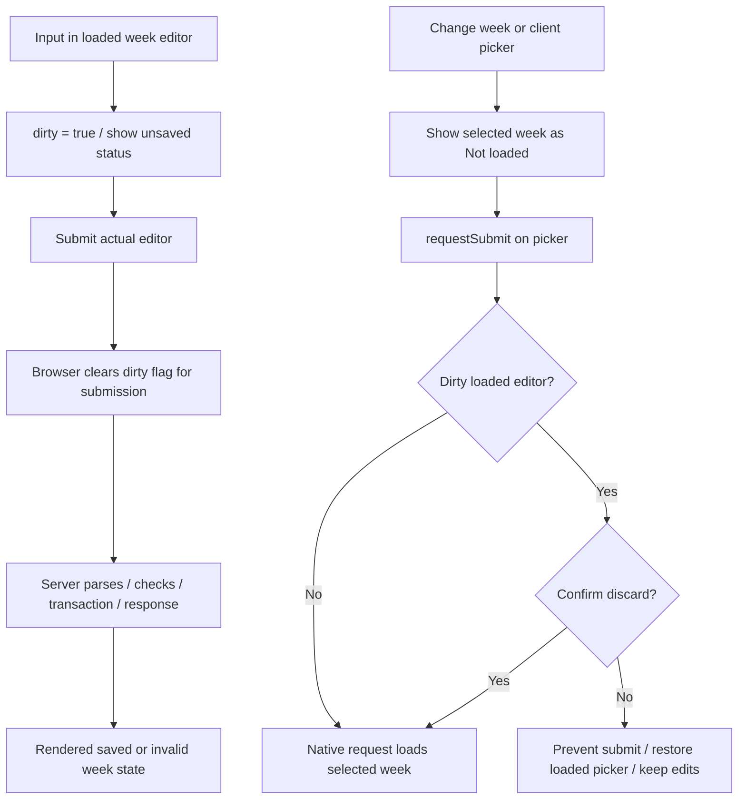
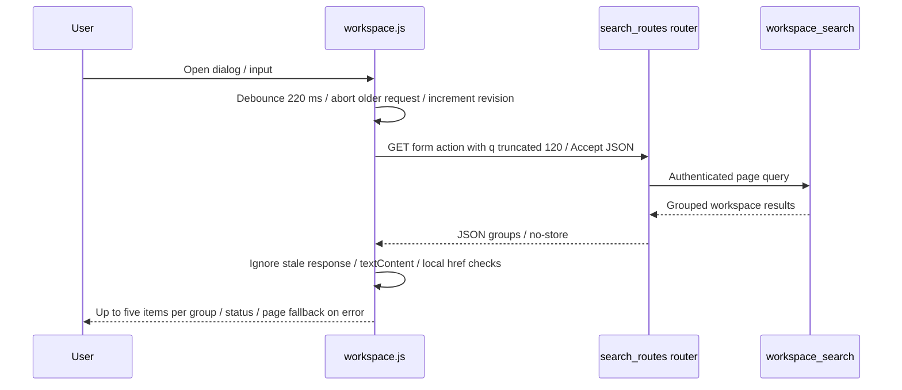
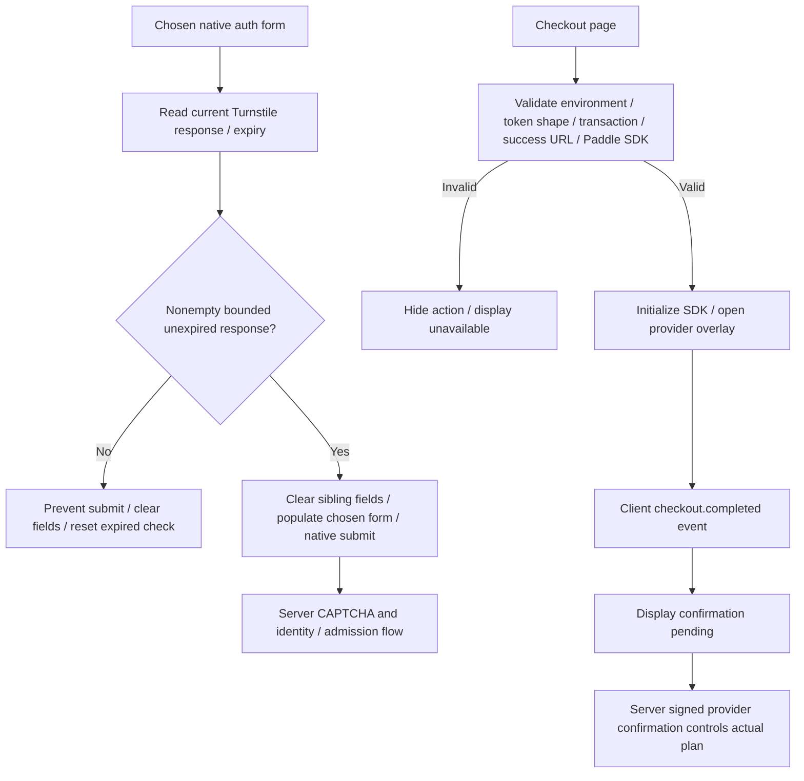
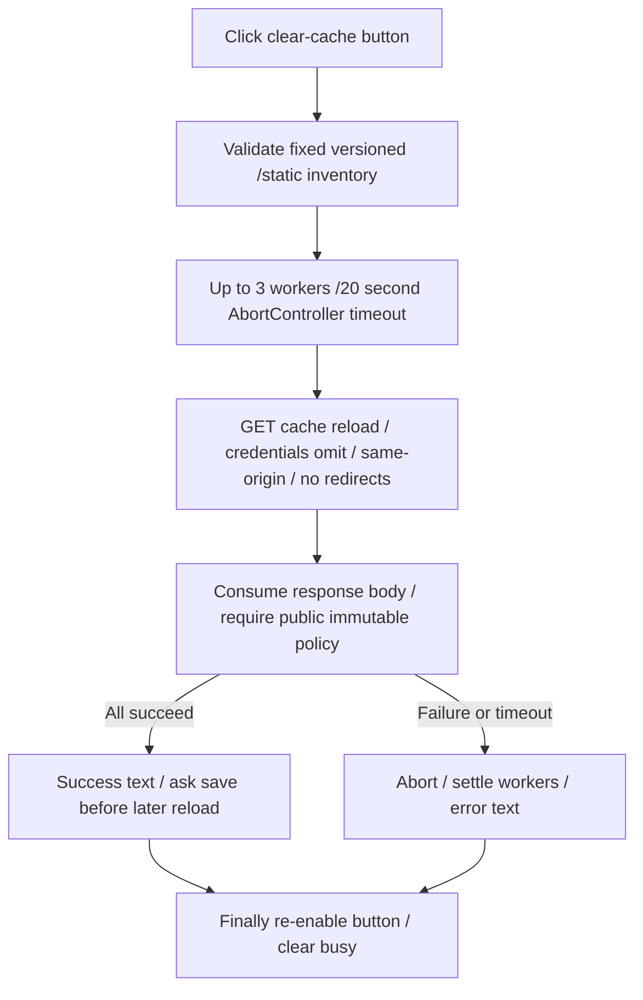

# Browser, templates and progressive enhancement

Source snapshot `4bb5c424d6e7d270cdca1479283896be77d581c3`. These diagrams trace
the existing browser code; they are not newly observed browser executions.
Backend authorization, validation, transactions and provider confirmation remain
in their traced server flows. The browser does not calculate authoritative money,
reserve tenant slots or activate a paid subscription.

## Page and interaction dispatch

1. [`base.html:1`][base] imports shared components, links content-versioned assets
   and defers HTMX, `app.js`, `usage.js` and `workspace.js`; page blocks add their
   own scripts. Its HTMX configuration disables eval/script tags, limits requests
   to self and disables automatic indicator styling.
2. Server templates retain native form/link behavior. The individual scripts
   opt in only when their expected DOM hooks exist. Authenticated navigation and
   feature-dependent entries are rendered by the server, not a client router.
3. [`app.js:125`][selectors] enhances bounded lookup refreshes. The Cases filter
   has its own request cancellation/revision handling and replaces a checked
   Cases fragment; HTMX processes inserted content afterward.
4. [`app.js:276`][htmx] handles pending/settled UI, while later blocks handle
   accessible dialogs, account/menu interactions, privacy feedback, validation
   feedback and dismissible save notices. These are presentation effects, not
   database state changes.

## Timecards: unsaved input and actual server save are separate

[`app.js:66`][dirty] tracks editor input, picker changes, capture-phase form
submission and `beforeunload`. Clearing the browser flag on submit is not proof
of a database commit: the response still goes through backend validation.
[`timecards.js:1`][timecards] separately enables removal only when permitted and
at least one draft is selected. Selection is not an edit to recorded time. The
internal-timecard toggle adjusts native client-field requirements and submits
the picker; a canceled picker submit restores its internal flag from the loaded
editor. The domain flow is in [work and billing](03-work-and-billing.md).

## Search and Cases use distinct fragment protocols

[`workspace.js:15`][workspace] guards stale results by request revision, sets an
abort controller and writes labels/context with text nodes. It skips non-local
or protocol-relative result links. Closing the dialog cancels work and returns
focus. [`search_routes.py:9`][search] chooses JSON for its negotiated request and
otherwise renders the full search page; search is a tenant-scoped read.

[`cases.js:10`][cases] uses a different loader: header
`X-Timeker-Fragment: case-mass-edit`, same-origin credentials, GET loading or POST
form data including the native submitter. It accepts the expected HTML content,
or a successful `saved` JSON result that navigates to `/cases`. Server redirects
and invalid input have distinct branches. Aborting a browser request does not
prove an already submitted server mutation was rolled back.

[`workspace.js:107`][rhythm] also enhances the Dashboard rhythm switch entirely
from server-rendered values, updates the URL with `history.replaceState` and
preserves independent detail pagination across HTMX swaps. It does not fetch new
business totals when toggling the pre-rendered bars/contributions views.

## Login security check and checkout confirmation

[`auth_challenge.js:21`][auth] prevents double submission and fails closed for a
missing, expired or overlong response; a back/forward-cache return clears fields
and resets the check. This client gate never substitutes for server verification.

[`paddle_checkout.js:20`][paddle] checks the environment and same-origin success
destination, transaction/token shapes and SDK availability; live-mode code also
requires the canonical production origin. Sandbox mode is selected explicitly.
The provider client event changes status text only. Follow [subscription server
confirmation](05-integrations-and-subscriptions.md) to diagnose a pending plan;
do not mark a plan active from the overlay or callback text alone.

## Settings public-file refresh

[`settings_cache.js:14`][cache] accepts 1–32 distinct versioned single-file static
URLs. It checks same-origin/no hash and the content-version syntax. The loop
consumes each body and rejects private/no-store/error responses. It does not
reload the page, clear local/session storage, purge a CDN, fetch owner data or
replace already executing JavaScript. An unsaved editor stays in the same DOM.
[`static_assets.py:10`][assets] supplies the public cache policy/versioning side.

## Privacy, contact and decorative clock

- [`usage.js:9`][usage] requires server-provided consent, configured collection,
  visible page and no GPC/DNT/block marker. Its bounded coarse event request has
  a 3-second timeout and no retry; consent changes/storage/pagehide cancel pending
  requests. Server consent validation remains authoritative. No business values,
  arbitrary URL, IDs or form payload are sent by this browser collector.
- [`app.js:491`][privacy] submits privacy preferences and dispatches
  `timeker:privacychange`; the collector stops or resumes from the response.
  [`privacy.py:74`][privacyserver] and [`usage.py:42`][usageserver] are separate
  server handlers. The local blocked marker is not an authorization grant.
- [`contact.js:31`][contact] submits once, displays accepted/429/uncertain states
  and uses a cooldown with an explicit restart link. An uncertain result is not
  retried automatically. The message is cleared only after accepted confirmation.
  Contact delivery is separate from statement/proposal delivery and auth email.
- [`app.js:1`][clock] animates the decorative browser-local clock, stops/resumes
  around page visibility/lifecycle and reduced-motion changes. Browser-local
  display does not redefine the business timezone or stored integer minutes.

## Symptom → inspect → focused evidence

| Symptom | First source/branch | Existing test entry point |
| --- | --- | --- |
| Picker shows another week but input remains unsaved | Dirty/pending-selection and capture-phase submit branch | [Timecard selection][testselection] |
| Search flashes older results | revision / abort / modal-close branch | [Workspace search browser][testsearch] |
| Case bulk edit returns a full page/error | Expected fragment marker, response type, submitter/CSRF and server handler | [Case mass edit browser][testcases] |
| File refresh reports error | URL inventory, fetch abort, cache headers; preserve owner state | [Settings refresh browser][testcache] |
| Checkout completed but plan pending | Client text vs signed server event/ledger | [Paddle overlay browser][testpaddle] |
| Auth form submits without a valid challenge | Client response selection plus server verify; never bypass | [OAuth CSP browser][testauth] |
| Usage still sends after opt-out | cancel/block marker and server consent gates | [Cookie preferences browser][testprivacy] |

These are existing test locations, not tests executed for this documentary change.
Never copy tokens, form values, network payloads or real business records into
troubleshooting reports. Record route/source version, sanitized outcome, request
correlation where available and the branch actually observed.

[base]: https://github.com/edlopezpm-ops/timeKER-Stage/blob/4bb5c424d6e7d270cdca1479283896be77d581c3/app/web/templates/base.html#L1
[selectors]: https://github.com/edlopezpm-ops/timeKER-Stage/blob/4bb5c424d6e7d270cdca1479283896be77d581c3/app/web/static/app.js#L125
[htmx]: https://github.com/edlopezpm-ops/timeKER-Stage/blob/4bb5c424d6e7d270cdca1479283896be77d581c3/app/web/static/app.js#L276
[dirty]: https://github.com/edlopezpm-ops/timeKER-Stage/blob/4bb5c424d6e7d270cdca1479283896be77d581c3/app/web/static/app.js#L66
[timecards]: https://github.com/edlopezpm-ops/timeKER-Stage/blob/4bb5c424d6e7d270cdca1479283896be77d581c3/app/web/static/timecards.js#L1
[workspace]: https://github.com/edlopezpm-ops/timeKER-Stage/blob/4bb5c424d6e7d270cdca1479283896be77d581c3/app/web/static/workspace.js#L15
[search]: https://github.com/edlopezpm-ops/timeKER-Stage/blob/4bb5c424d6e7d270cdca1479283896be77d581c3/app/search_routes.py#L9
[cases]: https://github.com/edlopezpm-ops/timeKER-Stage/blob/4bb5c424d6e7d270cdca1479283896be77d581c3/app/web/static/cases.js#L10
[rhythm]: https://github.com/edlopezpm-ops/timeKER-Stage/blob/4bb5c424d6e7d270cdca1479283896be77d581c3/app/web/static/workspace.js#L107
[auth]: https://github.com/edlopezpm-ops/timeKER-Stage/blob/4bb5c424d6e7d270cdca1479283896be77d581c3/app/web/static/auth_challenge.js#L21
[paddle]: https://github.com/edlopezpm-ops/timeKER-Stage/blob/4bb5c424d6e7d270cdca1479283896be77d581c3/app/web/static/paddle_checkout.js#L20
[cache]: https://github.com/edlopezpm-ops/timeKER-Stage/blob/4bb5c424d6e7d270cdca1479283896be77d581c3/app/web/static/settings_cache.js#L14
[assets]: https://github.com/edlopezpm-ops/timeKER-Stage/blob/4bb5c424d6e7d270cdca1479283896be77d581c3/app/static_assets.py#L10
[usage]: https://github.com/edlopezpm-ops/timeKER-Stage/blob/4bb5c424d6e7d270cdca1479283896be77d581c3/app/web/static/usage.js#L9
[privacy]: https://github.com/edlopezpm-ops/timeKER-Stage/blob/4bb5c424d6e7d270cdca1479283896be77d581c3/app/web/static/app.js#L491
[privacyserver]: https://github.com/edlopezpm-ops/timeKER-Stage/blob/4bb5c424d6e7d270cdca1479283896be77d581c3/app/privacy.py#L74
[usageserver]: https://github.com/edlopezpm-ops/timeKER-Stage/blob/4bb5c424d6e7d270cdca1479283896be77d581c3/app/usage.py#L42
[contact]: https://github.com/edlopezpm-ops/timeKER-Stage/blob/4bb5c424d6e7d270cdca1479283896be77d581c3/app/web/static/contact.js#L31
[clock]: https://github.com/edlopezpm-ops/timeKER-Stage/blob/4bb5c424d6e7d270cdca1479283896be77d581c3/app/web/static/app.js#L1
[testselection]: https://github.com/edlopezpm-ops/timeKER-Stage/blob/4bb5c424d6e7d270cdca1479283896be77d581c3/tests/e2e/test_timecard_selection.py
[testsearch]: https://github.com/edlopezpm-ops/timeKER-Stage/blob/4bb5c424d6e7d270cdca1479283896be77d581c3/tests/e2e/test_workspace_search_browser.py
[testcases]: https://github.com/edlopezpm-ops/timeKER-Stage/blob/4bb5c424d6e7d270cdca1479283896be77d581c3/tests/e2e/test_case_mass_edit_browser.py
[testcache]: https://github.com/edlopezpm-ops/timeKER-Stage/blob/4bb5c424d6e7d270cdca1479283896be77d581c3/tests/e2e/test_settings_cache_refresh_browser.py
[testpaddle]: https://github.com/edlopezpm-ops/timeKER-Stage/blob/4bb5c424d6e7d270cdca1479283896be77d581c3/tests/e2e/test_paddle_overlay_browser.py
[testauth]: https://github.com/edlopezpm-ops/timeKER-Stage/blob/4bb5c424d6e7d270cdca1479283896be77d581c3/tests/e2e/test_oauth_csp_browser.py
[testprivacy]: https://github.com/edlopezpm-ops/timeKER-Stage/blob/4bb5c424d6e7d270cdca1479283896be77d581c3/tests/e2e/test_cookie_preferences_browser.py

## Private prelaunch Sandbox policy

Production Sandbox is permitted only with explicit prelaunch, canonical `https://timeker.aekr.io`, fixed-owner mode and all generic/public/email-public/Stage/Live flags false. `PaddleSandbox` validates the exact Sandbox key/token shapes; Live rejects prelaunch. The checkout template independently requires matching verified provider mode and test token/transaction shapes before loading the SDK. A visible private-preview notice says payments use test mode. Sources: [app/paddle.py](https://github.com/edlopezpm-ops/timeKER-Stage/blob/4bb5c424d6e7d270cdca1479283896be77d581c3/app/paddle.py#L249), [app/web/templates/subscription_checkout.html](https://github.com/edlopezpm-ops/timeKER-Stage/blob/4bb5c424d6e7d270cdca1479283896be77d581c3/app/web/templates/subscription_checkout.html#L5), [app/web/templates/base.html](https://github.com/edlopezpm-ops/timeKER-Stage/blob/4bb5c424d6e7d270cdca1479283896be77d581c3/app/web/templates/base.html#L9), [deploy/cloudflare/src/proxy.ts](https://github.com/edlopezpm-ops/timeKER-Stage/blob/4bb5c424d6e7d270cdca1479283896be77d581c3/deploy/cloudflare/src/proxy.ts#L131).

The exception enables existing subscription and commercial-document workspace behavior without copying Stage identities/data or enabling outbound Sending/jobs. Checkout return does not activate a plan: signed/fetched provider confirmation still applies. The technical production release is verified; actual owner provider/human rehearsal remains pending; no live charge is authorized by this reference.

<!-- timeker-final-release-evidence -->
## Private prelaunch subscription presentation

The account/payment-controls, change-review, customer-portal and retention-review partials now apply the same explicit production Sandbox exception as checkout: canonical origin, prelaunch true and generic/public/email-public/Stage/Live flags false. Their Live branch separately rejects prelaunch. Account/payment controls still require configured, verified, available and history-compatible provider state; rendering a button or returning from checkout does not confirm an entitlement. Sources: [app/web/templates/subscription_account.html](https://github.com/edlopezpm-ops/timeKER-Stage/blob/4bb5c424d6e7d270cdca1479283896be77d581c3/app/web/templates/subscription_account.html#L2), [app/web/templates/subscription_payment_controls.html](https://github.com/edlopezpm-ops/timeKER-Stage/blob/4bb5c424d6e7d270cdca1479283896be77d581c3/app/web/templates/subscription_payment_controls.html#L2), [app/web/templates/subscription_change_review.html](https://github.com/edlopezpm-ops/timeKER-Stage/blob/4bb5c424d6e7d270cdca1479283896be77d581c3/app/web/templates/subscription_change_review.html#L2), [app/web/templates/subscription_portal.html](https://github.com/edlopezpm-ops/timeKER-Stage/blob/4bb5c424d6e7d270cdca1479283896be77d581c3/app/web/templates/subscription_portal.html#L2), [app/web/templates/subscription_retention_review.html](https://github.com/edlopezpm-ops/timeKER-Stage/blob/4bb5c424d6e7d270cdca1479283896be77d581c3/app/web/templates/subscription_retention_review.html#L2).

The bounded template/browser verification is retained separately from the real owner's pending Google/acknowledgment, Verify catalog and plan choice. The release created no Paddle billing record or transaction and did not exercise a real paid-owner lifecycle.
<!-- /timeker-final-release-evidence -->
