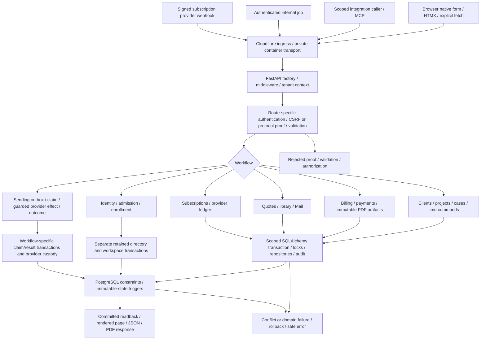

# timeKER code flow — maintenance keystone

This is a source-traced maintenance reference for commit
`4bb5c424d6e7d270cdca1479283896be77d581c3` of the reviewed private-prelaunch candidate branch. Diagrams
follow actual entry points, function branches, transaction boundaries, failure
outcomes and external-effect custody. They describe source behavior, not fresh
Stage/PROD execution or an approved future SDK.

GitHub renders the Mermaid diagrams directly in these Markdown files. Use the
[single complete code-flow Markdown](timeKER-CODE-FLOW-FULL.md) for one continuous
reading copy, or the module chapters below. No separate website is required.

| Chapter | What to trace |
| --- | --- |
| [01 Runtime and requests](01-runtime-and-request.md) | Worker/container ingress, app factory, middleware, tenant/session checks, worker thread, transaction, template and response. |
| [02 Identity and admission](02-identity-and-admission.md) | Existing owner vs new admission, email/social proof, finite slot reservation, enrollment/acknowledgment and explicit first plan. |
| [03 Work and billing](03-work-and-billing.md) | Client/project/case lifecycle, timecards, delegated commands/imports, exact minutes, statement issue/PDF/payment/credit memo. |
| [04 Documents, Mail and Sending](04-documents-mail-and-sending.md) | Quotes/revisions/library/mail custody, immutable documents, separate outboxes, dispatch locks, uncertain outcomes, stops/retries. |
| [05 Integrations and subscriptions](05-integrations-and-subscriptions.md) | OAuth grants/tokens/MCP/scopes/idempotency, quotas, provider ledger, checkout/webhook/portal reconciliation. |
| [06 Operations and troubleshooting](06-operations-and-troubleshooting.md) | CLI/health/role readiness, correlation and sanitized logging, operator boundaries, symptom→function→test→runbook. |
| [07 Browser and UI](07-browser-and-ui.md) | Jinja/native forms/HTMX, unsaved weeks, search/case fragments, auth challenge, checkout status, cache refresh and privacy. |
| [08 Every Python module/symbol](08-module-and-symbol-index.md) | Complete production/support AST inventory with declarations, source lines, import edges and explicit static-analysis limits. |

## End-to-end code map



This overview groups flows. It does not claim all routes use one shared
transaction or one proof protocol. Browser form mutations, bearer-token MCP,
signed provider webhooks and internal jobs have different trust boundaries.
Admission and external dispatch have deliberately separate durable stages; their
chapter diagrams explain those points rather than hiding them inside one box.

The [database reference](../database/README.md) supplies every table, FK,
constraint, final function and trigger used at the persistence boundary. The
[route inventory](../10-http-routes-and-templates.md) supplies every literal route
declaration; literal decorators need their router composition to establish the
full dispatch path. The [source/test inventory](../12-source-map-tests-and-manifest.md)
supplies all source hashes and test declarations.

## How to read a diagram as code evidence

1. Select the actual entry point and exact source/runtime version. Match the
   route, caller and proof type before following a diagram.
2. Follow named functions and their pinned source links. An error branch can
   terminate before a service, transaction or external provider is reached.
3. Identify who begins/commits/rolls back each transaction and which state is
   already durable before network I/O. A timeout never proves no commit/send.
4. Check table/guard/invariant references and the response/readback branch. A
   toast, redirect, rendered form or provider overlay is not persistence proof.
5. Locate the existing focused test or operator runbook. Test locations listed
   here were inspected as evidence; the documentary update did not rerun the
   product suite, hosted flows, identity proof, recovery or provider lifecycle.

The [AST JSON](module-symbol-call-index.json) covers 118 tracked Python modules:
90 application, 27 Alembic including its environment and 1 support script; 103 class
declarations, 945 function/async declarations and 13,150 syntactic call sites. It
also records 180 app literal route decorators and 438 internal declared-import
edges. This is a source-location index, not an inferred runtime call graph.
The [declared-import Mermaid source](declared-imports.mmd) is correspondingly a
dependency declaration graph, not chronological flow. The hand-traced module
diagrams explain control behavior the AST cannot prove.

## Keystone contract for maintenance, whitepaper and future SDK

| Future use | Evidence already provided | Work that remains a separate deliverable |
| --- | --- | --- |
| Troubleshooting | Entry/proof/branch/transaction/effect/result maps; source and focused-test pointers | Observe the actual environment/version and collect sanitized correlated evidence for the incident. |
| Maintenance | All Python declarations/call-site locations/import edges, module flow chapters, database layouts and final guards | Make an authorized change, update affected diagrams/contracts and verify the changed behavior. |
| Technical whitepaper | Actual architecture, tenancy, data invariants, effect custody and recorded limits | Write the whitepaper for a defined audience; validate any operational/performance/security claims. |
| Future SDK | Existing scoped integration and MCP flow, authentication/lifecycle/idempotency/error boundaries | Select/version a supported external contract, define compatibility and generate/build/test the SDK. Internal form handlers are not automatically public SDK methods. |

Do not turn a current implementation detail or a static call expression into a
stable public contract. Source capability, deployment activation, observed
execution and human acceptance remain different facts. PH2 residuals, Stage-only
boundaries and authorized private prelaunch and later public/Live production boundaries remain in the dossier.

## Incident evidence template

```text
Observed environment and timestamp:
Observed deployed source/image/schema head:
Entry point, method and caller category:
Proof/access branch reached (sanitized):
Request/execution correlation ID, if emitted:
Expected named function / actual observed branch:
Transaction durable before failure? Evidence, or UNKNOWN:
External effect status: not reached / confirmed / uncertain / UNKNOWN:
Safe error code/status and sanitized readback:
Relevant table/constraint/function/trigger:
Existing focused test and result, if actually run:
Recovery decision / authorized operator / next bounded action:
```

Do not place cookies, tokens, emails, business descriptions, documents or raw
provider payloads in an incident report. Unknown fields stay UNKNOWN. Do not
retry a financial mutation, delivery or admission by assuming a timeout rolled
back its durable state.

## Keeping this reference current

This dossier describes the pinned application; canonical requirements remain in
the source repository. For a changed entry point or invariant, update the affected
flow/transaction/error/source/test mapping in the same documentary cycle. Refresh
the AST index and source-bound provenance after a source change; refresh database
structure only through the authorized migration/reference workflow. Reassemble
the reading copies and verify package hashes and links. Do not relabel source
review as runtime validation or automatically execute deployment/operator steps.
