# timeKER — complete code-flow reading copy

Generated from the maintenance overview and eight chapters; pinned source
traces are not runtime validation. See static-analysis and evidence limits.

# timeKER code flow — maintenance keystone

This is a source-traced maintenance reference for commit
`9fc9eebdaf9f52170530c8a28d34f6c8cd612c64` of the prepared PH3 branch. Diagrams
follow actual entry points, function branches, transaction boundaries, failure
outcomes and external-effect custody. They describe source behavior, not fresh
Stage/PROD execution or an approved future SDK.

GitHub renders the Mermaid diagrams directly in these Markdown files. Use the
[single complete code-flow Markdown](timeKER-CODE-FLOW-FULL.md) for one continuous
reading copy, or the module chapters below. No separate website is required.

| Chapter | What to trace |
| --- | --- |
| [01 Runtime and requests](01-runtime-and-request.md) | Worker/container ingress, app factory, middleware, tenant/session checks, worker thread, transaction, template and response. |
| [02 Identity and admission](02-identity-and-admission.md) | Existing owner vs new admission, email/social proof, finite slot reservation, enrollment/acknowledgment and explicit first plan. |
| [03 Work and billing](03-work-and-billing.md) | Client/project/case lifecycle, timecards, delegated commands/imports, exact minutes, statement issue/PDF/payment/credit memo. |
| [04 Documents, Mail and Sending](04-documents-mail-and-sending.md) | Quotes/revisions/library/mail custody, immutable documents, separate outboxes, dispatch locks, uncertain outcomes, stops/retries. |
| [05 Integrations and subscriptions](05-integrations-and-subscriptions.md) | OAuth grants/tokens/MCP/scopes/idempotency, quotas, provider ledger, checkout/webhook/portal reconciliation. |
| [06 Operations and troubleshooting](06-operations-and-troubleshooting.md) | CLI/health/role readiness, correlation and sanitized logging, operator boundaries, symptom→function→test→runbook. |
| [07 Browser and UI](07-browser-and-ui.md) | Jinja/native forms/HTMX, unsaved weeks, search/case fragments, auth challenge, checkout status, cache refresh and privacy. |
| [08 Every Python module/symbol](08-module-and-symbol-index.md) | Complete production/support AST inventory with declarations, source lines, import edges and explicit static-analysis limits. |

## End-to-end code map

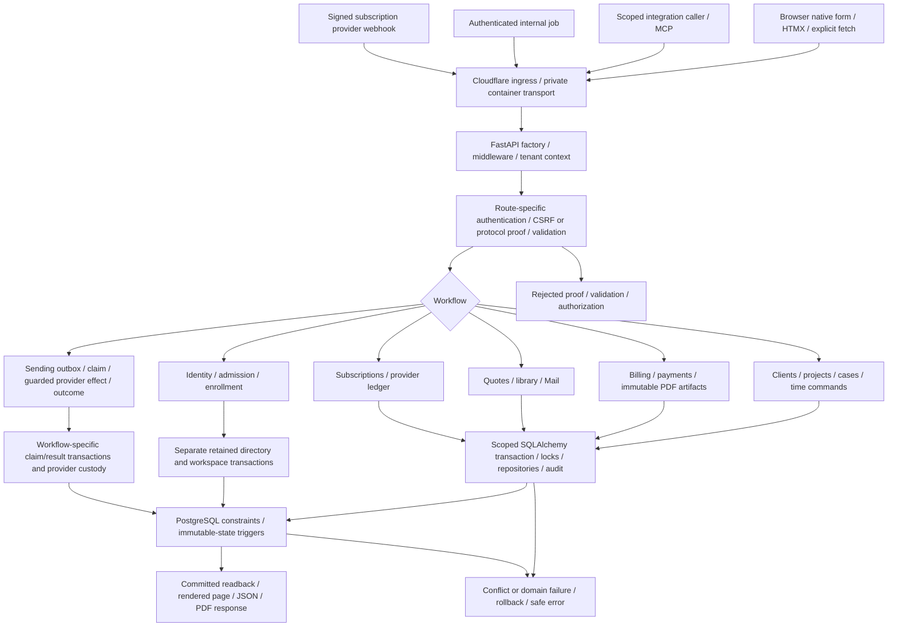

This overview groups flows. It does not claim all routes use one shared
transaction or one proof protocol. Browser form mutations, bearer-token MCP,
signed provider webhooks and internal jobs have different trust boundaries.
Admission and external dispatch have deliberately separate durable stages; their
chapter diagrams explain those points rather than hiding them inside one box.

The [database reference](../database/README.md) supplies every table, FK,
constraint, final function and trigger used at the persistence boundary. The
[route inventory](../10-http-routes-and-templates.md) supplies every literal route
declaration; literal decorators need their router composition to establish the
full dispatch path. The [source/test inventory](../12-source-map-tests-and-manifest.md)
supplies all source hashes and test declarations.

## How to read a diagram as code evidence

1. Select the actual entry point and exact source/runtime version. Match the
   route, caller and proof type before following a diagram.
2. Follow named functions and their pinned source links. An error branch can
   terminate before a service, transaction or external provider is reached.
3. Identify who begins/commits/rolls back each transaction and which state is
   already durable before network I/O. A timeout never proves no commit/send.
4. Check table/guard/invariant references and the response/readback branch. A
   toast, redirect, rendered form or provider overlay is not persistence proof.
5. Locate the existing focused test or operator runbook. Test locations listed
   here were inspected as evidence; the documentary update did not rerun the
   product suite, hosted flows, identity proof, recovery or provider lifecycle.

The [AST JSON](module-symbol-call-index.json) covers 118 tracked Python modules:
90 application, 27 Alembic including its environment and 1 support script; 103 class
declarations, 945 function/async declarations and 13,140 syntactic call sites. It
also records 180 app literal route decorators and 438 internal declared-import
edges. This is a source-location index, not an inferred runtime call graph.
The [declared-import Mermaid source](declared-imports.mmd) is correspondingly a
dependency declaration graph, not chronological flow. The hand-traced module
diagrams explain control behavior the AST cannot prove.

## Keystone contract for maintenance, whitepaper and future SDK

| Future use | Evidence already provided | Work that remains a separate deliverable |
| --- | --- | --- |
| Troubleshooting | Entry/proof/branch/transaction/effect/result maps; source and focused-test pointers | Observe the actual environment/version and collect sanitized correlated evidence for the incident. |
| Maintenance | All Python declarations/call-site locations/import edges, module flow chapters, database layouts and final guards | Make an authorized change, update affected diagrams/contracts and verify the changed behavior. |
| Technical whitepaper | Actual architecture, tenancy, data invariants, effect custody and recorded limits | Write the whitepaper for a defined audience; validate any operational/performance/security claims. |
| Future SDK | Existing scoped integration and MCP flow, authentication/lifecycle/idempotency/error boundaries | Select/version a supported external contract, define compatibility and generate/build/test the SDK. Internal form handlers are not automatically public SDK methods. |

Do not turn a current implementation detail or a static call expression into a
stable public contract. Source capability, deployment activation, observed
execution and human acceptance remain different facts. PH2 residuals, Stage-only
boundaries and future combined PH2+PH3 PROD authority remain in the dossier.

## Incident evidence template

```text
Observed environment and timestamp:
Observed deployed source/image/schema head:
Entry point, method and caller category:
Proof/access branch reached (sanitized):
Request/execution correlation ID, if emitted:
Expected named function / actual observed branch:
Transaction durable before failure? Evidence, or UNKNOWN:
External effect status: not reached / confirmed / uncertain / UNKNOWN:
Safe error code/status and sanitized readback:
Relevant table/constraint/function/trigger:
Existing focused test and result, if actually run:
Recovery decision / authorized operator / next bounded action:
```

Do not place cookies, tokens, emails, business descriptions, documents or raw
provider payloads in an incident report. Unknown fields stay UNKNOWN. Do not
retry a financial mutation, delivery or admission by assuming a timeout rolled
back its durable state.

## Keeping this reference current

This dossier describes the pinned application; canonical requirements remain in
the source repository. For a changed entry point or invariant, update the affected
flow/transaction/error/source/test mapping in the same documentary cycle. Refresh
the AST index and source-bound provenance after a source change; refresh database
structure only through the authorized migration/reference workflow. Reassemble
the reading copies and verify package hashes and links. Do not relabel source
review as runtime validation or automatically execute deployment/operator steps.

---

# Runtime and request flow

Source basis: `9fc9eebdaf9f52170530c8a28d34f6c8cd612c64`, prepared PH3.
These diagrams trace source behavior. They are not fresh hosted observations,
test results or permission to operate a provider/database. Retained Stage delivery
is recorded separately in [chapter 06](../06-deployment-and-operations-sop.md).
The maintained architecture is one application and one PostgreSQL database per
environment, with fixed private tenant schemas/roles.

## 1. Locate the real entrypoints

| Caller / entry | Callee / responsibility |
| --- | --- |
| Stage Worker's exported `fetch` | [proxyRequest](https://github.com/edlopezpm-ops/timeker-PH2/blob/9fc9eebdaf9f52170530c8a28d34f6c8cd612c64/deploy/cloudflare/src/proxy.ts#L296) |
| Worker forwarding closure | [TimekerPh2StageContainer.fetch](https://github.com/edlopezpm-ops/timeker-PH2/blob/9fc9eebdaf9f52170530c8a28d34f6c8cd612c64/deploy/cloudflare/src/index.ts#L28) |
| Container's Uvicorn entrypoint | [create_app](https://github.com/edlopezpm-ops/timeker-PH2/blob/9fc9eebdaf9f52170530c8a28d34f6c8cd612c64/app/main.py#L118) / module application |
| Application startup/shutdown | [lifespan](https://github.com/edlopezpm-ops/timeker-PH2/blob/9fc9eebdaf9f52170530c8a28d34f6c8cd612c64/app/main.py#L127) |
| Application request wrapper | [request_context](https://github.com/edlopezpm-ops/timeker-PH2/blob/9fc9eebdaf9f52170530c8a28d34f6c8cd612c64/app/main.py#L196) |
| Decoded browser session | [TenantMiddleware.__call__](https://github.com/edlopezpm-ops/timeker-PH2/blob/9fc9eebdaf9f52170530c8a28d34f6c8cd612c64/app/tenancy.py#L473) |
| Protected-router dependency | [authorized](https://github.com/edlopezpm-ops/timeker-PH2/blob/9fc9eebdaf9f52170530c8a28d34f6c8cd612c64/app/main.py#L716) → [owner](https://github.com/edlopezpm-ops/timeker-PH2/blob/9fc9eebdaf9f52170530c8a28d34f6c8cd612c64/app/auth.py#L87) → [principal](https://github.com/edlopezpm-ops/timeker-PH2/blob/9fc9eebdaf9f52170530c8a28d34f6c8cd612c64/app/auth.py#L51) |
| Ordinary owner form mutation | [mutate](https://github.com/edlopezpm-ops/timeker-PH2/blob/9fc9eebdaf9f52170530c8a28d34f6c8cd612c64/app/main.py#L379) |
| Tenant-scoped database factory | [DBRouter](https://github.com/edlopezpm-ops/timeker-PH2/blob/9fc9eebdaf9f52170530c8a28d34f6c8cd612c64/app/tenancy.py#L438) → [session_factory](https://github.com/edlopezpm-ops/timeker-PH2/blob/9fc9eebdaf9f52170530c8a28d34f6c8cd612c64/app/db.py#L9) |
| Existing-row lookup / lock | [require](https://github.com/edlopezpm-ops/timeker-PH2/blob/9fc9eebdaf9f52170530c8a28d34f6c8cd612c64/app/repositories.py#L12); specialized [lock_invoice](https://github.com/edlopezpm-ops/timeker-PH2/blob/9fc9eebdaf9f52170530c8a28d34f6c8cd612c64/app/repositories.py#L35) |
| HTML rendering | [page](https://github.com/edlopezpm-ops/timeker-PH2/blob/9fc9eebdaf9f52170530c8a28d34f6c8cd612c64/app/main.py#L283) → Jinja template |

The Stage adapter is this file's scope. The separate production Worker profile
has its own policy and must be reviewed independently. Framework libraries supply
the ASGI/session/threadpool machinery; no additional custom SDK is implied.

## 2. Edge → Container

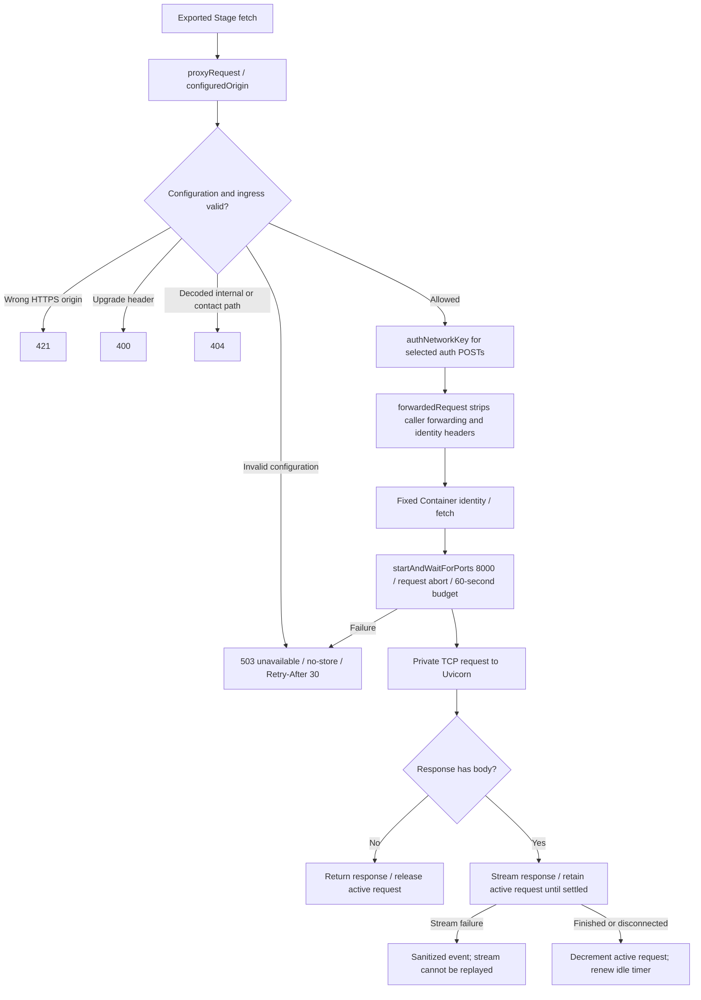

1. [configuredOrigin](https://github.com/edlopezpm-ops/timeker-PH2/blob/9fc9eebdaf9f52170530c8a28d34f6c8cd612c64/deploy/cloudflare/src/proxy.ts#L241) checks the
   canonical Stage origin and allowed environment combinations before contacting
   the Container. It is configuration validation, not authentication of an owner.
2. [authNetworkKey](https://github.com/edlopezpm-ops/timeker-PH2/blob/9fc9eebdaf9f52170530c8a28d34f6c8cd612c64/deploy/cloudflare/src/proxy.ts#L286) derives a bounded
   network key only for selected authentication POSTs. [forwardedRequest](https://github.com/edlopezpm-ops/timeker-PH2/blob/9fc9eebdaf9f52170530c8a28d34f6c8cd612c64/deploy/cloudflare/src/proxy.ts#L265)
   removes caller-supplied forwarding, target-port and timeKER identity headers.
   The application never trusts a browser-selected tenant or forwarding identity.
3. [Container fetch and lifecycle](https://github.com/edlopezpm-ops/timeker-PH2/blob/9fc9eebdaf9f52170530c8a28d34f6c8cd612c64/deploy/cloudflare/src/index.ts#L6)
   renews activity while requests/streams run. Idle expiration stops the Container
   only when no request remains active. A process can restart after idle sleep;
   application state is retained in PostgreSQL, not process memory.
4. [unavailable](https://github.com/edlopezpm-ops/timeker-PH2/blob/9fc9eebdaf9f52170530c8a28d34f6c8cd612c64/deploy/cloudflare/src/proxy.ts#L336) returns a bounded
   failure. Edge logging is guarded so telemetry failure cannot change the result.
   The Stage default observer is deliberately limited; do not expect raw provider
   errors or HTTP payloads to appear in logs.
5. Edge and application generate separate request IDs. The forwarding helper
   strips a caller request ID; do not assume one ID automatically joins both
   layers. The application response's `X-Request-ID` comes from its own wrapper.

The exported Case-only scheduled handler is separate from browser `fetch`.
Its configured presence does not prove a scheduled execution, and it does not
enable scheduled statement Sending:
[scheduled handler](https://github.com/edlopezpm-ops/timeker-PH2/blob/9fc9eebdaf9f52170530c8a28d34f6c8cd612c64/deploy/cloudflare/src/index.ts#L63).

## 3. Startup, middleware and role binding

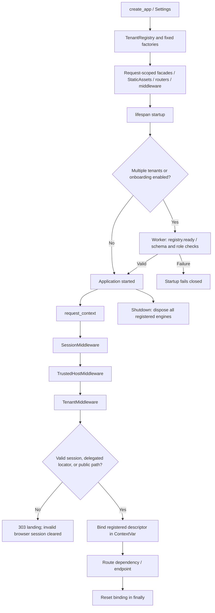

The middleware list shows application-added incoming order; Starlette also has
framework exception/error handling outside/inside that list. The registry may
refresh admission state during construction as well as during requests.

1. [TenantRegistry.__init__](https://github.com/edlopezpm-ops/timeker-PH2/blob/9fc9eebdaf9f52170530c8a28d34f6c8cd612c64/app/tenancy.py#L99) builds descriptors from
   explicit operator configuration. Runtime does not provision schemas/roles.
   [ready](https://github.com/edlopezpm-ops/timeker-PH2/blob/9fc9eebdaf9f52170530c8a28d34f6c8cd612c64/app/tenancy.py#L348) and [_check_databases](https://github.com/edlopezpm-ops/timeker-PH2/blob/9fc9eebdaf9f52170530c8a28d34f6c8cd612c64/app/tenancy.py#L357)
   check the expected migration head, required relations and role boundaries.
2. Hosted SessionMiddleware uses a Secure, HttpOnly, SameSite=Lax signed cookie
   with one-hour lifetime. Signing is not encryption of the whole session:
   [middleware assembly](https://github.com/edlopezpm-ops/timeker-PH2/blob/9fc9eebdaf9f52170530c8a28d34f6c8cd612c64/app/main.py#L160).
3. [TenantMiddleware](https://github.com/edlopezpm-ops/timeker-PH2/blob/9fc9eebdaf9f52170530c8a28d34f6c8cd612c64/app/tenancy.py#L473) refreshes the retained admission
   overlay in `run_in_threadpool` for non-static/non-liveness HTTP requests.
   Invalid signed sessions never fall back to the default owner's workspace.
4. Integration paths may initially use a credential tenant locator or public
   default descriptor. That is routing only; grant/token/scope validation remains
   mandatory before delegated resources. Anonymous public paths likewise gain no
   business-record authority from their default descriptor.
5. [bind](https://github.com/edlopezpm-ops/timeker-PH2/blob/9fc9eebdaf9f52170530c8a28d34f6c8cd612c64/app/tenancy.py#L339) sets and resets the descriptor.
   [RequestScopedSettings / DBRouter](https://github.com/edlopezpm-ops/timeker-PH2/blob/9fc9eebdaf9f52170530c8a28d34f6c8cd612c64/app/tenancy.py#L430) read that
   request-local descriptor rather than modifying global settings/search paths.
6. [session_factory](https://github.com/edlopezpm-ops/timeker-PH2/blob/9fc9eebdaf9f52170530c8a28d34f6c8cd612c64/app/db.py#L9) uses synchronous SQLAlchemy/psycopg,
   bounded pooling and hidden parameters. A newly opened connection checks its
   actual role/schema when configured; mismatch raises before business queries.

## 4. Protected read and ordinary write

A representative synchronous GET is [dashboard](https://github.com/edlopezpm-ops/timeker-PH2/blob/9fc9eebdaf9f52170530c8a28d34f6c8cd612c64/app/main.py#L739):
the protected-router dependency first validates the owner. FastAPI executes the
synchronous handler in a framework worker; its database Session stays within
that unit. It obtains exact read data and calls `page` for either full HTML or
the selected HTMX detail fragment. Dashboard fragments preserve private/no-store.

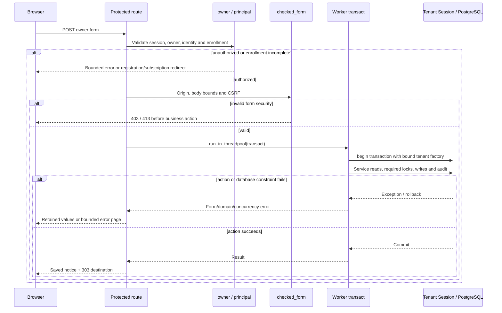

The ordinary write path is [mutate](https://github.com/edlopezpm-ops/timeker-PH2/blob/9fc9eebdaf9f52170530c8a28d34f6c8cd612c64/app/main.py#L379):

1. [owner](https://github.com/edlopezpm-ops/timeker-PH2/blob/9fc9eebdaf9f52170530c8a28d34f6c8cd612c64/app/auth.py#L87) checks `principal` and, when enrollment is active,
   current acknowledgment and workspace readiness. Subscription/security paths have the explicit
   readiness exception described in the identity flow.
2. [checked_form / verify_csrf](https://github.com/edlopezpm-ops/timeker-PH2/blob/9fc9eebdaf9f52170530c8a28d34f6c8cd612c64/app/auth.py#L109) validates an Origin
   header when supplied, bounded form size/count and a constant-time session CSRF
   comparison. Origin checking does not replace CSRF.
3. Its inner `transact` opens `with app.state.db.begin()` inside a worker.
   The service receives the verified owner ID, parsed form and request ID.
   Business audit writes share this transaction. Only successful scope exit
   commits; the action must not report success before that exit.
4. Services choose their required lock order. For example,
   [lock_invoice](https://github.com/edlopezpm-ops/timeker-PH2/blob/9fc9eebdaf9f52170530c8a28d34f6c8cd612c64/app/repositories.py#L35) locks client, related cards in
   UUID order and invoice. `require(lock=True)` uses `FOR UPDATE` and refreshes
   the entity. A generic lookup alone is not owner authorization.
5. `IntegrityError`, `StaleDataError`, form/domain/value errors roll back and
   become bounded feedback. An optional error renderer may be synchronous or
   awaitable. Success stores a notice and returns 303.
6. This helper is not universal: provider callbacks, uploads, webhooks and
   dispatch define separate transactions. Do not assume every synchronous SQL call
   in every async handler is automatically offloaded by this helper.

## 5. Rendered response, cache policy and failure paths

[page](https://github.com/edlopezpm-ops/timeker-PH2/blob/9fc9eebdaf9f52170530c8a28d34f6c8cd612c64/app/main.py#L283) adds source-versioned public asset URLs, CSRF,
current user/configuration, bounded notices and domain-prepared context to Jinja.
Services calculate money and enforce contracts; templates do not enforce them.
Native links/forms remain the action path under progressive enhancement.

[request_context](https://github.com/edlopezpm-ops/timeker-PH2/blob/9fc9eebdaf9f52170530c8a28d34f6c8cd612c64/app/main.py#L196) applies request ID, no-sniff/frame/
referrer/permissions policy, route-dependent CSP and hosted HSTS. Private content
does not inherit the public asset cache. [StaticAssets](https://github.com/edlopezpm-ops/timeker-PH2/blob/9fc9eebdaf9f52170530c8a28d34f6c8cd612c64/app/static_assets.py#L15)
recognizes only known successful GET/HEAD versions for immutable public caching;
eligible asset responses have Set-Cookie removed.

| Failure boundary | Actual source outcome / next inspection |
| --- | --- |
| Invalid owner/session | [http_error](https://github.com/edlopezpm-ops/timeker-PH2/blob/9fc9eebdaf9f52170530c8a28d34f6c8cd612c64/app/main.py#L333) clears a rejected 401 session and redirects to landing; enrollment has explicit destination. |
| CSRF or forbidden request | Bounded HTTP error page; business action not invoked. Inspect form/session/origin handling, not payload logs. |
| Domain/input failure | [domain_error](https://github.com/edlopezpm-ops/timeker-PH2/blob/9fc9eebdaf9f52170530c8a28d34f6c8cd612c64/app/main.py#L359) or [validation_error](https://github.com/edlopezpm-ops/timeker-PH2/blob/9fc9eebdaf9f52170530c8a28d34f6c8cd612c64/app/main.py#L367) gives bounded 400. |
| Unexpected application exception | Request wrapper returns bounded 500, retaining no raw exception/business content. |
| Fixed role/schema or directory failure | Fail closed; inspect configuration/readiness and migration/grants rather than retrying under another tenant. |
| Deep readiness failure | [ready route](https://github.com/edlopezpm-ops/timeker-PH2/blob/9fc9eebdaf9f52170530c8a28d34f6c8cd612c64/app/main.py#L707) returns unavailable; `/health/live` remains a distinct cheap process probe. |

Diagnostic events use fixed event names, route templates, internal UUIDs,
status/outcome and duration. [safe_fields](https://github.com/edlopezpm-ops/timeker-PH2/blob/9fc9eebdaf9f52170530c8a28d34f6c8cd612c64/app/logging.py#L32) redacts
unknown fields; [event](https://github.com/edlopezpm-ops/timeker-PH2/blob/9fc9eebdaf9f52170530c8a28d34f6c8cd612c64/app/logging.py#L104) cannot change a committed
business result. Never add email, cookie/header/query data, descriptions,
credentials, snapshots or artifact bytes to a debugging event.

## 6. Maintenance and verification map

These are test declarations to consult, not tests executed for this document.

| Change or symptom | Source verification to inspect |
| --- | --- |
| Edge policy / forged forwarding | [proxy tests](https://github.com/edlopezpm-ops/timeker-PH2/blob/9fc9eebdaf9f52170530c8a28d34f6c8cd612c64/deploy/cloudflare/test/proxy.test.mjs#L70) |
| Cross-tenant binding / concurrent requests | [same UUID and concurrent isolation](https://github.com/edlopezpm-ops/timeker-PH2/blob/9fc9eebdaf9f52170530c8a28d34f6c8cd612c64/tests/integration/test_tenancy.py#L259) |
| Invalid signed session fallback | [invalid session test](https://github.com/edlopezpm-ops/timeker-PH2/blob/9fc9eebdaf9f52170530c8a28d34f6c8cd612c64/tests/integration/test_tenancy.py#L305) |
| Wrong fixed connection identity | [role/schema test](https://github.com/edlopezpm-ops/timeker-PH2/blob/9fc9eebdaf9f52170530c8a28d34f6c8cd612c64/tests/integration/test_tenancy.py#L438) |
| Revoked session redirect loop | [recovery test](https://github.com/edlopezpm-ops/timeker-PH2/blob/9fc9eebdaf9f52170530c8a28d34f6c8cd612c64/tests/integration/test_session_recovery.py#L9) |
| Immutable-public versus private/error caching | [asset cache tests](https://github.com/edlopezpm-ops/timeker-PH2/blob/9fc9eebdaf9f52170530c8a28d34f6c8cd612c64/tests/unit/test_static_assets.py#L35) |
| Redaction and telemetry non-effect | [logging tests](https://github.com/edlopezpm-ops/timeker-PH2/blob/9fc9eebdaf9f52170530c8a28d34f6c8cd612c64/tests/unit/test_logging.py#L23) |

For an extension, identify the entrypoint, owner/tenant authority, worker/Session
boundary, lock order, commit boundary, audit event, failure outcome and native
fallback before changing a route. Source tests, native reference metadata and
retained Stage evidence answer different questions; none alone proves human UAT.

---

# Identity, admission and first workspace access

This is a source trace at `9fc9eebdaf9f52170530c8a28d34f6c8cd612c64`.
It separates provider proof, retained identity binding, workspace admission,
registration acknowledgment and first-plan access. No diagram is evidence of a
fresh human login, provider configuration, email delivery or successful hosted
UAT. Those residuals remain in [chapter 08](../08-PAUSE-AND-CONTINUE.md).

## 1. Entry modes and routing authority

| Entry / caller | Actual implementation |
| --- | --- |
| GET Sign in / Sign up | [sign_in / sign_up](https://github.com/edlopezpm-ops/timeker-PH2/blob/9fc9eebdaf9f52170530c8a28d34f6c8cd612c64/app/enrollment_routes.py#L128) → [auth_page](https://github.com/edlopezpm-ops/timeker-PH2/blob/9fc9eebdaf9f52170530c8a28d34f6c8cd612c64/app/enrollment_routes.py#L94) |
| POST Google / GitHub | Shared [google_login](https://github.com/edlopezpm-ops/timeker-PH2/blob/9fc9eebdaf9f52170530c8a28d34f6c8cd612c64/app/main.py#L486); provider selected from the actual route |
| Provider GET callback | [google_callback](https://github.com/edlopezpm-ops/timeker-PH2/blob/9fc9eebdaf9f52170530c8a28d34f6c8cd612c64/app/main.py#L553) → [complete_provider_callback](https://github.com/edlopezpm-ops/timeker-PH2/blob/9fc9eebdaf9f52170530c8a28d34f6c8cd612c64/app/main.py#L566) |
| POST email start / verify | [start_email](https://github.com/edlopezpm-ops/timeker-PH2/blob/9fc9eebdaf9f52170530c8a28d34f6c8cd612c64/app/enrollment_routes.py#L359) / [verify_email](https://github.com/edlopezpm-ops/timeker-PH2/blob/9fc9eebdaf9f52170530c8a28d34f6c8cd612c64/app/enrollment_routes.py#L520) |
| Retained immutable identity lookup | [resolve_identity](https://github.com/edlopezpm-ops/timeker-PH2/blob/9fc9eebdaf9f52170530c8a28d34f6c8cd612c64/app/admission.py#L77) / [bound_identity](https://github.com/edlopezpm-ops/timeker-PH2/blob/9fc9eebdaf9f52170530c8a28d34f6c8cd612c64/app/enrollment.py#L46) |
| New workspace allocation | [admit](https://github.com/edlopezpm-ops/timeker-PH2/blob/9fc9eebdaf9f52170530c8a28d34f6c8cd612c64/app/admission.py#L142) |
| Current registration acknowledgment | [acknowledge](https://github.com/edlopezpm-ops/timeker-PH2/blob/9fc9eebdaf9f52170530c8a28d34f6c8cd612c64/app/enrollment_routes.py#L190) / [accept_registration](https://github.com/edlopezpm-ops/timeker-PH2/blob/9fc9eebdaf9f52170530c8a28d34f6c8cd612c64/app/enrollment.py#L218) |
| Explicit first Free activation | [activate_free](https://github.com/edlopezpm-ops/timeker-PH2/blob/9fc9eebdaf9f52170530c8a28d34f6c8cd612c64/app/enrollment_routes.py#L232) |
| Issued authenticated session | [issue_session](https://github.com/edlopezpm-ops/timeker-PH2/blob/9fc9eebdaf9f52170530c8a28d34f6c8cd612c64/app/enrollment_routes.py#L36) |
| Every protected request | [owner](https://github.com/edlopezpm-ops/timeker-PH2/blob/9fc9eebdaf9f52170530c8a28d34f6c8cd612c64/app/auth.py#L87) → [principal](https://github.com/edlopezpm-ops/timeker-PH2/blob/9fc9eebdaf9f52170530c8a28d34f6c8cd612c64/app/auth.py#L51) |

`enrollment_active` means either Stage enrollment or generic onboarding is
enabled. Generic `onboarding_enabled` selects the central admission protocol.
These are different flags:
[configuration properties](https://github.com/edlopezpm-ops/timeker-PH2/blob/9fc9eebdaf9f52170530c8a28d34f6c8cd612c64/app/config.py#L192).

In generic admission mode the issuer/subject locator selects the tenant and
the exact tenant-local immutable binding is rechecked. A locator is routing
metadata, not proof by itself. In fixed/legacy mode the server-configured verified
email registry selects a fixed descriptor; enrollment-active paths still require
the retained issuer/subject binding or explicit registration/linking.
No branch creates an email-based merge or a default-owner fallback.

GET authentication pages render fresh forms; they do not themselves consume
a challenge, authenticate an identity or activate a plan. A new explicit POST
controls its closed intent/offer/return destination. See
[auth GET session tests](https://github.com/edlopezpm-ops/timeker-PH2/blob/9fc9eebdaf9f52170530c8a28d34f6c8cd612c64/tests/integration/test_auth_get_sessions.py#L54).

## 2. Google/GitHub: start, fresh proof and session

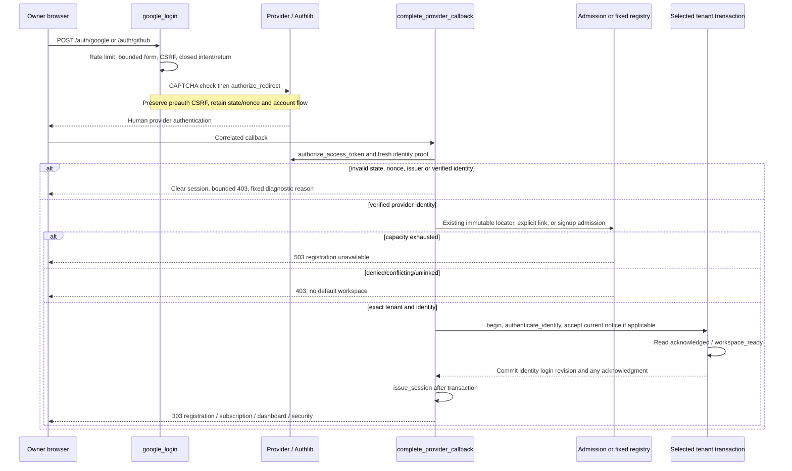

Ordered trace:

1. [google_login](https://github.com/edlopezpm-ops/timeker-PH2/blob/9fc9eebdaf9f52170530c8a28d34f6c8cd612c64/app/main.py#L486) enforces rate limit and
   `checked_form`, duplicate/unknown-field rejection in enrollment mode, and
   a closed `return_to`. [verify_sign_in](https://github.com/edlopezpm-ops/timeker-PH2/blob/9fc9eebdaf9f52170530c8a28d34f6c8cd612c64/app/bot_check.py#L14) checks
   Turnstile before OAuth; unavailable hosted verification fails closed.
2. Provider configuration is checked through
   [configured_providers](https://github.com/edlopezpm-ops/timeker-PH2/blob/9fc9eebdaf9f52170530c8a28d34f6c8cd612c64/app/social_auth.py#L17). Intent is signin,
   signup or explicit link; offer is selected from the closed catalog. A link
   additionally retains fresh existing-owner proof. The handler preserves
   preauthentication CSRF while replacing the previous account flow.
3. Authlib `authorize_redirect` receives a nonce and callback. OAuth clients are
   assembled at [provider setup](https://github.com/edlopezpm-ops/timeker-PH2/blob/9fc9eebdaf9f52170530c8a28d34f6c8cd612c64/app/main.py#L174): Google uses OIDC
   metadata; configured enrollment uses PKCE. GitHub uses the explicit OAuth
   endpoints and PKCE. State/nonce tests use mocked provider transport rather
   than asserting a live human authentication.
4. [complete_provider_callback](https://github.com/edlopezpm-ops/timeker-PH2/blob/9fc9eebdaf9f52170530c8a28d34f6c8cd612c64/app/main.py#L566) exchanges the callback.
   Google requires ID token plus verified userinfo; generic admission additionally
   validates issuer and normalized proof. GitHub calls
   [github_identity](https://github.com/edlopezpm-ops/timeker-PH2/blob/9fc9eebdaf9f52170530c8a28d34f6c8cd612c64/app/social_auth.py#L28), reading fresh numeric account
   ID and verified email from its API. Public admission requires one verified
   primary candidate; fixed mode uses the admitted-email set. Ambiguity fails.
5. Generic mode calls `admit` or `link_identity`; fixed mode resolves the configured
   tenant and applies its retained binding rules. The selected-tenant transaction
   calls [authenticate_identity](https://github.com/edlopezpm-ops/timeker-PH2/blob/9fc9eebdaf9f52170530c8a28d34f6c8cd612c64/app/auth.py#L36) in generic mode.
   Legacy fixed authentication uses [authenticate](https://github.com/edlopezpm-ops/timeker-PH2/blob/9fc9eebdaf9f52170530c8a28d34f6c8cd612c64/app/auth.py#L19)
   alongside its enrollment/binding checks.
6. Successful login increments the owner's session revision and last-login time.
   In the same local transaction, `accept_sign_in_notice` may retain the exact
   current displayed notice; readiness is computed. Only afterward does
   `issue_session` clear/rotate session state and CSRF.
7. Not registered routes to registration; registered paid-intent may route to
   Subscription; ready routes to Dashboard or a validated integration resume.
   Explicit security return/link routes to Account security. Return targets are
   closed choices, not arbitrary caller URLs.

Failures are intentionally bounded. Callback exceptions clear the session and
emit only a fixed provider/reason/outcome. Generic callback wording cannot prove
the provider was merely unlinked: inspect the actual reason branch, relevant
source and fresh proof. [callback failure handling](https://github.com/edlopezpm-ops/timeker-PH2/blob/9fc9eebdaf9f52170530c8a28d34f6c8cd612c64/app/main.py#L553)
distinguishes the fixed `AUTH_PROVIDER_NOT_LINKED` reason only for applicable
branches; other failures use `AUTH_PROVIDER_PROOF_REJECTED`.

## 3. New owner: reserve → initialize → activate

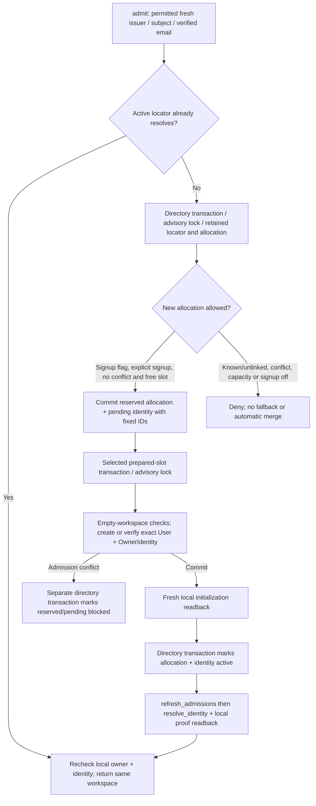

[admit](https://github.com/edlopezpm-ops/timeker-PH2/blob/9fc9eebdaf9f52170530c8a28d34f6c8cd612c64/app/admission.py#L142) is a cross-transaction protocol, not one
atomic transaction spanning all schemas. Its retained IDs/states make supported
retries and operator diagnosis explicit.

- First directory transaction serializes allocation with an advisory lock.
  Existing pending/reserved work must match exact retained identities. New
  allocation requires public signup plus explicit signup intent, no known-email
  collision and one unused prepared slot. Capacity exhaustion returns a distinct
  bounded failure.
- [_initialize](https://github.com/edlopezpm-ops/timeker-PH2/blob/9fc9eebdaf9f52170530c8a28d34f6c8cd612c64/app/admission.py#L92) opens that slot's fixed factory.
  It rejects nonempty business/configuration/history state, or a mismatching
  existing owner/identity. It creates or verifies only the retained owner and
  identity IDs; no runtime DDL/admin credential is introduced.
- A caught admission conflict marks still-reserved directory records blocked;
  it never silently recycles the slot. Other interruption points retain the
  protocol state rather than claiming all work rolled back across schemas.
- [_initialization_readback](https://github.com/edlopezpm-ops/timeker-PH2/blob/9fc9eebdaf9f52170530c8a28d34f6c8cd612c64/app/admission.py#L131) verifies local identity
  before the separate active-directory commit. `refresh_admissions` then exposes
  only retained active allocations and rejects reassignment:
  [refresh_admissions](https://github.com/edlopezpm-ops/timeker-PH2/blob/9fc9eebdaf9f52170530c8a28d34f6c8cd612c64/app/tenancy.py#L294).
- [resolve_identity](https://github.com/edlopezpm-ops/timeker-PH2/blob/9fc9eebdaf9f52170530c8a28d34f6c8cd612c64/app/admission.py#L77) always rechecks the exact local
  binding with [_local_identity](https://github.com/edlopezpm-ops/timeker-PH2/blob/9fc9eebdaf9f52170530c8a28d34f6c8cd612c64/app/admission.py#L64).

This runtime path consumes operator-prepared slots. Workspace preparation and
directory reconciliation are separate operator actions; the browser cannot choose
or provision a schema, role or connection.

## 4. Managed email: external proof between durable reservations

There are two protocols. Generic non-linking sign-in/signup uses central
`PublicEmailChallenge` before any owner exists. Fixed existing-owner or email
linking uses tenant-local `EmailAuthChallenge`.

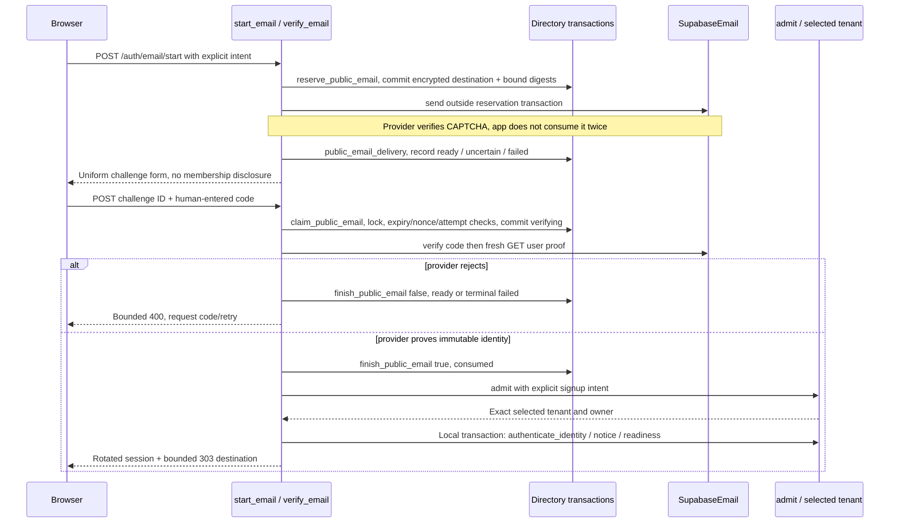

1. [start_email](https://github.com/edlopezpm-ops/timeker-PH2/blob/9fc9eebdaf9f52170530c8a28d34f6c8cd612c64/app/enrollment_routes.py#L359) validates enabled provider,
   rate limit, bounded account form, explicit signin/signup or separate link action,
   delivery mode, offer and closed destination. Hosted public starts require the
   edge-derived network key.
2. [reserve_public_email](https://github.com/edlopezpm-ops/timeker-PH2/blob/9fc9eebdaf9f52170530c8a28d34f6c8cd612c64/app/admission.py#L322) durably serializes
   abuse admission and stores encrypted destination plus address/session/network
   digests, expiry and intent. Session preview/routing is opaque submitted-input
   context, not proof that an account exists or mail arrived.
3. [SupabaseEmail.send](https://github.com/edlopezpm-ops/timeker-PH2/blob/9fc9eebdaf9f52170530c8a28d34f6c8cd612c64/app/email_auth.py#L128) passes CAPTCHA to the
   managed provider exactly once. Provider signup requires the explicit configured
   switch; existing confirmation has its separate resend path. The source maps
   accepted true to ready, false to uncertain, and no attempted delivery to failed through
   [public_email_delivery](https://github.com/edlopezpm-ops/timeker-PH2/blob/9fc9eebdaf9f52170530c8a28d34f6c8cd612c64/app/admission.py#L351).
   `ready` or `uncertain` can be claimed because fresh provider proof is still
   required; delivery state alone authenticates nobody.
4. [claim_public_email](https://github.com/edlopezpm-ops/timeker-PH2/blob/9fc9eebdaf9f52170530c8a28d34f6c8cd612c64/app/admission.py#L378) locks the row, validates
   challenge ID, session nonce, state, expiry, decryption purpose and attempt cap,
   then commits `verifying`. [SupabaseEmail.verify](https://github.com/edlopezpm-ops/timeker-PH2/blob/9fc9eebdaf9f52170530c8a28d34f6c8cd612c64/app/email_auth.py#L152)
   checks bounded code format, verifies it and obtains fresh `/user` proof rather
   than trusting the token response's user object. Provider token stays transient.
5. [finish_public_email](https://github.com/edlopezpm-ops/timeker-PH2/blob/9fc9eebdaf9f52170530c8a28d34f6c8cd612c64/app/admission.py#L401) records consumed on
   successful proof, or ready/failed after rejection. Proof consumption precedes
   admission; a later capacity/binding failure does not make that code reusable.
   The caller returns generic 400 or capacity 503 without inventing successful
   admission.
6. For tenant-local challenges, [reserve](https://github.com/edlopezpm-ops/timeker-PH2/blob/9fc9eebdaf9f52170530c8a28d34f6c8cd612c64/app/email_auth.py#L180) and
   [locked_challenge](https://github.com/edlopezpm-ops/timeker-PH2/blob/9fc9eebdaf9f52170530c8a28d34f6c8cd612c64/app/email_auth.py#L211) enforce owner cooldown,
   session binding, expiry, state and attempts. A local transaction commits
   verifying before provider verification. Provider rejection resets ready or
   failed; the final transaction consumes the challenge, checks the exact bound
   identity and advances session revision. Other post-reservation failures can
   terminally fail the challenge. See [local verification branch](https://github.com/edlopezpm-ops/timeker-PH2/blob/9fc9eebdaf9f52170530c8a28d34f6c8cd612c64/app/enrollment_routes.py#L574).
7. Unknown/unadmitted starts retain a uniform response. Duplicate starts can
   preserve prior still-valid proof through
   [pending_public_email](https://github.com/edlopezpm-ops/timeker-PH2/blob/9fc9eebdaf9f52170530c8a28d34f6c8cd612c64/app/admission.py#L361); do not replace this with
   a process-memory cooldown or an account-existence response.

## 5. Explicit registration and first plan

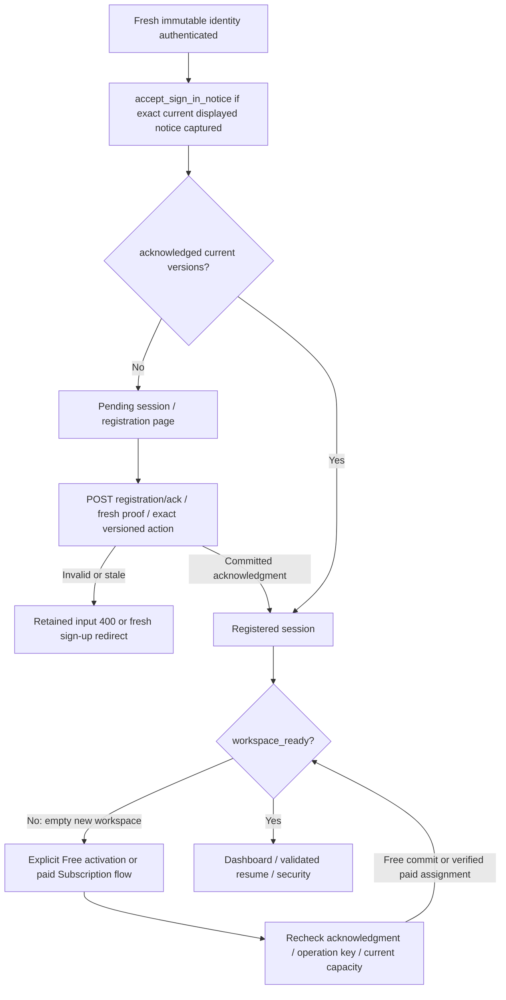

[accept_sign_in_notice](https://github.com/edlopezpm-ops/timeker-PH2/blob/9fc9eebdaf9f52170530c8a28d34f6c8cd612c64/app/enrollment.py#L237) records acknowledgment only
after successful provider proof and immutable binding, and only for the exact
captured current notice and allowed flow. A normal source path may therefore
already have a current registration receipt before opening Registration.
Do not incorrectly describe every account as requiring a second checkbox page.

[accept_registration](https://github.com/edlopezpm-ops/timeker-PH2/blob/9fc9eebdaf9f52170530c8a28d34f6c8cd612c64/app/enrollment.py#L218) accepts the explicit current
Continue action or its retained legacy checkbox contract, with exact terms,
privacy and catalog versions. [_record_registration](https://github.com/edlopezpm-ops/timeker-PH2/blob/9fc9eebdaf9f52170530c8a28d34f6c8cd612c64/app/enrollment.py#L196)
binds/verifies identity and writes the current receipt plus business audit in
the caller's transaction. It does not purchase or silently assign a paid plan.

[acknowledge route](https://github.com/edlopezpm-ops/timeker-PH2/blob/9fc9eebdaf9f52170530c8a28d34f6c8cd612c64/app/enrollment_routes.py#L190) requires a recent
authentication (`fresh`: ten minutes), validates a closed account form, commits
the acknowledgment, then promotes pending session state. Failure leaves access
gated; stale proof clears the session and redirects for fresh sign-up.

[activate_free](https://github.com/edlopezpm-ops/timeker-PH2/blob/9fc9eebdaf9f52170530c8a28d34f6c8cd612c64/app/enrollment_routes.py#L232) requires current
acknowledgment, its session-bound operation key, a capacity lock and no existing
records/plan. It calls explicit Free enrollment with current version and empty
selections in the transaction. Paid choice instead goes through
[checkout route](https://github.com/edlopezpm-ops/timeker-PH2/blob/9fc9eebdaf9f52170530c8a28d34f6c8cd612c64/app/subscription_payment_routes.py#L129) and the
environment-isolated billing service; a browser return or selected offer alone
does not confer a paid entitlement.

Readiness has deliberate retained-history exceptions:
[workspace_ready](https://github.com/edlopezpm-ops/timeker-PH2/blob/9fc9eebdaf9f52170530c8a28d34f6c8cd612c64/app/enrollment.py#L126) allows a matching Free assignment,
a prior paid assignment with an access-expiry value, or retained pre-enrollment
client history after acknowledgment. Expired paid access does not silently become
Free; capacity guards independently reject growth. A new empty workspace still
requires explicit first-plan activation. `active_plan` and `workspace_ready`
therefore answer different questions.

Every protected request rechecks [principal](https://github.com/edlopezpm-ops/timeker-PH2/blob/9fc9eebdaf9f52170530c8a28d34f6c8cd612c64/app/auth.py#L51):
registered tenant, active local owner, allowlist mapping, session revision and,
when enrollment is active, immutable method. [owner](https://github.com/edlopezpm-ops/timeker-PH2/blob/9fc9eebdaf9f52170530c8a28d34f6c8cd612c64/app/auth.py#L87) then gates current
acknowledgment/readiness in that mode, while permitting Subscription/security destinations
needed to resolve enrollment. Pending users do not bypass these gates.

## 6. Explicit linking and revocation

[link_identity](https://github.com/edlopezpm-ops/timeker-PH2/blob/9fc9eebdaf9f52170530c8a28d34f6c8cd612c64/app/admission.py#L225) combines fresh existing-owner proof
with fresh proof of the new provider. [fresh_owner](https://github.com/edlopezpm-ops/timeker-PH2/blob/9fc9eebdaf9f52170530c8a28d34f6c8cd612c64/app/admission.py#L210)
rechecks tenant, owner, revision, bound issuer/subject, acknowledgment and time
under the owner row lock. Directory reservation, local binding/readback and
directory activation are separate commits; conflicts and revoked tombstones
cannot be silently reassigned. Different verified emails do not imply an owner
merge: the independent owner proof authorizes this specific link.

Email linking uses separate `/settings/security/email/start` and verify routes.
The legacy source additionally requires the designated independent existing
provider; an email challenge cannot establish its own existing-owner authority.
Social linking retains the explicit state-bound existing proof in the account flow.

[revoke_identity](https://github.com/edlopezpm-ops/timeker-PH2/blob/9fc9eebdaf9f52170530c8a28d34f6c8cd612c64/app/admission.py#L266) blocks global routing before local
revocation, retains tombstones and keeps an alternative usable method.
The local [revoke_identity](https://github.com/edlopezpm-ops/timeker-PH2/blob/9fc9eebdaf9f52170530c8a28d34f6c8cd612c64/app/enrollment.py#L157) increments session
revision; the UI revoke route clears the session. Do not implement recovery by
rewriting email, subject, locator or session revision directly.

## 7. Tests and sanitized diagnosis

These are source declarations, not tests run for this documentation.

| Boundary | Targeted declaration |
| --- | --- |
| OIDC state/nonce/verified allowlist | [OIDC test](https://github.com/edlopezpm-ops/timeker-PH2/blob/9fc9eebdaf9f52170530c8a28d34f6c8cd612c64/tests/integration/test_oauth.py#L19) |
| GitHub proof/state/PKCE | [GitHub test](https://github.com/edlopezpm-ops/timeker-PH2/blob/9fc9eebdaf9f52170530c8a28d34f6c8cd612c64/tests/integration/test_social_auth.py#L93) |
| Two-owner admission and explicit plan | [admission test](https://github.com/edlopezpm-ops/timeker-PH2/blob/9fc9eebdaf9f52170530c8a28d34f6c8cd612c64/tests/integration/test_public_admission.py#L186) |
| Interruptions retain allocation IDs | [allocation-boundary test](https://github.com/edlopezpm-ops/timeker-PH2/blob/9fc9eebdaf9f52170530c8a28d34f6c8cd612c64/tests/integration/test_public_admission.py#L229) |
| Exhaustion/conflict never selects default | [capacity test](https://github.com/edlopezpm-ops/timeker-PH2/blob/9fc9eebdaf9f52170530c8a28d34f6c8cd612c64/tests/integration/test_public_admission.py#L271) |
| Public email CAPTCHA/proof/activation | [email test](https://github.com/edlopezpm-ops/timeker-PH2/blob/9fc9eebdaf9f52170530c8a28d34f6c8cd612c64/tests/integration/test_public_admission.py#L737) |
| Empty new workspace requires activation | [first-plan test](https://github.com/edlopezpm-ops/timeker-PH2/blob/9fc9eebdaf9f52170530c8a28d34f6c8cd612c64/tests/integration/test_onboarding_auth.py#L391) |
| Retained expired-paid history / blocked growth | [expiry test](https://github.com/edlopezpm-ops/timeker-PH2/blob/9fc9eebdaf9f52170530c8a28d34f6c8cd612c64/tests/integration/test_onboarding_auth.py#L162) |
| Fresh independent link proof | [link test](https://github.com/edlopezpm-ops/timeker-PH2/blob/9fc9eebdaf9f52170530c8a28d34f6c8cd612c64/tests/integration/test_public_admission.py#L322) |
| Fixed safe failure diagnostics | [redaction test](https://github.com/edlopezpm-ops/timeker-PH2/blob/9fc9eebdaf9f52170530c8a28d34f6c8cd612c64/tests/integration/test_social_auth.py#L256) |

For diagnosis, retain internal request ID, route template, status and fixed
provider/reason/outcome only. Inspect the corresponding durable protocol state
through separately authorized metadata/readback; never log identity values,
codes, provider tokens, cookies, encrypted destinations or raw exceptions.
Do not infer successful email delivery, valid identity, human acceptance or
provider interoperability from a visible form, generic 403, test fixture or
public GET. Real human proof and UAT remain separate work.

---

# Work records, time and billing: executable flow map

This chapter traces source `9fc9eebdaf9f52170530c8a28d34f6c8cd612c64`.
It is a maintenance/troubleshooting reference, not a new specification, public
SDK or execution authorization. No product tests, database queries, provider
operations or hosted flows were run to prepare it. PH3 awaits the owner's feature
prompts; existing Stage continues and one future PROD candidate combines PH2+PH3.

All function names below are existing implementation entry points. Source links
pin their actual one-based lines. Read caller and callee together before changing
a branch: a service taking `db` generally participates in its caller's transaction.

## 1. End-to-end map and transaction ownership

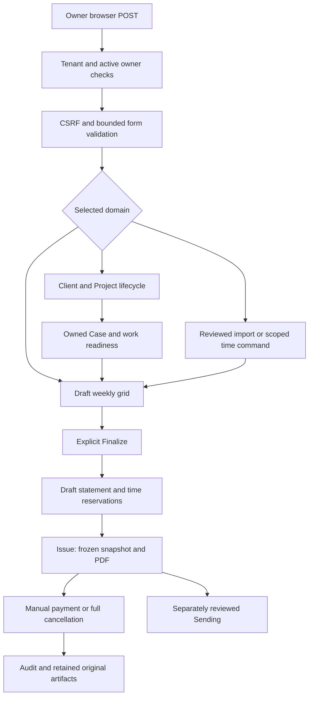

1. Middleware resolves the fixed tenant; protected routes require the current
   active owner. Browser mutation forms use origin/CSRF validation.
2. Most forms call `create_app.mutate()`: it opens `app.state.db.begin()` inside a
   worker, invokes the supplied domain action, commits on successful context exit,
   then sets the save notice/redirect. Domain functions do not independently
   commit the passed session.
3. `FormError`/`DomainError`, integrity/stale-version failures and malformed input
   return bounded validation feedback or propagate to the normal error handler.
   A failed transaction cannot earn a successful save notice.
4. Imports and external dispatch use their own explicit transaction wrappers;
   do not assume every POST uses `mutate()`.

[Owner/CSRF](https://github.com/edlopezpm-ops/timeker-PH2/blob/9fc9eebdaf9f52170530c8a28d34f6c8cd612c64/app/auth.py#L87),
[mutation wrapper](https://github.com/edlopezpm-ops/timeker-PH2/blob/9fc9eebdaf9f52170530c8a28d34f6c8cd612c64/app/main.py#L379),
[time-import transaction](https://github.com/edlopezpm-ops/timeker-PH2/blob/9fc9eebdaf9f52170530c8a28d34f6c8cd612c64/app/time_import_routes.py#L296).

## 2. Concrete caller-to-service map

| Browser caller | Owning service | Branch or persisted result |
| --- | --- | --- |
| `/clients/new`, `/clients/{client_id}/edit` | `clients.update_client()` | Create/edit, normalized code, profile/lifecycle and capacity |
| `/clients/{client_id}/projects` | `clients.save_project()` | Owned Project terms/status and billing-history restrictions |
| Case create/edit routes | `cases.save_case()` | Active parent context, version, type/status and transition guards |
| `/cases/mass-edit` | `cases.mass_update()` | Entire selected Project snapshot; status/type only |
| `/timecards/save` | `timecards.save_week()` | Draft grid, retained entry provenance and exact integer minutes |
| `/timecards/{id}/finalize` | `timecards.finalize()` | Nonempty unchanged Draft; explicit cap override evidence if required |
| `/timecards/{id}/reopen` | `timecards.reopen()` | Eligible unreserved history with reason and active parent checks |
| `/timecards/import`, `/commit` | `preview_import()` / `commit_import()` | Reviewed hash/versions and atomic source-owned contributions |
| `/billing/create` | `billing.create_draft()` | Finalized billable time grouped/reserved into Draft lines |
| `/project-billing/{id}/{operation}` | Fixed-fee/manual-extra billing services | Separate reviewed Project charge bases |
| `/billing/{id}/{operation}` | `issue`, `adjust_draft`, `mark_sent`, `correct_due`, `pay`, `void`, `cancel_draft` | Explicit action map; unknown action rejects |
| `/payments/{id}/reverse` | `billing.reverse_payment()` | Retained reversal timestamp/reason, not provider refund |

Sources: [client callers](https://github.com/edlopezpm-ops/timeker-PH2/blob/9fc9eebdaf9f52170530c8a28d34f6c8cd612c64/app/main.py#L893),
[Project caller](https://github.com/edlopezpm-ops/timeker-PH2/blob/9fc9eebdaf9f52170530c8a28d34f6c8cd612c64/app/main.py#L965),
[Case router](https://github.com/edlopezpm-ops/timeker-PH2/blob/9fc9eebdaf9f52170530c8a28d34f6c8cd612c64/app/case_routes.py#L245),
[Timecards caller](https://github.com/edlopezpm-ops/timeker-PH2/blob/9fc9eebdaf9f52170530c8a28d34f6c8cd612c64/app/main.py#L1252),
[Project billing router](https://github.com/edlopezpm-ops/timeker-PH2/blob/9fc9eebdaf9f52170530c8a28d34f6c8cd612c64/app/project_billing_routes.py#L59),
[statement action map](https://github.com/edlopezpm-ops/timeker-PH2/blob/9fc9eebdaf9f52170530c8a28d34f6c8cd612c64/app/main.py#L1479).

## 3. Client, Project and Case prerequisites

### Client and Project writes

`update_client()` takes the capacity lock and checks its operation-key/payload
replay before writing. Client codes are normalized and validated; Draft/Archived
codes remain reserved. Activation validates the required profile and capacity.
Moving away from Active requires confirmation and work-readiness checks; a status
change is not a way to hide open dependent work.
[Client entry](https://github.com/edlopezpm-ops/timeker-PH2/blob/9fc9eebdaf9f52170530c8a28d34f6c8cd612c64/app/clients.py#L48),
[lifecycle branch](https://github.com/edlopezpm-ops/timeker-PH2/blob/9fc9eebdaf9f52170530c8a28d34f6c8cd612c64/app/clients.py#L26).

`save_project()` similarly uses capacity/replay, locks its Client and verifies
Project ownership. The Client must be Active. Existing billing freezes relevant
Project type/fee/currency relationships: an active fixed-fee statement cannot be
rewritten by editing the underlying budget; additional charge and void/replace
are separate domain decisions. Stable display numbers do not replace UUID
relationships.
[Project entry and billing restrictions](https://github.com/edlopezpm-ops/timeker-PH2/blob/9fc9eebdaf9f52170530c8a28d34f6c8cd612c64/app/clients.py#L216).

### Case writes, close and archive

`save_case()` checks owner, Active Client, an Active owned Project, unarchived
Case and expected version. Changing Project is rejected when retained time/mail
associations prevent reassignment; further database guards protect commercial
history. Closing requires explicit confirmation and `require_case_ready()`.
Case work does not itself create time or authorize billing.
[Case service](https://github.com/edlopezpm-ops/timeker-PH2/blob/9fc9eebdaf9f52170530c8a28d34f6c8cd612c64/app/cases.py#L49).

`mass_update()` locks the selected Project/Client and full owned Case set. Submitted
numbers must match the exact snapshot, with only version/status/type fields.
Every row is validated before applying the changes. Manual archive is a separate
versioned, confirmed operation for an eligible Closed Case; it retains history.
[Mass-edit service](https://github.com/edlopezpm-ops/timeker-PH2/blob/9fc9eebdaf9f52170530c8a28d34f6c8cd612c64/app/cases.py#L150),
[archive service](https://github.com/edlopezpm-ops/timeker-PH2/blob/9fc9eebdaf9f52170530c8a28d34f6c8cd612c64/app/cases.py#L136).

## 4. Weekly grid save, Finalize and reopen

The `/timecards/save` caller parses Monday/week and grid rows, passes the expected
card version and internal-time context to `save_week()`, then applies flexfields
in the same transaction. Lookup-only submissions re-render without saving.
[Save caller](https://github.com/edlopezpm-ops/timeker-PH2/blob/9fc9eebdaf9f52170530c8a28d34f6c8cd612c64/app/main.py#L1252).

Step through `save_week()` in this order:

1. Verify active owner, Client/Case context and the six-month editable window.
2. Require Monday and an Active Client for normal work; lock/find the matching
   owner/client/week/internal card and validate Draft/version state.
3. Validate Project/day rows, daily maximum 1440 minutes, notes and retained
   archived-Project entries. Internal work is explicitly nonbillable.
4. Prevent removing/reducing a parent entry under retained Case allocations or
   imported/assistant contributions; those have their own correction flow.
5. Assign the saved entry set, integer total minutes, timestamp and transactional
   `timecard.saved` audit event.

[Save implementation](https://github.com/edlopezpm-ops/timeker-PH2/blob/9fc9eebdaf9f52170530c8a28d34f6c8cd612c64/app/timecards.py#L55),
[retained-entry protections](https://github.com/edlopezpm-ops/timeker-PH2/blob/9fc9eebdaf9f52170530c8a28d34f6c8cd612c64/app/timecards.py#L179).

A Draft may retain over-cap work. `finalize()` locks the card and requires an
unchanged nonempty Draft. If the noninternal weekly total exceeds the configured
Client cap, a bounded explicit reason and authorization reference are required.
It then records Finalized state/time and audit. No per-intervention hour rounding,
automatic invented approval or assistant finalization is introduced.
[Finalize](https://github.com/edlopezpm-ops/timeker-PH2/blob/9fc9eebdaf9f52170530c8a28d34f6c8cd612c64/app/timecards.py#L236).

`reopen()` rechecks active Client/Project/Case context and reservations. Only
eligible unreserved Finalized/retained historical Voided cards may return to Draft
with a reason. New timecard voids are explicitly prohibited by `timecards.void()`.
Duplicating structure is separate from copying finalized billed work.
[Reopen and prohibited void](https://github.com/edlopezpm-ops/timeker-PH2/blob/9fc9eebdaf9f52170530c8a28d34f6c8cd612c64/app/timecards.py#L262),
[duplicate structure](https://github.com/edlopezpm-ops/timeker-PH2/blob/9fc9eebdaf9f52170530c8a28d34f6c8cd612c64/app/timecards.py#L319).

## 5. Source-owned commands and reviewed imports

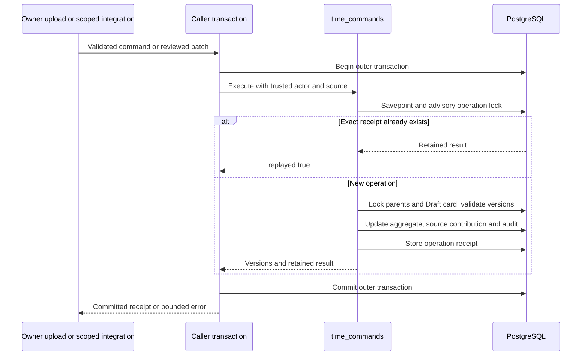

`execute_time_command()` permits create/edit/delete contribution operations only.
The caller supplies trusted actor/source; an assistant does not select a tenant.
`_receipt()` takes an actor/source/key advisory transaction lock and compares the
payload hash. An exact replay returns the stored result; conflicting key reuse
rejects. Nested savepoints belong inside the caller's outer transaction.
[Command dispatcher](https://github.com/edlopezpm-ops/timeker-PH2/blob/9fc9eebdaf9f52170530c8a28d34f6c8cd612c64/app/time_commands.py#L409),
[receipt lock](https://github.com/edlopezpm-ops/timeker-PH2/blob/9fc9eebdaf9f52170530c8a28d34f6c8cd612c64/app/time_commands.py#L40).

`_parents()` checks Client/Project/Case ownership, actual Client IANA timezone and
editable week. `_card()` checks Draft/version, and `_bounds()` enforces daily and
Project-count limits. `_add()` updates/creates the aggregate entry and separately
stores `TimeContribution` provenance and Case allocation. Corrections require
contribution/card versions and the same trusted source, preserving other sources'
minutes and manual content. Deletion retains operation/source provenance.
[Parent/card checks](https://github.com/edlopezpm-ops/timeker-PH2/blob/9fc9eebdaf9f52170530c8a28d34f6c8cd612c64/app/time_commands.py#L77),
[addition](https://github.com/edlopezpm-ops/timeker-PH2/blob/9fc9eebdaf9f52170530c8a28d34f6c8cd612c64/app/time_commands.py#L204),
[correction](https://github.com/edlopezpm-ops/timeker-PH2/blob/9fc9eebdaf9f52170530c8a28d34f6c8cd612c64/app/time_commands.py#L305).

For owner uploads:

1. `_bounded_form()` and `parse_upload()` enforce origin/CSRF, format, UTF-8,
   256 KiB/200-row bounds and exact canonical fields.
2. `preview_file()` calls `preview_import()` without committing contributions.
   The preview returns labels/conflicts/hash/expected versions and a signed
   owner/session binding. A retained exact receipt may be shown immediately.
3. `commit_file()` verifies the signed confirmation, 15-minute expiry and current
   owner/session; it parses the reviewed JSON and opens one outer transaction.
4. `commit_import()` checks the hash, enters a savepoint, handles receipt replay,
   locks source-record identities and Clients, and recomputes the preview.
5. Any version/payload conflict requires a new preview. Each validated allocation
   slice creates source contributions through `_add()`; the import deliberately
   passes its own `open_cases=False` policy. Do not silently substitute ordinary
   interactive Case-selection rules for that branch.
6. All rows and the batch receipt commit together. A failed later row rolls back
   earlier effects and receipt; rebatching does not erase source identity.

[Upload parser](https://github.com/edlopezpm-ops/timeker-PH2/blob/9fc9eebdaf9f52170530c8a28d34f6c8cd612c64/app/time_import.py#L195),
[preview/commit callers](https://github.com/edlopezpm-ops/timeker-PH2/blob/9fc9eebdaf9f52170530c8a28d34f6c8cd612c64/app/time_import_routes.py#L271),
[atomic import service](https://github.com/edlopezpm-ops/timeker-PH2/blob/9fc9eebdaf9f52170530c8a28d34f6c8cd612c64/app/time_commands.py#L558).

## 6. Draft statements and reservation ownership

`create_draft()` locks the billing sequence/Client and relevant owner cards. It
selects normal Finalized/Invoiced billable entries in the requested period that
lack a reservation. Fixed-fee Project types are excluded from hourly selection.
Entries are grouped by Project/week/rate, exact integer minutes are aggregated,
and Decimal line amounts are rounded at the monetary boundary. The service
checks Project budget/currency, creates Draft lines and reserves each entry.
[Hourly draft service](https://github.com/edlopezpm-ops/timeker-PH2/blob/9fc9eebdaf9f52170530c8a28d34f6c8cd612c64/app/billing.py#L201).

A reservation prevents another draft from claiming the same work and blocks
reopening reserved time. Repeated create requests do not inherit time-command
idempotency keys: inspect existing Draft/reservations after an uncertain result,
rather than assuming it is safe to recreate the charge.

`create_fixed_fee_draft()` and `create_manual_extra_draft()` are separate paths.
Manual extras require their explicit commercial permission and do not release or
convert reserved hourly entries. `adjust_draft()` permits only the reviewed Draft
adjustment contract. No exchange rate, tax, minimum or legal identifier is invented.
[Fixed fee](https://github.com/edlopezpm-ops/timeker-PH2/blob/9fc9eebdaf9f52170530c8a28d34f6c8cd612c64/app/billing.py#L118),
[manual extra](https://github.com/edlopezpm-ops/timeker-PH2/blob/9fc9eebdaf9f52170530c8a28d34f6c8cd612c64/app/billing.py#L150),
[Draft adjustment](https://github.com/edlopezpm-ops/timeker-PH2/blob/9fc9eebdaf9f52170530c8a28d34f6c8cd612c64/app/billing.py#L286).

## 7. Issue and immutable artifact retrieval

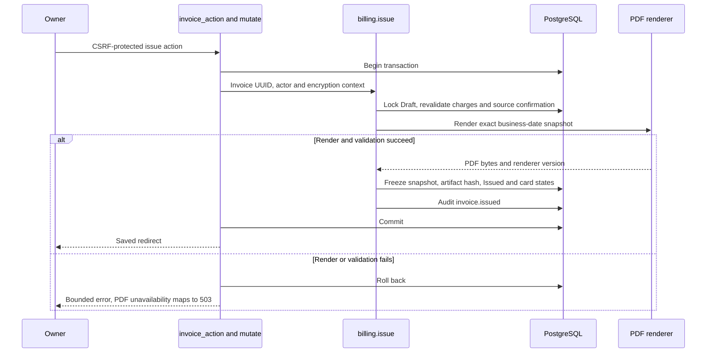

`issue()` requires Draft, rechecks Project charge basis/budget/currency and
commercial-source confirmation, captures the Client-zone business issue date,
builds a factual snapshot and renders before commit. The same transaction stores
snapshot/PDF/SHA-256/renderer identity, sets Issued and marks reserved cards
Invoiced. This is commercial service-statement issuance, not a tax-authority API.
[Issue implementation](https://github.com/edlopezpm-ops/timeker-PH2/blob/9fc9eebdaf9f52170530c8a28d34f6c8cd612c64/app/billing.py#L396),
[route error mapping](https://github.com/edlopezpm-ops/timeker-PH2/blob/9fc9eebdaf9f52170530c8a28d34f6c8cd612c64/app/main.py#L1479).

`artifact_bytes()` regenerates Draft previews but returns retained issued bytes
only after checksum verification. A later template/settings edit cannot rewrite
the original issued artifact. Credit memo download similarly retrieves its
retained artifact. Do not replace an integrity failure with a silent re-render.
[Statement artifact](https://github.com/edlopezpm-ops/timeker-PH2/blob/9fc9eebdaf9f52170530c8a28d34f6c8cd612c64/app/billing.py#L458),
[credit artifact](https://github.com/edlopezpm-ops/timeker-PH2/blob/9fc9eebdaf9f52170530c8a28d34f6c8cd612c64/app/billing.py#L736).

## 8. Payments, cancellation and Sending coupling

`pay()` records a manual positive Decimal amount within the remaining issued
balance, exact invoice currency and permitted business-date range. It stores the
payment and calls `sending.stop_for_invoice(reason="payment")` in the same
transaction—even a partial recorded payment stops the plan. This is not a client
card charge. Do not assume the import/command idempotency receipt also deduplicates
manual payment submissions.
[Manual payment](https://github.com/edlopezpm-ops/timeker-PH2/blob/9fc9eebdaf9f52170530c8a28d34f6c8cd612c64/app/billing.py#L572).

`reverse_payment()` locks the invoice/payment, requires an unreversed row and a
reason, and retains a reversal timestamp/audit. It does not refund a provider,
remove the old payment or automatically resume Sending.
[Reversal](https://github.com/edlopezpm-ops/timeker-PH2/blob/9fc9eebdaf9f52170530c8a28d34f6c8cd612c64/app/billing.py#L608).

`void()` requires an active owner/reason, an issued statement and zero unreversed
payments. It verifies original PDF integrity and freezes a full credit memo with
original identity/hash, amount, reason and its own PDF/hash. It then releases
reservations, retains Void history, returns cards to Finalized only when no other
reservation remains, and stops Sending. The original issued bytes stay intact.
Same actor/reason replay can return the retained memo; conflicting history rejects.
[Full cancellation](https://github.com/edlopezpm-ops/timeker-PH2/blob/9fc9eebdaf9f52170530c8a28d34f6c8cd612c64/app/billing.py#L658),
[reservation release](https://github.com/edlopezpm-ops/timeker-PH2/blob/9fc9eebdaf9f52170530c8a28d34f6c8cd612c64/app/billing.py#L628).

`cancel_draft()` instead retains canceled Draft history/releases claims without
issuing a credit memo. `mark_sent()` and due-date correction are explicit owner
operations; provider email acceptance does not invoke them or record payment.
[Draft cancellation](https://github.com/edlopezpm-ops/timeker-PH2/blob/9fc9eebdaf9f52170530c8a28d34f6c8cd612c64/app/billing.py#L724),
[manual delivery metadata](https://github.com/edlopezpm-ops/timeker-PH2/blob/9fc9eebdaf9f52170530c8a28d34f6c8cd612c64/app/billing.py#L551).

## 9. Troubleshooting: problem to boundary to evidence

| Problem | First boundary to inspect | Maintained evidence source |
| --- | --- | --- |
| Client cannot activate or disappear from active work | `clients._client_transition`, required profile/capacity and readiness | [client activation tests](https://github.com/edlopezpm-ops/timeker-PH2/blob/9fc9eebdaf9f52170530c8a28d34f6c8cd612c64/tests/integration/test_client_codes.py#L96) |
| Case mass edit loses a row or rejects stale page | Full Project snapshot/version check in `mass_update` | [Case mass-edit tests](https://github.com/edlopezpm-ops/timeker-PH2/blob/9fc9eebdaf9f52170530c8a28d34f6c8cd612c64/tests/integration/test_case_mass_edit.py#L1) |
| Saved grid refuses deletion of a row | Retained allocation/contribution checks in `save_week` | [timecard productivity tests](https://github.com/edlopezpm-ops/timeker-PH2/blob/9fc9eebdaf9f52170530c8a28d34f6c8cd612c64/tests/integration/test_timecard_productivity.py#L233) |
| Imported totals duplicate or correction removes manual time | Actor/source receipt, source-record locks and contribution ownership | [time command preservation/replay tests](https://github.com/edlopezpm-ops/timeker-PH2/blob/9fc9eebdaf9f52170530c8a28d34f6c8cd612c64/tests/integration/test_time_commands.py#L71) |
| Batch partially appears or stale preview accepted | Caller outer transaction plus `commit_import` savepoint/repreview | [atomic failure test](https://github.com/edlopezpm-ops/timeker-PH2/blob/9fc9eebdaf9f52170530c8a28d34f6c8cd612c64/tests/integration/test_time_commands.py#L213) |
| Finalized time cannot reopen | Reservation and parent lifecycle checks in `reopen` | [workflow tests](https://github.com/edlopezpm-ops/timeker-PH2/blob/9fc9eebdaf9f52170530c8a28d34f6c8cd612c64/tests/integration/test_workflow.py#L1) |
| Billing finds no time or wrong charge basis | Status/internal/billable/date/reservation/fixed-fee predicates | [Project billing routes](https://github.com/edlopezpm-ops/timeker-PH2/blob/9fc9eebdaf9f52170530c8a28d34f6c8cd612c64/tests/integration/test_project_billing_routes.py#L1) |
| Issue/download fails or totals drift | `build_snapshot`, renderer, immutable artifact checksum | [financial workflow tests](https://github.com/edlopezpm-ops/timeker-PH2/blob/9fc9eebdaf9f52170530c8a28d34f6c8cd612c64/tests/integration/test_workflow.py#L1) |
| Void/pay/reverse produces unexpected state | Invoice locks, unreversed balance, full-credit and stop branches | [credit memo tests](https://github.com/edlopezpm-ops/timeker-PH2/blob/9fc9eebdaf9f52170530c8a28d34f6c8cd612c64/tests/integration/test_credit_memos.py#L1) |

These links identify test implementations, not tests rerun for this whitepaper.
Use sanitized request/execution UUID, route template, outcome, source commit and
selected version to correlate diagnostics. Business events such as
`timecard.saved`, `time.operation_committed`, `invoice.issued`, `payment.recorded`
and `credit_memo.issued` belong to authorized private audit history; never copy
names, descriptions, payment notes, tax/bank facts or PDF bytes into logs/reports.
[Typed diagnostic boundary](https://github.com/edlopezpm-ops/timeker-PH2/blob/9fc9eebdaf9f52170530c8a28d34f6c8cd612c64/app/logging.py#L32).

Future integration/SDK design must preserve these existing ownership, version,
receipt, reservation and transaction boundaries. This chapter adds no SDK,
arbitrary financial API, new writer, automatic charge or production authority.

---

# Documents, Mail and Sending: executable flow map

This chapter traces source `9fc9eebdaf9f52170530c8a28d34f6c8cd612c64`.
It documents existing callers, service branches, transactions and effect limits
for maintenance and future troubleshooting/integration design. It creates no
SDK, new endpoint or permission to send, authenticate, query hosted data or deploy.
No product tests or provider flows were executed to prepare it. PH3 awaits owner
prompts; existing Stage continues toward one future combined PH2+PH3 PROD candidate.

## 1. Separate records and effects

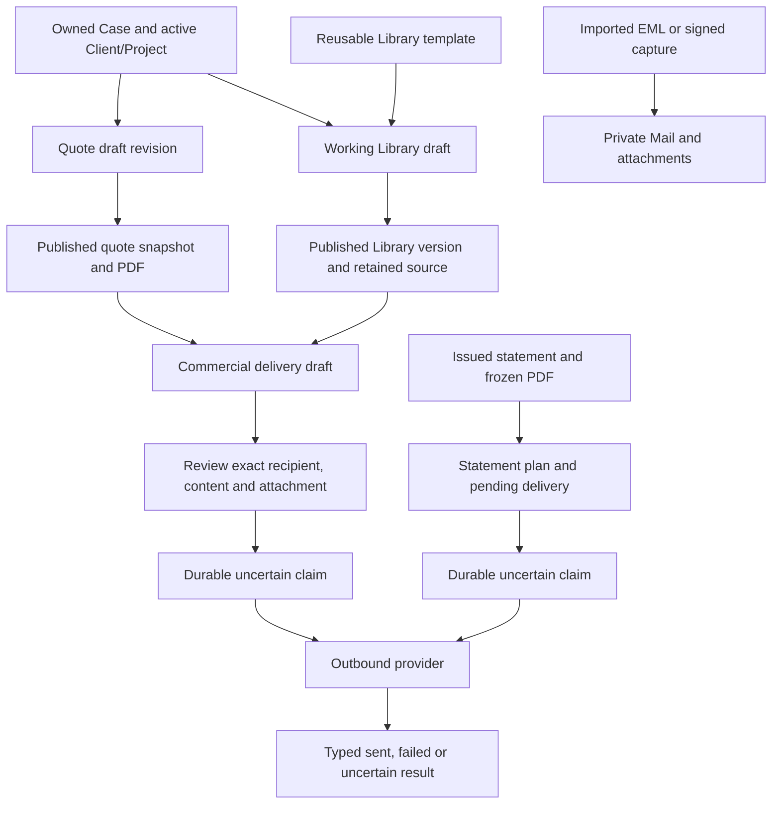

Publication, dispatch, provider acceptance, human agreement, client receipt and
manual payment are different events. Quote/Library publication does not create
an invoice, log work, change a Project budget, buy a subscription or send mail.
Statement provider acceptance does not call billing's manual Sent/payment writers.
[Quote publication](https://github.com/edlopezpm-ops/timeker-PH2/blob/9fc9eebdaf9f52170530c8a28d34f6c8cd612c64/app/quoting.py#L318),
[Library publication](https://github.com/edlopezpm-ops/timeker-PH2/blob/9fc9eebdaf9f52170530c8a28d34f6c8cd612c64/app/library.py#L313),
[Sending service contract](https://github.com/edlopezpm-ops/timeker-PH2/blob/9fc9eebdaf9f52170530c8a28d34f6c8cd612c64/app/sending.py#L1).

## 2. Quoting callers, revision branches and publication

| Caller | Callee | Branch/result |
| --- | --- | --- |
| `POST /quoting/new` | `quoting.create()` through shared `mutate()` | Owner operation-key replay or new quote/revision 1 |
| `POST /quoting/{id}/edit` | `quoting.update()` | Expected Draft revision/version; replace only editable lines |
| `POST /quoting/{id}/publish` | `quoting.publish()` with controlled renderer | Existing publication replay or new frozen artifact |
| `POST /quoting/{id}/revise` | `quoting.revise()` | New editable revision; retain old published revision |
| `POST /quoting/{id}/archive` | `quoting.archive()` | Versioned archive marker, not deletion |
| `GET /quoting/{id}/pdf` | Published artifact lookup or Draft render | Frozen integrity-checked bytes versus regenerable preview |

[Router](https://github.com/edlopezpm-ops/timeker-PH2/blob/9fc9eebdaf9f52170530c8a28d34f6c8cd612c64/app/quoting_routes.py#L191),
[publish/revise/download callers](https://github.com/edlopezpm-ops/timeker-PH2/blob/9fc9eebdaf9f52170530c8a28d34f6c8cd612c64/app/quoting_routes.py#L214),
[shared transaction wrapper](https://github.com/edlopezpm-ops/timeker-PH2/blob/9fc9eebdaf9f52170530c8a28d34f6c8cd612c64/app/main.py#L379).

Step-by-step creation and editing:

1. `_context()` resolves the actual owned Case and locks its Client/Project/Case;
   active parents, unarchived Case and consistent associations are mandatory.
   Submitted Client/Project IDs cannot contradict the Case-derived context.
2. Normalize bounded text, exact integer estimated minutes/ranges and Decimal
   money. Duration-only HLE work stays unpriced; HLE needs no invented SOW/SLA.
3. `create()` compares owner/operation-key and normalized creation digest. Exact
   replay returns revision 1; a conflicting payload rejects.
4. `update()` rechecks context, locks quote/revision and requires editable Draft
   plus expected version. A line-only edit still advances the revision version.
5. The caller's transaction persists revision/lines/flexfields and business audit
   together. Stale, foreign, archived or published edits fail instead of changing
   a retained artifact.

[Context and editability](https://github.com/edlopezpm-ops/timeker-PH2/blob/9fc9eebdaf9f52170530c8a28d34f6c8cd612c64/app/quoting.py#L159),
[normalization/totals](https://github.com/edlopezpm-ops/timeker-PH2/blob/9fc9eebdaf9f52170530c8a28d34f6c8cd612c64/app/quoting.py#L61),
[create/update](https://github.com/edlopezpm-ops/timeker-PH2/blob/9fc9eebdaf9f52170530c8a28d34f6c8cd612c64/app/quoting.py#L216).

Publication rechecks context and optimistic version, builds a JSON-safe snapshot,
renders the controlled quote template and requires bounded PDF-shaped bytes.
It stores snapshot/size/hash/renderer identity before marking the revision
published. Repeating a completed publication can return its existing artifact.
Rendering/validation failure aborts the caller transaction. Published retrieval
verifies retained size/hash; it does not silently rebuild altered bytes.
[Publish and retained retrieval](https://github.com/edlopezpm-ops/timeker-PH2/blob/9fc9eebdaf9f52170530c8a28d34f6c8cd612c64/app/quoting.py#L318).

## 3. Private Library original, draft and version custody

Working documents require an owned unarchived Case with active Client/Project.
Reusable templates instead have no Case. `_fields()` validates that distinction;
the browser cannot attach a working document to unrelated parent IDs.
[Library fields/context](https://github.com/edlopezpm-ops/timeker-PH2/blob/9fc9eebdaf9f52170530c8a28d34f6c8cd612c64/app/library.py#L135).

`library_routes` parses bounded forms/uploads and uses the shared mutation
transaction for create/save/upload/publish/new-draft. The service locks the
Document and compares its Draft revision; a frozen document requires a new Draft
before editing. Publication is not a signature or external acceptance writer.
[Mutation callers](https://github.com/edlopezpm-ops/timeker-PH2/blob/9fc9eebdaf9f52170530c8a28d34f6c8cd612c64/app/library_routes.py#L111),
[Draft/version service](https://github.com/edlopezpm-ops/timeker-PH2/blob/9fc9eebdaf9f52170530c8a28d34f6c8cd612c64/app/library.py#L222).

Upload path:

1. Bound multipart bytes before parsing; require a nonempty file at most 5 MiB.
2. `inspect_upload()` checks extension/content. PDF needs bounded header/end
   markers and yields no invented editable conversion. TXT/MD decode as bounded
   UTF-8 text.
3. DOCX inspection bounds ZIP entries, expansion/ratio/member sizes, rejects
   encryption/macros/embeddings and XML entity/DOCTYPE declarations, and extracts
   plain paragraph text without extracting files or executing relationships.
4. `upload()` retains immutable original bytes/size/hash in `LibraryUpload`,
   updates the Draft's selected source/editable text and advances revision.
   This is conservative parsing, not antivirus certification.

[Upload inspection](https://github.com/edlopezpm-ops/timeker-PH2/blob/9fc9eebdaf9f52170530c8a28d34f6c8cd612c64/app/library.py#L243),
[retained source write](https://github.com/edlopezpm-ops/timeker-PH2/blob/9fc9eebdaf9f52170530c8a28d34f6c8cd612c64/app/library.py#L289),
[upload caller](https://github.com/edlopezpm-ops/timeker-PH2/blob/9fc9eebdaf9f52170530c8a28d34f6c8cd612c64/app/library_routes.py#L130).

Publication path:

1. `publish()` locks the Draft, validates revision/context/content and selected
   attachment format. Original attachment requires an available retained source.
2. It captures a numbered snapshot. Uploaded PDF is retained as PDF; other text
   renders through the controlled Library PDF template. Size limits still apply.
3. The transaction stores immutable `LibraryDocumentVersion` PDF/size/hash,
   source reference and publication metadata, then marks the Document frozen.
4. `new_draft()` advances the editable Draft without replacing earlier versions.
5. `frozen_artifact()` verifies the version PDF and, when original attachment was
   selected, the retained original source/hash. PDF preview and selected outbound
   attachment may therefore be different byte artifacts.

[Publish/new Draft](https://github.com/edlopezpm-ops/timeker-PH2/blob/9fc9eebdaf9f52170530c8a28d34f6c8cd612c64/app/library.py#L313),
[artifact selection and checksum validation](https://github.com/edlopezpm-ops/timeker-PH2/blob/9fc9eebdaf9f52170530c8a28d34f6c8cd612c64/app/library.py#L368).
Original/version download routes recheck owner/context and force bounded private
attachment responses; no public document bucket or editable PDF converter exists.
[Download callers](https://github.com/edlopezpm-ops/timeker-PH2/blob/9fc9eebdaf9f52170530c8a28d34f6c8cd612c64/app/library_routes.py#L155).

## 4. Mail import, capture and attachment access

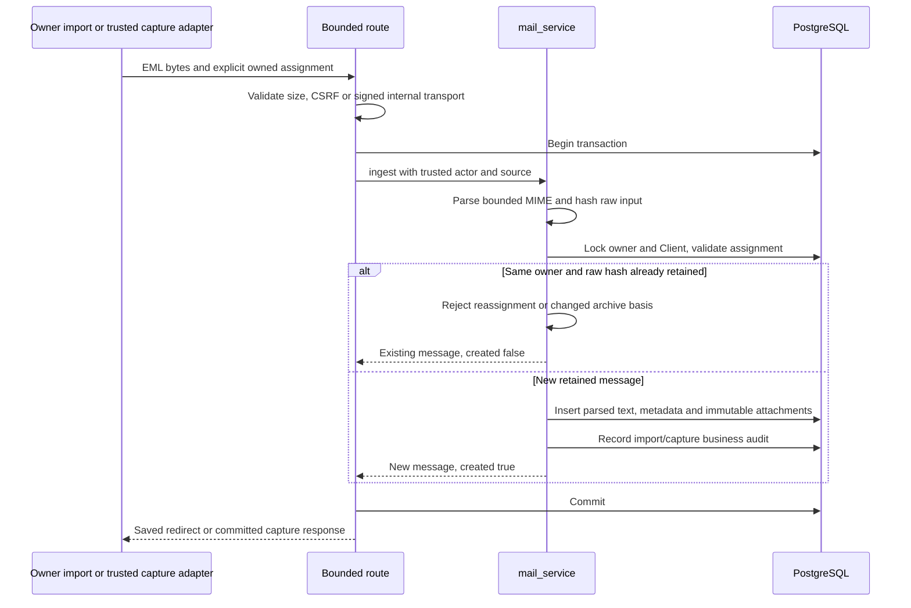

`POST /mail/import` uses `_uploaded_form()` for origin/CSRF and bounded EML
upload, then opens a transaction around `mail_service.ingest()`. Ingestion parses
at most 5 MiB raw mail with bounded headers/body/MIME depth/parts; stores parsed
text/metadata and immutable attachment bytes; and hashes raw input
for owner-scoped deduplication. It is not a mailbox synchronization or a promise
of full original-MIME download.
[Import caller](https://github.com/edlopezpm-ops/timeker-PH2/blob/9fc9eebdaf9f52170530c8a28d34f6c8cd612c64/app/mail_routes.py#L210),
[parser](https://github.com/edlopezpm-ops/timeker-PH2/blob/9fc9eebdaf9f52170530c8a28d34f6c8cd612c64/app/mail_service.py#L66),
[ingestion](https://github.com/edlopezpm-ops/timeker-PH2/blob/9fc9eebdaf9f52170530c8a28d34f6c8cd612c64/app/mail_service.py#L201).

Assignment validation locks owner/Client and checks Project/Case relationships.
Exact duplicate raw bytes return the retained message only for the same
assignment. A changed assignment or historical archive receipt basis rejects;
Message-ID, sender and Date are not authentication or permission to rewrite it.
Owner import may supply a nonfuture historical receipt date; capture may not.
Archive visibility is based on retained receipt policy, not a spoofed mail Date.
[Assignment boundary](https://github.com/edlopezpm-ops/timeker-PH2/blob/9fc9eebdaf9f52170530c8a28d34f6c8cd612c64/app/mail_service.py#L167),
[deduplication/receipt branches](https://github.com/edlopezpm-ops/timeker-PH2/blob/9fc9eebdaf9f52170530c8a28d34f6c8cd612c64/app/mail_service.py#L219).

Optional `/internal/mail` first requires configured capture and a bounded signed
transport. `authenticated_body()` binds timestamp, exact route, recipient and
body hash with HMAC. The current handler uses the **default tenant factory**,
resolves a digest-only capture token, validates active owner/assignment, locks
against revocation/parallel quota admission and limits new captures to 100 per
owner/day. Do not infer a general arbitrary-tenant mail router from this handler.
[Signed transport](https://github.com/edlopezpm-ops/timeker-PH2/blob/9fc9eebdaf9f52170530c8a28d34f6c8cd612c64/app/internal_routes.py#L82),
[capture handler](https://github.com/edlopezpm-ops/timeker-PH2/blob/9fc9eebdaf9f52170530c8a28d34f6c8cd612c64/app/internal_routes.py#L133),
[address resolution/revocation](https://github.com/edlopezpm-ops/timeker-PH2/blob/9fc9eebdaf9f52170530c8a28d34f6c8cd612c64/app/mail_service.py#L296).

Attachment routes join exact message/attachment/owner and enforce active versus
archive-export visibility; they return sanitized attachment names with
application/octet-stream, nosniff and private/no-store. The current Mail route
selects stored size/hash but directly returns selected payload; it does not call
Library's `verify_payload()`. Preserve that distinction when troubleshooting
custody rather than claiming every download runs the same integrity check.
[Mail attachment response](https://github.com/edlopezpm-ops/timeker-PH2/blob/9fc9eebdaf9f52170530c8a28d34f6c8cd612c64/app/mail_routes.py#L357).

## 5. Statement Sending: prepare, claim, effect and completion

### Caller and preparation gates

Statement routes require owner authorization and CSRF. Current source defaults
outbound provider/jobs to disabled, and production has a separate capability.
Manual dispatch requires current configured provider; source presence/UI is not
activation or send authority. Authentication SMTP is never reused as outbound
business credentials.
[Configuration gates](https://github.com/edlopezpm-ops/timeker-PH2/blob/9fc9eebdaf9f52170530c8a28d34f6c8cd612c64/app/config.py#L57),
[dispatch route gates](https://github.com/edlopezpm-ops/timeker-PH2/blob/9fc9eebdaf9f52170530c8a28d34f6c8cd612c64/app/sending_dispatch_routes.py#L13).

`/sending/prepare/{invoice_id}` review/confirmation calls `sending.prepare()` in
the caller transaction. It locks preferences/invoice, rejects pause, requires
confirmation of exact recipient/immutable checksum, validates the issued artifact,
requires no recorded payment and positive balance, and rejects a second retained
plan for the same statement. It freezes rendered initial content, bounded
follow-up policy and creates sequence 0 Pending delivery plus audit.
[Preparation callers](https://github.com/edlopezpm-ops/timeker-PH2/blob/9fc9eebdaf9f52170530c8a28d34f6c8cd612c64/app/sending_routes.py#L107),
[prepare service](https://github.com/edlopezpm-ops/timeker-PH2/blob/9fc9eebdaf9f52170530c8a28d34f6c8cd612c64/app/sending.py#L214).

The initial manual dispatch route relies on that authorized prepared plan; its
POST still verifies CSRF/provider readiness. Manual follow-up advancement has a
fresh explicit confirmation and exact current review digest. Do not describe
both caller contracts as an identical generic checkbox.
[Initial/follow-up callers](https://github.com/edlopezpm-ops/timeker-PH2/blob/9fc9eebdaf9f52170530c8a28d34f6c8cd612c64/app/sending_dispatch_routes.py#L33).

### Two transactions around an uncertain claim

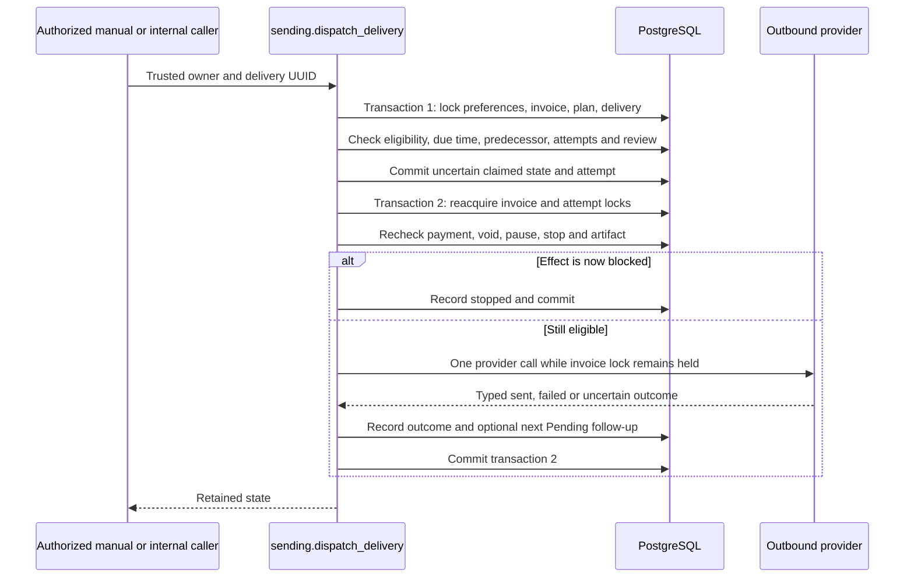

`dispatch_delivery()` returns existing nonpending states without replay. Future
scheduled time waits unless the confirmed manual-follow-up branch applies.
Follow-ups require a Sent predecessor; attempts are bounded to four. The durable
claim commits **before** provider I/O, so process death cannot turn an unknown
acceptance into an unclaimed Pending retry.
[Claim transaction](https://github.com/edlopezpm-ops/timeker-PH2/blob/9fc9eebdaf9f52170530c8a28d34f6c8cd612c64/app/sending.py#L513).

The second transaction rechecks current blocking state and exact PDF checksum,
then holds the invoice lock used by manual payment/void until provider outcome
commit. A stop/payment/void between claim and effect can prevent the send.
A transport exception, invalid result or ambiguous provider reply is retained as
Uncertain, not a reason to replay. A successful acceptance can schedule the next
bounded Pending row; it does not invoke billing.mark_sent/pay or alter issued PDF.
[Recheck/effect/result](https://github.com/edlopezpm-ops/timeker-PH2/blob/9fc9eebdaf9f52170530c8a28d34f6c8cd612c64/app/sending.py#L591).

The Cloudflare transport validates address/header/PDF/hash/encoded-message bounds,
uses fixed configured destination/credentials and a bounded response. It treats
only recognized negative responses as definitive Failed; malformed/unexpected
results/timeouts remain Uncertain. Recognized queued/delivered acceptance maps to
Sent; a permanent bounce maps to Failed. The implementation assumes no provider
idempotency guarantee and promises no inbox placement or client payment.
[Response classifier](https://github.com/edlopezpm-ops/timeker-PH2/blob/9fc9eebdaf9f52170530c8a28d34f6c8cd612c64/app/sending_transport.py#L31).

### Retry, Stop and invoice coupling

`retry()` permits an eligible definitively Failed active delivery below four
attempts; it rechecks artifact/payment/balance and restores Pending with the
original authorized schedule. It does not retry Uncertain or Sent rows.
`stop_plan()`/`stop_all()` retain stop history; `resume()` permits new plans and is
not a recall or automatic replay of completed/uncertain messages.
[Stop controls](https://github.com/edlopezpm-ops/timeker-PH2/blob/9fc9eebdaf9f52170530c8a28d34f6c8cd612c64/app/sending.py#L288),
[retry](https://github.com/edlopezpm-ops/timeker-PH2/blob/9fc9eebdaf9f52170530c8a28d34f6c8cd612c64/app/sending.py#L348).

`billing.pay()` stops statement plans for any recorded payment; `billing.void()`
stops them during full cancellation. Reversing a payment does not automatically
restart Sending. These are invoice-transaction effects, not provider webhooks.
[Payment coupling](https://github.com/edlopezpm-ops/timeker-PH2/blob/9fc9eebdaf9f52170530c8a28d34f6c8cd612c64/app/billing.py#L572),
[cancellation coupling](https://github.com/edlopezpm-ops/timeker-PH2/blob/9fc9eebdaf9f52170530c8a28d34f6c8cd612c64/app/billing.py#L716).

## 6. Commercial Sending has a separate outbox

`proposal_sending.published_source()` accepts a published Quote or Library version
and verifies the source identity/attachment. `prepare()` retains selected bytes,
hash, filename/type, addressed content and operation-key/digest. Draft editing
requires current version and no prior claim. The commercial ledger does not
reuse invoice collections/follow-up state.
[Published source and preparation](https://github.com/edlopezpm-ops/timeker-PH2/blob/9fc9eebdaf9f52170530c8a28d34f6c8cd612c64/app/proposal_sending.py#L100),
[Draft revision/review](https://github.com/edlopezpm-ops/timeker-PH2/blob/9fc9eebdaf9f52170530c8a28d34f6c8cd612c64/app/proposal_sending.py#L173).

`POST /sending/proposals/{id}/dispatch` requires configured commercial Sending,
CSRF, explicit confirmation, exact review digest and optional explicit Failed
retry. `dispatch_delivery()` validates encoded 5 MiB budget/artifact and four-attempt
limit, then commits an Uncertain claim/attempt before I/O. **Unlike statement
Sending**, commercial provider I/O runs between the claim and result transactions,
not under a retained invoice lock. A final transaction records actual typed outcome.
[Caller](https://github.com/edlopezpm-ops/timeker-PH2/blob/9fc9eebdaf9f52170530c8a28d34f6c8cd612c64/app/proposal_sending_routes.py#L81),
[commercial dispatch](https://github.com/edlopezpm-ops/timeker-PH2/blob/9fc9eebdaf9f52170530c8a28d34f6c8cd612c64/app/proposal_sending.py#L230).

Sent/Uncertain/stopped rows are not automatically dispatched again; definitive
Failed retry requires its specific branch. Stop prevents future attempts but
cannot recall an already claimed message. If Stop occurs during I/O, preserve
actual outcome plus stop history instead of pretending the provider call vanished.
[Commercial stop](https://github.com/edlopezpm-ops/timeker-PH2/blob/9fc9eebdaf9f52170530c8a28d34f6c8cd612c64/app/proposal_sending.py#L193),
[bounded transport](https://github.com/edlopezpm-ops/timeker-PH2/blob/9fc9eebdaf9f52170530c8a28d34f6c8cd612c64/app/proposal_sending_transport.py#L94).

## 7. Jobs and provider callbacks are separate paths

`POST /internal/sending` requires signed empty-body transport, available provider
and `sending_jobs_enabled`. Its worker batch binds trusted non-demo tenant roles,
selects due rows and shares a maximum 20-delivery budget across the batch.
The retained Stage configuration keeps scheduled Sending **off**. The existing
02:17 UTC cron invokes only Case retention; its actual scheduled execution remains
unobserved. It does not dispatch statement or commercial email.
[Sending job](https://github.com/edlopezpm-ops/timeker-PH2/blob/9fc9eebdaf9f52170530c8a28d34f6c8cd612c64/app/internal_routes.py#L20),
[batch selection](https://github.com/edlopezpm-ops/timeker-PH2/blob/9fc9eebdaf9f52170530c8a28d34f6c8cd612c64/app/internal_routes.py#L42),
[Case-only scheduler](https://github.com/edlopezpm-ops/timeker-PH2/blob/9fc9eebdaf9f52170530c8a28d34f6c8cd612c64/deploy/cloudflare/src/index.ts#L63).

There is no implemented asynchronous email delivery/receipt webhook in these
Sending routers. The provider HTTP result above supplies the retained send status;
it is not a payment callback. `/subscriptions/paddle/webhook` is a **separate**
subscription handler: bounded JSON/signature verification, exact retained checkout/
tenant metadata and `handle_verified_event()`. It returns bounded 400/409/503 for
rejected/unconfirmed/retryable processing and acknowledges only completed handling.
Do not connect it to client statement payment or email receipt semantics.
[Subscription webhook caller](https://github.com/edlopezpm-ops/timeker-PH2/blob/9fc9eebdaf9f52170530c8a28d34f6c8cd612c64/app/subscription_payment_routes.py#L392).

## 8. Troubleshooting map and safe evidence

| Problem | First branch/transaction to inspect | Maintained test source |
| --- | --- | --- |
| HLE rejects context or edit after publication | `_context`, `_editable`, creation digest/revision | [Quoting tests](https://github.com/edlopezpm-ops/timeker-PH2/blob/9fc9eebdaf9f52170530c8a28d34f6c8cd612c64/tests/integration/test_quoting.py#L1) |
| Publication fails or attachment changes | Renderer validation, snapshot/size/hash and Library selected format | [invalid quote renderer](https://github.com/edlopezpm-ops/timeker-PH2/blob/9fc9eebdaf9f52170530c8a28d34f6c8cd612c64/tests/integration/test_quoting.py#L240), [Library tests](https://github.com/edlopezpm-ops/timeker-PH2/blob/9fc9eebdaf9f52170530c8a28d34f6c8cd612c64/tests/integration/test_library.py#L1) |
| EML duplicate appears under another Project | Owner/raw-hash deduplication and assignment locks | [Mail tests](https://github.com/edlopezpm-ops/timeker-PH2/blob/9fc9eebdaf9f52170530c8a28d34f6c8cd612c64/tests/integration/test_mail.py#L1) |
| Mail attachment available through wrong view | Owner/parent join and active/archive predicate | [Mail attachment tests](https://github.com/edlopezpm-ops/timeker-PH2/blob/9fc9eebdaf9f52170530c8a28d34f6c8cd612c64/tests/integration/test_mail_attachments.py#L1) |
| Capture redirects/fails or over-admits | HMAC binding, default-role routing, revocation/quota transaction | [internal capture tests](https://github.com/edlopezpm-ops/timeker-PH2/blob/9fc9eebdaf9f52170530c8a28d34f6c8cd612c64/tests/integration/test_internal_jobs.py#L29) |
| Double click/timeout seems to need resend | Durable claim/result transaction and typed uncertainty | [statement dispatch tests](https://github.com/edlopezpm-ops/timeker-PH2/blob/9fc9eebdaf9f52170530c8a28d34f6c8cd612c64/tests/integration/test_sending_dispatch.py#L185), [commercial claim tests](https://github.com/edlopezpm-ops/timeker-PH2/blob/9fc9eebdaf9f52170530c8a28d34f6c8cd612c64/tests/integration/test_proposal_sending.py#L94) |
| Payment/Stop after follow-up review | Current eligibility and exact review digest recheck | [manual follow-up tests](https://github.com/edlopezpm-ops/timeker-PH2/blob/9fc9eebdaf9f52170530c8a28d34f6c8cd612c64/tests/integration/test_sending_manual_followup.py#L107) |
| Stop during commercial I/O appears Sent | Already-claimed call cannot be recalled; preserve actual result/stop history | [commercial stop race](https://github.com/edlopezpm-ops/timeker-PH2/blob/9fc9eebdaf9f52170530c8a28d34f6c8cd612c64/tests/integration/test_proposal_sending.py#L160) |
| Scheduled delivery never runs | Disabled jobs flag and Case-only cron, not payment/provider acceptance | [disabled job tests](https://github.com/edlopezpm-ops/timeker-PH2/blob/9fc9eebdaf9f52170530c8a28d34f6c8cd612c64/tests/integration/test_sending_dispatch.py#L218) |

These are source references to test implementations, not fresh execution claims.
Use request/execution UUID, route template, source commit, internal artifact/
delivery/attempt IDs, version/hash and typed outcome to correlate authorized
private evidence. Audit events such as `quote.published`, `library.published`,
`mail.imported`, `sending.claimed` and `proposal_sending.claimed` are business audit,
not permission to log recipients, subjects/bodies, attachment/PDF bytes, raw mail,
contracts, credentials or provider exception objects.
[Sanitized logging](https://github.com/edlopezpm-ops/timeker-PH2/blob/9fc9eebdaf9f52170530c8a28d34f6c8cd612c64/app/logging.py#L32).

Future troubleshooting/SDK work should reuse the real review, artifact, claim,
uncertainty and transaction contracts. No delivery callback, unlimited retry,
public upload, general mailbox sync, automatic collection or new SDK is invented
by these diagrams. Human UAT, actual external MCP/provider lifecycle, hosted
recovery and Live/production gates remain separate pending evidence.

---

# 05 — Integration and subscription code flows

Source: `9fc9eebdaf9f52170530c8a28d34f6c8cd612c64`. These are source-traced execution paths and maintenance boundaries, not newly executed client/provider flows. The existing Stage remains the target of future authorized work; actual MCP interoperability and remaining Sandbox lifecycle acceptance remain pending in [current residuals][current residuals]. No SDK package is implemented by this chapter.

## 1. Two adapters, one delegated tool boundary

[public_router][public_router] builds discovery/OAuth, JSON tool and MCP routes. [owner_router][owner_router] builds owner connection management. [TOOLS][TOOLS] declares 15 tools under eight scopes; [tool_catalog][tool_catalog] filters discovery by granted scopes and emits strict input schemas plus annotations. An annotation is guidance; server authorization remains mandatory.

| Scope | Tools and permitted domain effect |
| --- | --- |
| `clients:read` | `search_clients`: bounded client/project summaries |
| `clients:draft` | `create_client_draft`: proposed client, without publishing an active client |
| `cases:read` | `list_open_cases`, `get_case` |
| `cases:write` | `create_case`, `edit_case`, `close_case`: explicit owned Case mutations |
| `time:read` | `list_time_entries`: current work/contribution versions |
| `time:write` | `create_time_entry`, `edit_time_entry`, `delete_time_entry`: this connection's Draft contributions |
| `bills:read` | `list_bills`, `get_bill`, `list_credit_memos` |
| `dashboard:read` | `get_week_summary`: recorded work, with no inferred time |

The adapters expose no invoice issue/payment mutation, timecard finalization, mailbox read or automatic email operation. Case mutations and proposed clients are distinct from Draft time. Business text returned by tools is untrusted data, never an instruction/authorization. Sources: [SCOPES][SCOPES], [read_tool][read_tool], [write_tool][write_tool].

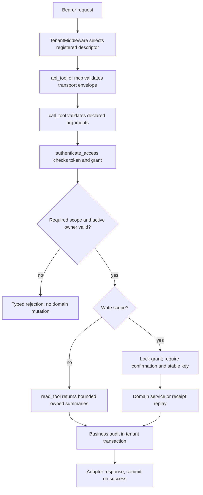

The descriptor selection is routing, not authentication. The default descriptor used for an invalid/missing selector is not a business-access fallback: token authentication must still pass before data access. [request_tenant][request_tenant] parses the token selector; [TenantMiddleware][TenantMiddleware] binds a registry-owned descriptor; [authenticate_access][authenticate_access] verifies tenant UUID, credential digest/kind/expiry/unused state, grant, resource/client and scope intersection. [grant_owner][grant_owner] rechecks owner activity/role/allowlist/registry mapping, client/resource availability, revocation/expiry and enrollment readiness.

### Ordered trace: authorization, code exchange and rotation

1. Discovery publishes issuer, exact authorization/token/revocation URLs, supported scopes and S256 public-client behavior. [registered_clients][registered_clients] accepts only operator-configured exact HTTPS callbacks, unique IDs and bounded metadata. There is no dynamic client-registration endpoint here.
2. GET `/oauth/authorize` rejects duplicate/unknown/invalid fields through [validate_authorization][validate_authorization]. It requires code response, S256, bounded state and an exact resource audience. An unsigned visitor stores a bounded continuation and returns to normal login; authenticated owners see consent.
3. POST consent uses owner authorization and checked CSRF form. Its `db.begin()` owns grant/code/audit persistence. Authlib handles Allow/Decline; [CodeGrant][CodeGrant] stores a 30-day grant and five-minute code digest, callback/challenge/scope. [IntegrationAuthorizationServer][IntegrationAuthorizationServer] registers S256, rotating refresh and the configured issuer response extension.
4. POST `/oauth/token` validates form content type, bounded fields, origin when supplied and a rate limit. [token route][token route] derives a registered tenant from the code/refresh selector, binds it and opens that tenant's transaction. Authlib verifies the public client, callback/PKCE and grant; no client secret substitutes for proof.
5. `CodeGrant.query_authorization_code` locks code and grant. Reused codes revoke the grant. [RotatingRefreshGrant][RotatingRefreshGrant] locks the refresh token/grant; reuse revokes the whole connection. The route deliberately commits OAuth error responses so replay revocation survives; converting that response into an exception/rollback would change security behavior.
6. `save_token` stores digests, not returned secrets. Access lifetime is at most 600 seconds and grant expiry; refresh ends at grant expiry. Rotation marks the old refresh used. The response contains new opaque credentials, which must stay out of source/logs/prompts.
7. [revocation route][revocation route] checks matching client and credential digest, locks/revokes the grant and returns 200 for invalid/unrecognized credentials without disclosing presence. Owner Settings revocation uses the same grant-level authority. Every later access rechecks the grant, stopping existing access credentials too.

Maintain with [PKCE and MCP integration test][PKCE and MCP integration test], [rotation replay test][rotation replay test], [scope expiry owner suspension test][scope expiry owner suspension test] and [actual tenant selector test][actual tenant selector test]. These links identify maintained tests; this documentation did not run them or complete a human OAuth Allow flow.

### Ordered trace: one tool call and idempotent writes

1. `/api/integration/tools/{name}` requires JSON and header bearer, with no query credentials. `/mcp` additionally checks Accept contains JSON and event-stream, protocol version and a single valid JSON-RPC object. Supported versions are source constants, not a promise of every client's compatibility.
2. [bounded_body and transport checks][bounded_body and transport checks] cap body at 32,768 bytes, reject foreign supplied Origin and disable unavailable integration capability. [validate_arguments][validate_arguments] rejects unknown/missing fields, invalid primitive types, UUID/date/length/range/enum values; boolean is not accepted as integer minutes.
3. [call_tool][call_tool] determines required scope and reauthenticates. It locks the grant for writes, serializing that connection's idempotency and revocation boundary.
4. Read calls reuse `read_tool`; all successful calls also add `integration.tool_called` business audit in the route transaction. A read-only tool hint does not mean a database session may be globally READ ONLY, because audit is persisted.
5. Writes require `confirmed is True`. Time operations delegate to [execute_time_command][execute_time_command] with a source bound to the grant UUID. Its receipts, owned parents/card locks, expected versions, exact minutes, contract bounds and own-contribution rules remain authoritative. Never replace this with direct row mutation.
6. Other writes hash the stable idempotency key and full tool intent. Same key/same payload replays the retained result; changed payload/tool is 409. Client proposal and Case services run before receipt/audit flush in the same transaction. A rollback does not leave a successful receipt behind.
7. The JSON adapter returns the structured result or sanitized errors. MCP wraps successful text/structuredContent and `isError=false`; domain/form/stale changes roll back and return `isError=true` with reread guidance. Invalid protocol/method/argument and authentication errors use their distinct JSON-RPC/HTTP branches.

[MCP route][MCP route] supports initialize, ping, tools/list, tools/call and two accepted notifications. It is stateless: GET/DELETE authenticate then return 405/Allow POST; required event-stream Accept does not create a persistent GET stream, resumable session or server-push API. See [transport error tests][transport error tests] and [strict contract tests][strict contract tests].

## 2. Enrollment and capacity precede ordinary workspace growth

Identity proof/admission and subscription entitlement are different state machines. [admit][admit] verifies provider proof, finds an existing immutable identity or reserves one exact prepared slot in the central directory. It commits reservation, initializes the fixed tenant, reads it back, then activates the retained mapping. Failure/uncertainty retains reserved IDs; it does not create arbitrary schemas or merge accounts by email.

[acknowledgment route][acknowledgment route] calls [accept_registration][accept_registration] after fresh owner proof and exact current notice/terms/privacy/catalog acknowledgment. [workspace_ready][workspace_ready] permits acknowledged assigned Free or previously proven paid history, including after paid expiry; copied legacy history has its own explicit retained branch. It does not invent a plan. [active_plan][active_plan] is stricter about currently valid paid access. These differences preserve history while separately blocking growth.

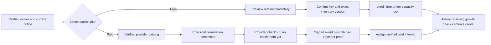

### Free selection and quotas

1. [subscription router][subscription router] renders plan/usage and separate preview/confirm forms. Preview does not archive. [registration Free route][registration Free route] supports the first-plan journey; the Settings route reuses the same domain service.
2. [enroll_free][enroll_free] requires stable operation key and takes [capacity_lock][capacity_lock] before nested flush. The PostgreSQL advisory transaction lock is keyed by the actual fixed schema.
3. Receipt replay precedes stale-version validation. New intent locks client/project rows, checks the inventory version and selected retained records, verifies lifecycle readiness, then archives only the explicitly listed excess records. It does not delete history or partially archive if a guard fails.
4. The singleton assignment is created/updated explicitly to Free. An unexpired verified paid period cannot be silently replaced. Receipt and audit share the caller's transaction.
5. [require_capacity][require_capacity] counts active clients and active projects under active parents. Free permits 1/1, Solo 5/10, Pro has no commercial client/project cap. These source quotas are not hosting/storage/mail guarantees or authoritative tax/pricing facts.
6. Positive growth requires an assignment and valid paid interval where applicable; unassigned/expired workspaces retain zero-growth editing/history. Parent reactivation accounts for latent active projects. Actual client/project entry points reuse this guard, including [client capacity callers][client capacity callers] and [project creation capacity][project creation capacity].

Check [last-slot race test][last-slot race test], [zero-growth expiry behavior][zero-growth expiry behavior], [parent reactivation test][parent reactivation test] and [free selection service tests][free selection service tests] before changing counts or lock placement.

## 3. Paid checkout: commit intent before network

The provider adapter is existing application code, [PaddleSandbox][PaddleSandbox], selected by [provider_from_settings][provider_from_settings]. Prepared Live source is separately gated; current retained Stage is Sandbox. Adapter API methods are internal implementation, not a timeKER public SDK.

1. The owner route [checkout POST][checkout POST] validates CSRF/bounded form fields, operation key, offer and explicit renewal confirmation, then calls [start_checkout][start_checkout].
2. [verify_catalog][verify_catalog] separately validates all configured offers remotely, then stores a configuration fingerprint under a fresh local transaction. `_require_verified` checks fingerprint/mode compatibility; a catalog match is not a paid event.
3. In the first tenant transaction, `_reserve` takes the capacity lock, verifies owner/key/payload and returns an existing receipt on exact replay. It rejects a competing reserved/uncertain checkout/change/cancel/retention effect and existing active subscription/pending checkout.
4. Commit happens before `create_checkout`. The server supplies exact tenant/checkout UUID binding and validated configured offer. [provider request boundary][provider request boundary] uses bounded HTTP, no redirects and no ambient proxy trust. It does not automatically retry mutations.
5. A successful provider response is rebound and saved in a new transaction as confirmed operation with outcome PENDING. It records a transaction ID; it does not grant capacity from a browser success page.
6. [_record_failure][_record_failure] preserves failed versus uncertain state. Network/malformed successful mutation/unknown post-effect failure may be uncertain. Exact operation replay returns saved status and never sends the effect again.
7. [reconcile_checkout][reconcile_checkout] uses GET on an already bound transaction. It closes only a verified canceled checkout, never assumes a timeout canceled it. No bound transaction means operator reconciliation, not a fresh checkout.

Maintenance evidence: [checkout reservation test][checkout reservation test], [uncertain checkout test][uncertain checkout test], [provider mutation no-retry test][provider mutation no-retry test].

## 4. Webhook to paid entitlement: verify twice around network

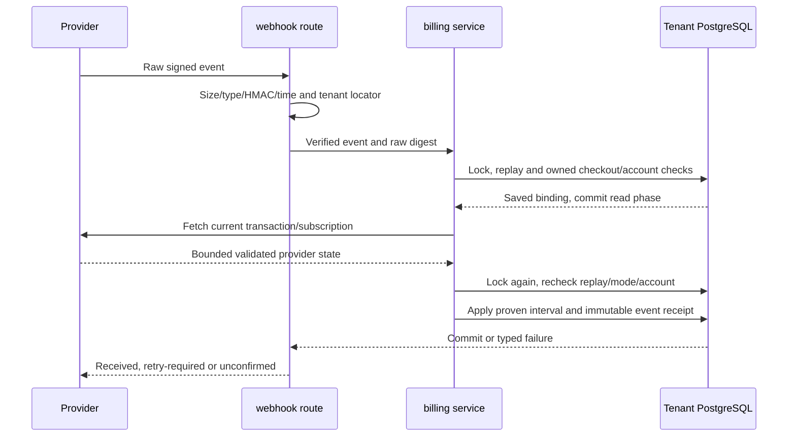

1. [webhook route][webhook route] is public machine transport, not owner CSRF form. It checks configured mode, JSON/body bounds and [verify_webhook][verify_webhook] over unchanged raw bytes before JSON decode. HMAC timestamp tolerance is five seconds, multiple h1 signatures support rotation; malformed/unknown bindings are rejected.
2. The signed `custom_data` must be exactly checkout_id and tenant_id. A registered tenant locator is selected, then [handle_verified_event][handle_verified_event] validates event ID/type/time/digest and binding again. Supported transaction/subscription lifecycle event names are explicit.
3. First transaction locks capacity, checks mode and event replay. Same event ID/digest replays; different digest conflicts. The event must refer to an owned checkout. Closed checkout/stale historical subscription receive retained no-regrant outcomes; a different active subscription is rejected.
4. The service fetches current transaction/subscription outside the transaction. Second transaction relocks, repeats replay/mode/owner/account checks and rebinds fetched customer/subscription/custom_data. A valid signature alone is insufficient payment proof.
5. [_proof][_proof] validates exact configured offer, one quantity, IDs, currency/payment status and paid period. [_set_entitlement][_set_entitlement] applies only a newer proven interval or matching confirmed upgrade, updates assignment/paid-through and handles pending selection. Old completed events cannot extend access.
6. Failed renewal grants seven-day grace only for the exact still-unpaid period after fetched transaction and subscription both confirm past_due. The earliest verified failure is stable; retries cannot extend grace. Paused/canceled or unconverged state does not invent it.
7. Immutable BillingEvent plus business audit commit with the entitlement change. Unavailable/provider or database conflicts produce retry-required 503; unconfirmed domain state 409; rejected signatures/bindings 400. Do not collapse all responses into success or replay a provider mutation to satisfy a webhook.

Relevant checks: [payment proof/replay test][payment proof/replay test], [foreign proof test][foreign proof test], [old payment test][old payment test], [failure convergence test][failure convergence test], [grace test][grace test].

## 5. Changes, cancellation, retention and safe reads

| Entry/service | Ordered behavior and maintenance trap |
| --- | --- |
| [preview_plan_change][preview_plan_change] → [confirm_plan_change][confirm_plan_change] | Fetch/save provider quote with account/inventory version and 15-minute expiry. Confirmation replays first, then rechecks current quote/totals/selection/version. Reserve+commit before mutation. Solo→Pro uses immediate proration; other supported changes use next-period mode. Confirmed response is PENDING; matching completed payment still controls entitlement. |
| [cancel_renewal][cancel_renewal] | Explicit confirmation; reserve/commit; schedule provider cancellation at verified paid end; validate effective date; persist PENDING. No immediate entitlement removal or automatic Free. |
| [preview_retention][preview_retention] / [confirm_retention][confirm_retention] | Eligible monthly account/once-for-owner claim, exact bound quote and refreshed equality before reserve+effect. No invented universal discount. Uncertainty retains claim; [reconcile_retention][reconcile_retention] GETs current subscription without repeating mutation. |
| [check_renewal_status][check_renewal_status] | Read remains available during an uncertain effect. Fetch exact subscription/customer/checkout; persist keyed status/scheduled-action receipt. It does not extend access or activate a change. |
| [owner_portal][owner_portal] | Check verified owned account; request exact provider portal session; validate URL. Ephemeral URL is returned, never persisted/audited. |

Plan/cycle changes preserve paid history and retained records. Deferred downgrade applies a reviewed selection only when matching paid-period proof arrives and lifecycle guards still pass; failure leaves explicit selection work rather than partial archive. See [downgrade tests][downgrade tests], [upgrade payment test][upgrade payment test], [retention uncertainty test][retention uncertainty test], [renewal during uncertainty test][renewal during uncertainty test].

## 6. Existing contracts a future SDK could consume

Use these existing contracts rather than inventing endpoints: [tool schemas and limits][tool schemas and limits], discovery/OAuth routes, JSON `/api/integration/tools/{name}` and stateless MCP `/mcp`. [portable connection guide][portable connection guide] describes the private package and intended normal connection flow. JSON/API and MCP resource audiences are distinct; a token for one cannot simply be reused for the other.

A future client library would need exact static client registration/redirect and S256; owner consent; secure returned-credential handling; refresh rotation and revocation; header bearer/no-query credentials; protocol/media negotiation; strict arguments and dates/integer minutes; caller confirmation/selection; stable idempotency keys and version rereads; typed HTTP/JSON-RPC errors; and safe uncertainty handling. These are requirements inferred from current server checks, not a shipped SDK, OpenAPI promise, host eligibility or voice/dot interoperability claim. Browser subscription/registration forms and the provider webhook are not delegated integration financial APIs. A future SDK cannot bypass their owner/CSRF/provider/entitlement boundaries.

No provider activation, SDK generation, human OAuth proof or hosted execution occurred while writing this reference. Existing exact-source tests guide future changes; canonical residuals continue to control pending acceptance.

[current residuals]: https://github.com/edlopezpm-ops/timeker-PH2/blob/9fc9eebdaf9f52170530c8a28d34f6c8cd612c64/docs/STATUS.md#L27
[public_router]: https://github.com/edlopezpm-ops/timeker-PH2/blob/9fc9eebdaf9f52170530c8a28d34f6c8cd612c64/app/integration_routes.py#L668
[owner_router]: https://github.com/edlopezpm-ops/timeker-PH2/blob/9fc9eebdaf9f52170530c8a28d34f6c8cd612c64/app/integration_routes.py#L1044
[TOOLS]: https://github.com/edlopezpm-ops/timeker-PH2/blob/9fc9eebdaf9f52170530c8a28d34f6c8cd612c64/app/integration_routes.py#L61
[tool_catalog]: https://github.com/edlopezpm-ops/timeker-PH2/blob/9fc9eebdaf9f52170530c8a28d34f6c8cd612c64/app/integration_routes.py#L257
[SCOPES]: https://github.com/edlopezpm-ops/timeker-PH2/blob/9fc9eebdaf9f52170530c8a28d34f6c8cd612c64/app/integration_auth.py#L24
[read_tool]: https://github.com/edlopezpm-ops/timeker-PH2/blob/9fc9eebdaf9f52170530c8a28d34f6c8cd612c64/app/integration_routes.py#L312
[write_tool]: https://github.com/edlopezpm-ops/timeker-PH2/blob/9fc9eebdaf9f52170530c8a28d34f6c8cd612c64/app/integration_routes.py#L515
[request_tenant]: https://github.com/edlopezpm-ops/timeker-PH2/blob/9fc9eebdaf9f52170530c8a28d34f6c8cd612c64/app/integration_auth.py#L86
[TenantMiddleware]: https://github.com/edlopezpm-ops/timeker-PH2/blob/9fc9eebdaf9f52170530c8a28d34f6c8cd612c64/app/tenancy.py#L469
[authenticate_access]: https://github.com/edlopezpm-ops/timeker-PH2/blob/9fc9eebdaf9f52170530c8a28d34f6c8cd612c64/app/integration_auth.py#L254
[grant_owner]: https://github.com/edlopezpm-ops/timeker-PH2/blob/9fc9eebdaf9f52170530c8a28d34f6c8cd612c64/app/integration_auth.py#L231
[registered_clients]: https://github.com/edlopezpm-ops/timeker-PH2/blob/9fc9eebdaf9f52170530c8a28d34f6c8cd612c64/app/integration_auth.py#L147
[validate_authorization]: https://github.com/edlopezpm-ops/timeker-PH2/blob/9fc9eebdaf9f52170530c8a28d34f6c8cd612c64/app/integration_auth.py#L197
[CodeGrant]: https://github.com/edlopezpm-ops/timeker-PH2/blob/9fc9eebdaf9f52170530c8a28d34f6c8cd612c64/app/integration_auth.py#L307
[IntegrationAuthorizationServer]: https://github.com/edlopezpm-ops/timeker-PH2/blob/9fc9eebdaf9f52170530c8a28d34f6c8cd612c64/app/integration_auth.py#L453
[token route]: https://github.com/edlopezpm-ops/timeker-PH2/blob/9fc9eebdaf9f52170530c8a28d34f6c8cd612c64/app/integration_routes.py#L776
[RotatingRefreshGrant]: https://github.com/edlopezpm-ops/timeker-PH2/blob/9fc9eebdaf9f52170530c8a28d34f6c8cd612c64/app/integration_auth.py#L381
[revocation route]: https://github.com/edlopezpm-ops/timeker-PH2/blob/9fc9eebdaf9f52170530c8a28d34f6c8cd612c64/app/integration_routes.py#L811
[PKCE and MCP integration test]: https://github.com/edlopezpm-ops/timeker-PH2/blob/9fc9eebdaf9f52170530c8a28d34f6c8cd612c64/tests/integration/test_delegated_integration.py#L104
[rotation replay test]: https://github.com/edlopezpm-ops/timeker-PH2/blob/9fc9eebdaf9f52170530c8a28d34f6c8cd612c64/tests/integration/test_delegated_integration.py#L164
[scope expiry owner suspension test]: https://github.com/edlopezpm-ops/timeker-PH2/blob/9fc9eebdaf9f52170530c8a28d34f6c8cd612c64/tests/integration/test_delegated_integration.py#L204
[actual tenant selector test]: https://github.com/edlopezpm-ops/timeker-PH2/blob/9fc9eebdaf9f52170530c8a28d34f6c8cd612c64/tests/integration/test_delegated_integration.py#L376
[bounded_body and transport checks]: https://github.com/edlopezpm-ops/timeker-PH2/blob/9fc9eebdaf9f52170530c8a28d34f6c8cd612c64/app/integration_routes.py#L609
[validate_arguments]: https://github.com/edlopezpm-ops/timeker-PH2/blob/9fc9eebdaf9f52170530c8a28d34f6c8cd612c64/app/integration_routes.py#L217
[call_tool]: https://github.com/edlopezpm-ops/timeker-PH2/blob/9fc9eebdaf9f52170530c8a28d34f6c8cd612c64/app/integration_routes.py#L591
[execute_time_command]: https://github.com/edlopezpm-ops/timeker-PH2/blob/9fc9eebdaf9f52170530c8a28d34f6c8cd612c64/app/time_commands.py#L409
[MCP route]: https://github.com/edlopezpm-ops/timeker-PH2/blob/9fc9eebdaf9f52170530c8a28d34f6c8cd612c64/app/integration_routes.py#L891
[transport error tests]: https://github.com/edlopezpm-ops/timeker-PH2/blob/9fc9eebdaf9f52170530c8a28d34f6c8cd612c64/tests/integration/test_delegated_integration.py#L231
[strict contract tests]: https://github.com/edlopezpm-ops/timeker-PH2/blob/9fc9eebdaf9f52170530c8a28d34f6c8cd612c64/tests/unit/test_integration_contracts.py#L180
[admit]: https://github.com/edlopezpm-ops/timeker-PH2/blob/9fc9eebdaf9f52170530c8a28d34f6c8cd612c64/app/admission.py#L142
[acknowledgment route]: https://github.com/edlopezpm-ops/timeker-PH2/blob/9fc9eebdaf9f52170530c8a28d34f6c8cd612c64/app/enrollment_routes.py#L189
[accept_registration]: https://github.com/edlopezpm-ops/timeker-PH2/blob/9fc9eebdaf9f52170530c8a28d34f6c8cd612c64/app/enrollment.py#L218
[workspace_ready]: https://github.com/edlopezpm-ops/timeker-PH2/blob/9fc9eebdaf9f52170530c8a28d34f6c8cd612c64/app/enrollment.py#L126
[active_plan]: https://github.com/edlopezpm-ops/timeker-PH2/blob/9fc9eebdaf9f52170530c8a28d34f6c8cd612c64/app/enrollment.py#L111
[subscription router]: https://github.com/edlopezpm-ops/timeker-PH2/blob/9fc9eebdaf9f52170530c8a28d34f6c8cd612c64/app/subscription_routes.py#L50
[registration Free route]: https://github.com/edlopezpm-ops/timeker-PH2/blob/9fc9eebdaf9f52170530c8a28d34f6c8cd612c64/app/enrollment_routes.py#L231
[enroll_free]: https://github.com/edlopezpm-ops/timeker-PH2/blob/9fc9eebdaf9f52170530c8a28d34f6c8cd612c64/app/subscriptions.py#L349
[capacity_lock]: https://github.com/edlopezpm-ops/timeker-PH2/blob/9fc9eebdaf9f52170530c8a28d34f6c8cd612c64/app/subscriptions.py#L61
[require_capacity]: https://github.com/edlopezpm-ops/timeker-PH2/blob/9fc9eebdaf9f52170530c8a28d34f6c8cd612c64/app/subscriptions.py#L107
[client capacity callers]: https://github.com/edlopezpm-ops/timeker-PH2/blob/9fc9eebdaf9f52170530c8a28d34f6c8cd612c64/app/clients.py#L45
[project creation capacity]: https://github.com/edlopezpm-ops/timeker-PH2/blob/9fc9eebdaf9f52170530c8a28d34f6c8cd612c64/app/clients.py#L305
[last-slot race test]: https://github.com/edlopezpm-ops/timeker-PH2/blob/9fc9eebdaf9f52170530c8a28d34f6c8cd612c64/tests/integration/test_subscription_capacity.py#L347
[zero-growth expiry behavior]: https://github.com/edlopezpm-ops/timeker-PH2/blob/9fc9eebdaf9f52170530c8a28d34f6c8cd612c64/tests/integration/test_subscription_billing.py#L233
[parent reactivation test]: https://github.com/edlopezpm-ops/timeker-PH2/blob/9fc9eebdaf9f52170530c8a28d34f6c8cd612c64/tests/integration/test_subscription_capacity.py#L156
[free selection service tests]: https://github.com/edlopezpm-ops/timeker-PH2/blob/9fc9eebdaf9f52170530c8a28d34f6c8cd612c64/tests/integration/test_subscription_domain.py#L1
[PaddleSandbox]: https://github.com/edlopezpm-ops/timeker-PH2/blob/9fc9eebdaf9f52170530c8a28d34f6c8cd612c64/app/paddle.py#L242
[provider_from_settings]: https://github.com/edlopezpm-ops/timeker-PH2/blob/9fc9eebdaf9f52170530c8a28d34f6c8cd612c64/app/paddle.py#L667
[checkout POST]: https://github.com/edlopezpm-ops/timeker-PH2/blob/9fc9eebdaf9f52170530c8a28d34f6c8cd612c64/app/subscription_payment_routes.py#L128
[start_checkout]: https://github.com/edlopezpm-ops/timeker-PH2/blob/9fc9eebdaf9f52170530c8a28d34f6c8cd612c64/app/subscription_billing.py#L400
[verify_catalog]: https://github.com/edlopezpm-ops/timeker-PH2/blob/9fc9eebdaf9f52170530c8a28d34f6c8cd612c64/app/subscription_billing.py#L302
[provider request boundary]: https://github.com/edlopezpm-ops/timeker-PH2/blob/9fc9eebdaf9f52170530c8a28d34f6c8cd612c64/app/paddle.py#L299
[_record_failure]: https://github.com/edlopezpm-ops/timeker-PH2/blob/9fc9eebdaf9f52170530c8a28d34f6c8cd612c64/app/subscription_billing.py#L388
[reconcile_checkout]: https://github.com/edlopezpm-ops/timeker-PH2/blob/9fc9eebdaf9f52170530c8a28d34f6c8cd612c64/app/subscription_billing.py#L454
[checkout reservation test]: https://github.com/edlopezpm-ops/timeker-PH2/blob/9fc9eebdaf9f52170530c8a28d34f6c8cd612c64/tests/integration/test_subscription_billing.py#L405
[uncertain checkout test]: https://github.com/edlopezpm-ops/timeker-PH2/blob/9fc9eebdaf9f52170530c8a28d34f6c8cd612c64/tests/integration/test_subscription_billing.py#L475
[provider mutation no-retry test]: https://github.com/edlopezpm-ops/timeker-PH2/blob/9fc9eebdaf9f52170530c8a28d34f6c8cd612c64/tests/unit/test_paddle.py#L363
[webhook route]: https://github.com/edlopezpm-ops/timeker-PH2/blob/9fc9eebdaf9f52170530c8a28d34f6c8cd612c64/app/subscription_payment_routes.py#L395
[verify_webhook]: https://github.com/edlopezpm-ops/timeker-PH2/blob/9fc9eebdaf9f52170530c8a28d34f6c8cd612c64/app/paddle.py#L183
[handle_verified_event]: https://github.com/edlopezpm-ops/timeker-PH2/blob/9fc9eebdaf9f52170530c8a28d34f6c8cd612c64/app/subscription_billing.py#L739
[_proof]: https://github.com/edlopezpm-ops/timeker-PH2/blob/9fc9eebdaf9f52170530c8a28d34f6c8cd612c64/app/subscription_billing.py#L99
[_set_entitlement]: https://github.com/edlopezpm-ops/timeker-PH2/blob/9fc9eebdaf9f52170530c8a28d34f6c8cd612c64/app/subscription_billing.py#L597
[payment proof/replay test]: https://github.com/edlopezpm-ops/timeker-PH2/blob/9fc9eebdaf9f52170530c8a28d34f6c8cd612c64/tests/integration/test_subscription_billing.py#L508
[foreign proof test]: https://github.com/edlopezpm-ops/timeker-PH2/blob/9fc9eebdaf9f52170530c8a28d34f6c8cd612c64/tests/integration/test_subscription_billing.py#L535
[old payment test]: https://github.com/edlopezpm-ops/timeker-PH2/blob/9fc9eebdaf9f52170530c8a28d34f6c8cd612c64/tests/integration/test_subscription_billing.py#L552
[failure convergence test]: https://github.com/edlopezpm-ops/timeker-PH2/blob/9fc9eebdaf9f52170530c8a28d34f6c8cd612c64/tests/integration/test_subscription_billing.py#L1175
[grace test]: https://github.com/edlopezpm-ops/timeker-PH2/blob/9fc9eebdaf9f52170530c8a28d34f6c8cd612c64/tests/integration/test_subscription_billing.py#L573
[preview_plan_change]: https://github.com/edlopezpm-ops/timeker-PH2/blob/9fc9eebdaf9f52170530c8a28d34f6c8cd612c64/app/subscription_billing.py#L1041
[confirm_plan_change]: https://github.com/edlopezpm-ops/timeker-PH2/blob/9fc9eebdaf9f52170530c8a28d34f6c8cd612c64/app/subscription_billing.py#L1098
[cancel_renewal]: https://github.com/edlopezpm-ops/timeker-PH2/blob/9fc9eebdaf9f52170530c8a28d34f6c8cd612c64/app/subscription_billing.py#L1602
[preview_retention]: https://github.com/edlopezpm-ops/timeker-PH2/blob/9fc9eebdaf9f52170530c8a28d34f6c8cd612c64/app/subscription_billing.py#L1432
[confirm_retention]: https://github.com/edlopezpm-ops/timeker-PH2/blob/9fc9eebdaf9f52170530c8a28d34f6c8cd612c64/app/subscription_billing.py#L1455
[reconcile_retention]: https://github.com/edlopezpm-ops/timeker-PH2/blob/9fc9eebdaf9f52170530c8a28d34f6c8cd612c64/app/subscription_billing.py#L1582
[check_renewal_status]: https://github.com/edlopezpm-ops/timeker-PH2/blob/9fc9eebdaf9f52170530c8a28d34f6c8cd612c64/app/subscription_billing.py#L1227
[owner_portal]: https://github.com/edlopezpm-ops/timeker-PH2/blob/9fc9eebdaf9f52170530c8a28d34f6c8cd612c64/app/subscription_billing.py#L442
[downgrade tests]: https://github.com/edlopezpm-ops/timeker-PH2/blob/9fc9eebdaf9f52170530c8a28d34f6c8cd612c64/tests/integration/test_subscription_billing.py#L645
[upgrade payment test]: https://github.com/edlopezpm-ops/timeker-PH2/blob/9fc9eebdaf9f52170530c8a28d34f6c8cd612c64/tests/integration/test_subscription_billing.py#L857
[retention uncertainty test]: https://github.com/edlopezpm-ops/timeker-PH2/blob/9fc9eebdaf9f52170530c8a28d34f6c8cd612c64/tests/integration/test_subscription_retention.py#L274
[renewal during uncertainty test]: https://github.com/edlopezpm-ops/timeker-PH2/blob/9fc9eebdaf9f52170530c8a28d34f6c8cd612c64/tests/integration/test_subscription_retention.py#L607
[tool schemas and limits]: https://github.com/edlopezpm-ops/timeker-PH2/blob/9fc9eebdaf9f52170530c8a28d34f6c8cd612c64/app/integration_routes.py#L50
[portable connection guide]: https://github.com/edlopezpm-ops/timeker-PH2/blob/9fc9eebdaf9f52170530c8a28d34f6c8cd612c64/integrations/README.md#L1

---

# 06 — Operations and troubleshooting code flows

Source: `9fc9eebdaf9f52170530c8a28d34f6c8cd612c64`. This is a maintenance map of actual commands, request branches, transactions and safe failure behavior. Commands and tests are described, not executed here. The last verified Stage remains version 29/source e282985/schema 009; this chapter makes no fresh runtime, provider, identity, database or production claim. Use [canonical continuation][canonical continuation], [hosting evidence][hosting evidence] and the [operational SOP](../06-deployment-and-operations-sop.md) before an authorized operation.

## 1. Locate the correct boundary first

| Question | Entry point | What it establishes |
| --- | --- | --- |
| Is the Python HTTP process serving? | [live][live] | `/health/live` returns status ok without deep tenant readiness. |
| Are selected tenant/schema/role/directory prerequisites ready? | [ready][ready] → [TenantRegistry.ready][TenantRegistry.ready] | Deep explicit check; generic 503 on failure, not a diagnostic payload. |
| Which fixed tenant owns this request/session/token? | [TenantMiddleware][TenantMiddleware] | Registry refresh/selection and request-local binding, not authorization by UUID alone. |
| Did a UI mutation commit? | [mutate][mutate] | Checked form, one worker-owned tenant transaction, redirect only after success. |
| Did a CLI action finish? | [main CLI dispatcher][main CLI dispatcher] | Selected command path plus sanitized terminal event/exit status. |
| Did a provider effect happen? | Billing/Sending durable operation state and exact provider reconciliation | A timeout or HTTP page alone cannot establish accepted versus rejected effect. |
| Does reconstructed DDL match a hosted catalog? | [Database reference](../database/README.md) and [metadata procedure](../database/07-inspect-live-metadata.md) | Empty reference is source structure; hosted parity requires separately authorized evidence. |

A maintenance action must distinguish source capability, configured activation, actual execution and human acceptance. Do not turn an old script/receipt, available tool or draft PR into authority to operate.

## 2. Application start, health and tenant binding

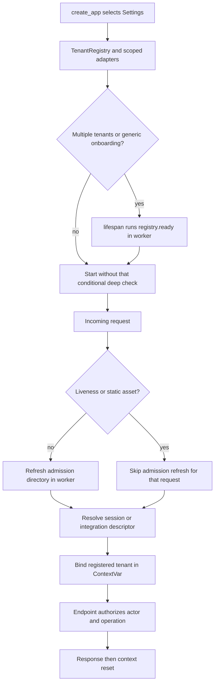

### Ordered trace

1. [create_app][create_app] obtains explicit config or `Settings.from_env`, constructs the registry/scoped settings/DB router/static manifest and logging. It does not implicitly migrate/create tables.
2. Lifespan performs deep readiness in a worker only when multiple tenants or generic onboarding require it; then emits application.started. Its finally disposes registry engines. Do not describe every process start as a full database audit.
3. `TenantMiddleware` requires session middleware. Except liveness/static paths it freshly refreshes admission mappings in a worker; selection remains on the request task. Invalid owner-session mapping clears the session and redirects. Anonymous public paths use the default descriptor; other anonymous workspace paths redirect.
4. Integration requests use the token's selector for registry routing, then their endpoint authenticates the complete credential/grant. The descriptor is not a caller-supplied schema/DSN or a default-owner access fallback. See [integration flow](05-integrations-and-subscriptions.md).
5. [bind][bind] rejects an unregistered descriptor, sets the ContextVar and resets it in finally. [DBRouter][DBRouter] and [RequestScopedSettings][RequestScopedSettings] resolve that current tenant; an offloaded unit must own its Session and receive the correct context.
6. [session_factory][session_factory] disables SQL echo, hides parameters, uses pre-ping/bounded pools and verifies expected role/schema on connect when configured. It is not a migration grant or unrestricted engine.
7. Deep `/health/ready` offloads `registry.ready`; `_check_databases` refreshes mappings and checks fixed/prepared descriptors, maintained `SCHEMA_HEAD`, relation access and applicable runtime privilege/foreign boundaries. [verify_admission_readiness][verify_admission_readiness] checks directory/identity coverage. Failures become a fixed RuntimeError and generic 503; never bypass the check to turn green.
8. Docker's process healthcheck uses liveness, while explicit release checks inspect both live and ready. [Docker healthcheck][Docker healthcheck] must not be relabeled as a deep database probe. Stage container port-wait/stream handling is in [Stage container][Stage container].

Maintenance checks: [readiness worker regression][readiness worker regression], [actual role isolation][actual role isolation], [prepared-slot drift tests][prepared-slot drift tests]. These tests are pointers, not new execution evidence.

## 3. HTTP transaction, error and observability trace

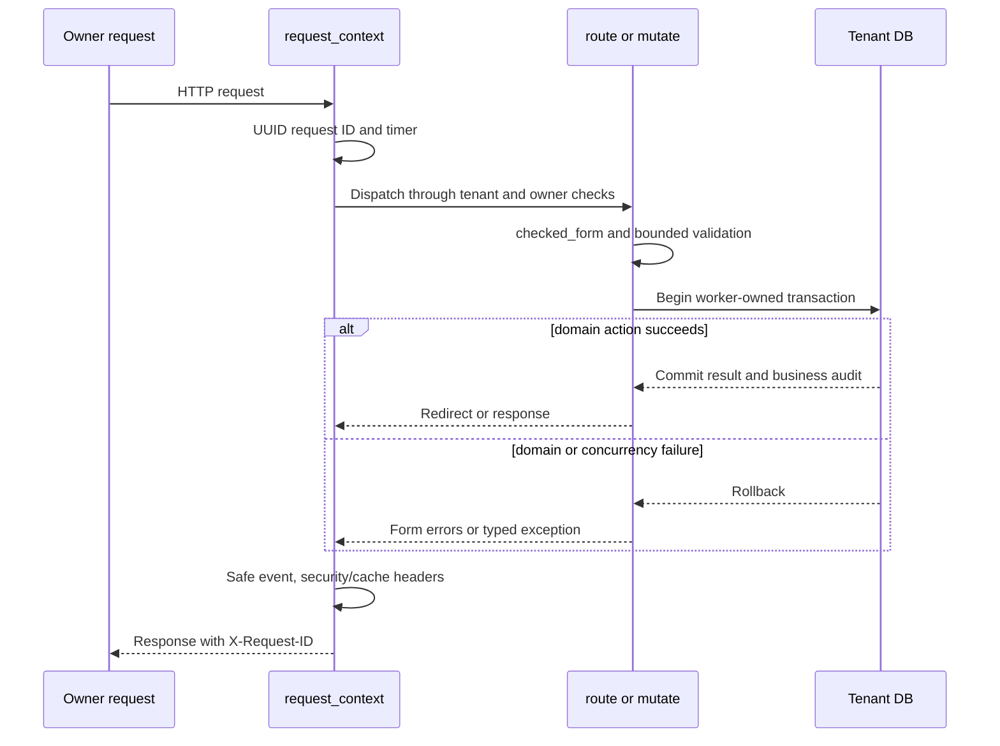

1. [request_context][request_context] generates a UUID and timer. Unexpected downstream exceptions become fixed HTML or integration JSON500; raw exception text is not returned/logged.
2. `mutate` obtains `checked_form` unless the caller supplied an already checked form. A nested synchronous `transact` opens `app.state.db.begin()` and invokes the domain action inside `run_in_threadpool`. The Session is created/used/closed in that worker; it is not handed between concurrent tasks.
3. Integrity/stale/version/form/domain/value errors roll back through transaction exit. Capacity errors add safe upgrade context; FormError retains field errors; controlled DomainError supplies its safe form message; database conflicts use fixed reread guidance. `on_error` re-renders, including awaitable callbacks, rather than silently committing partial work.
4. Only success stores the save notice and redirects 303. An external effect that already committed its own reservation is outside this generic UI transaction; use its dedicated reconciliation state machine.
5. [HTTP exception handler][HTTP exception handler] returns fixed integration/internal JSON shapes, redirects EnrollmentRequired to its selected enrollment destination, clears/rejects 401 sessions, or renders the controlled blocked page. [domain handler][domain handler] and [validation handler][validation handler] have separate sanitized integration versus UI branches.
6. `request_context` records request.failed for 5xx, request.completed otherwise, with FAILED outcome for any 4xx/5xx. It uses the registered route template, not actual query/path business identifiers. Response headers include X-Request-ID, CSP/security policy and no-store unless the exact versioned public-file rule permits caching. Dynamic checkout/provider/CSP branches must stay bounded to their selected route/configuration.

### Diagnostic log versus business audit

[safe_fields][safe_fields] accepts only typed/allowlisted request/execution/entity/actor UUIDs, outcomes, auth reasons/providers, registered routes, methods and integer status/duration/count. Unknown values are redacted. [SafeFormatter][SafeFormatter] allowlists event names, produces UTC JSON in hosted mode/readable development output and redacts exception information. [configure logging][configure logging] suppresses noisy raw Uvicorn/SQLAlchemy/Authlib/HTTPX/WeasyPrint/root handlers. [event][event] catches logging failures so committed business results remain intact.

[record business audit][record business audit] belongs to the domain database transaction; it is not permission to send business text to diagnostic logs. Do not add raw cookies/tokens/headers/query strings, names/emails/addresses, notes, line text, contract/tax/bank facts or PDFs to troubleshoot. Tests: [arbitrary input redaction][arbitrary input redaction], [exception contract][exception contract], [logger non-effectful failure][logger non-effectful failure].

## 4. CLI dispatcher and operational scripts

`timeker` is the [project script entry][project script entry] for `app.cli:main`. The dispatcher parses a required subcommand, creates execution ID/timer, validates Settings, configures logs and creates a lazy Session factory. A command-specific exception is caught by one terminal boundary: command.failed/FAILED, fixed stderr and exit1, with no raw exception. Success emits command.completed/SUCCEEDED and elapsed duration. Success means that command's behavior completed, not global readiness or UAT.

| Command or script | Exact source behavior | Boundary to preserve |
| --- | --- | --- |
| `timeker migrate` | [CLI migrate][CLI migrate] calls Alembic upgrade head with the configured target. | Source-driven DDL, not a dry-run. It does not invent a disposable target or grant runtime role migration authority. |
| `timeker doctor` | [CLI doctor][CLI doctor] executes SELECT1, imports WeasyPrint and prints version/environment. | Does not render PDF, validate every schema/guard, run migrations or certify hosted health. |
| `timeker admission-identities` | [identity synchronization][identity synchronization] verifies retained immutable bindings by default; `--apply` selects its write path. Registry is disposed in finally. | Existing-owner provider subject proof is operator-controlled; email equality is not account linking. |
| `timeker admission-grants` | [CLI directory grants][CLI directory grants] requires matching operator/runtime target, rejects production without explicit flag, applies directory grants in admin transaction. | Operator credential is named environment custody, never serving-runtime substitution or a logged DSN. |
| `timeker prepare-workspaces` | [prepare_workspaces][prepare_workspaces] preflights protected unallocated slots, target/head/roles/markers before bounded provisioning. | No fixed-owner tenant migration/seed; retained admissions cannot be reprovisioned. Production is separately gated. |
| `timeker seed --profile fixture/demo/alco` | [CLI seed][CLI seed] wraps selected seeding in a transaction and lets profile/domain guards run. | This is a writer. Fixture/demo are fictional; a real private source is never a public/test artifact or a release prerequisite. |
| `timeker render-invoice` | [CLI render artifact][CLI render artifact] obtains [artifact_bytes][artifact_bytes] and writes the specified file. | Issued bytes remain frozen; a file path/output can contain private data. No delivery occurs. |
| `timeker verify` | [CLI verify][CLI verify] sequentially runs pytest, Ruff and mypy with check=True. | Test fixture safety still matters; no browser/migration/hosted acceptance is supplied by its name alone. |
| [dev.ps1][dev.ps1] | Resolves uv, optional local PDF DLLs, enables dev login, syncs lock, migrates, optionally seeds fixture, then runs loopback Uvicorn. | Development-only multi-effect helper; do not use as hosted inspection or on an existing valuable target. |
| [invitation preview][invitation preview] | Validates explicit link/branding/bounded names and renders fictional preview. | It sends/provisions nothing; a rendered preview does not admit an owner. |
| [runtime grant SQL][runtime grant SQL] / [local init SQL][local init SQL] | Explicit schema privileges versus disposable development bootstrap. | Different purposes; hardcoded local/Supabase principals are not a generic hosted migration recipe. |
| [mailbox credential utility][mailbox credential utility] | Local human credential custody utility. | Not a backend integration prerequisite or normal troubleshooting read; do not extract its protected payload. |

### Ordered trace: an approved preparation action

1. Select exact environment and current protected descriptor catalog; `operation_catalog` does not infer arbitrary new slots from user input.
2. `prepare_workspaces` checks production authority first, matches operator/runtime database coordinates/TLS, verifies every slot connection and refuses a runtime operator.
3. One operator transaction takes the directory advisory lock, requires the maintained central head and rejects any retained slot admission. All descriptors are preflighted before role/schema mutations.
4. Migration/structure/guard/grant/empty-marker verification uses existing fixed-source contracts. Idempotent marked reruns must remain byte/authority compatible; unknown preexisting schemas are not adopted or reset.
5. Any failure rolls back the transaction. Finally disposes owned engine/catalog. Preserve failure receipts; do not retry by changing password/ownership or clearing admission rows.

Tests: [preparation idempotency][preparation idempotency], [late migration rollback][late migration rollback], [production before connection guard][production before connection guard]. These preparation paths differ from runtime [admit][admit], which reserves an already prepared slot without runtime DDL.

## 5. Internal jobs and schedules are distinct channels

1. [authenticated_body][authenticated_body] requires a configured strong internal key, ten-digit timestamp within 300 seconds, bounded body and constant-time HMAC over version/timestamp/exact request path/recipient/body digest. It does not trust browser cookies as machine authentication.
2. [archive_job][archive_job] chooses Case-only by exact path, rejects that Stage-specific path in production, binds each registered tenant and opens one transaction per tenant. Failure in one tenant is retained as aggregate 503; completed earlier tenant commits are not globally rolled back.
3. [run_archive][run_archive] takes a nonblocking advisory lock, processes bounded eligible records with row-lock/skip-locked behavior and retains archive markers. Case-only leaves Mail/timecards untouched; eligible Cases are Closed and beyond the reviewed retention boundary. It does not delete rows or reclaim storage.
4. Stage [scheduled handler][scheduled handler] accepts only the configured 02:17 UTC schedule and calls [archiveClosedCases][archiveClosedCases] through signed internal transport. The adapter requires expected Stage origin/profile, successful JSON response and drains/cancels response body. Source/configuration does not prove an actual scheduled run occurred.
5. [sending_job][sending_job] is a different endpoint, requires enabled provider plus jobs flag, and offloads [_sending_batch][_sending_batch]. It caps due delivery work across tenants and delegates each durable claim/send/settle to the existing Sending service. It is not reached by the Case-only cron; scheduled Sending remains off in retained Stage.
6. [receive_mail][receive_mail] separately requires capture configuration, signed bounded payload and valid capture address/owner. Do not repurpose auth SMTP or treat archive scheduling as mail transport activation.

Tests: [signed Case job][signed Case job], [retention replay boundary][retention replay boundary], [internal job tests][internal job tests], [Sending dispatch tests][Sending dispatch tests]. Manual/domain and provider-channel details are linked contracts, not newly activated jobs.

## 6. PDF, build and database recovery boundaries

[PDF render][PDF render] allocates its own execution UUID, renders an approved escaped template, blocks external asset retrieval with `deny_asset`, logs safe terminal timing and returns bytes/version. Any render exception becomes a fixed RuntimeError with no payload leak. An issued invoice download retrieves retained bytes through `artifact_bytes`; template changes must not silently regenerate an issued artifact.

Build/deploy is outside request/CLI health. The [Docker source][Docker source] and separate Stage/production profiles define explicit inputs. A Git commit/push does not deploy. Future release requires exact source/tests/config/image, compatible migration/grants and actual convergence/readback. See [deployment guide][deployment guide], [operations][operations] and current HOSTING rather than replaying archived carriers.

For a database discrepancy, separate ORM table/column metadata, migration-defined triggers/functions/ACLs, and actual installed environment. `Base.metadata.create_all()` cannot reproduce the 36 guard functions or their state/immutability protections. The [empty native reference](../database/README.md) covers 55 tables/634 columns at head 009 without hosted business rows; it is not a hosted backup or ACL installation. The [metadata collector](../database/inventory-live.sql) starts a read-only transaction and ends ROLLBACK; it is a future authorized catalog inspection, not a repair.

A restore/cutover must use a new isolated target, compatible source/image, encrypted backup and independent key custody. Verify full retained/prepared inventory, exact heads/grants/guards, immutable artifacts/balances/history and provider/revocation receipts. Reconcile already accepted emails, payments/webhooks and rotated credentials before reactivating writes. Restored Pending rows do not authorize resend/recharge. Source runbook: [capacity and recovery][capacity and recovery]; structural tests: [migration roundtrip][migration roundtrip], [private schema guards][private schema guards], [recovery rehearsal tests][recovery rehearsal tests].

## 7. Symptom → function → maintained evidence → runbook

| Symptom | First source boundary | Relevant test or runbook; bounded next interpretation |
| --- | --- | --- |
| Live 200 but ready 503 | `ready` → `TenantRegistry.ready` → `_check_databases` / admission readiness | readiness worker and private-schema tests; verify exact selected head/role/grants/directory, without bypass. |
| Workspace redirects to landing | `TenantMiddleware.session_tenant`, owner/session exception branch | [owner authentication contract][owner authentication contract] and tenancy tests; fresh normal proof, not copied session. |
| Generic provider sign-in rejection | Safe auth reason emitted by callback plus immutable binding logic | [social proof tests][social proof tests]; separate proof rejection from provider-not-linked. Generic page alone cannot name a cause. |
| Tool401/403 or missing tools | `authenticate_access`, grant scope/resource and `tool_catalog` | PKCE/scope/selector tests in integration chapter; exact client, audience, owner/readiness and revocation. |
| Tool 409 or MCP isError | `write_tool` / domain command versions/receipt | Delegated integration test263; reread versions and same-intent receipt, do not invent a fresh key to hide conflict. |
| Capacity rejected although records visible | `require_capacity` / `_assignment` / `usage` | Last-slot, parent-reactivation and unassigned tests; history access is not positive-growth entitlement. |
| Checkout/retention Pending or uncertain | Durable `_reserve` / `_record_failure` / reconciliation services | [billing uncertainty tests][billing uncertainty tests], retention tests; no automatic second provider mutation. |
| Webhook 409/503 | Raw signature/binding then `handle_verified_event` fetched-state checks | [webhook tests][webhook tests]; preserve event/digest and convergence, never log raw provider payload. |
| Duplicate/stale UI save | `mutate` integrity/version branch | [workflow feedback tests][workflow feedback tests]; transaction rollback plus controlled reread guidance. |
| PDF unavailable | `pdf.render` dependency/template/asset boundary | [PDF tests][PDF tests]; actual render needed, doctor import alone is insufficient. |
| Case cron configured but no observed run | Stage scheduled handler → signed Case path → archive job | Case retention tests and HOSTING; configuration/GET health is not scheduled execution proof. |
| Provisioning fails on head/marker/role | `prepare_workspaces` preflight, `_verify_slot` | Workspace-operation tests; do not reset password/owner or migrate fixed tenants incidentally. |
| Log backend fails or contains unsafe field | `safe_fields` / `SafeFormatter` / `event` | Logging tests; redact unknowns, preserve committed result and use DB audit separately. |
| Source/reconstruction/live schemas differ | Alembic head, actual catalog, runtime grants and compatible image | Database reference plus read-only inventory; record drift before separately scoped repair, never seed/reset. |

A test link identifies the regression surface; it does not mean it ran in this documentation task. Locate the actual test name before narrowing a new selection. No blanket live-health, recovery-time, security-certification or human-acceptance claim follows from this map.

## 8. Maintenance handoff

For any future correction, identify the concrete caller/branch and transaction/effect boundary above, reproduce only on the authorized target, reuse the existing domain service, preserve unchanged sibling evidence and failed attempts, verify the changed behavior/negative paths, and update canonical STATUS/DECISIONS/CONTINUE. Keep tests, Stage readback, product UAT and production authority distinct.

PH2 is closed administratively; PH3 awaits owner prompts. One eventual reviewed production candidate must include PH2 plus authorized PH3. Do not infer merge, migration, secret/provider changes, customer sends/charges or deployment from this code-flow reference.

[canonical continuation]: https://github.com/edlopezpm-ops/timeker-PH2/blob/9fc9eebdaf9f52170530c8a28d34f6c8cd612c64/CONTINUE.md#L1
[hosting evidence]: https://github.com/edlopezpm-ops/timeker-PH2/blob/9fc9eebdaf9f52170530c8a28d34f6c8cd612c64/HOSTING.md#L12
[live]: https://github.com/edlopezpm-ops/timeker-PH2/blob/9fc9eebdaf9f52170530c8a28d34f6c8cd612c64/app/main.py#L703
[ready]: https://github.com/edlopezpm-ops/timeker-PH2/blob/9fc9eebdaf9f52170530c8a28d34f6c8cd612c64/app/main.py#L707
[TenantRegistry.ready]: https://github.com/edlopezpm-ops/timeker-PH2/blob/9fc9eebdaf9f52170530c8a28d34f6c8cd612c64/app/tenancy.py#L348
[TenantMiddleware]: https://github.com/edlopezpm-ops/timeker-PH2/blob/9fc9eebdaf9f52170530c8a28d34f6c8cd612c64/app/tenancy.py#L469
[mutate]: https://github.com/edlopezpm-ops/timeker-PH2/blob/9fc9eebdaf9f52170530c8a28d34f6c8cd612c64/app/main.py#L379
[main CLI dispatcher]: https://github.com/edlopezpm-ops/timeker-PH2/blob/9fc9eebdaf9f52170530c8a28d34f6c8cd612c64/app/cli.py#L24
[create_app]: https://github.com/edlopezpm-ops/timeker-PH2/blob/9fc9eebdaf9f52170530c8a28d34f6c8cd612c64/app/main.py#L118
[bind]: https://github.com/edlopezpm-ops/timeker-PH2/blob/9fc9eebdaf9f52170530c8a28d34f6c8cd612c64/app/tenancy.py#L339
[DBRouter]: https://github.com/edlopezpm-ops/timeker-PH2/blob/9fc9eebdaf9f52170530c8a28d34f6c8cd612c64/app/tenancy.py#L438
[RequestScopedSettings]: https://github.com/edlopezpm-ops/timeker-PH2/blob/9fc9eebdaf9f52170530c8a28d34f6c8cd612c64/app/tenancy.py#L430
[session_factory]: https://github.com/edlopezpm-ops/timeker-PH2/blob/9fc9eebdaf9f52170530c8a28d34f6c8cd612c64/app/db.py#L9
[verify_admission_readiness]: https://github.com/edlopezpm-ops/timeker-PH2/blob/9fc9eebdaf9f52170530c8a28d34f6c8cd612c64/app/admission_operations.py#L90
[Docker healthcheck]: https://github.com/edlopezpm-ops/timeker-PH2/blob/9fc9eebdaf9f52170530c8a28d34f6c8cd612c64/Dockerfile#L22
[Stage container]: https://github.com/edlopezpm-ops/timeker-PH2/blob/9fc9eebdaf9f52170530c8a28d34f6c8cd612c64/deploy/cloudflare/src/index.ts#L6
[readiness worker regression]: https://github.com/edlopezpm-ops/timeker-PH2/blob/9fc9eebdaf9f52170530c8a28d34f6c8cd612c64/tests/unit/test_readiness_worker.py#L11
[actual role isolation]: https://github.com/edlopezpm-ops/timeker-PH2/blob/9fc9eebdaf9f52170530c8a28d34f6c8cd612c64/tests/integration/test_tenancy.py#L177
[prepared-slot drift tests]: https://github.com/edlopezpm-ops/timeker-PH2/blob/9fc9eebdaf9f52170530c8a28d34f6c8cd612c64/tests/integration/test_workspace_operations.py#L145
[request_context]: https://github.com/edlopezpm-ops/timeker-PH2/blob/9fc9eebdaf9f52170530c8a28d34f6c8cd612c64/app/main.py#L196
[HTTP exception handler]: https://github.com/edlopezpm-ops/timeker-PH2/blob/9fc9eebdaf9f52170530c8a28d34f6c8cd612c64/app/main.py#L333
[domain handler]: https://github.com/edlopezpm-ops/timeker-PH2/blob/9fc9eebdaf9f52170530c8a28d34f6c8cd612c64/app/main.py#L359
[validation handler]: https://github.com/edlopezpm-ops/timeker-PH2/blob/9fc9eebdaf9f52170530c8a28d34f6c8cd612c64/app/main.py#L367
[safe_fields]: https://github.com/edlopezpm-ops/timeker-PH2/blob/9fc9eebdaf9f52170530c8a28d34f6c8cd612c64/app/logging.py#L32
[SafeFormatter]: https://github.com/edlopezpm-ops/timeker-PH2/blob/9fc9eebdaf9f52170530c8a28d34f6c8cd612c64/app/logging.py#L61
[configure logging]: https://github.com/edlopezpm-ops/timeker-PH2/blob/9fc9eebdaf9f52170530c8a28d34f6c8cd612c64/app/logging.py#L81
[event]: https://github.com/edlopezpm-ops/timeker-PH2/blob/9fc9eebdaf9f52170530c8a28d34f6c8cd612c64/app/logging.py#L104
[record business audit]: https://github.com/edlopezpm-ops/timeker-PH2/blob/9fc9eebdaf9f52170530c8a28d34f6c8cd612c64/app/audit.py#L8
[arbitrary input redaction]: https://github.com/edlopezpm-ops/timeker-PH2/blob/9fc9eebdaf9f52170530c8a28d34f6c8cd612c64/tests/unit/test_logging.py#L23
[exception contract]: https://github.com/edlopezpm-ops/timeker-PH2/blob/9fc9eebdaf9f52170530c8a28d34f6c8cd612c64/tests/unit/test_logging.py#L36
[logger non-effectful failure]: https://github.com/edlopezpm-ops/timeker-PH2/blob/9fc9eebdaf9f52170530c8a28d34f6c8cd612c64/tests/unit/test_logging.py#L61
[project script entry]: https://github.com/edlopezpm-ops/timeker-PH2/blob/9fc9eebdaf9f52170530c8a28d34f6c8cd612c64/pyproject.toml#L16
[CLI migrate]: https://github.com/edlopezpm-ops/timeker-PH2/blob/9fc9eebdaf9f52170530c8a28d34f6c8cd612c64/app/cli.py#L49
[CLI doctor]: https://github.com/edlopezpm-ops/timeker-PH2/blob/9fc9eebdaf9f52170530c8a28d34f6c8cd612c64/app/cli.py#L53
[identity synchronization]: https://github.com/edlopezpm-ops/timeker-PH2/blob/9fc9eebdaf9f52170530c8a28d34f6c8cd612c64/app/admission_operations.py#L15
[CLI directory grants]: https://github.com/edlopezpm-ops/timeker-PH2/blob/9fc9eebdaf9f52170530c8a28d34f6c8cd612c64/app/cli.py#L76
[prepare_workspaces]: https://github.com/edlopezpm-ops/timeker-PH2/blob/9fc9eebdaf9f52170530c8a28d34f6c8cd612c64/app/workspace_operations.py#L241
[CLI seed]: https://github.com/edlopezpm-ops/timeker-PH2/blob/9fc9eebdaf9f52170530c8a28d34f6c8cd612c64/app/cli.py#L103
[CLI render artifact]: https://github.com/edlopezpm-ops/timeker-PH2/blob/9fc9eebdaf9f52170530c8a28d34f6c8cd612c64/app/cli.py#L110
[artifact_bytes]: https://github.com/edlopezpm-ops/timeker-PH2/blob/9fc9eebdaf9f52170530c8a28d34f6c8cd612c64/app/billing.py#L458
[CLI verify]: https://github.com/edlopezpm-ops/timeker-PH2/blob/9fc9eebdaf9f52170530c8a28d34f6c8cd612c64/app/cli.py#L115
[dev.ps1]: https://github.com/edlopezpm-ops/timeker-PH2/blob/9fc9eebdaf9f52170530c8a28d34f6c8cd612c64/scripts/dev.ps1#L1
[invitation preview]: https://github.com/edlopezpm-ops/timeker-PH2/blob/9fc9eebdaf9f52170530c8a28d34f6c8cd612c64/scripts/render_invitation.py#L13
[runtime grant SQL]: https://github.com/edlopezpm-ops/timeker-PH2/blob/9fc9eebdaf9f52170530c8a28d34f6c8cd612c64/scripts/postgres-runtime-grants.sql#L1
[local init SQL]: https://github.com/edlopezpm-ops/timeker-PH2/blob/9fc9eebdaf9f52170530c8a28d34f6c8cd612c64/scripts/postgres-init.sql#L1
[mailbox credential utility]: https://github.com/edlopezpm-ops/timeker-PH2/blob/9fc9eebdaf9f52170530c8a28d34f6c8cd612c64/scripts/mailbox-credential.ps1#L1
[preparation idempotency]: https://github.com/edlopezpm-ops/timeker-PH2/blob/9fc9eebdaf9f52170530c8a28d34f6c8cd612c64/tests/integration/test_workspace_operations.py#L87
[late migration rollback]: https://github.com/edlopezpm-ops/timeker-PH2/blob/9fc9eebdaf9f52170530c8a28d34f6c8cd612c64/tests/integration/test_workspace_operations.py#L271
[production before connection guard]: https://github.com/edlopezpm-ops/timeker-PH2/blob/9fc9eebdaf9f52170530c8a28d34f6c8cd612c64/tests/integration/test_workspace_operations.py#L296
[admit]: https://github.com/edlopezpm-ops/timeker-PH2/blob/9fc9eebdaf9f52170530c8a28d34f6c8cd612c64/app/admission.py#L142
[authenticated_body]: https://github.com/edlopezpm-ops/timeker-PH2/blob/9fc9eebdaf9f52170530c8a28d34f6c8cd612c64/app/internal_routes.py#L82
[archive_job]: https://github.com/edlopezpm-ops/timeker-PH2/blob/9fc9eebdaf9f52170530c8a28d34f6c8cd612c64/app/internal_routes.py#L110
[run_archive]: https://github.com/edlopezpm-ops/timeker-PH2/blob/9fc9eebdaf9f52170530c8a28d34f6c8cd612c64/app/archiving.py#L60
[scheduled handler]: https://github.com/edlopezpm-ops/timeker-PH2/blob/9fc9eebdaf9f52170530c8a28d34f6c8cd612c64/deploy/cloudflare/src/index.ts#L62
[archiveClosedCases]: https://github.com/edlopezpm-ops/timeker-PH2/blob/9fc9eebdaf9f52170530c8a28d34f6c8cd612c64/deploy/cloudflare/src/stage-archive.ts#L4
[sending_job]: https://github.com/edlopezpm-ops/timeker-PH2/blob/9fc9eebdaf9f52170530c8a28d34f6c8cd612c64/app/internal_routes.py#L21
[_sending_batch]: https://github.com/edlopezpm-ops/timeker-PH2/blob/9fc9eebdaf9f52170530c8a28d34f6c8cd612c64/app/internal_routes.py#L42
[receive_mail]: https://github.com/edlopezpm-ops/timeker-PH2/blob/9fc9eebdaf9f52170530c8a28d34f6c8cd612c64/app/internal_routes.py#L134
[signed Case job]: https://github.com/edlopezpm-ops/timeker-PH2/blob/9fc9eebdaf9f52170530c8a28d34f6c8cd612c64/tests/integration/test_case_retention.py#L48
[retention replay boundary]: https://github.com/edlopezpm-ops/timeker-PH2/blob/9fc9eebdaf9f52170530c8a28d34f6c8cd612c64/tests/integration/test_case_retention.py#L15
[internal job tests]: https://github.com/edlopezpm-ops/timeker-PH2/blob/9fc9eebdaf9f52170530c8a28d34f6c8cd612c64/tests/integration/test_internal_jobs.py#L1
[Sending dispatch tests]: https://github.com/edlopezpm-ops/timeker-PH2/blob/9fc9eebdaf9f52170530c8a28d34f6c8cd612c64/tests/integration/test_sending_dispatch.py#L1
[PDF render]: https://github.com/edlopezpm-ops/timeker-PH2/blob/9fc9eebdaf9f52170530c8a28d34f6c8cd612c64/app/pdf.py#L17
[Docker source]: https://github.com/edlopezpm-ops/timeker-PH2/blob/9fc9eebdaf9f52170530c8a28d34f6c8cd612c64/Dockerfile#L1
[deployment guide]: https://github.com/edlopezpm-ops/timeker-PH2/blob/9fc9eebdaf9f52170530c8a28d34f6c8cd612c64/docs/DEPLOYMENT.md#L1
[operations]: https://github.com/edlopezpm-ops/timeker-PH2/blob/9fc9eebdaf9f52170530c8a28d34f6c8cd612c64/docs/OPERATIONS.md#L142
[capacity and recovery]: https://github.com/edlopezpm-ops/timeker-PH2/blob/9fc9eebdaf9f52170530c8a28d34f6c8cd612c64/docs/OPERATIONS.md#L711
[migration roundtrip]: https://github.com/edlopezpm-ops/timeker-PH2/blob/9fc9eebdaf9f52170530c8a28d34f6c8cd612c64/tests/integration/test_migrations.py#L35
[private schema guards]: https://github.com/edlopezpm-ops/timeker-PH2/blob/9fc9eebdaf9f52170530c8a28d34f6c8cd612c64/tests/integration/test_migrations.py#L66
[recovery rehearsal tests]: https://github.com/edlopezpm-ops/timeker-PH2/blob/9fc9eebdaf9f52170530c8a28d34f6c8cd612c64/tests/integration/test_recovery_rehearsal.py#L1
[owner authentication contract]: https://github.com/edlopezpm-ops/timeker-PH2/blob/9fc9eebdaf9f52170530c8a28d34f6c8cd612c64/app/auth.py#L1
[social proof tests]: https://github.com/edlopezpm-ops/timeker-PH2/blob/9fc9eebdaf9f52170530c8a28d34f6c8cd612c64/tests/integration/test_social_auth.py#L1
[billing uncertainty tests]: https://github.com/edlopezpm-ops/timeker-PH2/blob/9fc9eebdaf9f52170530c8a28d34f6c8cd612c64/tests/integration/test_subscription_billing.py#L475
[webhook tests]: https://github.com/edlopezpm-ops/timeker-PH2/blob/9fc9eebdaf9f52170530c8a28d34f6c8cd612c64/tests/unit/test_paddle.py#L597
[workflow feedback tests]: https://github.com/edlopezpm-ops/timeker-PH2/blob/9fc9eebdaf9f52170530c8a28d34f6c8cd612c64/tests/e2e/test_workflow_feedback_browser.py#L1
[PDF tests]: https://github.com/edlopezpm-ops/timeker-PH2/blob/9fc9eebdaf9f52170530c8a28d34f6c8cd612c64/tests/test_project_billing.py#L39

---

# Browser, templates and progressive enhancement

Source snapshot `9fc9eebdaf9f52170530c8a28d34f6c8cd612c64`. These diagrams trace
the existing browser code; they are not newly observed browser executions.
Backend authorization, validation, transactions and provider confirmation remain
in their traced server flows. The browser does not calculate authoritative money,
reserve tenant slots or activate a paid subscription.

## Page and interaction dispatch

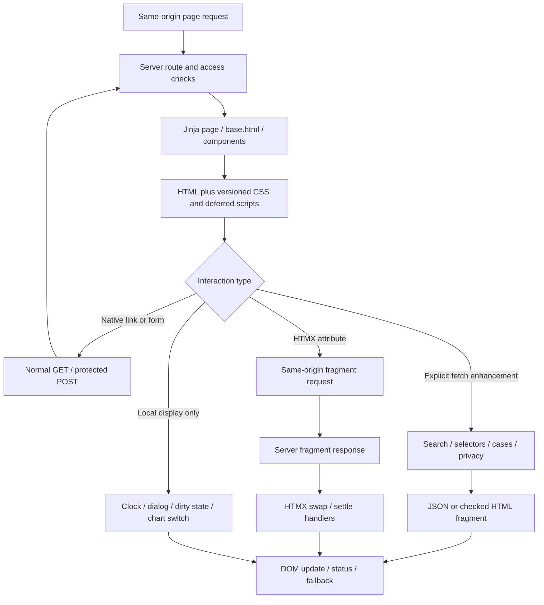

1. [`base.html:1`][base] imports shared components, links content-versioned assets
   and defers HTMX, `app.js`, `usage.js` and `workspace.js`; page blocks add their
   own scripts. Its HTMX configuration disables eval/script tags, limits requests
   to self and disables automatic indicator styling.
2. Server templates retain native form/link behavior. The individual scripts
   opt in only when their expected DOM hooks exist. Authenticated navigation and
   feature-dependent entries are rendered by the server, not a client router.
3. [`app.js:125`][selectors] enhances bounded lookup refreshes. The Cases filter
   has its own request cancellation/revision handling and replaces a checked
   Cases fragment; HTMX processes inserted content afterward.
4. [`app.js:276`][htmx] handles pending/settled UI, while later blocks handle
   accessible dialogs, account/menu interactions, privacy feedback, validation
   feedback and dismissible save notices. These are presentation effects, not
   database state changes.

## Timecards: unsaved input and actual server save are separate

```mermaid
flowchart TD
    A[Input in loaded week editor] --> B[dirty = true / show unsaved status]
    C[Change week or client picker] --> D[Show selected week as Not loaded]
    D --> E[requestSubmit on picker]
    E --> F{Dirty loaded editor?}
    F -->|No| G[Native request loads selected week]
    F -->|Yes| H{Confirm discard?}
    H -->|Yes| G
    H -->|No| I[Prevent submit / restore loaded picker / keep edits]
    B --> J[Submit actual editor]
    J --> K[Browser clears dirty flag for submission]
    K --> L[Server parses / checks / transaction / response]
    L --> M[Rendered saved or invalid week state]
```

[`app.js:66`][dirty] tracks editor input, picker changes, capture-phase form
submission and `beforeunload`. Clearing the browser flag on submit is not proof
of a database commit: the response still goes through backend validation.
[`timecards.js:1`][timecards] separately enables removal only when permitted and
at least one draft is selected. Selection is not an edit to recorded time. The
internal-timecard toggle adjusts native client-field requirements and submits
the picker; a canceled picker submit restores its internal flag from the loaded
editor. The domain flow is in [work and billing](03-work-and-billing.md).

## Search and Cases use distinct fragment protocols

```mermaid
sequenceDiagram
    participant U as User
    participant S as workspace.js
    participant R as search_routes router
    participant Q as workspace_search
    U->>S: Open dialog / input
    S->>S: Debounce 220 ms / abort older request / increment revision
    S->>R: GET form action with q truncated 120 / Accept JSON
    R->>Q: Authenticated page query
    Q-->>R: Grouped workspace results
    R-->>S: JSON groups / no-store
    S->>S: Ignore stale response / textContent / local href checks
    S-->>U: Up to five items per group / status / page fallback on error
```

[`workspace.js:15`][workspace] guards stale results by request revision, sets an
abort controller and writes labels/context with text nodes. It skips non-local
or protocol-relative result links. Closing the dialog cancels work and returns
focus. [`search_routes.py:9`][search] chooses JSON for its negotiated request and
otherwise renders the full search page; search is a tenant-scoped read.

[`cases.js:10`][cases] uses a different loader: header
`X-Timeker-Fragment: case-mass-edit`, same-origin credentials, GET loading or POST
form data including the native submitter. It accepts the expected HTML content,
or a successful `saved` JSON result that navigates to `/cases`. Server redirects
and invalid input have distinct branches. Aborting a browser request does not
prove an already submitted server mutation was rolled back.

[`workspace.js:107`][rhythm] also enhances the Dashboard rhythm switch entirely
from server-rendered values, updates the URL with `history.replaceState` and
preserves independent detail pagination across HTMX swaps. It does not fetch new
business totals when toggling the pre-rendered bars/contributions views.

## Login security check and checkout confirmation

```mermaid
flowchart TD
    A[Chosen native auth form] --> B[Read current Turnstile response / expiry]
    B --> C{Nonempty bounded unexpired response?}
    C -->|No| D[Prevent submit / clear fields / reset expired check]
    C -->|Yes| E[Clear sibling fields / populate chosen form / native submit]
    E --> F[Server CAPTCHA and identity / admission flow]
    G[Checkout page] --> H[Validate environment / token shape / transaction / success URL / Paddle SDK]
    H -->|Invalid| I[Hide action / display unavailable]
    H -->|Valid| J[Initialize SDK / open provider overlay]
    J --> K[Client checkout.completed event]
    K --> L[Display confirmation pending]
    L --> M[Server signed provider confirmation controls actual plan]
```

[`auth_challenge.js:21`][auth] prevents double submission and fails closed for a
missing, expired or overlong response; a back/forward-cache return clears fields
and resets the check. This client gate never substitutes for server verification.

[`paddle_checkout.js:20`][paddle] checks the environment and same-origin success
destination, transaction/token shapes and SDK availability; live-mode code also
requires the canonical production origin. Sandbox mode is selected explicitly.
The provider client event changes status text only. Follow [subscription server
confirmation](05-integrations-and-subscriptions.md) to diagnose a pending plan;
do not mark a plan active from the overlay or callback text alone.

## Settings public-file refresh

```mermaid
flowchart TD
    A[Click clear-cache button] --> B[Validate fixed versioned /static inventory]
    B --> C[Up to 3 workers /20 second AbortController timeout]
    C --> D[GET cache reload / credentials omit / same-origin / no redirects]
    D --> E[Consume response body / require public immutable policy]
    E -->|All succeed| F[Success text / ask save before later reload]
    E -->|Failure or timeout| G[Abort / settle workers / error text]
    F --> H[Finally re-enable button / clear busy]
    G --> H
```

[`settings_cache.js:14`][cache] accepts 1–32 distinct versioned single-file static
URLs. It checks same-origin/no hash and the content-version syntax. The loop
consumes each body and rejects private/no-store/error responses. It does not
reload the page, clear local/session storage, purge a CDN, fetch owner data or
replace already executing JavaScript. An unsaved editor stays in the same DOM.
[`static_assets.py:10`][assets] supplies the public cache policy/versioning side.

## Privacy, contact and decorative clock

- [`usage.js:9`][usage] requires server-provided consent, configured collection,
  visible page and no GPC/DNT/block marker. Its bounded coarse event request has
  a 3-second timeout and no retry; consent changes/storage/pagehide cancel pending
  requests. Server consent validation remains authoritative. No business values,
  arbitrary URL, IDs or form payload are sent by this browser collector.
- [`app.js:491`][privacy] submits privacy preferences and dispatches
  `timeker:privacychange`; the collector stops or resumes from the response.
  [`privacy.py:74`][privacyserver] and [`usage.py:42`][usageserver] are separate
  server handlers. The local blocked marker is not an authorization grant.
- [`contact.js:31`][contact] submits once, displays accepted/429/uncertain states
  and uses a cooldown with an explicit restart link. An uncertain result is not
  retried automatically. The message is cleared only after accepted confirmation.
  Contact delivery is separate from statement/proposal delivery and auth email.
- [`app.js:1`][clock] animates the decorative browser-local clock, stops/resumes
  around page visibility/lifecycle and reduced-motion changes. Browser-local
  display does not redefine the business timezone or stored integer minutes.

## Symptom → inspect → focused evidence

| Symptom | First source/branch | Existing test entry point |
| --- | --- | --- |
| Picker shows another week but input remains unsaved | Dirty/pending-selection and capture-phase submit branch | [Timecard selection][testselection] |
| Search flashes older results | revision / abort / modal-close branch | [Workspace search browser][testsearch] |
| Case bulk edit returns a full page/error | Expected fragment marker, response type, submitter/CSRF and server handler | [Case mass edit browser][testcases] |
| File refresh reports error | URL inventory, fetch abort, cache headers; preserve owner state | [Settings refresh browser][testcache] |
| Checkout completed but plan pending | Client text vs signed server event/ledger | [Paddle overlay browser][testpaddle] |
| Auth form submits without a valid challenge | Client response selection plus server verify; never bypass | [OAuth CSP browser][testauth] |
| Usage still sends after opt-out | cancel/block marker and server consent gates | [Cookie preferences browser][testprivacy] |

These are existing test locations, not tests executed for this documentary change.
Never copy tokens, form values, network payloads or real business records into
troubleshooting reports. Record route/source version, sanitized outcome, request
correlation where available and the branch actually observed.

[base]: https://github.com/edlopezpm-ops/timeker-PH2/blob/9fc9eebdaf9f52170530c8a28d34f6c8cd612c64/app/web/templates/base.html#L1
[selectors]: https://github.com/edlopezpm-ops/timeker-PH2/blob/9fc9eebdaf9f52170530c8a28d34f6c8cd612c64/app/web/static/app.js#L125
[htmx]: https://github.com/edlopezpm-ops/timeker-PH2/blob/9fc9eebdaf9f52170530c8a28d34f6c8cd612c64/app/web/static/app.js#L276
[dirty]: https://github.com/edlopezpm-ops/timeker-PH2/blob/9fc9eebdaf9f52170530c8a28d34f6c8cd612c64/app/web/static/app.js#L66
[timecards]: https://github.com/edlopezpm-ops/timeker-PH2/blob/9fc9eebdaf9f52170530c8a28d34f6c8cd612c64/app/web/static/timecards.js#L1
[workspace]: https://github.com/edlopezpm-ops/timeker-PH2/blob/9fc9eebdaf9f52170530c8a28d34f6c8cd612c64/app/web/static/workspace.js#L15
[search]: https://github.com/edlopezpm-ops/timeker-PH2/blob/9fc9eebdaf9f52170530c8a28d34f6c8cd612c64/app/search_routes.py#L9
[cases]: https://github.com/edlopezpm-ops/timeker-PH2/blob/9fc9eebdaf9f52170530c8a28d34f6c8cd612c64/app/web/static/cases.js#L10
[rhythm]: https://github.com/edlopezpm-ops/timeker-PH2/blob/9fc9eebdaf9f52170530c8a28d34f6c8cd612c64/app/web/static/workspace.js#L107
[auth]: https://github.com/edlopezpm-ops/timeker-PH2/blob/9fc9eebdaf9f52170530c8a28d34f6c8cd612c64/app/web/static/auth_challenge.js#L21
[paddle]: https://github.com/edlopezpm-ops/timeker-PH2/blob/9fc9eebdaf9f52170530c8a28d34f6c8cd612c64/app/web/static/paddle_checkout.js#L20
[cache]: https://github.com/edlopezpm-ops/timeker-PH2/blob/9fc9eebdaf9f52170530c8a28d34f6c8cd612c64/app/web/static/settings_cache.js#L14
[assets]: https://github.com/edlopezpm-ops/timeker-PH2/blob/9fc9eebdaf9f52170530c8a28d34f6c8cd612c64/app/static_assets.py#L10
[usage]: https://github.com/edlopezpm-ops/timeker-PH2/blob/9fc9eebdaf9f52170530c8a28d34f6c8cd612c64/app/web/static/usage.js#L9
[privacy]: https://github.com/edlopezpm-ops/timeker-PH2/blob/9fc9eebdaf9f52170530c8a28d34f6c8cd612c64/app/web/static/app.js#L491
[privacyserver]: https://github.com/edlopezpm-ops/timeker-PH2/blob/9fc9eebdaf9f52170530c8a28d34f6c8cd612c64/app/privacy.py#L74
[usageserver]: https://github.com/edlopezpm-ops/timeker-PH2/blob/9fc9eebdaf9f52170530c8a28d34f6c8cd612c64/app/usage.py#L42
[contact]: https://github.com/edlopezpm-ops/timeker-PH2/blob/9fc9eebdaf9f52170530c8a28d34f6c8cd612c64/app/web/static/contact.js#L31
[clock]: https://github.com/edlopezpm-ops/timeker-PH2/blob/9fc9eebdaf9f52170530c8a28d34f6c8cd612c64/app/web/static/app.js#L1
[testselection]: https://github.com/edlopezpm-ops/timeker-PH2/blob/9fc9eebdaf9f52170530c8a28d34f6c8cd612c64/tests/e2e/test_timecard_selection.py
[testsearch]: https://github.com/edlopezpm-ops/timeker-PH2/blob/9fc9eebdaf9f52170530c8a28d34f6c8cd612c64/tests/e2e/test_workspace_search_browser.py
[testcases]: https://github.com/edlopezpm-ops/timeker-PH2/blob/9fc9eebdaf9f52170530c8a28d34f6c8cd612c64/tests/e2e/test_case_mass_edit_browser.py
[testcache]: https://github.com/edlopezpm-ops/timeker-PH2/blob/9fc9eebdaf9f52170530c8a28d34f6c8cd612c64/tests/e2e/test_settings_cache_refresh_browser.py
[testpaddle]: https://github.com/edlopezpm-ops/timeker-PH2/blob/9fc9eebdaf9f52170530c8a28d34f6c8cd612c64/tests/e2e/test_paddle_overlay_browser.py
[testauth]: https://github.com/edlopezpm-ops/timeker-PH2/blob/9fc9eebdaf9f52170530c8a28d34f6c8cd612c64/tests/e2e/test_oauth_csp_browser.py
[testprivacy]: https://github.com/edlopezpm-ops/timeker-PH2/blob/9fc9eebdaf9f52170530c8a28d34f6c8cd612c64/tests/e2e/test_cookie_preferences_browser.py

---

# Complete Python module and symbol index

Source `9fc9eebdaf9f52170530c8a28d34f6c8cd612c64`. Generated from tracked source with Python AST, without importing
or executing application code. Test definitions/source hashes are already complete
in [dossier chapter12](../12-source-map-tests-and-manifest.md).

| Inventory | Count |
| --- | --- |
| python modules | 118 |
| app python modules | 90 |
| migration python modules | 27 |
| script python modules | 1 |
| class declarations | 103 |
| function and async declarations | 945 |
| syntactic call sites | 13140 |
| internal declared import edges | 438 |
| app literal route decorators | 180 |

SHA-256 values cover raw inspected checkout bytes. Git blob line endings can
differ (CRLF versus LF); the canonical [source manifest](../source-snapshot-manifest.json)
records raw hashes and Git blob IDs separately. A raw checkout hash is not
asserted to be the hash of normalized Git blob content.

## What this index establishes

Every production/support Python module under `app/`, `alembic/` and `scripts/`
has a source hash, all class/function declaration locations, parameter names,
import declarations, literal route decorators and syntactic call sites in the
[JSON index](module-symbol-call-index.json). Call arguments/default literals and
function bodies are omitted. A call site establishes syntax, not its dynamic
target, reachability, execution order, transaction ownership or successful runtime.
Receiver aliases, callbacks, DI/contextvars and dynamic dispatch need source
tracing; the manual diagrams explain those boundaries. Constructor/decorator/
annotation/default calls also appear. Nested qualification is lexical only.

The [full declared-import diagram](declared-imports.mmd) is a searchable Mermaid
source, not an execution flowchart. An import can be conditional or delayed.
No test or live coverage conclusion follows from any count here.

## Module navigation

| Module/source | Classes | Functions | Call sites | Declared internal imports |
| --- | --- | --- | --- | --- |
| [alembic.env](https://github.com/edlopezpm-ops/timeker-PH2/blob/9fc9eebdaf9f52170530c8a28d34f6c8cd612c64/alembic/env.py#L1) | 0 | 1 | 15 | `app.admission_models`, `app.config`, `app.credit_memo_models`, `app.enrollment_models`, `app.integration_models`, `app.library_models`, `app.mail_models`, `app.models`, `app.proposal_sending_models`, `app.quoting_models`, `app.sending_models`, `app.subscription_billing_models`, `app.subscription_models`, `app.time_command_models` |
| [alembic.versions.3f3c0f09ecf4_mail_custody_and_six_month_archive](https://github.com/edlopezpm-ops/timeker-PH2/blob/9fc9eebdaf9f52170530c8a28d34f6c8cd612c64/alembic/versions/3f3c0f09ecf4_mail_custody_and_six_month_archive.py#L1) | 0 | 2 | 132 | — |
| [alembic.versions.7e416c6444fe_baseline](https://github.com/edlopezpm-ops/timeker-PH2/blob/9fc9eebdaf9f52170530c8a28d34f6c8cd612c64/alembic/versions/7e416c6444fe_baseline.py#L1) | 0 | 2 | 426 | — |
| [alembic.versions.a10d45de891c_issued_status_guard](https://github.com/edlopezpm-ops/timeker-PH2/blob/9fc9eebdaf9f52170530c8a28d34f6c8cd612c64/alembic/versions/a10d45de891c_issued_status_guard.py#L1) | 0 | 2 | 1 | — |
| [alembic.versions.a82d43cf6120_project_workflow_and_agreements](https://github.com/edlopezpm-ops/timeker-PH2/blob/9fc9eebdaf9f52170530c8a28d34f6c8cd612c64/alembic/versions/a82d43cf6120_project_workflow_and_agreements.py#L1) | 0 | 2 | 46 | — |
| [alembic.versions.b07c9d621a30_pin_guard_schema](https://github.com/edlopezpm-ops/timeker-PH2/blob/9fc9eebdaf9f52170530c8a28d34f6c8cd612c64/alembic/versions/b07c9d621a30_pin_guard_schema.py#L1) | 0 | 2 | 5 | — |
| [alembic.versions.c41894d13cb7_project_commercial_metadata](https://github.com/edlopezpm-ops/timeker-PH2/blob/9fc9eebdaf9f52170530c8a28d34f6c8cd612c64/alembic/versions/c41894d13cb7_project_commercial_metadata.py#L1) | 0 | 2 | 20 | — |
| [alembic.versions.c46f2f62a011_immutable_artifacts](https://github.com/edlopezpm-ops/timeker-PH2/blob/9fc9eebdaf9f52170530c8a28d34f6c8cd612c64/alembic/versions/c46f2f62a011_immutable_artifacts.py#L1) | 0 | 2 | 3 | — |
| [alembic.versions.d3517d81ce20_contact_reservations](https://github.com/edlopezpm-ops/timeker-PH2/blob/9fc9eebdaf9f52170530c8a28d34f6c8cd612c64/alembic/versions/d3517d81ce20_contact_reservations.py#L1) | 0 | 2 | 18 | — |
| [alembic.versions.d529b08f14a2_project_billing](https://github.com/edlopezpm-ops/timeker-PH2/blob/9fc9eebdaf9f52170530c8a28d34f6c8cd612c64/alembic/versions/d529b08f14a2_project_billing.py#L1) | 0 | 3 | 60 | — |
| [alembic.versions.e3b42aea781a_parent_guards_and_sessions](https://github.com/edlopezpm-ops/timeker-PH2/blob/9fc9eebdaf9f52170530c8a28d34f6c8cd612c64/alembic/versions/e3b42aea781a_parent_guards_and_sessions.py#L1) | 0 | 2 | 7 | — |
| [alembic.versions.e640ab7230cd_case_identity_and_types](https://github.com/edlopezpm-ops/timeker-PH2/blob/9fc9eebdaf9f52170530c8a28d34f6c8cd612c64/alembic/versions/e640ab7230cd_case_identity_and_types.py#L1) | 0 | 5 | 57 | — |
| [alembic.versions.e672c40fa912_cases_and_allocations](https://github.com/edlopezpm-ops/timeker-PH2/blob/9fc9eebdaf9f52170530c8a28d34f6c8cd612c64/alembic/versions/e672c40fa912_cases_and_allocations.py#L1) | 0 | 3 | 65 | — |
| [alembic.versions.f409a1ac1700_parent_lock_guards](https://github.com/edlopezpm-ops/timeker-PH2/blob/9fc9eebdaf9f52170530c8a28d34f6c8cd612c64/alembic/versions/f409a1ac1700_parent_lock_guards.py#L1) | 0 | 2 | 1 | — |
| [alembic.versions.f710bc319ae2_mail_attachment_custody](https://github.com/edlopezpm-ops/timeker-PH2/blob/9fc9eebdaf9f52170530c8a28d34f6c8cd612c64/alembic/versions/f710bc319ae2_mail_attachment_custody.py#L1) | 0 | 2 | 44 | — |
| [alembic.versions.ph2_001_credit_memos](https://github.com/edlopezpm-ops/timeker-PH2/blob/9fc9eebdaf9f52170530c8a28d34f6c8cd612c64/alembic/versions/ph2_001_credit_memos.py#L1) | 0 | 2 | 57 | — |
| [alembic.versions.ph2_002_time_commands](https://github.com/edlopezpm-ops/timeker-PH2/blob/9fc9eebdaf9f52170530c8a28d34f6c8cd612c64/alembic/versions/ph2_002_time_commands.py#L1) | 0 | 3 | 99 | — |
| [alembic.versions.ph2_003_integrations](https://github.com/edlopezpm-ops/timeker-PH2/blob/9fc9eebdaf9f52170530c8a28d34f6c8cd612c64/alembic/versions/ph2_003_integrations.py#L1) | 0 | 3 | 96 | — |
| [alembic.versions.ph3_001_subscriptions](https://github.com/edlopezpm-ops/timeker-PH2/blob/9fc9eebdaf9f52170530c8a28d34f6c8cd612c64/alembic/versions/ph3_001_subscriptions.py#L1) | 0 | 2 | 58 | — |
| [alembic.versions.ph3_002_sandbox_billing](https://github.com/edlopezpm-ops/timeker-PH2/blob/9fc9eebdaf9f52170530c8a28d34f6c8cd612c64/alembic/versions/ph3_002_sandbox_billing.py#L1) | 0 | 2 | 125 | — |
| [alembic.versions.ph3_003_onboarding_auth](https://github.com/edlopezpm-ops/timeker-PH2/blob/9fc9eebdaf9f52170530c8a28d34f6c8cd612c64/alembic/versions/ph3_003_onboarding_auth.py#L1) | 0 | 3 | 71 | — |
| [alembic.versions.ph3_004_sending](https://github.com/edlopezpm-ops/timeker-PH2/blob/9fc9eebdaf9f52170530c8a28d34f6c8cd612c64/alembic/versions/ph3_004_sending.py#L1) | 0 | 3 | 116 | — |
| [alembic.versions.ph3_005_public_admission](https://github.com/edlopezpm-ops/timeker-PH2/blob/9fc9eebdaf9f52170530c8a28d34f6c8cd612c64/alembic/versions/ph3_005_public_admission.py#L1) | 0 | 3 | 87 | — |
| [alembic.versions.ph3_006_quoting_library](https://github.com/edlopezpm-ops/timeker-PH2/blob/9fc9eebdaf9f52170530c8a28d34f6c8cd612c64/alembic/versions/ph3_006_quoting_library.py#L1) | 0 | 3 | 54 | — |
| [alembic.versions.ph3_007_work_records](https://github.com/edlopezpm-ops/timeker-PH2/blob/9fc9eebdaf9f52170530c8a28d34f6c8cd612c64/alembic/versions/ph3_007_work_records.py#L1) | 0 | 4 | 111 | — |
| [alembic.versions.ph3_008_client_lifecycle](https://github.com/edlopezpm-ops/timeker-PH2/blob/9fc9eebdaf9f52170530c8a28d34f6c8cd612c64/alembic/versions/ph3_008_client_lifecycle.py#L1) | 0 | 2 | 15 | — |
| [alembic.versions.ph3_009_read_indexes](https://github.com/edlopezpm-ops/timeker-PH2/blob/9fc9eebdaf9f52170530c8a28d34f6c8cd612c64/alembic/versions/ph3_009_read_indexes.py#L1) | 0 | 2 | 13 | — |
| [app.__init__](https://github.com/edlopezpm-ops/timeker-PH2/blob/9fc9eebdaf9f52170530c8a28d34f6c8cd612c64/app/__init__.py) | 0 | 0 | 0 | — |
| [app.admission](https://github.com/edlopezpm-ops/timeker-PH2/blob/9fc9eebdaf9f52170530c8a28d34f6c8cd612c64/app/admission.py#L1) | 1 | 20 | 280 | `app.admission_models`, `app.domain`, `app.enrollment`, `app.enrollment_models`, `app.models`, `app.subscription_models` |
| [app.admission_models](https://github.com/edlopezpm-ops/timeker-PH2/blob/9fc9eebdaf9f52170530c8a28d34f6c8cd612c64/app/admission_models.py#L1) | 3 | 0 | 50 | `app.models` |
| [app.admission_operations](https://github.com/edlopezpm-ops/timeker-PH2/blob/9fc9eebdaf9f52170530c8a28d34f6c8cd612c64/app/admission_operations.py#L1) | 0 | 3 | 80 | `app.admission`, `app.admission_models`, `app.enrollment_models`, `app.models` |
| [app.archive_routes](https://github.com/edlopezpm-ops/timeker-PH2/blob/9fc9eebdaf9f52170530c8a28d34f6c8cd612c64/app/archive_routes.py#L1) | 0 | 8 | 79 | `app.archiving`, `app.domain`, `app.mail_models`, `app.models` |
| [app.archiving](https://github.com/edlopezpm-ops/timeker-PH2/blob/9fc9eebdaf9f52170530c8a28d34f6c8cd612c64/app/archiving.py#L1) | 0 | 7 | 136 | `app.domain`, `app.mail_models`, `app.models`, `app.work_lifecycle` |
| [app.audit](https://github.com/edlopezpm-ops/timeker-PH2/blob/9fc9eebdaf9f52170530c8a28d34f6c8cd612c64/app/audit.py#L1) | 0 | 1 | 4 | `app.models` |
| [app.auth](https://github.com/edlopezpm-ops/timeker-PH2/blob/9fc9eebdaf9f52170530c8a28d34f6c8cd612c64/app/auth.py#L1) | 1 | 8 | 73 | `app.enrollment`, `app.models` |
| [app.billing](https://github.com/edlopezpm-ops/timeker-PH2/blob/9fc9eebdaf9f52170530c8a28d34f6c8cd612c64/app/billing.py#L1) | 0 | 28 | 399 | `app.audit`, `app.credit_memo_models`, `app.domain`, `app.flexfields`, `app.models`, `app.pdf`, `app.project_terms`, `app.repositories`, `app.sending` |
| [app.bot_check](https://github.com/edlopezpm-ops/timeker-PH2/blob/9fc9eebdaf9f52170530c8a28d34f6c8cd612c64/app/bot_check.py#L1) | 0 | 1 | 16 | `app.config` |
| [app.case_routes](https://github.com/edlopezpm-ops/timeker-PH2/blob/9fc9eebdaf9f52170530c8a28d34f6c8cd612c64/app/case_routes.py#L1) | 0 | 23 | 273 | `app.archiving`, `app.auth`, `app.cases`, `app.forms`, `app.lookups`, `app.mail_models`, `app.models`, `app.pagination`, `app.repositories` |
| [app.cases](https://github.com/edlopezpm-ops/timeker-PH2/blob/9fc9eebdaf9f52170530c8a28d34f6c8cd612c64/app/cases.py#L1) | 0 | 7 | 143 | `app.archiving`, `app.audit`, `app.domain`, `app.flexfields`, `app.forms`, `app.mail_models`, `app.models`, `app.pagination`, `app.repositories`, `app.time_command_models`, `app.work_lifecycle` |
| [app.cli](https://github.com/edlopezpm-ops/timeker-PH2/blob/9fc9eebdaf9f52170530c8a28d34f6c8cd612c64/app/cli.py#L1) | 0 | 1 | 69 | `app.admission_operations`, `app.billing`, `app.config`, `app.db`, `app.demo`, `app.logging`, `app.seed`, `app.tenancy`, `app.workspace_operations` |
| [app.client_drafts](https://github.com/edlopezpm-ops/timeker-PH2/blob/9fc9eebdaf9f52170530c8a28d34f6c8cd612c64/app/client_drafts.py#L1) | 0 | 2 | 28 | `app.audit`, `app.domain`, `app.integration_models`, `app.models`, `app.repositories` |
| [app.client_sources](https://github.com/edlopezpm-ops/timeker-PH2/blob/9fc9eebdaf9f52170530c8a28d34f6c8cd612c64/app/client_sources.py#L1) | 0 | 6 | 66 | `app.audit`, `app.auth`, `app.forms`, `app.mail_service`, `app.models`, `app.repositories` |
| [app.clients](https://github.com/edlopezpm-ops/timeker-PH2/blob/9fc9eebdaf9f52170530c8a28d34f6c8cd612c64/app/clients.py#L1) | 0 | 7 | 188 | `app.archiving`, `app.audit`, `app.domain`, `app.flexfields`, `app.forms`, `app.models`, `app.project_terms`, `app.repositories`, `app.subscriptions`, `app.work_lifecycle` |
| [app.config](https://github.com/edlopezpm-ops/timeker-PH2/blob/9fc9eebdaf9f52170530c8a28d34f6c8cd612c64/app/config.py#L1) | 1 | 7 | 104 | `app.integration_auth`, `app.paddle` |
| [app.contact](https://github.com/edlopezpm-ops/timeker-PH2/blob/9fc9eebdaf9f52170530c8a28d34f6c8cd612c64/app/contact.py#L1) | 1 | 10 | 120 | `app.auth`, `app.bot_check`, `app.models` |
| [app.credit_memo_models](https://github.com/edlopezpm-ops/timeker-PH2/blob/9fc9eebdaf9f52170530c8a28d34f6c8cd612c64/app/credit_memo_models.py#L1) | 1 | 0 | 24 | `app.models` |
| [app.dashboard](https://github.com/edlopezpm-ops/timeker-PH2/blob/9fc9eebdaf9f52170530c8a28d34f6c8cd612c64/app/dashboard.py#L1) | 0 | 2 | 99 | `app.domain`, `app.models` |
| [app.db](https://github.com/edlopezpm-ops/timeker-PH2/blob/9fc9eebdaf9f52170530c8a28d34f6c8cd612c64/app/db.py#L1) | 0 | 2 | 7 | — |
| [app.demo](https://github.com/edlopezpm-ops/timeker-PH2/blob/9fc9eebdaf9f52170530c8a28d34f6c8cd612c64/app/demo.py#L1) | 0 | 1 | 49 | `app.billing`, `app.clients`, `app.domain`, `app.models`, `app.seed`, `app.timecards` |
| [app.domain](https://github.com/edlopezpm-ops/timeker-PH2/blob/9fc9eebdaf9f52170530c8a28d34f6c8cd612c64/app/domain.py#L1) | 1 | 6 | 38 | — |
| [app.email_auth](https://github.com/edlopezpm-ops/timeker-PH2/blob/9fc9eebdaf9f52170530c8a28d34f6c8cd612c64/app/email_auth.py#L1) | 2 | 14 | 144 | `app.domain`, `app.enrollment`, `app.enrollment_models`, `app.models` |
| [app.enrollment](https://github.com/edlopezpm-ops/timeker-PH2/blob/9fc9eebdaf9f52170530c8a28d34f6c8cd612c64/app/enrollment.py#L1) | 0 | 15 | 104 | `app.audit`, `app.domain`, `app.enrollment_models`, `app.models`, `app.subscription_models`, `app.subscriptions` |
| [app.enrollment_models](https://github.com/edlopezpm-ops/timeker-PH2/blob/9fc9eebdaf9f52170530c8a28d34f6c8cd612c64/app/enrollment_models.py#L1) | 3 | 0 | 44 | `app.models` |
| [app.enrollment_routes](https://github.com/edlopezpm-ops/timeker-PH2/blob/9fc9eebdaf9f52170530c8a28d34f6c8cd612c64/app/enrollment_routes.py#L1) | 0 | 25 | 387 | `app.admission`, `app.auth`, `app.domain`, `app.email_auth`, `app.enrollment`, `app.enrollment_models`, `app.integration_auth`, `app.models`, `app.social_auth`, `app.subscriptions`, `app.tenancy` |
| [app.flexfields](https://github.com/edlopezpm-ops/timeker-PH2/blob/9fc9eebdaf9f52170530c8a28d34f6c8cd612c64/app/flexfields.py#L1) | 0 | 2 | 28 | `app.audit`, `app.forms` |
| [app.forms](https://github.com/edlopezpm-ops/timeker-PH2/blob/9fc9eebdaf9f52170530c8a28d34f6c8cd612c64/app/forms.py#L1) | 1 | 5 | 58 | `app.domain` |
| [app.integration_auth](https://github.com/edlopezpm-ops/timeker-PH2/blob/9fc9eebdaf9f52170530c8a28d34f6c8cd612c64/app/integration_auth.py#L1) | 9 | 48 | 207 | `app.audit`, `app.enrollment`, `app.integration_models`, `app.models` |
| [app.integration_models](https://github.com/edlopezpm-ops/timeker-PH2/blob/9fc9eebdaf9f52170530c8a28d34f6c8cd612c64/app/integration_models.py#L1) | 5 | 4 | 60 | `app.models` |
| [app.integration_routes](https://github.com/edlopezpm-ops/timeker-PH2/blob/9fc9eebdaf9f52170530c8a28d34f6c8cd612c64/app/integration_routes.py#L1) | 0 | 29 | 495 | `app.archiving`, `app.audit`, `app.auth`, `app.cases`, `app.client_drafts`, `app.credit_memo_models`, `app.domain`, `app.forms`, `app.integration_auth`, `app.integration_models`, `app.models`, `app.repositories`, `app.tenancy`, `app.time_command_models`, `app.time_commands` |
| [app.internal_routes](https://github.com/edlopezpm-ops/timeker-PH2/blob/9fc9eebdaf9f52170530c8a28d34f6c8cd612c64/app/internal_routes.py#L1) | 0 | 5 | 89 | `app.archiving`, `app.domain`, `app.logging`, `app.mail_models`, `app.mail_service`, `app.models`, `app.sending`, `app.sending_transport` |
| [app.library](https://github.com/edlopezpm-ops/timeker-PH2/blob/9fc9eebdaf9f52170530c8a28d34f6c8cd612c64/app/library.py#L1) | 0 | 14 | 223 | `app.audit`, `app.domain`, `app.flexfields`, `app.forms`, `app.library_models`, `app.mail_service`, `app.models`, `app.pdf` |
| [app.library_models](https://github.com/edlopezpm-ops/timeker-PH2/blob/9fc9eebdaf9f52170530c8a28d34f6c8cd612c64/app/library_models.py#L1) | 3 | 0 | 66 | `app.models` |
| [app.library_routes](https://github.com/edlopezpm-ops/timeker-PH2/blob/9fc9eebdaf9f52170530c8a28d34f6c8cd612c64/app/library_routes.py#L1) | 0 | 18 | 139 | `app.auth`, `app.forms`, `app.library`, `app.library_models`, `app.lookups`, `app.models`, `app.pagination` |
| [app.logging](https://github.com/edlopezpm-ops/timeker-PH2/blob/9fc9eebdaf9f52170530c8a28d34f6c8cd612c64/app/logging.py#L1) | 1 | 5 | 36 | — |
| [app.lookups](https://github.com/edlopezpm-ops/timeker-PH2/blob/9fc9eebdaf9f52170530c8a28d34f6c8cd612c64/app/lookups.py#L1) | 0 | 6 | 85 | `app.domain`, `app.models`, `app.settings` |
| [app.mail_models](https://github.com/edlopezpm-ops/timeker-PH2/blob/9fc9eebdaf9f52170530c8a28d34f6c8cd612c64/app/mail_models.py#L1) | 3 | 0 | 68 | `app.models` |
| [app.mail_routes](https://github.com/edlopezpm-ops/timeker-PH2/blob/9fc9eebdaf9f52170530c8a28d34f6c8cd612c64/app/mail_routes.py#L1) | 0 | 19 | 193 | `app.archive_routes`, `app.archiving`, `app.auth`, `app.domain`, `app.forms`, `app.lookups`, `app.mail_models`, `app.mail_service`, `app.models`, `app.pagination` |
| [app.mail_service](https://github.com/edlopezpm-ops/timeker-PH2/blob/9fc9eebdaf9f52170530c8a28d34f6c8cd612c64/app/mail_service.py#L1) | 1 | 13 | 152 | `app.archiving`, `app.audit`, `app.domain`, `app.forms`, `app.mail_models`, `app.models`, `app.repositories` |
| [app.main](https://github.com/edlopezpm-ops/timeker-PH2/blob/9fc9eebdaf9f52170530c8a28d34f6c8cd612c64/app/main.py#L1) | 1 | 68 | 857 | `app.admission`, `app.archive_routes`, `app.archiving`, `app.auth`, `app.billing`, `app.bot_check`, `app.case_routes`, `app.client_sources`, `app.clients`, `app.config`, `app.credit_memo_models`, `app.dashboard`, `app.domain`, `app.enrollment`, `app.enrollment_models`, `app.enrollment_routes`, `app.flexfields`, `app.forms`, `app.integration_auth`, `app.integration_routes`, `app.internal_routes`, `app.library_routes`, `app.logging`, `app.lookups`, `app.mail_routes`, `app.models`, `app.pagination`, `app.privacy`, `app.project_billing_routes`, `app.project_routes`, `app.proposal_sending_routes`, `app.quoting_routes`, `app.reference_choices`, `app.reports`, `app.repositories`, `app.search_routes`, `app.sending_dispatch_routes`, `app.sending_routes`, `app.settings`, `app.social_auth`, `app.static_assets`, `app.subscription_payment_routes`, `app.subscription_routes`, `app.subscriptions`, `app.tenancy`, `app.time_import_routes`, `app.timecards`, `app.usage`, `app.work_history` |
| [app.models](https://github.com/edlopezpm-ops/timeker-PH2/blob/9fc9eebdaf9f52170530c8a28d34f6c8cd612c64/app/models.py#L1) | 20 | 0 | 339 | — |
| [app.paddle](https://github.com/edlopezpm-ops/timeker-PH2/blob/9fc9eebdaf9f52170530c8a28d34f6c8cd612c64/app/paddle.py#L1) | 5 | 40 | 302 | `app.domain` |
| [app.pagination](https://github.com/edlopezpm-ops/timeker-PH2/blob/9fc9eebdaf9f52170530c8a28d34f6c8cd612c64/app/pagination.py#L1) | 1 | 6 | 38 | `app.settings` |
| [app.pdf](https://github.com/edlopezpm-ops/timeker-PH2/blob/9fc9eebdaf9f52170530c8a28d34f6c8cd612c64/app/pdf.py#L1) | 0 | 2 | 21 | `app.domain`, `app.logging` |
| [app.privacy](https://github.com/edlopezpm-ops/timeker-PH2/blob/9fc9eebdaf9f52170530c8a28d34f6c8cd612c64/app/privacy.py#L1) | 1 | 6 | 37 | `app.auth` |
| [app.project_attachments](https://github.com/edlopezpm-ops/timeker-PH2/blob/9fc9eebdaf9f52170530c8a28d34f6c8cd612c64/app/project_attachments.py#L1) | 0 | 4 | 49 | `app.audit`, `app.auth`, `app.forms`, `app.mail_service`, `app.models`, `app.repositories` |
| [app.project_billing_routes](https://github.com/edlopezpm-ops/timeker-PH2/blob/9fc9eebdaf9f52170530c8a28d34f6c8cd612c64/app/project_billing_routes.py#L1) | 0 | 6 | 41 | `app.auth`, `app.billing`, `app.domain`, `app.forms`, `app.models`, `app.pagination`, `app.project_terms` |
| [app.project_routes](https://github.com/edlopezpm-ops/timeker-PH2/blob/9fc9eebdaf9f52170530c8a28d34f6c8cd612c64/app/project_routes.py#L1) | 0 | 14 | 144 | `app.auth`, `app.clients`, `app.domain`, `app.forms`, `app.lookups`, `app.models`, `app.pagination`, `app.project_attachments`, `app.project_terms`, `app.record_references`, `app.repositories`, `app.subscriptions`, `app.work_history` |
| [app.project_terms](https://github.com/edlopezpm-ops/timeker-PH2/blob/9fc9eebdaf9f52170530c8a28d34f6c8cd612c64/app/project_terms.py#L1) | 0 | 1 | 12 | `app.domain`, `app.forms` |
| [app.proposal_sending](https://github.com/edlopezpm-ops/timeker-PH2/blob/9fc9eebdaf9f52170530c8a28d34f6c8cd612c64/app/proposal_sending.py#L1) | 2 | 15 | 154 | `app.audit`, `app.domain`, `app.library`, `app.models`, `app.pagination`, `app.proposal_sending_models`, `app.proposal_sending_transport`, `app.quoting`, `app.repositories` |
| [app.proposal_sending_models](https://github.com/edlopezpm-ops/timeker-PH2/blob/9fc9eebdaf9f52170530c8a28d34f6c8cd612c64/app/proposal_sending_models.py#L1) | 2 | 0 | 57 | `app.models` |
| [app.proposal_sending_routes](https://github.com/edlopezpm-ops/timeker-PH2/blob/9fc9eebdaf9f52170530c8a28d34f6c8cd612c64/app/proposal_sending_routes.py#L1) | 0 | 13 | 71 | `app.auth`, `app.proposal_sending`, `app.proposal_sending_transport` |
| [app.proposal_sending_transport](https://github.com/edlopezpm-ops/timeker-PH2/blob/9fc9eebdaf9f52170530c8a28d34f6c8cd612c64/app/proposal_sending_transport.py#L1) | 2 | 9 | 68 | `app.domain`, `app.proposal_sending` |
| [app.quoting](https://github.com/edlopezpm-ops/timeker-PH2/blob/9fc9eebdaf9f52170530c8a28d34f6c8cd612c64/app/quoting.py#L1) | 0 | 28 | 344 | `app.audit`, `app.domain`, `app.flexfields`, `app.models`, `app.pagination`, `app.quoting_models`, `app.repositories` |
| [app.quoting_models](https://github.com/edlopezpm-ops/timeker-PH2/blob/9fc9eebdaf9f52170530c8a28d34f6c8cd612c64/app/quoting_models.py#L1) | 4 | 0 | 88 | `app.models` |
| [app.quoting_routes](https://github.com/edlopezpm-ops/timeker-PH2/blob/9fc9eebdaf9f52170530c8a28d34f6c8cd612c64/app/quoting_routes.py#L1) | 0 | 21 | 147 | `app.auth`, `app.cases`, `app.domain`, `app.flexfields`, `app.forms`, `app.lookups`, `app.models`, `app.pdf`, `app.quoting`, `app.quoting_models` |
| [app.record_references](https://github.com/edlopezpm-ops/timeker-PH2/blob/9fc9eebdaf9f52170530c8a28d34f6c8cd612c64/app/record_references.py#L1) | 0 | 2 | 5 | — |
| [app.reference_choices](https://github.com/edlopezpm-ops/timeker-PH2/blob/9fc9eebdaf9f52170530c8a28d34f6c8cd612c64/app/reference_choices.py#L1) | 0 | 4 | 21 | — |
| [app.reports](https://github.com/edlopezpm-ops/timeker-PH2/blob/9fc9eebdaf9f52170530c8a28d34f6c8cd612c64/app/reports.py#L1) | 0 | 5 | 108 | `app.archiving`, `app.billing`, `app.domain`, `app.models`, `app.pagination`, `app.project_terms` |
| [app.repositories](https://github.com/edlopezpm-ops/timeker-PH2/blob/9fc9eebdaf9f52170530c8a28d34f6c8cd612c64/app/repositories.py#L1) | 0 | 3 | 28 | `app.archiving`, `app.domain`, `app.models` |
| [app.search_routes](https://github.com/edlopezpm-ops/timeker-PH2/blob/9fc9eebdaf9f52170530c8a28d34f6c8cd612c64/app/search_routes.py#L1) | 0 | 2 | 9 | `app.workspace_search` |
| [app.seed](https://github.com/edlopezpm-ops/timeker-PH2/blob/9fc9eebdaf9f52170530c8a28d34f6c8cd612c64/app/seed.py#L1) | 0 | 1 | 33 | `app.audit`, `app.models` |
| [app.sending](https://github.com/edlopezpm-ops/timeker-PH2/blob/9fc9eebdaf9f52170530c8a28d34f6c8cd612c64/app/sending.py#L1) | 2 | 24 | 290 | `app.audit`, `app.billing`, `app.domain`, `app.models`, `app.pagination`, `app.repositories`, `app.sending_models` |
| [app.sending_dispatch_routes](https://github.com/edlopezpm-ops/timeker-PH2/blob/9fc9eebdaf9f52170530c8a28d34f6c8cd612c64/app/sending_dispatch_routes.py#L1) | 0 | 5 | 27 | `app.auth`, `app.sending`, `app.sending_routes`, `app.sending_transport` |
| [app.sending_models](https://github.com/edlopezpm-ops/timeker-PH2/blob/9fc9eebdaf9f52170530c8a28d34f6c8cd612c64/app/sending_models.py#L1) | 4 | 0 | 65 | `app.models` |
| [app.sending_routes](https://github.com/edlopezpm-ops/timeker-PH2/blob/9fc9eebdaf9f52170530c8a28d34f6c8cd612c64/app/sending_routes.py#L1) | 0 | 18 | 100 | `app.auth`, `app.domain`, `app.forms`, `app.sending` |
| [app.sending_transport](https://github.com/edlopezpm-ops/timeker-PH2/blob/9fc9eebdaf9f52170530c8a28d34f6c8cd612c64/app/sending_transport.py#L1) | 1 | 3 | 51 | `app.config`, `app.sending` |
| [app.settings](https://github.com/edlopezpm-ops/timeker-PH2/blob/9fc9eebdaf9f52170530c8a28d34f6c8cd612c64/app/settings.py#L1) | 0 | 8 | 99 | `app.audit`, `app.clients`, `app.domain`, `app.forms`, `app.models`, `app.repositories` |
| [app.social_auth](https://github.com/edlopezpm-ops/timeker-PH2/blob/9fc9eebdaf9f52170530c8a28d34f6c8cd612c64/app/social_auth.py#L1) | 1 | 3 | 36 | `app.domain`, `app.enrollment` |
| [app.static_assets](https://github.com/edlopezpm-ops/timeker-PH2/blob/9fc9eebdaf9f52170530c8a28d34f6c8cd612c64/app/static_assets.py#L1) | 1 | 3 | 24 | — |
| [app.subscription_billing](https://github.com/edlopezpm-ops/timeker-PH2/blob/9fc9eebdaf9f52170530c8a28d34f6c8cd612c64/app/subscription_billing.py#L1) | 0 | 48 | 695 | `app.audit`, `app.domain`, `app.forms`, `app.models`, `app.paddle`, `app.repositories`, `app.subscription_billing_models`, `app.subscription_models`, `app.subscriptions`, `app.work_lifecycle` |
| [app.subscription_billing_models](https://github.com/edlopezpm-ops/timeker-PH2/blob/9fc9eebdaf9f52170530c8a28d34f6c8cd612c64/app/subscription_billing_models.py#L1) | 3 | 0 | 78 | `app.models` |
| [app.subscription_models](https://github.com/edlopezpm-ops/timeker-PH2/blob/9fc9eebdaf9f52170530c8a28d34f6c8cd612c64/app/subscription_models.py#L1) | 2 | 0 | 32 | `app.models` |
| [app.subscription_payment_routes](https://github.com/edlopezpm-ops/timeker-PH2/blob/9fc9eebdaf9f52170530c8a28d34f6c8cd612c64/app/subscription_payment_routes.py#L1) | 0 | 19 | 193 | `app.auth`, `app.domain`, `app.forms`, `app.paddle`, `app.subscription_billing`, `app.subscription_billing_models`, `app.subscriptions` |
| [app.subscription_routes](https://github.com/edlopezpm-ops/timeker-PH2/blob/9fc9eebdaf9f52170530c8a28d34f6c8cd612c64/app/subscription_routes.py#L1) | 0 | 7 | 62 | `app.auth`, `app.domain`, `app.forms`, `app.subscription_billing`, `app.subscriptions` |
| [app.subscriptions](https://github.com/edlopezpm-ops/timeker-PH2/blob/9fc9eebdaf9f52170530c8a28d34f6c8cd612c64/app/subscriptions.py#L1) | 2 | 17 | 197 | `app.audit`, `app.domain`, `app.models`, `app.repositories`, `app.subscription_models`, `app.work_lifecycle` |
| [app.tenancy](https://github.com/edlopezpm-ops/timeker-PH2/blob/9fc9eebdaf9f52170530c8a28d34f6c8cd612c64/app/tenancy.py#L1) | 7 | 20 | 206 | `app.admission_models`, `app.admission_operations`, `app.config`, `app.contact`, `app.db`, `app.integration_auth` |
| [app.tenant_demo](https://github.com/edlopezpm-ops/timeker-PH2/blob/9fc9eebdaf9f52170530c8a28d34f6c8cd612c64/app/tenant_demo.py#L1) | 0 | 1 | 75 | `app.archiving`, `app.audit`, `app.billing`, `app.cases`, `app.clients`, `app.domain`, `app.mail_service`, `app.models`, `app.project_terms`, `app.tenancy`, `app.timecards` |
| [app.time_command_models](https://github.com/edlopezpm-ops/timeker-PH2/blob/9fc9eebdaf9f52170530c8a28d34f6c8cd612c64/app/time_command_models.py#L1) | 3 | 0 | 50 | `app.models` |
| [app.time_commands](https://github.com/edlopezpm-ops/timeker-PH2/blob/9fc9eebdaf9f52170530c8a28d34f6c8cd612c64/app/time_commands.py#L1) | 0 | 17 | 291 | `app.archiving`, `app.audit`, `app.domain`, `app.models`, `app.repositories`, `app.time_command_models`, `app.time_import` |
| [app.time_import](https://github.com/edlopezpm-ops/timeker-PH2/blob/9fc9eebdaf9f52170530c8a28d34f6c8cd612c64/app/time_import.py#L1) | 0 | 11 | 106 | `app.domain` |
| [app.time_import_routes](https://github.com/edlopezpm-ops/timeker-PH2/blob/9fc9eebdaf9f52170530c8a28d34f6c8cd612c64/app/time_import_routes.py#L1) | 0 | 14 | 146 | `app.archiving`, `app.auth`, `app.domain`, `app.models`, `app.repositories`, `app.time_command_models`, `app.time_commands`, `app.time_import` |
| [app.timecards](https://github.com/edlopezpm-ops/timeker-PH2/blob/9fc9eebdaf9f52170530c8a28d34f6c8cd612c64/app/timecards.py#L1) | 0 | 7 | 173 | `app.archiving`, `app.audit`, `app.domain`, `app.models`, `app.repositories`, `app.time_command_models` |
| [app.usage](https://github.com/edlopezpm-ops/timeker-PH2/blob/9fc9eebdaf9f52170530c8a28d34f6c8cd612c64/app/usage.py#L1) | 1 | 4 | 36 | `app.logging`, `app.privacy` |
| [app.work_history](https://github.com/edlopezpm-ops/timeker-PH2/blob/9fc9eebdaf9f52170530c8a28d34f6c8cd612c64/app/work_history.py#L1) | 0 | 3 | 45 | `app.models`, `app.pagination` |
| [app.work_lifecycle](https://github.com/edlopezpm-ops/timeker-PH2/blob/9fc9eebdaf9f52170530c8a28d34f6c8cd612c64/app/work_lifecycle.py#L1) | 0 | 6 | 56 | `app.archiving`, `app.forms`, `app.models` |
| [app.workspace_operations](https://github.com/edlopezpm-ops/timeker-PH2/blob/9fc9eebdaf9f52170530c8a28d34f6c8cd612c64/app/workspace_operations.py#L1) | 1 | 14 | 207 | `app.admission`, `app.admission_operations`, `app.db`, `app.tenancy` |
| [app.workspace_search](https://github.com/edlopezpm-ops/timeker-PH2/blob/9fc9eebdaf9f52170530c8a28d34f6c8cd612c64/app/workspace_search.py#L1) | 0 | 3 | 93 | `app.archiving`, `app.models`, `app.quoting_models`, `app.record_references` |
| [scripts.render_invitation](https://github.com/edlopezpm-ops/timeker-PH2/blob/9fc9eebdaf9f52170530c8a28d34f6c8cd612c64/scripts/render_invitation.py#L1) | 0 | 2 | 29 | — |

## alembic.env

[alembic/env.py](https://github.com/edlopezpm-ops/timeker-PH2/blob/9fc9eebdaf9f52170530c8a28d34f6c8cd612c64/alembic/env.py#L1); exact source SHA-256 `77776dbcf4097173c6ffac8af501b6ef1fd69fed77dd1f217815c4eb564e7334`.

<details>
<summary>All declarations and parameter names</summary>

| Qualified declaration | Kind | Parameters | Source |
| --- | --- | --- | --- |
| `migrate_connection` | function | `connection` | [25–28](https://github.com/edlopezpm-ops/timeker-PH2/blob/9fc9eebdaf9f52170530c8a28d34f6c8cd612c64/alembic/env.py#L25) |

</details>

## alembic.versions.3f3c0f09ecf4_mail_custody_and_six_month_archive

[alembic/versions/3f3c0f09ecf4_mail_custody_and_six_month_archive.py](https://github.com/edlopezpm-ops/timeker-PH2/blob/9fc9eebdaf9f52170530c8a28d34f6c8cd612c64/alembic/versions/3f3c0f09ecf4_mail_custody_and_six_month_archive.py#L1); exact source SHA-256 `5546dbd4d323183823febd3ca212dd74e83b7d2081710cd2f5056d1648c72c88`.

<details>
<summary>All declarations and parameter names</summary>

| Qualified declaration | Kind | Parameters | Source |
| --- | --- | --- | --- |
| `upgrade` | function | — | [13–175](https://github.com/edlopezpm-ops/timeker-PH2/blob/9fc9eebdaf9f52170530c8a28d34f6c8cd612c64/alembic/versions/3f3c0f09ecf4_mail_custody_and_six_month_archive.py#L13) |
| `downgrade` | function | — | [179–202](https://github.com/edlopezpm-ops/timeker-PH2/blob/9fc9eebdaf9f52170530c8a28d34f6c8cd612c64/alembic/versions/3f3c0f09ecf4_mail_custody_and_six_month_archive.py#L179) |

</details>

## alembic.versions.7e416c6444fe_baseline

[alembic/versions/7e416c6444fe_baseline.py](https://github.com/edlopezpm-ops/timeker-PH2/blob/9fc9eebdaf9f52170530c8a28d34f6c8cd612c64/alembic/versions/7e416c6444fe_baseline.py#L1); exact source SHA-256 `8570667b383600a021ec36cdab00f2a3851c50dc5aad8ec5d742fad45b91d0c7`.

<details>
<summary>All declarations and parameter names</summary>

| Qualified declaration | Kind | Parameters | Source |
| --- | --- | --- | --- |
| `upgrade` | function | — | [14–319](https://github.com/edlopezpm-ops/timeker-PH2/blob/9fc9eebdaf9f52170530c8a28d34f6c8cd612c64/alembic/versions/7e416c6444fe_baseline.py#L14) |
| `downgrade` | function | — | [323–353](https://github.com/edlopezpm-ops/timeker-PH2/blob/9fc9eebdaf9f52170530c8a28d34f6c8cd612c64/alembic/versions/7e416c6444fe_baseline.py#L323) |

</details>

## alembic.versions.a10d45de891c_issued_status_guard

[alembic/versions/a10d45de891c_issued_status_guard.py](https://github.com/edlopezpm-ops/timeker-PH2/blob/9fc9eebdaf9f52170530c8a28d34f6c8cd612c64/alembic/versions/a10d45de891c_issued_status_guard.py#L1); exact source SHA-256 `96a89b00f181fbed439d78cce295958bf6be88033b39b9f40f1b26f9653bfcf2`.

<details>
<summary>All declarations and parameter names</summary>

| Qualified declaration | Kind | Parameters | Source |
| --- | --- | --- | --- |
| `upgrade` | function | — | [11–46](https://github.com/edlopezpm-ops/timeker-PH2/blob/9fc9eebdaf9f52170530c8a28d34f6c8cd612c64/alembic/versions/a10d45de891c_issued_status_guard.py#L11) |
| `downgrade` | function | — | [49–51](https://github.com/edlopezpm-ops/timeker-PH2/blob/9fc9eebdaf9f52170530c8a28d34f6c8cd612c64/alembic/versions/a10d45de891c_issued_status_guard.py#L49) |

</details>

## alembic.versions.a82d43cf6120_project_workflow_and_agreements

[alembic/versions/a82d43cf6120_project_workflow_and_agreements.py](https://github.com/edlopezpm-ops/timeker-PH2/blob/9fc9eebdaf9f52170530c8a28d34f6c8cd612c64/alembic/versions/a82d43cf6120_project_workflow_and_agreements.py#L1); exact source SHA-256 `73649633d2736af6891f91024d3f61491b40d5e285ba16ba326f7c00efc4a0a9`.

<details>
<summary>All declarations and parameter names</summary>

| Qualified declaration | Kind | Parameters | Source |
| --- | --- | --- | --- |
| `upgrade` | function | — | [13–63](https://github.com/edlopezpm-ops/timeker-PH2/blob/9fc9eebdaf9f52170530c8a28d34f6c8cd612c64/alembic/versions/a82d43cf6120_project_workflow_and_agreements.py#L13) |
| `downgrade` | function | — | [66–82](https://github.com/edlopezpm-ops/timeker-PH2/blob/9fc9eebdaf9f52170530c8a28d34f6c8cd612c64/alembic/versions/a82d43cf6120_project_workflow_and_agreements.py#L66) |

</details>

## alembic.versions.b07c9d621a30_pin_guard_schema

[alembic/versions/b07c9d621a30_pin_guard_schema.py](https://github.com/edlopezpm-ops/timeker-PH2/blob/9fc9eebdaf9f52170530c8a28d34f6c8cd612c64/alembic/versions/b07c9d621a30_pin_guard_schema.py#L1); exact source SHA-256 `3d3412bd0df933a257df60ba61d1c0458a7d0dd8f21441aeb108414ed2eff7ab`.

<details>
<summary>All declarations and parameter names</summary>

| Qualified declaration | Kind | Parameters | Source |
| --- | --- | --- | --- |
| `upgrade` | function | — | [13–28](https://github.com/edlopezpm-ops/timeker-PH2/blob/9fc9eebdaf9f52170530c8a28d34f6c8cd612c64/alembic/versions/b07c9d621a30_pin_guard_schema.py#L13) |
| `downgrade` | function | — | [31–33](https://github.com/edlopezpm-ops/timeker-PH2/blob/9fc9eebdaf9f52170530c8a28d34f6c8cd612c64/alembic/versions/b07c9d621a30_pin_guard_schema.py#L31) |

</details>

## alembic.versions.c41894d13cb7_project_commercial_metadata

[alembic/versions/c41894d13cb7_project_commercial_metadata.py](https://github.com/edlopezpm-ops/timeker-PH2/blob/9fc9eebdaf9f52170530c8a28d34f6c8cd612c64/alembic/versions/c41894d13cb7_project_commercial_metadata.py#L1); exact source SHA-256 `335cd2864120a186f11cbbce4e2906f2e1ab22f71edfb2013d0f354aa9f29bce`.

<details>
<summary>All declarations and parameter names</summary>

| Qualified declaration | Kind | Parameters | Source |
| --- | --- | --- | --- |
| `upgrade` | function | — | [13–38](https://github.com/edlopezpm-ops/timeker-PH2/blob/9fc9eebdaf9f52170530c8a28d34f6c8cd612c64/alembic/versions/c41894d13cb7_project_commercial_metadata.py#L13) |
| `downgrade` | function | — | [41–51](https://github.com/edlopezpm-ops/timeker-PH2/blob/9fc9eebdaf9f52170530c8a28d34f6c8cd612c64/alembic/versions/c41894d13cb7_project_commercial_metadata.py#L41) |

</details>

## alembic.versions.c46f2f62a011_immutable_artifacts

[alembic/versions/c46f2f62a011_immutable_artifacts.py](https://github.com/edlopezpm-ops/timeker-PH2/blob/9fc9eebdaf9f52170530c8a28d34f6c8cd612c64/alembic/versions/c46f2f62a011_immutable_artifacts.py#L1); exact source SHA-256 `e101d2922ca2f5d842055548cf57ae49539763eb1433bb35af6a22a1f3645f55`.

<details>
<summary>All declarations and parameter names</summary>

| Qualified declaration | Kind | Parameters | Source |
| --- | --- | --- | --- |
| `upgrade` | function | — | [11–76](https://github.com/edlopezpm-ops/timeker-PH2/blob/9fc9eebdaf9f52170530c8a28d34f6c8cd612c64/alembic/versions/c46f2f62a011_immutable_artifacts.py#L11) |
| `downgrade` | function | — | [79–96](https://github.com/edlopezpm-ops/timeker-PH2/blob/9fc9eebdaf9f52170530c8a28d34f6c8cd612c64/alembic/versions/c46f2f62a011_immutable_artifacts.py#L79) |

</details>

## alembic.versions.d3517d81ce20_contact_reservations

[alembic/versions/d3517d81ce20_contact_reservations.py](https://github.com/edlopezpm-ops/timeker-PH2/blob/9fc9eebdaf9f52170530c8a28d34f6c8cd612c64/alembic/versions/d3517d81ce20_contact_reservations.py#L1); exact source SHA-256 `7642340c9545f651c410f986d11e93d973c0f71faded34a590ce0e5bbaf422d7`.

<details>
<summary>All declarations and parameter names</summary>

| Qualified declaration | Kind | Parameters | Source |
| --- | --- | --- | --- |
| `upgrade` | function | — | [13–25](https://github.com/edlopezpm-ops/timeker-PH2/blob/9fc9eebdaf9f52170530c8a28d34f6c8cd612c64/alembic/versions/d3517d81ce20_contact_reservations.py#L13) |
| `downgrade` | function | — | [28–29](https://github.com/edlopezpm-ops/timeker-PH2/blob/9fc9eebdaf9f52170530c8a28d34f6c8cd612c64/alembic/versions/d3517d81ce20_contact_reservations.py#L28) |

</details>

## alembic.versions.d529b08f14a2_project_billing

[alembic/versions/d529b08f14a2_project_billing.py](https://github.com/edlopezpm-ops/timeker-PH2/blob/9fc9eebdaf9f52170530c8a28d34f6c8cd612c64/alembic/versions/d529b08f14a2_project_billing.py#L1); exact source SHA-256 `8cde2a842be37f6e2edeb2388398e5772b94335b2bc251a2d7e40a64799a54ad`.

<details>
<summary>All declarations and parameter names</summary>

| Qualified declaration | Kind | Parameters | Source |
| --- | --- | --- | --- |
| `_pin` | function | `names` | [17–25](https://github.com/edlopezpm-ops/timeker-PH2/blob/9fc9eebdaf9f52170530c8a28d34f6c8cd612c64/alembic/versions/d529b08f14a2_project_billing.py#L17) |
| `upgrade` | function | — | [28–212](https://github.com/edlopezpm-ops/timeker-PH2/blob/9fc9eebdaf9f52170530c8a28d34f6c8cd612c64/alembic/versions/d529b08f14a2_project_billing.py#L28) |
| `downgrade` | function | — | [215–248](https://github.com/edlopezpm-ops/timeker-PH2/blob/9fc9eebdaf9f52170530c8a28d34f6c8cd612c64/alembic/versions/d529b08f14a2_project_billing.py#L215) |

</details>

## alembic.versions.e3b42aea781a_parent_guards_and_sessions

[alembic/versions/e3b42aea781a_parent_guards_and_sessions.py](https://github.com/edlopezpm-ops/timeker-PH2/blob/9fc9eebdaf9f52170530c8a28d34f6c8cd612c64/alembic/versions/e3b42aea781a_parent_guards_and_sessions.py#L1); exact source SHA-256 `2514f05093a597f52a618b2141526e137755c5c728e32704b749ebfce97eedc4`.

<details>
<summary>All declarations and parameter names</summary>

| Qualified declaration | Kind | Parameters | Source |
| --- | --- | --- | --- |
| `upgrade` | function | — | [13–57](https://github.com/edlopezpm-ops/timeker-PH2/blob/9fc9eebdaf9f52170530c8a28d34f6c8cd612c64/alembic/versions/e3b42aea781a_parent_guards_and_sessions.py#L13) |
| `downgrade` | function | — | [60–63](https://github.com/edlopezpm-ops/timeker-PH2/blob/9fc9eebdaf9f52170530c8a28d34f6c8cd612c64/alembic/versions/e3b42aea781a_parent_guards_and_sessions.py#L60) |

</details>

## alembic.versions.e640ab7230cd_case_identity_and_types

[alembic/versions/e640ab7230cd_case_identity_and_types.py](https://github.com/edlopezpm-ops/timeker-PH2/blob/9fc9eebdaf9f52170530c8a28d34f6c8cd612c64/alembic/versions/e640ab7230cd_case_identity_and_types.py#L1); exact source SHA-256 `6a50cd2b360207042a7f5c31c9326d89cb4318e20efdbd7f5cda78c19c5163fd`.

<details>
<summary>All declarations and parameter names</summary>

| Qualified declaration | Kind | Parameters | Source |
| --- | --- | --- | --- |
| `_empty_preflight` | function | — | [13–20](https://github.com/edlopezpm-ops/timeker-PH2/blob/9fc9eebdaf9f52170530c8a28d34f6c8cd612c64/alembic/versions/e640ab7230cd_case_identity_and_types.py#L13) |
| `_pin` | function | — | [23–30](https://github.com/edlopezpm-ops/timeker-PH2/blob/9fc9eebdaf9f52170530c8a28d34f6c8cd612c64/alembic/versions/e640ab7230cd_case_identity_and_types.py#L23) |
| `_mail_case_lock` | function | `enabled` | [33–75](https://github.com/edlopezpm-ops/timeker-PH2/blob/9fc9eebdaf9f52170530c8a28d34f6c8cd612c64/alembic/versions/e640ab7230cd_case_identity_and_types.py#L33) |
| `upgrade` | function | — | [78–133](https://github.com/edlopezpm-ops/timeker-PH2/blob/9fc9eebdaf9f52170530c8a28d34f6c8cd612c64/alembic/versions/e640ab7230cd_case_identity_and_types.py#L78) |
| `downgrade` | function | — | [136–178](https://github.com/edlopezpm-ops/timeker-PH2/blob/9fc9eebdaf9f52170530c8a28d34f6c8cd612c64/alembic/versions/e640ab7230cd_case_identity_and_types.py#L136) |

</details>

## alembic.versions.e672c40fa912_cases_and_allocations

[alembic/versions/e672c40fa912_cases_and_allocations.py](https://github.com/edlopezpm-ops/timeker-PH2/blob/9fc9eebdaf9f52170530c8a28d34f6c8cd612c64/alembic/versions/e672c40fa912_cases_and_allocations.py#L1); exact source SHA-256 `c342d896866a8bf90e98f8c432050cb5979550ed3181137970fc326e223037a9`.

<details>
<summary>All declarations and parameter names</summary>

| Qualified declaration | Kind | Parameters | Source |
| --- | --- | --- | --- |
| `entity_columns` | function | — | [13–18](https://github.com/edlopezpm-ops/timeker-PH2/blob/9fc9eebdaf9f52170530c8a28d34f6c8cd612c64/alembic/versions/e672c40fa912_cases_and_allocations.py#L13) |
| `upgrade` | function | — | [21–169](https://github.com/edlopezpm-ops/timeker-PH2/blob/9fc9eebdaf9f52170530c8a28d34f6c8cd612c64/alembic/versions/e672c40fa912_cases_and_allocations.py#L21) |
| `downgrade` | function | — | [172–185](https://github.com/edlopezpm-ops/timeker-PH2/blob/9fc9eebdaf9f52170530c8a28d34f6c8cd612c64/alembic/versions/e672c40fa912_cases_and_allocations.py#L172) |

</details>

## alembic.versions.f409a1ac1700_parent_lock_guards

[alembic/versions/f409a1ac1700_parent_lock_guards.py](https://github.com/edlopezpm-ops/timeker-PH2/blob/9fc9eebdaf9f52170530c8a28d34f6c8cd612c64/alembic/versions/f409a1ac1700_parent_lock_guards.py#L1); exact source SHA-256 `4cee6118c21cb895b9c1a183739ac1837e4ece5331af376c59255a68911c340a`.

<details>
<summary>All declarations and parameter names</summary>

| Qualified declaration | Kind | Parameters | Source |
| --- | --- | --- | --- |
| `upgrade` | function | — | [11–43](https://github.com/edlopezpm-ops/timeker-PH2/blob/9fc9eebdaf9f52170530c8a28d34f6c8cd612c64/alembic/versions/f409a1ac1700_parent_lock_guards.py#L11) |
| `downgrade` | function | — | [46–48](https://github.com/edlopezpm-ops/timeker-PH2/blob/9fc9eebdaf9f52170530c8a28d34f6c8cd612c64/alembic/versions/f409a1ac1700_parent_lock_guards.py#L46) |

</details>

## alembic.versions.f710bc319ae2_mail_attachment_custody

[alembic/versions/f710bc319ae2_mail_attachment_custody.py](https://github.com/edlopezpm-ops/timeker-PH2/blob/9fc9eebdaf9f52170530c8a28d34f6c8cd612c64/alembic/versions/f710bc319ae2_mail_attachment_custody.py#L1); exact source SHA-256 `bac187ef38a608d5c794e8495e383c42dfb69ea8d6ea8645dd4a4f52baea2a7a`.

<details>
<summary>All declarations and parameter names</summary>

| Qualified declaration | Kind | Parameters | Source |
| --- | --- | --- | --- |
| `upgrade` | function | — | [13–65](https://github.com/edlopezpm-ops/timeker-PH2/blob/9fc9eebdaf9f52170530c8a28d34f6c8cd612c64/alembic/versions/f710bc319ae2_mail_attachment_custody.py#L13) |
| `downgrade` | function | — | [68–74](https://github.com/edlopezpm-ops/timeker-PH2/blob/9fc9eebdaf9f52170530c8a28d34f6c8cd612c64/alembic/versions/f710bc319ae2_mail_attachment_custody.py#L68) |

</details>

## alembic.versions.ph2_001_credit_memos

[alembic/versions/ph2_001_credit_memos.py](https://github.com/edlopezpm-ops/timeker-PH2/blob/9fc9eebdaf9f52170530c8a28d34f6c8cd612c64/alembic/versions/ph2_001_credit_memos.py#L1); exact source SHA-256 `c8d79b29322e46bb5d68a04bfa6953e32fdb7526ca3aac4c6fc6db45c502dbf7`.

<details>
<summary>All declarations and parameter names</summary>

| Qualified declaration | Kind | Parameters | Source |
| --- | --- | --- | --- |
| `upgrade` | function | — | [14–115](https://github.com/edlopezpm-ops/timeker-PH2/blob/9fc9eebdaf9f52170530c8a28d34f6c8cd612c64/alembic/versions/ph2_001_credit_memos.py#L14) |
| `downgrade` | function | — | [118–129](https://github.com/edlopezpm-ops/timeker-PH2/blob/9fc9eebdaf9f52170530c8a28d34f6c8cd612c64/alembic/versions/ph2_001_credit_memos.py#L118) |

</details>

## alembic.versions.ph2_002_time_commands

[alembic/versions/ph2_002_time_commands.py](https://github.com/edlopezpm-ops/timeker-PH2/blob/9fc9eebdaf9f52170530c8a28d34f6c8cd612c64/alembic/versions/ph2_002_time_commands.py#L1); exact source SHA-256 `2760dd9b1efc7a4bba705468d8915204bae2068c1a49ac681c60ff3b800b986c`.

<details>
<summary>All declarations and parameter names</summary>

| Qualified declaration | Kind | Parameters | Source |
| --- | --- | --- | --- |
| `_entity` | function | — | [14–19](https://github.com/edlopezpm-ops/timeker-PH2/blob/9fc9eebdaf9f52170530c8a28d34f6c8cd612c64/alembic/versions/ph2_002_time_commands.py#L14) |
| `upgrade` | function | — | [22–163](https://github.com/edlopezpm-ops/timeker-PH2/blob/9fc9eebdaf9f52170530c8a28d34f6c8cd612c64/alembic/versions/ph2_002_time_commands.py#L22) |
| `downgrade` | function | — | [166–190](https://github.com/edlopezpm-ops/timeker-PH2/blob/9fc9eebdaf9f52170530c8a28d34f6c8cd612c64/alembic/versions/ph2_002_time_commands.py#L166) |

</details>

## alembic.versions.ph2_003_integrations

[alembic/versions/ph2_003_integrations.py](https://github.com/edlopezpm-ops/timeker-PH2/blob/9fc9eebdaf9f52170530c8a28d34f6c8cd612c64/alembic/versions/ph2_003_integrations.py#L1); exact source SHA-256 `aaca02a6e9db2e2515393e1ba12264574f305a1cbd332f8527f956958451360c`.

<details>
<summary>All declarations and parameter names</summary>

| Qualified declaration | Kind | Parameters | Source |
| --- | --- | --- | --- |
| `entity_columns` | function | — | [14–19](https://github.com/edlopezpm-ops/timeker-PH2/blob/9fc9eebdaf9f52170530c8a28d34f6c8cd612c64/alembic/versions/ph2_003_integrations.py#L14) |
| `upgrade` | function | — | [22–81](https://github.com/edlopezpm-ops/timeker-PH2/blob/9fc9eebdaf9f52170530c8a28d34f6c8cd612c64/alembic/versions/ph2_003_integrations.py#L22) |
| `downgrade` | function | — | [84–104](https://github.com/edlopezpm-ops/timeker-PH2/blob/9fc9eebdaf9f52170530c8a28d34f6c8cd612c64/alembic/versions/ph2_003_integrations.py#L84) |

</details>

## alembic.versions.ph3_001_subscriptions

[alembic/versions/ph3_001_subscriptions.py](https://github.com/edlopezpm-ops/timeker-PH2/blob/9fc9eebdaf9f52170530c8a28d34f6c8cd612c64/alembic/versions/ph3_001_subscriptions.py#L1); exact source SHA-256 `8a671d6355bd80b43239596e94fa94dc8f7ede7835e52d168a8a429498096d8a`.

<details>
<summary>All declarations and parameter names</summary>

| Qualified declaration | Kind | Parameters | Source |
| --- | --- | --- | --- |
| `upgrade` | function | — | [14–63](https://github.com/edlopezpm-ops/timeker-PH2/blob/9fc9eebdaf9f52170530c8a28d34f6c8cd612c64/alembic/versions/ph3_001_subscriptions.py#L14) |
| `downgrade` | function | — | [66–82](https://github.com/edlopezpm-ops/timeker-PH2/blob/9fc9eebdaf9f52170530c8a28d34f6c8cd612c64/alembic/versions/ph3_001_subscriptions.py#L66) |

</details>

## alembic.versions.ph3_002_sandbox_billing

[alembic/versions/ph3_002_sandbox_billing.py](https://github.com/edlopezpm-ops/timeker-PH2/blob/9fc9eebdaf9f52170530c8a28d34f6c8cd612c64/alembic/versions/ph3_002_sandbox_billing.py#L1); exact source SHA-256 `ad8af64c3f14f8143d02dc9efe767ce68402639399166a22e916fa341e4cef09`.

<details>
<summary>All declarations and parameter names</summary>

| Qualified declaration | Kind | Parameters | Source |
| --- | --- | --- | --- |
| `upgrade` | function | — | [14–132](https://github.com/edlopezpm-ops/timeker-PH2/blob/9fc9eebdaf9f52170530c8a28d34f6c8cd612c64/alembic/versions/ph3_002_sandbox_billing.py#L14) |
| `downgrade` | function | — | [135–158](https://github.com/edlopezpm-ops/timeker-PH2/blob/9fc9eebdaf9f52170530c8a28d34f6c8cd612c64/alembic/versions/ph3_002_sandbox_billing.py#L135) |

</details>

## alembic.versions.ph3_003_onboarding_auth

[alembic/versions/ph3_003_onboarding_auth.py](https://github.com/edlopezpm-ops/timeker-PH2/blob/9fc9eebdaf9f52170530c8a28d34f6c8cd612c64/alembic/versions/ph3_003_onboarding_auth.py#L1); exact source SHA-256 `8b4d28cf64781e7cd198f5769733f143ffe12d21186d08737d3962d92138a0d2`.

<details>
<summary>All declarations and parameter names</summary>

| Qualified declaration | Kind | Parameters | Source |
| --- | --- | --- | --- |
| `common` | function | — | [13–19](https://github.com/edlopezpm-ops/timeker-PH2/blob/9fc9eebdaf9f52170530c8a28d34f6c8cd612c64/alembic/versions/ph3_003_onboarding_auth.py#L13) |
| `upgrade` | function | — | [22–102](https://github.com/edlopezpm-ops/timeker-PH2/blob/9fc9eebdaf9f52170530c8a28d34f6c8cd612c64/alembic/versions/ph3_003_onboarding_auth.py#L22) |
| `downgrade` | function | — | [105–113](https://github.com/edlopezpm-ops/timeker-PH2/blob/9fc9eebdaf9f52170530c8a28d34f6c8cd612c64/alembic/versions/ph3_003_onboarding_auth.py#L105) |

</details>

## alembic.versions.ph3_004_sending

[alembic/versions/ph3_004_sending.py](https://github.com/edlopezpm-ops/timeker-PH2/blob/9fc9eebdaf9f52170530c8a28d34f6c8cd612c64/alembic/versions/ph3_004_sending.py#L1); exact source SHA-256 `e269d73e8a835f46987e4ea304a25f6b5bdb89bfa3eba0541a1ebb765debc24e`.

<details>
<summary>All declarations and parameter names</summary>

| Qualified declaration | Kind | Parameters | Source |
| --- | --- | --- | --- |
| `common` | function | — | [13–18](https://github.com/edlopezpm-ops/timeker-PH2/blob/9fc9eebdaf9f52170530c8a28d34f6c8cd612c64/alembic/versions/ph3_004_sending.py#L13) |
| `upgrade` | function | — | [21–156](https://github.com/edlopezpm-ops/timeker-PH2/blob/9fc9eebdaf9f52170530c8a28d34f6c8cd612c64/alembic/versions/ph3_004_sending.py#L21) |
| `downgrade` | function | — | [159–169](https://github.com/edlopezpm-ops/timeker-PH2/blob/9fc9eebdaf9f52170530c8a28d34f6c8cd612c64/alembic/versions/ph3_004_sending.py#L159) |

</details>

## alembic.versions.ph3_005_public_admission

[alembic/versions/ph3_005_public_admission.py](https://github.com/edlopezpm-ops/timeker-PH2/blob/9fc9eebdaf9f52170530c8a28d34f6c8cd612c64/alembic/versions/ph3_005_public_admission.py#L1); exact source SHA-256 `59036e375d5875b42d8de8d134b71d5ed8ed7056df122b4f2ac6df4d272ea2bc`.

<details>
<summary>All declarations and parameter names</summary>

| Qualified declaration | Kind | Parameters | Source |
| --- | --- | --- | --- |
| `common` | function | — | [13–18](https://github.com/edlopezpm-ops/timeker-PH2/blob/9fc9eebdaf9f52170530c8a28d34f6c8cd612c64/alembic/versions/ph3_005_public_admission.py#L13) |
| `upgrade` | function | — | [21–99](https://github.com/edlopezpm-ops/timeker-PH2/blob/9fc9eebdaf9f52170530c8a28d34f6c8cd612c64/alembic/versions/ph3_005_public_admission.py#L21) |
| `downgrade` | function | — | [102–110](https://github.com/edlopezpm-ops/timeker-PH2/blob/9fc9eebdaf9f52170530c8a28d34f6c8cd612c64/alembic/versions/ph3_005_public_admission.py#L102) |

</details>

## alembic.versions.ph3_006_quoting_library

[alembic/versions/ph3_006_quoting_library.py](https://github.com/edlopezpm-ops/timeker-PH2/blob/9fc9eebdaf9f52170530c8a28d34f6c8cd612c64/alembic/versions/ph3_006_quoting_library.py#L1); exact source SHA-256 `8a851a397894f99dedb11fa3a322346327ca22407f209ee3f6647d371b58bd38`.

<details>
<summary>All declarations and parameter names</summary>

| Qualified declaration | Kind | Parameters | Source |
| --- | --- | --- | --- |
| `create_tables` | function | — | [13–278](https://github.com/edlopezpm-ops/timeker-PH2/blob/9fc9eebdaf9f52170530c8a28d34f6c8cd612c64/alembic/versions/ph3_006_quoting_library.py#L13) |
| `upgrade` | function | — | [281–525](https://github.com/edlopezpm-ops/timeker-PH2/blob/9fc9eebdaf9f52170530c8a28d34f6c8cd612c64/alembic/versions/ph3_006_quoting_library.py#L281) |
| `downgrade` | function | — | [528–544](https://github.com/edlopezpm-ops/timeker-PH2/blob/9fc9eebdaf9f52170530c8a28d34f6c8cd612c64/alembic/versions/ph3_006_quoting_library.py#L528) |

</details>

## alembic.versions.ph3_007_work_records

[alembic/versions/ph3_007_work_records.py](https://github.com/edlopezpm-ops/timeker-PH2/blob/9fc9eebdaf9f52170530c8a28d34f6c8cd612c64/alembic/versions/ph3_007_work_records.py#L1); exact source SHA-256 `5de9f8aee0166f1eed32abdec3000f9633d41dd6aecb0256057d6a46638c41b3`.

<details>
<summary>All declarations and parameter names</summary>

| Qualified declaration | Kind | Parameters | Source |
| --- | --- | --- | --- |
| `entry_guard` | function | `internal` | [194–230](https://github.com/edlopezpm-ops/timeker-PH2/blob/9fc9eebdaf9f52170530c8a28d34f6c8cd612c64/alembic/versions/ph3_007_work_records.py#L194) |
| `flexfields_constraint` | function | — | [234–242](https://github.com/edlopezpm-ops/timeker-PH2/blob/9fc9eebdaf9f52170530c8a28d34f6c8cd612c64/alembic/versions/ph3_007_work_records.py#L234) |
| `upgrade` | function | — | [245–336](https://github.com/edlopezpm-ops/timeker-PH2/blob/9fc9eebdaf9f52170530c8a28d34f6c8cd612c64/alembic/versions/ph3_007_work_records.py#L245) |
| `downgrade` | function | — | [339–372](https://github.com/edlopezpm-ops/timeker-PH2/blob/9fc9eebdaf9f52170530c8a28d34f6c8cd612c64/alembic/versions/ph3_007_work_records.py#L339) |

</details>

## alembic.versions.ph3_008_client_lifecycle

[alembic/versions/ph3_008_client_lifecycle.py](https://github.com/edlopezpm-ops/timeker-PH2/blob/9fc9eebdaf9f52170530c8a28d34f6c8cd612c64/alembic/versions/ph3_008_client_lifecycle.py#L1); exact source SHA-256 `9f2e5027dabe0256522c224b412453d79d64df9fee7f9ff570f3bd7f4ceac1d8`.

<details>
<summary>All declarations and parameter names</summary>

| Qualified declaration | Kind | Parameters | Source |
| --- | --- | --- | --- |
| `upgrade` | function | — | [13–25](https://github.com/edlopezpm-ops/timeker-PH2/blob/9fc9eebdaf9f52170530c8a28d34f6c8cd612c64/alembic/versions/ph3_008_client_lifecycle.py#L13) |
| `downgrade` | function | — | [28–34](https://github.com/edlopezpm-ops/timeker-PH2/blob/9fc9eebdaf9f52170530c8a28d34f6c8cd612c64/alembic/versions/ph3_008_client_lifecycle.py#L28) |

</details>

## alembic.versions.ph3_009_read_indexes

[alembic/versions/ph3_009_read_indexes.py](https://github.com/edlopezpm-ops/timeker-PH2/blob/9fc9eebdaf9f52170530c8a28d34f6c8cd612c64/alembic/versions/ph3_009_read_indexes.py#L1); exact source SHA-256 `95e6579d5993aa015445e91f56a073125f227e2728f0f11451ef46bceff5355b`.

<details>
<summary>All declarations and parameter names</summary>

| Qualified declaration | Kind | Parameters | Source |
| --- | --- | --- | --- |
| `upgrade` | function | — | [13–20](https://github.com/edlopezpm-ops/timeker-PH2/blob/9fc9eebdaf9f52170530c8a28d34f6c8cd612c64/alembic/versions/ph3_009_read_indexes.py#L13) |
| `downgrade` | function | — | [23–26](https://github.com/edlopezpm-ops/timeker-PH2/blob/9fc9eebdaf9f52170530c8a28d34f6c8cd612c64/alembic/versions/ph3_009_read_indexes.py#L23) |

</details>

## app.__init__

[app/__init__.py](https://github.com/edlopezpm-ops/timeker-PH2/blob/9fc9eebdaf9f52170530c8a28d34f6c8cd612c64/app/__init__.py); exact source SHA-256 `e3b0c44298fc1c149afbf4c8996fb92427ae41e4649b934ca495991b7852b855`.

No class/function declarations.

## app.admission

[app/admission.py](https://github.com/edlopezpm-ops/timeker-PH2/blob/9fc9eebdaf9f52170530c8a28d34f6c8cd612c64/app/admission.py#L1); exact source SHA-256 `0c1b63f9debbed17322fc79f529014f2cdd3834044949b6c0e7ecec3706a78b8`.

<details>
<summary>All declarations and parameter names</summary>

| Qualified declaration | Kind | Parameters | Source |
| --- | --- | --- | --- |
| `AdmissionError` | class | — | [23–30](https://github.com/edlopezpm-ops/timeker-PH2/blob/9fc9eebdaf9f52170530c8a28d34f6c8cd612c64/app/admission.py#L23) |
| `AdmissionError.__init__` | function | `self`, `code` | [24–30](https://github.com/edlopezpm-ops/timeker-PH2/blob/9fc9eebdaf9f52170530c8a28d34f6c8cd612c64/app/admission.py#L24) |
| `_lock` | function | `db` | [33–34](https://github.com/edlopezpm-ops/timeker-PH2/blob/9fc9eebdaf9f52170530c8a28d34f6c8cd612c64/app/admission.py#L33) |
| `_proof` | function | `issuer`, `subject`, `email` | [37–41](https://github.com/edlopezpm-ops/timeker-PH2/blob/9fc9eebdaf9f52170530c8a28d34f6c8cd612c64/app/admission.py#L37) |
| `_provider_proof` | function | `registry`, `issuer`, `subject`, `email` | [44–50](https://github.com/edlopezpm-ops/timeker-PH2/blob/9fc9eebdaf9f52170530c8a28d34f6c8cd612c64/app/admission.py#L44) |
| `_fault` | function | `callback`, `phase` | [53–55](https://github.com/edlopezpm-ops/timeker-PH2/blob/9fc9eebdaf9f52170530c8a28d34f6c8cd612c64/app/admission.py#L53) |
| `identity_record` | function | `registry`, `issuer`, `subject` | [58–61](https://github.com/edlopezpm-ops/timeker-PH2/blob/9fc9eebdaf9f52170530c8a28d34f6c8cd612c64/app/admission.py#L58) |
| `_local_identity` | function | `tenant`, `locator` | [64–74](https://github.com/edlopezpm-ops/timeker-PH2/blob/9fc9eebdaf9f52170530c8a28d34f6c8cd612c64/app/admission.py#L64) |
| `resolve_identity` | function | `registry`, `issuer`, `subject` | [77–89](https://github.com/edlopezpm-ops/timeker-PH2/blob/9fc9eebdaf9f52170530c8a28d34f6c8cd612c64/app/admission.py#L77) |
| `_initialize` | function | `registry`, `allocation`, `locator`, `request_id` | [92–128](https://github.com/edlopezpm-ops/timeker-PH2/blob/9fc9eebdaf9f52170530c8a28d34f6c8cd612c64/app/admission.py#L92) |
| `_initialization_readback` | function | `registry`, `allocation`, `locator` | [131–139](https://github.com/edlopezpm-ops/timeker-PH2/blob/9fc9eebdaf9f52170530c8a28d34f6c8cd612c64/app/admission.py#L131) |
| `admit` | function | `registry`, `issuer`, `subject`, `email`, `signup`, `request_id`, `fault` | [142–207](https://github.com/edlopezpm-ops/timeker-PH2/blob/9fc9eebdaf9f52170530c8a28d34f6c8cd612c64/app/admission.py#L142) |
| `fresh_owner` | function | `db`, `tenant`, `owner_id`, `proof` | [210–222](https://github.com/edlopezpm-ops/timeker-PH2/blob/9fc9eebdaf9f52170530c8a28d34f6c8cd612c64/app/admission.py#L210) |
| `link_identity` | function | `registry`, `tenant`, `owner_id`, `proof`, `issuer`, `subject`, `email`, `request_id`, `fault` | [225–263](https://github.com/edlopezpm-ops/timeker-PH2/blob/9fc9eebdaf9f52170530c8a28d34f6c8cd612c64/app/admission.py#L225) |
| `revoke_identity` | function | `registry`, `tenant`, `owner_id`, `identity_id`, `proof`, `request_id`, `fault` | [266–313](https://github.com/edlopezpm-ops/timeker-PH2/blob/9fc9eebdaf9f52170530c8a28d34f6c8cd612c64/app/admission.py#L266) |
| `challenge_digest` | function | `settings`, `purpose`, `value` | [316–319](https://github.com/edlopezpm-ops/timeker-PH2/blob/9fc9eebdaf9f52170530c8a28d34f6c8cd612c64/app/admission.py#L316) |
| `reserve_public_email` | function | `registry`, `email`, `nonce`, `intent`, `offer`, `return_to`, `network` | [322–348](https://github.com/edlopezpm-ops/timeker-PH2/blob/9fc9eebdaf9f52170530c8a28d34f6c8cd612c64/app/admission.py#L322) |
| `public_email_delivery` | function | `registry`, `identifier`, `accepted` | [351–358](https://github.com/edlopezpm-ops/timeker-PH2/blob/9fc9eebdaf9f52170530c8a28d34f6c8cd612c64/app/admission.py#L351) |
| `pending_public_email` | function | `registry`, `identifier`, `nonce`, `email`, `intent`, `offer`, `return_to` | [361–375](https://github.com/edlopezpm-ops/timeker-PH2/blob/9fc9eebdaf9f52170530c8a28d34f6c8cd612c64/app/admission.py#L361) |
| `claim_public_email` | function | `registry`, `identifier`, `nonce` | [378–398](https://github.com/edlopezpm-ops/timeker-PH2/blob/9fc9eebdaf9f52170530c8a28d34f6c8cd612c64/app/admission.py#L378) |
| `finish_public_email` | function | `registry`, `identifier`, `nonce`, `succeeded` | [401–407](https://github.com/edlopezpm-ops/timeker-PH2/blob/9fc9eebdaf9f52170530c8a28d34f6c8cd612c64/app/admission.py#L401) |

</details>

## app.admission_models

[app/admission_models.py](https://github.com/edlopezpm-ops/timeker-PH2/blob/9fc9eebdaf9f52170530c8a28d34f6c8cd612c64/app/admission_models.py#L1); exact source SHA-256 `dc8149b178ca17241e5617b149a7e759618f4501b4f4fa3f37ac9ae929fa6d82`.

<details>
<summary>All declarations and parameter names</summary>

| Qualified declaration | Kind | Parameters | Source |
| --- | --- | --- | --- |
| `WorkspaceAdmission` | class | — | [12–23](https://github.com/edlopezpm-ops/timeker-PH2/blob/9fc9eebdaf9f52170530c8a28d34f6c8cd612c64/app/admission_models.py#L12) |
| `AdmissionIdentity` | class | — | [26–40](https://github.com/edlopezpm-ops/timeker-PH2/blob/9fc9eebdaf9f52170530c8a28d34f6c8cd612c64/app/admission_models.py#L26) |
| `PublicEmailChallenge` | class | — | [43–61](https://github.com/edlopezpm-ops/timeker-PH2/blob/9fc9eebdaf9f52170530c8a28d34f6c8cd612c64/app/admission_models.py#L43) |

</details>

## app.admission_operations

[app/admission_operations.py](https://github.com/edlopezpm-ops/timeker-PH2/blob/9fc9eebdaf9f52170530c8a28d34f6c8cd612c64/app/admission_operations.py#L1); exact source SHA-256 `fac6b66ace9f8ed864c1d5e51ed619308e9c5619ffe0dde61d93e6b060443dd5`.

<details>
<summary>All declarations and parameter names</summary>

| Qualified declaration | Kind | Parameters | Source |
| --- | --- | --- | --- |
| `synchronize_identities` | function | `registry`, `apply` | [15–76](https://github.com/edlopezpm-ops/timeker-PH2/blob/9fc9eebdaf9f52170530c8a28d34f6c8cd612c64/app/admission_operations.py#L15) |
| `apply_directory_grants` | function | `connection`, `registry` | [79–87](https://github.com/edlopezpm-ops/timeker-PH2/blob/9fc9eebdaf9f52170530c8a28d34f6c8cd612c64/app/admission_operations.py#L79) |
| `verify_admission_readiness` | function | `registry` | [90–142](https://github.com/edlopezpm-ops/timeker-PH2/blob/9fc9eebdaf9f52170530c8a28d34f6c8cd612c64/app/admission_operations.py#L90) |

</details>

## app.archive_routes

[app/archive_routes.py](https://github.com/edlopezpm-ops/timeker-PH2/blob/9fc9eebdaf9f52170530c8a28d34f6c8cd612c64/app/archive_routes.py#L1); exact source SHA-256 `e7593836df627b8b0d79783de66434ae99d242e5ed8fc3872b45b3dc7b5020bf`.

<details>
<summary>All declarations and parameter names</summary>

| Qualified declaration | Kind | Parameters | Source |
| --- | --- | --- | --- |
| `export_range` | function | `start`, `end` | [19–26](https://github.com/edlopezpm-ops/timeker-PH2/blob/9fc9eebdaf9f52170530c8a28d34f6c8cd612c64/app/archive_routes.py#L19) |
| `csv_cell` | function | `value` | [29–40](https://github.com/edlopezpm-ops/timeker-PH2/blob/9fc9eebdaf9f52170530c8a28d34f6c8cd612c64/app/archive_routes.py#L29) |
| `_csv_rows` | function | `db`, `query`, `headings` | [43–64](https://github.com/edlopezpm-ops/timeker-PH2/blob/9fc9eebdaf9f52170530c8a28d34f6c8cd612c64/app/archive_routes.py#L43) |
| `_export` | function | `request`, `query`, `headings`, `filename` | [67–83](https://github.com/edlopezpm-ops/timeker-PH2/blob/9fc9eebdaf9f52170530c8a28d34f6c8cd612c64/app/archive_routes.py#L67) |
| `build_router` | function | `page`, `mutate` | [86–232](https://github.com/edlopezpm-ops/timeker-PH2/blob/9fc9eebdaf9f52170530c8a28d34f6c8cd612c64/app/archive_routes.py#L86) |
| `build_router.export_timecards` | async_function | `request`, `start`, `end` | [90–166](https://github.com/edlopezpm-ops/timeker-PH2/blob/9fc9eebdaf9f52170530c8a28d34f6c8cd612c64/app/archive_routes.py#L90) |
| `build_router.export_mail` | async_function | `request`, `start`, `end` | [169–221](https://github.com/edlopezpm-ops/timeker-PH2/blob/9fc9eebdaf9f52170530c8a28d34f6c8cd612c64/app/archive_routes.py#L169) |
| `build_router.archive_now_action` | async_function | `request` | [224–230](https://github.com/edlopezpm-ops/timeker-PH2/blob/9fc9eebdaf9f52170530c8a28d34f6c8cd612c64/app/archive_routes.py#L224) |

</details>

## app.archiving

[app/archiving.py](https://github.com/edlopezpm-ops/timeker-PH2/blob/9fc9eebdaf9f52170530c8a28d34f6c8cd612c64/app/archiving.py#L1); exact source SHA-256 `7be273c2ef6b70b70443949756e8110d705453433b3e7b47b4d7d072ed968430`.

<details>
<summary>All declarations and parameter names</summary>

| Qualified declaration | Kind | Parameters | Source |
| --- | --- | --- | --- |
| `cutoff_months` | function | `value`, `months` | [17–21](https://github.com/edlopezpm-ops/timeker-PH2/blob/9fc9eebdaf9f52170530c8a28d34f6c8cd612c64/app/archiving.py#L17) |
| `archive_now` | function | `now` | [24–28](https://github.com/edlopezpm-ops/timeker-PH2/blob/9fc9eebdaf9f52170530c8a28d34f6c8cd612c64/app/archiving.py#L24) |
| `card_is_archived` | function | `card`, `client`, `now` | [31–35](https://github.com/edlopezpm-ops/timeker-PH2/blob/9fc9eebdaf9f52170530c8a28d34f6c8cd612c64/app/archiving.py#L31) |
| `active_card_predicate` | function | `now` | [38–42](https://github.com/edlopezpm-ops/timeker-PH2/blob/9fc9eebdaf9f52170530c8a28d34f6c8cd612c64/app/archiving.py#L38) |
| `mail_is_archived` | function | `message`, `now` | [45–48](https://github.com/edlopezpm-ops/timeker-PH2/blob/9fc9eebdaf9f52170530c8a28d34f6c8cd612c64/app/archiving.py#L45) |
| `active_mail_predicate` | function | `now` | [51–57](https://github.com/edlopezpm-ops/timeker-PH2/blob/9fc9eebdaf9f52170530c8a28d34f6c8cd612c64/app/archiving.py#L51) |
| `run_archive` | function | `db`, `actor`, `request_id`, `now`, `cases_only` | [60–184](https://github.com/edlopezpm-ops/timeker-PH2/blob/9fc9eebdaf9f52170530c8a28d34f6c8cd612c64/app/archiving.py#L60) |

</details>

## app.audit

[app/audit.py](https://github.com/edlopezpm-ops/timeker-PH2/blob/9fc9eebdaf9f52170530c8a28d34f6c8cd612c64/app/audit.py#L1); exact source SHA-256 `a46e464b8db010fd3ef47b7d931b99744ced06a6c15e356d074a77eb9806d5a8`.

<details>
<summary>All declarations and parameter names</summary>

| Qualified declaration | Kind | Parameters | Source |
| --- | --- | --- | --- |
| `record` | function | `db`, `actor`, `action`, `entity`, `request_id` | [8–19](https://github.com/edlopezpm-ops/timeker-PH2/blob/9fc9eebdaf9f52170530c8a28d34f6c8cd612c64/app/audit.py#L8) |

</details>

## app.auth

[app/auth.py](https://github.com/edlopezpm-ops/timeker-PH2/blob/9fc9eebdaf9f52170530c8a28d34f6c8cd612c64/app/auth.py#L1); exact source SHA-256 `580faa0592f9be8133db78a3e18eb7227838a3e99813b8f55a88eec2c498941b`.

<details>
<summary>All declarations and parameter names</summary>

| Qualified declaration | Kind | Parameters | Source |
| --- | --- | --- | --- |
| `EnrollmentRequired` | class | — | [13–16](https://github.com/edlopezpm-ops/timeker-PH2/blob/9fc9eebdaf9f52170530c8a28d34f6c8cd612c64/app/auth.py#L13) |
| `EnrollmentRequired.__init__` | function | `self`, `destination` | [14–16](https://github.com/edlopezpm-ops/timeker-PH2/blob/9fc9eebdaf9f52170530c8a28d34f6c8cd612c64/app/auth.py#L14) |
| `authenticate` | function | `db`, `settings`, `claims` | [19–33](https://github.com/edlopezpm-ops/timeker-PH2/blob/9fc9eebdaf9f52170530c8a28d34f6c8cd612c64/app/auth.py#L19) |
| `authenticate_identity` | function | `db`, `settings`, `owner_id`, `issuer`, `subject` | [36–48](https://github.com/edlopezpm-ops/timeker-PH2/blob/9fc9eebdaf9f52170530c8a28d34f6c8cd612c64/app/auth.py#L36) |
| `principal` | function | `request`, `pending` | [51–84](https://github.com/edlopezpm-ops/timeker-PH2/blob/9fc9eebdaf9f52170530c8a28d34f6c8cd612c64/app/auth.py#L51) |
| `owner` | function | `request` | [87–100](https://github.com/edlopezpm-ops/timeker-PH2/blob/9fc9eebdaf9f52170530c8a28d34f6c8cd612c64/app/auth.py#L87) |
| `csrf_token` | function | `request` | [103–106](https://github.com/edlopezpm-ops/timeker-PH2/blob/9fc9eebdaf9f52170530c8a28d34f6c8cd612c64/app/auth.py#L103) |
| `checked_form` | async_function | `request` | [109–117](https://github.com/edlopezpm-ops/timeker-PH2/blob/9fc9eebdaf9f52170530c8a28d34f6c8cd612c64/app/auth.py#L109) |
| `verify_csrf` | function | `request`, `token` | [120–126](https://github.com/edlopezpm-ops/timeker-PH2/blob/9fc9eebdaf9f52170530c8a28d34f6c8cd612c64/app/auth.py#L120) |

</details>

## app.billing

[app/billing.py](https://github.com/edlopezpm-ops/timeker-PH2/blob/9fc9eebdaf9f52170530c8a28d34f6c8cd612c64/app/billing.py#L1); exact source SHA-256 `26c868e306e9dc9c1e7129b17680d73cc18313d9594bda01e90ec68181e616e9`.

<details>
<summary>All declarations and parameter names</summary>

| Qualified declaration | Kind | Parameters | Source |
| --- | --- | --- | --- |
| `_new_invoice` | function | `db`, `client_id`, `currency`, `start`, `end`, `prefix` | [34–52](https://github.com/edlopezpm-ops/timeker-PH2/blob/9fc9eebdaf9f52170530c8a28d34f6c8cd612c64/app/billing.py#L34) |
| `_project_snapshot` | function | `project` | [55–62](https://github.com/edlopezpm-ops/timeker-PH2/blob/9fc9eebdaf9f52170530c8a28d34f6c8cd612c64/app/billing.py#L55) |
| `project_billing_summary` | function | `db`, `project_id` | [65–92](https://github.com/edlopezpm-ops/timeker-PH2/blob/9fc9eebdaf9f52170530c8a28d34f6c8cd612c64/app/billing.py#L65) |
| `_charge_project` | function | `db`, `actor`, `project_id`, `historical_time` | [95–106](https://github.com/edlopezpm-ops/timeker-PH2/blob/9fc9eebdaf9f52170530c8a28d34f6c8cd612c64/app/billing.py#L95) |
| `set_project_overbilling` | function | `db`, `actor`, `project_id`, `allowed`, `request_id` | [109–115](https://github.com/edlopezpm-ops/timeker-PH2/blob/9fc9eebdaf9f52170530c8a28d34f6c8cd612c64/app/billing.py#L109) |
| `create_fixed_fee_draft` | function | `db`, `actor`, `project_id`, `start`, `end`, `prefix`, `request_id` | [118–147](https://github.com/edlopezpm-ops/timeker-PH2/blob/9fc9eebdaf9f52170530c8a28d34f6c8cd612c64/app/billing.py#L118) |
| `create_manual_extra_draft` | function | `db`, `actor`, `project_id`, `start`, `end`, `amount`, `reason`, `reference`, `prefix`, `request_id` | [150–198](https://github.com/edlopezpm-ops/timeker-PH2/blob/9fc9eebdaf9f52170530c8a28d34f6c8cd612c64/app/billing.py#L150) |
| `create_draft` | function | `db`, `actor`, `client_id`, `start`, `end`, `prefix`, `request_id` | [201–283](https://github.com/edlopezpm-ops/timeker-PH2/blob/9fc9eebdaf9f52170530c8a28d34f6c8cd612c64/app/billing.py#L201) |
| `adjust_draft` | function | `db`, `actor`, `invoice_id`, `data`, `request_id` | [286–322](https://github.com/edlopezpm-ops/timeker-PH2/blob/9fc9eebdaf9f52170530c8a28d34f6c8cd612c64/app/billing.py#L286) |
| `build_snapshot` | function | `db`, `invoice`, `issued`, `encryption_key` | [325–393](https://github.com/edlopezpm-ops/timeker-PH2/blob/9fc9eebdaf9f52170530c8a28d34f6c8cd612c64/app/billing.py#L325) |
| `issue` | function | `db`, `actor`, `invoice_id`, `request_id`, `encryption_key` | [396–455](https://github.com/edlopezpm-ops/timeker-PH2/blob/9fc9eebdaf9f52170530c8a28d34f6c8cd612c64/app/billing.py#L396) |
| `artifact_bytes` | function | `db`, `invoice_id`, `encryption_key` | [458–472](https://github.com/edlopezpm-ops/timeker-PH2/blob/9fc9eebdaf9f52170530c8a28d34f6c8cd612c64/app/billing.py#L458) |
| `payment_totals` | function | `db`, `invoice_ids` | [475–485](https://github.com/edlopezpm-ops/timeker-PH2/blob/9fc9eebdaf9f52170530c8a28d34f6c8cd612c64/app/billing.py#L475) |
| `paid_amount` | function | `db`, `invoice_id`, `paid_totals` | [488–495](https://github.com/edlopezpm-ops/timeker-PH2/blob/9fc9eebdaf9f52170530c8a28d34f6c8cd612c64/app/billing.py#L488) |
| `balance` | function | `db`, `invoice`, `paid_totals` | [498–501](https://github.com/edlopezpm-ops/timeker-PH2/blob/9fc9eebdaf9f52170530c8a28d34f6c8cd612c64/app/billing.py#L498) |
| `display_status` | function | `db`, `invoice`, `today`, `paid_totals` | [504–516](https://github.com/edlopezpm-ops/timeker-PH2/blob/9fc9eebdaf9f52170530c8a28d34f6c8cd612c64/app/billing.py#L504) |
| `invoice_values` | function | `db`, `invoices`, `paid_totals`, `today` | [519–531](https://github.com/edlopezpm-ops/timeker-PH2/blob/9fc9eebdaf9f52170530c8a28d34f6c8cd612c64/app/billing.py#L519) |
| `listing_query` | function | `status` | [534–548](https://github.com/edlopezpm-ops/timeker-PH2/blob/9fc9eebdaf9f52170530c8a28d34f6c8cd612c64/app/billing.py#L534) |
| `mark_sent` | function | `db`, `actor`, `invoice_id`, `delivered`, `request_id` | [551–561](https://github.com/edlopezpm-ops/timeker-PH2/blob/9fc9eebdaf9f52170530c8a28d34f6c8cd612c64/app/billing.py#L551) |
| `correct_due` | function | `db`, `actor`, `invoice_id`, `due`, `reason`, `request_id` | [564–569](https://github.com/edlopezpm-ops/timeker-PH2/blob/9fc9eebdaf9f52170530c8a28d34f6c8cd612c64/app/billing.py#L564) |
| `pay` | function | `db`, `actor`, `invoice_id`, `data`, `request_id` | [572–605](https://github.com/edlopezpm-ops/timeker-PH2/blob/9fc9eebdaf9f52170530c8a28d34f6c8cd612c64/app/billing.py#L572) |
| `reverse_payment` | function | `db`, `actor`, `payment_id`, `reason`, `request_id` | [608–615](https://github.com/edlopezpm-ops/timeker-PH2/blob/9fc9eebdaf9f52170530c8a28d34f6c8cd612c64/app/billing.py#L608) |
| `_cancellation_owner` | function | `db`, `actor`, `reason` | [618–625](https://github.com/edlopezpm-ops/timeker-PH2/blob/9fc9eebdaf9f52170530c8a28d34f6c8cd612c64/app/billing.py#L618) |
| `_release_invoice` | function | `db`, `actor`, `invoice`, `reason`, `request_id`, `action` | [628–651](https://github.com/edlopezpm-ops/timeker-PH2/blob/9fc9eebdaf9f52170530c8a28d34f6c8cd612c64/app/billing.py#L628) |
| `credit_memo_for_invoice` | function | `db`, `invoice_id` | [654–655](https://github.com/edlopezpm-ops/timeker-PH2/blob/9fc9eebdaf9f52170530c8a28d34f6c8cd612c64/app/billing.py#L654) |
| `void` | function | `db`, `actor`, `invoice_id`, `reason`, `request_id`, `prefix` | [658–721](https://github.com/edlopezpm-ops/timeker-PH2/blob/9fc9eebdaf9f52170530c8a28d34f6c8cd612c64/app/billing.py#L658) |
| `cancel_draft` | function | `db`, `actor`, `invoice_id`, `reason`, `request_id` | [724–733](https://github.com/edlopezpm-ops/timeker-PH2/blob/9fc9eebdaf9f52170530c8a28d34f6c8cd612c64/app/billing.py#L724) |
| `credit_memo_bytes` | function | `db`, `memo_id` | [736–746](https://github.com/edlopezpm-ops/timeker-PH2/blob/9fc9eebdaf9f52170530c8a28d34f6c8cd612c64/app/billing.py#L736) |

</details>

## app.bot_check

[app/bot_check.py](https://github.com/edlopezpm-ops/timeker-PH2/blob/9fc9eebdaf9f52170530c8a28d34f6c8cd612c64/app/bot_check.py#L1); exact source SHA-256 `2863beef71e5ac4791e71a3561aa8380acee689150a41c12f87a3a7765a45b2f`.

<details>
<summary>All declarations and parameter names</summary>

| Qualified declaration | Kind | Parameters | Source |
| --- | --- | --- | --- |
| `verify_sign_in` | async_function | `settings`, `token`, `transport`, `action` | [13–36](https://github.com/edlopezpm-ops/timeker-PH2/blob/9fc9eebdaf9f52170530c8a28d34f6c8cd612c64/app/bot_check.py#L13) |

</details>

## app.case_routes

[app/case_routes.py](https://github.com/edlopezpm-ops/timeker-PH2/blob/9fc9eebdaf9f52170530c8a28d34f6c8cd612c64/app/case_routes.py#L1); exact source SHA-256 `2dcabe45643897df4b3088b3bf5454de0ccb375be775c42281ef3299a60532f0`.

<details>
<summary>All declarations and parameter names</summary>

| Qualified declaration | Kind | Parameters | Source |
| --- | --- | --- | --- |
| `build_router` | function | `page`, `mutate` | [20–546](https://github.com/edlopezpm-ops/timeker-PH2/blob/9fc9eebdaf9f52170530c8a28d34f6c8cd612c64/app/case_routes.py#L20) |
| `build_router.mass_edit_page` | function | `request`, `values`, `errors` | [23–57](https://github.com/edlopezpm-ops/timeker-PH2/blob/9fc9eebdaf9f52170530c8a28d34f6c8cd612c64/app/case_routes.py#L23) |
| `build_router.quoting_context` | function | `request`, `values` | [59–70](https://github.com/edlopezpm-ops/timeker-PH2/blob/9fc9eebdaf9f52170530c8a28d34f6c8cd612c64/app/case_routes.py#L59) |
| `build_router.case_form` | function | `request`, `client_id`, `case_id`, `form_values`, `errors` | [72–122](https://github.com/edlopezpm-ops/timeker-PH2/blob/9fc9eebdaf9f52170530c8a28d34f6c8cd612c64/app/case_routes.py#L72) |
| `build_router.case_list` | async_function | `request`, `q`, `status`, `client_id`, `project_id`, `archived`, `closed`, `sort`, `direction`, `p` | [125–243](https://github.com/edlopezpm-ops/timeker-PH2/blob/9fc9eebdaf9f52170530c8a28d34f6c8cd612c64/app/case_routes.py#L125) |
| `build_router.case_mass_edit` | async_function | `request` | [246–247](https://github.com/edlopezpm-ops/timeker-PH2/blob/9fc9eebdaf9f52170530c8a28d34f6c8cd612c64/app/case_routes.py#L246) |
| `build_router.case_mass_save` | async_function | `request` | [250–280](https://github.com/edlopezpm-ops/timeker-PH2/blob/9fc9eebdaf9f52170530c8a28d34f6c8cd612c64/app/case_routes.py#L250) |
| `build_router.case_mass_save.action` | function | `db`, `actor`, `data`, `rid` | [253–271](https://github.com/edlopezpm-ops/timeker-PH2/blob/9fc9eebdaf9f52170530c8a28d34f6c8cd612c64/app/case_routes.py#L253) |
| `build_router.new_case` | async_function | `request`, `client_id` | [283–284](https://github.com/edlopezpm-ops/timeker-PH2/blob/9fc9eebdaf9f52170530c8a28d34f6c8cd612c64/app/case_routes.py#L283) |
| `build_router.create_case` | async_function | `request` | [287–324](https://github.com/edlopezpm-ops/timeker-PH2/blob/9fc9eebdaf9f52170530c8a28d34f6c8cd612c64/app/case_routes.py#L287) |
| `build_router.create_case.action` | function | `db`, `actor`, `data`, `rid` | [296–301](https://github.com/edlopezpm-ops/timeker-PH2/blob/9fc9eebdaf9f52170530c8a28d34f6c8cd612c64/app/case_routes.py#L296) |
| `build_router.create_case.error` | function | `form`, `errors` | [303–308](https://github.com/edlopezpm-ops/timeker-PH2/blob/9fc9eebdaf9f52170530c8a28d34f6c8cd612c64/app/case_routes.py#L303) |
| `build_router.create_case.destination` | function | `item` | [310–320](https://github.com/edlopezpm-ops/timeker-PH2/blob/9fc9eebdaf9f52170530c8a28d34f6c8cd612c64/app/case_routes.py#L310) |
| `build_router.case_detail` | async_function | `request`, `case_id` | [327–354](https://github.com/edlopezpm-ops/timeker-PH2/blob/9fc9eebdaf9f52170530c8a28d34f6c8cd612c64/app/case_routes.py#L327) |
| `build_router.edit_case` | async_function | `request`, `case_id` | [357–358](https://github.com/edlopezpm-ops/timeker-PH2/blob/9fc9eebdaf9f52170530c8a28d34f6c8cd612c64/app/case_routes.py#L357) |
| `build_router.update_case` | async_function | `request`, `case_id` | [361–376](https://github.com/edlopezpm-ops/timeker-PH2/blob/9fc9eebdaf9f52170530c8a28d34f6c8cd612c64/app/case_routes.py#L361) |
| `build_router.update_case.action` | function | `db`, `actor`, `data`, `rid` | [366–368](https://github.com/edlopezpm-ops/timeker-PH2/blob/9fc9eebdaf9f52170530c8a28d34f6c8cd612c64/app/case_routes.py#L366) |
| `build_router.archive_case` | async_function | `request`, `case_id` | [379–387](https://github.com/edlopezpm-ops/timeker-PH2/blob/9fc9eebdaf9f52170530c8a28d34f6c8cd612c64/app/case_routes.py#L379) |
| `build_router.allocation_page` | function | `request`, `entry_id`, `form_values`, `errors` | [389–432](https://github.com/edlopezpm-ops/timeker-PH2/blob/9fc9eebdaf9f52170530c8a28d34f6c8cd612c64/app/case_routes.py#L389) |
| `build_router.allocations` | async_function | `request`, `entry_id` | [435–436](https://github.com/edlopezpm-ops/timeker-PH2/blob/9fc9eebdaf9f52170530c8a28d34f6c8cd612c64/app/case_routes.py#L435) |
| `build_router.allocation_save` | async_function | `request`, `entry_id` | [439–467](https://github.com/edlopezpm-ops/timeker-PH2/blob/9fc9eebdaf9f52170530c8a28d34f6c8cd612c64/app/case_routes.py#L439) |
| `build_router.allocation_save.action` | function | `db`, `actor`, `data`, `rid` | [444–460](https://github.com/edlopezpm-ops/timeker-PH2/blob/9fc9eebdaf9f52170530c8a28d34f6c8cd612c64/app/case_routes.py#L444) |
| `build_router.archive` | async_function | `request` | [470–544](https://github.com/edlopezpm-ops/timeker-PH2/blob/9fc9eebdaf9f52170530c8a28d34f6c8cd612c64/app/case_routes.py#L470) |

</details>

## app.cases

[app/cases.py](https://github.com/edlopezpm-ops/timeker-PH2/blob/9fc9eebdaf9f52170530c8a28d34f6c8cd612c64/app/cases.py#L1); exact source SHA-256 `ae33205efa12b46fd85037f8c0479f1788786059c84eb782a0c6843412cbe8fa`.

<details>
<summary>All declarations and parameter names</summary>

| Qualified declaration | Kind | Parameters | Source |
| --- | --- | --- | --- |
| `_owner` | function | `db`, `actor` | [32–35](https://github.com/edlopezpm-ops/timeker-PH2/blob/9fc9eebdaf9f52170530c8a28d34f6c8cd612c64/app/cases.py#L32) |
| `owned_case` | function | `db`, `actor`, `case_id`, `lock` | [38–46](https://github.com/edlopezpm-ops/timeker-PH2/blob/9fc9eebdaf9f52170530c8a28d34f6c8cd612c64/app/cases.py#L38) |
| `save_case` | function | `db`, `actor`, `client_id`, `data`, `case_id`, `request_id` | [49–133](https://github.com/edlopezpm-ops/timeker-PH2/blob/9fc9eebdaf9f52170530c8a28d34f6c8cd612c64/app/cases.py#L49) |
| `archive_case` | function | `db`, `actor`, `case_id`, `expected_version`, `request_id`, `confirmed` | [136–147](https://github.com/edlopezpm-ops/timeker-PH2/blob/9fc9eebdaf9f52170530c8a28d34f6c8cd612c64/app/cases.py#L136) |
| `mass_update` | function | `db`, `actor`, `project_id`, `rows`, `confirmed_close`, `request_id` | [150–191](https://github.com/edlopezpm-ops/timeker-PH2/blob/9fc9eebdaf9f52170530c8a28d34f6c8cd612c64/app/cases.py#L150) |
| `set_allocation` | function | `db`, `actor`, `entry_id`, `case_id`, `minutes`, `expected_version`, `request_id` | [194–256](https://github.com/edlopezpm-ops/timeker-PH2/blob/9fc9eebdaf9f52170530c8a28d34f6c8cd612c64/app/cases.py#L194) |
| `case_activity` | function | `db`, `actor`, `case_id`, `number` | [259–293](https://github.com/edlopezpm-ops/timeker-PH2/blob/9fc9eebdaf9f52170530c8a28d34f6c8cd612c64/app/cases.py#L259) |

</details>

## app.cli

[app/cli.py](https://github.com/edlopezpm-ops/timeker-PH2/blob/9fc9eebdaf9f52170530c8a28d34f6c8cd612c64/app/cli.py#L1); exact source SHA-256 `120e5b1dddb256335bb8eb2336ce6bc45e4ed9855aac0de14c36c65366556db9`.

<details>
<summary>All declarations and parameter names</summary>

| Qualified declaration | Kind | Parameters | Source |
| --- | --- | --- | --- |
| `main` | function | — | [24–139](https://github.com/edlopezpm-ops/timeker-PH2/blob/9fc9eebdaf9f52170530c8a28d34f6c8cd612c64/app/cli.py#L24) |

</details>

## app.client_drafts

[app/client_drafts.py](https://github.com/edlopezpm-ops/timeker-PH2/blob/9fc9eebdaf9f52170530c8a28d34f6c8cd612c64/app/client_drafts.py#L1); exact source SHA-256 `c25a759c44732499616f26187c931b3e76af2831f8630a3474af979eb6ce900d`.

<details>
<summary>All declarations and parameter names</summary>

| Qualified declaration | Kind | Parameters | Source |
| --- | --- | --- | --- |
| `validate_draft` | function | `data` | [23–50](https://github.com/edlopezpm-ops/timeker-PH2/blob/9fc9eebdaf9f52170530c8a28d34f6c8cd612c64/app/client_drafts.py#L23) |
| `create_draft` | function | `db`, `actor`, `data`, `request_id` | [53–68](https://github.com/edlopezpm-ops/timeker-PH2/blob/9fc9eebdaf9f52170530c8a28d34f6c8cd612c64/app/client_drafts.py#L53) |

</details>

## app.client_sources

[app/client_sources.py](https://github.com/edlopezpm-ops/timeker-PH2/blob/9fc9eebdaf9f52170530c8a28d34f6c8cd612c64/app/client_sources.py#L1); exact source SHA-256 `08efd63c7b78a3bdd3a14eaab8d93d8abe69185fc4bfb2556f06811ad27825e3`.

<details>
<summary>All declarations and parameter names</summary>

| Qualified declaration | Kind | Parameters | Source |
| --- | --- | --- | --- |
| `safe_link` | function | `value` | [27–39](https://github.com/edlopezpm-ops/timeker-PH2/blob/9fc9eebdaf9f52170530c8a28d34f6c8cd612c64/app/client_sources.py#L27) |
| `uploaded_form` | async_function | `request` | [42–63](https://github.com/edlopezpm-ops/timeker-PH2/blob/9fc9eebdaf9f52170530c8a28d34f6c8cd612c64/app/client_sources.py#L42) |
| `uploaded_form.receive` | async_function | — | [52–53](https://github.com/edlopezpm-ops/timeker-PH2/blob/9fc9eebdaf9f52170530c8a28d34f6c8cd612c64/app/client_sources.py#L52) |
| `source_for` | function | `db`, `client_id` | [66–67](https://github.com/edlopezpm-ops/timeker-PH2/blob/9fc9eebdaf9f52170530c8a28d34f6c8cd612c64/app/client_sources.py#L66) |
| `save` | function | `db`, `actor`, `client_id`, `data`, `upload`, `request_id` | [70–104](https://github.com/edlopezpm-ops/timeker-PH2/blob/9fc9eebdaf9f52170530c8a28d34f6c8cd612c64/app/client_sources.py#L70) |
| `download` | function | `db`, `actor`, `client_id`, `reference_id` | [107–127](https://github.com/edlopezpm-ops/timeker-PH2/blob/9fc9eebdaf9f52170530c8a28d34f6c8cd612c64/app/client_sources.py#L107) |

</details>

## app.clients

[app/clients.py](https://github.com/edlopezpm-ops/timeker-PH2/blob/9fc9eebdaf9f52170530c8a28d34f6c8cd612c64/app/clients.py#L1); exact source SHA-256 `c66d4e32e0fd354150af5717ac1d952464ff2688d5596c55767f7e691fdcfddf`.

<details>
<summary>All declarations and parameter names</summary>

| Qualified declaration | Kind | Parameters | Source |
| --- | --- | --- | --- |
| `text` | function | `value`, `maximum`, `required` | [19–23](https://github.com/edlopezpm-ops/timeker-PH2/blob/9fc9eebdaf9f52170530c8a28d34f6c8cd612c64/app/clients.py#L19) |
| `_client_transition` | function | `db`, `actor`, `client`, `status`, `activation_data`, `confirmed` | [26–45](https://github.com/edlopezpm-ops/timeker-PH2/blob/9fc9eebdaf9f52170530c8a28d34f6c8cd612c64/app/clients.py#L26) |
| `update_client` | function | `db`, `actor`, `data`, `entity_id`, `request_id`, `operation_key` | [48–166](https://github.com/edlopezpm-ops/timeker-PH2/blob/9fc9eebdaf9f52170530c8a28d34f6c8cd612c64/app/clients.py#L48) |
| `archive_client` | function | `db`, `actor`, `entity_id`, `request_id`, `desired_status`, `expected_version`, `operation_key`, `confirmed` | [169–213](https://github.com/edlopezpm-ops/timeker-PH2/blob/9fc9eebdaf9f52170530c8a28d34f6c8cd612c64/app/clients.py#L169) |
| `save_project` | function | `db`, `actor`, `client_id`, `data`, `project_id`, `request_id`, `operation_key` | [216–325](https://github.com/edlopezpm-ops/timeker-PH2/blob/9fc9eebdaf9f52170530c8a28d34f6c8cd612c64/app/clients.py#L216) |
| `save_contact` | function | `db`, `actor`, `client_id`, `data`, `contact_id`, `request_id` | [328–343](https://github.com/edlopezpm-ops/timeker-PH2/blob/9fc9eebdaf9f52170530c8a28d34f6c8cd612c64/app/clients.py#L328) |
| `missing_fields` | function | `client` | [346–347](https://github.com/edlopezpm-ops/timeker-PH2/blob/9fc9eebdaf9f52170530c8a28d34f6c8cd612c64/app/clients.py#L346) |

</details>

## app.config

[app/config.py](https://github.com/edlopezpm-ops/timeker-PH2/blob/9fc9eebdaf9f52170530c8a28d34f6c8cd612c64/app/config.py#L1); exact source SHA-256 `988fb2cc23e55bc4e9f310992a86d496dfa5f9a543609780591085e63a50446e`.

<details>
<summary>All declarations and parameter names</summary>

| Qualified declaration | Kind | Parameters | Source |
| --- | --- | --- | --- |
| `Settings` | class | — | [14–239](https://github.com/edlopezpm-ops/timeker-PH2/blob/9fc9eebdaf9f52170530c8a28d34f6c8cd612c64/app/config.py#L14) |
| `Settings.__post_init__` | function | `self` | [64–191](https://github.com/edlopezpm-ops/timeker-PH2/blob/9fc9eebdaf9f52170530c8a28d34f6c8cd612c64/app/config.py#L64) |
| `Settings.enrollment_active` | function | `self` | [194–195](https://github.com/edlopezpm-ops/timeker-PH2/blob/9fc9eebdaf9f52170530c8a28d34f6c8cd612c64/app/config.py#L194) |
| `Settings.hosted` | function | `self` | [198–199](https://github.com/edlopezpm-ops/timeker-PH2/blob/9fc9eebdaf9f52170530c8a28d34f6c8cd612c64/app/config.py#L198) |
| `Settings.commercial_documents_available` | function | `self` | [202–203](https://github.com/edlopezpm-ops/timeker-PH2/blob/9fc9eebdaf9f52170530c8a28d34f6c8cd612c64/app/config.py#L202) |
| `Settings.sending_available` | function | `self` | [206–207](https://github.com/edlopezpm-ops/timeker-PH2/blob/9fc9eebdaf9f52170530c8a28d34f6c8cd612c64/app/config.py#L206) |
| `Settings.sending_enabled` | function | `self` | [210–211](https://github.com/edlopezpm-ops/timeker-PH2/blob/9fc9eebdaf9f52170530c8a28d34f6c8cd612c64/app/config.py#L210) |
| `Settings.from_env` | function | `cls` | [214–239](https://github.com/edlopezpm-ops/timeker-PH2/blob/9fc9eebdaf9f52170530c8a28d34f6c8cd612c64/app/config.py#L214) |

</details>

## app.contact

[app/contact.py](https://github.com/edlopezpm-ops/timeker-PH2/blob/9fc9eebdaf9f52170530c8a28d34f6c8cd612c64/app/contact.py#L1); exact source SHA-256 `1a643a8dc3f1be76778d16d29fa4f8544072d2e111f423550dfd528d99b357f3`.

<details>
<summary>All declarations and parameter names</summary>

| Qualified declaration | Kind | Parameters | Source |
| --- | --- | --- | --- |
| `ContactService` | class | — | [31–193](https://github.com/edlopezpm-ops/timeker-PH2/blob/9fc9eebdaf9f52170530c8a28d34f6c8cd612c64/app/contact.py#L31) |
| `ContactService.__init__` | function | `self`, `settings`, `factory`, `secret` | [32–36](https://github.com/edlopezpm-ops/timeker-PH2/blob/9fc9eebdaf9f52170530c8a28d34f6c8cd612c64/app/contact.py#L32) |
| `ContactService.digest` | function | `self`, `purpose`, `value` | [38–39](https://github.com/edlopezpm-ops/timeker-PH2/blob/9fc9eebdaf9f52170530c8a28d34f6c8cd612c64/app/contact.py#L38) |
| `ContactService.token` | function | `self`, `request` | [41–44](https://github.com/edlopezpm-ops/timeker-PH2/blob/9fc9eebdaf9f52170530c8a28d34f6c8cd612c64/app/contact.py#L41) |
| `ContactService.retry_after` | function | `self`, `request` | [46–56](https://github.com/edlopezpm-ops/timeker-PH2/blob/9fc9eebdaf9f52170530c8a28d34f6c8cd612c64/app/contact.py#L46) |
| `ContactService.identity` | function | `self`, `request`, `form` | [58–75](https://github.com/edlopezpm-ops/timeker-PH2/blob/9fc9eebdaf9f52170530c8a28d34f6c8cd612c64/app/contact.py#L58) |
| `ContactService.admit` | function | `self`, `identifier`, `session`, `address`, `network`, `payload`, `reserve`, `now` | [77–137](https://github.com/edlopezpm-ops/timeker-PH2/blob/9fc9eebdaf9f52170530c8a28d34f6c8cd612c64/app/contact.py#L77) |
| `ContactService.deliver` | async_function | `self`, `email`, `message`, `identifier` | [139–149](https://github.com/edlopezpm-ops/timeker-PH2/blob/9fc9eebdaf9f52170530c8a28d34f6c8cd612c64/app/contact.py#L139) |
| `ContactService.submit` | async_function | `self`, `request` | [151–187](https://github.com/edlopezpm-ops/timeker-PH2/blob/9fc9eebdaf9f52170530c8a28d34f6c8cd612c64/app/contact.py#L151) |
| `ContactService.complete` | function | `self`, `identifier`, `status` | [189–193](https://github.com/edlopezpm-ops/timeker-PH2/blob/9fc9eebdaf9f52170530c8a28d34f6c8cd612c64/app/contact.py#L189) |
| `contact_form` | async_function | `request` | [196–215](https://github.com/edlopezpm-ops/timeker-PH2/blob/9fc9eebdaf9f52170530c8a28d34f6c8cd612c64/app/contact.py#L196) |

</details>

## app.credit_memo_models

[app/credit_memo_models.py](https://github.com/edlopezpm-ops/timeker-PH2/blob/9fc9eebdaf9f52170530c8a28d34f6c8cd612c64/app/credit_memo_models.py#L1); exact source SHA-256 `19971f8d366cdab98e7ccd0fd44926c5b7b89b6061eda5d65a13eae88f1dddfe`.

<details>
<summary>All declarations and parameter names</summary>

| Qualified declaration | Kind | Parameters | Source |
| --- | --- | --- | --- |
| `CreditMemo` | class | — | [14–33](https://github.com/edlopezpm-ops/timeker-PH2/blob/9fc9eebdaf9f52170530c8a28d34f6c8cd612c64/app/credit_memo_models.py#L14) |

</details>

## app.dashboard

[app/dashboard.py](https://github.com/edlopezpm-ops/timeker-PH2/blob/9fc9eebdaf9f52170530c8a28d34f6c8cd612c64/app/dashboard.py#L1); exact source SHA-256 `f243a01ee9e431b11365c6b3cac7a1acdfbffb6a081de90df0f374cdb23526c4`.

<details>
<summary>All declarations and parameter names</summary>

| Qualified declaration | Kind | Parameters | Source |
| --- | --- | --- | --- |
| `_contributions` | function | `daily`, `start`, `today` | [11–21](https://github.com/edlopezpm-ops/timeker-PH2/blob/9fc9eebdaf9f52170530c8a28d34f6c8cd612c64/app/dashboard.py#L11) |
| `work_overview` | function | `db`, `owner_id`, `today` | [24–79](https://github.com/edlopezpm-ops/timeker-PH2/blob/9fc9eebdaf9f52170530c8a28d34f6c8cd612c64/app/dashboard.py#L24) |

</details>

## app.db

[app/db.py](https://github.com/edlopezpm-ops/timeker-PH2/blob/9fc9eebdaf9f52170530c8a28d34f6c8cd612c64/app/db.py#L1); exact source SHA-256 `fd7fef0f3511e94d740eb2878349e0a02f0fb2c0382b1eae9a06007bd44adf50`.

<details>
<summary>All declarations and parameter names</summary>

| Qualified declaration | Kind | Parameters | Source |
| --- | --- | --- | --- |
| `session_factory` | function | `url`, `pool_size`, `expected_role`, `expected_schema` | [9–29](https://github.com/edlopezpm-ops/timeker-PH2/blob/9fc9eebdaf9f52170530c8a28d34f6c8cd612c64/app/db.py#L9) |
| `session_factory.verify_fixed_identity` | function | `connection`, `_record` | [22–27](https://github.com/edlopezpm-ops/timeker-PH2/blob/9fc9eebdaf9f52170530c8a28d34f6c8cd612c64/app/db.py#L22) |

</details>

## app.demo

[app/demo.py](https://github.com/edlopezpm-ops/timeker-PH2/blob/9fc9eebdaf9f52170530c8a28d34f6c8cd612c64/app/demo.py#L1); exact source SHA-256 `0d6001f34d760b3c9bff4e60d72ab73da21405adfadf82d45d216f25eb846aeb`.

<details>
<summary>All declarations and parameter names</summary>

| Qualified declaration | Kind | Parameters | Source |
| --- | --- | --- | --- |
| `seed_demo` | function | `db`, `settings` | [15–142](https://github.com/edlopezpm-ops/timeker-PH2/blob/9fc9eebdaf9f52170530c8a28d34f6c8cd612c64/app/demo.py#L15) |

</details>

## app.domain

[app/domain.py](https://github.com/edlopezpm-ops/timeker-PH2/blob/9fc9eebdaf9f52170530c8a28d34f6c8cd612c64/app/domain.py#L1); exact source SHA-256 `d63afdf63d9fd40f45426f2c88482f74185efc361225ad6ea195d8ae21dddb70`.

<details>
<summary>All declarations and parameter names</summary>

| Qualified declaration | Kind | Parameters | Source |
| --- | --- | --- | --- |
| `DomainError` | class | — | [9–10](https://github.com/edlopezpm-ops/timeker-PH2/blob/9fc9eebdaf9f52170530c8a28d34f6c8cd612c64/app/domain.py#L9) |
| `parse_duration` | function | `raw` | [13–31](https://github.com/edlopezpm-ops/timeker-PH2/blob/9fc9eebdaf9f52170530c8a28d34f6c8cd612c64/app/domain.py#L13) |
| `money` | function | `raw`, `signed` | [34–45](https://github.com/edlopezpm-ops/timeker-PH2/blob/9fc9eebdaf9f52170530c8a28d34f6c8cd612c64/app/domain.py#L34) |
| `line_amount` | function | `minutes`, `rate` | [48–49](https://github.com/edlopezpm-ops/timeker-PH2/blob/9fc9eebdaf9f52170530c8a28d34f6c8cd612c64/app/domain.py#L48) |
| `week_start` | function | `value`, `zone` | [52–57](https://github.com/edlopezpm-ops/timeker-PH2/blob/9fc9eebdaf9f52170530c8a28d34f6c8cd612c64/app/domain.py#L52) |
| `hours` | function | `minutes` | [60–61](https://github.com/edlopezpm-ops/timeker-PH2/blob/9fc9eebdaf9f52170530c8a28d34f6c8cd612c64/app/domain.py#L60) |
| `business_today` | function | `zone` | [64–67](https://github.com/edlopezpm-ops/timeker-PH2/blob/9fc9eebdaf9f52170530c8a28d34f6c8cd612c64/app/domain.py#L64) |

</details>

## app.email_auth

[app/email_auth.py](https://github.com/edlopezpm-ops/timeker-PH2/blob/9fc9eebdaf9f52170530c8a28d34f6c8cd612c64/app/email_auth.py#L1); exact source SHA-256 `db24f443e5512f013277a3b075dd66d846cf1cf6988e4aa6b96f5b91ce642067`.

<details>
<summary>All declarations and parameter names</summary>

| Qualified declaration | Kind | Parameters | Source |
| --- | --- | --- | --- |
| `EmailAuthError` | class | — | [19–21](https://github.com/edlopezpm-ops/timeker-PH2/blob/9fc9eebdaf9f52170530c8a28d34f6c8cd612c64/app/email_auth.py#L19) |
| `EmailAuthError.__init__` | function | `self` | [20–21](https://github.com/edlopezpm-ops/timeker-PH2/blob/9fc9eebdaf9f52170530c8a28d34f6c8cd612c64/app/email_auth.py#L20) |
| `delivery_mode` | function | `value` | [24–27](https://github.com/edlopezpm-ops/timeker-PH2/blob/9fc9eebdaf9f52170530c8a28d34f6c8cd612c64/app/email_auth.py#L24) |
| `preview_token` | function | `settings`, `identifier`, `nonce`, `email` | [34–49](https://github.com/edlopezpm-ops/timeker-PH2/blob/9fc9eebdaf9f52170530c8a28d34f6c8cd612c64/app/email_auth.py#L34) |
| `preview_email` | function | `settings`, `token`, `identifier`, `nonce` | [52–66](https://github.com/edlopezpm-ops/timeker-PH2/blob/9fc9eebdaf9f52170530c8a28d34f6c8cd612c64/app/email_auth.py#L52) |
| `recent_preview` | function | `settings`, `token`, `identifier`, `nonce`, `email` | [69–77](https://github.com/edlopezpm-ops/timeker-PH2/blob/9fc9eebdaf9f52170530c8a28d34f6c8cd612c64/app/email_auth.py#L69) |
| `opaque_route` | function | `settings`, `tenant_id` | [80–86](https://github.com/edlopezpm-ops/timeker-PH2/blob/9fc9eebdaf9f52170530c8a28d34f6c8cd612c64/app/email_auth.py#L80) |
| `route_identifier` | function | `settings`, `value` | [89–98](https://github.com/edlopezpm-ops/timeker-PH2/blob/9fc9eebdaf9f52170530c8a28d34f6c8cd612c64/app/email_auth.py#L89) |
| `SupabaseEmail` | class | — | [101–173](https://github.com/edlopezpm-ops/timeker-PH2/blob/9fc9eebdaf9f52170530c8a28d34f6c8cd612c64/app/email_auth.py#L101) |
| `SupabaseEmail.__init__` | function | `self`, `settings`, `transport` | [102–108](https://github.com/edlopezpm-ops/timeker-PH2/blob/9fc9eebdaf9f52170530c8a28d34f6c8cd612c64/app/email_auth.py#L102) |
| `SupabaseEmail._request` | async_function | `self`, `method`, `path`, `data`, `token` | [110–126](https://github.com/edlopezpm-ops/timeker-PH2/blob/9fc9eebdaf9f52170530c8a28d34f6c8cd612c64/app/email_auth.py#L110) |
| `SupabaseEmail.send` | async_function | `self`, `email`, `captcha`, `delivery`, `public_signup` | [128–150](https://github.com/edlopezpm-ops/timeker-PH2/blob/9fc9eebdaf9f52170530c8a28d34f6c8cd612c64/app/email_auth.py#L128) |
| `SupabaseEmail.verify` | async_function | `self`, `email`, `code` | [152–173](https://github.com/edlopezpm-ops/timeker-PH2/blob/9fc9eebdaf9f52170530c8a28d34f6c8cd612c64/app/email_auth.py#L152) |
| `digest` | function | `value` | [176–177](https://github.com/edlopezpm-ops/timeker-PH2/blob/9fc9eebdaf9f52170530c8a28d34f6c8cd612c64/app/email_auth.py#L176) |
| `reserve` | function | `db`, `owner_id`, `session_nonce`, `intent`, `selected_offer` | [180–208](https://github.com/edlopezpm-ops/timeker-PH2/blob/9fc9eebdaf9f52170530c8a28d34f6c8cd612c64/app/email_auth.py#L180) |
| `locked_challenge` | function | `db`, `identifier`, `nonce`, `states` | [211–228](https://github.com/edlopezpm-ops/timeker-PH2/blob/9fc9eebdaf9f52170530c8a28d34f6c8cd612c64/app/email_auth.py#L211) |

</details>

## app.enrollment

[app/enrollment.py](https://github.com/edlopezpm-ops/timeker-PH2/blob/9fc9eebdaf9f52170530c8a28d34f6c8cd612c64/app/enrollment.py#L1); exact source SHA-256 `9e42373a0670371700bcc8b3d772b434406ff0cee01ac5145343f6b0529b9661`.

<details>
<summary>All declarations and parameter names</summary>

| Qualified declaration | Kind | Parameters | Source |
| --- | --- | --- | --- |
| `offer` | function | `value` | [24–27](https://github.com/edlopezpm-ops/timeker-PH2/blob/9fc9eebdaf9f52170530c8a28d34f6c8cd612c64/app/enrollment.py#L24) |
| `identity_proof` | function | `issuer`, `subject`, `email` | [30–43](https://github.com/edlopezpm-ops/timeker-PH2/blob/9fc9eebdaf9f52170530c8a28d34f6c8cd612c64/app/enrollment.py#L30) |
| `bound_identity` | function | `db`, `owner_id`, `issuer`, `subject` | [46–54](https://github.com/edlopezpm-ops/timeker-PH2/blob/9fc9eebdaf9f52170530c8a28d34f6c8cd612c64/app/enrollment.py#L46) |
| `bind_identity` | function | `db`, `owner_id`, `issuer`, `subject`, `email`, `request_id`, `independent_owner_proof`, `identity_id` | [57–87](https://github.com/edlopezpm-ops/timeker-PH2/blob/9fc9eebdaf9f52170530c8a28d34f6c8cd612c64/app/enrollment.py#L57) |
| `registration` | function | `db`, `owner_id` | [90–98](https://github.com/edlopezpm-ops/timeker-PH2/blob/9fc9eebdaf9f52170530c8a28d34f6c8cd612c64/app/enrollment.py#L90) |
| `acknowledged` | function | `db`, `owner_id` | [101–108](https://github.com/edlopezpm-ops/timeker-PH2/blob/9fc9eebdaf9f52170530c8a28d34f6c8cd612c64/app/enrollment.py#L101) |
| `active_plan` | function | `db`, `owner_id` | [111–123](https://github.com/edlopezpm-ops/timeker-PH2/blob/9fc9eebdaf9f52170530c8a28d34f6c8cd612c64/app/enrollment.py#L111) |
| `workspace_ready` | function | `db`, `owner_id` | [126–141](https://github.com/edlopezpm-ops/timeker-PH2/blob/9fc9eebdaf9f52170530c8a28d34f6c8cd612c64/app/enrollment.py#L126) |
| `bootstrap_email_identity` | function | `db`, `settings`, `owner_id`, `provider_user_id`, `email`, `request_id` | [144–154](https://github.com/edlopezpm-ops/timeker-PH2/blob/9fc9eebdaf9f52170530c8a28d34f6c8cd612c64/app/enrollment.py#L144) |
| `revoke_identity` | function | `db`, `owner_id`, `identity_id`, `request_id` | [157–176](https://github.com/edlopezpm-ops/timeker-PH2/blob/9fc9eebdaf9f52170530c8a28d34f6c8cd612c64/app/enrollment.py#L157) |
| `current_notice` | function | — | [179–185](https://github.com/edlopezpm-ops/timeker-PH2/blob/9fc9eebdaf9f52170530c8a28d34f6c8cd612c64/app/enrollment.py#L179) |
| `captured_notice` | function | `values` | [188–193](https://github.com/edlopezpm-ops/timeker-PH2/blob/9fc9eebdaf9f52170530c8a28d34f6c8cd612c64/app/enrollment.py#L188) |
| `_record_registration` | function | `db`, `owner_id`, `issuer`, `subject`, `email`, `selected`, `acceptance_method`, `notice_revision`, `request_id` | [196–215](https://github.com/edlopezpm-ops/timeker-PH2/blob/9fc9eebdaf9f52170530c8a28d34f6c8cd612c64/app/enrollment.py#L196) |
| `accept_registration` | function | `db`, `owner_id`, `issuer`, `subject`, `email`, `chosen_offer`, `data`, `request_id` | [218–234](https://github.com/edlopezpm-ops/timeker-PH2/blob/9fc9eebdaf9f52170530c8a28d34f6c8cd612c64/app/enrollment.py#L218) |
| `accept_sign_in_notice` | function | `db`, `owner_id`, `issuer`, `subject`, `email`, `flow`, `request_id` | [237–245](https://github.com/edlopezpm-ops/timeker-PH2/blob/9fc9eebdaf9f52170530c8a28d34f6c8cd612c64/app/enrollment.py#L237) |

</details>

## app.enrollment_models

[app/enrollment_models.py](https://github.com/edlopezpm-ops/timeker-PH2/blob/9fc9eebdaf9f52170530c8a28d34f6c8cd612c64/app/enrollment_models.py#L1); exact source SHA-256 `cc28a549353c52c5c0abbdbceb0db19c88bf4774ba2fddc5c20dd6f37a2a1c0d`.

<details>
<summary>All declarations and parameter names</summary>

| Qualified declaration | Kind | Parameters | Source |
| --- | --- | --- | --- |
| `OwnerIdentity` | class | — | [12–23](https://github.com/edlopezpm-ops/timeker-PH2/blob/9fc9eebdaf9f52170530c8a28d34f6c8cd612c64/app/enrollment_models.py#L12) |
| `OwnerRegistration` | class | — | [26–39](https://github.com/edlopezpm-ops/timeker-PH2/blob/9fc9eebdaf9f52170530c8a28d34f6c8cd612c64/app/enrollment_models.py#L26) |
| `EmailAuthChallenge` | class | — | [42–56](https://github.com/edlopezpm-ops/timeker-PH2/blob/9fc9eebdaf9f52170530c8a28d34f6c8cd612c64/app/enrollment_models.py#L42) |

</details>

## app.enrollment_routes

[app/enrollment_routes.py](https://github.com/edlopezpm-ops/timeker-PH2/blob/9fc9eebdaf9f52170530c8a28d34f6c8cd612c64/app/enrollment_routes.py#L1); exact source SHA-256 `a3998de8ce63ad635412b853fc8667d8dae65947706ef076d81d5bd3d00cf0ff`.

<details>
<summary>All declarations and parameter names</summary>

| Qualified declaration | Kind | Parameters | Source |
| --- | --- | --- | --- |
| `closed_return` | function | `value` | [20–23](https://github.com/edlopezpm-ops/timeker-PH2/blob/9fc9eebdaf9f52170530c8a28d34f6c8cd612c64/app/enrollment_routes.py#L20) |
| `selected_flow` | function | `request`, `values`, `mode` | [26–33](https://github.com/edlopezpm-ops/timeker-PH2/blob/9fc9eebdaf9f52170530c8a28d34f6c8cd612c64/app/enrollment_routes.py#L26) |
| `issue_session` | function | `request`, `user`, `tenant`, `issuer`, `subject`, `pending`, `return_to` | [36–55](https://github.com/edlopezpm-ops/timeker-PH2/blob/9fc9eebdaf9f52170530c8a28d34f6c8cd612c64/app/enrollment_routes.py#L36) |
| `registration_destination` | function | `request`, `ready`, `fallback` | [58–61](https://github.com/edlopezpm-ops/timeker-PH2/blob/9fc9eebdaf9f52170530c8a28d34f6c8cd612c64/app/enrollment_routes.py#L58) |
| `fresh` | function | `request` | [64–66](https://github.com/edlopezpm-ops/timeker-PH2/blob/9fc9eebdaf9f52170530c8a28d34f6c8cd612c64/app/enrollment_routes.py#L64) |
| `account_form` | async_function | `request`, `allowed` | [69–74](https://github.com/edlopezpm-ops/timeker-PH2/blob/9fc9eebdaf9f52170530c8a28d34f6c8cd612c64/app/enrollment_routes.py#L69) |
| `router` | function | `page` | [77–698](https://github.com/edlopezpm-ops/timeker-PH2/blob/9fc9eebdaf9f52170530c8a28d34f6c8cd612c64/app/enrollment_routes.py#L77) |
| `router.legal_policies` | async_function | `request` | [81–88](https://github.com/edlopezpm-ops/timeker-PH2/blob/9fc9eebdaf9f52170530c8a28d34f6c8cd612c64/app/enrollment_routes.py#L81) |
| `router.enabled` | function | `request` | [90–92](https://github.com/edlopezpm-ops/timeker-PH2/blob/9fc9eebdaf9f52170530c8a28d34f6c8cd612c64/app/enrollment_routes.py#L90) |
| `router.auth_page` | function | `request`, `mode`, `values`, `errors`, `status_code`, `show_challenge` | [94–126](https://github.com/edlopezpm-ops/timeker-PH2/blob/9fc9eebdaf9f52170530c8a28d34f6c8cd612c64/app/enrollment_routes.py#L94) |
| `router.sign_in` | async_function | `request` | [129–130](https://github.com/edlopezpm-ops/timeker-PH2/blob/9fc9eebdaf9f52170530c8a28d34f6c8cd612c64/app/enrollment_routes.py#L129) |
| `router.sign_up` | async_function | `request` | [133–134](https://github.com/edlopezpm-ops/timeker-PH2/blob/9fc9eebdaf9f52170530c8a28d34f6c8cd612c64/app/enrollment_routes.py#L133) |
| `router.registration_page` | function | `request`, `errors`, `status_code` | [136–183](https://github.com/edlopezpm-ops/timeker-PH2/blob/9fc9eebdaf9f52170530c8a28d34f6c8cd612c64/app/enrollment_routes.py#L136) |
| `router.registration` | async_function | `request` | [186–187](https://github.com/edlopezpm-ops/timeker-PH2/blob/9fc9eebdaf9f52170530c8a28d34f6c8cd612c64/app/enrollment_routes.py#L186) |
| `router.acknowledge` | async_function | `request` | [190–229](https://github.com/edlopezpm-ops/timeker-PH2/blob/9fc9eebdaf9f52170530c8a28d34f6c8cd612c64/app/enrollment_routes.py#L190) |
| `router.activate_free` | async_function | `request` | [232–261](https://github.com/edlopezpm-ops/timeker-PH2/blob/9fc9eebdaf9f52170530c8a28d34f6c8cd612c64/app/enrollment_routes.py#L232) |
| `router.security_page` | function | `request`, `errors`, `status_code` | [263–304](https://github.com/edlopezpm-ops/timeker-PH2/blob/9fc9eebdaf9f52170530c8a28d34f6c8cd612c64/app/enrollment_routes.py#L263) |
| `router.security` | async_function | `request` | [307–308](https://github.com/edlopezpm-ops/timeker-PH2/blob/9fc9eebdaf9f52170530c8a28d34f6c8cd612c64/app/enrollment_routes.py#L307) |
| `router.revoke_email` | async_function | `request` | [311–357](https://github.com/edlopezpm-ops/timeker-PH2/blob/9fc9eebdaf9f52170530c8a28d34f6c8cd612c64/app/enrollment_routes.py#L311) |
| `router.start_email` | async_function | `request`, `linking` | [359–510](https://github.com/edlopezpm-ops/timeker-PH2/blob/9fc9eebdaf9f52170530c8a28d34f6c8cd612c64/app/enrollment_routes.py#L359) |
| `router.email_start` | async_function | `request` | [513–514](https://github.com/edlopezpm-ops/timeker-PH2/blob/9fc9eebdaf9f52170530c8a28d34f6c8cd612c64/app/enrollment_routes.py#L513) |
| `router.email_link_start` | async_function | `request` | [517–518](https://github.com/edlopezpm-ops/timeker-PH2/blob/9fc9eebdaf9f52170530c8a28d34f6c8cd612c64/app/enrollment_routes.py#L517) |
| `router.verify_email` | async_function | `request`, `linking` | [520–688](https://github.com/edlopezpm-ops/timeker-PH2/blob/9fc9eebdaf9f52170530c8a28d34f6c8cd612c64/app/enrollment_routes.py#L520) |
| `router.email_verify` | async_function | `request` | [691–692](https://github.com/edlopezpm-ops/timeker-PH2/blob/9fc9eebdaf9f52170530c8a28d34f6c8cd612c64/app/enrollment_routes.py#L691) |
| `router.email_link_verify` | async_function | `request` | [695–696](https://github.com/edlopezpm-ops/timeker-PH2/blob/9fc9eebdaf9f52170530c8a28d34f6c8cd612c64/app/enrollment_routes.py#L695) |

</details>

## app.flexfields

[app/flexfields.py](https://github.com/edlopezpm-ops/timeker-PH2/blob/9fc9eebdaf9f52170530c8a28d34f6c8cd612c64/app/flexfields.py#L1); exact source SHA-256 `1882b10eb980459912e06a76ef747209b799f60d9ab59987b6ecd8c74cc511b0`.

<details>
<summary>All declarations and parameter names</summary>

| Qualified declaration | Kind | Parameters | Source |
| --- | --- | --- | --- |
| `normalize` | function | `data` | [14–47](https://github.com/edlopezpm-ops/timeker-PH2/blob/9fc9eebdaf9f52170530c8a28d34f6c8cd612c64/app/flexfields.py#L14) |
| `apply_flexfields` | function | `db`, `actor_id`, `entity`, `data`, `request_id` | [50–58](https://github.com/edlopezpm-ops/timeker-PH2/blob/9fc9eebdaf9f52170530c8a28d34f6c8cd612c64/app/flexfields.py#L50) |

</details>

## app.forms

[app/forms.py](https://github.com/edlopezpm-ops/timeker-PH2/blob/9fc9eebdaf9f52170530c8a28d34f6c8cd612c64/app/forms.py#L1); exact source SHA-256 `0853ec143e8042173756d54f0a4ae23ee12e208c6a3ce6cf8a53021498c263d3`.

<details>
<summary>All declarations and parameter names</summary>

| Qualified declaration | Kind | Parameters | Source |
| --- | --- | --- | --- |
| `FormError` | class | — | [9–12](https://github.com/edlopezpm-ops/timeker-PH2/blob/9fc9eebdaf9f52170530c8a28d34f6c8cd612c64/app/forms.py#L9) |
| `FormError.__init__` | function | `self`, `errors` | [10–12](https://github.com/edlopezpm-ops/timeker-PH2/blob/9fc9eebdaf9f52170530c8a28d34f6c8cd612c64/app/forms.py#L10) |
| `normalize_client_code` | function | `value` | [15–19](https://github.com/edlopezpm-ops/timeker-PH2/blob/9fc9eebdaf9f52170530c8a28d34f6c8cd612c64/app/forms.py#L15) |
| `client_activation_errors` | function | `data` | [22–27](https://github.com/edlopezpm-ops/timeker-PH2/blob/9fc9eebdaf9f52170530c8a28d34f6c8cd612c64/app/forms.py#L22) |
| `validate_client` | function | `data` | [30–93](https://github.com/edlopezpm-ops/timeker-PH2/blob/9fc9eebdaf9f52170530c8a28d34f6c8cd612c64/app/forms.py#L30) |
| `validate_week` | function | `data` | [96–116](https://github.com/edlopezpm-ops/timeker-PH2/blob/9fc9eebdaf9f52170530c8a28d34f6c8cd612c64/app/forms.py#L96) |

</details>

## app.integration_auth

[app/integration_auth.py](https://github.com/edlopezpm-ops/timeker-PH2/blob/9fc9eebdaf9f52170530c8a28d34f6c8cd612c64/app/integration_auth.py#L1); exact source SHA-256 `954d534e609376db32270c4592e3da28824515e7104a12b719912effad2456c6`.

<details>
<summary>All declarations and parameter names</summary>

| Qualified declaration | Kind | Parameters | Source |
| --- | --- | --- | --- |
| `IntegrationError` | class | — | [56–59](https://github.com/edlopezpm-ops/timeker-PH2/blob/9fc9eebdaf9f52170530c8a28d34f6c8cd612c64/app/integration_auth.py#L56) |
| `IntegrationError.__init__` | function | `self`, `code`, `status` | [57–59](https://github.com/edlopezpm-ops/timeker-PH2/blob/9fc9eebdaf9f52170530c8a28d34f6c8cd612c64/app/integration_auth.py#L57) |
| `integration_path` | function | `path` | [62–63](https://github.com/edlopezpm-ops/timeker-PH2/blob/9fc9eebdaf9f52170530c8a28d34f6c8cd612c64/app/integration_auth.py#L62) |
| `digest` | function | `value` | [66–67](https://github.com/edlopezpm-ops/timeker-PH2/blob/9fc9eebdaf9f52170530c8a28d34f6c8cd612c64/app/integration_auth.py#L66) |
| `parse_credential` | function | `raw`, `kind` | [70–79](https://github.com/edlopezpm-ops/timeker-PH2/blob/9fc9eebdaf9f52170530c8a28d34f6c8cd612c64/app/integration_auth.py#L70) |
| `new_credential` | function | `kind`, `tenant_id`, `identifier` | [82–83](https://github.com/edlopezpm-ops/timeker-PH2/blob/9fc9eebdaf9f52170530c8a28d34f6c8cd612c64/app/integration_auth.py#L82) |
| `request_tenant` | function | `registry`, `authorization_header` | [86–94](https://github.com/edlopezpm-ops/timeker-PH2/blob/9fc9eebdaf9f52170530c8a28d34f6c8cd612c64/app/integration_auth.py#L86) |
| `credential_tenant` | function | `registry`, `raw`, `kind` | [97–102](https://github.com/edlopezpm-ops/timeker-PH2/blob/9fc9eebdaf9f52170530c8a28d34f6c8cd612c64/app/integration_auth.py#L97) |
| `RegisteredClient` | class | — | [106–135](https://github.com/edlopezpm-ops/timeker-PH2/blob/9fc9eebdaf9f52170530c8a28d34f6c8cd612c64/app/integration_auth.py#L106) |
| `RegisteredClient.get_client_id` | function | `self` | [111–112](https://github.com/edlopezpm-ops/timeker-PH2/blob/9fc9eebdaf9f52170530c8a28d34f6c8cd612c64/app/integration_auth.py#L111) |
| `RegisteredClient.get_default_redirect_uri` | function | `self` | [114–115](https://github.com/edlopezpm-ops/timeker-PH2/blob/9fc9eebdaf9f52170530c8a28d34f6c8cd612c64/app/integration_auth.py#L114) |
| `RegisteredClient.get_allowed_scope` | function | `self`, `scope` | [117–120](https://github.com/edlopezpm-ops/timeker-PH2/blob/9fc9eebdaf9f52170530c8a28d34f6c8cd612c64/app/integration_auth.py#L117) |
| `RegisteredClient.check_redirect_uri` | function | `self`, `redirect_uri` | [122–123](https://github.com/edlopezpm-ops/timeker-PH2/blob/9fc9eebdaf9f52170530c8a28d34f6c8cd612c64/app/integration_auth.py#L122) |
| `RegisteredClient.check_client_secret` | function | `self`, `_secret` | [125–126](https://github.com/edlopezpm-ops/timeker-PH2/blob/9fc9eebdaf9f52170530c8a28d34f6c8cd612c64/app/integration_auth.py#L125) |
| `RegisteredClient.check_endpoint_auth_method` | function | `self`, `method`, `endpoint` | [128–129](https://github.com/edlopezpm-ops/timeker-PH2/blob/9fc9eebdaf9f52170530c8a28d34f6c8cd612c64/app/integration_auth.py#L128) |
| `RegisteredClient.check_response_type` | function | `self`, `response_type` | [131–132](https://github.com/edlopezpm-ops/timeker-PH2/blob/9fc9eebdaf9f52170530c8a28d34f6c8cd612c64/app/integration_auth.py#L131) |
| `RegisteredClient.check_grant_type` | function | `self`, `grant_type` | [134–135](https://github.com/edlopezpm-ops/timeker-PH2/blob/9fc9eebdaf9f52170530c8a28d34f6c8cd612c64/app/integration_auth.py#L134) |
| `authorization_form_origin` | function | `redirect_uri` | [138–144](https://github.com/edlopezpm-ops/timeker-PH2/blob/9fc9eebdaf9f52170530c8a28d34f6c8cd612c64/app/integration_auth.py#L138) |
| `registered_clients` | function | `settings` | [147–189](https://github.com/edlopezpm-ops/timeker-PH2/blob/9fc9eebdaf9f52170530c8a28d34f6c8cd612c64/app/integration_auth.py#L147) |
| `resources` | function | `settings` | [192–194](https://github.com/edlopezpm-ops/timeker-PH2/blob/9fc9eebdaf9f52170530c8a28d34f6c8cd612c64/app/integration_auth.py#L192) |
| `validate_authorization` | function | `data`, `settings` | [197–217](https://github.com/edlopezpm-ops/timeker-PH2/blob/9fc9eebdaf9f52170530c8a28d34f6c8cd612c64/app/integration_auth.py#L197) |
| `authorization_resume` | function | `request` | [220–228](https://github.com/edlopezpm-ops/timeker-PH2/blob/9fc9eebdaf9f52170530c8a28d34f6c8cd612c64/app/integration_auth.py#L220) |
| `grant_owner` | function | `db`, `grant`, `tenant`, `registry` | [231–251](https://github.com/edlopezpm-ops/timeker-PH2/blob/9fc9eebdaf9f52170530c8a28d34f6c8cd612c64/app/integration_auth.py#L231) |
| `authenticate_access` | function | `db`, `tenant`, `registry`, `raw`, `resource`, `scope`, `lock` | [254–279](https://github.com/edlopezpm-ops/timeker-PH2/blob/9fc9eebdaf9f52170530c8a28d34f6c8cd612c64/app/integration_auth.py#L254) |
| `AdapterRequest` | class | — | [282–293](https://github.com/edlopezpm-ops/timeker-PH2/blob/9fc9eebdaf9f52170530c8a28d34f6c8cd612c64/app/integration_auth.py#L282) |
| `AdapterRequest.__init__` | function | `self`, `method`, `uri`, `data` | [283–285](https://github.com/edlopezpm-ops/timeker-PH2/blob/9fc9eebdaf9f52170530c8a28d34f6c8cd612c64/app/integration_auth.py#L283) |
| `AdapterRequest.form` | function | `self` | [288–289](https://github.com/edlopezpm-ops/timeker-PH2/blob/9fc9eebdaf9f52170530c8a28d34f6c8cd612c64/app/integration_auth.py#L288) |
| `AdapterRequest.args` | function | `self` | [292–293](https://github.com/edlopezpm-ops/timeker-PH2/blob/9fc9eebdaf9f52170530c8a28d34f6c8cd612c64/app/integration_auth.py#L292) |
| `S256Challenge` | class | — | [296–304](https://github.com/edlopezpm-ops/timeker-PH2/blob/9fc9eebdaf9f52170530c8a28d34f6c8cd612c64/app/integration_auth.py#L296) |
| `S256Challenge.validate_code_challenge` | function | `self`, `grant`, `redirect_uri` | [299–304](https://github.com/edlopezpm-ops/timeker-PH2/blob/9fc9eebdaf9f52170530c8a28d34f6c8cd612c64/app/integration_auth.py#L299) |
| `CodeGrant` | class | — | [307–378](https://github.com/edlopezpm-ops/timeker-PH2/blob/9fc9eebdaf9f52170530c8a28d34f6c8cd612c64/app/integration_auth.py#L307) |
| `CodeGrant.generate_authorization_code` | function | `self` | [310–311](https://github.com/edlopezpm-ops/timeker-PH2/blob/9fc9eebdaf9f52170530c8a28d34f6c8cd612c64/app/integration_auth.py#L310) |
| `CodeGrant.save_authorization_code` | function | `self`, `code`, `request` | [313–347](https://github.com/edlopezpm-ops/timeker-PH2/blob/9fc9eebdaf9f52170530c8a28d34f6c8cd612c64/app/integration_auth.py#L313) |
| `CodeGrant.query_authorization_code` | function | `self`, `code`, `client` | [349–372](https://github.com/edlopezpm-ops/timeker-PH2/blob/9fc9eebdaf9f52170530c8a28d34f6c8cd612c64/app/integration_auth.py#L349) |
| `CodeGrant.authenticate_user` | function | `self`, `_code` | [374–375](https://github.com/edlopezpm-ops/timeker-PH2/blob/9fc9eebdaf9f52170530c8a28d34f6c8cd612c64/app/integration_auth.py#L374) |
| `CodeGrant.delete_authorization_code` | function | `self`, `authorization_code` | [377–378](https://github.com/edlopezpm-ops/timeker-PH2/blob/9fc9eebdaf9f52170530c8a28d34f6c8cd612c64/app/integration_auth.py#L377) |
| `RotatingRefreshGrant` | class | — | [381–419](https://github.com/edlopezpm-ops/timeker-PH2/blob/9fc9eebdaf9f52170530c8a28d34f6c8cd612c64/app/integration_auth.py#L381) |
| `RotatingRefreshGrant.authenticate_refresh_token` | function | `self`, `raw` | [385–413](https://github.com/edlopezpm-ops/timeker-PH2/blob/9fc9eebdaf9f52170530c8a28d34f6c8cd612c64/app/integration_auth.py#L385) |
| `RotatingRefreshGrant.authenticate_user` | function | `self`, `_token` | [415–416](https://github.com/edlopezpm-ops/timeker-PH2/blob/9fc9eebdaf9f52170530c8a28d34f6c8cd612c64/app/integration_auth.py#L415) |
| `RotatingRefreshGrant.revoke_old_credential` | function | `self`, `refresh_token` | [418–419](https://github.com/edlopezpm-ops/timeker-PH2/blob/9fc9eebdaf9f52170530c8a28d34f6c8cd612c64/app/integration_auth.py#L418) |
| `AdapterResponse` | class | — | [423–442](https://github.com/edlopezpm-ops/timeker-PH2/blob/9fc9eebdaf9f52170530c8a28d34f6c8cd612c64/app/integration_auth.py#L423) |
| `AdapterResponse.__iter__` | function | `self` | [430–433](https://github.com/edlopezpm-ops/timeker-PH2/blob/9fc9eebdaf9f52170530c8a28d34f6c8cd612c64/app/integration_auth.py#L430) |
| `AdapterResponse.location` | function | `self` | [436–437](https://github.com/edlopezpm-ops/timeker-PH2/blob/9fc9eebdaf9f52170530c8a28d34f6c8cd612c64/app/integration_auth.py#L436) |
| `AdapterResponse.location` | function | `self`, `value` | [440–442](https://github.com/edlopezpm-ops/timeker-PH2/blob/9fc9eebdaf9f52170530c8a28d34f6c8cd612c64/app/integration_auth.py#L440) |
| `TrustedIssuerParameter` | class | — | [446–450](https://github.com/edlopezpm-ops/timeker-PH2/blob/9fc9eebdaf9f52170530c8a28d34f6c8cd612c64/app/integration_auth.py#L446) |
| `TrustedIssuerParameter.get_issuer` | function | `self` | [449–450](https://github.com/edlopezpm-ops/timeker-PH2/blob/9fc9eebdaf9f52170530c8a28d34f6c8cd612c64/app/integration_auth.py#L449) |
| `IntegrationAuthorizationServer` | class | — | [453–531](https://github.com/edlopezpm-ops/timeker-PH2/blob/9fc9eebdaf9f52170530c8a28d34f6c8cd612c64/app/integration_auth.py#L453) |
| `IntegrationAuthorizationServer.__init__` | function | `self`, `db`, `tenant`, `registry`, `request_id` | [456–464](https://github.com/edlopezpm-ops/timeker-PH2/blob/9fc9eebdaf9f52170530c8a28d34f6c8cd612c64/app/integration_auth.py#L456) |
| `IntegrationAuthorizationServer.query_client` | function | `self`, `client_id` | [466–467](https://github.com/edlopezpm-ops/timeker-PH2/blob/9fc9eebdaf9f52170530c8a28d34f6c8cd612c64/app/integration_auth.py#L466) |
| `IntegrationAuthorizationServer.create_oauth2_request` | function | `self`, `request` | [469–470](https://github.com/edlopezpm-ops/timeker-PH2/blob/9fc9eebdaf9f52170530c8a28d34f6c8cd612c64/app/integration_auth.py#L469) |
| `IntegrationAuthorizationServer.handle_response` | function | `self`, `status`, `body`, `headers` | [472–473](https://github.com/edlopezpm-ops/timeker-PH2/blob/9fc9eebdaf9f52170530c8a28d34f6c8cd612c64/app/integration_auth.py#L472) |
| `IntegrationAuthorizationServer.send_signal` | function | `self`, `_name` | [475–476](https://github.com/edlopezpm-ops/timeker-PH2/blob/9fc9eebdaf9f52170530c8a28d34f6c8cd612c64/app/integration_auth.py#L475) |
| `IntegrationAuthorizationServer.current_owner` | function | `self` | [478–482](https://github.com/edlopezpm-ops/timeker-PH2/blob/9fc9eebdaf9f52170530c8a28d34f6c8cd612c64/app/integration_auth.py#L478) |
| `IntegrationAuthorizationServer.revoke` | function | `self`, `grant`, `action` | [484–487](https://github.com/edlopezpm-ops/timeker-PH2/blob/9fc9eebdaf9f52170530c8a28d34f6c8cd612c64/app/integration_auth.py#L484) |
| `IntegrationAuthorizationServer.generate_credentials` | function | `self` | [489–502](https://github.com/edlopezpm-ops/timeker-PH2/blob/9fc9eebdaf9f52170530c8a28d34f6c8cd612c64/app/integration_auth.py#L489) |
| `IntegrationAuthorizationServer.save_token` | function | `self`, `token`, `request` | [504–531](https://github.com/edlopezpm-ops/timeker-PH2/blob/9fc9eebdaf9f52170530c8a28d34f6c8cd612c64/app/integration_auth.py#L504) |
| `oauth_request` | function | `method`, `settings`, `path`, `data` | [534–539](https://github.com/edlopezpm-ops/timeker-PH2/blob/9fc9eebdaf9f52170530c8a28d34f6c8cd612c64/app/integration_auth.py#L534) |

</details>

## app.integration_models

[app/integration_models.py](https://github.com/edlopezpm-ops/timeker-PH2/blob/9fc9eebdaf9f52170530c8a28d34f6c8cd612c64/app/integration_models.py#L1); exact source SHA-256 `b34fd0f5ae069977ba78b800f18b7329b9a86ce420592d0a4bc17c4efff9766b`.

<details>
<summary>All declarations and parameter names</summary>

| Qualified declaration | Kind | Parameters | Source |
| --- | --- | --- | --- |
| `IntegrationGrant` | class | — | [21–30](https://github.com/edlopezpm-ops/timeker-PH2/blob/9fc9eebdaf9f52170530c8a28d34f6c8cd612c64/app/integration_models.py#L21) |
| `IntegrationCode` | class | — | [33–48](https://github.com/edlopezpm-ops/timeker-PH2/blob/9fc9eebdaf9f52170530c8a28d34f6c8cd612c64/app/integration_models.py#L33) |
| `IntegrationCode.get_redirect_uri` | function | `self` | [44–45](https://github.com/edlopezpm-ops/timeker-PH2/blob/9fc9eebdaf9f52170530c8a28d34f6c8cd612c64/app/integration_models.py#L44) |
| `IntegrationCode.get_scope` | function | `self` | [47–48](https://github.com/edlopezpm-ops/timeker-PH2/blob/9fc9eebdaf9f52170530c8a28d34f6c8cd612c64/app/integration_models.py#L47) |
| `IntegrationToken` | class | — | [51–66](https://github.com/edlopezpm-ops/timeker-PH2/blob/9fc9eebdaf9f52170530c8a28d34f6c8cd612c64/app/integration_models.py#L51) |
| `IntegrationToken.get_scope` | function | `self` | [62–63](https://github.com/edlopezpm-ops/timeker-PH2/blob/9fc9eebdaf9f52170530c8a28d34f6c8cd612c64/app/integration_models.py#L62) |
| `IntegrationToken.check_client` | function | `self`, `client` | [65–66](https://github.com/edlopezpm-ops/timeker-PH2/blob/9fc9eebdaf9f52170530c8a28d34f6c8cd612c64/app/integration_models.py#L65) |
| `IntegrationOperation` | class | — | [69–76](https://github.com/edlopezpm-ops/timeker-PH2/blob/9fc9eebdaf9f52170530c8a28d34f6c8cd612c64/app/integration_models.py#L69) |
| `ClientDraft` | class | — | [79–84](https://github.com/edlopezpm-ops/timeker-PH2/blob/9fc9eebdaf9f52170530c8a28d34f6c8cd612c64/app/integration_models.py#L79) |

</details>

## app.integration_routes

[app/integration_routes.py](https://github.com/edlopezpm-ops/timeker-PH2/blob/9fc9eebdaf9f52170530c8a28d34f6c8cd612c64/app/integration_routes.py#L1); exact source SHA-256 `a6c558527b3dc3030bd885c78027008a3670520d35383f3305ab9b57056a2996`.

<details>
<summary>All declarations and parameter names</summary>

| Qualified declaration | Kind | Parameters | Source |
| --- | --- | --- | --- |
| `field` | function | `kind` | [50–51](https://github.com/edlopezpm-ops/timeker-PH2/blob/9fc9eebdaf9f52170530c8a28d34f6c8cd612c64/app/integration_routes.py#L50) |
| `validate_arguments` | function | `name`, `arguments` | [217–254](https://github.com/edlopezpm-ops/timeker-PH2/blob/9fc9eebdaf9f52170530c8a28d34f6c8cd612c64/app/integration_routes.py#L217) |
| `tool_catalog` | function | `allowed` | [257–281](https://github.com/edlopezpm-ops/timeker-PH2/blob/9fc9eebdaf9f52170530c8a28d34f6c8cd612c64/app/integration_routes.py#L257) |
| `case_summary` | function | `case` | [284–295](https://github.com/edlopezpm-ops/timeker-PH2/blob/9fc9eebdaf9f52170530c8a28d34f6c8cd612c64/app/integration_routes.py#L284) |
| `bill_summary` | function | `invoice` | [298–309](https://github.com/edlopezpm-ops/timeker-PH2/blob/9fc9eebdaf9f52170530c8a28d34f6c8cd612c64/app/integration_routes.py#L298) |
| `read_tool` | function | `db`, `actor`, `name`, `args`, `grant` | [312–512](https://github.com/edlopezpm-ops/timeker-PH2/blob/9fc9eebdaf9f52170530c8a28d34f6c8cd612c64/app/integration_routes.py#L312) |
| `write_tool` | function | `db`, `actor`, `name`, `args`, `grant`, `request_id` | [515–588](https://github.com/edlopezpm-ops/timeker-PH2/blob/9fc9eebdaf9f52170530c8a28d34f6c8cd612c64/app/integration_routes.py#L515) |
| `call_tool` | function | `db`, `tenant`, `registry`, `raw`, `resource`, `name`, `arguments`, `request_id` | [591–606](https://github.com/edlopezpm-ops/timeker-PH2/blob/9fc9eebdaf9f52170530c8a28d34f6c8cd612c64/app/integration_routes.py#L591) |
| `bounded_body` | async_function | `request` | [609–615](https://github.com/edlopezpm-ops/timeker-PH2/blob/9fc9eebdaf9f52170530c8a28d34f6c8cd612c64/app/integration_routes.py#L609) |
| `check_origin` | function | `request` | [618–621](https://github.com/edlopezpm-ops/timeker-PH2/blob/9fc9eebdaf9f52170530c8a28d34f6c8cd612c64/app/integration_routes.py#L618) |
| `enabled` | function | `request` | [624–626](https://github.com/edlopezpm-ops/timeker-PH2/blob/9fc9eebdaf9f52170530c8a28d34f6c8cd612c64/app/integration_routes.py#L624) |
| `bearer` | function | `request` | [629–633](https://github.com/edlopezpm-ops/timeker-PH2/blob/9fc9eebdaf9f52170530c8a28d34f6c8cd612c64/app/integration_routes.py#L629) |
| `rejected` | function | `request`, `error` | [636–646](https://github.com/edlopezpm-ops/timeker-PH2/blob/9fc9eebdaf9f52170530c8a28d34f6c8cd612c64/app/integration_routes.py#L636) |
| `oauth_form` | async_function | `request` | [649–665](https://github.com/edlopezpm-ops/timeker-PH2/blob/9fc9eebdaf9f52170530c8a28d34f6c8cd612c64/app/integration_routes.py#L649) |
| `public_router` | function | `page` | [668–1041](https://github.com/edlopezpm-ops/timeker-PH2/blob/9fc9eebdaf9f52170530c8a28d34f6c8cd612c64/app/integration_routes.py#L668) |
| `public_router.server_metadata` | async_function | `request` | [672–691](https://github.com/edlopezpm-ops/timeker-PH2/blob/9fc9eebdaf9f52170530c8a28d34f6c8cd612c64/app/integration_routes.py#L672) |
| `public_router.resource_metadata` | async_function | `request` | [696–710](https://github.com/edlopezpm-ops/timeker-PH2/blob/9fc9eebdaf9f52170530c8a28d34f6c8cd612c64/app/integration_routes.py#L696) |
| `public_router.authorization_page` | async_function | `request` | [713–746](https://github.com/edlopezpm-ops/timeker-PH2/blob/9fc9eebdaf9f52170530c8a28d34f6c8cd612c64/app/integration_routes.py#L713) |
| `public_router.authorize` | async_function | `request` | [749–774](https://github.com/edlopezpm-ops/timeker-PH2/blob/9fc9eebdaf9f52170530c8a28d34f6c8cd612c64/app/integration_routes.py#L749) |
| `public_router.token` | async_function | `request` | [777–809](https://github.com/edlopezpm-ops/timeker-PH2/blob/9fc9eebdaf9f52170530c8a28d34f6c8cd612c64/app/integration_routes.py#L777) |
| `public_router.revoke_token` | async_function | `request` | [812–842](https://github.com/edlopezpm-ops/timeker-PH2/blob/9fc9eebdaf9f52170530c8a28d34f6c8cd612c64/app/integration_routes.py#L812) |
| `public_router.no_stream` | async_function | `request` | [846–862](https://github.com/edlopezpm-ops/timeker-PH2/blob/9fc9eebdaf9f52170530c8a28d34f6c8cd612c64/app/integration_routes.py#L846) |
| `public_router.api_tool` | async_function | `request`, `name` | [865–889](https://github.com/edlopezpm-ops/timeker-PH2/blob/9fc9eebdaf9f52170530c8a28d34f6c8cd612c64/app/integration_routes.py#L865) |
| `public_router.mcp` | async_function | `request` | [892–1039](https://github.com/edlopezpm-ops/timeker-PH2/blob/9fc9eebdaf9f52170530c8a28d34f6c8cd612c64/app/integration_routes.py#L892) |
| `owner_router` | function | `page`, `mutate` | [1044–1095](https://github.com/edlopezpm-ops/timeker-PH2/blob/9fc9eebdaf9f52170530c8a28d34f6c8cd612c64/app/integration_routes.py#L1044) |
| `owner_router.integrations` | async_function | `request` | [1048–1066](https://github.com/edlopezpm-ops/timeker-PH2/blob/9fc9eebdaf9f52170530c8a28d34f6c8cd612c64/app/integration_routes.py#L1048) |
| `owner_router.revoke` | async_function | `request`, `grant_id` | [1069–1080](https://github.com/edlopezpm-ops/timeker-PH2/blob/9fc9eebdaf9f52170530c8a28d34f6c8cd612c64/app/integration_routes.py#L1069) |
| `owner_router.revoke.action` | function | `db`, `actor`, `_form`, `request_id` | [1070–1076](https://github.com/edlopezpm-ops/timeker-PH2/blob/9fc9eebdaf9f52170530c8a28d34f6c8cd612c64/app/integration_routes.py#L1070) |
| `owner_router.drafts` | async_function | `request` | [1083–1093](https://github.com/edlopezpm-ops/timeker-PH2/blob/9fc9eebdaf9f52170530c8a28d34f6c8cd612c64/app/integration_routes.py#L1083) |

</details>

## app.internal_routes

[app/internal_routes.py](https://github.com/edlopezpm-ops/timeker-PH2/blob/9fc9eebdaf9f52170530c8a28d34f6c8cd612c64/app/internal_routes.py#L1); exact source SHA-256 `ab16a622f5f44b9a211d020a3f8d1e0ce5919cddfef8e1c7a36755d3178fcc6f`.

<details>
<summary>All declarations and parameter names</summary>

| Qualified declaration | Kind | Parameters | Source |
| --- | --- | --- | --- |
| `sending_job` | async_function | `request` | [21–39](https://github.com/edlopezpm-ops/timeker-PH2/blob/9fc9eebdaf9f52170530c8a28d34f6c8cd612c64/app/internal_routes.py#L21) |
| `_sending_batch` | function | `registry`, `request_id` | [42–79](https://github.com/edlopezpm-ops/timeker-PH2/blob/9fc9eebdaf9f52170530c8a28d34f6c8cd612c64/app/internal_routes.py#L42) |
| `authenticated_body` | async_function | `request`, `limit` | [82–105](https://github.com/edlopezpm-ops/timeker-PH2/blob/9fc9eebdaf9f52170530c8a28d34f6c8cd612c64/app/internal_routes.py#L82) |
| `archive_job` | async_function | `request` | [110–130](https://github.com/edlopezpm-ops/timeker-PH2/blob/9fc9eebdaf9f52170530c8a28d34f6c8cd612c64/app/internal_routes.py#L110) |
| `receive_mail` | async_function | `request` | [134–194](https://github.com/edlopezpm-ops/timeker-PH2/blob/9fc9eebdaf9f52170530c8a28d34f6c8cd612c64/app/internal_routes.py#L134) |

</details>

## app.library

[app/library.py](https://github.com/edlopezpm-ops/timeker-PH2/blob/9fc9eebdaf9f52170530c8a28d34f6c8cd612c64/app/library.py#L1); exact source SHA-256 `65aa0bbabbafcf7aa8aaac5dd431ec5928e033cb81906c982d559e954bfddc81`.

<details>
<summary>All declarations and parameter names</summary>

| Qualified declaration | Kind | Parameters | Source |
| --- | --- | --- | --- |
| `authorize` | function | `db`, `actor` | [118–121](https://github.com/edlopezpm-ops/timeker-PH2/blob/9fc9eebdaf9f52170530c8a28d34f6c8cd612c64/app/library.py#L118) |
| `document` | function | `db`, `actor`, `document_id`, `lock` | [124–132](https://github.com/edlopezpm-ops/timeker-PH2/blob/9fc9eebdaf9f52170530c8a28d34f6c8cd612c64/app/library.py#L124) |
| `_active_case` | function | `db`, `actor`, `value` | [135–149](https://github.com/edlopezpm-ops/timeker-PH2/blob/9fc9eebdaf9f52170530c8a28d34f6c8cd612c64/app/library.py#L135) |
| `_fields` | function | `db`, `actor`, `data` | [152–176](https://github.com/edlopezpm-ops/timeker-PH2/blob/9fc9eebdaf9f52170530c8a28d34f6c8cd612c64/app/library.py#L152) |
| `create` | function | `db`, `actor`, `data`, `request_id` | [179–219](https://github.com/edlopezpm-ops/timeker-PH2/blob/9fc9eebdaf9f52170530c8a28d34f6c8cd612c64/app/library.py#L179) |
| `_draft` | function | `row`, `revision` | [222–226](https://github.com/edlopezpm-ops/timeker-PH2/blob/9fc9eebdaf9f52170530c8a28d34f6c8cd612c64/app/library.py#L222) |
| `save` | function | `db`, `actor`, `document_id`, `data`, `request_id` | [229–240](https://github.com/edlopezpm-ops/timeker-PH2/blob/9fc9eebdaf9f52170530c8a28d34f6c8cd612c64/app/library.py#L229) |
| `inspect_upload` | function | `filename`, `payload` | [243–286](https://github.com/edlopezpm-ops/timeker-PH2/blob/9fc9eebdaf9f52170530c8a28d34f6c8cd612c64/app/library.py#L243) |
| `upload` | function | `db`, `actor`, `document_id`, `revision`, `filename`, `payload`, `request_id` | [289–301](https://github.com/edlopezpm-ops/timeker-PH2/blob/9fc9eebdaf9f52170530c8a28d34f6c8cd612c64/app/library.py#L289) |
| `_source` | function | `db`, `row` | [304–310](https://github.com/edlopezpm-ops/timeker-PH2/blob/9fc9eebdaf9f52170530c8a28d34f6c8cd612c64/app/library.py#L304) |
| `publish` | function | `db`, `actor`, `document_id`, `revision`, `request_id`, `attachment_format` | [313–354](https://github.com/edlopezpm-ops/timeker-PH2/blob/9fc9eebdaf9f52170530c8a28d34f6c8cd612c64/app/library.py#L313) |
| `new_draft` | function | `db`, `actor`, `document_id`, `revision`, `request_id` | [357–365](https://github.com/edlopezpm-ops/timeker-PH2/blob/9fc9eebdaf9f52170530c8a28d34f6c8cd612c64/app/library.py#L357) |
| `frozen_artifact` | function | `db`, `actor`, `version_id` | [368–394](https://github.com/edlopezpm-ops/timeker-PH2/blob/9fc9eebdaf9f52170530c8a28d34f6c8cd612c64/app/library.py#L368) |
| `verify_payload` | function | `payload`, `size`, `checksum` | [397–400](https://github.com/edlopezpm-ops/timeker-PH2/blob/9fc9eebdaf9f52170530c8a28d34f6c8cd612c64/app/library.py#L397) |

</details>

## app.library_models

[app/library_models.py](https://github.com/edlopezpm-ops/timeker-PH2/blob/9fc9eebdaf9f52170530c8a28d34f6c8cd612c64/app/library_models.py#L1); exact source SHA-256 `31cf9525e21fa7e711b6dfd0ace11a7a06752f63f6339e6be77a1feb3cbec7dc`.

<details>
<summary>All declarations and parameter names</summary>

| Qualified declaration | Kind | Parameters | Source |
| --- | --- | --- | --- |
| `LibraryDocument` | class | — | [26–49](https://github.com/edlopezpm-ops/timeker-PH2/blob/9fc9eebdaf9f52170530c8a28d34f6c8cd612c64/app/library_models.py#L26) |
| `LibraryUpload` | class | — | [52–65](https://github.com/edlopezpm-ops/timeker-PH2/blob/9fc9eebdaf9f52170530c8a28d34f6c8cd612c64/app/library_models.py#L52) |
| `LibraryDocumentVersion` | class | — | [68–86](https://github.com/edlopezpm-ops/timeker-PH2/blob/9fc9eebdaf9f52170530c8a28d34f6c8cd612c64/app/library_models.py#L68) |

</details>

## app.library_routes

[app/library_routes.py](https://github.com/edlopezpm-ops/timeker-PH2/blob/9fc9eebdaf9f52170530c8a28d34f6c8cd612c64/app/library_routes.py#L1); exact source SHA-256 `0e47b3b14946e5353d186abb908661db1e47d0c0613ba4aa44cf23e0782f3c69`.

<details>
<summary>All declarations and parameter names</summary>

| Qualified declaration | Kind | Parameters | Source |
| --- | --- | --- | --- |
| `_form` | async_function | `request`, `file` | [20–40](https://github.com/edlopezpm-ops/timeker-PH2/blob/9fc9eebdaf9f52170530c8a28d34f6c8cd612c64/app/library_routes.py#L20) |
| `_form.receive` | async_function | — | [28–29](https://github.com/edlopezpm-ops/timeker-PH2/blob/9fc9eebdaf9f52170530c8a28d34f6c8cd612c64/app/library_routes.py#L28) |
| `_download` | function | `payload`, `filename`, `content_type` | [43–47](https://github.com/edlopezpm-ops/timeker-PH2/blob/9fc9eebdaf9f52170530c8a28d34f6c8cd612c64/app/library_routes.py#L43) |
| `build_router` | function | `page`, `mutate`, `scoped_config` | [50–178](https://github.com/edlopezpm-ops/timeker-PH2/blob/9fc9eebdaf9f52170530c8a28d34f6c8cd612c64/app/library_routes.py#L50) |
| `build_router.available` | function | `request` | [51–53](https://github.com/edlopezpm-ops/timeker-PH2/blob/9fc9eebdaf9f52170530c8a28d34f6c8cd612c64/app/library_routes.py#L51) |
| `build_router.composer` | function | `request`, `document_id`, `values`, `errors` | [57–90](https://github.com/edlopezpm-ops/timeker-PH2/blob/9fc9eebdaf9f52170530c8a28d34f6c8cd612c64/app/library_routes.py#L57) |
| `build_router.library_list` | async_function | `request`, `q`, `p` | [93–104](https://github.com/edlopezpm-ops/timeker-PH2/blob/9fc9eebdaf9f52170530c8a28d34f6c8cd612c64/app/library_routes.py#L93) |
| `build_router.new_document` | async_function | `request` | [108–109](https://github.com/edlopezpm-ops/timeker-PH2/blob/9fc9eebdaf9f52170530c8a28d34f6c8cd612c64/app/library_routes.py#L108) |
| `build_router.create_document` | async_function | `request` | [112–117](https://github.com/edlopezpm-ops/timeker-PH2/blob/9fc9eebdaf9f52170530c8a28d34f6c8cd612c64/app/library_routes.py#L112) |
| `build_router.document_detail` | async_function | `request`, `document_id` | [120–121](https://github.com/edlopezpm-ops/timeker-PH2/blob/9fc9eebdaf9f52170530c8a28d34f6c8cd612c64/app/library_routes.py#L120) |
| `build_router.save_document` | async_function | `request`, `document_id` | [124–128](https://github.com/edlopezpm-ops/timeker-PH2/blob/9fc9eebdaf9f52170530c8a28d34f6c8cd612c64/app/library_routes.py#L124) |
| `build_router.upload_document` | async_function | `request`, `document_id` | [131–140](https://github.com/edlopezpm-ops/timeker-PH2/blob/9fc9eebdaf9f52170530c8a28d34f6c8cd612c64/app/library_routes.py#L131) |
| `build_router.upload_document.attach` | function | `db`, `actor`, `data`, `rid` | [134–137](https://github.com/edlopezpm-ops/timeker-PH2/blob/9fc9eebdaf9f52170530c8a28d34f6c8cd612c64/app/library_routes.py#L134) |
| `build_router.publish_document` | async_function | `request`, `document_id` | [143–147](https://github.com/edlopezpm-ops/timeker-PH2/blob/9fc9eebdaf9f52170530c8a28d34f6c8cd612c64/app/library_routes.py#L143) |
| `build_router.create_draft` | async_function | `request`, `document_id` | [150–153](https://github.com/edlopezpm-ops/timeker-PH2/blob/9fc9eebdaf9f52170530c8a28d34f6c8cd612c64/app/library_routes.py#L150) |
| `build_router.original_download` | async_function | `request`, `document_id`, `upload_id` | [156–164](https://github.com/edlopezpm-ops/timeker-PH2/blob/9fc9eebdaf9f52170530c8a28d34f6c8cd612c64/app/library_routes.py#L156) |
| `build_router.pdf_download` | async_function | `request`, `version_id` | [167–170](https://github.com/edlopezpm-ops/timeker-PH2/blob/9fc9eebdaf9f52170530c8a28d34f6c8cd612c64/app/library_routes.py#L167) |
| `build_router.attachment_download` | async_function | `request`, `version_id` | [173–176](https://github.com/edlopezpm-ops/timeker-PH2/blob/9fc9eebdaf9f52170530c8a28d34f6c8cd612c64/app/library_routes.py#L173) |

</details>

## app.logging

[app/logging.py](https://github.com/edlopezpm-ops/timeker-PH2/blob/9fc9eebdaf9f52170530c8a28d34f6c8cd612c64/app/logging.py#L1); exact source SHA-256 `3d18cb7338c745f175a95901a58b0f7f329b8857dfc26d3f74e10665f4e9d676`.

<details>
<summary>All declarations and parameter names</summary>

| Qualified declaration | Kind | Parameters | Source |
| --- | --- | --- | --- |
| `safe_fields` | function | `fields` | [32–58](https://github.com/edlopezpm-ops/timeker-PH2/blob/9fc9eebdaf9f52170530c8a28d34f6c8cd612c64/app/logging.py#L32) |
| `SafeFormatter` | class | — | [61–78](https://github.com/edlopezpm-ops/timeker-PH2/blob/9fc9eebdaf9f52170530c8a28d34f6c8cd612c64/app/logging.py#L61) |
| `SafeFormatter.__init__` | function | `self`, `production` | [62–64](https://github.com/edlopezpm-ops/timeker-PH2/blob/9fc9eebdaf9f52170530c8a28d34f6c8cd612c64/app/logging.py#L62) |
| `SafeFormatter.format` | function | `self`, `record` | [66–78](https://github.com/edlopezpm-ops/timeker-PH2/blob/9fc9eebdaf9f52170530c8a28d34f6c8cd612c64/app/logging.py#L66) |
| `configure` | function | `production` | [81–101](https://github.com/edlopezpm-ops/timeker-PH2/blob/9fc9eebdaf9f52170530c8a28d34f6c8cd612c64/app/logging.py#L81) |
| `event` | function | `name` | [104–109](https://github.com/edlopezpm-ops/timeker-PH2/blob/9fc9eebdaf9f52170530c8a28d34f6c8cd612c64/app/logging.py#L104) |

</details>

## app.lookups

[app/lookups.py](https://github.com/edlopezpm-ops/timeker-PH2/blob/9fc9eebdaf9f52170530c8a28d34f6c8cd612c64/app/lookups.py#L1); exact source SHA-256 `b433ba638ec9a5cf88f904492c54725ed33dc8e8fb3bcbb0b33154c124988c43`.

<details>
<summary>All declarations and parameter names</summary>

| Qualified declaration | Kind | Parameters | Source |
| --- | --- | --- | --- |
| `_id` | function | `value` | [17–21](https://github.com/edlopezpm-ops/timeker-PH2/blob/9fc9eebdaf9f52170530c8a28d34f6c8cd612c64/app/lookups.py#L17) |
| `_page` | function | `value` | [24–28](https://github.com/edlopezpm-ops/timeker-PH2/blob/9fc9eebdaf9f52170530c8a28d34f6c8cd612c64/app/lookups.py#L24) |
| `is_lookup` | function | `values` | [31–32](https://github.com/edlopezpm-ops/timeker-PH2/blob/9fc9eebdaf9f52170530c8a28d34f6c8cd612c64/app/lookups.py#L31) |
| `lookup_state` | function | `values`, `field` | [35–45](https://github.com/edlopezpm-ops/timeker-PH2/blob/9fc9eebdaf9f52170530c8a28d34f6c8cd612c64/app/lookups.py#L35) |
| `selection_page` | function | `db`, `actor`, `kind`, `selected`, `client_id`, `project_id`, `active`, `all_clients`, `exclude_closed`, `search`, `page`, `tools_open` | [48–167](https://github.com/edlopezpm-ops/timeker-PH2/blob/9fc9eebdaf9f52170530c8a28d34f6c8cd612c64/app/lookups.py#L48) |
| `selection_page.label` | function | `row` | [140–145](https://github.com/edlopezpm-ops/timeker-PH2/blob/9fc9eebdaf9f52170530c8a28d34f6c8cd612c64/app/lookups.py#L140) |

</details>

## app.mail_models

[app/mail_models.py](https://github.com/edlopezpm-ops/timeker-PH2/blob/9fc9eebdaf9f52170530c8a28d34f6c8cd612c64/app/mail_models.py#L1); exact source SHA-256 `de5d6203acc78fd54236b653bc379b2c0a1950844aca06abe872799d7d5104ed`.

<details>
<summary>All declarations and parameter names</summary>

| Qualified declaration | Kind | Parameters | Source |
| --- | --- | --- | --- |
| `MailMessage` | class | — | [22–46](https://github.com/edlopezpm-ops/timeker-PH2/blob/9fc9eebdaf9f52170530c8a28d34f6c8cd612c64/app/mail_models.py#L22) |
| `MailAddress` | class | — | [49–56](https://github.com/edlopezpm-ops/timeker-PH2/blob/9fc9eebdaf9f52170530c8a28d34f6c8cd612c64/app/mail_models.py#L49) |
| `MailAttachment` | class | — | [64–81](https://github.com/edlopezpm-ops/timeker-PH2/blob/9fc9eebdaf9f52170530c8a28d34f6c8cd612c64/app/mail_models.py#L64) |

</details>

## app.mail_routes

[app/mail_routes.py](https://github.com/edlopezpm-ops/timeker-PH2/blob/9fc9eebdaf9f52170530c8a28d34f6c8cd612c64/app/mail_routes.py#L1); exact source SHA-256 `15720d79d8dceb63a7e459db75ed8d0645aeba528f42e7c926012505ddbff942`.

<details>
<summary>All declarations and parameter names</summary>

| Qualified declaration | Kind | Parameters | Source |
| --- | --- | --- | --- |
| `_utc` | function | `value` | [24–29](https://github.com/edlopezpm-ops/timeker-PH2/blob/9fc9eebdaf9f52170530c8a28d34f6c8cd612c64/app/mail_routes.py#L24) |
| `_ids` | function | `data` | [32–43](https://github.com/edlopezpm-ops/timeker-PH2/blob/9fc9eebdaf9f52170530c8a28d34f6c8cd612c64/app/mail_routes.py#L32) |
| `_uploaded_form` | async_function | `request` | [46–70](https://github.com/edlopezpm-ops/timeker-PH2/blob/9fc9eebdaf9f52170530c8a28d34f6c8cd612c64/app/mail_routes.py#L46) |
| `_uploaded_form.receive` | async_function | — | [57–58](https://github.com/edlopezpm-ops/timeker-PH2/blob/9fc9eebdaf9f52170530c8a28d34f6c8cd612c64/app/mail_routes.py#L57) |
| `build_router` | function | `page`, `mutate` | [73–448](https://github.com/edlopezpm-ops/timeker-PH2/blob/9fc9eebdaf9f52170530c8a28d34f6c8cd612c64/app/mail_routes.py#L73) |
| `build_router.choices` | function | `request`, `db`, `values`, `active` | [77–93](https://github.com/edlopezpm-ops/timeker-PH2/blob/9fc9eebdaf9f52170530c8a28d34f6c8cd612c64/app/mail_routes.py#L77) |
| `build_router.import_form` | function | `request`, `values`, `errors` | [95–106](https://github.com/edlopezpm-ops/timeker-PH2/blob/9fc9eebdaf9f52170530c8a28d34f6c8cd612c64/app/mail_routes.py#L95) |
| `build_router.mail_list` | async_function | `request`, `client_id`, `project_id`, `case_id`, `case_ref`, `q`, `p` | [109–204](https://github.com/edlopezpm-ops/timeker-PH2/blob/9fc9eebdaf9f52170530c8a28d34f6c8cd612c64/app/mail_routes.py#L109) |
| `build_router.mail_import_form` | async_function | `request` | [207–208](https://github.com/edlopezpm-ops/timeker-PH2/blob/9fc9eebdaf9f52170530c8a28d34f6c8cd612c64/app/mail_routes.py#L207) |
| `build_router.mail_import` | async_function | `request` | [211–237](https://github.com/edlopezpm-ops/timeker-PH2/blob/9fc9eebdaf9f52170530c8a28d34f6c8cd612c64/app/mail_routes.py#L211) |
| `build_router.address_page` | function | `request`, `values`, `errors`, `address_once` | [239–266](https://github.com/edlopezpm-ops/timeker-PH2/blob/9fc9eebdaf9f52170530c8a28d34f6c8cd612c64/app/mail_routes.py#L239) |
| `build_router.address_list` | async_function | `request` | [269–270](https://github.com/edlopezpm-ops/timeker-PH2/blob/9fc9eebdaf9f52170530c8a28d34f6c8cd612c64/app/mail_routes.py#L269) |
| `build_router.address_create` | async_function | `request` | [273–295](https://github.com/edlopezpm-ops/timeker-PH2/blob/9fc9eebdaf9f52170530c8a28d34f6c8cd612c64/app/mail_routes.py#L273) |
| `build_router.address_revoke` | async_function | `request`, `address_id` | [298–304](https://github.com/edlopezpm-ops/timeker-PH2/blob/9fc9eebdaf9f52170530c8a28d34f6c8cd612c64/app/mail_routes.py#L298) |
| `build_router.mail_detail` | async_function | `request`, `message_id` | [307–355](https://github.com/edlopezpm-ops/timeker-PH2/blob/9fc9eebdaf9f52170530c8a28d34f6c8cd612c64/app/mail_routes.py#L307) |
| `build_router.attachment_response` | function | `request`, `message_id`, `attachment_id`, `archived` | [357–392](https://github.com/edlopezpm-ops/timeker-PH2/blob/9fc9eebdaf9f52170530c8a28d34f6c8cd612c64/app/mail_routes.py#L357) |
| `build_router.active_attachment` | async_function | `request`, `message_id`, `attachment_id` | [395–396](https://github.com/edlopezpm-ops/timeker-PH2/blob/9fc9eebdaf9f52170530c8a28d34f6c8cd612c64/app/mail_routes.py#L395) |
| `build_router.archived_attachment` | async_function | `request`, `message_id`, `attachment_id` | [399–400](https://github.com/edlopezpm-ops/timeker-PH2/blob/9fc9eebdaf9f52170530c8a28d34f6c8cd612c64/app/mail_routes.py#L399) |
| `build_router.attachment_manifest` | async_function | `request`, `start`, `end` | [403–446](https://github.com/edlopezpm-ops/timeker-PH2/blob/9fc9eebdaf9f52170530c8a28d34f6c8cd612c64/app/mail_routes.py#L403) |

</details>

## app.mail_service

[app/mail_service.py](https://github.com/edlopezpm-ops/timeker-PH2/blob/9fc9eebdaf9f52170530c8a28d34f6c8cd612c64/app/mail_service.py#L1); exact source SHA-256 `29f109c355d2e985a2e1ac97819b23e98443c2cd969cfcba73b9737bbbac71f1`.

<details>
<summary>All declarations and parameter names</summary>

| Qualified declaration | Kind | Parameters | Source |
| --- | --- | --- | --- |
| `_PlainHTML` | class | — | [29–47](https://github.com/edlopezpm-ops/timeker-PH2/blob/9fc9eebdaf9f52170530c8a28d34f6c8cd612c64/app/mail_service.py#L29) |
| `_PlainHTML.__init__` | function | `self` | [30–33](https://github.com/edlopezpm-ops/timeker-PH2/blob/9fc9eebdaf9f52170530c8a28d34f6c8cd612c64/app/mail_service.py#L30) |
| `_PlainHTML.handle_starttag` | function | `self`, `tag`, `attrs` | [35–39](https://github.com/edlopezpm-ops/timeker-PH2/blob/9fc9eebdaf9f52170530c8a28d34f6c8cd612c64/app/mail_service.py#L35) |
| `_PlainHTML.handle_endtag` | function | `self`, `tag` | [41–43](https://github.com/edlopezpm-ops/timeker-PH2/blob/9fc9eebdaf9f52170530c8a28d34f6c8cd612c64/app/mail_service.py#L41) |
| `_PlainHTML.handle_data` | function | `self`, `data` | [45–47](https://github.com/edlopezpm-ops/timeker-PH2/blob/9fc9eebdaf9f52170530c8a28d34f6c8cd612c64/app/mail_service.py#L45) |
| `_header` | function | `message`, `name`, `maximum` | [50–55](https://github.com/edlopezpm-ops/timeker-PH2/blob/9fc9eebdaf9f52170530c8a28d34f6c8cd612c64/app/mail_service.py#L50) |
| `safe_filename` | function | `value`, `position` | [58–63](https://github.com/edlopezpm-ops/timeker-PH2/blob/9fc9eebdaf9f52170530c8a28d34f6c8cd612c64/app/mail_service.py#L58) |
| `parse_message` | function | `raw`, `include_attachments` | [66–164](https://github.com/edlopezpm-ops/timeker-PH2/blob/9fc9eebdaf9f52170530c8a28d34f6c8cd612c64/app/mail_service.py#L66) |
| `_owner` | function | `db`, `actor` | [167–177](https://github.com/edlopezpm-ops/timeker-PH2/blob/9fc9eebdaf9f52170530c8a28d34f6c8cd612c64/app/mail_service.py#L167) |
| `validate_assignment` | function | `db`, `actor`, `client_id`, `project_id`, `case_id` | [180–198](https://github.com/edlopezpm-ops/timeker-PH2/blob/9fc9eebdaf9f52170530c8a28d34f6c8cd612c64/app/mail_service.py#L180) |
| `ingest` | function | `db`, `actor`, `raw`, `client_id`, `project_id`, `case_id`, `source`, `request_id`, `historical_received` | [201–278](https://github.com/edlopezpm-ops/timeker-PH2/blob/9fc9eebdaf9f52170530c8a28d34f6c8cd612c64/app/mail_service.py#L201) |
| `create_address` | function | `db`, `actor`, `client_id`, `project_id`, `case_id`, `request_id` | [281–293](https://github.com/edlopezpm-ops/timeker-PH2/blob/9fc9eebdaf9f52170530c8a28d34f6c8cd612c64/app/mail_service.py#L281) |
| `resolve_address` | function | `db`, `token` | [296–311](https://github.com/edlopezpm-ops/timeker-PH2/blob/9fc9eebdaf9f52170530c8a28d34f6c8cd612c64/app/mail_service.py#L296) |
| `revoke_address` | function | `db`, `actor`, `address_id`, `request_id` | [314–324](https://github.com/edlopezpm-ops/timeker-PH2/blob/9fc9eebdaf9f52170530c8a28d34f6c8cd612c64/app/mail_service.py#L314) |

</details>

## app.main

[app/main.py](https://github.com/edlopezpm-ops/timeker-PH2/blob/9fc9eebdaf9f52170530c8a28d34f6c8cd612c64/app/main.py#L1); exact source SHA-256 `e919301265bf35ab18507a49ff4953a16ffae9958d2843b65f94c4af21e4ed23`.

<details>
<summary>All declarations and parameter names</summary>

| Qualified declaration | Kind | Parameters | Source |
| --- | --- | --- | --- |
| `RateLimiter` | class | — | [95–115](https://github.com/edlopezpm-ops/timeker-PH2/blob/9fc9eebdaf9f52170530c8a28d34f6c8cd612c64/app/main.py#L95) |
| `RateLimiter.__init__` | function | `self` | [96–97](https://github.com/edlopezpm-ops/timeker-PH2/blob/9fc9eebdaf9f52170530c8a28d34f6c8cd612c64/app/main.py#L96) |
| `RateLimiter.check` | function | `self`, `request`, `action`, `limit` | [99–115](https://github.com/edlopezpm-ops/timeker-PH2/blob/9fc9eebdaf9f52170530c8a28d34f6c8cd612c64/app/main.py#L99) |
| `create_app` | function | `config` | [118–1736](https://github.com/edlopezpm-ops/timeker-PH2/blob/9fc9eebdaf9f52170530c8a28d34f6c8cd612c64/app/main.py#L118) |
| `create_app.lifespan` | async_function | `app` | [127–135](https://github.com/edlopezpm-ops/timeker-PH2/blob/9fc9eebdaf9f52170530c8a28d34f6c8cd612c64/app/main.py#L127) |
| `create_app.request_context` | async_function | `request`, `call_next` | [196–281](https://github.com/edlopezpm-ops/timeker-PH2/blob/9fc9eebdaf9f52170530c8a28d34f6c8cd612c64/app/main.py#L196) |
| `create_app.page` | function | `request`, `name`, `status_code` | [283–330](https://github.com/edlopezpm-ops/timeker-PH2/blob/9fc9eebdaf9f52170530c8a28d34f6c8cd612c64/app/main.py#L283) |
| `create_app.http_error` | async_function | `request`, `error` | [333–356](https://github.com/edlopezpm-ops/timeker-PH2/blob/9fc9eebdaf9f52170530c8a28d34f6c8cd612c64/app/main.py#L333) |
| `create_app.domain_error` | async_function | `request`, `error` | [359–364](https://github.com/edlopezpm-ops/timeker-PH2/blob/9fc9eebdaf9f52170530c8a28d34f6c8cd612c64/app/main.py#L359) |
| `create_app.validation_error` | async_function | `request`, `error` | [367–377](https://github.com/edlopezpm-ops/timeker-PH2/blob/9fc9eebdaf9f52170530c8a28d34f6c8cd612c64/app/main.py#L367) |
| `create_app.mutate` | async_function | `request`, `action`, `destination`, `on_error`, `form`, `success` | [379–416](https://github.com/edlopezpm-ops/timeker-PH2/blob/9fc9eebdaf9f52170530c8a28d34f6c8cd612c64/app/main.py#L379) |
| `create_app.mutate.transact` | function | — | [391–393](https://github.com/edlopezpm-ops/timeker-PH2/blob/9fc9eebdaf9f52170530c8a28d34f6c8cd612c64/app/main.py#L391) |
| `create_app.landing` | async_function | `request` | [419–422](https://github.com/edlopezpm-ops/timeker-PH2/blob/9fc9eebdaf9f52170530c8a28d34f6c8cd612c64/app/main.py#L419) |
| `create_app.contact_submit` | async_function | `request` | [425–455](https://github.com/edlopezpm-ops/timeker-PH2/blob/9fc9eebdaf9f52170530c8a28d34f6c8cd612c64/app/main.py#L425) |
| `create_app.local_login` | async_function | `request` | [458–477](https://github.com/edlopezpm-ops/timeker-PH2/blob/9fc9eebdaf9f52170530c8a28d34f6c8cd612c64/app/main.py#L458) |
| `create_app.google_entry` | async_function | — | [481–482](https://github.com/edlopezpm-ops/timeker-PH2/blob/9fc9eebdaf9f52170530c8a28d34f6c8cd612c64/app/main.py#L481) |
| `create_app.google_login` | async_function | `request` | [486–549](https://github.com/edlopezpm-ops/timeker-PH2/blob/9fc9eebdaf9f52170530c8a28d34f6c8cd612c64/app/main.py#L486) |
| `create_app.google_callback` | async_function | `request` | [553–564](https://github.com/edlopezpm-ops/timeker-PH2/blob/9fc9eebdaf9f52170530c8a28d34f6c8cd612c64/app/main.py#L553) |
| `create_app.complete_provider_callback` | async_function | `request`, `provider` | [566–700](https://github.com/edlopezpm-ops/timeker-PH2/blob/9fc9eebdaf9f52170530c8a28d34f6c8cd612c64/app/main.py#L566) |
| `create_app.live` | async_function | — | [703–704](https://github.com/edlopezpm-ops/timeker-PH2/blob/9fc9eebdaf9f52170530c8a28d34f6c8cd612c64/app/main.py#L703) |
| `create_app.ready` | async_function | — | [707–714](https://github.com/edlopezpm-ops/timeker-PH2/blob/9fc9eebdaf9f52170530c8a28d34f6c8cd612c64/app/main.py#L707) |
| `create_app.authorized` | function | `request` | [716–719](https://github.com/edlopezpm-ops/timeker-PH2/blob/9fc9eebdaf9f52170530c8a28d34f6c8cd612c64/app/main.py#L716) |
| `create_app.logout` | async_function | `request` | [724–736](https://github.com/edlopezpm-ops/timeker-PH2/blob/9fc9eebdaf9f52170530c8a28d34f6c8cd612c64/app/main.py#L724) |
| `create_app.dashboard` | function | `request`, `detail`, `rhythm`, `outstanding_p`, `this_week_p`, `drafts_p`, `unbilled_p`, `overdue_p` | [739–818](https://github.com/edlopezpm-ops/timeker-PH2/blob/9fc9eebdaf9f52170530c8a28d34f6c8cd612c64/app/main.py#L739) |
| `create_app.dashboard.dashboard_page_url` | function | `number`, `parameter` | [779–786](https://github.com/edlopezpm-ops/timeker-PH2/blob/9fc9eebdaf9f52170530c8a28d34f6c8cd612c64/app/main.py#L779) |
| `create_app.client_list` | function | `request`, `q`, `status`, `sort`, `p` | [821–870](https://github.com/edlopezpm-ops/timeker-PH2/blob/9fc9eebdaf9f52170530c8a28d34f6c8cd612c64/app/main.py#L821) |
| `create_app.client_form_error` | function | `request`, `form`, `errors`, `client_id` | [872–885](https://github.com/edlopezpm-ops/timeker-PH2/blob/9fc9eebdaf9f52170530c8a28d34f6c8cd612c64/app/main.py#L872) |
| `create_app.new_client` | function | `request` | [888–891](https://github.com/edlopezpm-ops/timeker-PH2/blob/9fc9eebdaf9f52170530c8a28d34f6c8cd612c64/app/main.py#L888) |
| `create_app.create_client` | async_function | `request` | [894–903](https://github.com/edlopezpm-ops/timeker-PH2/blob/9fc9eebdaf9f52170530c8a28d34f6c8cd612c64/app/main.py#L894) |
| `create_app.client_detail_page` | function | `request`, `client_id`, `form_values`, `errors` | [905–941](https://github.com/edlopezpm-ops/timeker-PH2/blob/9fc9eebdaf9f52170530c8a28d34f6c8cd612c64/app/main.py#L905) |
| `create_app.client_detail` | function | `request`, `client_id` | [944–945](https://github.com/edlopezpm-ops/timeker-PH2/blob/9fc9eebdaf9f52170530c8a28d34f6c8cd612c64/app/main.py#L944) |
| `create_app.edit_client` | function | `request`, `client_id` | [948–951](https://github.com/edlopezpm-ops/timeker-PH2/blob/9fc9eebdaf9f52170530c8a28d34f6c8cd612c64/app/main.py#L948) |
| `create_app.client_save` | async_function | `request`, `client_id` | [954–963](https://github.com/edlopezpm-ops/timeker-PH2/blob/9fc9eebdaf9f52170530c8a28d34f6c8cd612c64/app/main.py#L954) |
| `create_app.project_save` | async_function | `request`, `client_id` | [966–979](https://github.com/edlopezpm-ops/timeker-PH2/blob/9fc9eebdaf9f52170530c8a28d34f6c8cd612c64/app/main.py#L966) |
| `create_app.contact_save` | async_function | `request`, `client_id` | [982–994](https://github.com/edlopezpm-ops/timeker-PH2/blob/9fc9eebdaf9f52170530c8a28d34f6c8cd612c64/app/main.py#L982) |
| `create_app.contract_confirm` | async_function | `request`, `client_id` | [997–1020](https://github.com/edlopezpm-ops/timeker-PH2/blob/9fc9eebdaf9f52170530c8a28d34f6c8cd612c64/app/main.py#L997) |
| `create_app.contract_confirm.action` | function | `db`, `actor`, `data`, `rid` | [1005–1010](https://github.com/edlopezpm-ops/timeker-PH2/blob/9fc9eebdaf9f52170530c8a28d34f6c8cd612c64/app/main.py#L1005) |
| `create_app.client_source_download` | function | `request`, `client_id`, `reference_id` | [1023–1027](https://github.com/edlopezpm-ops/timeker-PH2/blob/9fc9eebdaf9f52170530c8a28d34f6c8cd612c64/app/main.py#L1023) |
| `create_app.timecard_list` | function | `request`, `client_id`, `week`, `status`, `p`, `q`, `view`, `internal`, `projects` | [1030–1211](https://github.com/edlopezpm-ops/timeker-PH2/blob/9fc9eebdaf9f52170530c8a28d34f6c8cd612c64/app/main.py#L1030) |
| `create_app.week_form_error` | async_function | `request`, `form`, `errors`, `card_id` | [1213–1232](https://github.com/edlopezpm-ops/timeker-PH2/blob/9fc9eebdaf9f52170530c8a28d34f6c8cd612c64/app/main.py#L1213) |
| `create_app.submitted_week_rows` | function | `data` | [1234–1240](https://github.com/edlopezpm-ops/timeker-PH2/blob/9fc9eebdaf9f52170530c8a28d34f6c8cd612c64/app/main.py#L1234) |
| `create_app.saved_week_url` | function | `card`, `history`, `rows` | [1242–1250](https://github.com/edlopezpm-ops/timeker-PH2/blob/9fc9eebdaf9f52170530c8a28d34f6c8cd612c64/app/main.py#L1242) |
| `create_app.timecard_save` | async_function | `request` | [1253–1284](https://github.com/edlopezpm-ops/timeker-PH2/blob/9fc9eebdaf9f52170530c8a28d34f6c8cd612c64/app/main.py#L1253) |
| `create_app.timecard_save.action` | function | `db`, `actor`, `data`, `rid` | [1258–1275](https://github.com/edlopezpm-ops/timeker-PH2/blob/9fc9eebdaf9f52170530c8a28d34f6c8cd612c64/app/main.py#L1258) |
| `create_app.remove_timecard_drafts` | async_function | `request` | [1287–1307](https://github.com/edlopezpm-ops/timeker-PH2/blob/9fc9eebdaf9f52170530c8a28d34f6c8cd612c64/app/main.py#L1287) |
| `create_app.remove_timecard_drafts.action` | function | `db`, `actor`, `data`, `rid` | [1291–1301](https://github.com/edlopezpm-ops/timeker-PH2/blob/9fc9eebdaf9f52170530c8a28d34f6c8cd612c64/app/main.py#L1291) |
| `create_app.add_timecard_project` | async_function | `request` | [1310–1325](https://github.com/edlopezpm-ops/timeker-PH2/blob/9fc9eebdaf9f52170530c8a28d34f6c8cd612c64/app/main.py#L1310) |
| `create_app.timecard_finalize` | async_function | `request`, `card_id` | [1328–1342](https://github.com/edlopezpm-ops/timeker-PH2/blob/9fc9eebdaf9f52170530c8a28d34f6c8cd612c64/app/main.py#L1328) |
| `create_app.timecard_reopen` | async_function | `request`, `card_id` | [1345–1352](https://github.com/edlopezpm-ops/timeker-PH2/blob/9fc9eebdaf9f52170530c8a28d34f6c8cd612c64/app/main.py#L1345) |
| `create_app.duplicate` | async_function | `request`, `card_id` | [1355–1360](https://github.com/edlopezpm-ops/timeker-PH2/blob/9fc9eebdaf9f52170530c8a28d34f6c8cd612c64/app/main.py#L1355) |
| `create_app.render_billing` | function | `request`, `q`, `status`, `p`, `form_values` | [1362–1413](https://github.com/edlopezpm-ops/timeker-PH2/blob/9fc9eebdaf9f52170530c8a28d34f6c8cd612c64/app/main.py#L1362) |
| `create_app.invoice_list` | function | `request`, `q`, `status`, `p` | [1416–1417](https://github.com/edlopezpm-ops/timeker-PH2/blob/9fc9eebdaf9f52170530c8a28d34f6c8cd612c64/app/main.py#L1416) |
| `create_app.invoice_create` | async_function | `request` | [1420–1437](https://github.com/edlopezpm-ops/timeker-PH2/blob/9fc9eebdaf9f52170530c8a28d34f6c8cd612c64/app/main.py#L1420) |
| `create_app.invoice_detail` | function | `request`, `invoice_id` | [1440–1459](https://github.com/edlopezpm-ops/timeker-PH2/blob/9fc9eebdaf9f52170530c8a28d34f6c8cd612c64/app/main.py#L1440) |
| `create_app.invoice_pdf` | function | `request`, `invoice_id`, `download` | [1462–1477](https://github.com/edlopezpm-ops/timeker-PH2/blob/9fc9eebdaf9f52170530c8a28d34f6c8cd612c64/app/main.py#L1462) |
| `create_app.invoice_action` | async_function | `request`, `invoice_id`, `operation` | [1480–1520](https://github.com/edlopezpm-ops/timeker-PH2/blob/9fc9eebdaf9f52170530c8a28d34f6c8cd612c64/app/main.py#L1480) |
| `create_app.invoice_action.action` | function | `db`, `actor`, `data`, `rid` | [1481–1518](https://github.com/edlopezpm-ops/timeker-PH2/blob/9fc9eebdaf9f52170530c8a28d34f6c8cd612c64/app/main.py#L1481) |
| `create_app.credit_memo_detail` | function | `request`, `memo_id` | [1523–1526](https://github.com/edlopezpm-ops/timeker-PH2/blob/9fc9eebdaf9f52170530c8a28d34f6c8cd612c64/app/main.py#L1523) |
| `create_app.credit_memo_pdf` | function | `request`, `memo_id`, `download` | [1529–1540](https://github.com/edlopezpm-ops/timeker-PH2/blob/9fc9eebdaf9f52170530c8a28d34f6c8cd612c64/app/main.py#L1529) |
| `create_app.payment_reverse` | async_function | `request`, `payment_id` | [1543–1550](https://github.com/edlopezpm-ops/timeker-PH2/blob/9fc9eebdaf9f52170530c8a28d34f6c8cd612c64/app/main.py#L1543) |
| `create_app.reports_page` | function | `request` | [1553–1559](https://github.com/edlopezpm-ops/timeker-PH2/blob/9fc9eebdaf9f52170530c8a28d34f6c8cd612c64/app/main.py#L1553) |
| `create_app.csv_export` | function | `request` | [1562–1597](https://github.com/edlopezpm-ops/timeker-PH2/blob/9fc9eebdaf9f52170530c8a28d34f6c8cd612c64/app/main.py#L1562) |
| `create_app.render_settings` | function | `request`, `limit_values`, `limit_errors`, `record_values`, `record_errors` | [1599–1618](https://github.com/edlopezpm-ops/timeker-PH2/blob/9fc9eebdaf9f52170530c8a28d34f6c8cd612c64/app/main.py#L1599) |
| `create_app.settings_page` | function | `request` | [1621–1622](https://github.com/edlopezpm-ops/timeker-PH2/blob/9fc9eebdaf9f52170530c8a28d34f6c8cd612c64/app/main.py#L1621) |
| `create_app.save_limits` | async_function | `request` | [1625–1631](https://github.com/edlopezpm-ops/timeker-PH2/blob/9fc9eebdaf9f52170530c8a28d34f6c8cd612c64/app/main.py#L1625) |
| `create_app.save_record_limits` | async_function | `request` | [1634–1636](https://github.com/edlopezpm-ops/timeker-PH2/blob/9fc9eebdaf9f52170530c8a28d34f6c8cd612c64/app/main.py#L1634) |
| `create_app.lookup_page` | function | `request`, `kind`, `field`, `search`, `p`, `selected`, `client_id`, `project_id`, `active`, `required`, `all_clients`, `exclude_closed` | [1639–1677](https://github.com/edlopezpm-ops/timeker-PH2/blob/9fc9eebdaf9f52170530c8a28d34f6c8cd612c64/app/main.py#L1639) |
| `create_app.save_settings` | async_function | `request` | [1680–1687](https://github.com/edlopezpm-ops/timeker-PH2/blob/9fc9eebdaf9f52170530c8a28d34f6c8cd612c64/app/main.py#L1680) |
| `create_app.audit_page` | function | `request`, `p` | [1690–1694](https://github.com/edlopezpm-ops/timeker-PH2/blob/9fc9eebdaf9f52170530c8a28d34f6c8cd612c64/app/main.py#L1690) |

</details>

## app.models

[app/models.py](https://github.com/edlopezpm-ops/timeker-PH2/blob/9fc9eebdaf9f52170530c8a28d34f6c8cd612c64/app/models.py#L1); exact source SHA-256 `4dc6233d743ffd43bea41585e6423c5b80a89a96b497155f88774182f88b8b70`.

<details>
<summary>All declarations and parameter names</summary>

| Qualified declaration | Kind | Parameters | Source |
| --- | --- | --- | --- |
| `Base` | class | — | [29–30](https://github.com/edlopezpm-ops/timeker-PH2/blob/9fc9eebdaf9f52170530c8a28d34f6c8cd612c64/app/models.py#L29) |
| `ContactAttempt` | class | — | [33–44](https://github.com/edlopezpm-ops/timeker-PH2/blob/9fc9eebdaf9f52170530c8a28d34f6c8cd612c64/app/models.py#L33) |
| `Entity` | class | — | [47–56](https://github.com/edlopezpm-ops/timeker-PH2/blob/9fc9eebdaf9f52170530c8a28d34f6c8cd612c64/app/models.py#L47) |
| `User` | class | — | [59–66](https://github.com/edlopezpm-ops/timeker-PH2/blob/9fc9eebdaf9f52170530c8a28d34f6c8cd612c64/app/models.py#L59) |
| `Client` | class | — | [69–96](https://github.com/edlopezpm-ops/timeker-PH2/blob/9fc9eebdaf9f52170530c8a28d34f6c8cd612c64/app/models.py#L69) |
| `Contact` | class | — | [99–109](https://github.com/edlopezpm-ops/timeker-PH2/blob/9fc9eebdaf9f52170530c8a28d34f6c8cd612c64/app/models.py#L99) |
| `Project` | class | — | [112–150](https://github.com/edlopezpm-ops/timeker-PH2/blob/9fc9eebdaf9f52170530c8a28d34f6c8cd612c64/app/models.py#L112) |
| `ClientSourceReference` | class | — | [153–166](https://github.com/edlopezpm-ops/timeker-PH2/blob/9fc9eebdaf9f52170530c8a28d34f6c8cd612c64/app/models.py#L153) |
| `ProjectAgreement` | class | — | [169–181](https://github.com/edlopezpm-ops/timeker-PH2/blob/9fc9eebdaf9f52170530c8a28d34f6c8cd612c64/app/models.py#L169) |
| `Timecard` | class | — | [184–212](https://github.com/edlopezpm-ops/timeker-PH2/blob/9fc9eebdaf9f52170530c8a28d34f6c8cd612c64/app/models.py#L184) |
| `TimeEntry` | class | — | [215–230](https://github.com/edlopezpm-ops/timeker-PH2/blob/9fc9eebdaf9f52170530c8a28d34f6c8cd612c64/app/models.py#L215) |
| `Case` | class | — | [233–263](https://github.com/edlopezpm-ops/timeker-PH2/blob/9fc9eebdaf9f52170530c8a28d34f6c8cd612c64/app/models.py#L233) |
| `CaseTimeAllocation` | class | — | [266–277](https://github.com/edlopezpm-ops/timeker-PH2/blob/9fc9eebdaf9f52170530c8a28d34f6c8cd612c64/app/models.py#L266) |
| `Invoice` | class | — | [280–338](https://github.com/edlopezpm-ops/timeker-PH2/blob/9fc9eebdaf9f52170530c8a28d34f6c8cd612c64/app/models.py#L280) |
| `InvoiceLine` | class | — | [341–362](https://github.com/edlopezpm-ops/timeker-PH2/blob/9fc9eebdaf9f52170530c8a28d34f6c8cd612c64/app/models.py#L341) |
| `Reservation` | class | — | [365–368](https://github.com/edlopezpm-ops/timeker-PH2/blob/9fc9eebdaf9f52170530c8a28d34f6c8cd612c64/app/models.py#L365) |
| `Artifact` | class | — | [371–377](https://github.com/edlopezpm-ops/timeker-PH2/blob/9fc9eebdaf9f52170530c8a28d34f6c8cd612c64/app/models.py#L371) |
| `Payment` | class | — | [380–391](https://github.com/edlopezpm-ops/timeker-PH2/blob/9fc9eebdaf9f52170530c8a28d34f6c8cd612c64/app/models.py#L380) |
| `Audit` | class | — | [394–401](https://github.com/edlopezpm-ops/timeker-PH2/blob/9fc9eebdaf9f52170530c8a28d34f6c8cd612c64/app/models.py#L394) |
| `AppSettings` | class | — | [404–408](https://github.com/edlopezpm-ops/timeker-PH2/blob/9fc9eebdaf9f52170530c8a28d34f6c8cd612c64/app/models.py#L404) |

</details>

## app.paddle

[app/paddle.py](https://github.com/edlopezpm-ops/timeker-PH2/blob/9fc9eebdaf9f52170530c8a28d34f6c8cd612c64/app/paddle.py#L1); exact source SHA-256 `81d60d45b1b7a172ced8b663c67f1968f2129ad749610024603ec63d42d8ab48`.

<details>
<summary>All declarations and parameter names</summary>

| Qualified declaration | Kind | Parameters | Source |
| --- | --- | --- | --- |
| `PaddleError` | class | — | [73–98](https://github.com/edlopezpm-ops/timeker-PH2/blob/9fc9eebdaf9f52170530c8a28d34f6c8cd612c64/app/paddle.py#L73) |
| `PaddleError.__init__` | function | `self`, `code`, `status_code`, `provider_code`, `live` | [76–98](https://github.com/edlopezpm-ops/timeker-PH2/blob/9fc9eebdaf9f52170530c8a28d34f6c8cd612c64/app/paddle.py#L76) |
| `PaddleUnavailable` | class | — | [101–103](https://github.com/edlopezpm-ops/timeker-PH2/blob/9fc9eebdaf9f52170530c8a28d34f6c8cd612c64/app/paddle.py#L101) |
| `PaddleUnavailable.__init__` | function | `self`, `live` | [102–103](https://github.com/edlopezpm-ops/timeker-PH2/blob/9fc9eebdaf9f52170530c8a28d34f6c8cd612c64/app/paddle.py#L102) |
| `PaddleUncertain` | class | — | [106–110](https://github.com/edlopezpm-ops/timeker-PH2/blob/9fc9eebdaf9f52170530c8a28d34f6c8cd612c64/app/paddle.py#L106) |
| `PaddleUncertain.__init__` | function | `self`, `live` | [109–110](https://github.com/edlopezpm-ops/timeker-PH2/blob/9fc9eebdaf9f52170530c8a28d34f6c8cd612c64/app/paddle.py#L109) |
| `_object` | function | `pairs` | [113–119](https://github.com/edlopezpm-ops/timeker-PH2/blob/9fc9eebdaf9f52170530c8a28d34f6c8cd612c64/app/paddle.py#L113) |
| `_constant` | function | `_value` | [122–123](https://github.com/edlopezpm-ops/timeker-PH2/blob/9fc9eebdaf9f52170530c8a28d34f6c8cd612c64/app/paddle.py#L122) |
| `_decimal` | function | `value` | [126–130](https://github.com/edlopezpm-ops/timeker-PH2/blob/9fc9eebdaf9f52170530c8a28d34f6c8cd612c64/app/paddle.py#L126) |
| `_json` | function | `raw` | [133–138](https://github.com/edlopezpm-ops/timeker-PH2/blob/9fc9eebdaf9f52170530c8a28d34f6c8cd612c64/app/paddle.py#L133) |
| `_rejection` | function | `response`, `live` | [141–150](https://github.com/edlopezpm-ops/timeker-PH2/blob/9fc9eebdaf9f52170530c8a28d34f6c8cd612c64/app/paddle.py#L141) |
| `_id` | function | `value`, `prefix` | [153–156](https://github.com/edlopezpm-ops/timeker-PH2/blob/9fc9eebdaf9f52170530c8a28d34f6c8cd612c64/app/paddle.py#L153) |
| `_date` | function | `value` | [159–166](https://github.com/edlopezpm-ops/timeker-PH2/blob/9fc9eebdaf9f52170530c8a28d34f6c8cd612c64/app/paddle.py#L159) |
| `_url` | function | `value` | [169–180](https://github.com/edlopezpm-ops/timeker-PH2/blob/9fc9eebdaf9f52170530c8a28d34f6c8cd612c64/app/paddle.py#L169) |
| `verify_webhook` | function | `raw`, `signature`, `secret`, `now` | [183–239](https://github.com/edlopezpm-ops/timeker-PH2/blob/9fc9eebdaf9f52170530c8a28d34f6c8cd612c64/app/paddle.py#L183) |
| `PaddleSandbox` | class | — | [242–657](https://github.com/edlopezpm-ops/timeker-PH2/blob/9fc9eebdaf9f52170530c8a28d34f6c8cd612c64/app/paddle.py#L242) |
| `PaddleSandbox.__init__` | function | `self`, `settings`, `transport` | [248–297](https://github.com/edlopezpm-ops/timeker-PH2/blob/9fc9eebdaf9f52170530c8a28d34f6c8cd612c64/app/paddle.py#L248) |
| `PaddleSandbox._request` | async_function | `self`, `method`, `path`, `payload`, `mutation` | [299–334](https://github.com/edlopezpm-ops/timeker-PH2/blob/9fc9eebdaf9f52170530c8a28d34f6c8cd612c64/app/paddle.py#L299) |
| `PaddleSandbox._offer` | function | `self`, `offer` | [336–339](https://github.com/edlopezpm-ops/timeker-PH2/blob/9fc9eebdaf9f52170530c8a28d34f6c8cd612c64/app/paddle.py#L336) |
| `PaddleSandbox.validated_price` | async_function | `self`, `offer` | [341–345](https://github.com/edlopezpm-ops/timeker-PH2/blob/9fc9eebdaf9f52170530c8a28d34f6c8cd612c64/app/paddle.py#L341) |
| `PaddleSandbox._price` | function | `self`, `data`, `offer`, `active` | [347–362](https://github.com/edlopezpm-ops/timeker-PH2/blob/9fc9eebdaf9f52170530c8a28d34f6c8cd612c64/app/paddle.py#L347) |
| `PaddleSandbox._items` | function | `self`, `data`, `price_id` | [364–380](https://github.com/edlopezpm-ops/timeker-PH2/blob/9fc9eebdaf9f52170530c8a28d34f6c8cd612c64/app/paddle.py#L364) |
| `PaddleSandbox._subscription` | function | `self`, `data`, `identifier`, `price_id`, `preview` | [382–389](https://github.com/edlopezpm-ops/timeker-PH2/blob/9fc9eebdaf9f52170530c8a28d34f6c8cd612c64/app/paddle.py#L382) |
| `PaddleSandbox.get_subscription` | async_function | `self`, `identifier` | [391–395](https://github.com/edlopezpm-ops/timeker-PH2/blob/9fc9eebdaf9f52170530c8a28d34f6c8cd612c64/app/paddle.py#L391) |
| `PaddleSandbox.get_transaction` | async_function | `self`, `identifier` | [397–417](https://github.com/edlopezpm-ops/timeker-PH2/blob/9fc9eebdaf9f52170530c8a28d34f6c8cd612c64/app/paddle.py#L397) |
| `PaddleSandbox._checkout_url` | function | `self`, `value`, `identifier` | [419–431](https://github.com/edlopezpm-ops/timeker-PH2/blob/9fc9eebdaf9f52170530c8a28d34f6c8cd612c64/app/paddle.py#L419) |
| `PaddleSandbox.create_checkout` | async_function | `self`, `checkout_uuid`, `tenant_uuid`, `offer` | [433–462](https://github.com/edlopezpm-ops/timeker-PH2/blob/9fc9eebdaf9f52170530c8a28d34f6c8cd612c64/app/paddle.py#L433) |
| `PaddleSandbox.portal` | async_function | `self`, `customer_id`, `subscription_id` | [464–493](https://github.com/edlopezpm-ops/timeker-PH2/blob/9fc9eebdaf9f52170530c8a28d34f6c8cd612c64/app/paddle.py#L464) |
| `PaddleSandbox._portal_url` | function | `self`, `value`, `action`, `subscription_id` | [495–513](https://github.com/edlopezpm-ops/timeker-PH2/blob/9fc9eebdaf9f52170530c8a28d34f6c8cd612c64/app/paddle.py#L495) |
| `PaddleSandbox._change` | async_function | `self`, `identifier`, `offer`, `mode`, `preview` | [515–536](https://github.com/edlopezpm-ops/timeker-PH2/blob/9fc9eebdaf9f52170530c8a28d34f6c8cd612c64/app/paddle.py#L515) |
| `PaddleSandbox.preview_change` | async_function | `self`, `subscription_id`, `offer`, `proration_billing_mode` | [538–539](https://github.com/edlopezpm-ops/timeker-PH2/blob/9fc9eebdaf9f52170530c8a28d34f6c8cd612c64/app/paddle.py#L538) |
| `PaddleSandbox.change_subscription` | async_function | `self`, `subscription_id`, `offer`, `proration_billing_mode` | [541–542](https://github.com/edlopezpm-ops/timeker-PH2/blob/9fc9eebdaf9f52170530c8a28d34f6c8cd612c64/app/paddle.py#L541) |
| `PaddleSandbox.validated_retention_discount` | async_function | `self` | [544–570](https://github.com/edlopezpm-ops/timeker-PH2/blob/9fc9eebdaf9f52170530c8a28d34f6c8cd612c64/app/paddle.py#L544) |
| `PaddleSandbox._retention` | async_function | `self`, `identifier`, `offer`, `preview`, `expected` | [572–605](https://github.com/edlopezpm-ops/timeker-PH2/blob/9fc9eebdaf9f52170530c8a28d34f6c8cd612c64/app/paddle.py#L572) |
| `PaddleSandbox.preview_retention` | async_function | `self`, `identifier`, `offer` | [607–608](https://github.com/edlopezpm-ops/timeker-PH2/blob/9fc9eebdaf9f52170530c8a28d34f6c8cd612c64/app/paddle.py#L607) |
| `PaddleSandbox.apply_retention` | async_function | `self`, `identifier`, `offer`, `expected` | [610–611](https://github.com/edlopezpm-ops/timeker-PH2/blob/9fc9eebdaf9f52170530c8a28d34f6c8cd612c64/app/paddle.py#L610) |
| `PaddleSandbox.cancel_at_period_end` | async_function | `self`, `identifier` | [613–629](https://github.com/edlopezpm-ops/timeker-PH2/blob/9fc9eebdaf9f52170530c8a28d34f6c8cd612c64/app/paddle.py#L613) |
| `PaddleSandbox._error` | function | `self`, `code` | [632–633](https://github.com/edlopezpm-ops/timeker-PH2/blob/9fc9eebdaf9f52170530c8a28d34f6c8cd612c64/app/paddle.py#L632) |
| `PaddleSandbox._uncertain` | function | `self` | [635–636](https://github.com/edlopezpm-ops/timeker-PH2/blob/9fc9eebdaf9f52170530c8a28d34f6c8cd612c64/app/paddle.py#L635) |
| `PaddleSandbox._unavailable` | function | `self` | [638–639](https://github.com/edlopezpm-ops/timeker-PH2/blob/9fc9eebdaf9f52170530c8a28d34f6c8cd612c64/app/paddle.py#L638) |
| `PaddleSandbox._id` | function | `self`, `value`, `prefix` | [641–645](https://github.com/edlopezpm-ops/timeker-PH2/blob/9fc9eebdaf9f52170530c8a28d34f6c8cd612c64/app/paddle.py#L641) |
| `PaddleSandbox._date` | function | `self`, `value` | [647–651](https://github.com/edlopezpm-ops/timeker-PH2/blob/9fc9eebdaf9f52170530c8a28d34f6c8cd612c64/app/paddle.py#L647) |
| `PaddleSandbox._url` | function | `self`, `value` | [653–657](https://github.com/edlopezpm-ops/timeker-PH2/blob/9fc9eebdaf9f52170530c8a28d34f6c8cd612c64/app/paddle.py#L653) |
| `PaddleLive` | class | — | [660–664](https://github.com/edlopezpm-ops/timeker-PH2/blob/9fc9eebdaf9f52170530c8a28d34f6c8cd612c64/app/paddle.py#L660) |
| `provider_from_settings` | function | `settings`, `transport` | [667–669](https://github.com/edlopezpm-ops/timeker-PH2/blob/9fc9eebdaf9f52170530c8a28d34f6c8cd612c64/app/paddle.py#L667) |

</details>

## app.pagination

[app/pagination.py](https://github.com/edlopezpm-ops/timeker-PH2/blob/9fc9eebdaf9f52170530c8a28d34f6c8cd612c64/app/pagination.py#L1); exact source SHA-256 `517df621a3f89da8a75e231315773fed84e74f94532106b7035759972eb1040e`.

<details>
<summary>All declarations and parameter names</summary>

| Qualified declaration | Kind | Parameters | Source |
| --- | --- | --- | --- |
| `record_page_size` | function | `db` | [11–16](https://github.com/edlopezpm-ops/timeker-PH2/blob/9fc9eebdaf9f52170530c8a28d34f6c8cd612c64/app/pagination.py#L11) |
| `Page` | class | — | [20–32](https://github.com/edlopezpm-ops/timeker-PH2/blob/9fc9eebdaf9f52170530c8a28d34f6c8cd612c64/app/pagination.py#L20) |
| `Page.pages` | function | `self` | [27–28](https://github.com/edlopezpm-ops/timeker-PH2/blob/9fc9eebdaf9f52170530c8a28d34f6c8cd612c64/app/pagination.py#L27) |
| `Page.offset` | function | `self` | [31–32](https://github.com/edlopezpm-ops/timeker-PH2/blob/9fc9eebdaf9f52170530c8a28d34f6c8cd612c64/app/pagination.py#L31) |
| `page_bounds` | function | `total`, `number`, `size` | [35–42](https://github.com/edlopezpm-ops/timeker-PH2/blob/9fc9eebdaf9f52170530c8a28d34f6c8cd612c64/app/pagination.py#L35) |
| `paginate` | function | `db`, `query`, `number`, `size`, `scalars` | [45–59](https://github.com/edlopezpm-ops/timeker-PH2/blob/9fc9eebdaf9f52170530c8a28d34f6c8cd612c64/app/pagination.py#L45) |
| `page_url` | function | `request`, `number`, `parameter`, `target`, `path` | [62–65](https://github.com/edlopezpm-ops/timeker-PH2/blob/9fc9eebdaf9f52170530c8a28d34f6c8cd612c64/app/pagination.py#L62) |

</details>

## app.pdf

[app/pdf.py](https://github.com/edlopezpm-ops/timeker-PH2/blob/9fc9eebdaf9f52170530c8a28d34f6c8cd612c64/app/pdf.py#L1); exact source SHA-256 `daff94ba6dd182472ecc7f37277cef2042d3433e0922cebc7cc7dcc74c25fda9`.

<details>
<summary>All declarations and parameter names</summary>

| Qualified declaration | Kind | Parameters | Source |
| --- | --- | --- | --- |
| `deny_asset` | function | `url` | [13–14](https://github.com/edlopezpm-ops/timeker-PH2/blob/9fc9eebdaf9f52170530c8a28d34f6c8cd612c64/app/pdf.py#L13) |
| `render` | function | `snapshot`, `template` | [17–49](https://github.com/edlopezpm-ops/timeker-PH2/blob/9fc9eebdaf9f52170530c8a28d34f6c8cd612c64/app/pdf.py#L17) |

</details>

## app.privacy

[app/privacy.py](https://github.com/edlopezpm-ops/timeker-PH2/blob/9fc9eebdaf9f52170530c8a28d34f6c8cd612c64/app/privacy.py#L1); exact source SHA-256 `11d50b154251250dd54a601713c34ccd86a9ea235aba38738989b5c232ade569`.

<details>
<summary>All declarations and parameter names</summary>

| Qualified declaration | Kind | Parameters | Source |
| --- | --- | --- | --- |
| `privacy_signal` | function | `request` | [18–20](https://github.com/edlopezpm-ops/timeker-PH2/blob/9fc9eebdaf9f52170530c8a28d34f6c8cd612c64/app/privacy.py#L18) |
| `PrivacyPreferences` | class | — | [23–63](https://github.com/edlopezpm-ops/timeker-PH2/blob/9fc9eebdaf9f52170530c8a28d34f6c8cd612c64/app/privacy.py#L23) |
| `PrivacyPreferences.__init__` | function | `self`, `secret_key`, `hosted`, `demo` | [24–35](https://github.com/edlopezpm-ops/timeker-PH2/blob/9fc9eebdaf9f52170530c8a28d34f6c8cd612c64/app/privacy.py#L24) |
| `PrivacyPreferences.read` | function | `self`, `request` | [37–48](https://github.com/edlopezpm-ops/timeker-PH2/blob/9fc9eebdaf9f52170530c8a28d34f6c8cd612c64/app/privacy.py#L37) |
| `PrivacyPreferences.context` | function | `self`, `request` | [50–63](https://github.com/edlopezpm-ops/timeker-PH2/blob/9fc9eebdaf9f52170530c8a28d34f6c8cd612c64/app/privacy.py#L50) |
| `preference_message` | function | `choice`, `signal` | [66–71](https://github.com/edlopezpm-ops/timeker-PH2/blob/9fc9eebdaf9f52170530c8a28d34f6c8cd612c64/app/privacy.py#L66) |
| `save_preferences` | async_function | `request` | [75–125](https://github.com/edlopezpm-ops/timeker-PH2/blob/9fc9eebdaf9f52170530c8a28d34f6c8cd612c64/app/privacy.py#L75) |

</details>

## app.project_attachments

[app/project_attachments.py](https://github.com/edlopezpm-ops/timeker-PH2/blob/9fc9eebdaf9f52170530c8a28d34f6c8cd612c64/app/project_attachments.py#L1); exact source SHA-256 `ba5e96917ba2bed7b6dd84dc2791405ba26d18faf411f1db211ce34135b045bc`.

<details>
<summary>All declarations and parameter names</summary>

| Qualified declaration | Kind | Parameters | Source |
| --- | --- | --- | --- |
| `uploaded_form` | async_function | `request` | [21–43](https://github.com/edlopezpm-ops/timeker-PH2/blob/9fc9eebdaf9f52170530c8a28d34f6c8cd612c64/app/project_attachments.py#L21) |
| `uploaded_form.receive` | async_function | — | [32–33](https://github.com/edlopezpm-ops/timeker-PH2/blob/9fc9eebdaf9f52170530c8a28d34f6c8cd612c64/app/project_attachments.py#L32) |
| `attach` | function | `db`, `actor`, `project_id`, `filename`, `payload`, `request_id` | [46–77](https://github.com/edlopezpm-ops/timeker-PH2/blob/9fc9eebdaf9f52170530c8a28d34f6c8cd612c64/app/project_attachments.py#L46) |
| `download` | function | `db`, `actor`, `project_id`, `agreement_id` | [80–100](https://github.com/edlopezpm-ops/timeker-PH2/blob/9fc9eebdaf9f52170530c8a28d34f6c8cd612c64/app/project_attachments.py#L80) |

</details>

## app.project_billing_routes

[app/project_billing_routes.py](https://github.com/edlopezpm-ops/timeker-PH2/blob/9fc9eebdaf9f52170530c8a28d34f6c8cd612c64/app/project_billing_routes.py#L1); exact source SHA-256 `62692b3b21d2fb75a27266b9219877b15a69f8be4041bc8aaa05a46c99b41f02`.

<details>
<summary>All declarations and parameter names</summary>

| Qualified declaration | Kind | Parameters | Source |
| --- | --- | --- | --- |
| `_period` | function | `data` | [18–30](https://github.com/edlopezpm-ops/timeker-PH2/blob/9fc9eebdaf9f52170530c8a28d34f6c8cd612c64/app/project_billing_routes.py#L18) |
| `build_router` | function | `page`, `mutate`, `config` | [33–110](https://github.com/edlopezpm-ops/timeker-PH2/blob/9fc9eebdaf9f52170530c8a28d34f6c8cd612c64/app/project_billing_routes.py#L33) |
| `build_router.render` | function | `request`, `project_id`, `values`, `errors` | [36–53](https://github.com/edlopezpm-ops/timeker-PH2/blob/9fc9eebdaf9f52170530c8a28d34f6c8cd612c64/app/project_billing_routes.py#L36) |
| `build_router.detail` | async_function | `request`, `project_id` | [56–57](https://github.com/edlopezpm-ops/timeker-PH2/blob/9fc9eebdaf9f52170530c8a28d34f6c8cd612c64/app/project_billing_routes.py#L56) |
| `build_router.action` | async_function | `request`, `project_id`, `operation` | [60–108](https://github.com/edlopezpm-ops/timeker-PH2/blob/9fc9eebdaf9f52170530c8a28d34f6c8cd612c64/app/project_billing_routes.py#L60) |
| `build_router.action.save` | function | `db`, `actor`, `data`, `rid` | [61–101](https://github.com/edlopezpm-ops/timeker-PH2/blob/9fc9eebdaf9f52170530c8a28d34f6c8cd612c64/app/project_billing_routes.py#L61) |

</details>

## app.project_routes

[app/project_routes.py](https://github.com/edlopezpm-ops/timeker-PH2/blob/9fc9eebdaf9f52170530c8a28d34f6c8cd612c64/app/project_routes.py#L1); exact source SHA-256 `4d11b4729383c7bd67cbbcf30cf0c9d4a006966dd2eb319adb9def82e4018411`.

<details>
<summary>All declarations and parameter names</summary>

| Qualified declaration | Kind | Parameters | Source |
| --- | --- | --- | --- |
| `_validated_project` | function | `db`, `actor`, `data`, `request_id`, `project_id` | [22–56](https://github.com/edlopezpm-ops/timeker-PH2/blob/9fc9eebdaf9f52170530c8a28d34f6c8cd612c64/app/project_routes.py#L22) |
| `_week` | function | `value` | [59–64](https://github.com/edlopezpm-ops/timeker-PH2/blob/9fc9eebdaf9f52170530c8a28d34f6c8cd612c64/app/project_routes.py#L59) |
| `build_router` | function | `page`, `mutate` | [67–331](https://github.com/edlopezpm-ops/timeker-PH2/blob/9fc9eebdaf9f52170530c8a28d34f6c8cd612c64/app/project_routes.py#L67) |
| `build_router.render_form` | function | `request`, `project_id`, `form_values`, `errors` | [70–144](https://github.com/edlopezpm-ops/timeker-PH2/blob/9fc9eebdaf9f52170530c8a28d34f6c8cd612c64/app/project_routes.py#L70) |
| `build_router.project_list` | async_function | `request`, `client_id`, `status`, `q`, `p` | [147–218](https://github.com/edlopezpm-ops/timeker-PH2/blob/9fc9eebdaf9f52170530c8a28d34f6c8cd612c64/app/project_routes.py#L147) |
| `build_router.project_new` | async_function | `request` | [221–222](https://github.com/edlopezpm-ops/timeker-PH2/blob/9fc9eebdaf9f52170530c8a28d34f6c8cd612c64/app/project_routes.py#L221) |
| `build_router.project_edit` | async_function | `request`, `project_id` | [225–226](https://github.com/edlopezpm-ops/timeker-PH2/blob/9fc9eebdaf9f52170530c8a28d34f6c8cd612c64/app/project_routes.py#L225) |
| `build_router.save` | async_function | `request`, `project_id` | [228–272](https://github.com/edlopezpm-ops/timeker-PH2/blob/9fc9eebdaf9f52170530c8a28d34f6c8cd612c64/app/project_routes.py#L228) |
| `build_router.save.action` | function | `db`, `actor`, `data`, `request_id` | [236–263](https://github.com/edlopezpm-ops/timeker-PH2/blob/9fc9eebdaf9f52170530c8a28d34f6c8cd612c64/app/project_routes.py#L236) |
| `build_router.project_create` | async_function | `request` | [275–276](https://github.com/edlopezpm-ops/timeker-PH2/blob/9fc9eebdaf9f52170530c8a28d34f6c8cd612c64/app/project_routes.py#L275) |
| `build_router.project_update` | async_function | `request`, `project_id` | [279–280](https://github.com/edlopezpm-ops/timeker-PH2/blob/9fc9eebdaf9f52170530c8a28d34f6c8cd612c64/app/project_routes.py#L279) |
| `build_router.project_archive` | async_function | `request`, `project_id` | [283–324](https://github.com/edlopezpm-ops/timeker-PH2/blob/9fc9eebdaf9f52170530c8a28d34f6c8cd612c64/app/project_routes.py#L283) |
| `build_router.project_archive.action` | function | `db`, `actor`, `data`, `request_id` | [284–317](https://github.com/edlopezpm-ops/timeker-PH2/blob/9fc9eebdaf9f52170530c8a28d34f6c8cd612c64/app/project_routes.py#L284) |
| `build_router.agreement_download` | async_function | `request`, `project_id`, `agreement_id` | [327–329](https://github.com/edlopezpm-ops/timeker-PH2/blob/9fc9eebdaf9f52170530c8a28d34f6c8cd612c64/app/project_routes.py#L327) |

</details>

## app.project_terms

[app/project_terms.py](https://github.com/edlopezpm-ops/timeker-PH2/blob/9fc9eebdaf9f52170530c8a28d34f6c8cd612c64/app/project_terms.py#L1); exact source SHA-256 `afca055671b6d0459ecfd931b078fb5eddb78efe10568d0bf2d15d5a270df107`.

<details>
<summary>All declarations and parameter names</summary>

| Qualified declaration | Kind | Parameters | Source |
| --- | --- | --- | --- |
| `project_terms` | function | `project`, `client`, `data` | [17–58](https://github.com/edlopezpm-ops/timeker-PH2/blob/9fc9eebdaf9f52170530c8a28d34f6c8cd612c64/app/project_terms.py#L17) |

</details>

## app.proposal_sending

[app/proposal_sending.py](https://github.com/edlopezpm-ops/timeker-PH2/blob/9fc9eebdaf9f52170530c8a28d34f6c8cd612c64/app/proposal_sending.py#L1); exact source SHA-256 `29362e637a348ac241d3c1af6ad70e785fcb94a3a5949e2b9ae1b280f67bfac8`.

<details>
<summary>All declarations and parameter names</summary>

| Qualified declaration | Kind | Parameters | Source |
| --- | --- | --- | --- |
| `ProposalMessage` | class | — | [39–48](https://github.com/edlopezpm-ops/timeker-PH2/blob/9fc9eebdaf9f52170530c8a28d34f6c8cd612c64/app/proposal_sending.py#L39) |
| `ProposalResult` | class | — | [52–54](https://github.com/edlopezpm-ops/timeker-PH2/blob/9fc9eebdaf9f52170530c8a28d34f6c8cd612c64/app/proposal_sending.py#L52) |
| `normalize_result` | function | `value` | [57–62](https://github.com/edlopezpm-ops/timeker-PH2/blob/9fc9eebdaf9f52170530c8a28d34f6c8cd612c64/app/proposal_sending.py#L57) |
| `validate_message` | function | `recipient`, `subject`, `body` | [65–75](https://github.com/edlopezpm-ops/timeker-PH2/blob/9fc9eebdaf9f52170530c8a28d34f6c8cd612c64/app/proposal_sending.py#L65) |
| `validate_attachment` | function | `filename`, `content_type`, `payload`, `sha256` | [78–90](https://github.com/edlopezpm-ops/timeker-PH2/blob/9fc9eebdaf9f52170530c8a28d34f6c8cd612c64/app/proposal_sending.py#L78) |
| `_owner` | function | `db`, `actor`, `lock` | [93–97](https://github.com/edlopezpm-ops/timeker-PH2/blob/9fc9eebdaf9f52170530c8a28d34f6c8cd612c64/app/proposal_sending.py#L93) |
| `published_source` | function | `db`, `actor`, `source`, `artifact_id` | [100–136](https://github.com/edlopezpm-ops/timeker-PH2/blob/9fc9eebdaf9f52170530c8a28d34f6c8cd612c64/app/proposal_sending.py#L100) |
| `prepare` | function | `db`, `actor`, `source`, `artifact_id`, `recipient`, `subject`, `body`, `operation_key`, `request_id` | [139–162](https://github.com/edlopezpm-ops/timeker-PH2/blob/9fc9eebdaf9f52170530c8a28d34f6c8cd612c64/app/proposal_sending.py#L139) |
| `owned_delivery` | function | `db`, `actor`, `delivery_id`, `lock` | [165–170](https://github.com/edlopezpm-ops/timeker-PH2/blob/9fc9eebdaf9f52170530c8a28d34f6c8cd612c64/app/proposal_sending.py#L165) |
| `review_digest` | function | `delivery` | [173–178](https://github.com/edlopezpm-ops/timeker-PH2/blob/9fc9eebdaf9f52170530c8a28d34f6c8cd612c64/app/proposal_sending.py#L173) |
| `revise` | function | `db`, `actor`, `delivery_id`, `recipient`, `subject`, `body`, `expected_version`, `request_id` | [181–190](https://github.com/edlopezpm-ops/timeker-PH2/blob/9fc9eebdaf9f52170530c8a28d34f6c8cd612c64/app/proposal_sending.py#L181) |
| `stop` | function | `db`, `actor`, `delivery_id`, `request_id` | [193–200](https://github.com/edlopezpm-ops/timeker-PH2/blob/9fc9eebdaf9f52170530c8a28d34f6c8cd612c64/app/proposal_sending.py#L193) |
| `history` | function | `db`, `actor`, `number` | [203–209](https://github.com/edlopezpm-ops/timeker-PH2/blob/9fc9eebdaf9f52170530c8a28d34f6c8cd612c64/app/proposal_sending.py#L203) |
| `attempts` | function | `db`, `actor`, `delivery_id` | [212–215](https://github.com/edlopezpm-ops/timeker-PH2/blob/9fc9eebdaf9f52170530c8a28d34f6c8cd612c64/app/proposal_sending.py#L212) |
| `delivery_message` | function | `delivery`, `attempt_number` | [218–221](https://github.com/edlopezpm-ops/timeker-PH2/blob/9fc9eebdaf9f52170530c8a28d34f6c8cd612c64/app/proposal_sending.py#L218) |
| `delivery_budget` | function | `delivery`, `sender` | [224–227](https://github.com/edlopezpm-ops/timeker-PH2/blob/9fc9eebdaf9f52170530c8a28d34f6c8cd612c64/app/proposal_sending.py#L224) |
| `dispatch_delivery` | function | `factory`, `actor`, `delivery_id`, `transport`, `confirmed`, `expected_review_digest`, `retry`, `request_id`, `sender` | [230–277](https://github.com/edlopezpm-ops/timeker-PH2/blob/9fc9eebdaf9f52170530c8a28d34f6c8cd612c64/app/proposal_sending.py#L230) |

</details>

## app.proposal_sending_models

[app/proposal_sending_models.py](https://github.com/edlopezpm-ops/timeker-PH2/blob/9fc9eebdaf9f52170530c8a28d34f6c8cd612c64/app/proposal_sending_models.py#L1); exact source SHA-256 `78a724d0ecfc1db0ce5ad8b333680ae0bdbe5ad64c1b38e5b5df74bbd82c0d41`.

<details>
<summary>All declarations and parameter names</summary>

| Qualified declaration | Kind | Parameters | Source |
| --- | --- | --- | --- |
| `ProposalSendingDelivery` | class | — | [22–55](https://github.com/edlopezpm-ops/timeker-PH2/blob/9fc9eebdaf9f52170530c8a28d34f6c8cd612c64/app/proposal_sending_models.py#L22) |
| `ProposalSendingAttempt` | class | — | [58–69](https://github.com/edlopezpm-ops/timeker-PH2/blob/9fc9eebdaf9f52170530c8a28d34f6c8cd612c64/app/proposal_sending_models.py#L58) |

</details>

## app.proposal_sending_routes

[app/proposal_sending_routes.py](https://github.com/edlopezpm-ops/timeker-PH2/blob/9fc9eebdaf9f52170530c8a28d34f6c8cd612c64/app/proposal_sending_routes.py#L1); exact source SHA-256 `c66cdb170dfbfb3ea3b417e340b691d5091c52d5d9353f8ca13ef7980f60c5d0`.

<details>
<summary>All declarations and parameter names</summary>

| Qualified declaration | Kind | Parameters | Source |
| --- | --- | --- | --- |
| `_utc` | function | `value` | [16–17](https://github.com/edlopezpm-ops/timeker-PH2/blob/9fc9eebdaf9f52170530c8a28d34f6c8cd612c64/app/proposal_sending_routes.py#L16) |
| `build_router` | function | `page`, `mutate`, `config` | [20–116](https://github.com/edlopezpm-ops/timeker-PH2/blob/9fc9eebdaf9f52170530c8a28d34f6c8cd612c64/app/proposal_sending_routes.py#L20) |
| `build_router.available` | async_function | — | [21–23](https://github.com/edlopezpm-ops/timeker-PH2/blob/9fc9eebdaf9f52170530c8a28d34f6c8cd612c64/app/proposal_sending_routes.py#L21) |
| `build_router.preparation` | function | `request`, `source`, `artifact_id`, `values`, `errors` | [27–35](https://github.com/edlopezpm-ops/timeker-PH2/blob/9fc9eebdaf9f52170530c8a28d34f6c8cd612c64/app/proposal_sending_routes.py#L27) |
| `build_router.index` | async_function | `request`, `p` | [38–43](https://github.com/edlopezpm-ops/timeker-PH2/blob/9fc9eebdaf9f52170530c8a28d34f6c8cd612c64/app/proposal_sending_routes.py#L38) |
| `build_router.prepare_form` | async_function | `request`, `source`, `artifact_id` | [46–47](https://github.com/edlopezpm-ops/timeker-PH2/blob/9fc9eebdaf9f52170530c8a28d34f6c8cd612c64/app/proposal_sending_routes.py#L46) |
| `build_router.prepare` | async_function | `request`, `source`, `artifact_id` | [50–56](https://github.com/edlopezpm-ops/timeker-PH2/blob/9fc9eebdaf9f52170530c8a28d34f6c8cd612c64/app/proposal_sending_routes.py#L50) |
| `build_router.review` | function | `request`, `delivery_id`, `values`, `errors` | [58–67](https://github.com/edlopezpm-ops/timeker-PH2/blob/9fc9eebdaf9f52170530c8a28d34f6c8cd612c64/app/proposal_sending_routes.py#L58) |
| `build_router.review_form` | async_function | `request`, `delivery_id` | [70–71](https://github.com/edlopezpm-ops/timeker-PH2/blob/9fc9eebdaf9f52170530c8a28d34f6c8cd612c64/app/proposal_sending_routes.py#L70) |
| `build_router.edit` | async_function | `request`, `delivery_id` | [74–79](https://github.com/edlopezpm-ops/timeker-PH2/blob/9fc9eebdaf9f52170530c8a28d34f6c8cd612c64/app/proposal_sending_routes.py#L74) |
| `build_router.dispatch` | async_function | `request`, `delivery_id` | [82–97](https://github.com/edlopezpm-ops/timeker-PH2/blob/9fc9eebdaf9f52170530c8a28d34f6c8cd612c64/app/proposal_sending_routes.py#L82) |
| `build_router.stop` | async_function | `request`, `delivery_id` | [100–103](https://github.com/edlopezpm-ops/timeker-PH2/blob/9fc9eebdaf9f52170530c8a28d34f6c8cd612c64/app/proposal_sending_routes.py#L100) |
| `build_router.attachment` | async_function | `request`, `delivery_id` | [106–114](https://github.com/edlopezpm-ops/timeker-PH2/blob/9fc9eebdaf9f52170530c8a28d34f6c8cd612c64/app/proposal_sending_routes.py#L106) |

</details>

## app.proposal_sending_transport

[app/proposal_sending_transport.py](https://github.com/edlopezpm-ops/timeker-PH2/blob/9fc9eebdaf9f52170530c8a28d34f6c8cd612c64/app/proposal_sending_transport.py#L1); exact source SHA-256 `46bb13a7e8d59a19ced5ac8c95b032449b070125f783d339a3339085be55d89b`.

<details>
<summary>All declarations and parameter names</summary>

| Qualified declaration | Kind | Parameters | Source |
| --- | --- | --- | --- |
| `MessageBudget` | class | — | [22–30](https://github.com/edlopezpm-ops/timeker-PH2/blob/9fc9eebdaf9f52170530c8a28d34f6c8cd612c64/app/proposal_sending_transport.py#L22) |
| `MessageBudget.ready` | function | `self` | [29–30](https://github.com/edlopezpm-ops/timeker-PH2/blob/9fc9eebdaf9f52170530c8a28d34f6c8cd612c64/app/proposal_sending_transport.py#L29) |
| `_encoded_size` | function | `size` | [33–35](https://github.com/edlopezpm-ops/timeker-PH2/blob/9fc9eebdaf9f52170530c8a28d34f6c8cd612c64/app/proposal_sending_transport.py#L33) |
| `prepared_payload` | function | `message`, `sender` | [38–53](https://github.com/edlopezpm-ops/timeker-PH2/blob/9fc9eebdaf9f52170530c8a28d34f6c8cd612c64/app/proposal_sending_transport.py#L38) |
| `message_budget` | function | `message`, `sender` | [56–57](https://github.com/edlopezpm-ops/timeker-PH2/blob/9fc9eebdaf9f52170530c8a28d34f6c8cd612c64/app/proposal_sending_transport.py#L56) |
| `configured` | function | `config` | [60–62](https://github.com/edlopezpm-ops/timeker-PH2/blob/9fc9eebdaf9f52170530c8a28d34f6c8cd612c64/app/proposal_sending_transport.py#L60) |
| `classify_response` | function | `status`, `raw`, `recipient` | [65–91](https://github.com/edlopezpm-ops/timeker-PH2/blob/9fc9eebdaf9f52170530c8a28d34f6c8cd612c64/app/proposal_sending_transport.py#L65) |
| `CloudflareProposalSending` | class | — | [94–126](https://github.com/edlopezpm-ops/timeker-PH2/blob/9fc9eebdaf9f52170530c8a28d34f6c8cd612c64/app/proposal_sending_transport.py#L94) |
| `CloudflareProposalSending.__init__` | function | `self`, `config` | [95–101](https://github.com/edlopezpm-ops/timeker-PH2/blob/9fc9eebdaf9f52170530c8a28d34f6c8cd612c64/app/proposal_sending_transport.py#L95) |
| `CloudflareProposalSending.__call__` | function | `self`, `message` | [103–126](https://github.com/edlopezpm-ops/timeker-PH2/blob/9fc9eebdaf9f52170530c8a28d34f6c8cd612c64/app/proposal_sending_transport.py#L103) |
| `transport_from_settings` | function | `config` | [129–132](https://github.com/edlopezpm-ops/timeker-PH2/blob/9fc9eebdaf9f52170530c8a28d34f6c8cd612c64/app/proposal_sending_transport.py#L129) |

</details>

## app.quoting

[app/quoting.py](https://github.com/edlopezpm-ops/timeker-PH2/blob/9fc9eebdaf9f52170530c8a28d34f6c8cd612c64/app/quoting.py#L1); exact source SHA-256 `6f5cc3ee39a9056a3485b0d4f5c3bb2a10b409548aaf6680ff770db64eb2627e`.

<details>
<summary>All declarations and parameter names</summary>

| Qualified declaration | Kind | Parameters | Source |
| --- | --- | --- | --- |
| `_text` | function | `value`, `maximum`, `label`, `required` | [38–46](https://github.com/edlopezpm-ops/timeker-PH2/blob/9fc9eebdaf9f52170530c8a28d34f6c8cd612c64/app/quoting.py#L38) |
| `_minutes` | function | `value` | [49–58](https://github.com/edlopezpm-ops/timeker-PH2/blob/9fc9eebdaf9f52170530c8a28d34f6c8cd612c64/app/quoting.py#L49) |
| `normalize_line` | function | `data` | [61–82](https://github.com/edlopezpm-ops/timeker-PH2/blob/9fc9eebdaf9f52170530c8a28d34f6c8cd612c64/app/quoting.py#L61) |
| `totals` | function | `lines` | [85–107](https://github.com/edlopezpm-ops/timeker-PH2/blob/9fc9eebdaf9f52170530c8a28d34f6c8cd612c64/app/quoting.py#L85) |
| `normalize` | function | `data`, `default_currency` | [110–143](https://github.com/edlopezpm-ops/timeker-PH2/blob/9fc9eebdaf9f52170530c8a28d34f6c8cd612c64/app/quoting.py#L110) |
| `_owner` | function | `db`, `actor` | [146–149](https://github.com/edlopezpm-ops/timeker-PH2/blob/9fc9eebdaf9f52170530c8a28d34f6c8cd612c64/app/quoting.py#L146) |
| `_identifier` | function | `value`, `label` | [152–156](https://github.com/edlopezpm-ops/timeker-PH2/blob/9fc9eebdaf9f52170530c8a28d34f6c8cd612c64/app/quoting.py#L152) |
| `_context` | function | `db`, `actor`, `data`, `lock` | [159–174](https://github.com/edlopezpm-ops/timeker-PH2/blob/9fc9eebdaf9f52170530c8a28d34f6c8cd612c64/app/quoting.py#L159) |
| `get_quote` | function | `db`, `actor`, `quote_id`, `lock` | [177–182](https://github.com/edlopezpm-ops/timeker-PH2/blob/9fc9eebdaf9f52170530c8a28d34f6c8cd612c64/app/quoting.py#L177) |
| `_revision` | function | `db`, `actor`, `revision_id`, `lock` | [185–189](https://github.com/edlopezpm-ops/timeker-PH2/blob/9fc9eebdaf9f52170530c8a28d34f6c8cd612c64/app/quoting.py#L185) |
| `_editable` | function | `quote`, `revision`, `expected_version` | [192–196](https://github.com/edlopezpm-ops/timeker-PH2/blob/9fc9eebdaf9f52170530c8a28d34f6c8cd612c64/app/quoting.py#L192) |
| `_lines` | function | `db`, `revision_id` | [199–201](https://github.com/edlopezpm-ops/timeker-PH2/blob/9fc9eebdaf9f52170530c8a28d34f6c8cd612c64/app/quoting.py#L199) |
| `_assign` | function | `db`, `revision`, `values`, `context` | [204–213](https://github.com/edlopezpm-ops/timeker-PH2/blob/9fc9eebdaf9f52170530c8a28d34f6c8cd612c64/app/quoting.py#L204) |
| `create` | function | `db`, `actor`, `data`, `operation_key`, `request_id` | [216–241](https://github.com/edlopezpm-ops/timeker-PH2/blob/9fc9eebdaf9f52170530c8a28d34f6c8cd612c64/app/quoting.py#L216) |
| `update` | function | `db`, `actor`, `revision_id`, `data`, `expected_version`, `request_id` | [244–257](https://github.com/edlopezpm-ops/timeker-PH2/blob/9fc9eebdaf9f52170530c8a28d34f6c8cd612c64/app/quoting.py#L244) |
| `_data` | function | `revision`, `lines` | [260–262](https://github.com/edlopezpm-ops/timeker-PH2/blob/9fc9eebdaf9f52170530c8a28d34f6c8cd612c64/app/quoting.py#L260) |
| `revise` | function | `db`, `actor`, `revision_id`, `expected_version`, `request_id` | [265–288](https://github.com/edlopezpm-ops/timeker-PH2/blob/9fc9eebdaf9f52170530c8a28d34f6c8cd612c64/app/quoting.py#L265) |
| `_json` | function | `value` | [291–300](https://github.com/edlopezpm-ops/timeker-PH2/blob/9fc9eebdaf9f52170530c8a28d34f6c8cd612c64/app/quoting.py#L291) |
| `snapshot` | function | `db`, `actor`, `revision_id` | [303–315](https://github.com/edlopezpm-ops/timeker-PH2/blob/9fc9eebdaf9f52170530c8a28d34f6c8cd612c64/app/quoting.py#L303) |
| `publish` | function | `db`, `actor`, `revision_id`, `expected_version`, `renderer`, `request_id` | [318–344](https://github.com/edlopezpm-ops/timeker-PH2/blob/9fc9eebdaf9f52170530c8a28d34f6c8cd612c64/app/quoting.py#L318) |
| `archive` | function | `db`, `actor`, `quote_id`, `expected_version`, `request_id` | [347–355](https://github.com/edlopezpm-ops/timeker-PH2/blob/9fc9eebdaf9f52170530c8a28d34f6c8cd612c64/app/quoting.py#L347) |
| `published_artifact` | function | `db`, `actor`, `artifact_id` | [358–369](https://github.com/edlopezpm-ops/timeker-PH2/blob/9fc9eebdaf9f52170530c8a28d34f6c8cd612c64/app/quoting.py#L358) |
| `view` | function | `db`, `actor`, `quote_id`, `revision_id` | [372–383](https://github.com/edlopezpm-ops/timeker-PH2/blob/9fc9eebdaf9f52170530c8a28d34f6c8cd612c64/app/quoting.py#L372) |
| `_listing` | function | `db`, `actor`, `include_archived`, `case_id`, `q` | [386–401](https://github.com/edlopezpm-ops/timeker-PH2/blob/9fc9eebdaf9f52170530c8a28d34f6c8cd612c64/app/quoting.py#L386) |
| `_list_views` | function | `db`, `actor`, `identifiers` | [404–432](https://github.com/edlopezpm-ops/timeker-PH2/blob/9fc9eebdaf9f52170530c8a28d34f6c8cd612c64/app/quoting.py#L404) |
| `list_quotes` | function | `db`, `actor`, `include_archived`, `case_id`, `q`, `limit`, `offset` | [435–440](https://github.com/edlopezpm-ops/timeker-PH2/blob/9fc9eebdaf9f52170530c8a28d34f6c8cd612c64/app/quoting.py#L435) |
| `count_quotes` | function | `db`, `actor`, `include_archived`, `case_id`, `q` | [443–445](https://github.com/edlopezpm-ops/timeker-PH2/blob/9fc9eebdaf9f52170530c8a28d34f6c8cd612c64/app/quoting.py#L443) |
| `quote_page` | function | `db`, `actor`, `number`, `include_archived`, `case_id`, `q` | [448–455](https://github.com/edlopezpm-ops/timeker-PH2/blob/9fc9eebdaf9f52170530c8a28d34f6c8cd612c64/app/quoting.py#L448) |

</details>

## app.quoting_models

[app/quoting_models.py](https://github.com/edlopezpm-ops/timeker-PH2/blob/9fc9eebdaf9f52170530c8a28d34f6c8cd612c64/app/quoting_models.py#L1); exact source SHA-256 `24910fd16be91df9e117f6ead470e3e9dde084045d257ba7061f4b1e6a888991`.

<details>
<summary>All declarations and parameter names</summary>

| Qualified declaration | Kind | Parameters | Source |
| --- | --- | --- | --- |
| `Quote` | class | — | [30–43](https://github.com/edlopezpm-ops/timeker-PH2/blob/9fc9eebdaf9f52170530c8a28d34f6c8cd612c64/app/quoting_models.py#L30) |
| `QuoteRevision` | class | — | [46–76](https://github.com/edlopezpm-ops/timeker-PH2/blob/9fc9eebdaf9f52170530c8a28d34f6c8cd612c64/app/quoting_models.py#L46) |
| `QuoteLine` | class | — | [79–102](https://github.com/edlopezpm-ops/timeker-PH2/blob/9fc9eebdaf9f52170530c8a28d34f6c8cd612c64/app/quoting_models.py#L79) |
| `QuoteArtifact` | class | — | [105–120](https://github.com/edlopezpm-ops/timeker-PH2/blob/9fc9eebdaf9f52170530c8a28d34f6c8cd612c64/app/quoting_models.py#L105) |

</details>

## app.quoting_routes

[app/quoting_routes.py](https://github.com/edlopezpm-ops/timeker-PH2/blob/9fc9eebdaf9f52170530c8a28d34f6c8cd612c64/app/quoting_routes.py#L1); exact source SHA-256 `ab8760856e4958cf91b9ebe47b2a2a844c11f26dd63503f1045a07db9da6c37a`.

<details>
<summary>All declarations and parameter names</summary>

| Qualified declaration | Kind | Parameters | Source |
| --- | --- | --- | --- |
| `estimate_minutes` | function | `value` | [22–39](https://github.com/edlopezpm-ops/timeker-PH2/blob/9fc9eebdaf9f52170530c8a28d34f6c8cd612c64/app/quoting_routes.py#L22) |
| `row_count` | function | `values` | [42–49](https://github.com/edlopezpm-ops/timeker-PH2/blob/9fc9eebdaf9f52170530c8a28d34f6c8cd612c64/app/quoting_routes.py#L42) |
| `estimate_data` | function | `values` | [52–86](https://github.com/edlopezpm-ops/timeker-PH2/blob/9fc9eebdaf9f52170530c8a28d34f6c8cd612c64/app/quoting_routes.py#L52) |
| `revision_values` | function | `item` | [89–100](https://github.com/edlopezpm-ops/timeker-PH2/blob/9fc9eebdaf9f52170530c8a28d34f6c8cd612c64/app/quoting_routes.py#L89) |
| `build_router` | function | `page`, `mutate`, `config` | [103–252](https://github.com/edlopezpm-ops/timeker-PH2/blob/9fc9eebdaf9f52170530c8a28d34f6c8cd612c64/app/quoting_routes.py#L103) |
| `build_router.available` | function | — | [104–106](https://github.com/edlopezpm-ops/timeker-PH2/blob/9fc9eebdaf9f52170530c8a28d34f6c8cd612c64/app/quoting_routes.py#L104) |
| `build_router.render_form` | function | `request`, `quote_id`, `revision_id`, `values`, `errors` | [110–145](https://github.com/edlopezpm-ops/timeker-PH2/blob/9fc9eebdaf9f52170530c8a28d34f6c8cd612c64/app/quoting_routes.py#L110) |
| `build_router.index` | async_function | `request`, `q`, `case_id`, `archived`, `p` | [148–160](https://github.com/edlopezpm-ops/timeker-PH2/blob/9fc9eebdaf9f52170530c8a28d34f6c8cd612c64/app/quoting_routes.py#L148) |
| `build_router.new` | async_function | `request` | [163–164](https://github.com/edlopezpm-ops/timeker-PH2/blob/9fc9eebdaf9f52170530c8a28d34f6c8cd612c64/app/quoting_routes.py#L163) |
| `build_router.save` | async_function | `request`, `quote_id`, `revision_id`, `form` | [166–189](https://github.com/edlopezpm-ops/timeker-PH2/blob/9fc9eebdaf9f52170530c8a28d34f6c8cd612c64/app/quoting_routes.py#L166) |
| `build_router.save.change` | function | `db`, `actor`, `values`, `rid` | [180–185](https://github.com/edlopezpm-ops/timeker-PH2/blob/9fc9eebdaf9f52170530c8a28d34f6c8cd612c64/app/quoting_routes.py#L180) |
| `build_router.create` | async_function | `request` | [192–193](https://github.com/edlopezpm-ops/timeker-PH2/blob/9fc9eebdaf9f52170530c8a28d34f6c8cd612c64/app/quoting_routes.py#L192) |
| `build_router.detail` | async_function | `request`, `quote_id`, `revision_id` | [196–201](https://github.com/edlopezpm-ops/timeker-PH2/blob/9fc9eebdaf9f52170530c8a28d34f6c8cd612c64/app/quoting_routes.py#L196) |
| `build_router.edit` | async_function | `request`, `quote_id`, `revision_id` | [204–205](https://github.com/edlopezpm-ops/timeker-PH2/blob/9fc9eebdaf9f52170530c8a28d34f6c8cd612c64/app/quoting_routes.py#L204) |
| `build_router.update` | async_function | `request`, `quote_id` | [208–212](https://github.com/edlopezpm-ops/timeker-PH2/blob/9fc9eebdaf9f52170530c8a28d34f6c8cd612c64/app/quoting_routes.py#L208) |
| `build_router.publish` | async_function | `request`, `quote_id` | [215–221](https://github.com/edlopezpm-ops/timeker-PH2/blob/9fc9eebdaf9f52170530c8a28d34f6c8cd612c64/app/quoting_routes.py#L215) |
| `build_router.publish.action` | function | `db`, `actor`, `data`, `rid` | [216–220](https://github.com/edlopezpm-ops/timeker-PH2/blob/9fc9eebdaf9f52170530c8a28d34f6c8cd612c64/app/quoting_routes.py#L216) |
| `build_router.revise` | async_function | `request`, `quote_id` | [224–229](https://github.com/edlopezpm-ops/timeker-PH2/blob/9fc9eebdaf9f52170530c8a28d34f6c8cd612c64/app/quoting_routes.py#L224) |
| `build_router.revise.action` | function | `db`, `actor`, `data`, `rid` | [225–228](https://github.com/edlopezpm-ops/timeker-PH2/blob/9fc9eebdaf9f52170530c8a28d34f6c8cd612c64/app/quoting_routes.py#L225) |
| `build_router.archive` | async_function | `request`, `quote_id` | [232–234](https://github.com/edlopezpm-ops/timeker-PH2/blob/9fc9eebdaf9f52170530c8a28d34f6c8cd612c64/app/quoting_routes.py#L232) |
| `build_router.download` | async_function | `request`, `quote_id`, `revision_id` | [237–250](https://github.com/edlopezpm-ops/timeker-PH2/blob/9fc9eebdaf9f52170530c8a28d34f6c8cd612c64/app/quoting_routes.py#L237) |

</details>

## app.record_references

[app/record_references.py](https://github.com/edlopezpm-ops/timeker-PH2/blob/9fc9eebdaf9f52170530c8a28d34f6c8cd612c64/app/record_references.py#L1); exact source SHA-256 `e7ab56e18f6a30fe9f29f795e200e670017f8480b31d829ef5b7cd73217a10b5`.

<details>
<summary>All declarations and parameter names</summary>

| Qualified declaration | Kind | Parameters | Source |
| --- | --- | --- | --- |
| `project_reference` | function | `object_id` | [9–12](https://github.com/edlopezpm-ops/timeker-PH2/blob/9fc9eebdaf9f52170530c8a28d34f6c8cd612c64/app/record_references.py#L9) |
| `project_object_id` | function | `query` | [15–21](https://github.com/edlopezpm-ops/timeker-PH2/blob/9fc9eebdaf9f52170530c8a28d34f6c8cd612c64/app/record_references.py#L15) |

</details>

## app.reference_choices

[app/reference_choices.py](https://github.com/edlopezpm-ops/timeker-PH2/blob/9fc9eebdaf9f52170530c8a28d34f6c8cd612c64/app/reference_choices.py#L1); exact source SHA-256 `ba1637bfe2df15d46350e8593e7e9e5119404585c3c5ead2fbec0a7ba57e1529`.

<details>
<summary>All declarations and parameter names</summary>

| Qualified declaration | Kind | Parameters | Source |
| --- | --- | --- | --- |
| `_countries` | function | — | [13–20](https://github.com/edlopezpm-ops/timeker-PH2/blob/9fc9eebdaf9f52170530c8a28d34f6c8cd612c64/app/reference_choices.py#L13) |
| `_currencies` | function | — | [24–26](https://github.com/edlopezpm-ops/timeker-PH2/blob/9fc9eebdaf9f52170530c8a28d34f6c8cd612c64/app/reference_choices.py#L24) |
| `_timezones` | function | — | [30–31](https://github.com/edlopezpm-ops/timeker-PH2/blob/9fc9eebdaf9f52170530c8a28d34f6c8cd612c64/app/reference_choices.py#L30) |
| `reference_choices` | function | `name` | [34–42](https://github.com/edlopezpm-ops/timeker-PH2/blob/9fc9eebdaf9f52170530c8a28d34f6c8cd612c64/app/reference_choices.py#L34) |

</details>

## app.reports

[app/reports.py](https://github.com/edlopezpm-ops/timeker-PH2/blob/9fc9eebdaf9f52170530c8a28d34f6c8cd612c64/app/reports.py#L1); exact source SHA-256 `1e1509b7c6e1df4cb059bbe0845c91a5e409188c4a09b3f295ba654bd75cd87f`.

<details>
<summary>All declarations and parameter names</summary>

| Qualified declaration | Kind | Parameters | Source |
| --- | --- | --- | --- |
| `report` | function | `db`, `paid_totals` | [17–78](https://github.com/edlopezpm-ops/timeker-PH2/blob/9fc9eebdaf9f52170530c8a28d34f6c8cd612c64/app/reports.py#L17) |
| `aging_bucket` | function | `due`, `today` | [81–91](https://github.com/edlopezpm-ops/timeker-PH2/blob/9fc9eebdaf9f52170530c8a28d34f6c8cd612c64/app/reports.py#L81) |
| `report_pages` | function | `db`, `monthly_number`, `aging_number` | [94–105](https://github.com/edlopezpm-ops/timeker-PH2/blob/9fc9eebdaf9f52170530c8a28d34f6c8cd612c64/app/reports.py#L94) |
| `dashboard_details` | function | `db`, `actor`, `paid_totals`, `only` | [108–255](https://github.com/edlopezpm-ops/timeker-PH2/blob/9fc9eebdaf9f52170530c8a28d34f6c8cd612c64/app/reports.py#L108) |
| `billing_metrics` | function | `db`, `paid_totals` | [258–291](https://github.com/edlopezpm-ops/timeker-PH2/blob/9fc9eebdaf9f52170530c8a28d34f6c8cd612c64/app/reports.py#L258) |

</details>

## app.repositories

[app/repositories.py](https://github.com/edlopezpm-ops/timeker-PH2/blob/9fc9eebdaf9f52170530c8a28d34f6c8cd612c64/app/repositories.py#L1); exact source SHA-256 `561396ae7d6ee6728b19a86baeb88d8f591ce819e289062c41b89adc90fe7cd8`.

<details>
<summary>All declarations and parameter names</summary>

| Qualified declaration | Kind | Parameters | Source |
| --- | --- | --- | --- |
| `require` | function | `db`, `model`, `entity_id`, `lock` | [12–19](https://github.com/edlopezpm-ops/timeker-PH2/blob/9fc9eebdaf9f52170530c8a28d34f6c8cd612c64/app/repositories.py#L12) |
| `lock_card` | function | `db`, `card_id`, `owner_id` | [22–32](https://github.com/edlopezpm-ops/timeker-PH2/blob/9fc9eebdaf9f52170530c8a28d34f6c8cd612c64/app/repositories.py#L22) |
| `lock_invoice` | function | `db`, `invoice_id` | [35–54](https://github.com/edlopezpm-ops/timeker-PH2/blob/9fc9eebdaf9f52170530c8a28d34f6c8cd612c64/app/repositories.py#L35) |

</details>

## app.search_routes

[app/search_routes.py](https://github.com/edlopezpm-ops/timeker-PH2/blob/9fc9eebdaf9f52170530c8a28d34f6c8cd612c64/app/search_routes.py#L1); exact source SHA-256 `3374521b6ac5d6e26c55f176d2ce1e3bf735e90286960e49681bf2d74674c541`.

<details>
<summary>All declarations and parameter names</summary>

| Qualified declaration | Kind | Parameters | Source |
| --- | --- | --- | --- |
| `router` | function | `page`, `config` | [9–25](https://github.com/edlopezpm-ops/timeker-PH2/blob/9fc9eebdaf9f52170530c8a28d34f6c8cd612c64/app/search_routes.py#L9) |
| `router.workspace_search` | async_function | `request`, `q` | [13–23](https://github.com/edlopezpm-ops/timeker-PH2/blob/9fc9eebdaf9f52170530c8a28d34f6c8cd612c64/app/search_routes.py#L13) |

</details>

## app.seed

[app/seed.py](https://github.com/edlopezpm-ops/timeker-PH2/blob/9fc9eebdaf9f52170530c8a28d34f6c8cd612c64/app/seed.py#L1); exact source SHA-256 `4009105e059783c2584b5d0e8fe3cd8b67f91847615c01d111690bb659503bde`.

<details>
<summary>All declarations and parameter names</summary>

| Qualified declaration | Kind | Parameters | Source |
| --- | --- | --- | --- |
| `seed` | function | `db`, `settings`, `profile`, `source` | [15–102](https://github.com/edlopezpm-ops/timeker-PH2/blob/9fc9eebdaf9f52170530c8a28d34f6c8cd612c64/app/seed.py#L15) |

</details>

## app.sending

[app/sending.py](https://github.com/edlopezpm-ops/timeker-PH2/blob/9fc9eebdaf9f52170530c8a28d34f6c8cd612c64/app/sending.py#L1); exact source SHA-256 `54109ad28c289bbfcb415fd556c002c4cdb651a292a09e737fa18dace0ad547b`.

<details>
<summary>All declarations and parameter names</summary>

| Qualified declaration | Kind | Parameters | Source |
| --- | --- | --- | --- |
| `OutboundMessage` | class | — | [65–73](https://github.com/edlopezpm-ops/timeker-PH2/blob/9fc9eebdaf9f52170530c8a28d34f6c8cd612c64/app/sending.py#L65) |
| `DeliveryResult` | class | — | [77–80](https://github.com/edlopezpm-ops/timeker-PH2/blob/9fc9eebdaf9f52170530c8a28d34f6c8cd612c64/app/sending.py#L77) |
| `_now` | function | `value` | [83–87](https://github.com/edlopezpm-ops/timeker-PH2/blob/9fc9eebdaf9f52170530c8a28d34f6c8cd612c64/app/sending.py#L83) |
| `_owner` | function | `db`, `owner_id`, `lock` | [90–103](https://github.com/edlopezpm-ops/timeker-PH2/blob/9fc9eebdaf9f52170530c8a28d34f6c8cd612c64/app/sending.py#L90) |
| `preferences` | function | `db`, `owner_id`, `lock` | [106–117](https://github.com/edlopezpm-ops/timeker-PH2/blob/9fc9eebdaf9f52170530c8a28d34f6c8cd612c64/app/sending.py#L106) |
| `validate_template` | function | `subject`, `body` | [120–133](https://github.com/edlopezpm-ops/timeker-PH2/blob/9fc9eebdaf9f52170530c8a28d34f6c8cd612c64/app/sending.py#L120) |
| `validate_recipient` | function | `recipient` | [136–143](https://github.com/edlopezpm-ops/timeker-PH2/blob/9fc9eebdaf9f52170530c8a28d34f6c8cd612c64/app/sending.py#L136) |
| `validate_followups` | function | `followup_interval_days`, `followup_max` | [146–155](https://github.com/edlopezpm-ops/timeker-PH2/blob/9fc9eebdaf9f52170530c8a28d34f6c8cd612c64/app/sending.py#L146) |
| `_values` | function | `db`, `invoice` | [158–166](https://github.com/edlopezpm-ops/timeker-PH2/blob/9fc9eebdaf9f52170530c8a28d34f6c8cd612c64/app/sending.py#L158) |
| `render_templates` | function | `db`, `owner_id`, `invoice_id`, `subject`, `body` | [169–181](https://github.com/edlopezpm-ops/timeker-PH2/blob/9fc9eebdaf9f52170530c8a28d34f6c8cd612c64/app/sending.py#L169) |
| `update_templates` | function | `db`, `owner_id`, `initial_subject`, `initial_body`, `followup_subject`, `followup_body`, `request_id` | [184–191](https://github.com/edlopezpm-ops/timeker-PH2/blob/9fc9eebdaf9f52170530c8a28d34f6c8cd612c64/app/sending.py#L184) |
| `_artifact` | function | `db`, `invoice`, `expected_id`, `expected_sha` | [194–211](https://github.com/edlopezpm-ops/timeker-PH2/blob/9fc9eebdaf9f52170530c8a28d34f6c8cd612c64/app/sending.py#L194) |
| `prepare` | function | `db`, `owner_id`, `invoice_id`, `recipient`, `artifact_sha256`, `subject`, `body`, `confirmed`, `followup_subject`, `followup_body`, `followup_interval_days`, `followup_max`, `request_id`, `now` | [214–285](https://github.com/edlopezpm-ops/timeker-PH2/blob/9fc9eebdaf9f52170530c8a28d34f6c8cd612c64/app/sending.py#L214) |
| `_stop` | function | `db`, `owner_id`, `plan`, `reason`, `request_id`, `now` | [288–301](https://github.com/edlopezpm-ops/timeker-PH2/blob/9fc9eebdaf9f52170530c8a28d34f6c8cd612c64/app/sending.py#L288) |
| `stop_plan` | function | `db`, `owner_id`, `plan_id`, `request_id` | [304–312](https://github.com/edlopezpm-ops/timeker-PH2/blob/9fc9eebdaf9f52170530c8a28d34f6c8cd612c64/app/sending.py#L304) |
| `stop_for_invoice` | function | `db`, `owner_id`, `invoice_id`, `reason`, `request_id` | [315–326](https://github.com/edlopezpm-ops/timeker-PH2/blob/9fc9eebdaf9f52170530c8a28d34f6c8cd612c64/app/sending.py#L315) |
| `stop_all` | function | `db`, `owner_id`, `request_id` | [329–338](https://github.com/edlopezpm-ops/timeker-PH2/blob/9fc9eebdaf9f52170530c8a28d34f6c8cd612c64/app/sending.py#L329) |
| `resume` | function | `db`, `owner_id`, `request_id` | [341–345](https://github.com/edlopezpm-ops/timeker-PH2/blob/9fc9eebdaf9f52170530c8a28d34f6c8cd612c64/app/sending.py#L341) |
| `retry` | function | `db`, `owner_id`, `delivery_id`, `request_id`, `now` | [348–367](https://github.com/edlopezpm-ops/timeker-PH2/blob/9fc9eebdaf9f52170530c8a28d34f6c8cd612c64/app/sending.py#L348) |
| `dashboard` | function | `db`, `owner_id`, `plan_number`, `eligible_number` | [370–400](https://github.com/edlopezpm-ops/timeker-PH2/blob/9fc9eebdaf9f52170530c8a28d34f6c8cd612c64/app/sending.py#L370) |
| `_locked_delivery` | function | `db`, `owner_id`, `delivery_id` | [403–413](https://github.com/edlopezpm-ops/timeker-PH2/blob/9fc9eebdaf9f52170530c8a28d34f6c8cd612c64/app/sending.py#L403) |
| `due_deliveries` | function | `db`, `owner_id`, `now`, `limit` | [416–436](https://github.com/edlopezpm-ops/timeker-PH2/blob/9fc9eebdaf9f52170530c8a28d34f6c8cd612c64/app/sending.py#L416) |
| `_blocked` | function | `db`, `prefs`, `invoice`, `plan` | [439–452](https://github.com/edlopezpm-ops/timeker-PH2/blob/9fc9eebdaf9f52170530c8a28d34f6c8cd612c64/app/sending.py#L439) |
| `_manual_followup_context` | function | `db`, `owner_id`, `prefs`, `invoice`, `plan`, `delivery` | [455–496](https://github.com/edlopezpm-ops/timeker-PH2/blob/9fc9eebdaf9f52170530c8a28d34f6c8cd612c64/app/sending.py#L455) |
| `manual_followup_preview` | function | `db`, `owner_id`, `delivery_id` | [499–510](https://github.com/edlopezpm-ops/timeker-PH2/blob/9fc9eebdaf9f52170530c8a28d34f6c8cd612c64/app/sending.py#L499) |
| `dispatch_delivery` | function | `factory`, `owner_id`, `delivery_id`, `transport`, `request_id`, `now`, `manual_followup`, `expected_review_digest` | [513–665](https://github.com/edlopezpm-ops/timeker-PH2/blob/9fc9eebdaf9f52170530c8a28d34f6c8cd612c64/app/sending.py#L513) |

</details>

## app.sending_dispatch_routes

[app/sending_dispatch_routes.py](https://github.com/edlopezpm-ops/timeker-PH2/blob/9fc9eebdaf9f52170530c8a28d34f6c8cd612c64/app/sending_dispatch_routes.py#L1); exact source SHA-256 `10e6ca799e17cb6f3acc8fe474f21159c262e3987664cdb18fe13ac5a3a544aa`.

<details>
<summary>All declarations and parameter names</summary>

| Qualified declaration | Kind | Parameters | Source |
| --- | --- | --- | --- |
| `build_router` | function | `config`, `page` | [13–82](https://github.com/edlopezpm-ops/timeker-PH2/blob/9fc9eebdaf9f52170530c8a28d34f6c8cd612c64/app/sending_dispatch_routes.py#L13) |
| `build_router.enabled` | function | — | [16–20](https://github.com/edlopezpm-ops/timeker-PH2/blob/9fc9eebdaf9f52170530c8a28d34f6c8cd612c64/app/sending_dispatch_routes.py#L16) |
| `build_router.followup_review` | async_function | `request`, `delivery_id` | [23–31](https://github.com/edlopezpm-ops/timeker-PH2/blob/9fc9eebdaf9f52170530c8a28d34f6c8cd612c64/app/sending_dispatch_routes.py#L23) |
| `build_router.followup_dispatch` | async_function | `request`, `delivery_id` | [34–57](https://github.com/edlopezpm-ops/timeker-PH2/blob/9fc9eebdaf9f52170530c8a28d34f6c8cd612c64/app/sending_dispatch_routes.py#L34) |
| `build_router.dispatch` | async_function | `request`, `delivery_id` | [60–80](https://github.com/edlopezpm-ops/timeker-PH2/blob/9fc9eebdaf9f52170530c8a28d34f6c8cd612c64/app/sending_dispatch_routes.py#L60) |

</details>

## app.sending_models

[app/sending_models.py](https://github.com/edlopezpm-ops/timeker-PH2/blob/9fc9eebdaf9f52170530c8a28d34f6c8cd612c64/app/sending_models.py#L1); exact source SHA-256 `5e2540ac381f7f85016700bab1639187f86609a342f4c3ba62d8f519a7f738b7`.

<details>
<summary>All declarations and parameter names</summary>

| Qualified declaration | Kind | Parameters | Source |
| --- | --- | --- | --- |
| `SendingPreferences` | class | — | [21–28](https://github.com/edlopezpm-ops/timeker-PH2/blob/9fc9eebdaf9f52170530c8a28d34f6c8cd612c64/app/sending_models.py#L21) |
| `SendingPlan` | class | — | [31–52](https://github.com/edlopezpm-ops/timeker-PH2/blob/9fc9eebdaf9f52170530c8a28d34f6c8cd612c64/app/sending_models.py#L31) |
| `SendingDelivery` | class | — | [55–69](https://github.com/edlopezpm-ops/timeker-PH2/blob/9fc9eebdaf9f52170530c8a28d34f6c8cd612c64/app/sending_models.py#L55) |
| `SendingAttempt` | class | — | [72–84](https://github.com/edlopezpm-ops/timeker-PH2/blob/9fc9eebdaf9f52170530c8a28d34f6c8cd612c64/app/sending_models.py#L72) |

</details>

## app.sending_routes

[app/sending_routes.py](https://github.com/edlopezpm-ops/timeker-PH2/blob/9fc9eebdaf9f52170530c8a28d34f6c8cd612c64/app/sending_routes.py#L1); exact source SHA-256 `96d134fa87766a80ef46a7df7f0eee545cf4d75114e4251dfbfcd1de525f5392`.

<details>
<summary>All declarations and parameter names</summary>

| Qualified declaration | Kind | Parameters | Source |
| --- | --- | --- | --- |
| `_utc` | function | `value` | [14–15](https://github.com/edlopezpm-ops/timeker-PH2/blob/9fc9eebdaf9f52170530c8a28d34f6c8cd612c64/app/sending_routes.py#L14) |
| `_followups` | function | `values` | [18–28](https://github.com/edlopezpm-ops/timeker-PH2/blob/9fc9eebdaf9f52170530c8a28d34f6c8cd612c64/app/sending_routes.py#L18) |
| `build_router` | function | `page`, `mutate`, `config` | [31–183](https://github.com/edlopezpm-ops/timeker-PH2/blob/9fc9eebdaf9f52170530c8a28d34f6c8cd612c64/app/sending_routes.py#L31) |
| `build_router.sending_available` | async_function | — | [32–34](https://github.com/edlopezpm-ops/timeker-PH2/blob/9fc9eebdaf9f52170530c8a28d34f6c8cd612c64/app/sending_routes.py#L32) |
| `build_router.dashboard` | function | `request`, `values`, `errors` | [38–48](https://github.com/edlopezpm-ops/timeker-PH2/blob/9fc9eebdaf9f52170530c8a28d34f6c8cd612c64/app/sending_routes.py#L38) |
| `build_router.preparation` | function | `request`, `invoice_id`, `values`, `errors`, `review` | [50–97](https://github.com/edlopezpm-ops/timeker-PH2/blob/9fc9eebdaf9f52170530c8a28d34f6c8cd612c64/app/sending_routes.py#L50) |
| `build_router.index` | async_function | `request` | [100–101](https://github.com/edlopezpm-ops/timeker-PH2/blob/9fc9eebdaf9f52170530c8a28d34f6c8cd612c64/app/sending_routes.py#L100) |
| `build_router.prepare_form` | async_function | `request`, `invoice_id` | [104–105](https://github.com/edlopezpm-ops/timeker-PH2/blob/9fc9eebdaf9f52170530c8a28d34f6c8cd612c64/app/sending_routes.py#L104) |
| `build_router.review` | async_function | `request`, `invoice_id` | [108–114](https://github.com/edlopezpm-ops/timeker-PH2/blob/9fc9eebdaf9f52170530c8a28d34f6c8cd612c64/app/sending_routes.py#L108) |
| `build_router.edit` | async_function | `request`, `invoice_id` | [117–118](https://github.com/edlopezpm-ops/timeker-PH2/blob/9fc9eebdaf9f52170530c8a28d34f6c8cd612c64/app/sending_routes.py#L117) |
| `build_router.prepare` | async_function | `request`, `invoice_id` | [121–137](https://github.com/edlopezpm-ops/timeker-PH2/blob/9fc9eebdaf9f52170530c8a28d34f6c8cd612c64/app/sending_routes.py#L121) |
| `build_router.prepare.save` | function | `db`, `actor`, `data`, `rid` | [122–131](https://github.com/edlopezpm-ops/timeker-PH2/blob/9fc9eebdaf9f52170530c8a28d34f6c8cd612c64/app/sending_routes.py#L122) |
| `build_router.templates` | async_function | `request` | [140–153](https://github.com/edlopezpm-ops/timeker-PH2/blob/9fc9eebdaf9f52170530c8a28d34f6c8cd612c64/app/sending_routes.py#L140) |
| `build_router.templates.save` | function | `db`, `actor`, `data`, `rid` | [141–147](https://github.com/edlopezpm-ops/timeker-PH2/blob/9fc9eebdaf9f52170530c8a28d34f6c8cd612c64/app/sending_routes.py#L141) |
| `build_router.stop` | async_function | `request`, `plan_id` | [156–160](https://github.com/edlopezpm-ops/timeker-PH2/blob/9fc9eebdaf9f52170530c8a28d34f6c8cd612c64/app/sending_routes.py#L156) |
| `build_router.stop_all` | async_function | `request` | [163–167](https://github.com/edlopezpm-ops/timeker-PH2/blob/9fc9eebdaf9f52170530c8a28d34f6c8cd612c64/app/sending_routes.py#L163) |
| `build_router.resume` | async_function | `request` | [170–174](https://github.com/edlopezpm-ops/timeker-PH2/blob/9fc9eebdaf9f52170530c8a28d34f6c8cd612c64/app/sending_routes.py#L170) |
| `build_router.retry` | async_function | `request`, `delivery_id` | [177–181](https://github.com/edlopezpm-ops/timeker-PH2/blob/9fc9eebdaf9f52170530c8a28d34f6c8cd612c64/app/sending_routes.py#L177) |

</details>

## app.sending_transport

[app/sending_transport.py](https://github.com/edlopezpm-ops/timeker-PH2/blob/9fc9eebdaf9f52170530c8a28d34f6c8cd612c64/app/sending_transport.py#L1); exact source SHA-256 `87566951cfe2a1a38bf78650b4322281a9d3fc579293264fa276c8815bc6a74f`.

<details>
<summary>All declarations and parameter names</summary>

| Qualified declaration | Kind | Parameters | Source |
| --- | --- | --- | --- |
| `CloudflareSending` | class | — | [19–110](https://github.com/edlopezpm-ops/timeker-PH2/blob/9fc9eebdaf9f52170530c8a28d34f6c8cd612c64/app/sending_transport.py#L19) |
| `CloudflareSending.__init__` | function | `self`, `config` | [20–29](https://github.com/edlopezpm-ops/timeker-PH2/blob/9fc9eebdaf9f52170530c8a28d34f6c8cd612c64/app/sending_transport.py#L20) |
| `CloudflareSending.__call__` | function | `self`, `message` | [31–110](https://github.com/edlopezpm-ops/timeker-PH2/blob/9fc9eebdaf9f52170530c8a28d34f6c8cd612c64/app/sending_transport.py#L31) |
| `transport_from_settings` | function | `config` | [113–116](https://github.com/edlopezpm-ops/timeker-PH2/blob/9fc9eebdaf9f52170530c8a28d34f6c8cd612c64/app/sending_transport.py#L113) |

</details>

## app.settings

[app/settings.py](https://github.com/edlopezpm-ops/timeker-PH2/blob/9fc9eebdaf9f52170530c8a28d34f6c8cd612c64/app/settings.py#L1); exact source SHA-256 `7653208aa42c2d40c40485f6b6b86c7a9ae574d9a11ec85a2118d843d4ba30f3`.

<details>
<summary>All declarations and parameter names</summary>

| Qualified declaration | Kind | Parameters | Source |
| --- | --- | --- | --- |
| `preferences` | function | `db` | [16–28](https://github.com/edlopezpm-ops/timeker-PH2/blob/9fc9eebdaf9f52170530c8a28d34f6c8cd612c64/app/settings.py#L16) |
| `lookup_limits` | function | `db` | [31–41](https://github.com/edlopezpm-ops/timeker-PH2/blob/9fc9eebdaf9f52170530c8a28d34f6c8cd612c64/app/settings.py#L31) |
| `lookup_limits.bounded` | function | `key`, `maximum` | [34–38](https://github.com/edlopezpm-ops/timeker-PH2/blob/9fc9eebdaf9f52170530c8a28d34f6c8cd612c64/app/settings.py#L34) |
| `_locked_preferences` | function | `db` | [44–50](https://github.com/edlopezpm-ops/timeker-PH2/blob/9fc9eebdaf9f52170530c8a28d34f6c8cd612c64/app/settings.py#L44) |
| `save_lookup_limits` | function | `db`, `actor`, `data`, `request_id` | [53–68](https://github.com/edlopezpm-ops/timeker-PH2/blob/9fc9eebdaf9f52170530c8a28d34f6c8cd612c64/app/settings.py#L53) |
| `save_record_limits` | function | `db`, `actor`, `data`, `request_id` | [71–80](https://github.com/edlopezpm-ops/timeker-PH2/blob/9fc9eebdaf9f52170530c8a28d34f6c8cd612c64/app/settings.py#L71) |
| `save_issuer` | function | `db`, `actor`, `config`, `data`, `request_id` | [83–149](https://github.com/edlopezpm-ops/timeker-PH2/blob/9fc9eebdaf9f52170530c8a28d34f6c8cd612c64/app/settings.py#L83) |
| `confirm_contract` | function | `db`, `actor`, `client_id`, `data`, `request_id` | [152–163](https://github.com/edlopezpm-ops/timeker-PH2/blob/9fc9eebdaf9f52170530c8a28d34f6c8cd612c64/app/settings.py#L152) |

</details>

## app.social_auth

[app/social_auth.py](https://github.com/edlopezpm-ops/timeker-PH2/blob/9fc9eebdaf9f52170530c8a28d34f6c8cd612c64/app/social_auth.py#L1); exact source SHA-256 `16ca8368511d60857cd3ca928b469d996f52fa0a1a28fea463df1794a1dbbbc9`.

<details>
<summary>All declarations and parameter names</summary>

| Qualified declaration | Kind | Parameters | Source |
| --- | --- | --- | --- |
| `SocialAuthError` | class | — | [12–14](https://github.com/edlopezpm-ops/timeker-PH2/blob/9fc9eebdaf9f52170530c8a28d34f6c8cd612c64/app/social_auth.py#L12) |
| `SocialAuthError.__init__` | function | `self` | [13–14](https://github.com/edlopezpm-ops/timeker-PH2/blob/9fc9eebdaf9f52170530c8a28d34f6c8cd612c64/app/social_auth.py#L13) |
| `configured_providers` | function | `settings`, `identities` | [17–25](https://github.com/edlopezpm-ops/timeker-PH2/blob/9fc9eebdaf9f52170530c8a28d34f6c8cd612c64/app/social_auth.py#L17) |
| `github_identity` | async_function | `token`, `admitted_emails`, `transport`, `allow_unadmitted` | [28–76](https://github.com/edlopezpm-ops/timeker-PH2/blob/9fc9eebdaf9f52170530c8a28d34f6c8cd612c64/app/social_auth.py#L28) |

</details>

## app.static_assets

[app/static_assets.py](https://github.com/edlopezpm-ops/timeker-PH2/blob/9fc9eebdaf9f52170530c8a28d34f6c8cd612c64/app/static_assets.py#L1); exact source SHA-256 `be5f61745af96e9a730b826367c3d94db0db62bb070e5bca7f1d9b98adf58d46`.

<details>
<summary>All declarations and parameter names</summary>

| Qualified declaration | Kind | Parameters | Source |
| --- | --- | --- | --- |
| `StaticAssets` | class | — | [15–56](https://github.com/edlopezpm-ops/timeker-PH2/blob/9fc9eebdaf9f52170530c8a28d34f6c8cd612c64/app/static_assets.py#L15) |
| `StaticAssets.from_directory` | function | `cls`, `directory` | [21–35](https://github.com/edlopezpm-ops/timeker-PH2/blob/9fc9eebdaf9f52170530c8a28d34f6c8cd612c64/app/static_assets.py#L21) |
| `StaticAssets.url` | function | `self`, `name` | [37–39](https://github.com/edlopezpm-ops/timeker-PH2/blob/9fc9eebdaf9f52170530c8a28d34f6c8cd612c64/app/static_assets.py#L37) |
| `StaticAssets.cache_control` | function | `self`, `path`, `query_string`, `method`, `status_code` | [41–56](https://github.com/edlopezpm-ops/timeker-PH2/blob/9fc9eebdaf9f52170530c8a28d34f6c8cd612c64/app/static_assets.py#L41) |

</details>

## app.subscription_billing

[app/subscription_billing.py](https://github.com/edlopezpm-ops/timeker-PH2/blob/9fc9eebdaf9f52170530c8a28d34f6c8cd612c64/app/subscription_billing.py#L1); exact source SHA-256 `53936d4dbf846483aafecf2fe7daa91e9807f3f0e3ad697fd7f345619178fbd7`.

<details>
<summary>All declarations and parameter names</summary>

| Qualified declaration | Kind | Parameters | Source |
| --- | --- | --- | --- |
| `_date` | function | `value` | [49–60](https://github.com/edlopezpm-ops/timeker-PH2/blob/9fc9eebdaf9f52170530c8a28d34f6c8cd612c64/app/subscription_billing.py#L49) |
| `_id` | function | `value`, `prefix` | [63–66](https://github.com/edlopezpm-ops/timeker-PH2/blob/9fc9eebdaf9f52170530c8a28d34f6c8cd612c64/app/subscription_billing.py#L63) |
| `_period` | function | `data` | [69–75](https://github.com/edlopezpm-ops/timeker-PH2/blob/9fc9eebdaf9f52170530c8a28d34f6c8cd612c64/app/subscription_billing.py#L69) |
| `_offer` | function | `data`, `prices` | [78–96](https://github.com/edlopezpm-ops/timeker-PH2/blob/9fc9eebdaf9f52170530c8a28d34f6c8cd612c64/app/subscription_billing.py#L78) |
| `_proof` | function | `transaction`, `subscription`, `prices`, `tenant_id`, `checkout_id`, `initial` | [99–140](https://github.com/edlopezpm-ops/timeker-PH2/blob/9fc9eebdaf9f52170530c8a28d34f6c8cd612c64/app/subscription_billing.py#L99) |
| `_fingerprint` | function | `settings` | [143–158](https://github.com/edlopezpm-ops/timeker-PH2/blob/9fc9eebdaf9f52170530c8a28d34f6c8cd612c64/app/subscription_billing.py#L143) |
| `_account` | function | `db`, `actor` | [161–169](https://github.com/edlopezpm-ops/timeker-PH2/blob/9fc9eebdaf9f52170530c8a28d34f6c8cd612c64/app/subscription_billing.py#L161) |
| `_configured` | function | `settings` | [172–177](https://github.com/edlopezpm-ops/timeker-PH2/blob/9fc9eebdaf9f52170530c8a28d34f6c8cd612c64/app/subscription_billing.py#L172) |
| `_provider` | function | `settings` | [180–181](https://github.com/edlopezpm-ops/timeker-PH2/blob/9fc9eebdaf9f52170530c8a28d34f6c8cd612c64/app/subscription_billing.py#L180) |
| `_mode_compatible` | function | `db`, `settings` | [184–191](https://github.com/edlopezpm-ops/timeker-PH2/blob/9fc9eebdaf9f52170530c8a28d34f6c8cd612c64/app/subscription_billing.py#L184) |
| `_require_mode` | function | `db`, `settings` | [194–198](https://github.com/edlopezpm-ops/timeker-PH2/blob/9fc9eebdaf9f52170530c8a28d34f6c8cd612c64/app/subscription_billing.py#L194) |
| `_pending_checkout` | function | `db`, `actor`, `account`, `exclude` | [201–221](https://github.com/edlopezpm-ops/timeker-PH2/blob/9fc9eebdaf9f52170530c8a28d34f6c8cd612c64/app/subscription_billing.py#L201) |
| `billing_view` | function | `db`, `actor`, `settings` | [224–294](https://github.com/edlopezpm-ops/timeker-PH2/blob/9fc9eebdaf9f52170530c8a28d34f6c8cd612c64/app/subscription_billing.py#L224) |
| `_require_verified` | function | `db`, `actor`, `settings` | [297–299](https://github.com/edlopezpm-ops/timeker-PH2/blob/9fc9eebdaf9f52170530c8a28d34f6c8cd612c64/app/subscription_billing.py#L297) |
| `verify_catalog` | async_function | `tenant`, `actor`, `settings` | [302–325](https://github.com/edlopezpm-ops/timeker-PH2/blob/9fc9eebdaf9f52170530c8a28d34f6c8cd612c64/app/subscription_billing.py#L302) |
| `_receipt` | function | `operation`, `replayed` | [328–335](https://github.com/edlopezpm-ops/timeker-PH2/blob/9fc9eebdaf9f52170530c8a28d34f6c8cd612c64/app/subscription_billing.py#L328) |
| `_reserve` | function | `db`, `actor`, `action`, `key`, `intent` | [338–385](https://github.com/edlopezpm-ops/timeker-PH2/blob/9fc9eebdaf9f52170530c8a28d34f6c8cd612c64/app/subscription_billing.py#L338) |
| `_record_failure` | function | `tenant`, `actor`, `identifier`, `error` | [388–397](https://github.com/edlopezpm-ops/timeker-PH2/blob/9fc9eebdaf9f52170530c8a28d34f6c8cd612c64/app/subscription_billing.py#L388) |
| `start_checkout` | async_function | `tenant`, `actor`, `settings`, `operation_key`, `offer`, `renewal_authorized` | [400–439](https://github.com/edlopezpm-ops/timeker-PH2/blob/9fc9eebdaf9f52170530c8a28d34f6c8cd612c64/app/subscription_billing.py#L400) |
| `owner_portal` | async_function | `tenant`, `actor`, `settings` | [442–451](https://github.com/edlopezpm-ops/timeker-PH2/blob/9fc9eebdaf9f52170530c8a28d34f6c8cd612c64/app/subscription_billing.py#L442) |
| `reconcile_checkout` | async_function | `tenant`, `actor`, `settings`, `checkout_id` | [454–510](https://github.com/edlopezpm-ops/timeker-PH2/blob/9fc9eebdaf9f52170530c8a28d34f6c8cd612c64/app/subscription_billing.py#L454) |
| `_inventory_version` | function | `db` | [513–533](https://github.com/edlopezpm-ops/timeker-PH2/blob/9fc9eebdaf9f52170530c8a28d34f6c8cd612c64/app/subscription_billing.py#L513) |
| `_retained_selection` | function | `db`, `actor`, `plan_code`, `client_ids`, `project_ids`, `expected_version` | [536–546](https://github.com/edlopezpm-ops/timeker-PH2/blob/9fc9eebdaf9f52170530c8a28d34f6c8cd612c64/app/subscription_billing.py#L536) |
| `_apply_selection` | function | `db`, `actor`, `plan_code`, `saved` | [549–594](https://github.com/edlopezpm-ops/timeker-PH2/blob/9fc9eebdaf9f52170530c8a28d34f6c8cd612c64/app/subscription_billing.py#L549) |
| `_set_entitlement` | function | `db`, `actor`, `account`, `proof`, `initial`, `upgrade` | [597–631](https://github.com/edlopezpm-ops/timeker-PH2/blob/9fc9eebdaf9f52170530c8a28d34f6c8cd612c64/app/subscription_billing.py#L597) |
| `_event_receipt` | function | `event`, `replayed` | [634–640](https://github.com/edlopezpm-ops/timeker-PH2/blob/9fc9eebdaf9f52170530c8a28d34f6c8cd612c64/app/subscription_billing.py#L634) |
| `_existing_event` | function | `db`, `identifier`, `digest` | [643–647](https://github.com/edlopezpm-ops/timeker-PH2/blob/9fc9eebdaf9f52170530c8a28d34f6c8cd612c64/app/subscription_billing.py#L643) |
| `_matching_upgrade` | function | `db`, `account`, `transaction`, `proof` | [650–684](https://github.com/edlopezpm-ops/timeker-PH2/blob/9fc9eebdaf9f52170530c8a28d34f6c8cd612c64/app/subscription_billing.py#L650) |
| `_reconcile_effects` | function | `db`, `account`, `subscription`, `prices` | [687–736](https://github.com/edlopezpm-ops/timeker-PH2/blob/9fc9eebdaf9f52170530c8a28d34f6c8cd612c64/app/subscription_billing.py#L687) |
| `handle_verified_event` | async_function | `tenant`, `settings`, `event`, `raw_digest` | [739–970](https://github.com/edlopezpm-ops/timeker-PH2/blob/9fc9eebdaf9f52170530c8a28d34f6c8cd612c64/app/subscription_billing.py#L739) |
| `_totals` | function | `transaction` | [973–984](https://github.com/edlopezpm-ops/timeker-PH2/blob/9fc9eebdaf9f52170530c8a28d34f6c8cd612c64/app/subscription_billing.py#L973) |
| `_direction` | function | `source`, `target` | [987–998](https://github.com/edlopezpm-ops/timeker-PH2/blob/9fc9eebdaf9f52170530c8a28d34f6c8cd612c64/app/subscription_billing.py#L987) |
| `_review` | function | `data`, `account`, `target`, `selection`, `instant` | [1001–1038](https://github.com/edlopezpm-ops/timeker-PH2/blob/9fc9eebdaf9f52170530c8a28d34f6c8cd612c64/app/subscription_billing.py#L1001) |
| `preview_plan_change` | async_function | `tenant`, `actor`, `settings`, `target_offer`, `operation_key`, `expected_version`, `client_ids`, `project_ids` | [1041–1095](https://github.com/edlopezpm-ops/timeker-PH2/blob/9fc9eebdaf9f52170530c8a28d34f6c8cd612c64/app/subscription_billing.py#L1041) |
| `confirm_plan_change` | async_function | `tenant`, `actor`, `settings`, `review_id`, `operation_key`, `confirmed` | [1098–1191](https://github.com/edlopezpm-ops/timeker-PH2/blob/9fc9eebdaf9f52170530c8a28d34f6c8cd612c64/app/subscription_billing.py#L1098) |
| `_renewal_history` | function | `db`, `actor`, `account` | [1194–1224](https://github.com/edlopezpm-ops/timeker-PH2/blob/9fc9eebdaf9f52170530c8a28d34f6c8cd612c64/app/subscription_billing.py#L1194) |
| `check_renewal_status` | async_function | `tenant`, `actor`, `settings`, `operation_key` | [1227–1278](https://github.com/edlopezpm-ops/timeker-PH2/blob/9fc9eebdaf9f52170530c8a28d34f6c8cd612c64/app/subscription_billing.py#L1227) |
| `_retention_claim` | function | `db`, `actor` | [1281–1291](https://github.com/edlopezpm-ops/timeker-PH2/blob/9fc9eebdaf9f52170530c8a28d34f6c8cd612c64/app/subscription_billing.py#L1281) |
| `_retention_pending` | function | `db`, `actor` | [1294–1304](https://github.com/edlopezpm-ops/timeker-PH2/blob/9fc9eebdaf9f52170530c8a28d34f6c8cd612c64/app/subscription_billing.py#L1294) |
| `_retention_account` | function | `db`, `actor`, `settings` | [1307–1326](https://github.com/edlopezpm-ops/timeker-PH2/blob/9fc9eebdaf9f52170530c8a28d34f6c8cd612c64/app/subscription_billing.py#L1307) |
| `_retention_binding` | function | `data`, `account`, `tenant_id` | [1329–1358](https://github.com/edlopezpm-ops/timeker-PH2/blob/9fc9eebdaf9f52170530c8a28d34f6c8cd612c64/app/subscription_billing.py#L1329) |
| `_retention_quote` | function | `snapshot`, `account`, `tenant_id`, `instant` | [1361–1429](https://github.com/edlopezpm-ops/timeker-PH2/blob/9fc9eebdaf9f52170530c8a28d34f6c8cd612c64/app/subscription_billing.py#L1361) |
| `preview_retention` | async_function | `tenant`, `actor`, `settings`, `operation_key` | [1432–1452](https://github.com/edlopezpm-ops/timeker-PH2/blob/9fc9eebdaf9f52170530c8a28d34f6c8cd612c64/app/subscription_billing.py#L1432) |
| `confirm_retention` | async_function | `tenant`, `actor`, `settings`, `review_id`, `operation_key`, `confirmed` | [1455–1516](https://github.com/edlopezpm-ops/timeker-PH2/blob/9fc9eebdaf9f52170530c8a28d34f6c8cd612c64/app/subscription_billing.py#L1455) |
| `_retention_effect_matches` | function | `review`, `account`, `data` | [1519–1544](https://github.com/edlopezpm-ops/timeker-PH2/blob/9fc9eebdaf9f52170530c8a28d34f6c8cd612c64/app/subscription_billing.py#L1519) |
| `_reconcile_retention` | function | `db`, `operation`, `account`, `data` | [1547–1579](https://github.com/edlopezpm-ops/timeker-PH2/blob/9fc9eebdaf9f52170530c8a28d34f6c8cd612c64/app/subscription_billing.py#L1547) |
| `reconcile_retention` | async_function | `tenant`, `actor`, `settings`, `operation_id` | [1582–1599](https://github.com/edlopezpm-ops/timeker-PH2/blob/9fc9eebdaf9f52170530c8a28d34f6c8cd612c64/app/subscription_billing.py#L1582) |
| `cancel_renewal` | async_function | `tenant`, `actor`, `settings`, `operation_key`, `confirmed` | [1602–1638](https://github.com/edlopezpm-ops/timeker-PH2/blob/9fc9eebdaf9f52170530c8a28d34f6c8cd612c64/app/subscription_billing.py#L1602) |

</details>

## app.subscription_billing_models

[app/subscription_billing_models.py](https://github.com/edlopezpm-ops/timeker-PH2/blob/9fc9eebdaf9f52170530c8a28d34f6c8cd612c64/app/subscription_billing_models.py#L1); exact source SHA-256 `6d7e872cb2c38646c8eaea8859c0da4412a6bed26ea20d96ab91d6f1e6cbce58`.

<details>
<summary>All declarations and parameter names</summary>

| Qualified declaration | Kind | Parameters | Source |
| --- | --- | --- | --- |
| `BillingAccount` | class | — | [24–68](https://github.com/edlopezpm-ops/timeker-PH2/blob/9fc9eebdaf9f52170530c8a28d34f6c8cd612c64/app/subscription_billing_models.py#L24) |
| `BillingOperation` | class | — | [71–86](https://github.com/edlopezpm-ops/timeker-PH2/blob/9fc9eebdaf9f52170530c8a28d34f6c8cd612c64/app/subscription_billing_models.py#L71) |
| `BillingEvent` | class | — | [89–101](https://github.com/edlopezpm-ops/timeker-PH2/blob/9fc9eebdaf9f52170530c8a28d34f6c8cd612c64/app/subscription_billing_models.py#L89) |

</details>

## app.subscription_models

[app/subscription_models.py](https://github.com/edlopezpm-ops/timeker-PH2/blob/9fc9eebdaf9f52170530c8a28d34f6c8cd612c64/app/subscription_models.py#L1); exact source SHA-256 `3a04dfbdcaf1922272d72ac788ef2179160156962dfb64402a40fdcac9501743`.

<details>
<summary>All declarations and parameter names</summary>

| Qualified declaration | Kind | Parameters | Source |
| --- | --- | --- | --- |
| `WorkspaceSubscription` | class | — | [13–34](https://github.com/edlopezpm-ops/timeker-PH2/blob/9fc9eebdaf9f52170530c8a28d34f6c8cd612c64/app/subscription_models.py#L13) |
| `SubscriptionOperation` | class | — | [37–48](https://github.com/edlopezpm-ops/timeker-PH2/blob/9fc9eebdaf9f52170530c8a28d34f6c8cd612c64/app/subscription_models.py#L37) |

</details>

## app.subscription_payment_routes

[app/subscription_payment_routes.py](https://github.com/edlopezpm-ops/timeker-PH2/blob/9fc9eebdaf9f52170530c8a28d34f6c8cd612c64/app/subscription_payment_routes.py#L1); exact source SHA-256 `a66dd4e3f88a242d7c85a8e2cb9e110f99cd1f43ade1f2cb00dc50029dbef3c0`.

<details>
<summary>All declarations and parameter names</summary>

| Qualified declaration | Kind | Parameters | Source |
| --- | --- | --- | --- |
| `command_form` | async_function | `request`, `allowed`, `lists` | [26–48](https://github.com/edlopezpm-ops/timeker-PH2/blob/9fc9eebdaf9f52170530c8a28d34f6c8cd612c64/app/subscription_payment_routes.py#L26) |
| `owner_router` | function | `page` | [51–389](https://github.com/edlopezpm-ops/timeker-PH2/blob/9fc9eebdaf9f52170530c8a28d34f6c8cd612c64/app/subscription_payment_routes.py#L51) |
| `owner_router.error_page` | function | `request`, `error` | [54–68](https://github.com/edlopezpm-ops/timeker-PH2/blob/9fc9eebdaf9f52170530c8a28d34f6c8cd612c64/app/subscription_payment_routes.py#L54) |
| `owner_router.checkout_operation` | function | `request`, `identifier`, `transaction_id` | [70–90](https://github.com/edlopezpm-ops/timeker-PH2/blob/9fc9eebdaf9f52170530c8a28d34f6c8cd612c64/app/subscription_payment_routes.py#L70) |
| `owner_router.checkout_return` | async_function | `request` | [93–104](https://github.com/edlopezpm-ops/timeker-PH2/blob/9fc9eebdaf9f52170530c8a28d34f6c8cd612c64/app/subscription_payment_routes.py#L93) |
| `owner_router.checkout_page` | async_function | `request`, `operation_id` | [107–126](https://github.com/edlopezpm-ops/timeker-PH2/blob/9fc9eebdaf9f52170530c8a28d34f6c8cd612c64/app/subscription_payment_routes.py#L107) |
| `owner_router.checkout` | async_function | `request` | [129–151](https://github.com/edlopezpm-ops/timeker-PH2/blob/9fc9eebdaf9f52170530c8a28d34f6c8cd612c64/app/subscription_payment_routes.py#L129) |
| `owner_router.catalog` | async_function | `request` | [154–162](https://github.com/edlopezpm-ops/timeker-PH2/blob/9fc9eebdaf9f52170530c8a28d34f6c8cd612c64/app/subscription_payment_routes.py#L154) |
| `owner_router.portal` | async_function | `request` | [165–178](https://github.com/edlopezpm-ops/timeker-PH2/blob/9fc9eebdaf9f52170530c8a28d34f6c8cd612c64/app/subscription_payment_routes.py#L165) |
| `owner_router.reconcile_checkout` | async_function | `request` | [181–197](https://github.com/edlopezpm-ops/timeker-PH2/blob/9fc9eebdaf9f52170530c8a28d34f6c8cd612c64/app/subscription_payment_routes.py#L181) |
| `owner_router.cancel` | async_function | `request` | [200–217](https://github.com/edlopezpm-ops/timeker-PH2/blob/9fc9eebdaf9f52170530c8a28d34f6c8cd612c64/app/subscription_payment_routes.py#L200) |
| `owner_router.change_preview` | async_function | `request` | [220–274](https://github.com/edlopezpm-ops/timeker-PH2/blob/9fc9eebdaf9f52170530c8a28d34f6c8cd612c64/app/subscription_payment_routes.py#L220) |
| `owner_router.renewal_check` | async_function | `request` | [277–291](https://github.com/edlopezpm-ops/timeker-PH2/blob/9fc9eebdaf9f52170530c8a28d34f6c8cd612c64/app/subscription_payment_routes.py#L277) |
| `owner_router.retention_preview` | async_function | `request` | [294–326](https://github.com/edlopezpm-ops/timeker-PH2/blob/9fc9eebdaf9f52170530c8a28d34f6c8cd612c64/app/subscription_payment_routes.py#L294) |
| `owner_router.retention_confirm` | async_function | `request` | [329–347](https://github.com/edlopezpm-ops/timeker-PH2/blob/9fc9eebdaf9f52170530c8a28d34f6c8cd612c64/app/subscription_payment_routes.py#L329) |
| `owner_router.retention_reconcile` | async_function | `request` | [350–366](https://github.com/edlopezpm-ops/timeker-PH2/blob/9fc9eebdaf9f52170530c8a28d34f6c8cd612c64/app/subscription_payment_routes.py#L350) |
| `owner_router.change_confirm` | async_function | `request` | [369–387](https://github.com/edlopezpm-ops/timeker-PH2/blob/9fc9eebdaf9f52170530c8a28d34f6c8cd612c64/app/subscription_payment_routes.py#L369) |
| `public_router` | function | — | [392–434](https://github.com/edlopezpm-ops/timeker-PH2/blob/9fc9eebdaf9f52170530c8a28d34f6c8cd612c64/app/subscription_payment_routes.py#L392) |
| `public_router.webhook` | async_function | `request` | [396–432](https://github.com/edlopezpm-ops/timeker-PH2/blob/9fc9eebdaf9f52170530c8a28d34f6c8cd612c64/app/subscription_payment_routes.py#L396) |

</details>

## app.subscription_routes

[app/subscription_routes.py](https://github.com/edlopezpm-ops/timeker-PH2/blob/9fc9eebdaf9f52170530c8a28d34f6c8cd612c64/app/subscription_routes.py#L1); exact source SHA-256 `122a1bdd40a236c8fbea7d52732291e1f51a895e8f1d4fe6afe29dcffb89920f`.

<details>
<summary>All declarations and parameter names</summary>

| Qualified declaration | Kind | Parameters | Source |
| --- | --- | --- | --- |
| `selection_form` | async_function | `request`, `confirming` | [14–47](https://github.com/edlopezpm-ops/timeker-PH2/blob/9fc9eebdaf9f52170530c8a28d34f6c8cd612c64/app/subscription_routes.py#L14) |
| `router` | function | `page`, `mutate` | [50–166](https://github.com/edlopezpm-ops/timeker-PH2/blob/9fc9eebdaf9f52170530c8a28d34f6c8cd612c64/app/subscription_routes.py#L50) |
| `router.render` | function | `request`, `view`, `values`, `errors`, `db` | [53–108](https://github.com/edlopezpm-ops/timeker-PH2/blob/9fc9eebdaf9f52170530c8a28d34f6c8cd612c64/app/subscription_routes.py#L53) |
| `router.subscription` | async_function | `request` | [111–112](https://github.com/edlopezpm-ops/timeker-PH2/blob/9fc9eebdaf9f52170530c8a28d34f6c8cd612c64/app/subscription_routes.py#L111) |
| `router.preview` | async_function | `request` | [115–131](https://github.com/edlopezpm-ops/timeker-PH2/blob/9fc9eebdaf9f52170530c8a28d34f6c8cd612c64/app/subscription_routes.py#L115) |
| `router.enroll` | async_function | `request` | [134–164](https://github.com/edlopezpm-ops/timeker-PH2/blob/9fc9eebdaf9f52170530c8a28d34f6c8cd612c64/app/subscription_routes.py#L134) |
| `router.enroll.action` | function | `db`, `actor`, `_form`, `request_id` | [146–155](https://github.com/edlopezpm-ops/timeker-PH2/blob/9fc9eebdaf9f52170530c8a28d34f6c8cd612c64/app/subscription_routes.py#L146) |

</details>

## app.subscriptions

[app/subscriptions.py](https://github.com/edlopezpm-ops/timeker-PH2/blob/9fc9eebdaf9f52170530c8a28d34f6c8cd612c64/app/subscriptions.py#L1); exact source SHA-256 `e9cce91ef4287afd5f7cc0931681f9b1359795ca42b036e47c1adcfe4ac5d9fd`.

<details>
<summary>All declarations and parameter names</summary>

| Qualified declaration | Kind | Parameters | Source |
| --- | --- | --- | --- |
| `CapacityError` | class | — | [23–39](https://github.com/edlopezpm-ops/timeker-PH2/blob/9fc9eebdaf9f52170530c8a28d34f6c8cd612c64/app/subscriptions.py#L23) |
| `CapacityError.__init__` | function | `self`, `plan`, `resource`, `limit` | [26–39](https://github.com/edlopezpm-ops/timeker-PH2/blob/9fc9eebdaf9f52170530c8a28d34f6c8cd612c64/app/subscriptions.py#L26) |
| `Plan` | class | — | [43–49](https://github.com/edlopezpm-ops/timeker-PH2/blob/9fc9eebdaf9f52170530c8a28d34f6c8cd612c64/app/subscriptions.py#L43) |
| `capacity_lock` | function | `db` | [61–69](https://github.com/edlopezpm-ops/timeker-PH2/blob/9fc9eebdaf9f52170530c8a28d34f6c8cd612c64/app/subscriptions.py#L61) |
| `_owner` | function | `db`, `actor` | [72–75](https://github.com/edlopezpm-ops/timeker-PH2/blob/9fc9eebdaf9f52170530c8a28d34f6c8cd612c64/app/subscriptions.py#L72) |
| `_assignment` | function | `db`, `actor` | [78–88](https://github.com/edlopezpm-ops/timeker-PH2/blob/9fc9eebdaf9f52170530c8a28d34f6c8cd612c64/app/subscriptions.py#L78) |
| `usage` | function | `db` | [91–104](https://github.com/edlopezpm-ops/timeker-PH2/blob/9fc9eebdaf9f52170530c8a28d34f6c8cd612c64/app/subscriptions.py#L91) |
| `require_capacity` | function | `db`, `actor`, `client_delta`, `project_delta` | [107–142](https://github.com/edlopezpm-ops/timeker-PH2/blob/9fc9eebdaf9f52170530c8a28d34f6c8cd612c64/app/subscriptions.py#L107) |
| `_plain` | function | `value` | [145–166](https://github.com/edlopezpm-ops/timeker-PH2/blob/9fc9eebdaf9f52170530c8a28d34f6c8cd612c64/app/subscriptions.py#L145) |
| `_digest` | function | `value` | [169–174](https://github.com/edlopezpm-ops/timeker-PH2/blob/9fc9eebdaf9f52170530c8a28d34f6c8cd612c64/app/subscriptions.py#L169) |
| `_operation_values` | function | `action`, `key`, `payload` | [177–182](https://github.com/edlopezpm-ops/timeker-PH2/blob/9fc9eebdaf9f52170530c8a28d34f6c8cd612c64/app/subscriptions.py#L177) |
| `replay_operation` | function | `db`, `actor`, `action`, `key`, `payload` | [185–200](https://github.com/edlopezpm-ops/timeker-PH2/blob/9fc9eebdaf9f52170530c8a28d34f6c8cd612c64/app/subscriptions.py#L185) |
| `finish_operation` | function | `db`, `actor`, `action`, `key`, `payload`, `result` | [203–227](https://github.com/edlopezpm-ops/timeker-PH2/blob/9fc9eebdaf9f52170530c8a28d34f6c8cd612c64/app/subscriptions.py#L203) |
| `_view` | function | `db`, `actor` | [230–285](https://github.com/edlopezpm-ops/timeker-PH2/blob/9fc9eebdaf9f52170530c8a28d34f6c8cd612c64/app/subscriptions.py#L230) |
| `subscription_view` | function | `db`, `actor` | [288–291](https://github.com/edlopezpm-ops/timeker-PH2/blob/9fc9eebdaf9f52170530c8a28d34f6c8cd612c64/app/subscriptions.py#L288) |
| `_ids` | function | `values`, `label` | [294–303](https://github.com/edlopezpm-ops/timeker-PH2/blob/9fc9eebdaf9f52170530c8a28d34f6c8cd612c64/app/subscriptions.py#L294) |
| `_selection` | function | `view`, `plan_code`, `client_ids`, `project_ids` | [306–342](https://github.com/edlopezpm-ops/timeker-PH2/blob/9fc9eebdaf9f52170530c8a28d34f6c8cd612c64/app/subscriptions.py#L306) |
| `preview_selection` | function | `db`, `actor`, `plan_code`, `client_ids`, `project_ids` | [345–346](https://github.com/edlopezpm-ops/timeker-PH2/blob/9fc9eebdaf9f52170530c8a28d34f6c8cd612c64/app/subscriptions.py#L345) |
| `enroll_free` | function | `db`, `actor`, `operation_key`, `expected_version`, `client_ids`, `project_ids`, `request_id` | [349–439](https://github.com/edlopezpm-ops/timeker-PH2/blob/9fc9eebdaf9f52170530c8a28d34f6c8cd612c64/app/subscriptions.py#L349) |

</details>

## app.tenancy

[app/tenancy.py](https://github.com/edlopezpm-ops/timeker-PH2/blob/9fc9eebdaf9f52170530c8a28d34f6c8cd612c64/app/tenancy.py#L1); exact source SHA-256 `93211d39a9a73ac7ff964eec909be76f25f44dd8c3ff139770cb47b8e7f04beb`.

<details>
<summary>All declarations and parameter names</summary>

| Qualified declaration | Kind | Parameters | Source |
| --- | --- | --- | --- |
| `Tenant` | class | — | [54–60](https://github.com/edlopezpm-ops/timeker-PH2/blob/9fc9eebdaf9f52170530c8a28d34f6c8cd612c64/app/tenancy.py#L54) |
| `PreparedSlot` | class | — | [64–69](https://github.com/edlopezpm-ops/timeker-PH2/blob/9fc9eebdaf9f52170530c8a28d34f6c8cd612c64/app/tenancy.py#L64) |
| `current_tenant` | function | — | [72–76](https://github.com/edlopezpm-ops/timeker-PH2/blob/9fc9eebdaf9f52170530c8a28d34f6c8cd612c64/app/tenancy.py#L72) |
| `_email` | function | `value` | [79–87](https://github.com/edlopezpm-ops/timeker-PH2/blob/9fc9eebdaf9f52170530c8a28d34f6c8cd612c64/app/tenancy.py#L79) |
| `_demo_billing` | function | `settings`, `demo` | [90–95](https://github.com/edlopezpm-ops/timeker-PH2/blob/9fc9eebdaf9f52170530c8a28d34f6c8cd612c64/app/tenancy.py#L90) |
| `TenantRegistry` | class | — | [98–427](https://github.com/edlopezpm-ops/timeker-PH2/blob/9fc9eebdaf9f52170530c8a28d34f6c8cd612c64/app/tenancy.py#L98) |
| `TenantRegistry.__init__` | function | `self`, `settings` | [99–292](https://github.com/edlopezpm-ops/timeker-PH2/blob/9fc9eebdaf9f52170530c8a28d34f6c8cd612c64/app/tenancy.py#L99) |
| `TenantRegistry.refresh_admissions` | function | `self` | [294–317](https://github.com/edlopezpm-ops/timeker-PH2/blob/9fc9eebdaf9f52170530c8a28d34f6c8cd612c64/app/tenancy.py#L294) |
| `TenantRegistry.resolve_claims` | function | `self`, `claims` | [319–328](https://github.com/edlopezpm-ops/timeker-PH2/blob/9fc9eebdaf9f52170530c8a28d34f6c8cd612c64/app/tenancy.py#L319) |
| `TenantRegistry.session_tenant` | function | `self`, `session` | [330–336](https://github.com/edlopezpm-ops/timeker-PH2/blob/9fc9eebdaf9f52170530c8a28d34f6c8cd612c64/app/tenancy.py#L330) |
| `TenantRegistry.bind` | function | `self`, `selected` | [339–346](https://github.com/edlopezpm-ops/timeker-PH2/blob/9fc9eebdaf9f52170530c8a28d34f6c8cd612c64/app/tenancy.py#L339) |
| `TenantRegistry.ready` | function | `self` | [348–355](https://github.com/edlopezpm-ops/timeker-PH2/blob/9fc9eebdaf9f52170530c8a28d34f6c8cd612c64/app/tenancy.py#L348) |
| `TenantRegistry._check_databases` | function | `self` | [357–423](https://github.com/edlopezpm-ops/timeker-PH2/blob/9fc9eebdaf9f52170530c8a28d34f6c8cd612c64/app/tenancy.py#L357) |
| `TenantRegistry.dispose` | function | `self` | [425–427](https://github.com/edlopezpm-ops/timeker-PH2/blob/9fc9eebdaf9f52170530c8a28d34f6c8cd612c64/app/tenancy.py#L425) |
| `RequestScopedSettings` | class | — | [430–435](https://github.com/edlopezpm-ops/timeker-PH2/blob/9fc9eebdaf9f52170530c8a28d34f6c8cd612c64/app/tenancy.py#L430) |
| `RequestScopedSettings.__init__` | function | `self`, `registry` | [431–432](https://github.com/edlopezpm-ops/timeker-PH2/blob/9fc9eebdaf9f52170530c8a28d34f6c8cd612c64/app/tenancy.py#L431) |
| `RequestScopedSettings.__getattr__` | function | `self`, `name` | [434–435](https://github.com/edlopezpm-ops/timeker-PH2/blob/9fc9eebdaf9f52170530c8a28d34f6c8cd612c64/app/tenancy.py#L434) |
| `DBRouter` | class | — | [438–446](https://github.com/edlopezpm-ops/timeker-PH2/blob/9fc9eebdaf9f52170530c8a28d34f6c8cd612c64/app/tenancy.py#L438) |
| `DBRouter.__init__` | function | `self`, `registry` | [439–440](https://github.com/edlopezpm-ops/timeker-PH2/blob/9fc9eebdaf9f52170530c8a28d34f6c8cd612c64/app/tenancy.py#L439) |
| `DBRouter.__call__` | function | `self` | [442–443](https://github.com/edlopezpm-ops/timeker-PH2/blob/9fc9eebdaf9f52170530c8a28d34f6c8cd612c64/app/tenancy.py#L442) |
| `DBRouter.begin` | function | `self` | [445–446](https://github.com/edlopezpm-ops/timeker-PH2/blob/9fc9eebdaf9f52170530c8a28d34f6c8cd612c64/app/tenancy.py#L445) |
| `ContactRouter` | class | — | [449–466](https://github.com/edlopezpm-ops/timeker-PH2/blob/9fc9eebdaf9f52170530c8a28d34f6c8cd612c64/app/tenancy.py#L449) |
| `ContactRouter.__init__` | function | `self`, `registry`, `signing_key` | [450–457](https://github.com/edlopezpm-ops/timeker-PH2/blob/9fc9eebdaf9f52170530c8a28d34f6c8cd612c64/app/tenancy.py#L450) |
| `ContactRouter.__getattr__` | function | `self`, `name` | [459–466](https://github.com/edlopezpm-ops/timeker-PH2/blob/9fc9eebdaf9f52170530c8a28d34f6c8cd612c64/app/tenancy.py#L459) |
| `TenantMiddleware` | class | — | [469–511](https://github.com/edlopezpm-ops/timeker-PH2/blob/9fc9eebdaf9f52170530c8a28d34f6c8cd612c64/app/tenancy.py#L469) |
| `TenantMiddleware.__init__` | function | `self`, `app`, `registry` | [470–471](https://github.com/edlopezpm-ops/timeker-PH2/blob/9fc9eebdaf9f52170530c8a28d34f6c8cd612c64/app/tenancy.py#L470) |
| `TenantMiddleware.__call__` | async_function | `self`, `scope`, `receive`, `send` | [473–511](https://github.com/edlopezpm-ops/timeker-PH2/blob/9fc9eebdaf9f52170530c8a28d34f6c8cd612c64/app/tenancy.py#L473) |

</details>

## app.tenant_demo

[app/tenant_demo.py](https://github.com/edlopezpm-ops/timeker-PH2/blob/9fc9eebdaf9f52170530c8a28d34f6c8cd612c64/app/tenant_demo.py#L1); exact source SHA-256 `b0d5609aba928c7ecaef018aeb677521af22dd0648165fd63a7c5b85f577a7be`.

<details>
<summary>All declarations and parameter names</summary>

| Qualified declaration | Kind | Parameters | Source |
| --- | --- | --- | --- |
| `seed_tenant_demo` | function | `db`, `registry`, `tenant` | [19–232](https://github.com/edlopezpm-ops/timeker-PH2/blob/9fc9eebdaf9f52170530c8a28d34f6c8cd612c64/app/tenant_demo.py#L19) |

</details>

## app.time_command_models

[app/time_command_models.py](https://github.com/edlopezpm-ops/timeker-PH2/blob/9fc9eebdaf9f52170530c8a28d34f6c8cd612c64/app/time_command_models.py#L1); exact source SHA-256 `5d19880baee473007d13ac2b7e26f390be645bb532efe82adca7310a598a8ddb`.

<details>
<summary>All declarations and parameter names</summary>

| Qualified declaration | Kind | Parameters | Source |
| --- | --- | --- | --- |
| `TimeImportRecord` | class | — | [13–23](https://github.com/edlopezpm-ops/timeker-PH2/blob/9fc9eebdaf9f52170530c8a28d34f6c8cd612c64/app/time_command_models.py#L13) |
| `TimeContribution` | class | — | [26–46](https://github.com/edlopezpm-ops/timeker-PH2/blob/9fc9eebdaf9f52170530c8a28d34f6c8cd612c64/app/time_command_models.py#L26) |
| `TimeOperation` | class | — | [49–61](https://github.com/edlopezpm-ops/timeker-PH2/blob/9fc9eebdaf9f52170530c8a28d34f6c8cd612c64/app/time_command_models.py#L49) |

</details>

## app.time_commands

[app/time_commands.py](https://github.com/edlopezpm-ops/timeker-PH2/blob/9fc9eebdaf9f52170530c8a28d34f6c8cd612c64/app/time_commands.py#L1); exact source SHA-256 `0953e5f22da94c48e9f8717c2dd88ecd47223705cd9fd169ebc8fc1fca2435f0`.

<details>
<summary>All declarations and parameter names</summary>

| Qualified declaration | Kind | Parameters | Source |
| --- | --- | --- | --- |
| `_owner` | function | `db`, `actor` | [28–31](https://github.com/edlopezpm-ops/timeker-PH2/blob/9fc9eebdaf9f52170530c8a28d34f6c8cd612c64/app/time_commands.py#L28) |
| `_source` | function | `source` | [34–37](https://github.com/edlopezpm-ops/timeker-PH2/blob/9fc9eebdaf9f52170530c8a28d34f6c8cd612c64/app/time_commands.py#L34) |
| `_receipt` | function | `db`, `actor`, `source`, `operation_key`, `digest` | [40–59](https://github.com/edlopezpm-ops/timeker-PH2/blob/9fc9eebdaf9f52170530c8a28d34f6c8cd612c64/app/time_commands.py#L40) |
| `_store_receipt` | function | `db`, `actor`, `source`, `operation_key`, `digest`, `operation`, `result`, `request_id` | [62–74](https://github.com/edlopezpm-ops/timeker-PH2/blob/9fc9eebdaf9f52170530c8a28d34f6c8cd612c64/app/time_commands.py#L62) |
| `_parents` | function | `db`, `actor`, `row`, `lock`, `open_cases` | [77–100](https://github.com/edlopezpm-ops/timeker-PH2/blob/9fc9eebdaf9f52170530c8a28d34f6c8cd612c64/app/time_commands.py#L77) |
| `_card` | function | `db`, `actor`, `client`, `start`, `expected_version`, `create` | [103–128](https://github.com/edlopezpm-ops/timeker-PH2/blob/9fc9eebdaf9f52170530c8a28d34f6c8cd612c64/app/time_commands.py#L103) |
| `_bounds` | function | `db`, `card`, `project_id`, `work_date`, `delta` | [131–141](https://github.com/edlopezpm-ops/timeker-PH2/blob/9fc9eebdaf9f52170530c8a28d34f6c8cd612c64/app/time_commands.py#L131) |
| `_allocation` | function | `db`, `actor`, `entry`, `case_id`, `delta`, `request_id` | [144–167](https://github.com/edlopezpm-ops/timeker-PH2/blob/9fc9eebdaf9f52170530c8a28d34f6c8cd612c64/app/time_commands.py#L144) |
| `_result` | function | `db`, `card`, `contribution`, `client`, `delta`, `operation_id` | [170–201](https://github.com/edlopezpm-ops/timeker-PH2/blob/9fc9eebdaf9f52170530c8a28d34f6c8cd612c64/app/time_commands.py#L170) |
| `_add` | function | `db`, `actor`, `row`, `source`, `source_item_id`, `expected_version`, `request_id`, `open_cases`, `import_record_id` | [204–261](https://github.com/edlopezpm-ops/timeker-PH2/blob/9fc9eebdaf9f52170530c8a28d34f6c8cd612c64/app/time_commands.py#L204) |
| `add_contribution` | function | `db`, `actor`, `data`, `source`, `request_id` | [264–302](https://github.com/edlopezpm-ops/timeker-PH2/blob/9fc9eebdaf9f52170530c8a28d34f6c8cd612c64/app/time_commands.py#L264) |
| `_change` | function | `db`, `actor`, `contribution_id`, `data`, `source`, `operation`, `request_id` | [305–398](https://github.com/edlopezpm-ops/timeker-PH2/blob/9fc9eebdaf9f52170530c8a28d34f6c8cd612c64/app/time_commands.py#L305) |
| `update_contribution` | function | `db`, `actor`, `contribution_id`, `data`, `source`, `request_id` | [401–402](https://github.com/edlopezpm-ops/timeker-PH2/blob/9fc9eebdaf9f52170530c8a28d34f6c8cd612c64/app/time_commands.py#L401) |
| `delete_contribution` | function | `db`, `actor`, `contribution_id`, `data`, `source`, `request_id` | [405–406](https://github.com/edlopezpm-ops/timeker-PH2/blob/9fc9eebdaf9f52170530c8a28d34f6c8cd612c64/app/time_commands.py#L405) |
| `execute_time_command` | function | `db`, `actor`, `payload`, `request_id`, `source` | [409–422](https://github.com/edlopezpm-ops/timeker-PH2/blob/9fc9eebdaf9f52170530c8a28d34f6c8cd612c64/app/time_commands.py#L409) |
| `preview_import` | function | `db`, `actor`, `batch`, `source` | [425–555](https://github.com/edlopezpm-ops/timeker-PH2/blob/9fc9eebdaf9f52170530c8a28d34f6c8cd612c64/app/time_commands.py#L425) |
| `commit_import` | function | `db`, `actor`, `batch`, `expected_hash`, `expected_versions`, `source`, `request_id` | [558–646](https://github.com/edlopezpm-ops/timeker-PH2/blob/9fc9eebdaf9f52170530c8a28d34f6c8cd612c64/app/time_commands.py#L558) |

</details>

## app.time_import

[app/time_import.py](https://github.com/edlopezpm-ops/timeker-PH2/blob/9fc9eebdaf9f52170530c8a28d34f6c8cd612c64/app/time_import.py#L1); exact source SHA-256 `b995c8dfdce546fb1a8a245bbdbf3646e823b88dde9c66d8613cdf0e9dbc2ece`.

<details>
<summary>All declarations and parameter names</summary>

| Qualified declaration | Kind | Parameters | Source |
| --- | --- | --- | --- |
| `key` | function | `value`, `label` | [37–42](https://github.com/edlopezpm-ops/timeker-PH2/blob/9fc9eebdaf9f52170530c8a28d34f6c8cd612c64/app/time_import.py#L37) |
| `integer` | function | `value`, `label`, `minimum`, `maximum` | [45–48](https://github.com/edlopezpm-ops/timeker-PH2/blob/9fc9eebdaf9f52170530c8a28d34f6c8cd612c64/app/time_import.py#L45) |
| `entry_values` | function | `row`, `external` | [51–79](https://github.com/edlopezpm-ops/timeker-PH2/blob/9fc9eebdaf9f52170530c8a28d34f6c8cd612c64/app/time_import.py#L51) |
| `_import_values` | function | `row` | [82–122](https://github.com/edlopezpm-ops/timeker-PH2/blob/9fc9eebdaf9f52170530c8a28d34f6c8cd612c64/app/time_import.py#L82) |
| `canonical_batch` | function | `batch` | [125–140](https://github.com/edlopezpm-ops/timeker-PH2/blob/9fc9eebdaf9f52170530c8a28d34f6c8cd612c64/app/time_import.py#L125) |
| `payload_hash` | function | `payload` | [143–147](https://github.com/edlopezpm-ops/timeker-PH2/blob/9fc9eebdaf9f52170530c8a28d34f6c8cd612c64/app/time_import.py#L143) |
| `_unique_object` | function | `pairs` | [150–156](https://github.com/edlopezpm-ops/timeker-PH2/blob/9fc9eebdaf9f52170530c8a28d34f6c8cd612c64/app/time_import.py#L150) |
| `_invalid_constant` | function | `value` | [159–160](https://github.com/edlopezpm-ops/timeker-PH2/blob/9fc9eebdaf9f52170530c8a28d34f6c8cd612c64/app/time_import.py#L159) |
| `_integer_constant` | function | `value` | [163–166](https://github.com/edlopezpm-ops/timeker-PH2/blob/9fc9eebdaf9f52170530c8a28d34f6c8cd612c64/app/time_import.py#L163) |
| `_load_json` | function | `text` | [169–192](https://github.com/edlopezpm-ops/timeker-PH2/blob/9fc9eebdaf9f52170530c8a28d34f6c8cd612c64/app/time_import.py#L169) |
| `parse_upload` | function | `payload`, `format` | [195–234](https://github.com/edlopezpm-ops/timeker-PH2/blob/9fc9eebdaf9f52170530c8a28d34f6c8cd612c64/app/time_import.py#L195) |

</details>

## app.time_import_routes

[app/time_import_routes.py](https://github.com/edlopezpm-ops/timeker-PH2/blob/9fc9eebdaf9f52170530c8a28d34f6c8cd612c64/app/time_import_routes.py#L1); exact source SHA-256 `7007db8a0a654b83b3b45c028e70c80d0acb9dec557173f538a3f9d0bf7c16c7`.

<details>
<summary>All declarations and parameter names</summary>

| Qualified declaration | Kind | Parameters | Source |
| --- | --- | --- | --- |
| `_signer` | function | `request` | [29–32](https://github.com/edlopezpm-ops/timeker-PH2/blob/9fc9eebdaf9f52170530c8a28d34f6c8cd612c64/app/time_import_routes.py#L29) |
| `_binding` | function | `request` | [35–40](https://github.com/edlopezpm-ops/timeker-PH2/blob/9fc9eebdaf9f52170530c8a28d34f6c8cd612c64/app/time_import_routes.py#L35) |
| `_bounded_form` | async_function | `request`, `upload` | [43–74](https://github.com/edlopezpm-ops/timeker-PH2/blob/9fc9eebdaf9f52170530c8a28d34f6c8cd612c64/app/time_import_routes.py#L43) |
| `_bounded_form.receive` | async_function | — | [53–54](https://github.com/edlopezpm-ops/timeker-PH2/blob/9fc9eebdaf9f52170530c8a28d34f6c8cd612c64/app/time_import_routes.py#L53) |
| `build_router` | function | `page` | [77–329](https://github.com/edlopezpm-ops/timeker-PH2/blob/9fc9eebdaf9f52170530c8a28d34f6c8cd612c64/app/time_import_routes.py#L77) |
| `build_router.render` | function | `request`, `preview`, `confirmation`, `batch_json`, `errors`, `receipt`, `contributions`, `correction`, `form_values`, `p`, `count`, `entry_filter` | [80–113](https://github.com/edlopezpm-ops/timeker-PH2/blob/9fc9eebdaf9f52170530c8a28d34f6c8cd612c64/app/time_import_routes.py#L80) |
| `build_router.import_form` | async_function | `request` | [116–117](https://github.com/edlopezpm-ops/timeker-PH2/blob/9fc9eebdaf9f52170530c8a28d34f6c8cd612c64/app/time_import_routes.py#L116) |
| `build_router.contribution_list` | async_function | `request`, `entry_id`, `p` | [120–159](https://github.com/edlopezpm-ops/timeker-PH2/blob/9fc9eebdaf9f52170530c8a28d34f6c8cd612c64/app/time_import_routes.py#L120) |
| `build_router.correction_form` | function | `request`, `contribution_id`, `errors`, `form_values` | [161–196](https://github.com/edlopezpm-ops/timeker-PH2/blob/9fc9eebdaf9f52170530c8a28d34f6c8cd612c64/app/time_import_routes.py#L161) |
| `build_router.correction_error` | function | `request`, `contribution_id`, `message`, `form` | [198–204](https://github.com/edlopezpm-ops/timeker-PH2/blob/9fc9eebdaf9f52170530c8a28d34f6c8cd612c64/app/time_import_routes.py#L198) |
| `build_router.contribution_form` | async_function | `request`, `contribution_id` | [207–211](https://github.com/edlopezpm-ops/timeker-PH2/blob/9fc9eebdaf9f52170530c8a28d34f6c8cd612c64/app/time_import_routes.py#L207) |
| `build_router.correct_contribution` | async_function | `request`, `contribution_id` | [214–269](https://github.com/edlopezpm-ops/timeker-PH2/blob/9fc9eebdaf9f52170530c8a28d34f6c8cd612c64/app/time_import_routes.py#L214) |
| `build_router.preview_file` | async_function | `request` | [272–294](https://github.com/edlopezpm-ops/timeker-PH2/blob/9fc9eebdaf9f52170530c8a28d34f6c8cd612c64/app/time_import_routes.py#L272) |
| `build_router.commit_file` | async_function | `request` | [297–327](https://github.com/edlopezpm-ops/timeker-PH2/blob/9fc9eebdaf9f52170530c8a28d34f6c8cd612c64/app/time_import_routes.py#L297) |

</details>

## app.timecards

[app/timecards.py](https://github.com/edlopezpm-ops/timeker-PH2/blob/9fc9eebdaf9f52170530c8a28d34f6c8cd612c64/app/timecards.py#L1); exact source SHA-256 `49d6767b097e3e09ab2aaa32d1b847f6d5c6f63ed4d5fd0cf98c8362af64fa8a`.

<details>
<summary>All declarations and parameter names</summary>

| Qualified declaration | Kind | Parameters | Source |
| --- | --- | --- | --- |
| `selected_week_metrics` | function | `db`, `actor`, `start`, `now` | [20–52](https://github.com/edlopezpm-ops/timeker-PH2/blob/9fc9eebdaf9f52170530c8a28d34f6c8cd612c64/app/timecards.py#L20) |
| `save_week` | function | `db`, `actor`, `client_id`, `start`, `rows`, `expected_version`, `request_id`, `is_internal`, `internal_case_id` | [55–233](https://github.com/edlopezpm-ops/timeker-PH2/blob/9fc9eebdaf9f52170530c8a28d34f6c8cd612c64/app/timecards.py#L55) |
| `finalize` | function | `db`, `actor`, `card_id`, `expected_version`, `reason`, `reference`, `request_id` | [236–259](https://github.com/edlopezpm-ops/timeker-PH2/blob/9fc9eebdaf9f52170530c8a28d34f6c8cd612c64/app/timecards.py#L236) |
| `reopen` | function | `db`, `actor`, `card_id`, `reason`, `request_id` | [262–310](https://github.com/edlopezpm-ops/timeker-PH2/blob/9fc9eebdaf9f52170530c8a28d34f6c8cd612c64/app/timecards.py#L262) |
| `void` | function | `db`, `actor`, `card_id`, `reason`, `request_id` | [313–316](https://github.com/edlopezpm-ops/timeker-PH2/blob/9fc9eebdaf9f52170530c8a28d34f6c8cd612c64/app/timecards.py#L313) |
| `duplicate_structure` | function | `db`, `actor`, `card_id`, `request_id` | [319–343](https://github.com/edlopezpm-ops/timeker-PH2/blob/9fc9eebdaf9f52170530c8a28d34f6c8cd612c64/app/timecards.py#L319) |
| `remove_project_drafts` | function | `db`, `actor`, `client_id`, `start`, `rows`, `selected`, `expected_version`, `request_id` | [346–368](https://github.com/edlopezpm-ops/timeker-PH2/blob/9fc9eebdaf9f52170530c8a28d34f6c8cd612c64/app/timecards.py#L346) |

</details>

## app.usage

[app/usage.py](https://github.com/edlopezpm-ops/timeker-PH2/blob/9fc9eebdaf9f52170530c8a28d34f6c8cd612c64/app/usage.py#L1); exact source SHA-256 `22d85b100c90de845ea1ed37dcf76209c1899d62836e0458030c5d2a3483eae0`.

<details>
<summary>All declarations and parameter names</summary>

| Qualified declaration | Kind | Parameters | Source |
| --- | --- | --- | --- |
| `UsageBudget` | class | — | [27–39](https://github.com/edlopezpm-ops/timeker-PH2/blob/9fc9eebdaf9f52170530c8a28d34f6c8cd612c64/app/usage.py#L27) |
| `UsageBudget.__init__` | function | `self` | [30–32](https://github.com/edlopezpm-ops/timeker-PH2/blob/9fc9eebdaf9f52170530c8a28d34f6c8cd612c64/app/usage.py#L30) |
| `UsageBudget.admit` | function | `self` | [34–39](https://github.com/edlopezpm-ops/timeker-PH2/blob/9fc9eebdaf9f52170530c8a28d34f6c8cd612c64/app/usage.py#L34) |
| `collect_usage` | async_function | `request` | [43–88](https://github.com/edlopezpm-ops/timeker-PH2/blob/9fc9eebdaf9f52170530c8a28d34f6c8cd612c64/app/usage.py#L43) |
| `collect_usage.reply` | function | `status` | [44–45](https://github.com/edlopezpm-ops/timeker-PH2/blob/9fc9eebdaf9f52170530c8a28d34f6c8cd612c64/app/usage.py#L44) |

</details>

## app.work_history

[app/work_history.py](https://github.com/edlopezpm-ops/timeker-PH2/blob/9fc9eebdaf9f52170530c8a28d34f6c8cd612c64/app/work_history.py#L1); exact source SHA-256 `9260dd6c87e1754209db9c9e9c1a5c64403489ca6c237d3dd494cb31903c3b24`.

<details>
<summary>All declarations and parameter names</summary>

| Qualified declaration | Kind | Parameters | Source |
| --- | --- | --- | --- |
| `describe` | function | `audit`, `label` | [41–55](https://github.com/edlopezpm-ops/timeker-PH2/blob/9fc9eebdaf9f52170530c8a28d34f6c8cd612c64/app/work_history.py#L41) |
| `project_history` | function | `db`, `project_id`, `number`, `with_page` | [58–66](https://github.com/edlopezpm-ops/timeker-PH2/blob/9fc9eebdaf9f52170530c8a28d34f6c8cd612c64/app/work_history.py#L58) |
| `client_history` | function | `db`, `client_id`, `number`, `with_page` | [69–85](https://github.com/edlopezpm-ops/timeker-PH2/blob/9fc9eebdaf9f52170530c8a28d34f6c8cd612c64/app/work_history.py#L69) |

</details>

## app.work_lifecycle

[app/work_lifecycle.py](https://github.com/edlopezpm-ops/timeker-PH2/blob/9fc9eebdaf9f52170530c8a28d34f6c8cd612c64/app/work_lifecycle.py#L1); exact source SHA-256 `6df2ab2139991026bbe154bb354bdcc4e3f92b2dc0597538df8acf700189477f`.

<details>
<summary>All declarations and parameter names</summary>

| Qualified declaration | Kind | Parameters | Source |
| --- | --- | --- | --- |
| `blocked` | function | `field`, `message` | [10–11](https://github.com/edlopezpm-ops/timeker-PH2/blob/9fc9eebdaf9f52170530c8a28d34f6c8cd612c64/app/work_lifecycle.py#L10) |
| `confirm_transition` | function | `data`, `status` | [14–18](https://github.com/edlopezpm-ops/timeker-PH2/blob/9fc9eebdaf9f52170530c8a28d34f6c8cd612c64/app/work_lifecycle.py#L14) |
| `open_timecard` | function | `db`, `client_id`, `project_id`, `case_id` | [21–44](https://github.com/edlopezpm-ops/timeker-PH2/blob/9fc9eebdaf9f52170530c8a28d34f6c8cd612c64/app/work_lifecycle.py#L21) |
| `require_client_ready` | function | `db`, `client_id`, `closing_project_ids` | [47–62](https://github.com/edlopezpm-ops/timeker-PH2/blob/9fc9eebdaf9f52170530c8a28d34f6c8cd612c64/app/work_lifecycle.py#L47) |
| `require_project_ready` | function | `db`, `project_id`, `status` | [65–74](https://github.com/edlopezpm-ops/timeker-PH2/blob/9fc9eebdaf9f52170530c8a28d34f6c8cd612c64/app/work_lifecycle.py#L65) |
| `require_case_ready` | function | `db`, `case_id`, `status` | [77–80](https://github.com/edlopezpm-ops/timeker-PH2/blob/9fc9eebdaf9f52170530c8a28d34f6c8cd612c64/app/work_lifecycle.py#L77) |

</details>

## app.workspace_operations

[app/workspace_operations.py](https://github.com/edlopezpm-ops/timeker-PH2/blob/9fc9eebdaf9f52170530c8a28d34f6c8cd612c64/app/workspace_operations.py#L1); exact source SHA-256 `9e6c6030e5ca6a366b8f04d4f30d23b1fe5382df0a80073181c69767191defc2`.

<details>
<summary>All declarations and parameter names</summary>

| Qualified declaration | Kind | Parameters | Source |
| --- | --- | --- | --- |
| `WorkspacePreparationError` | class | — | [26–27](https://github.com/edlopezpm-ops/timeker-PH2/blob/9fc9eebdaf9f52170530c8a28d34f6c8cd612c64/app/workspace_operations.py#L26) |
| `operation_catalog` | function | `settings` | [30–38](https://github.com/edlopezpm-ops/timeker-PH2/blob/9fc9eebdaf9f52170530c8a28d34f6c8cd612c64/app/workspace_operations.py#L30) |
| `_target` | function | `url` | [41–42](https://github.com/edlopezpm-ops/timeker-PH2/blob/9fc9eebdaf9f52170530c8a28d34f6c8cd612c64/app/workspace_operations.py#L41) |
| `_native` | function | `connection`, `statement`, `parameters` | [45–48](https://github.com/edlopezpm-ops/timeker-PH2/blob/9fc9eebdaf9f52170530c8a28d34f6c8cd612c64/app/workspace_operations.py#L45) |
| `_grants_source` | function | — | [51–68](https://github.com/edlopezpm-ops/timeker-PH2/blob/9fc9eebdaf9f52170530c8a28d34f6c8cd612c64/app/workspace_operations.py#L51) |
| `_apply_runtime_grants` | function | `connection`, `schema`, `role`, `source` | [71–78](https://github.com/edlopezpm-ops/timeker-PH2/blob/9fc9eebdaf9f52170530c8a28d34f6c8cd612c64/app/workspace_operations.py#L71) |
| `_role_safe` | function | `connection`, `role`, `schemas`, `own_schema` | [81–124](https://github.com/edlopezpm-ops/timeker-PH2/blob/9fc9eebdaf9f52170530c8a28d34f6c8cd612c64/app/workspace_operations.py#L81) |
| `_head` | function | `connection`, `schema` | [127–131](https://github.com/edlopezpm-ops/timeker-PH2/blob/9fc9eebdaf9f52170530c8a28d34f6c8cd612c64/app/workspace_operations.py#L127) |
| `_empty` | function | `connection`, `schema`, `tables` | [134–140](https://github.com/edlopezpm-ops/timeker-PH2/blob/9fc9eebdaf9f52170530c8a28d34f6c8cd612c64/app/workspace_operations.py#L134) |
| `_structure` | function | `connection`, `schema` | [143–171](https://github.com/edlopezpm-ops/timeker-PH2/blob/9fc9eebdaf9f52170530c8a28d34f6c8cd612c64/app/workspace_operations.py#L143) |
| `_binding` | function | `slot` | [174–175](https://github.com/edlopezpm-ops/timeker-PH2/blob/9fc9eebdaf9f52170530c8a28d34f6c8cd612c64/app/workspace_operations.py#L174) |
| `_verify_slot` | function | `connection`, `slot`, `tables`, `sequences`, `operator`, `others` | [178–220](https://github.com/edlopezpm-ops/timeker-PH2/blob/9fc9eebdaf9f52170530c8a28d34f6c8cd612c64/app/workspace_operations.py#L178) |
| `_migrate` | function | `connection` | [223–227](https://github.com/edlopezpm-ops/timeker-PH2/blob/9fc9eebdaf9f52170530c8a28d34f6c8cd612c64/app/workspace_operations.py#L223) |
| `_verify_directory` | function | `connection`, `catalog` | [230–238](https://github.com/edlopezpm-ops/timeker-PH2/blob/9fc9eebdaf9f52170530c8a28d34f6c8cd612c64/app/workspace_operations.py#L230) |
| `prepare_workspaces` | function | `settings`, `admin_url`, `allow_production` | [241–321](https://github.com/edlopezpm-ops/timeker-PH2/blob/9fc9eebdaf9f52170530c8a28d34f6c8cd612c64/app/workspace_operations.py#L241) |

</details>

## app.workspace_search

[app/workspace_search.py](https://github.com/edlopezpm-ops/timeker-PH2/blob/9fc9eebdaf9f52170530c8a28d34f6c8cd612c64/app/workspace_search.py#L1); exact source SHA-256 `4a524b6e2f04f2a310cadf18fdf2a2723dc036bd5ba6c2a8401ec13d4122d096`.

<details>
<summary>All declarations and parameter names</summary>

| Qualified declaration | Kind | Parameters | Source |
| --- | --- | --- | --- |
| `_matches` | function | `query` | [15–16](https://github.com/edlopezpm-ops/timeker-PH2/blob/9fc9eebdaf9f52170530c8a28d34f6c8cd612c64/app/workspace_search.py#L15) |
| `search` | function | `db`, `owner_id`, `query`, `quoting_available` | [19–84](https://github.com/edlopezpm-ops/timeker-PH2/blob/9fc9eebdaf9f52170530c8a28d34f6c8cd612c64/app/workspace_search.py#L19) |
| `search.items` | function | `index`, `rows` | [25–26](https://github.com/edlopezpm-ops/timeker-PH2/blob/9fc9eebdaf9f52170530c8a28d34f6c8cd612c64/app/workspace_search.py#L25) |

</details>

## scripts.render_invitation

[scripts/render_invitation.py](https://github.com/edlopezpm-ops/timeker-PH2/blob/9fc9eebdaf9f52170530c8a28d34f6c8cd612c64/scripts/render_invitation.py#L1); exact source SHA-256 `a40e18aa97da3ea53566d4db18ab8ee6768beb35dd6f762a7aa6f8ffa35fab70`.

<details>
<summary>All declarations and parameter names</summary>

| Qualified declaration | Kind | Parameters | Source |
| --- | --- | --- | --- |
| `render_invitation` | function | `recipient_name`, `inviter_name`, `workspace_name`, `invite_url`, `stage`, `wordmark_src`, `expires_label` | [12–53](https://github.com/edlopezpm-ops/timeker-PH2/blob/9fc9eebdaf9f52170530c8a28d34f6c8cd612c64/scripts/render_invitation.py#L12) |
| `main` | function | — | [56–75](https://github.com/edlopezpm-ops/timeker-PH2/blob/9fc9eebdaf9f52170530c8a28d34f6c8cd612c64/scripts/render_invitation.py#L56) |

</details>
