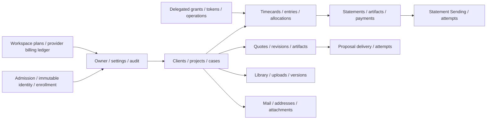

# Database map and every foreign key

Candidate source `4bb5c424d6e7d270cdca1479283896be77d581c3`; migration head `ph3_009_read_indexes`. Structural reference inherited from the original 2026-10-18 empty PostgreSQL18.4 reconstruction at `9fc9eebdaf9f52170530c8a28d34f6c8cd612c64` after 26 migrations. Exactly 45 structural input blobs are unchanged at the candidate. No database connection, migration or DDL replay was rerun in this refresh. `timeker_reference` is synthetic, not a hosted schema name; no business rows or hosted catalog are included.

## Functional overview

Arrows below summarize domain flow; the exact physical relationships follow.

## Complete physical ER diagram

This graph includes all 55 table nodes and 90 physical foreign-key edges. Standalone
source: [relationships.mmd](relationships.mmd). A child can have zero rows; nullable
FKs allow zero/one parent. UNIQUE/PK membership determines the maximum child count.
Additional checks/triggers can restrict state beyond these FK cardinalities.
Directory routing identifiers are intentionally not invented cross-schema FKs.

```mermaid
erDiagram
    admission_identities {
        uuid id PK
    }
    alembic_version {
        character_varying_32 version_num PK
    }
    app_settings {
        uuid id PK
    }
    audit_events {
        uuid actor_id FK
        uuid id PK
    }
    case_time_allocations {
        uuid id PK
        uuid entry_id FK
        uuid case_id FK
        uuid actor_id FK
    }
    cases {
        uuid id PK
        uuid client_id FK
        uuid project_id FK
        uuid owner_id FK
    }
    client_drafts {
        uuid id PK
        uuid owner_id FK
    }
    client_source_references {
        uuid id PK
        uuid client_id FK
        uuid uploaded_by FK
    }
    clients {
        uuid id PK
    }
    contact_attempts {
        uuid id PK
    }
    contacts {
        uuid client_id FK
        uuid id PK
    }
    credit_memos {
        uuid id PK
        uuid invoice_id FK
        uuid actor_id FK
    }
    email_auth_challenges {
        uuid id PK
        uuid owner_id FK
    }
    integration_codes {
        uuid id PK
        uuid grant_id FK
    }
    integration_grants {
        uuid id PK
        uuid owner_id FK
    }
    integration_operations {
        uuid id PK
        uuid grant_id FK
    }
    integration_tokens {
        uuid id PK
        uuid grant_id FK
    }
    invoice_artifacts {
        uuid invoice_id FK
        uuid id PK
    }
    invoice_lines {
        uuid invoice_id FK
        uuid project_id FK
        uuid id PK
    }
    invoice_time_entries {
        uuid entry_id PK
        uuid invoice_id FK
    }
    invoices {
        uuid client_id FK
        uuid id PK
        uuid fixed_fee_project_id FK
        uuid manual_extra_project_id FK
    }
    library_document_versions {
        uuid document_id FK
        uuid owner_id FK
        uuid source_upload_id FK
        uuid id PK
    }
    library_documents {
        uuid owner_id FK
        uuid case_id FK
        uuid client_id FK
        uuid project_id FK
        uuid id PK
    }
    library_uploads {
        uuid document_id FK
        uuid uploaded_by FK
        uuid id PK
    }
    mail_addresses {
        uuid owner_id FK
        uuid client_id FK
        uuid project_id FK
        uuid case_id FK
        uuid id PK
    }
    mail_attachments {
        uuid message_id FK
        uuid id PK
    }
    mail_messages {
        uuid owner_id FK
        uuid client_id FK
        uuid project_id FK
        uuid case_id FK
        uuid id PK
    }
    owner_identities {
        uuid id PK
        uuid owner_id FK
    }
    owner_registrations {
        uuid id PK
        uuid owner_id FK
    }
    payments {
        uuid invoice_id FK
        uuid created_by FK
        uuid id PK
    }
    project_agreements {
        uuid id PK
        uuid project_id FK
        uuid uploaded_by FK
    }
    projects {
        uuid client_id FK
        uuid id PK
    }
    proposal_sending_attempts {
        uuid delivery_id FK
        uuid id PK
    }
    proposal_sending_deliveries {
        uuid owner_id FK
        uuid case_id FK
        uuid quote_artifact_id FK
        uuid library_version_id FK
        uuid id PK
    }
    public_email_challenges {
        uuid id PK
    }
    quote_artifacts {
        uuid revision_id FK
        uuid owner_id FK
        uuid id PK
    }
    quote_lines {
        uuid revision_id FK
        uuid id PK
    }
    quote_revisions {
        uuid quote_id FK
        uuid parent_revision_id FK
        uuid case_id FK
        uuid client_id FK
        uuid project_id FK
        uuid id PK
    }
    quotes {
        uuid owner_id FK
        uuid id PK
    }
    sending_attempts {
        uuid id PK
        uuid delivery_id FK
    }
    sending_deliveries {
        uuid id PK
        uuid owner_id FK
        uuid plan_id FK
    }
    sending_plans {
        uuid id PK
        uuid owner_id FK
        uuid invoice_id FK
        uuid artifact_id FK
    }
    sending_preferences {
        uuid id PK
        uuid owner_id FK
    }
    subscription_billing_accounts {
        integer id PK
        uuid owner_id FK
        uuid checkout_id FK
    }
    subscription_billing_events {
        uuid id PK
    }
    subscription_billing_operations {
        uuid id PK
        uuid owner_id FK
    }
    subscription_operations {
        uuid id PK
        uuid owner_id FK
    }
    time_contributions {
        uuid id PK
        uuid actor_id FK
        uuid import_record_id FK
        uuid timecard_id FK
        uuid project_id FK
        uuid entry_id FK
        uuid case_id FK
    }
    time_entries {
        uuid timecard_id FK
        uuid project_id FK
        uuid id PK
    }
    time_import_records {
        uuid id PK
        uuid actor_id FK
    }
    time_operations {
        uuid id PK
        uuid actor_id FK
    }
    timecards {
        uuid owner_id FK
        uuid client_id FK
        uuid id PK
        uuid internal_case_id FK
    }
    users {
        uuid id PK
    }
    workspace_admissions {
        uuid id PK
    }
    workspace_subscriptions {
        integer id PK
        uuid owner_id FK
    }
    users |o--o{ audit_events : "actor_id"
    users ||--o{ case_time_allocations : "actor_id"
    cases ||--o{ case_time_allocations : "case_id"
    time_entries ||--o{ case_time_allocations : "entry_id"
    clients ||--o{ cases : "client_id"
    users ||--o{ cases : "owner_id"
    projects ||--o{ cases : "project_id"
    users ||--o{ client_drafts : "owner_id"
    clients ||--o| client_source_references : "client_id"
    users ||--o{ client_source_references : "uploaded_by"
    clients ||--o{ contacts : "client_id"
    users ||--o{ credit_memos : "actor_id"
    invoices ||--o| credit_memos : "invoice_id"
    users ||--o{ email_auth_challenges : "owner_id"
    integration_grants ||--o{ integration_codes : "grant_id"
    users ||--o{ integration_grants : "owner_id"
    integration_grants ||--o{ integration_operations : "grant_id"
    integration_grants ||--o{ integration_tokens : "grant_id"
    invoices ||--o| invoice_artifacts : "invoice_id"
    invoices ||--o{ invoice_lines : "invoice_id"
    projects ||--o{ invoice_lines : "project_id"
    time_entries ||--o| invoice_time_entries : "entry_id"
    invoices ||--o{ invoice_time_entries : "invoice_id"
    projects |o--o{ invoices : "fixed_fee_project_id"
    projects |o--o{ invoices : "manual_extra_project_id"
    clients ||--o{ invoices : "client_id"
    library_documents ||--o{ library_document_versions : "document_id"
    users ||--o{ library_document_versions : "owner_id"
    library_uploads |o--o{ library_document_versions : "source_upload_id"
    cases |o--o{ library_documents : "case_id"
    clients |o--o{ library_documents : "client_id"
    users ||--o{ library_documents : "owner_id"
    projects |o--o{ library_documents : "project_id"
    library_documents ||--o{ library_uploads : "document_id"
    users ||--o{ library_uploads : "uploaded_by"
    cases |o--o{ mail_addresses : "case_id"
    clients ||--o{ mail_addresses : "client_id"
    users ||--o{ mail_addresses : "owner_id"
    projects |o--o{ mail_addresses : "project_id"
    mail_messages ||--o{ mail_attachments : "message_id"
    cases |o--o{ mail_messages : "case_id"
    clients ||--o{ mail_messages : "client_id"
    users ||--o{ mail_messages : "owner_id"
    projects |o--o{ mail_messages : "project_id"
    users ||--o{ owner_identities : "owner_id"
    users ||--o{ owner_registrations : "owner_id"
    users ||--o{ payments : "created_by"
    invoices ||--o{ payments : "invoice_id"
    projects ||--o| project_agreements : "project_id"
    users ||--o{ project_agreements : "uploaded_by"
    clients ||--o{ projects : "client_id"
    proposal_sending_deliveries ||--o{ proposal_sending_attempts : "delivery_id"
    cases ||--o{ proposal_sending_deliveries : "case_id"
    library_document_versions |o--o{ proposal_sending_deliveries : "library_version_id"
    users ||--o{ proposal_sending_deliveries : "owner_id"
    quote_artifacts |o--o{ proposal_sending_deliveries : "quote_artifact_id"
    users ||--o{ quote_artifacts : "owner_id"
    quote_revisions ||--o| quote_artifacts : "revision_id"
    quote_revisions ||--o{ quote_lines : "revision_id"
    cases ||--o{ quote_revisions : "case_id"
    clients ||--o{ quote_revisions : "client_id"
    quote_revisions |o--o{ quote_revisions : "parent_revision_id"
    projects ||--o{ quote_revisions : "project_id"
    quotes ||--o{ quote_revisions : "quote_id"
    users ||--o{ quotes : "owner_id"
    sending_deliveries ||--o{ sending_attempts : "delivery_id"
    users ||--o{ sending_deliveries : "owner_id"
    sending_plans ||--o{ sending_deliveries : "plan_id"
    invoice_artifacts ||--o{ sending_plans : "artifact_id"
    invoices ||--o| sending_plans : "invoice_id"
    users ||--o{ sending_plans : "owner_id"
    users ||--o| sending_preferences : "owner_id"
    subscription_billing_operations ||--o{ subscription_billing_accounts : "checkout_id"
    users ||--o{ subscription_billing_accounts : "owner_id"
    users ||--o{ subscription_billing_operations : "owner_id"
    users ||--o{ subscription_operations : "owner_id"
    users ||--o{ time_contributions : "actor_id"
    cases |o--o{ time_contributions : "case_id"
    time_entries |o--o{ time_contributions : "entry_id"
    time_import_records |o--o{ time_contributions : "import_record_id"
    projects ||--o{ time_contributions : "project_id"
    timecards ||--o{ time_contributions : "timecard_id"
    projects |o--o{ time_entries : "project_id"
    timecards ||--o{ time_entries : "timecard_id"
    users ||--o{ time_import_records : "actor_id"
    users ||--o{ time_operations : "actor_id"
    clients |o--o{ timecards : "client_id"
    cases |o--o{ timecards : "internal_case_id"
    users ||--o{ timecards : "owner_id"
    users ||--o{ workspace_subscriptions : "owner_id"
```

## Exact named foreign keys

| Constraint | Child columns | Parent columns | UPDATE | DELETE | Deferred |
| --- | --- | --- | --- | --- | --- |
| `audit_events_actor_id_fkey` | `audit_events.actor_id` | `users.id` | NO ACTION | NO ACTION | No |
| `case_time_allocations_actor_id_fkey` | `case_time_allocations.actor_id` | `users.id` | NO ACTION | NO ACTION | No |
| `case_time_allocations_case_id_fkey` | `case_time_allocations.case_id` | `cases.id` | NO ACTION | NO ACTION | No |
| `case_time_allocations_entry_id_fkey` | `case_time_allocations.entry_id` | `time_entries.id` | NO ACTION | NO ACTION | No |
| `cases_client_id_fkey` | `cases.client_id` | `clients.id` | NO ACTION | NO ACTION | No |
| `cases_owner_id_fkey` | `cases.owner_id` | `users.id` | NO ACTION | NO ACTION | No |
| `cases_project_id_fkey` | `cases.project_id` | `projects.id` | NO ACTION | NO ACTION | No |
| `client_drafts_owner_id_fkey` | `client_drafts.owner_id` | `users.id` | NO ACTION | NO ACTION | No |
| `client_source_references_client_id_fkey` | `client_source_references.client_id` | `clients.id` | NO ACTION | NO ACTION | No |
| `client_source_references_uploaded_by_fkey` | `client_source_references.uploaded_by` | `users.id` | NO ACTION | NO ACTION | No |
| `contacts_client_id_fkey` | `contacts.client_id` | `clients.id` | NO ACTION | NO ACTION | No |
| `credit_memos_actor_id_fkey` | `credit_memos.actor_id` | `users.id` | NO ACTION | NO ACTION | No |
| `credit_memos_invoice_id_fkey` | `credit_memos.invoice_id` | `invoices.id` | NO ACTION | NO ACTION | No |
| `email_auth_challenges_owner_id_fkey` | `email_auth_challenges.owner_id` | `users.id` | NO ACTION | NO ACTION | No |
| `integration_codes_grant_id_fkey` | `integration_codes.grant_id` | `integration_grants.id` | NO ACTION | NO ACTION | No |
| `integration_grants_owner_id_fkey` | `integration_grants.owner_id` | `users.id` | NO ACTION | NO ACTION | No |
| `integration_operations_grant_id_fkey` | `integration_operations.grant_id` | `integration_grants.id` | NO ACTION | NO ACTION | No |
| `integration_tokens_grant_id_fkey` | `integration_tokens.grant_id` | `integration_grants.id` | NO ACTION | NO ACTION | No |
| `invoice_artifacts_invoice_id_fkey` | `invoice_artifacts.invoice_id` | `invoices.id` | NO ACTION | NO ACTION | No |
| `invoice_lines_invoice_id_fkey` | `invoice_lines.invoice_id` | `invoices.id` | NO ACTION | NO ACTION | No |
| `invoice_lines_project_id_fkey` | `invoice_lines.project_id` | `projects.id` | NO ACTION | NO ACTION | No |
| `invoice_time_entries_entry_id_fkey` | `invoice_time_entries.entry_id` | `time_entries.id` | NO ACTION | NO ACTION | No |
| `invoice_time_entries_invoice_id_fkey` | `invoice_time_entries.invoice_id` | `invoices.id` | NO ACTION | NO ACTION | No |
| `fk_invoices_fixed_fee_project_id` | `invoices.fixed_fee_project_id` | `projects.id` | NO ACTION | NO ACTION | No |
| `fk_invoices_manual_extra_project_id` | `invoices.manual_extra_project_id` | `projects.id` | NO ACTION | NO ACTION | No |
| `invoices_client_id_fkey` | `invoices.client_id` | `clients.id` | NO ACTION | NO ACTION | No |
| `library_document_versions_document_id_fkey` | `library_document_versions.document_id` | `library_documents.id` | NO ACTION | NO ACTION | No |
| `library_document_versions_owner_id_fkey` | `library_document_versions.owner_id` | `users.id` | NO ACTION | NO ACTION | No |
| `library_document_versions_source_upload_id_fkey` | `library_document_versions.source_upload_id` | `library_uploads.id` | NO ACTION | NO ACTION | No |
| `library_documents_case_id_fkey` | `library_documents.case_id` | `cases.id` | NO ACTION | NO ACTION | No |
| `library_documents_client_id_fkey` | `library_documents.client_id` | `clients.id` | NO ACTION | NO ACTION | No |
| `library_documents_owner_id_fkey` | `library_documents.owner_id` | `users.id` | NO ACTION | NO ACTION | No |
| `library_documents_project_id_fkey` | `library_documents.project_id` | `projects.id` | NO ACTION | NO ACTION | No |
| `library_uploads_document_id_fkey` | `library_uploads.document_id` | `library_documents.id` | NO ACTION | NO ACTION | No |
| `library_uploads_uploaded_by_fkey` | `library_uploads.uploaded_by` | `users.id` | NO ACTION | NO ACTION | No |
| `mail_addresses_case_id_fkey` | `mail_addresses.case_id` | `cases.id` | NO ACTION | NO ACTION | No |
| `mail_addresses_client_id_fkey` | `mail_addresses.client_id` | `clients.id` | NO ACTION | NO ACTION | No |
| `mail_addresses_owner_id_fkey` | `mail_addresses.owner_id` | `users.id` | NO ACTION | NO ACTION | No |
| `mail_addresses_project_id_fkey` | `mail_addresses.project_id` | `projects.id` | NO ACTION | NO ACTION | No |
| `mail_attachments_message_id_fkey` | `mail_attachments.message_id` | `mail_messages.id` | NO ACTION | NO ACTION | No |
| `mail_messages_case_id_fkey` | `mail_messages.case_id` | `cases.id` | NO ACTION | NO ACTION | No |
| `mail_messages_client_id_fkey` | `mail_messages.client_id` | `clients.id` | NO ACTION | NO ACTION | No |
| `mail_messages_owner_id_fkey` | `mail_messages.owner_id` | `users.id` | NO ACTION | NO ACTION | No |
| `mail_messages_project_id_fkey` | `mail_messages.project_id` | `projects.id` | NO ACTION | NO ACTION | No |
| `owner_identities_owner_id_fkey` | `owner_identities.owner_id` | `users.id` | NO ACTION | NO ACTION | No |
| `owner_registrations_owner_id_fkey` | `owner_registrations.owner_id` | `users.id` | NO ACTION | NO ACTION | No |
| `payments_created_by_fkey` | `payments.created_by` | `users.id` | NO ACTION | NO ACTION | No |
| `payments_invoice_id_fkey` | `payments.invoice_id` | `invoices.id` | NO ACTION | NO ACTION | No |
| `project_agreements_project_id_fkey` | `project_agreements.project_id` | `projects.id` | NO ACTION | NO ACTION | No |
| `project_agreements_uploaded_by_fkey` | `project_agreements.uploaded_by` | `users.id` | NO ACTION | NO ACTION | No |
| `projects_client_id_fkey` | `projects.client_id` | `clients.id` | NO ACTION | NO ACTION | No |
| `proposal_sending_attempts_delivery_id_fkey` | `proposal_sending_attempts.delivery_id` | `proposal_sending_deliveries.id` | NO ACTION | NO ACTION | No |
| `proposal_sending_deliveries_case_id_fkey` | `proposal_sending_deliveries.case_id` | `cases.id` | NO ACTION | NO ACTION | No |
| `proposal_sending_deliveries_library_version_id_fkey` | `proposal_sending_deliveries.library_version_id` | `library_document_versions.id` | NO ACTION | NO ACTION | No |
| `proposal_sending_deliveries_owner_id_fkey` | `proposal_sending_deliveries.owner_id` | `users.id` | NO ACTION | NO ACTION | No |
| `proposal_sending_deliveries_quote_artifact_id_fkey` | `proposal_sending_deliveries.quote_artifact_id` | `quote_artifacts.id` | NO ACTION | NO ACTION | No |
| `quote_artifacts_owner_id_fkey` | `quote_artifacts.owner_id` | `users.id` | NO ACTION | NO ACTION | No |
| `quote_artifacts_revision_id_fkey` | `quote_artifacts.revision_id` | `quote_revisions.id` | NO ACTION | NO ACTION | No |
| `quote_lines_revision_id_fkey` | `quote_lines.revision_id` | `quote_revisions.id` | NO ACTION | NO ACTION | No |
| `quote_revisions_case_id_fkey` | `quote_revisions.case_id` | `cases.id` | NO ACTION | NO ACTION | No |
| `quote_revisions_client_id_fkey` | `quote_revisions.client_id` | `clients.id` | NO ACTION | NO ACTION | No |
| `quote_revisions_parent_revision_id_fkey` | `quote_revisions.parent_revision_id` | `quote_revisions.id` | NO ACTION | NO ACTION | No |
| `quote_revisions_project_id_fkey` | `quote_revisions.project_id` | `projects.id` | NO ACTION | NO ACTION | No |
| `quote_revisions_quote_id_fkey` | `quote_revisions.quote_id` | `quotes.id` | NO ACTION | NO ACTION | No |
| `quotes_owner_id_fkey` | `quotes.owner_id` | `users.id` | NO ACTION | NO ACTION | No |
| `sending_attempts_delivery_id_fkey` | `sending_attempts.delivery_id` | `sending_deliveries.id` | NO ACTION | NO ACTION | No |
| `sending_deliveries_owner_id_fkey` | `sending_deliveries.owner_id` | `users.id` | NO ACTION | NO ACTION | No |
| `sending_deliveries_plan_id_fkey` | `sending_deliveries.plan_id` | `sending_plans.id` | NO ACTION | NO ACTION | No |
| `sending_plans_artifact_id_fkey` | `sending_plans.artifact_id` | `invoice_artifacts.id` | NO ACTION | NO ACTION | No |
| `sending_plans_invoice_id_fkey` | `sending_plans.invoice_id` | `invoices.id` | NO ACTION | NO ACTION | No |
| `sending_plans_owner_id_fkey` | `sending_plans.owner_id` | `users.id` | NO ACTION | NO ACTION | No |
| `sending_preferences_owner_id_fkey` | `sending_preferences.owner_id` | `users.id` | NO ACTION | NO ACTION | No |
| `subscription_billing_accounts_checkout_id_fkey` | `subscription_billing_accounts.checkout_id` | `subscription_billing_operations.id` | NO ACTION | NO ACTION | No |
| `subscription_billing_accounts_owner_id_fkey` | `subscription_billing_accounts.owner_id` | `users.id` | NO ACTION | NO ACTION | No |
| `subscription_billing_operations_owner_id_fkey` | `subscription_billing_operations.owner_id` | `users.id` | NO ACTION | NO ACTION | No |
| `subscription_operations_owner_id_fkey` | `subscription_operations.owner_id` | `users.id` | NO ACTION | NO ACTION | No |
| `time_contributions_actor_id_fkey` | `time_contributions.actor_id` | `users.id` | NO ACTION | NO ACTION | No |
| `time_contributions_case_id_fkey` | `time_contributions.case_id` | `cases.id` | NO ACTION | NO ACTION | No |
| `time_contributions_entry_id_fkey` | `time_contributions.entry_id` | `time_entries.id` | NO ACTION | NO ACTION | No |
| `time_contributions_import_record_id_fkey` | `time_contributions.import_record_id` | `time_import_records.id` | NO ACTION | NO ACTION | No |
| `time_contributions_project_id_fkey` | `time_contributions.project_id` | `projects.id` | NO ACTION | NO ACTION | No |
| `time_contributions_timecard_id_fkey` | `time_contributions.timecard_id` | `timecards.id` | NO ACTION | NO ACTION | No |
| `time_entries_project_id_fkey` | `time_entries.project_id` | `projects.id` | NO ACTION | NO ACTION | No |
| `time_entries_timecard_id_fkey` | `time_entries.timecard_id` | `timecards.id` | NO ACTION | NO ACTION | No |
| `time_import_records_actor_id_fkey` | `time_import_records.actor_id` | `users.id` | NO ACTION | NO ACTION | No |
| `time_operations_actor_id_fkey` | `time_operations.actor_id` | `users.id` | NO ACTION | NO ACTION | No |
| `timecards_client_id_fkey` | `timecards.client_id` | `clients.id` | NO ACTION | NO ACTION | No |
| `timecards_internal_case_id_fkey` | `timecards.internal_case_id` | `cases.id` | NO ACTION | NO ACTION | No |
| `timecards_owner_id_fkey` | `timecards.owner_id` | `users.id` | NO ACTION | NO ACTION | No |
| `workspace_subscriptions_owner_id_fkey` | `workspace_subscriptions.owner_id` | `users.id` | NO ACTION | NO ACTION | No |
