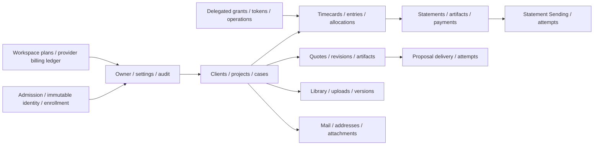

# timeKER — complete database reading copy

Generated from the database overview and seven chapters. Source and local/native
reconstruction limits are recorded below; no hosted inventory is implied.

# timeKER database reference

Source `9fc9eebdaf9f52170530c8a28d34f6c8cd612c64`; migration head `ph3_009_read_indexes`. Extracted on 2026-10-18 from a new empty PostgreSQL 18.4 database after all 26 Alembic migrations. `timeker_reference` is a synthetic documentation schema, not a hosted schema name. No seed, business-row query or hosted connection ran.

This folder documents the exact application structure produced by the pinned
migrations. It is a descriptive reference, not a migration plan or live database dump.
The full hosted schema-name inventory is unavailable in the allowed source/evidence;
[schema inventory](01-schemas-and-tenancy.md) identifies known names and unknowns.

Read the [single complete database Markdown](timeKER-DATABASE-FULL.md) for a
continuous copy of this overview and all seven database chapters. It contains
the same content; it is not independent evidence.

| Read | Contents |
| --- | --- |
| [Schemas and tenancy](01-schemas-and-tenancy.md) | Physical topology, exact known names, central directory, retained Stage counts and unknown hosted/platform names. |
| [All tables and layouts](02-tables-and-layouts.md) | All 55 tables, all 634 columns, SQL types/nullability/defaults, Python defaults, keys/checks, indexes and table triggers. |
| [Database map](03-relationships-and-map.md) | Domain overview, full FK diagram and all 90 named FK relationships. |
| [Functions and procedures](04-functions-and-procedures.md) | All 36 final PL/pgSQL function bodies, source locations, search paths and procedure inventory. |
| [Application triggers](05-application-triggers.md) | All 61 application trigger definitions and their function/table bindings. |
| [Internal triggers and other objects](06-internal-triggers-and-other-objects.md) | All 360 PostgreSQL-generated FK triggers, 8 sequences, types/views/extensions/RLS inventory. |
| [Inspect live metadata](07-inspect-live-metadata.md) | Read-only catalog queries for completing the actual hosted inventory, and native PostgreSQL client access. |
| [Catalog JSON](catalog.json) | Complete machine-readable structural extraction; no business records. |
| [Schema-only SQL](reference-schema.sql) | Full native reference DDL, with no row payload, owners or privileges. |
| [Full ER source](relationships.mmd) | Standalone Mermaid graph of all 55 table nodes and 90 FK edges. |
| [Read-only live inventory SQL](inventory-live.sql) | Schema/table/column/constraint/index/routine/trigger/sequence/policy metadata only; not executed against Stage or PROD. |
| [Provenance](PROVENANCE.json) | Counts, migration chain, file hashes, native reconstruction checks and limits. |

## Exact reference counts

| Object | Count |
| --- | --- |
| mapped application tables | 54 |
| physical tables in reference schema | 55 |
| columns | 634 |
| primary keys | 55 |
| unique constraints | 55 |
| check constraints | 128 |
| foreign keys | 90 |
| not null catalog constraints pg18 | 537 |
| constraint trigger constraints | 4 |
| indexes including constraint backing indexes | 192 |
| sequences | 8 |
| application functions | 36 |
| application stored procedures | 0 |
| application triggers | 61 |
| ordinary application triggers | 57 |
| deferred constraint triggers | 4 |
| internal fk triggers pg18 | 360 |
| views | 0 |
| materialized views | 0 |
| rls policies | 0 |
| custom enum domain range types | 0 |

55 physical tables =54 application tables +`alembic_version`. Index counts include
indexes backing PK/unique constraints. 421 total reference triggers =61 application
+360 internal FK triggers; internal names are generated by PostgreSQL and may differ
between installations. PostgreSQL 18 catalogs537 NOT NULL constraints separately;
that catalog representation/count is engine-specific. Nullability itself is in
the column layouts. All 36 application functions return `trigger`; there are no
application callable business-operation stored procedures at this migration head.

## Source, reconstructed structure and hosted evidence

- `alembic upgrade head` succeeded from empty, and `alembic check` reported
  `No new upgrade operations detected.` All 54 mapped tables match the migrated
  structure under Alembic's metadata comparison (not exhaustive behavioral parity).
- Native catalogs supply inherited columns, final replaced function bodies,
  generated triggers and effective schema-pinned search paths; a grep or model-only
  inventory would miss these details.
- The retained hosted Stage 009 evidence covers9 maintained schemas/495 table
  images,486 application table images and 36 guard functions per schema;5 quarantines
  were retained outside that population. This task did not refresh those facts.
- The local cluster used a synthetic DDL owner; hosted roles/grants, platform
  schemas/extensions and actual owner allocations were not reconstructed or read.
  [Source runtime grant policy](https://github.com/edlopezpm-ops/timeker-PH2/blob/9fc9eebdaf9f52170530c8a28d34f6c8cd612c64/scripts/postgres-runtime-grants.sql) and
  [directory grant policy](https://github.com/edlopezpm-ops/timeker-PH2/blob/9fc9eebdaf9f52170530c8a28d34f6c8cd612c64/app/admission_operations.py#L79-L87) are separate.
- SQLAlchemy Python defaults and `onupdate` run through that client; they are
  not PostgreSQL DEFAULT clauses or general UPDATE triggers. Direct SQL writers
  must supply fields without server defaults and preserve service/domain rules.
- No source, hosted data, runtime, provider setting or production deployment was
  changed. Source/models/migrations remain authoritative; regenerate this reference
  after authorized schema changes.

---

# Schemas, tenancy and known inventory

This database reference follows application source
`9fc9eebdaf9f52170530c8a28d34f6c8cd612c64`, prepared on 2026-10-18 after PH2
administrative closure. It describes source-defined structure, retained dated
Stage evidence and a separately built empty reference database. No live
Stage/production catalog or business table was queried to prepare this chapter.

A complete source-derived reference and a complete live database inventory are
different deliverables. The former is supplied here. Exact live schema names,
owners, provider-managed schemas and current deployment drift remain unknown
where the available evidence does not enumerate them.

## Three populations with different evidence

| Population | Known structure/count | Evidence boundary |
| --- | --- | --- |
| Empty local reference | PostgreSQL 18.4; schema `timeker_reference`; 55 tables, 634 columns, 36 functions, 61 application triggers, 360 internal triggers and 90 foreign keys; migration head `ph3_009_read_indexes` | Reference-build catalog counts. Contains no live owners, clients, financial records, credentials or provider data. |
| Maintained Stage targets | Nine schemas last verified at head 009; 495 snapshot tables and 486 retained application-table images | Dated backup/migration/readback evidence; does not enumerate every live schema name or imply nine active owners/free slots. |
| Excluded Stage quarantines | Five retained quarantined schemas, separate from the nine maintained targets | Retained exclusion evidence. Exact names and fresh live catalog state are not available in this source snapshot. |

The source pins the maintained head in [app/db.py:6](https://github.com/edlopezpm-ops/timeker-PH2/blob/9fc9eebdaf9f52170530c8a28d34f6c8cd612c64/app/db.py#L6).
The dated nine-schema preservation result is in
[HOSTING.md:26](https://github.com/edlopezpm-ops/timeker-PH2/blob/9fc9eebdaf9f52170530c8a28d34f6c8cd612c64/HOSTING.md#L26),
with current inventory limits at
[HOSTING.md:38](https://github.com/edlopezpm-ops/timeker-PH2/blob/9fc9eebdaf9f52170530c8a28d34f6c8cd612c64/HOSTING.md#L38).

The reference catalog is an empty structural specimen, not a Stage backup,
production restore, provider-schema dump or migration applied to an existing
service. Its PostgreSQL 18.4 version describes the reference build only. It does
not establish either hosted environment's current server version or capacity.

## Exact names that the available sources actually identify

| Name or family | What is established | What is not established |
| --- | --- | --- |
| `timeker_reference` | This package's empty reference schema | It is not a live workspace or a schema to deploy by renaming. |
| `timeker` | Default hosted application schema, paired with runtime role `timeker_app` | This source-defined/default mapping is not a fresh catalog observation of all live tenants. |
| `timeker_eve` | Named retained/inactive schema in the historical Stage database runbook; explicitly excluded by the Stage transport policy | Current live presence, ownership and row inventory have not been queried here; it is not an admitted Stage login target. |
| `timeker_stage_*` | Required naming family for additional configured Stage targets, with corresponding `*_app` roles | A naming rule does not enumerate actual schema names or prove allocation. |
| `timeker_stage_signup_*` | Five prepared schemas are described using this family in the operations record | Exact suffixes, current allocation and owner identities are not published in the source inventory. |
| `public` | Non-hosted fallback when no explicit schema is selected | It is not proof that hosted business tables use `public`, or a complete account of provider-managed schemas. |

Sources: [default schema selection](https://github.com/edlopezpm-ops/timeker-PH2/blob/9fc9eebdaf9f52170530c8a28d34f6c8cd612c64/app/tenancy.py#L105),
[Stage schema/role policy](https://github.com/edlopezpm-ops/timeker-PH2/blob/9fc9eebdaf9f52170530c8a28d34f6c8cd612c64/deploy/cloudflare/README.md#L26),
[historical inactive schema](https://github.com/edlopezpm-ops/timeker-PH2/blob/9fc9eebdaf9f52170530c8a28d34f6c8cd612c64/deploy/postgres/README.md#L9),
[prepared-family and quarantine boundary](https://github.com/edlopezpm-ops/timeker-PH2/blob/9fc9eebdaf9f52170530c8a28d34f6c8cd612c64/docs/OPERATIONS.md#L93).

**UNKNOWN:** the complete nine-name maintained Stage list; the complete five-name
quarantine list; each target's current owner/runtime role, allocation and grants;
the complete live production schema inventory; and all installed Supabase/platform
schema names, objects and counts. These unknowns must remain visible until an
authorized metadata-only inventory supplies them. Synthetic test names, numeric
suffix guesses and assumed Supabase defaults cannot fill the gaps.

The nine maintained targets plus five exclusions describe fourteen targets in
the retained maintenance account. They are not a verified total for every schema
in either hosted PostgreSQL database. In particular, do not infer installed
`auth`, `storage`, `realtime` or other provider schemas from product conventions
or authentication API URLs.

## Count denominators

The application has 54 mapped application tables. Alembic adds its version table,
giving 55 tables in the reference schema. At the recorded nine-schema maintenance
boundary, 9 × 55 explains the 495-table snapshot and 9 × 54 explains the 486
application-table preservation images. The latter includes application management
tables and directory shadows; it is not a count of 486 distinct entity types.

The five quarantines were excluded from that nine-schema backup/migration
population. Older evidence describes them as empty, NOLOGIN and retained at
head 005. “Empty” must not be translated into zero physical tables: retained
migration markers and structure are different from an absence of business rows.
Their exact physical table inventory remains unknown here.
[Dated owner/quarantine record](https://github.com/edlopezpm-ops/timeker-PH2/blob/9fc9eebdaf9f52170530c8a28d34f6c8cd612c64/docs/OPERATIONS.md#L144).

The reference's 36 functions and 61 application triggers are structure counts.
The additional 360 internal triggers are PostgreSQL-maintained catalog objects,
not 360 more application features. The 90 foreign keys are constraint counts.
None of these counts measures active owners, business rows, API endpoints, passed
tests, hosted service health or human acceptance.

## Workspace routing and isolation

One owner/user belongs to one private workspace. Clients, Projects and Cases are
business records inside it. The server resolves a fixed descriptor containing
schema, runtime role and connection factory from verified identity or a scoped
integration credential. Browser/model-supplied names and UUIDs cannot select an
arbitrary schema. There is no default-owner fallback or runtime DDL.

The registry requires unique identifiers, schemas, roles and encryption keys;
additional descriptors and prepared slots must remain on the selected database
boundary. Each connection checks its actual `current_user` and `current_schema()`
against the expected descriptor. A connection string alone is not isolation proof.
[Registry validation](https://github.com/edlopezpm-ops/timeker-PH2/blob/9fc9eebdaf9f52170530c8a28d34f6c8cd612c64/app/tenancy.py#L148),
[prepared slots](https://github.com/edlopezpm-ops/timeker-PH2/blob/9fc9eebdaf9f52170530c8a28d34f6c8cd612c64/app/tenancy.py#L251),
[connection identity check](https://github.com/edlopezpm-ops/timeker-PH2/blob/9fc9eebdaf9f52170530c8a28d34f6c8cd612c64/app/db.py#L19).

New-owner admission reserves an exact operator-prepared slot, initializes and
reads back its immutable owner identity, then activates the retained mapping.
Reservations survive partial failure; they are not casually reassigned. A
prepared schema is not necessarily an active owner workspace or currently free.
[Reserve/initialize/activate](https://github.com/edlopezpm-ops/timeker-PH2/blob/9fc9eebdaf9f52170530c8a28d34f6c8cd612c64/app/admission.py#L142).

## Runtime roles and schema owners

| Role boundary | Source or retained evidence |
| --- | --- |
| Default runtime role | `timeker_app`; schema USAGE and explicit table/sequence privileges, without schema creation or object ownership. |
| Additional Stage runtime roles | Corresponding `<schema>_app` naming rule. Exact complete live role-name list is unknown. |
| Migration owner | Historical `timeker_migrator` is explicitly named for the default schema. Do not treat it as the owner of every workspace. |
| Retained owner split | The dated nine-target record describes four named migrators and five administrator-owned prepared schemas; exact complete owner-name inventory is unavailable. |
| Quarantine roles | Retained NOLOGIN exclusion; not proof of usable runtime admission or authorization to enable them. |
| Provider/platform roles | `anon`, `authenticated` and `service_role` occur as revoked principals in grant policy; this does not inventory every installed role or provider schema. |

[Runtime grants](https://github.com/edlopezpm-ops/timeker-PH2/blob/9fc9eebdaf9f52170530c8a28d34f6c8cd612c64/scripts/postgres-runtime-grants.sql#L3),
[historical default owner/runtime provisioning](https://github.com/edlopezpm-ops/timeker-PH2/blob/9fc9eebdaf9f52170530c8a28d34f6c8cd612c64/deploy/postgres/README.md#L57),
[four/five owner split](https://github.com/edlopezpm-ops/timeker-PH2/blob/9fc9eebdaf9f52170530c8a28d34f6c8cd612c64/docs/OPERATIONS.md#L144).

Readiness checks reject runtime object ownership, schema CREATE, role membership,
foreign-schema USAGE and elevated role capabilities. Operator/migrator authority
must not enter the serving container or be substituted for the runtime role to
make an isolation check pass.
[Runtime privilege verification](https://github.com/edlopezpm-ops/timeker-PH2/blob/9fc9eebdaf9f52170530c8a28d34f6c8cd612c64/app/tenancy.py#L405).

## Central directory and noncentral shadows

`workspace_admissions`, `admission_identities` and `public_email_challenges` are
the three central admission tables. They are part of the replicated application
structure, but only the fixed default directory role receives their central
SELECT/INSERT/UPDATE authorization. Noncentral runtime roles lose access to
their shadow copies. Physical presence therefore does not imply the same
operational purpose or permission in every workspace schema.
[Directory table list](https://github.com/edlopezpm-ops/timeker-PH2/blob/9fc9eebdaf9f52170530c8a28d34f6c8cd612c64/app/admission_operations.py#L12),
[directory grant boundary](https://github.com/edlopezpm-ops/timeker-PH2/blob/9fc9eebdaf9f52170530c8a28d34f6c8cd612c64/app/admission_operations.py#L79).

## How to close the live inventory gap

Use the separately reviewed [metadata inspection procedure](07-inspect-live-metadata.md)
and [inventory-live.sql](inventory-live.sql) only on a specifically authorized
connection. Retain target/date/role, exact schema names and visibility limits;
compare maintained, prepared, allocated, inactive, quarantine and platform
populations explicitly. A role-limited view can be complete for that role without
being a complete server inventory. No schema creation, grants, migration, data
query or recovery action follows from this documentation.

---

# All tables and complete layouts

Source `9fc9eebdaf9f52170530c8a28d34f6c8cd612c64`; migration head `ph3_009_read_indexes`. Extracted on 2026-10-18 from a new empty PostgreSQL 18.4 database after all 26 Alembic migrations. `timeker_reference` is a synthetic documentation schema, not a hosted schema name. No seed, business-row query or hosted connection ran.


All names below are relative to the synthetic reference schema. SQL server defaults,
identity generation and Python client defaults are deliberately separate. `—` means
absent; NULL allowed is explicit. Identity `a` means GENERATED ALWAYS, `d` BY DEFAULT.
Collations, ordinal positions and all constraints also appear in [catalog.json](catalog.json).
All tables are permanent ordinary tables, without RLS or partition keys in this build.

## Table index

| Domain | Exact tables |
| --- | --- |
| Owner, settings and audit | [users](#users), [app_settings](#app_settings), [audit_events](#audit_events), [contact_attempts](#contact_attempts) |
| Clients, projects and cases | [clients](#clients), [contacts](#contacts), [client_source_references](#client_source_references), [projects](#projects), [project_agreements](#project_agreements), [cases](#cases) |
| Work records and time commands | [timecards](#timecards), [time_entries](#time_entries), [case_time_allocations](#case_time_allocations), [time_contributions](#time_contributions), [time_import_records](#time_import_records), [time_operations](#time_operations) |
| Statements and payments | [invoices](#invoices), [invoice_lines](#invoice_lines), [invoice_time_entries](#invoice_time_entries), [invoice_artifacts](#invoice_artifacts), [payments](#payments), [credit_memos](#credit_memos) |
| Delegated integrations | [integration_grants](#integration_grants), [integration_codes](#integration_codes), [integration_tokens](#integration_tokens), [integration_operations](#integration_operations), [client_drafts](#client_drafts) |
| Plans and provider billing | [workspace_subscriptions](#workspace_subscriptions), [subscription_operations](#subscription_operations), [subscription_billing_accounts](#subscription_billing_accounts), [subscription_billing_operations](#subscription_billing_operations), [subscription_billing_events](#subscription_billing_events) |
| Enrollment and central directory | [owner_identities](#owner_identities), [owner_registrations](#owner_registrations), [email_auth_challenges](#email_auth_challenges), [workspace_admissions](#workspace_admissions), [admission_identities](#admission_identities), [public_email_challenges](#public_email_challenges) |
| Statement Sending | [sending_preferences](#sending_preferences), [sending_plans](#sending_plans), [sending_deliveries](#sending_deliveries), [sending_attempts](#sending_attempts) |
| Quoting, library and commercial Sending | [quotes](#quotes), [quote_revisions](#quote_revisions), [quote_lines](#quote_lines), [quote_artifacts](#quote_artifacts), [library_documents](#library_documents), [library_uploads](#library_uploads), [library_document_versions](#library_document_versions), [proposal_sending_deliveries](#proposal_sending_deliveries), [proposal_sending_attempts](#proposal_sending_attempts) |
| Mail custody | [mail_messages](#mail_messages), [mail_addresses](#mail_addresses), [mail_attachments](#mail_attachments) |
| Migration bookkeeping | [alembic_version](#alembic_version) |

## admission_identities

Mapped class `AdmissionIdentity`; [Source](https://github.com/edlopezpm-ops/timeker-PH2/blob/9fc9eebdaf9f52170530c8a28d34f6c8cd612c64/app/admission_models.py#L26).

10 columns; 15 catalog constraints; 4 indexes; 1 application triggers.

| # | Column | PostgreSQL type | NULL allowed | Key membership | SQL DEFAULT | Identity | Python insert default | Python on update |
| --- | --- | --- | --- | --- | --- | --- | --- | --- |
| 1 | `id` | `uuid` | No | PK | — | — | `Python callable: uuid4` | — |
| 2 | `created_at` | `timestamp with time zone` | No | — | — | — | `Python callable: <lambda>` | — |
| 3 | `updated_at` | `timestamp with time zone` | No | — | — | — | `Python callable: <lambda>` | `Python callable: <lambda>` |
| 4 | `tenant_id` | `uuid` | No | UNIQUE | — | — | — | — |
| 5 | `owner_id` | `uuid` | No | UNIQUE | — | — | — | — |
| 6 | `identity_id` | `uuid` | No | UNIQUE | — | — | — | — |
| 7 | `issuer` | `character varying(255)` | No | UNIQUE | — | — | — | — |
| 8 | `subject` | `character varying(255)` | No | UNIQUE | — | — | — | — |
| 9 | `verified_email` | `character varying(254)` | No | — | — | — | — | — |
| 10 | `state` | `character varying(12)` | No | — | — | — | `'pending'` | — |

### Constraints

| Name | Kind | Definition | Deferred |
| --- | --- | --- | --- |
| `admission_identities_created_at_not_null` | NOT NULL | `NOT NULL created_at` | No |
| `admission_identities_id_not_null` | NOT NULL | `NOT NULL id` | No |
| `admission_identities_identity_id_not_null` | NOT NULL | `NOT NULL identity_id` | No |
| `admission_identities_issuer_not_null` | NOT NULL | `NOT NULL issuer` | No |
| `admission_identities_issuer_subject_key` | UNIQUE | `UNIQUE (issuer, subject)` | No |
| `admission_identities_owner_id_not_null` | NOT NULL | `NOT NULL owner_id` | No |
| `admission_identities_pkey` | PRIMARY KEY | `PRIMARY KEY (id)` | No |
| `admission_identities_state_check` | CHECK | `CHECK (state::text = ANY (ARRAY['pending'::character varying, 'active'::character varying, 'blocked'::character varying, 'revoked'::character varying]::text[]))` | No |
| `admission_identities_state_not_null` | NOT NULL | `NOT NULL state` | No |
| `admission_identities_subject_not_null` | NOT NULL | `NOT NULL subject` | No |
| `admission_identities_tenant_id_identity_id_key` | UNIQUE | `UNIQUE (tenant_id, identity_id)` | No |
| `admission_identities_tenant_id_not_null` | NOT NULL | `NOT NULL tenant_id` | No |
| `admission_identities_tenant_id_owner_id_issuer_key` | UNIQUE | `UNIQUE (tenant_id, owner_id, issuer)` | No |
| `admission_identities_updated_at_not_null` | NOT NULL | `NOT NULL updated_at` | No |
| `admission_identities_verified_email_not_null` | NOT NULL | `NOT NULL verified_email` | No |

### Indexes

| Name | SQL |
| --- | --- |
| `admission_identities_issuer_subject_key` | `CREATE UNIQUE INDEX admission_identities_issuer_subject_key ON timeker_reference.admission_identities USING btree (issuer, subject)` |
| `admission_identities_pkey` | `CREATE UNIQUE INDEX admission_identities_pkey ON timeker_reference.admission_identities USING btree (id)` |
| `admission_identities_tenant_id_identity_id_key` | `CREATE UNIQUE INDEX admission_identities_tenant_id_identity_id_key ON timeker_reference.admission_identities USING btree (tenant_id, identity_id)` |
| `admission_identities_tenant_id_owner_id_issuer_key` | `CREATE UNIQUE INDEX admission_identities_tenant_id_owner_id_issuer_key ON timeker_reference.admission_identities USING btree (tenant_id, owner_id, issuer)` |

### Application triggers

| Trigger | Function | Constraint |
| --- | --- | --- |
| `admission_identity_history` | [timeker_admission_history_guard](04-functions-and-procedures.md#timeker_admission_history_guard) | — |

## alembic_version

Alembic migration metadata; not a mapped application entity.

1 columns; 2 catalog constraints; 1 indexes; 0 application triggers.

| # | Column | PostgreSQL type | NULL allowed | Key membership | SQL DEFAULT | Identity | Python insert default | Python on update |
| --- | --- | --- | --- | --- | --- | --- | --- | --- |
| 1 | `version_num` | `character varying(32)` | No | PK | — | — | — | — |

### Constraints

| Name | Kind | Definition | Deferred |
| --- | --- | --- | --- |
| `alembic_version_pkc` | PRIMARY KEY | `PRIMARY KEY (version_num)` | No |
| `alembic_version_version_num_not_null` | NOT NULL | `NOT NULL version_num` | No |

### Indexes

| Name | SQL |
| --- | --- |
| `alembic_version_pkc` | `CREATE UNIQUE INDEX alembic_version_pkc ON timeker_reference.alembic_version USING btree (version_num)` |

### Application triggers

None.

## app_settings

Mapped class `AppSettings`; [Source](https://github.com/edlopezpm-ops/timeker-PH2/blob/9fc9eebdaf9f52170530c8a28d34f6c8cd612c64/app/models.py#L404).

6 columns; 7 catalog constraints; 2 indexes; 0 application triggers.

| # | Column | PostgreSQL type | NULL allowed | Key membership | SQL DEFAULT | Identity | Python insert default | Python on update |
| --- | --- | --- | --- | --- | --- | --- | --- | --- |
| 1 | `key` | `character varying(30)` | No | UNIQUE | — | — | — | — |
| 2 | `value` | `jsonb` | No | — | — | — | `Python callable: dict` | — |
| 3 | `encrypted_value` | `bytea` | Yes | — | — | — | — | — |
| 4 | `id` | `uuid` | No | PK | — | — | `Python callable: uuid4` | — |
| 5 | `created_at` | `timestamp with time zone` | No | — | — | — | `Python callable: <lambda>` | — |
| 6 | `updated_at` | `timestamp with time zone` | No | — | — | — | `Python callable: <lambda>` | `Python callable: <lambda>` |

### Constraints

| Name | Kind | Definition | Deferred |
| --- | --- | --- | --- |
| `app_settings_created_at_not_null` | NOT NULL | `NOT NULL created_at` | No |
| `app_settings_id_not_null` | NOT NULL | `NOT NULL id` | No |
| `app_settings_key_key` | UNIQUE | `UNIQUE (key)` | No |
| `app_settings_key_not_null` | NOT NULL | `NOT NULL key` | No |
| `app_settings_pkey` | PRIMARY KEY | `PRIMARY KEY (id)` | No |
| `app_settings_updated_at_not_null` | NOT NULL | `NOT NULL updated_at` | No |
| `app_settings_value_not_null` | NOT NULL | `NOT NULL value` | No |

### Indexes

| Name | SQL |
| --- | --- |
| `app_settings_key_key` | `CREATE UNIQUE INDEX app_settings_key_key ON timeker_reference.app_settings USING btree (key)` |
| `app_settings_pkey` | `CREATE UNIQUE INDEX app_settings_pkey ON timeker_reference.app_settings USING btree (id)` |

### Application triggers

None.

## audit_events

Mapped class `Audit`; [Source](https://github.com/edlopezpm-ops/timeker-PH2/blob/9fc9eebdaf9f52170530c8a28d34f6c8cd612c64/app/models.py#L394).

9 columns; 10 catalog constraints; 3 indexes; 1 application triggers.

| # | Column | PostgreSQL type | NULL allowed | Key membership | SQL DEFAULT | Identity | Python insert default | Python on update |
| --- | --- | --- | --- | --- | --- | --- | --- | --- |
| 1 | `actor_id` | `uuid` | Yes | FK | — | — | — | — |
| 2 | `request_id` | `uuid` | No | — | — | — | — | — |
| 3 | `event_type` | `character varying(60)` | No | — | — | — | — | — |
| 4 | `entity_type` | `character varying(30)` | No | — | — | — | — | — |
| 5 | `entity_id` | `uuid` | No | — | — | — | — | — |
| 6 | `details` | `jsonb` | No | — | — | — | `Python callable: dict` | — |
| 7 | `id` | `uuid` | No | PK | — | — | `Python callable: uuid4` | — |
| 8 | `created_at` | `timestamp with time zone` | No | — | — | — | `Python callable: <lambda>` | — |
| 9 | `updated_at` | `timestamp with time zone` | No | — | — | — | `Python callable: <lambda>` | `Python callable: <lambda>` |

### Constraints

| Name | Kind | Definition | Deferred |
| --- | --- | --- | --- |
| `audit_events_actor_id_fkey` | FOREIGN KEY | `FOREIGN KEY (actor_id) REFERENCES users(id)` | No |
| `audit_events_created_at_not_null` | NOT NULL | `NOT NULL created_at` | No |
| `audit_events_details_not_null` | NOT NULL | `NOT NULL details` | No |
| `audit_events_entity_id_not_null` | NOT NULL | `NOT NULL entity_id` | No |
| `audit_events_entity_type_not_null` | NOT NULL | `NOT NULL entity_type` | No |
| `audit_events_event_type_not_null` | NOT NULL | `NOT NULL event_type` | No |
| `audit_events_id_not_null` | NOT NULL | `NOT NULL id` | No |
| `audit_events_pkey` | PRIMARY KEY | `PRIMARY KEY (id)` | No |
| `audit_events_request_id_not_null` | NOT NULL | `NOT NULL request_id` | No |
| `audit_events_updated_at_not_null` | NOT NULL | `NOT NULL updated_at` | No |

### Indexes

| Name | SQL |
| --- | --- |
| `audit_events_pkey` | `CREATE UNIQUE INDEX audit_events_pkey ON timeker_reference.audit_events USING btree (id)` |
| `ix_audit_events_created_id` | `CREATE INDEX ix_audit_events_created_id ON timeker_reference.audit_events USING btree (created_at DESC, id)` |
| `ix_audit_events_entity_id` | `CREATE INDEX ix_audit_events_entity_id ON timeker_reference.audit_events USING btree (entity_id)` |

### Application triggers

| Trigger | Function | Constraint |
| --- | --- | --- |
| `audit_guard` | [timeker_artifact_guard](04-functions-and-procedures.md#timeker_artifact_guard) | — |

## case_time_allocations

Mapped class `CaseTimeAllocation`; [Source](https://github.com/edlopezpm-ops/timeker-PH2/blob/9fc9eebdaf9f52170530c8a28d34f6c8cd612c64/app/models.py#L266).

8 columns; 14 catalog constraints; 4 indexes; 2 application triggers.

| # | Column | PostgreSQL type | NULL allowed | Key membership | SQL DEFAULT | Identity | Python insert default | Python on update |
| --- | --- | --- | --- | --- | --- | --- | --- | --- |
| 1 | `id` | `uuid` | No | PK | — | — | `Python callable: uuid4` | — |
| 2 | `created_at` | `timestamp with time zone` | No | — | — | — | `Python callable: <lambda>` | — |
| 3 | `updated_at` | `timestamp with time zone` | No | — | — | — | `Python callable: <lambda>` | `Python callable: <lambda>` |
| 4 | `entry_id` | `uuid` | No | FK, UNIQUE | — | — | — | — |
| 5 | `case_id` | `uuid` | No | FK, UNIQUE | — | — | — | — |
| 6 | `minutes` | `integer` | No | — | — | — | — | — |
| 7 | `actor_id` | `uuid` | No | FK | — | — | — | — |
| 8 | `version` | `integer` | No | — | — | — | `1` | — |

### Constraints

| Name | Kind | Definition | Deferred |
| --- | --- | --- | --- |
| `case_time_allocations_actor_id_fkey` | FOREIGN KEY | `FOREIGN KEY (actor_id) REFERENCES users(id)` | No |
| `case_time_allocations_actor_id_not_null` | NOT NULL | `NOT NULL actor_id` | No |
| `case_time_allocations_case_id_fkey` | FOREIGN KEY | `FOREIGN KEY (case_id) REFERENCES cases(id)` | No |
| `case_time_allocations_case_id_not_null` | NOT NULL | `NOT NULL case_id` | No |
| `case_time_allocations_created_at_not_null` | NOT NULL | `NOT NULL created_at` | No |
| `case_time_allocations_entry_id_case_id_key` | UNIQUE | `UNIQUE (entry_id, case_id)` | No |
| `case_time_allocations_entry_id_fkey` | FOREIGN KEY | `FOREIGN KEY (entry_id) REFERENCES time_entries(id)` | No |
| `case_time_allocations_entry_id_not_null` | NOT NULL | `NOT NULL entry_id` | No |
| `case_time_allocations_id_not_null` | NOT NULL | `NOT NULL id` | No |
| `case_time_allocations_minutes_check` | CHECK | `CHECK (minutes >= 1 AND minutes <= 1440)` | No |
| `case_time_allocations_minutes_not_null` | NOT NULL | `NOT NULL minutes` | No |
| `case_time_allocations_pkey` | PRIMARY KEY | `PRIMARY KEY (id)` | No |
| `case_time_allocations_updated_at_not_null` | NOT NULL | `NOT NULL updated_at` | No |
| `case_time_allocations_version_not_null` | NOT NULL | `NOT NULL version` | No |

### Indexes

| Name | SQL |
| --- | --- |
| `case_time_allocations_entry_id_case_id_key` | `CREATE UNIQUE INDEX case_time_allocations_entry_id_case_id_key ON timeker_reference.case_time_allocations USING btree (entry_id, case_id)` |
| `case_time_allocations_pkey` | `CREATE UNIQUE INDEX case_time_allocations_pkey ON timeker_reference.case_time_allocations USING btree (id)` |
| `ix_case_time_allocations_case_id` | `CREATE INDEX ix_case_time_allocations_case_id ON timeker_reference.case_time_allocations USING btree (case_id)` |
| `ix_case_time_allocations_entry_id` | `CREATE INDEX ix_case_time_allocations_entry_id ON timeker_reference.case_time_allocations USING btree (entry_id)` |

### Application triggers

| Trigger | Function | Constraint |
| --- | --- | --- |
| `allocation_contribution_guard` | [timeker_allocation_contribution_guard](04-functions-and-procedures.md#timeker_allocation_contribution_guard) | — |
| `allocation_guard` | [timeker_allocation_guard](04-functions-and-procedures.md#timeker_allocation_guard) | — |

## cases

Mapped class `Case`; [Source](https://github.com/edlopezpm-ops/timeker-PH2/blob/9fc9eebdaf9f52170530c8a28d34f6c8cd612c64/app/models.py#L233).

18 columns; 23 catalog constraints; 7 indexes; 3 application triggers.

| # | Column | PostgreSQL type | NULL allowed | Key membership | SQL DEFAULT | Identity | Python insert default | Python on update |
| --- | --- | --- | --- | --- | --- | --- | --- | --- |
| 1 | `id` | `uuid` | No | PK | — | — | `Python callable: uuid4` | — |
| 2 | `created_at` | `timestamp with time zone` | No | — | — | — | `Python callable: <lambda>` | — |
| 3 | `updated_at` | `timestamp with time zone` | No | — | — | — | `Python callable: <lambda>` | `Python callable: <lambda>` |
| 4 | `client_id` | `uuid` | No | FK | — | — | — | — |
| 5 | `project_id` | `uuid` | No | FK | — | — | — | — |
| 6 | `owner_id` | `uuid` | No | FK | — | — | — | — |
| 7 | `legacy_number` | `character varying(30)` | Yes | — | — | — | — | — |
| 8 | `title` | `character varying(200)` | No | — | — | — | — | — |
| 9 | `description` | `text` | Yes | — | — | — | — | — |
| 10 | `status` | `character varying(20)` | No | — | — | — | `'Open'` | — |
| 11 | `opened_at` | `timestamp with time zone` | No | — | — | — | `Python callable: <lambda>` | — |
| 12 | `resolved_at` | `timestamp with time zone` | Yes | — | — | — | — | — |
| 13 | `closed_at` | `timestamp with time zone` | Yes | — | — | — | — | — |
| 14 | `archived_at` | `timestamp with time zone` | Yes | — | — | — | — | — |
| 15 | `version` | `integer` | No | — | — | — | `1` | — |
| 16 | `number` | `bigint` | No | UNIQUE | — | `a` | — | — |
| 17 | `case_type` | `character varying(20)` | No | — | — | — | — | — |
| 18 | `flexfields` | `jsonb` | No | — | `'{}'::jsonb` | — | `Python callable: dict` | — |

### Constraints

| Name | Kind | Definition | Deferred |
| --- | --- | --- | --- |
| `case_description_length` | CHECK | `CHECK (description IS NULL OR char_length(description) <= 500)` | No |
| `case_number_range` | CHECK | `CHECK (number >= 10001)` | No |
| `case_type_allowed` | CHECK | `CHECK (case_type::text = ANY (ARRAY['Issue'::character varying, 'Consulting'::character varying, 'Dev Services'::character varying, 'Design'::character varying, 'Services'::character varying]::text[]))` | No |
| `cases_case_type_not_null` | NOT NULL | `NOT NULL case_type` | No |
| `cases_client_id_fkey` | FOREIGN KEY | `FOREIGN KEY (client_id) REFERENCES clients(id)` | No |
| `cases_client_id_not_null` | NOT NULL | `NOT NULL client_id` | No |
| `cases_created_at_not_null` | NOT NULL | `NOT NULL created_at` | No |
| `cases_flexfields_not_null` | NOT NULL | `NOT NULL flexfields` | No |
| `cases_flexfields_valid` | CHECK | `CHECK (jsonb_typeof(flexfields) = 'object'::text AND (flexfields - ARRAY['flexfield1'::text, 'flexfield2'::text, 'flexfield3'::text, 'flexfield4'::text, 'flexfield5'::text, 'flexfield6'::text, 'flexfield7'::text, 'flexfield8'::text]) = '{}'::jsonb AND (NOT flexfields ? 'flexfield1'::text OR (flexfields -> 'flexfield1'::text) = 'null'::jsonb OR jsonb_typeof(flexfields -> 'flexfield1'::text) = 'string'::text AND char_length(flexfields ->> 'flexfield1'::text) <= 250) AND (NOT flexfields ? 'flexfield2'::text OR (flexfields -> 'flexfield2'::text) = 'null'::jsonb OR jsonb_typeof(flexfields -> 'flexfield2'::text) = 'string'::text AND char_length(flexfields ->> 'flexfield2'::text) <= 250) AND (NOT flexfields ? 'flexfield3'::text OR (flexfields -> 'flexfield3'::text) = 'null'::jsonb OR jsonb_typeof(flexfields -> 'flexfield3'::text) = 'string'::text AND char_length(flexfields ->> 'flexfield3'::text) <= 250) AND (NOT flexfields ? 'flexfield4'::text OR (flexfields -> 'flexfield4'::text) = 'null'::jsonb OR jsonb_typeof(flexfields -> 'flexfield4'::text) = 'string'::text AND char_length(flexfields ->> 'flexfield4'::text) <= 250) AND (NOT flexfields ? 'flexfield5'::text OR (flexfields -> 'flexfield5'::text) = 'null'::jsonb OR jsonb_typeof(flexfields -> 'flexfield5'::text) = 'string'::text AND char_length(flexfields ->> 'flexfield5'::text) <= 250) AND (NOT flexfields ? 'flexfield6'::text OR (flexfields -> 'flexfield6'::text) = 'null'::jsonb OR jsonb_typeof(flexfields -> 'flexfield6'::text) = 'string'::text AND char_length(flexfields ->> 'flexfield6'::text) <= 250) AND (NOT flexfields ? 'flexfield7'::text OR (flexfields -> 'flexfield7'::text) = 'null'::jsonb OR jsonb_typeof(flexfields -> 'flexfield7'::text) = 'string'::text AND (flexfields ->> 'flexfield7'::text) ~ '^-?[0-9]{1,14}([.][0-9]{1,5})?$'::text) AND (NOT flexfields ? 'flexfield8'::text OR (flexfields -> 'flexfield8'::text) = 'null'::jsonb OR jsonb_typeof(flexfields -> 'flexfield8'::text) = 'string'::text AND (flexfields ->> 'flexfield8'::text) ~ '^-?[0-9]{1,14}([.][0-9]{1,5})?$'::text))` | No |
| `cases_id_not_null` | NOT NULL | `NOT NULL id` | No |
| `cases_number_key` | UNIQUE | `UNIQUE (number)` | No |
| `cases_number_not_null` | NOT NULL | `NOT NULL number` | No |
| `cases_opened_at_not_null` | NOT NULL | `NOT NULL opened_at` | No |
| `cases_owner_id_fkey` | FOREIGN KEY | `FOREIGN KEY (owner_id) REFERENCES users(id)` | No |
| `cases_owner_id_not_null` | NOT NULL | `NOT NULL owner_id` | No |
| `cases_pkey` | PRIMARY KEY | `PRIMARY KEY (id)` | No |
| `cases_project_id_fkey` | FOREIGN KEY | `FOREIGN KEY (project_id) REFERENCES projects(id)` | No |
| `cases_project_id_not_null` | NOT NULL | `NOT NULL project_id` | No |
| `cases_status_check` | CHECK | `CHECK (status::text = ANY (ARRAY['Open'::character varying, 'In progress'::character varying, 'Waiting'::character varying, 'Resolved'::character varying, 'Closed'::character varying]::text[]))` | No |
| `cases_status_not_null` | NOT NULL | `NOT NULL status` | No |
| `cases_title_not_null` | NOT NULL | `NOT NULL title` | No |
| `cases_updated_at_not_null` | NOT NULL | `NOT NULL updated_at` | No |
| `cases_version_not_null` | NOT NULL | `NOT NULL version` | No |

### Indexes

| Name | SQL |
| --- | --- |
| `cases_number_key` | `CREATE UNIQUE INDEX cases_number_key ON timeker_reference.cases USING btree (number)` |
| `cases_pkey` | `CREATE UNIQUE INDEX cases_pkey ON timeker_reference.cases USING btree (id)` |
| `ix_cases_archived_at` | `CREATE INDEX ix_cases_archived_at ON timeker_reference.cases USING btree (archived_at)` |
| `ix_cases_client_id` | `CREATE INDEX ix_cases_client_id ON timeker_reference.cases USING btree (client_id)` |
| `ix_cases_owner_id` | `CREATE INDEX ix_cases_owner_id ON timeker_reference.cases USING btree (owner_id)` |
| `ix_cases_project_id` | `CREATE INDEX ix_cases_project_id ON timeker_reference.cases USING btree (project_id)` |
| `ix_cases_status` | `CREATE INDEX ix_cases_status ON timeker_reference.cases USING btree (status)` |

### Application triggers

| Trigger | Function | Constraint |
| --- | --- | --- |
| `case_archive_status_guard` | [timeker_case_archive_status_guard](04-functions-and-procedures.md#timeker_case_archive_status_guard) | — |
| `case_guard` | [timeker_case_guard](04-functions-and-procedures.md#timeker_case_guard) | — |
| `commercial_case_guard` | [timeker_commercial_case_guard](04-functions-and-procedures.md#timeker_commercial_case_guard) | — |

## client_drafts

Mapped class `ClientDraft`; [Source](https://github.com/edlopezpm-ops/timeker-PH2/blob/9fc9eebdaf9f52170530c8a28d34f6c8cd612c64/app/integration_models.py#L79).

6 columns; 8 catalog constraints; 2 indexes; 0 application triggers.

| # | Column | PostgreSQL type | NULL allowed | Key membership | SQL DEFAULT | Identity | Python insert default | Python on update |
| --- | --- | --- | --- | --- | --- | --- | --- | --- |
| 1 | `id` | `uuid` | No | PK | — | — | `Python callable: uuid4` | — |
| 2 | `created_at` | `timestamp with time zone` | No | — | — | — | `Python callable: <lambda>` | — |
| 3 | `updated_at` | `timestamp with time zone` | No | — | — | — | `Python callable: <lambda>` | `Python callable: <lambda>` |
| 4 | `owner_id` | `uuid` | No | FK | — | — | — | — |
| 5 | `payload` | `jsonb` | No | — | — | — | — | — |
| 6 | `version` | `integer` | No | — | — | — | `1` | — |

### Constraints

| Name | Kind | Definition | Deferred |
| --- | --- | --- | --- |
| `client_drafts_created_at_not_null` | NOT NULL | `NOT NULL created_at` | No |
| `client_drafts_id_not_null` | NOT NULL | `NOT NULL id` | No |
| `client_drafts_owner_id_fkey` | FOREIGN KEY | `FOREIGN KEY (owner_id) REFERENCES users(id)` | No |
| `client_drafts_owner_id_not_null` | NOT NULL | `NOT NULL owner_id` | No |
| `client_drafts_payload_not_null` | NOT NULL | `NOT NULL payload` | No |
| `client_drafts_pkey` | PRIMARY KEY | `PRIMARY KEY (id)` | No |
| `client_drafts_updated_at_not_null` | NOT NULL | `NOT NULL updated_at` | No |
| `client_drafts_version_not_null` | NOT NULL | `NOT NULL version` | No |

### Indexes

| Name | SQL |
| --- | --- |
| `client_drafts_pkey` | `CREATE UNIQUE INDEX client_drafts_pkey ON timeker_reference.client_drafts USING btree (id)` |
| `ix_client_drafts_owner_id` | `CREATE INDEX ix_client_drafts_owner_id ON timeker_reference.client_drafts USING btree (owner_id)` |

### Application triggers

None.

## client_source_references

Mapped class `ClientSourceReference`; [Source](https://github.com/edlopezpm-ops/timeker-PH2/blob/9fc9eebdaf9f52170530c8a28d34f6c8cd612c64/app/models.py#L153).

10 columns; 12 catalog constraints; 2 indexes; 0 application triggers.

| # | Column | PostgreSQL type | NULL allowed | Key membership | SQL DEFAULT | Identity | Python insert default | Python on update |
| --- | --- | --- | --- | --- | --- | --- | --- | --- |
| 1 | `id` | `uuid` | No | PK | — | — | `Python callable: uuid4` | — |
| 2 | `created_at` | `timestamp with time zone` | No | — | — | — | `Python callable: <lambda>` | — |
| 3 | `updated_at` | `timestamp with time zone` | No | — | — | — | `Python callable: <lambda>` | `Python callable: <lambda>` |
| 4 | `client_id` | `uuid` | No | FK, UNIQUE | — | — | — | — |
| 5 | `uploaded_by` | `uuid` | No | FK | — | — | — | — |
| 6 | `filename` | `character varying(180)` | No | — | — | — | — | — |
| 7 | `media_type` | `character varying(80)` | No | — | — | — | — | — |
| 8 | `content` | `bytea` | Yes | — | — | — | — | — |
| 9 | `url` | `text` | Yes | — | — | — | — | — |
| 10 | `sha256` | `character varying(64)` | Yes | — | — | — | — | — |

### Constraints

| Name | Kind | Definition | Deferred |
| --- | --- | --- | --- |
| `client_source_payload` | CHECK | `CHECK (content IS NOT NULL AND url IS NULL AND octet_length(content) >= 1 AND octet_length(content) <= 5242880 AND sha256::text ~ '^[0-9a-f]{64}$'::text OR content IS NULL AND url IS NOT NULL AND length(url) >= 1 AND length(url) <= 2048 AND sha256 IS NULL)` | No |
| `client_source_references_client_id_fkey` | FOREIGN KEY | `FOREIGN KEY (client_id) REFERENCES clients(id)` | No |
| `client_source_references_client_id_key` | UNIQUE | `UNIQUE (client_id)` | No |
| `client_source_references_client_id_not_null` | NOT NULL | `NOT NULL client_id` | No |
| `client_source_references_created_at_not_null` | NOT NULL | `NOT NULL created_at` | No |
| `client_source_references_filename_not_null` | NOT NULL | `NOT NULL filename` | No |
| `client_source_references_id_not_null` | NOT NULL | `NOT NULL id` | No |
| `client_source_references_media_type_not_null` | NOT NULL | `NOT NULL media_type` | No |
| `client_source_references_pkey` | PRIMARY KEY | `PRIMARY KEY (id)` | No |
| `client_source_references_updated_at_not_null` | NOT NULL | `NOT NULL updated_at` | No |
| `client_source_references_uploaded_by_fkey` | FOREIGN KEY | `FOREIGN KEY (uploaded_by) REFERENCES users(id)` | No |
| `client_source_references_uploaded_by_not_null` | NOT NULL | `NOT NULL uploaded_by` | No |

### Indexes

| Name | SQL |
| --- | --- |
| `client_source_references_client_id_key` | `CREATE UNIQUE INDEX client_source_references_client_id_key ON timeker_reference.client_source_references USING btree (client_id)` |
| `client_source_references_pkey` | `CREATE UNIQUE INDEX client_source_references_pkey ON timeker_reference.client_source_references USING btree (id)` |

### Application triggers

None.

## clients

Mapped class `Client`; [Source](https://github.com/edlopezpm-ops/timeker-PH2/blob/9fc9eebdaf9f52170530c8a28d34f6c8cd612c64/app/models.py#L69).

20 columns; 26 catalog constraints; 5 indexes; 1 application triggers.

| # | Column | PostgreSQL type | NULL allowed | Key membership | SQL DEFAULT | Identity | Python insert default | Python on update |
| --- | --- | --- | --- | --- | --- | --- | --- | --- |
| 1 | `code` | `character varying(30)` | No | UNIQUE | — | — | — | — |
| 2 | `legal_name` | `character varying(200)` | No | — | — | — | — | — |
| 3 | `display_name` | `character varying(120)` | No | — | — | — | — | — |
| 4 | `country_code` | `character varying(2)` | No | — | — | — | — | — |
| 5 | `status` | `character varying(20)` | No | — | `'draft'::character varying` | — | `'draft'` | — |
| 6 | `timezone` | `character varying(80)` | No | — | — | — | `'UTC'` | — |
| 7 | `language` | `character varying(2)` | No | — | — | — | `'en'` | — |
| 8 | `currency` | `character varying(3)` | No | — | — | — | `'USD'` | — |
| 9 | `rate` | `numeric(14,2)` | No | — | — | — | — | — |
| 10 | `weekly_limit_minutes` | `integer` | Yes | — | — | — | — | — |
| 11 | `payment_terms_days` | `integer` | No | — | — | — | `15` | — |
| 12 | `profile` | `jsonb` | No | — | — | — | `Python callable: dict` | — |
| 13 | `contract` | `jsonb` | No | — | — | — | `Python callable: dict` | — |
| 14 | `archived_at` | `timestamp with time zone` | Yes | — | — | — | — | — |
| 15 | `version` | `integer` | No | — | — | — | `1` | — |
| 16 | `id` | `uuid` | No | PK | — | — | `Python callable: uuid4` | — |
| 17 | `created_at` | `timestamp with time zone` | No | — | — | — | `Python callable: <lambda>` | — |
| 18 | `updated_at` | `timestamp with time zone` | No | — | — | — | `Python callable: <lambda>` | `Python callable: <lambda>` |
| 19 | `object_id` | `bigint` | No | UNIQUE | — | `a` | — | — |
| 20 | `flexfields` | `jsonb` | No | — | `'{}'::jsonb` | — | `Python callable: dict` | — |

### Constraints

| Name | Kind | Definition | Deferred |
| --- | --- | --- | --- |
| `client_status_allowed` | CHECK | `CHECK (status::text = ANY (ARRAY['draft'::character varying, 'active'::character varying, 'archived'::character varying]::text[]))` | No |
| `clients_check` | CHECK | `CHECK (rate >= 0::numeric AND payment_terms_days >= 0)` | No |
| `clients_code_key` | UNIQUE | `UNIQUE (code)` | No |
| `clients_code_not_null` | NOT NULL | `NOT NULL code` | No |
| `clients_contract_not_null` | NOT NULL | `NOT NULL contract` | No |
| `clients_country_code_not_null` | NOT NULL | `NOT NULL country_code` | No |
| `clients_created_at_not_null` | NOT NULL | `NOT NULL created_at` | No |
| `clients_currency_not_null` | NOT NULL | `NOT NULL currency` | No |
| `clients_display_name_not_null` | NOT NULL | `NOT NULL display_name` | No |
| `clients_flexfields_not_null` | NOT NULL | `NOT NULL flexfields` | No |
| `clients_flexfields_valid` | CHECK | `CHECK (jsonb_typeof(flexfields) = 'object'::text AND (flexfields - ARRAY['flexfield1'::text, 'flexfield2'::text, 'flexfield3'::text, 'flexfield4'::text, 'flexfield5'::text, 'flexfield6'::text, 'flexfield7'::text, 'flexfield8'::text]) = '{}'::jsonb AND (NOT flexfields ? 'flexfield1'::text OR (flexfields -> 'flexfield1'::text) = 'null'::jsonb OR jsonb_typeof(flexfields -> 'flexfield1'::text) = 'string'::text AND char_length(flexfields ->> 'flexfield1'::text) <= 250) AND (NOT flexfields ? 'flexfield2'::text OR (flexfields -> 'flexfield2'::text) = 'null'::jsonb OR jsonb_typeof(flexfields -> 'flexfield2'::text) = 'string'::text AND char_length(flexfields ->> 'flexfield2'::text) <= 250) AND (NOT flexfields ? 'flexfield3'::text OR (flexfields -> 'flexfield3'::text) = 'null'::jsonb OR jsonb_typeof(flexfields -> 'flexfield3'::text) = 'string'::text AND char_length(flexfields ->> 'flexfield3'::text) <= 250) AND (NOT flexfields ? 'flexfield4'::text OR (flexfields -> 'flexfield4'::text) = 'null'::jsonb OR jsonb_typeof(flexfields -> 'flexfield4'::text) = 'string'::text AND char_length(flexfields ->> 'flexfield4'::text) <= 250) AND (NOT flexfields ? 'flexfield5'::text OR (flexfields -> 'flexfield5'::text) = 'null'::jsonb OR jsonb_typeof(flexfields -> 'flexfield5'::text) = 'string'::text AND char_length(flexfields ->> 'flexfield5'::text) <= 250) AND (NOT flexfields ? 'flexfield6'::text OR (flexfields -> 'flexfield6'::text) = 'null'::jsonb OR jsonb_typeof(flexfields -> 'flexfield6'::text) = 'string'::text AND char_length(flexfields ->> 'flexfield6'::text) <= 250) AND (NOT flexfields ? 'flexfield7'::text OR (flexfields -> 'flexfield7'::text) = 'null'::jsonb OR jsonb_typeof(flexfields -> 'flexfield7'::text) = 'string'::text AND (flexfields ->> 'flexfield7'::text) ~ '^-?[0-9]{1,14}([.][0-9]{1,5})?$'::text) AND (NOT flexfields ? 'flexfield8'::text OR (flexfields -> 'flexfield8'::text) = 'null'::jsonb OR jsonb_typeof(flexfields -> 'flexfield8'::text) = 'string'::text AND (flexfields ->> 'flexfield8'::text) ~ '^-?[0-9]{1,14}([.][0-9]{1,5})?$'::text))` | No |
| `clients_id_not_null` | NOT NULL | `NOT NULL id` | No |
| `clients_language_check` | CHECK | `CHECK (language::text = ANY (ARRAY['es'::character varying, 'en'::character varying]::text[]))` | No |
| `clients_language_not_null` | NOT NULL | `NOT NULL language` | No |
| `clients_legal_name_not_null` | NOT NULL | `NOT NULL legal_name` | No |
| `clients_object_id_key` | UNIQUE | `UNIQUE (object_id)` | No |
| `clients_object_id_not_null` | NOT NULL | `NOT NULL object_id` | No |
| `clients_payment_terms_days_not_null` | NOT NULL | `NOT NULL payment_terms_days` | No |
| `clients_pkey` | PRIMARY KEY | `PRIMARY KEY (id)` | No |
| `clients_profile_not_null` | NOT NULL | `NOT NULL profile` | No |
| `clients_rate_not_null` | NOT NULL | `NOT NULL rate` | No |
| `clients_status_not_null` | NOT NULL | `NOT NULL status` | No |
| `clients_timezone_not_null` | NOT NULL | `NOT NULL timezone` | No |
| `clients_updated_at_not_null` | NOT NULL | `NOT NULL updated_at` | No |
| `clients_version_not_null` | NOT NULL | `NOT NULL version` | No |
| `clients_weekly_limit_minutes_check` | CHECK | `CHECK (weekly_limit_minutes IS NULL OR weekly_limit_minutes >= 0 AND weekly_limit_minutes <= 10080)` | No |

### Indexes

| Name | SQL |
| --- | --- |
| `clients_code_key` | `CREATE UNIQUE INDEX clients_code_key ON timeker_reference.clients USING btree (code)` |
| `clients_object_id_key` | `CREATE UNIQUE INDEX clients_object_id_key ON timeker_reference.clients USING btree (object_id)` |
| `clients_pkey` | `CREATE UNIQUE INDEX clients_pkey ON timeker_reference.clients USING btree (id)` |
| `ix_clients_display_name` | `CREATE INDEX ix_clients_display_name ON timeker_reference.clients USING btree (display_name)` |
| `ix_clients_status` | `CREATE INDEX ix_clients_status ON timeker_reference.clients USING btree (status)` |

### Application triggers

| Trigger | Function | Constraint |
| --- | --- | --- |
| `object_id_guard` | [timeker_object_id_guard](04-functions-and-procedures.md#timeker_object_id_guard) | — |

## contact_attempts

Mapped class `ContactAttempt`; [Source](https://github.com/edlopezpm-ops/timeker-PH2/blob/9fc9eebdaf9f52170530c8a28d34f6c8cd612c64/app/models.py#L33).

7 columns; 9 catalog constraints; 2 indexes; 0 application triggers.

| # | Column | PostgreSQL type | NULL allowed | Key membership | SQL DEFAULT | Identity | Python insert default | Python on update |
| --- | --- | --- | --- | --- | --- | --- | --- | --- |
| 1 | `id` | `uuid` | No | PK | — | — | — | — |
| 2 | `created_at` | `timestamp with time zone` | No | — | — | — | — | — |
| 3 | `session_digest` | `character varying(64)` | No | — | — | — | — | — |
| 4 | `address_digest` | `character varying(64)` | No | — | — | — | — | — |
| 5 | `network_digest` | `character varying(64)` | No | — | — | — | — | — |
| 6 | `payload_digest` | `character varying(64)` | No | — | — | — | — | — |
| 7 | `status` | `character varying(12)` | No | — | — | — | — | — |

### Constraints

| Name | Kind | Definition | Deferred |
| --- | --- | --- | --- |
| `contact_attempts_address_digest_not_null` | NOT NULL | `NOT NULL address_digest` | No |
| `contact_attempts_created_at_not_null` | NOT NULL | `NOT NULL created_at` | No |
| `contact_attempts_id_not_null` | NOT NULL | `NOT NULL id` | No |
| `contact_attempts_network_digest_not_null` | NOT NULL | `NOT NULL network_digest` | No |
| `contact_attempts_payload_digest_not_null` | NOT NULL | `NOT NULL payload_digest` | No |
| `contact_attempts_pkey` | PRIMARY KEY | `PRIMARY KEY (id)` | No |
| `contact_attempts_session_digest_not_null` | NOT NULL | `NOT NULL session_digest` | No |
| `contact_attempts_status_check` | CHECK | `CHECK (status::text = ANY (ARRAY['reserved'::character varying, 'accepted'::character varying, 'uncertain'::character varying]::text[]))` | No |
| `contact_attempts_status_not_null` | NOT NULL | `NOT NULL status` | No |

### Indexes

| Name | SQL |
| --- | --- |
| `contact_attempts_pkey` | `CREATE UNIQUE INDEX contact_attempts_pkey ON timeker_reference.contact_attempts USING btree (id)` |
| `ix_contact_attempts_created_at` | `CREATE INDEX ix_contact_attempts_created_at ON timeker_reference.contact_attempts USING btree (created_at)` |

### Application triggers

None.

## contacts

Mapped class `Contact`; [Source](https://github.com/edlopezpm-ops/timeker-PH2/blob/9fc9eebdaf9f52170530c8a28d34f6c8cd612c64/app/models.py#L99).

12 columns; 11 catalog constraints; 2 indexes; 0 application triggers.

| # | Column | PostgreSQL type | NULL allowed | Key membership | SQL DEFAULT | Identity | Python insert default | Python on update |
| --- | --- | --- | --- | --- | --- | --- | --- | --- |
| 1 | `client_id` | `uuid` | No | FK | — | — | — | — |
| 2 | `name` | `character varying(100)` | No | — | — | — | — | — |
| 3 | `title` | `character varying(100)` | Yes | — | — | — | — | — |
| 4 | `email` | `character varying(254)` | Yes | — | — | — | — | — |
| 5 | `phone` | `character varying(50)` | Yes | — | — | — | — | — |
| 6 | `contact_type` | `character varying(40)` | No | — | — | — | `'general'` | — |
| 7 | `may_request_work` | `boolean` | No | — | — | — | `False` | — |
| 8 | `may_approve_hours` | `boolean` | No | — | — | — | `False` | — |
| 9 | `active` | `boolean` | No | — | — | — | `True` | — |
| 10 | `id` | `uuid` | No | PK | — | — | `Python callable: uuid4` | — |
| 11 | `created_at` | `timestamp with time zone` | No | — | — | — | `Python callable: <lambda>` | — |
| 12 | `updated_at` | `timestamp with time zone` | No | — | — | — | `Python callable: <lambda>` | `Python callable: <lambda>` |

### Constraints

| Name | Kind | Definition | Deferred |
| --- | --- | --- | --- |
| `contacts_active_not_null` | NOT NULL | `NOT NULL active` | No |
| `contacts_client_id_fkey` | FOREIGN KEY | `FOREIGN KEY (client_id) REFERENCES clients(id)` | No |
| `contacts_client_id_not_null` | NOT NULL | `NOT NULL client_id` | No |
| `contacts_contact_type_not_null` | NOT NULL | `NOT NULL contact_type` | No |
| `contacts_created_at_not_null` | NOT NULL | `NOT NULL created_at` | No |
| `contacts_id_not_null` | NOT NULL | `NOT NULL id` | No |
| `contacts_may_approve_hours_not_null` | NOT NULL | `NOT NULL may_approve_hours` | No |
| `contacts_may_request_work_not_null` | NOT NULL | `NOT NULL may_request_work` | No |
| `contacts_name_not_null` | NOT NULL | `NOT NULL name` | No |
| `contacts_pkey` | PRIMARY KEY | `PRIMARY KEY (id)` | No |
| `contacts_updated_at_not_null` | NOT NULL | `NOT NULL updated_at` | No |

### Indexes

| Name | SQL |
| --- | --- |
| `contacts_pkey` | `CREATE UNIQUE INDEX contacts_pkey ON timeker_reference.contacts USING btree (id)` |
| `ix_contacts_client_id` | `CREATE INDEX ix_contacts_client_id ON timeker_reference.contacts USING btree (client_id)` |

### Application triggers

None.

## credit_memos

Mapped class `CreditMemo`; [Source](https://github.com/edlopezpm-ops/timeker-PH2/blob/9fc9eebdaf9f52170530c8a28d34f6c8cd612c64/app/credit_memo_models.py#L14).

15 columns; 25 catalog constraints; 3 indexes; 2 application triggers.

| # | Column | PostgreSQL type | NULL allowed | Key membership | SQL DEFAULT | Identity | Python insert default | Python on update |
| --- | --- | --- | --- | --- | --- | --- | --- | --- |
| 1 | `id` | `uuid` | No | PK | — | — | `Python callable: uuid4` | — |
| 2 | `created_at` | `timestamp with time zone` | No | — | — | — | `Python callable: <lambda>` | — |
| 3 | `updated_at` | `timestamp with time zone` | No | — | — | — | `Python callable: <lambda>` | `Python callable: <lambda>` |
| 4 | `invoice_id` | `uuid` | No | FK, UNIQUE | — | — | — | — |
| 5 | `number` | `character varying(60)` | No | UNIQUE | — | — | — | — |
| 6 | `actor_id` | `uuid` | No | FK | — | — | — | — |
| 7 | `issue_date` | `date` | No | — | — | — | — | — |
| 8 | `currency` | `character varying(3)` | No | — | — | — | — | — |
| 9 | `total` | `numeric(14,2)` | No | — | — | — | — | — |
| 10 | `reason` | `text` | No | — | — | — | — | — |
| 11 | `snapshot` | `jsonb` | No | — | — | — | — | — |
| 12 | `filename` | `character varying(180)` | No | — | — | — | — | — |
| 13 | `pdf_bytes` | `bytea` | No | — | — | — | — | — |
| 14 | `sha256` | `character varying(64)` | No | — | — | — | — | — |
| 15 | `renderer_version` | `character varying(40)` | No | — | — | — | — | — |

### Constraints

| Name | Kind | Definition | Deferred |
| --- | --- | --- | --- |
| `credit_memo_invoice_check` | CONSTRAINT TRIGGER | `TRIGGER DEFERRABLE INITIALLY DEFERRED` | Initially deferred |
| `credit_memos_actor_id_fkey` | FOREIGN KEY | `FOREIGN KEY (actor_id) REFERENCES users(id)` | No |
| `credit_memos_actor_id_not_null` | NOT NULL | `NOT NULL actor_id` | No |
| `credit_memos_created_at_not_null` | NOT NULL | `NOT NULL created_at` | No |
| `credit_memos_currency_not_null` | NOT NULL | `NOT NULL currency` | No |
| `credit_memos_filename_not_null` | NOT NULL | `NOT NULL filename` | No |
| `credit_memos_id_not_null` | NOT NULL | `NOT NULL id` | No |
| `credit_memos_invoice_id_fkey` | FOREIGN KEY | `FOREIGN KEY (invoice_id) REFERENCES invoices(id)` | No |
| `credit_memos_invoice_id_key` | UNIQUE | `UNIQUE (invoice_id)` | No |
| `credit_memos_invoice_id_not_null` | NOT NULL | `NOT NULL invoice_id` | No |
| `credit_memos_issue_date_not_null` | NOT NULL | `NOT NULL issue_date` | No |
| `credit_memos_number_key` | UNIQUE | `UNIQUE (number)` | No |
| `credit_memos_number_not_null` | NOT NULL | `NOT NULL number` | No |
| `credit_memos_pdf_bytes_check` | CHECK | `CHECK (octet_length(pdf_bytes) > 0)` | No |
| `credit_memos_pdf_bytes_not_null` | NOT NULL | `NOT NULL pdf_bytes` | No |
| `credit_memos_pkey` | PRIMARY KEY | `PRIMARY KEY (id)` | No |
| `credit_memos_reason_check` | CHECK | `CHECK (length(btrim(reason)) >= 1 AND length(btrim(reason)) <= 2000)` | No |
| `credit_memos_reason_not_null` | NOT NULL | `NOT NULL reason` | No |
| `credit_memos_renderer_version_not_null` | NOT NULL | `NOT NULL renderer_version` | No |
| `credit_memos_sha256_check` | CHECK | `CHECK (sha256::text ~ '^[0-9a-f]{64}$'::text)` | No |
| `credit_memos_sha256_not_null` | NOT NULL | `NOT NULL sha256` | No |
| `credit_memos_snapshot_not_null` | NOT NULL | `NOT NULL snapshot` | No |
| `credit_memos_total_check` | CHECK | `CHECK (total >= 0::numeric)` | No |
| `credit_memos_total_not_null` | NOT NULL | `NOT NULL total` | No |
| `credit_memos_updated_at_not_null` | NOT NULL | `NOT NULL updated_at` | No |

### Indexes

| Name | SQL |
| --- | --- |
| `credit_memos_invoice_id_key` | `CREATE UNIQUE INDEX credit_memos_invoice_id_key ON timeker_reference.credit_memos USING btree (invoice_id)` |
| `credit_memos_number_key` | `CREATE UNIQUE INDEX credit_memos_number_key ON timeker_reference.credit_memos USING btree (number)` |
| `credit_memos_pkey` | `CREATE UNIQUE INDEX credit_memos_pkey ON timeker_reference.credit_memos USING btree (id)` |

### Application triggers

| Trigger | Function | Constraint |
| --- | --- | --- |
| `credit_memo_guard` | [timeker_credit_memo_guard](04-functions-and-procedures.md#timeker_credit_memo_guard) | — |
| `credit_memo_invoice_check` | [timeker_credit_memo_final_guard](04-functions-and-procedures.md#timeker_credit_memo_final_guard) | `credit_memo_invoice_check` |

## email_auth_challenges

Mapped class `EmailAuthChallenge`; [Source](https://github.com/edlopezpm-ops/timeker-PH2/blob/9fc9eebdaf9f52170530c8a28d34f6c8cd612c64/app/enrollment_models.py#L42).

10 columns; 16 catalog constraints; 1 indexes; 1 application triggers.

| # | Column | PostgreSQL type | NULL allowed | Key membership | SQL DEFAULT | Identity | Python insert default | Python on update |
| --- | --- | --- | --- | --- | --- | --- | --- | --- |
| 1 | `id` | `uuid` | No | PK | — | — | `Python callable: uuid4` | — |
| 2 | `owner_id` | `uuid` | No | FK | — | — | — | — |
| 3 | `created_at` | `timestamp with time zone` | No | — | — | — | `Python callable: <lambda>` | — |
| 4 | `updated_at` | `timestamp with time zone` | No | — | — | — | `Python callable: <lambda>` | `Python callable: <lambda>` |
| 5 | `session_digest` | `character varying(64)` | No | — | — | — | — | — |
| 6 | `intent` | `character varying(12)` | No | — | — | — | — | — |
| 7 | `offer` | `character varying(20)` | No | — | — | — | — | — |
| 8 | `state` | `character varying(12)` | No | — | — | — | — | — |
| 9 | `attempts` | `integer` | No | — | — | — | `0` | — |
| 10 | `expires_at` | `timestamp with time zone` | No | — | — | — | — | — |

### Constraints

| Name | Kind | Definition | Deferred |
| --- | --- | --- | --- |
| `email_auth_challenges_attempts_check` | CHECK | `CHECK (attempts >= 0 AND attempts <= 6)` | No |
| `email_auth_challenges_attempts_not_null` | NOT NULL | `NOT NULL attempts` | No |
| `email_auth_challenges_created_at_not_null` | NOT NULL | `NOT NULL created_at` | No |
| `email_auth_challenges_expires_at_not_null` | NOT NULL | `NOT NULL expires_at` | No |
| `email_auth_challenges_id_not_null` | NOT NULL | `NOT NULL id` | No |
| `email_auth_challenges_intent_check` | CHECK | `CHECK (intent::text = ANY (ARRAY['signin'::character varying, 'signup'::character varying, 'link'::character varying]::text[]))` | No |
| `email_auth_challenges_intent_not_null` | NOT NULL | `NOT NULL intent` | No |
| `email_auth_challenges_offer_not_null` | NOT NULL | `NOT NULL offer` | No |
| `email_auth_challenges_owner_id_fkey` | FOREIGN KEY | `FOREIGN KEY (owner_id) REFERENCES users(id)` | No |
| `email_auth_challenges_owner_id_not_null` | NOT NULL | `NOT NULL owner_id` | No |
| `email_auth_challenges_pkey` | PRIMARY KEY | `PRIMARY KEY (id)` | No |
| `email_auth_challenges_session_digest_check` | CHECK | `CHECK (session_digest::text ~ '^[0-9a-f]{64}$'::text)` | No |
| `email_auth_challenges_session_digest_not_null` | NOT NULL | `NOT NULL session_digest` | No |
| `email_auth_challenges_state_check` | CHECK | `CHECK (state::text = ANY (ARRAY['reserved'::character varying, 'ready'::character varying, 'verifying'::character varying, 'consumed'::character varying, 'failed'::character varying]::text[]))` | No |
| `email_auth_challenges_state_not_null` | NOT NULL | `NOT NULL state` | No |
| `email_auth_challenges_updated_at_not_null` | NOT NULL | `NOT NULL updated_at` | No |

### Indexes

| Name | SQL |
| --- | --- |
| `email_auth_challenges_pkey` | `CREATE UNIQUE INDEX email_auth_challenges_pkey ON timeker_reference.email_auth_challenges USING btree (id)` |

### Application triggers

| Trigger | Function | Constraint |
| --- | --- | --- |
| `email_challenge_history` | [timeker_registration_history_guard](04-functions-and-procedures.md#timeker_registration_history_guard) | — |

## integration_codes

Mapped class `IntegrationCode`; [Source](https://github.com/edlopezpm-ops/timeker-PH2/blob/9fc9eebdaf9f52170530c8a28d34f6c8cd612c64/app/integration_models.py#L33).

11 columns; 13 catalog constraints; 3 indexes; 0 application triggers.

| # | Column | PostgreSQL type | NULL allowed | Key membership | SQL DEFAULT | Identity | Python insert default | Python on update |
| --- | --- | --- | --- | --- | --- | --- | --- | --- |
| 1 | `id` | `uuid` | No | PK | — | — | `Python callable: uuid4` | — |
| 2 | `created_at` | `timestamp with time zone` | No | — | — | — | `Python callable: <lambda>` | — |
| 3 | `updated_at` | `timestamp with time zone` | No | — | — | — | `Python callable: <lambda>` | `Python callable: <lambda>` |
| 4 | `grant_id` | `uuid` | No | FK | — | — | — | — |
| 5 | `digest` | `character varying(64)` | No | UNIQUE | — | — | — | — |
| 6 | `redirect_uri` | `character varying(1000)` | No | — | — | — | — | — |
| 7 | `code_challenge` | `character varying(128)` | No | — | — | — | — | — |
| 8 | `code_challenge_method` | `character varying(10)` | No | — | — | — | `'S256'` | — |
| 9 | `scope` | `character varying(500)` | No | — | — | — | — | — |
| 10 | `expires_at` | `timestamp with time zone` | No | — | — | — | — | — |
| 11 | `used_at` | `timestamp with time zone` | Yes | — | — | — | — | — |

### Constraints

| Name | Kind | Definition | Deferred |
| --- | --- | --- | --- |
| `integration_codes_code_challenge_method_not_null` | NOT NULL | `NOT NULL code_challenge_method` | No |
| `integration_codes_code_challenge_not_null` | NOT NULL | `NOT NULL code_challenge` | No |
| `integration_codes_created_at_not_null` | NOT NULL | `NOT NULL created_at` | No |
| `integration_codes_digest_key` | UNIQUE | `UNIQUE (digest)` | No |
| `integration_codes_digest_not_null` | NOT NULL | `NOT NULL digest` | No |
| `integration_codes_expires_at_not_null` | NOT NULL | `NOT NULL expires_at` | No |
| `integration_codes_grant_id_fkey` | FOREIGN KEY | `FOREIGN KEY (grant_id) REFERENCES integration_grants(id)` | No |
| `integration_codes_grant_id_not_null` | NOT NULL | `NOT NULL grant_id` | No |
| `integration_codes_id_not_null` | NOT NULL | `NOT NULL id` | No |
| `integration_codes_pkey` | PRIMARY KEY | `PRIMARY KEY (id)` | No |
| `integration_codes_redirect_uri_not_null` | NOT NULL | `NOT NULL redirect_uri` | No |
| `integration_codes_scope_not_null` | NOT NULL | `NOT NULL scope` | No |
| `integration_codes_updated_at_not_null` | NOT NULL | `NOT NULL updated_at` | No |

### Indexes

| Name | SQL |
| --- | --- |
| `integration_codes_digest_key` | `CREATE UNIQUE INDEX integration_codes_digest_key ON timeker_reference.integration_codes USING btree (digest)` |
| `integration_codes_pkey` | `CREATE UNIQUE INDEX integration_codes_pkey ON timeker_reference.integration_codes USING btree (id)` |
| `ix_integration_codes_grant_id` | `CREATE INDEX ix_integration_codes_grant_id ON timeker_reference.integration_codes USING btree (grant_id)` |

### Application triggers

None.

## integration_grants

Mapped class `IntegrationGrant`; [Source](https://github.com/edlopezpm-ops/timeker-PH2/blob/9fc9eebdaf9f52170530c8a28d34f6c8cd612c64/app/integration_models.py#L21).

11 columns; 12 catalog constraints; 2 indexes; 0 application triggers.

| # | Column | PostgreSQL type | NULL allowed | Key membership | SQL DEFAULT | Identity | Python insert default | Python on update |
| --- | --- | --- | --- | --- | --- | --- | --- | --- |
| 1 | `id` | `uuid` | No | PK | — | — | `Python callable: uuid4` | — |
| 2 | `created_at` | `timestamp with time zone` | No | — | — | — | `Python callable: <lambda>` | — |
| 3 | `updated_at` | `timestamp with time zone` | No | — | — | — | `Python callable: <lambda>` | `Python callable: <lambda>` |
| 4 | `owner_id` | `uuid` | No | FK | — | — | — | — |
| 5 | `tenant_id` | `uuid` | No | — | — | — | — | — |
| 6 | `client_id` | `character varying(120)` | No | — | — | — | — | — |
| 7 | `label` | `character varying(120)` | No | — | — | — | — | — |
| 8 | `scopes` | `jsonb` | No | — | — | — | — | — |
| 9 | `resource` | `character varying(300)` | No | — | — | — | — | — |
| 10 | `expires_at` | `timestamp with time zone` | No | — | — | — | — | — |
| 11 | `revoked_at` | `timestamp with time zone` | Yes | — | — | — | — | — |

### Constraints

| Name | Kind | Definition | Deferred |
| --- | --- | --- | --- |
| `integration_grants_client_id_not_null` | NOT NULL | `NOT NULL client_id` | No |
| `integration_grants_created_at_not_null` | NOT NULL | `NOT NULL created_at` | No |
| `integration_grants_expires_at_not_null` | NOT NULL | `NOT NULL expires_at` | No |
| `integration_grants_id_not_null` | NOT NULL | `NOT NULL id` | No |
| `integration_grants_label_not_null` | NOT NULL | `NOT NULL label` | No |
| `integration_grants_owner_id_fkey` | FOREIGN KEY | `FOREIGN KEY (owner_id) REFERENCES users(id)` | No |
| `integration_grants_owner_id_not_null` | NOT NULL | `NOT NULL owner_id` | No |
| `integration_grants_pkey` | PRIMARY KEY | `PRIMARY KEY (id)` | No |
| `integration_grants_resource_not_null` | NOT NULL | `NOT NULL resource` | No |
| `integration_grants_scopes_not_null` | NOT NULL | `NOT NULL scopes` | No |
| `integration_grants_tenant_id_not_null` | NOT NULL | `NOT NULL tenant_id` | No |
| `integration_grants_updated_at_not_null` | NOT NULL | `NOT NULL updated_at` | No |

### Indexes

| Name | SQL |
| --- | --- |
| `integration_grants_pkey` | `CREATE UNIQUE INDEX integration_grants_pkey ON timeker_reference.integration_grants USING btree (id)` |
| `ix_integration_grants_owner_id` | `CREATE INDEX ix_integration_grants_owner_id ON timeker_reference.integration_grants USING btree (owner_id)` |

### Application triggers

None.

## integration_operations

Mapped class `IntegrationOperation`; [Source](https://github.com/edlopezpm-ops/timeker-PH2/blob/9fc9eebdaf9f52170530c8a28d34f6c8cd612c64/app/integration_models.py#L69).

8 columns; 11 catalog constraints; 3 indexes; 0 application triggers.

| # | Column | PostgreSQL type | NULL allowed | Key membership | SQL DEFAULT | Identity | Python insert default | Python on update |
| --- | --- | --- | --- | --- | --- | --- | --- | --- |
| 1 | `id` | `uuid` | No | PK | — | — | `Python callable: uuid4` | — |
| 2 | `created_at` | `timestamp with time zone` | No | — | — | — | `Python callable: <lambda>` | — |
| 3 | `updated_at` | `timestamp with time zone` | No | — | — | — | `Python callable: <lambda>` | `Python callable: <lambda>` |
| 4 | `grant_id` | `uuid` | No | FK, UNIQUE | — | — | — | — |
| 5 | `key_digest` | `character varying(64)` | No | UNIQUE | — | — | — | — |
| 6 | `payload_digest` | `character varying(64)` | No | — | — | — | — | — |
| 7 | `tool` | `character varying(60)` | No | — | — | — | — | — |
| 8 | `result` | `jsonb` | No | — | — | — | — | — |

### Constraints

| Name | Kind | Definition | Deferred |
| --- | --- | --- | --- |
| `integration_operations_created_at_not_null` | NOT NULL | `NOT NULL created_at` | No |
| `integration_operations_grant_id_fkey` | FOREIGN KEY | `FOREIGN KEY (grant_id) REFERENCES integration_grants(id)` | No |
| `integration_operations_grant_id_key_digest_key` | UNIQUE | `UNIQUE (grant_id, key_digest)` | No |
| `integration_operations_grant_id_not_null` | NOT NULL | `NOT NULL grant_id` | No |
| `integration_operations_id_not_null` | NOT NULL | `NOT NULL id` | No |
| `integration_operations_key_digest_not_null` | NOT NULL | `NOT NULL key_digest` | No |
| `integration_operations_payload_digest_not_null` | NOT NULL | `NOT NULL payload_digest` | No |
| `integration_operations_pkey` | PRIMARY KEY | `PRIMARY KEY (id)` | No |
| `integration_operations_result_not_null` | NOT NULL | `NOT NULL result` | No |
| `integration_operations_tool_not_null` | NOT NULL | `NOT NULL tool` | No |
| `integration_operations_updated_at_not_null` | NOT NULL | `NOT NULL updated_at` | No |

### Indexes

| Name | SQL |
| --- | --- |
| `integration_operations_grant_id_key_digest_key` | `CREATE UNIQUE INDEX integration_operations_grant_id_key_digest_key ON timeker_reference.integration_operations USING btree (grant_id, key_digest)` |
| `integration_operations_pkey` | `CREATE UNIQUE INDEX integration_operations_pkey ON timeker_reference.integration_operations USING btree (id)` |
| `ix_integration_operations_grant_id` | `CREATE INDEX ix_integration_operations_grant_id ON timeker_reference.integration_operations USING btree (grant_id)` |

### Application triggers

None.

## integration_tokens

Mapped class `IntegrationToken`; [Source](https://github.com/edlopezpm-ops/timeker-PH2/blob/9fc9eebdaf9f52170530c8a28d34f6c8cd612c64/app/integration_models.py#L51).

10 columns; 13 catalog constraints; 4 indexes; 0 application triggers.

| # | Column | PostgreSQL type | NULL allowed | Key membership | SQL DEFAULT | Identity | Python insert default | Python on update |
| --- | --- | --- | --- | --- | --- | --- | --- | --- |
| 1 | `id` | `uuid` | No | PK | — | — | `Python callable: uuid4` | — |
| 2 | `created_at` | `timestamp with time zone` | No | — | — | — | `Python callable: <lambda>` | — |
| 3 | `updated_at` | `timestamp with time zone` | No | — | — | — | `Python callable: <lambda>` | `Python callable: <lambda>` |
| 4 | `grant_id` | `uuid` | No | FK | — | — | — | — |
| 5 | `digest` | `character varying(64)` | No | UNIQUE | — | — | — | — |
| 6 | `kind` | `character varying(10)` | No | — | — | — | — | — |
| 7 | `scope` | `character varying(500)` | No | — | — | — | — | — |
| 8 | `client_id` | `character varying(120)` | No | — | — | — | — | — |
| 9 | `expires_at` | `timestamp with time zone` | No | — | — | — | — | — |
| 10 | `used_at` | `timestamp with time zone` | Yes | — | — | — | — | — |

### Constraints

| Name | Kind | Definition | Deferred |
| --- | --- | --- | --- |
| `integration_tokens_client_id_not_null` | NOT NULL | `NOT NULL client_id` | No |
| `integration_tokens_created_at_not_null` | NOT NULL | `NOT NULL created_at` | No |
| `integration_tokens_digest_key` | UNIQUE | `UNIQUE (digest)` | No |
| `integration_tokens_digest_not_null` | NOT NULL | `NOT NULL digest` | No |
| `integration_tokens_expires_at_not_null` | NOT NULL | `NOT NULL expires_at` | No |
| `integration_tokens_grant_id_fkey` | FOREIGN KEY | `FOREIGN KEY (grant_id) REFERENCES integration_grants(id)` | No |
| `integration_tokens_grant_id_not_null` | NOT NULL | `NOT NULL grant_id` | No |
| `integration_tokens_id_not_null` | NOT NULL | `NOT NULL id` | No |
| `integration_tokens_kind_check` | CHECK | `CHECK (kind::text = ANY (ARRAY['access'::character varying, 'refresh'::character varying]::text[]))` | No |
| `integration_tokens_kind_not_null` | NOT NULL | `NOT NULL kind` | No |
| `integration_tokens_pkey` | PRIMARY KEY | `PRIMARY KEY (id)` | No |
| `integration_tokens_scope_not_null` | NOT NULL | `NOT NULL scope` | No |
| `integration_tokens_updated_at_not_null` | NOT NULL | `NOT NULL updated_at` | No |

### Indexes

| Name | SQL |
| --- | --- |
| `integration_tokens_digest_key` | `CREATE UNIQUE INDEX integration_tokens_digest_key ON timeker_reference.integration_tokens USING btree (digest)` |
| `integration_tokens_pkey` | `CREATE UNIQUE INDEX integration_tokens_pkey ON timeker_reference.integration_tokens USING btree (id)` |
| `ix_integration_tokens_expires_at` | `CREATE INDEX ix_integration_tokens_expires_at ON timeker_reference.integration_tokens USING btree (expires_at)` |
| `ix_integration_tokens_grant_id` | `CREATE INDEX ix_integration_tokens_grant_id ON timeker_reference.integration_tokens USING btree (grant_id)` |

### Application triggers

None.

## invoice_artifacts

Mapped class `Artifact`; [Source](https://github.com/edlopezpm-ops/timeker-PH2/blob/9fc9eebdaf9f52170530c8a28d34f6c8cd612c64/app/models.py#L371).

8 columns; 11 catalog constraints; 2 indexes; 1 application triggers.

| # | Column | PostgreSQL type | NULL allowed | Key membership | SQL DEFAULT | Identity | Python insert default | Python on update |
| --- | --- | --- | --- | --- | --- | --- | --- | --- |
| 1 | `invoice_id` | `uuid` | No | FK, UNIQUE | — | — | — | — |
| 2 | `filename` | `character varying(150)` | No | — | — | — | — | — |
| 3 | `pdf_bytes` | `bytea` | No | — | — | — | — | — |
| 4 | `sha256` | `character varying(64)` | No | — | — | — | — | — |
| 5 | `renderer_version` | `character varying(40)` | No | — | — | — | — | — |
| 6 | `id` | `uuid` | No | PK | — | — | `Python callable: uuid4` | — |
| 7 | `created_at` | `timestamp with time zone` | No | — | — | — | `Python callable: <lambda>` | — |
| 8 | `updated_at` | `timestamp with time zone` | No | — | — | — | `Python callable: <lambda>` | `Python callable: <lambda>` |

### Constraints

| Name | Kind | Definition | Deferred |
| --- | --- | --- | --- |
| `invoice_artifacts_created_at_not_null` | NOT NULL | `NOT NULL created_at` | No |
| `invoice_artifacts_filename_not_null` | NOT NULL | `NOT NULL filename` | No |
| `invoice_artifacts_id_not_null` | NOT NULL | `NOT NULL id` | No |
| `invoice_artifacts_invoice_id_fkey` | FOREIGN KEY | `FOREIGN KEY (invoice_id) REFERENCES invoices(id)` | No |
| `invoice_artifacts_invoice_id_key` | UNIQUE | `UNIQUE (invoice_id)` | No |
| `invoice_artifacts_invoice_id_not_null` | NOT NULL | `NOT NULL invoice_id` | No |
| `invoice_artifacts_pdf_bytes_not_null` | NOT NULL | `NOT NULL pdf_bytes` | No |
| `invoice_artifacts_pkey` | PRIMARY KEY | `PRIMARY KEY (id)` | No |
| `invoice_artifacts_renderer_version_not_null` | NOT NULL | `NOT NULL renderer_version` | No |
| `invoice_artifacts_sha256_not_null` | NOT NULL | `NOT NULL sha256` | No |
| `invoice_artifacts_updated_at_not_null` | NOT NULL | `NOT NULL updated_at` | No |

### Indexes

| Name | SQL |
| --- | --- |
| `invoice_artifacts_invoice_id_key` | `CREATE UNIQUE INDEX invoice_artifacts_invoice_id_key ON timeker_reference.invoice_artifacts USING btree (invoice_id)` |
| `invoice_artifacts_pkey` | `CREATE UNIQUE INDEX invoice_artifacts_pkey ON timeker_reference.invoice_artifacts USING btree (id)` |

### Application triggers

| Trigger | Function | Constraint |
| --- | --- | --- |
| `artifact_guard` | [timeker_artifact_guard](04-functions-and-procedures.md#timeker_artifact_guard) | — |

## invoice_lines

Mapped class `InvoiceLine`; [Source](https://github.com/edlopezpm-ops/timeker-PH2/blob/9fc9eebdaf9f52170530c8a28d34f6c8cd612c64/app/models.py#L341).

13 columns; 17 catalog constraints; 2 indexes; 1 application triggers.

| # | Column | PostgreSQL type | NULL allowed | Key membership | SQL DEFAULT | Identity | Python insert default | Python on update |
| --- | --- | --- | --- | --- | --- | --- | --- | --- |
| 1 | `invoice_id` | `uuid` | No | FK | — | — | — | — |
| 2 | `project_id` | `uuid` | No | FK | — | — | — | — |
| 3 | `description` | `character varying(200)` | No | — | — | — | — | — |
| 4 | `service_period` | `character varying(40)` | No | — | — | — | — | — |
| 5 | `quantity_minutes` | `integer` | No | — | — | — | — | — |
| 6 | `unit_rate` | `numeric(14,2)` | No | — | — | — | — | — |
| 7 | `amount` | `numeric(14,2)` | No | — | — | — | — | — |
| 8 | `sort_order` | `integer` | No | — | — | — | — | — |
| 9 | `id` | `uuid` | No | PK | — | — | `Python callable: uuid4` | — |
| 10 | `created_at` | `timestamp with time zone` | No | — | — | — | `Python callable: <lambda>` | — |
| 11 | `updated_at` | `timestamp with time zone` | No | — | — | — | `Python callable: <lambda>` | `Python callable: <lambda>` |
| 12 | `basis` | `character varying(20)` | No | — | `'time'::character varying` | — | `'time'` | — |
| 13 | `charge_metadata` | `jsonb` | No | — | `'{}'::jsonb` | — | `Python callable: dict` | — |

### Constraints

| Name | Kind | Definition | Deferred |
| --- | --- | --- | --- |
| `invoice_line_basis_values` | CHECK | `CHECK (amount >= 0::numeric AND amount <= 9999999999.99 AND (basis::text = 'time'::text AND quantity_minutes > 0 AND unit_rate >= 0::numeric OR (basis::text = ANY (ARRAY['fixed_fee'::character varying, 'manual_extra'::character varying]::text[])) AND quantity_minutes = 0 AND unit_rate = 0::numeric))` | No |
| `invoice_lines_amount_not_null` | NOT NULL | `NOT NULL amount` | No |
| `invoice_lines_basis_not_null` | NOT NULL | `NOT NULL basis` | No |
| `invoice_lines_charge_metadata_not_null` | NOT NULL | `NOT NULL charge_metadata` | No |
| `invoice_lines_created_at_not_null` | NOT NULL | `NOT NULL created_at` | No |
| `invoice_lines_description_not_null` | NOT NULL | `NOT NULL description` | No |
| `invoice_lines_id_not_null` | NOT NULL | `NOT NULL id` | No |
| `invoice_lines_invoice_id_fkey` | FOREIGN KEY | `FOREIGN KEY (invoice_id) REFERENCES invoices(id)` | No |
| `invoice_lines_invoice_id_not_null` | NOT NULL | `NOT NULL invoice_id` | No |
| `invoice_lines_pkey` | PRIMARY KEY | `PRIMARY KEY (id)` | No |
| `invoice_lines_project_id_fkey` | FOREIGN KEY | `FOREIGN KEY (project_id) REFERENCES projects(id)` | No |
| `invoice_lines_project_id_not_null` | NOT NULL | `NOT NULL project_id` | No |
| `invoice_lines_quantity_minutes_not_null` | NOT NULL | `NOT NULL quantity_minutes` | No |
| `invoice_lines_service_period_not_null` | NOT NULL | `NOT NULL service_period` | No |
| `invoice_lines_sort_order_not_null` | NOT NULL | `NOT NULL sort_order` | No |
| `invoice_lines_unit_rate_not_null` | NOT NULL | `NOT NULL unit_rate` | No |
| `invoice_lines_updated_at_not_null` | NOT NULL | `NOT NULL updated_at` | No |

### Indexes

| Name | SQL |
| --- | --- |
| `invoice_lines_pkey` | `CREATE UNIQUE INDEX invoice_lines_pkey ON timeker_reference.invoice_lines USING btree (id)` |
| `ix_invoice_lines_invoice_id` | `CREATE INDEX ix_invoice_lines_invoice_id ON timeker_reference.invoice_lines USING btree (invoice_id)` |

### Application triggers

| Trigger | Function | Constraint |
| --- | --- | --- |
| `line_guard` | [timeker_line_guard](04-functions-and-procedures.md#timeker_line_guard) | — |

## invoice_time_entries

Mapped class `Reservation`; [Source](https://github.com/edlopezpm-ops/timeker-PH2/blob/9fc9eebdaf9f52170530c8a28d34f6c8cd612c64/app/models.py#L365).

2 columns; 5 catalog constraints; 2 indexes; 1 application triggers.

| # | Column | PostgreSQL type | NULL allowed | Key membership | SQL DEFAULT | Identity | Python insert default | Python on update |
| --- | --- | --- | --- | --- | --- | --- | --- | --- |
| 1 | `entry_id` | `uuid` | No | FK, PK | — | — | — | — |
| 2 | `invoice_id` | `uuid` | No | FK | — | — | — | — |

### Constraints

| Name | Kind | Definition | Deferred |
| --- | --- | --- | --- |
| `invoice_time_entries_entry_id_fkey` | FOREIGN KEY | `FOREIGN KEY (entry_id) REFERENCES time_entries(id)` | No |
| `invoice_time_entries_entry_id_not_null` | NOT NULL | `NOT NULL entry_id` | No |
| `invoice_time_entries_invoice_id_fkey` | FOREIGN KEY | `FOREIGN KEY (invoice_id) REFERENCES invoices(id)` | No |
| `invoice_time_entries_invoice_id_not_null` | NOT NULL | `NOT NULL invoice_id` | No |
| `invoice_time_entries_pkey` | PRIMARY KEY | `PRIMARY KEY (entry_id)` | No |

### Indexes

| Name | SQL |
| --- | --- |
| `invoice_time_entries_pkey` | `CREATE UNIQUE INDEX invoice_time_entries_pkey ON timeker_reference.invoice_time_entries USING btree (entry_id)` |
| `ix_invoice_time_entries_invoice_id` | `CREATE INDEX ix_invoice_time_entries_invoice_id ON timeker_reference.invoice_time_entries USING btree (invoice_id)` |

### Application triggers

| Trigger | Function | Constraint |
| --- | --- | --- |
| `internal_billing_guard` | [timeker_internal_billing_guard](04-functions-and-procedures.md#timeker_internal_billing_guard) | — |

## invoices

Mapped class `Invoice`; [Source](https://github.com/edlopezpm-ops/timeker-PH2/blob/9fc9eebdaf9f52170530c8a28d34f6c8cd612c64/app/models.py#L280).

25 columns; 30 catalog constraints; 9 indexes; 4 application triggers.

| # | Column | PostgreSQL type | NULL allowed | Key membership | SQL DEFAULT | Identity | Python insert default | Python on update |
| --- | --- | --- | --- | --- | --- | --- | --- | --- |
| 1 | `client_id` | `uuid` | No | FK | — | — | — | — |
| 2 | `number` | `character varying(60)` | No | UNIQUE | — | — | — | — |
| 3 | `period_start` | `date` | No | — | — | — | — | — |
| 4 | `period_end` | `date` | No | — | — | — | — | — |
| 5 | `issue_date` | `date` | Yes | — | — | — | — | — |
| 6 | `delivered_at` | `date` | Yes | — | — | — | — | — |
| 7 | `due_date` | `date` | Yes | — | — | — | — | — |
| 8 | `status` | `character varying(20)` | No | — | — | — | `'Draft'` | — |
| 9 | `currency` | `character varying(3)` | No | — | — | — | — | — |
| 10 | `subtotal` | `numeric(14,2)` | No | — | — | — | — | — |
| 11 | `adjustments` | `jsonb` | No | — | — | — | `Python callable: dict` | — |
| 12 | `total` | `numeric(14,2)` | No | — | — | — | — | — |
| 13 | `snapshot` | `jsonb` | Yes | — | — | — | — | — |
| 14 | `issued_at` | `timestamp with time zone` | Yes | — | — | — | — | — |
| 15 | `voided_at` | `timestamp with time zone` | Yes | — | — | — | — | — |
| 16 | `void_reason` | `text` | Yes | — | — | — | — | — |
| 17 | `version` | `integer` | No | — | — | — | `1` | — |
| 18 | `id` | `uuid` | No | PK | — | — | `Python callable: uuid4` | — |
| 19 | `created_at` | `timestamp with time zone` | No | — | — | — | `Python callable: <lambda>` | — |
| 20 | `updated_at` | `timestamp with time zone` | No | — | — | — | `Python callable: <lambda>` | `Python callable: <lambda>` |
| 21 | `fixed_fee_project_id` | `uuid` | Yes | FK | — | — | — | — |
| 22 | `manual_extra_project_id` | `uuid` | Yes | FK | — | — | — | — |
| 23 | `manual_extra_reference` | `character varying(200)` | Yes | — | — | — | — | — |
| 24 | `object_id` | `bigint` | No | UNIQUE | — | `a` | — | — |
| 25 | `flexfields` | `jsonb` | No | — | `'{}'::jsonb` | — | `Python callable: dict` | — |

### Constraints

| Name | Kind | Definition | Deferred |
| --- | --- | --- | --- |
| `fk_invoices_fixed_fee_project_id` | FOREIGN KEY | `FOREIGN KEY (fixed_fee_project_id) REFERENCES projects(id)` | No |
| `fk_invoices_manual_extra_project_id` | FOREIGN KEY | `FOREIGN KEY (manual_extra_project_id) REFERENCES projects(id)` | No |
| `invoice_credit_memo_check` | CONSTRAINT TRIGGER | `TRIGGER DEFERRABLE INITIALLY DEFERRED` | Initially deferred |
| `invoice_extra_reference_pair` | CHECK | `CHECK (manual_extra_project_id IS NULL AND manual_extra_reference IS NULL OR manual_extra_project_id IS NOT NULL AND manual_extra_reference IS NOT NULL AND length(btrim(manual_extra_reference::text)) > 0)` | No |
| `invoice_single_charge_kind` | CHECK | `CHECK (fixed_fee_project_id IS NULL OR manual_extra_project_id IS NULL)` | No |
| `invoices_adjustments_not_null` | NOT NULL | `NOT NULL adjustments` | No |
| `invoices_check` | CHECK | `CHECK ((status::text <> ALL (ARRAY['Issued'::character varying, 'Sent'::character varying]::text[])) OR snapshot IS NOT NULL AND issued_at IS NOT NULL)` | No |
| `invoices_check1` | CHECK | `CHECK (period_end >= period_start)` | No |
| `invoices_check2` | CHECK | `CHECK (total >= 0::numeric AND subtotal >= 0::numeric)` | No |
| `invoices_client_id_fkey` | FOREIGN KEY | `FOREIGN KEY (client_id) REFERENCES clients(id)` | No |
| `invoices_client_id_not_null` | NOT NULL | `NOT NULL client_id` | No |
| `invoices_created_at_not_null` | NOT NULL | `NOT NULL created_at` | No |
| `invoices_currency_not_null` | NOT NULL | `NOT NULL currency` | No |
| `invoices_flexfields_not_null` | NOT NULL | `NOT NULL flexfields` | No |
| `invoices_flexfields_valid` | CHECK | `CHECK (jsonb_typeof(flexfields) = 'object'::text AND (flexfields - ARRAY['flexfield1'::text, 'flexfield2'::text, 'flexfield3'::text, 'flexfield4'::text, 'flexfield5'::text, 'flexfield6'::text, 'flexfield7'::text, 'flexfield8'::text]) = '{}'::jsonb AND (NOT flexfields ? 'flexfield1'::text OR (flexfields -> 'flexfield1'::text) = 'null'::jsonb OR jsonb_typeof(flexfields -> 'flexfield1'::text) = 'string'::text AND char_length(flexfields ->> 'flexfield1'::text) <= 250) AND (NOT flexfields ? 'flexfield2'::text OR (flexfields -> 'flexfield2'::text) = 'null'::jsonb OR jsonb_typeof(flexfields -> 'flexfield2'::text) = 'string'::text AND char_length(flexfields ->> 'flexfield2'::text) <= 250) AND (NOT flexfields ? 'flexfield3'::text OR (flexfields -> 'flexfield3'::text) = 'null'::jsonb OR jsonb_typeof(flexfields -> 'flexfield3'::text) = 'string'::text AND char_length(flexfields ->> 'flexfield3'::text) <= 250) AND (NOT flexfields ? 'flexfield4'::text OR (flexfields -> 'flexfield4'::text) = 'null'::jsonb OR jsonb_typeof(flexfields -> 'flexfield4'::text) = 'string'::text AND char_length(flexfields ->> 'flexfield4'::text) <= 250) AND (NOT flexfields ? 'flexfield5'::text OR (flexfields -> 'flexfield5'::text) = 'null'::jsonb OR jsonb_typeof(flexfields -> 'flexfield5'::text) = 'string'::text AND char_length(flexfields ->> 'flexfield5'::text) <= 250) AND (NOT flexfields ? 'flexfield6'::text OR (flexfields -> 'flexfield6'::text) = 'null'::jsonb OR jsonb_typeof(flexfields -> 'flexfield6'::text) = 'string'::text AND char_length(flexfields ->> 'flexfield6'::text) <= 250) AND (NOT flexfields ? 'flexfield7'::text OR (flexfields -> 'flexfield7'::text) = 'null'::jsonb OR jsonb_typeof(flexfields -> 'flexfield7'::text) = 'string'::text AND (flexfields ->> 'flexfield7'::text) ~ '^-?[0-9]{1,14}([.][0-9]{1,5})?$'::text) AND (NOT flexfields ? 'flexfield8'::text OR (flexfields -> 'flexfield8'::text) = 'null'::jsonb OR jsonb_typeof(flexfields -> 'flexfield8'::text) = 'string'::text AND (flexfields ->> 'flexfield8'::text) ~ '^-?[0-9]{1,14}([.][0-9]{1,5})?$'::text))` | No |
| `invoices_id_not_null` | NOT NULL | `NOT NULL id` | No |
| `invoices_number_key` | UNIQUE | `UNIQUE (number)` | No |
| `invoices_number_not_null` | NOT NULL | `NOT NULL number` | No |
| `invoices_object_id_key` | UNIQUE | `UNIQUE (object_id)` | No |
| `invoices_object_id_not_null` | NOT NULL | `NOT NULL object_id` | No |
| `invoices_period_end_not_null` | NOT NULL | `NOT NULL period_end` | No |
| `invoices_period_start_not_null` | NOT NULL | `NOT NULL period_start` | No |
| `invoices_pkey` | PRIMARY KEY | `PRIMARY KEY (id)` | No |
| `invoices_status_check` | CHECK | `CHECK (status::text = ANY (ARRAY['Draft'::character varying, 'Issued'::character varying, 'Sent'::character varying, 'Void'::character varying]::text[]))` | No |
| `invoices_status_not_null` | NOT NULL | `NOT NULL status` | No |
| `invoices_subtotal_not_null` | NOT NULL | `NOT NULL subtotal` | No |
| `invoices_total_not_null` | NOT NULL | `NOT NULL total` | No |
| `invoices_updated_at_not_null` | NOT NULL | `NOT NULL updated_at` | No |
| `invoices_version_not_null` | NOT NULL | `NOT NULL version` | No |
| `issued_artifact_check` | CONSTRAINT TRIGGER | `TRIGGER DEFERRABLE INITIALLY DEFERRED` | Initially deferred |

### Indexes

| Name | SQL |
| --- | --- |
| `invoices_number_key` | `CREATE UNIQUE INDEX invoices_number_key ON timeker_reference.invoices USING btree (number)` |
| `invoices_object_id_key` | `CREATE UNIQUE INDEX invoices_object_id_key ON timeker_reference.invoices USING btree (object_id)` |
| `invoices_pkey` | `CREATE UNIQUE INDEX invoices_pkey ON timeker_reference.invoices USING btree (id)` |
| `ix_invoices_client_id` | `CREATE INDEX ix_invoices_client_id ON timeker_reference.invoices USING btree (client_id)` |
| `ix_invoices_created_id` | `CREATE INDEX ix_invoices_created_id ON timeker_reference.invoices USING btree (created_at DESC, id)` |
| `ix_invoices_due_date` | `CREATE INDEX ix_invoices_due_date ON timeker_reference.invoices USING btree (due_date)` |
| `ix_invoices_status` | `CREATE INDEX ix_invoices_status ON timeker_reference.invoices USING btree (status)` |
| `uq_active_fixed_fee_project` | `CREATE UNIQUE INDEX uq_active_fixed_fee_project ON timeker_reference.invoices USING btree (fixed_fee_project_id) WHERE ((fixed_fee_project_id IS NOT NULL) AND ((status)::text <> 'Void'::text))` |
| `uq_active_manual_extra_reference` | `CREATE UNIQUE INDEX uq_active_manual_extra_reference ON timeker_reference.invoices USING btree (manual_extra_project_id, manual_extra_reference) WHERE ((manual_extra_project_id IS NOT NULL) AND ((status)::text <> 'Void'::text))` |

### Application triggers

| Trigger | Function | Constraint |
| --- | --- | --- |
| `invoice_credit_memo_check` | [timeker_credit_memo_final_guard](04-functions-and-procedures.md#timeker_credit_memo_final_guard) | `invoice_credit_memo_check` |
| `invoice_guard` | [timeker_invoice_guard](04-functions-and-procedures.md#timeker_invoice_guard) | — |
| `issued_artifact_check` | [timeker_issued_artifact_check](04-functions-and-procedures.md#timeker_issued_artifact_check) | `issued_artifact_check` |
| `object_id_guard` | [timeker_object_id_guard](04-functions-and-procedures.md#timeker_object_id_guard) | — |

## library_document_versions

Mapped class `LibraryDocumentVersion`; [Source](https://github.com/edlopezpm-ops/timeker-PH2/blob/9fc9eebdaf9f52170530c8a28d34f6c8cd612c64/app/library_models.py#L68).

14 columns; 21 catalog constraints; 4 indexes; 1 application triggers.

| # | Column | PostgreSQL type | NULL allowed | Key membership | SQL DEFAULT | Identity | Python insert default | Python on update |
| --- | --- | --- | --- | --- | --- | --- | --- | --- |
| 1 | `document_id` | `uuid` | No | FK, UNIQUE | — | — | — | — |
| 2 | `owner_id` | `uuid` | No | FK | — | — | — | — |
| 3 | `number` | `integer` | No | UNIQUE | — | — | — | — |
| 4 | `snapshot` | `jsonb` | No | — | — | — | — | — |
| 5 | `source_upload_id` | `uuid` | Yes | FK | — | — | — | — |
| 6 | `pdf_bytes` | `bytea` | No | — | — | — | — | — |
| 7 | `pdf_size` | `integer` | No | — | — | — | — | — |
| 8 | `pdf_sha256` | `character varying(64)` | No | — | — | — | — | — |
| 9 | `filename` | `character varying(180)` | No | — | — | — | — | — |
| 10 | `renderer_version` | `character varying(80)` | No | — | — | — | — | — |
| 11 | `published_at` | `timestamp with time zone` | No | — | — | — | — | — |
| 12 | `id` | `uuid` | No | PK | — | — | `Python callable: uuid4` | — |
| 13 | `created_at` | `timestamp with time zone` | No | — | — | — | `Python callable: <lambda>` | — |
| 14 | `updated_at` | `timestamp with time zone` | No | — | — | — | `Python callable: <lambda>` | `Python callable: <lambda>` |

### Constraints

| Name | Kind | Definition | Deferred |
| --- | --- | --- | --- |
| `library_document_versions_check` | CHECK | `CHECK (pdf_size >= 1 AND pdf_size <= 5242880 AND octet_length(pdf_bytes) = pdf_size)` | No |
| `library_document_versions_created_at_not_null` | NOT NULL | `NOT NULL created_at` | No |
| `library_document_versions_document_id_fkey` | FOREIGN KEY | `FOREIGN KEY (document_id) REFERENCES library_documents(id)` | No |
| `library_document_versions_document_id_not_null` | NOT NULL | `NOT NULL document_id` | No |
| `library_document_versions_document_id_number_key` | UNIQUE | `UNIQUE (document_id, number)` | No |
| `library_document_versions_filename_not_null` | NOT NULL | `NOT NULL filename` | No |
| `library_document_versions_id_not_null` | NOT NULL | `NOT NULL id` | No |
| `library_document_versions_number_check` | CHECK | `CHECK (number > 0)` | No |
| `library_document_versions_number_not_null` | NOT NULL | `NOT NULL number` | No |
| `library_document_versions_owner_id_fkey` | FOREIGN KEY | `FOREIGN KEY (owner_id) REFERENCES users(id)` | No |
| `library_document_versions_owner_id_not_null` | NOT NULL | `NOT NULL owner_id` | No |
| `library_document_versions_pdf_bytes_not_null` | NOT NULL | `NOT NULL pdf_bytes` | No |
| `library_document_versions_pdf_sha256_check` | CHECK | `CHECK (pdf_sha256::text ~ '^[0-9a-f]{64}$'::text)` | No |
| `library_document_versions_pdf_sha256_not_null` | NOT NULL | `NOT NULL pdf_sha256` | No |
| `library_document_versions_pdf_size_not_null` | NOT NULL | `NOT NULL pdf_size` | No |
| `library_document_versions_pkey` | PRIMARY KEY | `PRIMARY KEY (id)` | No |
| `library_document_versions_published_at_not_null` | NOT NULL | `NOT NULL published_at` | No |
| `library_document_versions_renderer_version_not_null` | NOT NULL | `NOT NULL renderer_version` | No |
| `library_document_versions_snapshot_not_null` | NOT NULL | `NOT NULL snapshot` | No |
| `library_document_versions_source_upload_id_fkey` | FOREIGN KEY | `FOREIGN KEY (source_upload_id) REFERENCES library_uploads(id)` | No |
| `library_document_versions_updated_at_not_null` | NOT NULL | `NOT NULL updated_at` | No |

### Indexes

| Name | SQL |
| --- | --- |
| `ix_library_document_versions_document_id` | `CREATE INDEX ix_library_document_versions_document_id ON timeker_reference.library_document_versions USING btree (document_id)` |
| `ix_library_document_versions_owner_id` | `CREATE INDEX ix_library_document_versions_owner_id ON timeker_reference.library_document_versions USING btree (owner_id)` |
| `library_document_versions_document_id_number_key` | `CREATE UNIQUE INDEX library_document_versions_document_id_number_key ON timeker_reference.library_document_versions USING btree (document_id, number)` |
| `library_document_versions_pkey` | `CREATE UNIQUE INDEX library_document_versions_pkey ON timeker_reference.library_document_versions USING btree (id)` |

### Application triggers

| Trigger | Function | Constraint |
| --- | --- | --- |
| `library_version_guard` | [timeker_library_guard](04-functions-and-procedures.md#timeker_library_guard) | — |

## library_documents

Mapped class `LibraryDocument`; [Source](https://github.com/edlopezpm-ops/timeker-PH2/blob/9fc9eebdaf9f52170530c8a28d34f6c8cd612c64/app/library_models.py#L26).

17 columns; 25 catalog constraints; 6 indexes; 2 application triggers.

| # | Column | PostgreSQL type | NULL allowed | Key membership | SQL DEFAULT | Identity | Python insert default | Python on update |
| --- | --- | --- | --- | --- | --- | --- | --- | --- |
| 1 | `owner_id` | `uuid` | No | FK | — | — | — | — |
| 2 | `title` | `character varying(180)` | No | — | — | — | — | — |
| 3 | `kind` | `character varying(16)` | No | — | — | — | — | — |
| 4 | `status` | `character varying(12)` | No | — | — | — | `'draft'` | — |
| 5 | `content` | `text` | No | — | — | — | `''` | — |
| 6 | `is_template` | `boolean` | No | — | — | — | `False` | — |
| 7 | `case_id` | `uuid` | Yes | FK | — | — | — | — |
| 8 | `client_id` | `uuid` | Yes | FK | — | — | — | — |
| 9 | `project_id` | `uuid` | Yes | FK | — | — | — | — |
| 10 | `source_template` | `character varying(40)` | Yes | — | — | — | — | — |
| 11 | `source_upload_id` | `uuid` | Yes | — | — | — | — | — |
| 12 | `revision` | `integer` | No | — | — | — | `1` | — |
| 13 | `id` | `uuid` | No | PK | — | — | `Python callable: uuid4` | — |
| 14 | `created_at` | `timestamp with time zone` | No | — | — | — | `Python callable: <lambda>` | — |
| 15 | `updated_at` | `timestamp with time zone` | No | — | — | — | `Python callable: <lambda>` | `Python callable: <lambda>` |
| 16 | `object_id` | `bigint` | No | UNIQUE | — | `a` | — | — |
| 17 | `flexfields` | `jsonb` | No | — | `'{}'::jsonb` | — | `Python callable: dict` | — |

### Constraints

| Name | Kind | Definition | Deferred |
| --- | --- | --- | --- |
| `library_documents_case_id_fkey` | FOREIGN KEY | `FOREIGN KEY (case_id) REFERENCES cases(id)` | No |
| `library_documents_check` | CHECK | `CHECK (is_template AND case_id IS NULL AND client_id IS NULL AND project_id IS NULL OR NOT is_template AND case_id IS NOT NULL AND client_id IS NOT NULL AND project_id IS NOT NULL)` | No |
| `library_documents_client_id_fkey` | FOREIGN KEY | `FOREIGN KEY (client_id) REFERENCES clients(id)` | No |
| `library_documents_content_check` | CHECK | `CHECK (length(content) <= 100000)` | No |
| `library_documents_content_not_null` | NOT NULL | `NOT NULL content` | No |
| `library_documents_created_at_not_null` | NOT NULL | `NOT NULL created_at` | No |
| `library_documents_flexfields_not_null` | NOT NULL | `NOT NULL flexfields` | No |
| `library_documents_flexfields_valid` | CHECK | `CHECK (jsonb_typeof(flexfields) = 'object'::text AND (flexfields - ARRAY['flexfield1'::text, 'flexfield2'::text, 'flexfield3'::text, 'flexfield4'::text, 'flexfield5'::text, 'flexfield6'::text, 'flexfield7'::text, 'flexfield8'::text]) = '{}'::jsonb AND (NOT flexfields ? 'flexfield1'::text OR (flexfields -> 'flexfield1'::text) = 'null'::jsonb OR jsonb_typeof(flexfields -> 'flexfield1'::text) = 'string'::text AND char_length(flexfields ->> 'flexfield1'::text) <= 250) AND (NOT flexfields ? 'flexfield2'::text OR (flexfields -> 'flexfield2'::text) = 'null'::jsonb OR jsonb_typeof(flexfields -> 'flexfield2'::text) = 'string'::text AND char_length(flexfields ->> 'flexfield2'::text) <= 250) AND (NOT flexfields ? 'flexfield3'::text OR (flexfields -> 'flexfield3'::text) = 'null'::jsonb OR jsonb_typeof(flexfields -> 'flexfield3'::text) = 'string'::text AND char_length(flexfields ->> 'flexfield3'::text) <= 250) AND (NOT flexfields ? 'flexfield4'::text OR (flexfields -> 'flexfield4'::text) = 'null'::jsonb OR jsonb_typeof(flexfields -> 'flexfield4'::text) = 'string'::text AND char_length(flexfields ->> 'flexfield4'::text) <= 250) AND (NOT flexfields ? 'flexfield5'::text OR (flexfields -> 'flexfield5'::text) = 'null'::jsonb OR jsonb_typeof(flexfields -> 'flexfield5'::text) = 'string'::text AND char_length(flexfields ->> 'flexfield5'::text) <= 250) AND (NOT flexfields ? 'flexfield6'::text OR (flexfields -> 'flexfield6'::text) = 'null'::jsonb OR jsonb_typeof(flexfields -> 'flexfield6'::text) = 'string'::text AND char_length(flexfields ->> 'flexfield6'::text) <= 250) AND (NOT flexfields ? 'flexfield7'::text OR (flexfields -> 'flexfield7'::text) = 'null'::jsonb OR jsonb_typeof(flexfields -> 'flexfield7'::text) = 'string'::text AND (flexfields ->> 'flexfield7'::text) ~ '^-?[0-9]{1,14}([.][0-9]{1,5})?$'::text) AND (NOT flexfields ? 'flexfield8'::text OR (flexfields -> 'flexfield8'::text) = 'null'::jsonb OR jsonb_typeof(flexfields -> 'flexfield8'::text) = 'string'::text AND (flexfields ->> 'flexfield8'::text) ~ '^-?[0-9]{1,14}([.][0-9]{1,5})?$'::text))` | No |
| `library_documents_id_not_null` | NOT NULL | `NOT NULL id` | No |
| `library_documents_is_template_not_null` | NOT NULL | `NOT NULL is_template` | No |
| `library_documents_kind_check` | CHECK | `CHECK (kind::text = ANY (ARRAY['msa'::character varying, 'sow'::character varying, 'sla'::character varying, 'custom'::character varying]::text[]))` | No |
| `library_documents_kind_not_null` | NOT NULL | `NOT NULL kind` | No |
| `library_documents_object_id_key` | UNIQUE | `UNIQUE (object_id)` | No |
| `library_documents_object_id_not_null` | NOT NULL | `NOT NULL object_id` | No |
| `library_documents_owner_id_fkey` | FOREIGN KEY | `FOREIGN KEY (owner_id) REFERENCES users(id)` | No |
| `library_documents_owner_id_not_null` | NOT NULL | `NOT NULL owner_id` | No |
| `library_documents_pkey` | PRIMARY KEY | `PRIMARY KEY (id)` | No |
| `library_documents_project_id_fkey` | FOREIGN KEY | `FOREIGN KEY (project_id) REFERENCES projects(id)` | No |
| `library_documents_revision_check` | CHECK | `CHECK (revision > 0)` | No |
| `library_documents_revision_not_null` | NOT NULL | `NOT NULL revision` | No |
| `library_documents_status_check` | CHECK | `CHECK (status::text = ANY (ARRAY['draft'::character varying, 'frozen'::character varying]::text[]))` | No |
| `library_documents_status_not_null` | NOT NULL | `NOT NULL status` | No |
| `library_documents_title_check` | CHECK | `CHECK (length(btrim(title::text)) >= 1 AND length(btrim(title::text)) <= 180)` | No |
| `library_documents_title_not_null` | NOT NULL | `NOT NULL title` | No |
| `library_documents_updated_at_not_null` | NOT NULL | `NOT NULL updated_at` | No |

### Indexes

| Name | SQL |
| --- | --- |
| `ix_library_documents_case_id` | `CREATE INDEX ix_library_documents_case_id ON timeker_reference.library_documents USING btree (case_id)` |
| `ix_library_documents_client_id` | `CREATE INDEX ix_library_documents_client_id ON timeker_reference.library_documents USING btree (client_id)` |
| `ix_library_documents_owner_id` | `CREATE INDEX ix_library_documents_owner_id ON timeker_reference.library_documents USING btree (owner_id)` |
| `ix_library_documents_project_id` | `CREATE INDEX ix_library_documents_project_id ON timeker_reference.library_documents USING btree (project_id)` |
| `library_documents_object_id_key` | `CREATE UNIQUE INDEX library_documents_object_id_key ON timeker_reference.library_documents USING btree (object_id)` |
| `library_documents_pkey` | `CREATE UNIQUE INDEX library_documents_pkey ON timeker_reference.library_documents USING btree (id)` |

### Application triggers

| Trigger | Function | Constraint |
| --- | --- | --- |
| `library_document_guard` | [timeker_library_guard](04-functions-and-procedures.md#timeker_library_guard) | — |
| `object_id_guard` | [timeker_object_id_guard](04-functions-and-procedures.md#timeker_object_id_guard) | — |

## library_uploads

Mapped class `LibraryUpload`; [Source](https://github.com/edlopezpm-ops/timeker-PH2/blob/9fc9eebdaf9f52170530c8a28d34f6c8cd612c64/app/library_models.py#L52).

10 columns; 16 catalog constraints; 2 indexes; 1 application triggers.

| # | Column | PostgreSQL type | NULL allowed | Key membership | SQL DEFAULT | Identity | Python insert default | Python on update |
| --- | --- | --- | --- | --- | --- | --- | --- | --- |
| 1 | `document_id` | `uuid` | No | FK | — | — | — | — |
| 2 | `uploaded_by` | `uuid` | No | FK | — | — | — | — |
| 3 | `filename` | `character varying(180)` | No | — | — | — | — | — |
| 4 | `content_type` | `character varying(128)` | No | — | — | — | — | — |
| 5 | `size` | `integer` | No | — | — | — | — | — |
| 6 | `sha256` | `character varying(64)` | No | — | — | — | — | — |
| 7 | `payload` | `bytea` | No | — | — | — | — | — |
| 8 | `id` | `uuid` | No | PK | — | — | `Python callable: uuid4` | — |
| 9 | `created_at` | `timestamp with time zone` | No | — | — | — | `Python callable: <lambda>` | — |
| 10 | `updated_at` | `timestamp with time zone` | No | — | — | — | `Python callable: <lambda>` | `Python callable: <lambda>` |

### Constraints

| Name | Kind | Definition | Deferred |
| --- | --- | --- | --- |
| `library_uploads_check` | CHECK | `CHECK (size >= 1 AND size <= 5242880 AND octet_length(payload) = size)` | No |
| `library_uploads_content_type_not_null` | NOT NULL | `NOT NULL content_type` | No |
| `library_uploads_created_at_not_null` | NOT NULL | `NOT NULL created_at` | No |
| `library_uploads_document_id_fkey` | FOREIGN KEY | `FOREIGN KEY (document_id) REFERENCES library_documents(id)` | No |
| `library_uploads_document_id_not_null` | NOT NULL | `NOT NULL document_id` | No |
| `library_uploads_filename_check` | CHECK | `CHECK (length(btrim(filename::text)) >= 1 AND length(btrim(filename::text)) <= 180)` | No |
| `library_uploads_filename_not_null` | NOT NULL | `NOT NULL filename` | No |
| `library_uploads_id_not_null` | NOT NULL | `NOT NULL id` | No |
| `library_uploads_payload_not_null` | NOT NULL | `NOT NULL payload` | No |
| `library_uploads_pkey` | PRIMARY KEY | `PRIMARY KEY (id)` | No |
| `library_uploads_sha256_check` | CHECK | `CHECK (sha256::text ~ '^[0-9a-f]{64}$'::text)` | No |
| `library_uploads_sha256_not_null` | NOT NULL | `NOT NULL sha256` | No |
| `library_uploads_size_not_null` | NOT NULL | `NOT NULL size` | No |
| `library_uploads_updated_at_not_null` | NOT NULL | `NOT NULL updated_at` | No |
| `library_uploads_uploaded_by_fkey` | FOREIGN KEY | `FOREIGN KEY (uploaded_by) REFERENCES users(id)` | No |
| `library_uploads_uploaded_by_not_null` | NOT NULL | `NOT NULL uploaded_by` | No |

### Indexes

| Name | SQL |
| --- | --- |
| `ix_library_uploads_document_id` | `CREATE INDEX ix_library_uploads_document_id ON timeker_reference.library_uploads USING btree (document_id)` |
| `library_uploads_pkey` | `CREATE UNIQUE INDEX library_uploads_pkey ON timeker_reference.library_uploads USING btree (id)` |

### Application triggers

| Trigger | Function | Constraint |
| --- | --- | --- |
| `library_upload_guard` | [timeker_library_guard](04-functions-and-procedures.md#timeker_library_guard) | — |

## mail_addresses

Mapped class `MailAddress`; [Source](https://github.com/edlopezpm-ops/timeker-PH2/blob/9fc9eebdaf9f52170530c8a28d34f6c8cd612c64/app/mail_models.py#L49).

9 columns; 12 catalog constraints; 6 indexes; 1 application triggers.

| # | Column | PostgreSQL type | NULL allowed | Key membership | SQL DEFAULT | Identity | Python insert default | Python on update |
| --- | --- | --- | --- | --- | --- | --- | --- | --- |
| 1 | `owner_id` | `uuid` | No | FK | — | — | — | — |
| 2 | `client_id` | `uuid` | No | FK | — | — | — | — |
| 3 | `project_id` | `uuid` | Yes | FK | — | — | — | — |
| 4 | `case_id` | `uuid` | Yes | FK | — | — | — | — |
| 5 | `token_digest` | `character varying(64)` | No | UNIQUE | — | — | — | — |
| 6 | `revoked_at` | `timestamp with time zone` | Yes | — | — | — | — | — |
| 7 | `id` | `uuid` | No | PK | — | — | `Python callable: uuid4` | — |
| 8 | `created_at` | `timestamp with time zone` | No | — | — | — | `Python callable: <lambda>` | — |
| 9 | `updated_at` | `timestamp with time zone` | No | — | — | — | `Python callable: <lambda>` | `Python callable: <lambda>` |

### Constraints

| Name | Kind | Definition | Deferred |
| --- | --- | --- | --- |
| `mail_addresses_case_id_fkey` | FOREIGN KEY | `FOREIGN KEY (case_id) REFERENCES cases(id)` | No |
| `mail_addresses_client_id_fkey` | FOREIGN KEY | `FOREIGN KEY (client_id) REFERENCES clients(id)` | No |
| `mail_addresses_client_id_not_null` | NOT NULL | `NOT NULL client_id` | No |
| `mail_addresses_created_at_not_null` | NOT NULL | `NOT NULL created_at` | No |
| `mail_addresses_id_not_null` | NOT NULL | `NOT NULL id` | No |
| `mail_addresses_owner_id_fkey` | FOREIGN KEY | `FOREIGN KEY (owner_id) REFERENCES users(id)` | No |
| `mail_addresses_owner_id_not_null` | NOT NULL | `NOT NULL owner_id` | No |
| `mail_addresses_pkey` | PRIMARY KEY | `PRIMARY KEY (id)` | No |
| `mail_addresses_project_id_fkey` | FOREIGN KEY | `FOREIGN KEY (project_id) REFERENCES projects(id)` | No |
| `mail_addresses_token_digest_key` | UNIQUE | `UNIQUE (token_digest)` | No |
| `mail_addresses_token_digest_not_null` | NOT NULL | `NOT NULL token_digest` | No |
| `mail_addresses_updated_at_not_null` | NOT NULL | `NOT NULL updated_at` | No |

### Indexes

| Name | SQL |
| --- | --- |
| `ix_mail_addresses_case_id` | `CREATE INDEX ix_mail_addresses_case_id ON timeker_reference.mail_addresses USING btree (case_id)` |
| `ix_mail_addresses_client_id` | `CREATE INDEX ix_mail_addresses_client_id ON timeker_reference.mail_addresses USING btree (client_id)` |
| `ix_mail_addresses_owner_id` | `CREATE INDEX ix_mail_addresses_owner_id ON timeker_reference.mail_addresses USING btree (owner_id)` |
| `ix_mail_addresses_project_id` | `CREATE INDEX ix_mail_addresses_project_id ON timeker_reference.mail_addresses USING btree (project_id)` |
| `mail_addresses_pkey` | `CREATE UNIQUE INDEX mail_addresses_pkey ON timeker_reference.mail_addresses USING btree (id)` |
| `mail_addresses_token_digest_key` | `CREATE UNIQUE INDEX mail_addresses_token_digest_key ON timeker_reference.mail_addresses USING btree (token_digest)` |

### Application triggers

| Trigger | Function | Constraint |
| --- | --- | --- |
| `mail_address_guard` | [timeker_mail_guard](04-functions-and-procedures.md#timeker_mail_guard) | — |

## mail_attachments

Mapped class `MailAttachment`; [Source](https://github.com/edlopezpm-ops/timeker-PH2/blob/9fc9eebdaf9f52170530c8a28d34f6c8cd612c64/app/mail_models.py#L64).

10 columns; 17 catalog constraints; 3 indexes; 1 application triggers.

| # | Column | PostgreSQL type | NULL allowed | Key membership | SQL DEFAULT | Identity | Python insert default | Python on update |
| --- | --- | --- | --- | --- | --- | --- | --- | --- |
| 1 | `message_id` | `uuid` | No | FK, UNIQUE | — | — | — | — |
| 2 | `position` | `integer` | No | UNIQUE | — | — | — | — |
| 3 | `filename` | `character varying(180)` | No | — | — | — | — | — |
| 4 | `declared_content_type` | `character varying(128)` | No | — | — | — | `'application/octet-stream'` | — |
| 5 | `size` | `integer` | No | — | — | — | — | — |
| 6 | `sha256` | `character varying(64)` | No | — | — | — | — | — |
| 7 | `payload` | `bytea` | No | — | — | — | — | — |
| 8 | `id` | `uuid` | No | PK | — | — | `Python callable: uuid4` | — |
| 9 | `created_at` | `timestamp with time zone` | No | — | — | — | `Python callable: <lambda>` | — |
| 10 | `updated_at` | `timestamp with time zone` | No | — | — | — | `Python callable: <lambda>` | `Python callable: <lambda>` |

### Constraints

| Name | Kind | Definition | Deferred |
| --- | --- | --- | --- |
| `mail_attachments_check` | CHECK | `CHECK (size >= 0 AND size <= 5242880 AND octet_length(payload) = size)` | No |
| `mail_attachments_created_at_not_null` | NOT NULL | `NOT NULL created_at` | No |
| `mail_attachments_declared_content_type_not_null` | NOT NULL | `NOT NULL declared_content_type` | No |
| `mail_attachments_filename_check` | CHECK | `CHECK (length(btrim(filename::text)) >= 1 AND length(btrim(filename::text)) <= 180)` | No |
| `mail_attachments_filename_not_null` | NOT NULL | `NOT NULL filename` | No |
| `mail_attachments_id_not_null` | NOT NULL | `NOT NULL id` | No |
| `mail_attachments_message_id_fkey` | FOREIGN KEY | `FOREIGN KEY (message_id) REFERENCES mail_messages(id)` | No |
| `mail_attachments_message_id_not_null` | NOT NULL | `NOT NULL message_id` | No |
| `mail_attachments_message_id_position_key` | UNIQUE | `UNIQUE (message_id, "position")` | No |
| `mail_attachments_payload_not_null` | NOT NULL | `NOT NULL payload` | No |
| `mail_attachments_pkey` | PRIMARY KEY | `PRIMARY KEY (id)` | No |
| `mail_attachments_position_check` | CHECK | `CHECK ("position" >= 1 AND "position" <= 100)` | No |
| `mail_attachments_position_not_null` | NOT NULL | `NOT NULL "position"` | No |
| `mail_attachments_sha256_check` | CHECK | `CHECK (sha256::text ~ '^[0-9a-f]{64}$'::text)` | No |
| `mail_attachments_sha256_not_null` | NOT NULL | `NOT NULL sha256` | No |
| `mail_attachments_size_not_null` | NOT NULL | `NOT NULL size` | No |
| `mail_attachments_updated_at_not_null` | NOT NULL | `NOT NULL updated_at` | No |

### Indexes

| Name | SQL |
| --- | --- |
| `ix_mail_attachments_message_id` | `CREATE INDEX ix_mail_attachments_message_id ON timeker_reference.mail_attachments USING btree (message_id)` |
| `mail_attachments_message_id_position_key` | `CREATE UNIQUE INDEX mail_attachments_message_id_position_key ON timeker_reference.mail_attachments USING btree (message_id, "position")` |
| `mail_attachments_pkey` | `CREATE UNIQUE INDEX mail_attachments_pkey ON timeker_reference.mail_attachments USING btree (id)` |

### Application triggers

| Trigger | Function | Constraint |
| --- | --- | --- |
| `mail_attachment_guard` | [timeker_mail_attachment_guard](04-functions-and-procedures.md#timeker_mail_attachment_guard) | — |

## mail_messages

Mapped class `MailMessage`; [Source](https://github.com/edlopezpm-ops/timeker-PH2/blob/9fc9eebdaf9f52170530c8a28d34f6c8cd612c64/app/mail_models.py#L22).

20 columns; 24 catalog constraints; 9 indexes; 2 application triggers.

| # | Column | PostgreSQL type | NULL allowed | Key membership | SQL DEFAULT | Identity | Python insert default | Python on update |
| --- | --- | --- | --- | --- | --- | --- | --- | --- |
| 1 | `owner_id` | `uuid` | No | FK, UNIQUE | — | — | — | — |
| 2 | `client_id` | `uuid` | No | FK | — | — | — | — |
| 3 | `project_id` | `uuid` | Yes | FK | — | — | — | — |
| 4 | `case_id` | `uuid` | Yes | FK | — | — | — | — |
| 5 | `message_id` | `character varying(998)` | Yes | — | — | — | — | — |
| 6 | `sha256` | `character varying(64)` | No | UNIQUE | — | — | — | — |
| 7 | `subject` | `character varying(998)` | No | — | — | — | — | — |
| 8 | `sender` | `character varying(2000)` | No | — | — | — | — | — |
| 9 | `recipients` | `character varying(4000)` | No | — | — | — | — | — |
| 10 | `body` | `text` | No | — | — | — | — | — |
| 11 | `message_at` | `timestamp with time zone` | Yes | — | — | — | — | — |
| 12 | `received_at` | `timestamp with time zone` | No | — | — | — | — | — |
| 13 | `archived_basis_at` | `timestamp with time zone` | No | — | — | — | — | — |
| 14 | `archive_basis_source` | `character varying(20)` | No | — | — | — | — | — |
| 15 | `archived_at` | `timestamp with time zone` | Yes | — | — | — | — | — |
| 16 | `source` | `character varying(10)` | No | — | — | — | — | — |
| 17 | `attachment_count` | `integer` | No | — | — | — | — | — |
| 18 | `id` | `uuid` | No | PK | — | — | `Python callable: uuid4` | — |
| 19 | `created_at` | `timestamp with time zone` | No | — | — | — | `Python callable: <lambda>` | — |
| 20 | `updated_at` | `timestamp with time zone` | No | — | — | — | `Python callable: <lambda>` | `Python callable: <lambda>` |

### Constraints

| Name | Kind | Definition | Deferred |
| --- | --- | --- | --- |
| `mail_messages_archive_basis_source_check` | CHECK | `CHECK (archive_basis_source::text = ANY (ARRAY['receipt'::character varying, 'owner_import'::character varying]::text[]))` | No |
| `mail_messages_archive_basis_source_not_null` | NOT NULL | `NOT NULL archive_basis_source` | No |
| `mail_messages_archived_basis_at_not_null` | NOT NULL | `NOT NULL archived_basis_at` | No |
| `mail_messages_attachment_count_check` | CHECK | `CHECK (attachment_count >= 0 AND attachment_count <= 100)` | No |
| `mail_messages_attachment_count_not_null` | NOT NULL | `NOT NULL attachment_count` | No |
| `mail_messages_body_not_null` | NOT NULL | `NOT NULL body` | No |
| `mail_messages_case_id_fkey` | FOREIGN KEY | `FOREIGN KEY (case_id) REFERENCES cases(id)` | No |
| `mail_messages_client_id_fkey` | FOREIGN KEY | `FOREIGN KEY (client_id) REFERENCES clients(id)` | No |
| `mail_messages_client_id_not_null` | NOT NULL | `NOT NULL client_id` | No |
| `mail_messages_created_at_not_null` | NOT NULL | `NOT NULL created_at` | No |
| `mail_messages_id_not_null` | NOT NULL | `NOT NULL id` | No |
| `mail_messages_owner_id_fkey` | FOREIGN KEY | `FOREIGN KEY (owner_id) REFERENCES users(id)` | No |
| `mail_messages_owner_id_not_null` | NOT NULL | `NOT NULL owner_id` | No |
| `mail_messages_owner_id_sha256_key` | UNIQUE | `UNIQUE (owner_id, sha256)` | No |
| `mail_messages_pkey` | PRIMARY KEY | `PRIMARY KEY (id)` | No |
| `mail_messages_project_id_fkey` | FOREIGN KEY | `FOREIGN KEY (project_id) REFERENCES projects(id)` | No |
| `mail_messages_received_at_not_null` | NOT NULL | `NOT NULL received_at` | No |
| `mail_messages_recipients_not_null` | NOT NULL | `NOT NULL recipients` | No |
| `mail_messages_sender_not_null` | NOT NULL | `NOT NULL sender` | No |
| `mail_messages_sha256_not_null` | NOT NULL | `NOT NULL sha256` | No |
| `mail_messages_source_check` | CHECK | `CHECK (source::text = ANY (ARRAY['import'::character varying, 'capture'::character varying]::text[]))` | No |
| `mail_messages_source_not_null` | NOT NULL | `NOT NULL source` | No |
| `mail_messages_subject_not_null` | NOT NULL | `NOT NULL subject` | No |
| `mail_messages_updated_at_not_null` | NOT NULL | `NOT NULL updated_at` | No |

### Indexes

| Name | SQL |
| --- | --- |
| `ix_mail_messages_archived_at` | `CREATE INDEX ix_mail_messages_archived_at ON timeker_reference.mail_messages USING btree (archived_at)` |
| `ix_mail_messages_archived_basis_at` | `CREATE INDEX ix_mail_messages_archived_basis_at ON timeker_reference.mail_messages USING btree (archived_basis_at)` |
| `ix_mail_messages_case_id` | `CREATE INDEX ix_mail_messages_case_id ON timeker_reference.mail_messages USING btree (case_id)` |
| `ix_mail_messages_client_id` | `CREATE INDEX ix_mail_messages_client_id ON timeker_reference.mail_messages USING btree (client_id)` |
| `ix_mail_messages_owner_id` | `CREATE INDEX ix_mail_messages_owner_id ON timeker_reference.mail_messages USING btree (owner_id)` |
| `ix_mail_messages_owner_received_id` | `CREATE INDEX ix_mail_messages_owner_received_id ON timeker_reference.mail_messages USING btree (owner_id, received_at DESC, id) WHERE (archived_at IS NULL)` |
| `ix_mail_messages_project_id` | `CREATE INDEX ix_mail_messages_project_id ON timeker_reference.mail_messages USING btree (project_id)` |
| `mail_messages_owner_id_sha256_key` | `CREATE UNIQUE INDEX mail_messages_owner_id_sha256_key ON timeker_reference.mail_messages USING btree (owner_id, sha256)` |
| `mail_messages_pkey` | `CREATE UNIQUE INDEX mail_messages_pkey ON timeker_reference.mail_messages USING btree (id)` |

### Application triggers

| Trigger | Function | Constraint |
| --- | --- | --- |
| `archive_mail_guard` | [timeker_archive_guard](04-functions-and-procedures.md#timeker_archive_guard) | — |
| `mail_message_guard` | [timeker_mail_guard](04-functions-and-procedures.md#timeker_mail_guard) | — |

## owner_identities

Mapped class `OwnerIdentity`; [Source](https://github.com/edlopezpm-ops/timeker-PH2/blob/9fc9eebdaf9f52170530c8a28d34f6c8cd612c64/app/enrollment_models.py#L12).

8 columns; 12 catalog constraints; 3 indexes; 1 application triggers.

| # | Column | PostgreSQL type | NULL allowed | Key membership | SQL DEFAULT | Identity | Python insert default | Python on update |
| --- | --- | --- | --- | --- | --- | --- | --- | --- |
| 1 | `id` | `uuid` | No | PK | — | — | `Python callable: uuid4` | — |
| 2 | `owner_id` | `uuid` | No | FK, UNIQUE | — | — | — | — |
| 3 | `created_at` | `timestamp with time zone` | No | — | — | — | `Python callable: <lambda>` | — |
| 4 | `updated_at` | `timestamp with time zone` | No | — | — | — | `Python callable: <lambda>` | `Python callable: <lambda>` |
| 5 | `issuer` | `character varying(255)` | No | UNIQUE | — | — | — | — |
| 6 | `subject` | `character varying(255)` | No | UNIQUE | — | — | — | — |
| 7 | `verified_email` | `character varying(254)` | No | — | — | — | — | — |
| 8 | `revoked_at` | `timestamp with time zone` | Yes | — | — | — | — | — |

### Constraints

| Name | Kind | Definition | Deferred |
| --- | --- | --- | --- |
| `owner_identities_created_at_not_null` | NOT NULL | `NOT NULL created_at` | No |
| `owner_identities_id_not_null` | NOT NULL | `NOT NULL id` | No |
| `owner_identities_issuer_not_null` | NOT NULL | `NOT NULL issuer` | No |
| `owner_identities_issuer_subject_key` | UNIQUE | `UNIQUE (issuer, subject)` | No |
| `owner_identities_owner_id_fkey` | FOREIGN KEY | `FOREIGN KEY (owner_id) REFERENCES users(id)` | No |
| `owner_identities_owner_id_issuer_key` | UNIQUE | `UNIQUE (owner_id, issuer)` | No |
| `owner_identities_owner_id_not_null` | NOT NULL | `NOT NULL owner_id` | No |
| `owner_identities_pkey` | PRIMARY KEY | `PRIMARY KEY (id)` | No |
| `owner_identities_subject_check` | CHECK | `CHECK (length(subject::text) >= 1 AND length(subject::text) <= 255)` | No |
| `owner_identities_subject_not_null` | NOT NULL | `NOT NULL subject` | No |
| `owner_identities_updated_at_not_null` | NOT NULL | `NOT NULL updated_at` | No |
| `owner_identities_verified_email_not_null` | NOT NULL | `NOT NULL verified_email` | No |

### Indexes

| Name | SQL |
| --- | --- |
| `owner_identities_issuer_subject_key` | `CREATE UNIQUE INDEX owner_identities_issuer_subject_key ON timeker_reference.owner_identities USING btree (issuer, subject)` |
| `owner_identities_owner_id_issuer_key` | `CREATE UNIQUE INDEX owner_identities_owner_id_issuer_key ON timeker_reference.owner_identities USING btree (owner_id, issuer)` |
| `owner_identities_pkey` | `CREATE UNIQUE INDEX owner_identities_pkey ON timeker_reference.owner_identities USING btree (id)` |

### Application triggers

| Trigger | Function | Constraint |
| --- | --- | --- |
| `identity_binding_history` | [timeker_registration_history_guard](04-functions-and-procedures.md#timeker_registration_history_guard) | — |

## owner_registrations

Mapped class `OwnerRegistration`; [Source](https://github.com/edlopezpm-ops/timeker-PH2/blob/9fc9eebdaf9f52170530c8a28d34f6c8cd612c64/app/enrollment_models.py#L26).

9 columns; 13 catalog constraints; 2 indexes; 1 application triggers.

| # | Column | PostgreSQL type | NULL allowed | Key membership | SQL DEFAULT | Identity | Python insert default | Python on update |
| --- | --- | --- | --- | --- | --- | --- | --- | --- |
| 1 | `id` | `uuid` | No | PK | — | — | `Python callable: uuid4` | — |
| 2 | `owner_id` | `uuid` | No | FK, UNIQUE | — | — | — | — |
| 3 | `created_at` | `timestamp with time zone` | No | — | — | — | `Python callable: <lambda>` | — |
| 4 | `updated_at` | `timestamp with time zone` | No | — | — | — | `Python callable: <lambda>` | `Python callable: <lambda>` |
| 5 | `terms_version` | `character varying(60)` | No | UNIQUE | — | — | — | — |
| 6 | `privacy_version` | `character varying(60)` | No | UNIQUE | — | — | — | — |
| 7 | `catalog_version` | `character varying(60)` | No | UNIQUE | — | — | — | — |
| 8 | `offer` | `character varying(20)` | No | — | — | — | — | — |
| 9 | `accepted_at` | `timestamp with time zone` | No | — | — | — | — | — |

### Constraints

| Name | Kind | Definition | Deferred |
| --- | --- | --- | --- |
| `owner_registrations_accepted_at_not_null` | NOT NULL | `NOT NULL accepted_at` | No |
| `owner_registrations_catalog_version_not_null` | NOT NULL | `NOT NULL catalog_version` | No |
| `owner_registrations_created_at_not_null` | NOT NULL | `NOT NULL created_at` | No |
| `owner_registrations_id_not_null` | NOT NULL | `NOT NULL id` | No |
| `owner_registrations_offer_check` | CHECK | `CHECK (offer::text = ANY (ARRAY['free'::character varying, 'solo_monthly'::character varying, 'solo_annual'::character varying, 'pro_monthly'::character varying, 'pro_annual'::character varying]::text[]))` | No |
| `owner_registrations_offer_not_null` | NOT NULL | `NOT NULL offer` | No |
| `owner_registrations_owner_id_fkey` | FOREIGN KEY | `FOREIGN KEY (owner_id) REFERENCES users(id)` | No |
| `owner_registrations_owner_id_not_null` | NOT NULL | `NOT NULL owner_id` | No |
| `owner_registrations_owner_id_terms_version_privacy_version__key` | UNIQUE | `UNIQUE (owner_id, terms_version, privacy_version, catalog_version)` | No |
| `owner_registrations_pkey` | PRIMARY KEY | `PRIMARY KEY (id)` | No |
| `owner_registrations_privacy_version_not_null` | NOT NULL | `NOT NULL privacy_version` | No |
| `owner_registrations_terms_version_not_null` | NOT NULL | `NOT NULL terms_version` | No |
| `owner_registrations_updated_at_not_null` | NOT NULL | `NOT NULL updated_at` | No |

### Indexes

| Name | SQL |
| --- | --- |
| `owner_registrations_owner_id_terms_version_privacy_version__key` | `CREATE UNIQUE INDEX owner_registrations_owner_id_terms_version_privacy_version__key ON timeker_reference.owner_registrations USING btree (owner_id, terms_version, privacy_version, catalog_version)` |
| `owner_registrations_pkey` | `CREATE UNIQUE INDEX owner_registrations_pkey ON timeker_reference.owner_registrations USING btree (id)` |

### Application triggers

| Trigger | Function | Constraint |
| --- | --- | --- |
| `registration_acceptance_history` | [timeker_registration_history_guard](04-functions-and-procedures.md#timeker_registration_history_guard) | — |

## payments

Mapped class `Payment`; [Source](https://github.com/edlopezpm-ops/timeker-PH2/blob/9fc9eebdaf9f52170530c8a28d34f6c8cd612c64/app/models.py#L380).

12 columns; 13 catalog constraints; 2 indexes; 1 application triggers.

| # | Column | PostgreSQL type | NULL allowed | Key membership | SQL DEFAULT | Identity | Python insert default | Python on update |
| --- | --- | --- | --- | --- | --- | --- | --- | --- |
| 1 | `invoice_id` | `uuid` | No | FK | — | — | — | — |
| 2 | `paid_at` | `date` | No | — | — | — | — | — |
| 3 | `amount` | `numeric(14,2)` | No | — | — | — | — | — |
| 4 | `currency` | `character varying(3)` | No | — | — | — | — | — |
| 5 | `method` | `character varying(40)` | No | — | — | — | — | — |
| 6 | `reference` | `character varying(200)` | Yes | — | — | — | — | — |
| 7 | `note` | `text` | Yes | — | — | — | — | — |
| 8 | `created_by` | `uuid` | No | FK | — | — | — | — |
| 9 | `reversed_at` | `timestamp with time zone` | Yes | — | — | — | — | — |
| 10 | `id` | `uuid` | No | PK | — | — | `Python callable: uuid4` | — |
| 11 | `created_at` | `timestamp with time zone` | No | — | — | — | `Python callable: <lambda>` | — |
| 12 | `updated_at` | `timestamp with time zone` | No | — | — | — | `Python callable: <lambda>` | `Python callable: <lambda>` |

### Constraints

| Name | Kind | Definition | Deferred |
| --- | --- | --- | --- |
| `payments_amount_check` | CHECK | `CHECK (amount > 0::numeric)` | No |
| `payments_amount_not_null` | NOT NULL | `NOT NULL amount` | No |
| `payments_created_at_not_null` | NOT NULL | `NOT NULL created_at` | No |
| `payments_created_by_fkey` | FOREIGN KEY | `FOREIGN KEY (created_by) REFERENCES users(id)` | No |
| `payments_created_by_not_null` | NOT NULL | `NOT NULL created_by` | No |
| `payments_currency_not_null` | NOT NULL | `NOT NULL currency` | No |
| `payments_id_not_null` | NOT NULL | `NOT NULL id` | No |
| `payments_invoice_id_fkey` | FOREIGN KEY | `FOREIGN KEY (invoice_id) REFERENCES invoices(id)` | No |
| `payments_invoice_id_not_null` | NOT NULL | `NOT NULL invoice_id` | No |
| `payments_method_not_null` | NOT NULL | `NOT NULL method` | No |
| `payments_paid_at_not_null` | NOT NULL | `NOT NULL paid_at` | No |
| `payments_pkey` | PRIMARY KEY | `PRIMARY KEY (id)` | No |
| `payments_updated_at_not_null` | NOT NULL | `NOT NULL updated_at` | No |

### Indexes

| Name | SQL |
| --- | --- |
| `ix_payments_invoice_id` | `CREATE INDEX ix_payments_invoice_id ON timeker_reference.payments USING btree (invoice_id)` |
| `payments_pkey` | `CREATE UNIQUE INDEX payments_pkey ON timeker_reference.payments USING btree (id)` |

### Application triggers

| Trigger | Function | Constraint |
| --- | --- | --- |
| `payment_guard` | [timeker_payment_guard](04-functions-and-procedures.md#timeker_payment_guard) | — |

## project_agreements

Mapped class `ProjectAgreement`; [Source](https://github.com/edlopezpm-ops/timeker-PH2/blob/9fc9eebdaf9f52170530c8a28d34f6c8cd612c64/app/models.py#L169).

9 columns; 16 catalog constraints; 2 indexes; 1 application triggers.

| # | Column | PostgreSQL type | NULL allowed | Key membership | SQL DEFAULT | Identity | Python insert default | Python on update |
| --- | --- | --- | --- | --- | --- | --- | --- | --- |
| 1 | `id` | `uuid` | No | PK | — | — | `Python callable: uuid4` | — |
| 2 | `project_id` | `uuid` | No | FK, UNIQUE | — | — | — | — |
| 3 | `uploaded_by` | `uuid` | No | FK | — | — | — | — |
| 4 | `filename` | `character varying(180)` | No | — | — | — | — | — |
| 5 | `size` | `integer` | No | — | — | — | — | — |
| 6 | `sha256` | `character varying(64)` | No | — | — | — | — | — |
| 7 | `payload` | `bytea` | No | — | — | — | — | — |
| 8 | `created_at` | `timestamp with time zone` | No | — | — | — | `Python callable: <lambda>` | — |
| 9 | `updated_at` | `timestamp with time zone` | No | — | — | — | `Python callable: <lambda>` | `Python callable: <lambda>` |

### Constraints

| Name | Kind | Definition | Deferred |
| --- | --- | --- | --- |
| `project_agreements_check` | CHECK | `CHECK (size >= 1 AND size <= 5242880 AND octet_length(payload) = size)` | No |
| `project_agreements_created_at_not_null` | NOT NULL | `NOT NULL created_at` | No |
| `project_agreements_filename_check` | CHECK | `CHECK (length(btrim(filename::text)) >= 1 AND length(btrim(filename::text)) <= 180)` | No |
| `project_agreements_filename_not_null` | NOT NULL | `NOT NULL filename` | No |
| `project_agreements_id_not_null` | NOT NULL | `NOT NULL id` | No |
| `project_agreements_payload_not_null` | NOT NULL | `NOT NULL payload` | No |
| `project_agreements_pkey` | PRIMARY KEY | `PRIMARY KEY (id)` | No |
| `project_agreements_project_id_fkey` | FOREIGN KEY | `FOREIGN KEY (project_id) REFERENCES projects(id)` | No |
| `project_agreements_project_id_key` | UNIQUE | `UNIQUE (project_id)` | No |
| `project_agreements_project_id_not_null` | NOT NULL | `NOT NULL project_id` | No |
| `project_agreements_sha256_check` | CHECK | `CHECK (sha256::text ~ '^[0-9a-f]{64}$'::text)` | No |
| `project_agreements_sha256_not_null` | NOT NULL | `NOT NULL sha256` | No |
| `project_agreements_size_not_null` | NOT NULL | `NOT NULL size` | No |
| `project_agreements_updated_at_not_null` | NOT NULL | `NOT NULL updated_at` | No |
| `project_agreements_uploaded_by_fkey` | FOREIGN KEY | `FOREIGN KEY (uploaded_by) REFERENCES users(id)` | No |
| `project_agreements_uploaded_by_not_null` | NOT NULL | `NOT NULL uploaded_by` | No |

### Indexes

| Name | SQL |
| --- | --- |
| `project_agreements_pkey` | `CREATE UNIQUE INDEX project_agreements_pkey ON timeker_reference.project_agreements USING btree (id)` |
| `project_agreements_project_id_key` | `CREATE UNIQUE INDEX project_agreements_project_id_key ON timeker_reference.project_agreements USING btree (project_id)` |

### Application triggers

| Trigger | Function | Constraint |
| --- | --- | --- |
| `project_agreement_guard` | [timeker_project_agreement_guard](04-functions-and-procedures.md#timeker_project_agreement_guard) | — |

## projects

Mapped class `Project`; [Source](https://github.com/edlopezpm-ops/timeker-PH2/blob/9fc9eebdaf9f52170530c8a28d34f6c8cd612c64/app/models.py#L112).

18 columns; 21 catalog constraints; 4 indexes; 3 application triggers.

| # | Column | PostgreSQL type | NULL allowed | Key membership | SQL DEFAULT | Identity | Python insert default | Python on update |
| --- | --- | --- | --- | --- | --- | --- | --- | --- |
| 1 | `client_id` | `uuid` | No | FK, UNIQUE | — | — | — | — |
| 2 | `code` | `character varying(30)` | No | UNIQUE | — | — | — | — |
| 3 | `name` | `character varying(150)` | No | — | — | — | — | — |
| 4 | `description` | `text` | Yes | — | — | — | — | — |
| 5 | `status` | `character varying(20)` | No | — | `'draft'::character varying` | — | `'draft'` | — |
| 6 | `billable` | `boolean` | No | — | — | — | `True` | — |
| 7 | `rate_override` | `numeric(14,2)` | Yes | — | — | — | — | — |
| 8 | `id` | `uuid` | No | PK | — | — | `Python callable: uuid4` | — |
| 9 | `created_at` | `timestamp with time zone` | No | — | — | — | `Python callable: <lambda>` | — |
| 10 | `updated_at` | `timestamp with time zone` | No | — | — | — | `Python callable: <lambda>` | `Python callable: <lambda>` |
| 11 | `project_type` | `character varying(40)` | Yes | — | — | — | — | — |
| 12 | `budget_amount` | `numeric(14,2)` | Yes | — | — | — | — | — |
| 13 | `budget_currency` | `character varying(3)` | Yes | — | — | — | — | — |
| 14 | `agreement_type` | `character varying(10)` | Yes | — | — | — | — | — |
| 15 | `agreement_reference` | `character varying(200)` | Yes | — | — | — | — | — |
| 16 | `allow_overbilling` | `boolean` | No | — | `false` | — | `False` | — |
| 17 | `object_id` | `bigint` | No | UNIQUE | — | `a` | — | — |
| 18 | `flexfields` | `jsonb` | No | — | `'{}'::jsonb` | — | `Python callable: dict` | — |

### Constraints

| Name | Kind | Definition | Deferred |
| --- | --- | --- | --- |
| `project_agreement_pair` | CHECK | `CHECK (agreement_type IS NULL AND agreement_reference IS NULL OR agreement_type IS NOT NULL AND agreement_reference IS NOT NULL AND (agreement_type::text = ANY (ARRAY['Contract'::character varying, 'SAL'::character varying, 'SOW'::character varying]::text[])) AND length(btrim(agreement_reference::text)) > 0)` | No |
| `project_budget_pair` | CHECK | `CHECK (budget_amount IS NULL AND budget_currency IS NULL OR budget_amount IS NOT NULL AND budget_currency IS NOT NULL AND budget_amount >= 0::numeric AND budget_amount <= 9999999999.99 AND budget_currency::text ~ '^[A-Z]{3}$'::text)` | No |
| `project_status_allowed` | CHECK | `CHECK (status::text = ANY (ARRAY['draft'::character varying, 'active'::character varying, 'closed'::character varying, 'archived'::character varying]::text[]))` | No |
| `project_type_allowed` | CHECK | `CHECK (project_type IS NULL OR (project_type::text = ANY (ARRAY['time_and_materials'::character varying, 'fixed_fee'::character varying, 'on_call_support'::character varying, 'on_demand_support_tm'::character varying, 'on_demand_support_ff'::character varying]::text[])))` | No |
| `projects_allow_overbilling_not_null` | NOT NULL | `NOT NULL allow_overbilling` | No |
| `projects_billable_not_null` | NOT NULL | `NOT NULL billable` | No |
| `projects_client_id_code_key` | UNIQUE | `UNIQUE (client_id, code)` | No |
| `projects_client_id_fkey` | FOREIGN KEY | `FOREIGN KEY (client_id) REFERENCES clients(id)` | No |
| `projects_client_id_not_null` | NOT NULL | `NOT NULL client_id` | No |
| `projects_code_not_null` | NOT NULL | `NOT NULL code` | No |
| `projects_created_at_not_null` | NOT NULL | `NOT NULL created_at` | No |
| `projects_flexfields_not_null` | NOT NULL | `NOT NULL flexfields` | No |
| `projects_flexfields_valid` | CHECK | `CHECK (jsonb_typeof(flexfields) = 'object'::text AND (flexfields - ARRAY['flexfield1'::text, 'flexfield2'::text, 'flexfield3'::text, 'flexfield4'::text, 'flexfield5'::text, 'flexfield6'::text, 'flexfield7'::text, 'flexfield8'::text]) = '{}'::jsonb AND (NOT flexfields ? 'flexfield1'::text OR (flexfields -> 'flexfield1'::text) = 'null'::jsonb OR jsonb_typeof(flexfields -> 'flexfield1'::text) = 'string'::text AND char_length(flexfields ->> 'flexfield1'::text) <= 250) AND (NOT flexfields ? 'flexfield2'::text OR (flexfields -> 'flexfield2'::text) = 'null'::jsonb OR jsonb_typeof(flexfields -> 'flexfield2'::text) = 'string'::text AND char_length(flexfields ->> 'flexfield2'::text) <= 250) AND (NOT flexfields ? 'flexfield3'::text OR (flexfields -> 'flexfield3'::text) = 'null'::jsonb OR jsonb_typeof(flexfields -> 'flexfield3'::text) = 'string'::text AND char_length(flexfields ->> 'flexfield3'::text) <= 250) AND (NOT flexfields ? 'flexfield4'::text OR (flexfields -> 'flexfield4'::text) = 'null'::jsonb OR jsonb_typeof(flexfields -> 'flexfield4'::text) = 'string'::text AND char_length(flexfields ->> 'flexfield4'::text) <= 250) AND (NOT flexfields ? 'flexfield5'::text OR (flexfields -> 'flexfield5'::text) = 'null'::jsonb OR jsonb_typeof(flexfields -> 'flexfield5'::text) = 'string'::text AND char_length(flexfields ->> 'flexfield5'::text) <= 250) AND (NOT flexfields ? 'flexfield6'::text OR (flexfields -> 'flexfield6'::text) = 'null'::jsonb OR jsonb_typeof(flexfields -> 'flexfield6'::text) = 'string'::text AND char_length(flexfields ->> 'flexfield6'::text) <= 250) AND (NOT flexfields ? 'flexfield7'::text OR (flexfields -> 'flexfield7'::text) = 'null'::jsonb OR jsonb_typeof(flexfields -> 'flexfield7'::text) = 'string'::text AND (flexfields ->> 'flexfield7'::text) ~ '^-?[0-9]{1,14}([.][0-9]{1,5})?$'::text) AND (NOT flexfields ? 'flexfield8'::text OR (flexfields -> 'flexfield8'::text) = 'null'::jsonb OR jsonb_typeof(flexfields -> 'flexfield8'::text) = 'string'::text AND (flexfields ->> 'flexfield8'::text) ~ '^-?[0-9]{1,14}([.][0-9]{1,5})?$'::text))` | No |
| `projects_id_not_null` | NOT NULL | `NOT NULL id` | No |
| `projects_name_not_null` | NOT NULL | `NOT NULL name` | No |
| `projects_object_id_key` | UNIQUE | `UNIQUE (object_id)` | No |
| `projects_object_id_not_null` | NOT NULL | `NOT NULL object_id` | No |
| `projects_pkey` | PRIMARY KEY | `PRIMARY KEY (id)` | No |
| `projects_rate_override_check` | CHECK | `CHECK (rate_override IS NULL OR rate_override >= 0::numeric)` | No |
| `projects_status_not_null` | NOT NULL | `NOT NULL status` | No |
| `projects_updated_at_not_null` | NOT NULL | `NOT NULL updated_at` | No |

### Indexes

| Name | SQL |
| --- | --- |
| `ix_projects_client_id` | `CREATE INDEX ix_projects_client_id ON timeker_reference.projects USING btree (client_id)` |
| `projects_client_id_code_key` | `CREATE UNIQUE INDEX projects_client_id_code_key ON timeker_reference.projects USING btree (client_id, code)` |
| `projects_object_id_key` | `CREATE UNIQUE INDEX projects_object_id_key ON timeker_reference.projects USING btree (object_id)` |
| `projects_pkey` | `CREATE UNIQUE INDEX projects_pkey ON timeker_reference.projects USING btree (id)` |

### Application triggers

| Trigger | Function | Constraint |
| --- | --- | --- |
| `allocated_project_guard` | [timeker_allocated_parent_guard](04-functions-and-procedures.md#timeker_allocated_parent_guard) | — |
| `object_id_guard` | [timeker_object_id_guard](04-functions-and-procedures.md#timeker_object_id_guard) | — |
| `project_billing_guard` | [timeker_project_billing_guard](04-functions-and-procedures.md#timeker_project_billing_guard) | — |

## proposal_sending_attempts

Mapped class `ProposalSendingAttempt`; [Source](https://github.com/edlopezpm-ops/timeker-PH2/blob/9fc9eebdaf9f52170530c8a28d34f6c8cd612c64/app/proposal_sending_models.py#L58).

8 columns; 12 catalog constraints; 3 indexes; 1 application triggers.

| # | Column | PostgreSQL type | NULL allowed | Key membership | SQL DEFAULT | Identity | Python insert default | Python on update |
| --- | --- | --- | --- | --- | --- | --- | --- | --- |
| 1 | `delivery_id` | `uuid` | No | FK, UNIQUE | — | — | — | — |
| 2 | `number` | `integer` | No | UNIQUE | — | — | — | — |
| 3 | `state` | `character varying(12)` | No | — | — | — | — | — |
| 4 | `code` | `character varying(40)` | No | — | — | — | — | — |
| 5 | `completed_at` | `timestamp with time zone` | Yes | — | — | — | — | — |
| 6 | `id` | `uuid` | No | PK | — | — | `Python callable: uuid4` | — |
| 7 | `created_at` | `timestamp with time zone` | No | — | — | — | `Python callable: <lambda>` | — |
| 8 | `updated_at` | `timestamp with time zone` | No | — | — | — | `Python callable: <lambda>` | `Python callable: <lambda>` |

### Constraints

| Name | Kind | Definition | Deferred |
| --- | --- | --- | --- |
| `proposal_sending_attempts_code_not_null` | NOT NULL | `NOT NULL code` | No |
| `proposal_sending_attempts_created_at_not_null` | NOT NULL | `NOT NULL created_at` | No |
| `proposal_sending_attempts_delivery_id_fkey` | FOREIGN KEY | `FOREIGN KEY (delivery_id) REFERENCES proposal_sending_deliveries(id)` | No |
| `proposal_sending_attempts_delivery_id_not_null` | NOT NULL | `NOT NULL delivery_id` | No |
| `proposal_sending_attempts_delivery_id_number_key` | UNIQUE | `UNIQUE (delivery_id, number)` | No |
| `proposal_sending_attempts_id_not_null` | NOT NULL | `NOT NULL id` | No |
| `proposal_sending_attempts_number_check` | CHECK | `CHECK (number >= 1 AND number <= 4)` | No |
| `proposal_sending_attempts_number_not_null` | NOT NULL | `NOT NULL number` | No |
| `proposal_sending_attempts_pkey` | PRIMARY KEY | `PRIMARY KEY (id)` | No |
| `proposal_sending_attempts_state_check` | CHECK | `CHECK (state::text = ANY (ARRAY['sent'::character varying, 'failed'::character varying, 'uncertain'::character varying]::text[]))` | No |
| `proposal_sending_attempts_state_not_null` | NOT NULL | `NOT NULL state` | No |
| `proposal_sending_attempts_updated_at_not_null` | NOT NULL | `NOT NULL updated_at` | No |

### Indexes

| Name | SQL |
| --- | --- |
| `ix_proposal_sending_attempts_delivery_id` | `CREATE INDEX ix_proposal_sending_attempts_delivery_id ON timeker_reference.proposal_sending_attempts USING btree (delivery_id)` |
| `proposal_sending_attempts_delivery_id_number_key` | `CREATE UNIQUE INDEX proposal_sending_attempts_delivery_id_number_key ON timeker_reference.proposal_sending_attempts USING btree (delivery_id, number)` |
| `proposal_sending_attempts_pkey` | `CREATE UNIQUE INDEX proposal_sending_attempts_pkey ON timeker_reference.proposal_sending_attempts USING btree (id)` |

### Application triggers

| Trigger | Function | Constraint |
| --- | --- | --- |
| `proposal_attempt_guard` | [timeker_proposal_sending_guard](04-functions-and-procedures.md#timeker_proposal_sending_guard) | — |

## proposal_sending_deliveries

Mapped class `ProposalSendingDelivery`; [Source](https://github.com/edlopezpm-ops/timeker-PH2/blob/9fc9eebdaf9f52170530c8a28d34f6c8cd612c64/app/proposal_sending_models.py#L22).

25 columns; 32 catalog constraints; 5 indexes; 1 application triggers.

| # | Column | PostgreSQL type | NULL allowed | Key membership | SQL DEFAULT | Identity | Python insert default | Python on update |
| --- | --- | --- | --- | --- | --- | --- | --- | --- |
| 1 | `owner_id` | `uuid` | No | FK, UNIQUE | — | — | — | — |
| 2 | `case_id` | `uuid` | No | FK | — | — | — | — |
| 3 | `quote_artifact_id` | `uuid` | Yes | FK | — | — | — | — |
| 4 | `library_version_id` | `uuid` | Yes | FK | — | — | — | — |
| 5 | `artifact_revision_id` | `uuid` | No | — | — | — | — | — |
| 6 | `revision_number` | `integer` | No | — | — | — | — | — |
| 7 | `document_kind` | `character varying(12)` | No | — | — | — | — | — |
| 8 | `attachment_filename` | `character varying(180)` | No | — | — | — | — | — |
| 9 | `attachment_content_type` | `character varying(100)` | No | — | — | — | — | — |
| 10 | `attachment_bytes` | `bytea` | No | — | — | — | — | — |
| 11 | `attachment_sha256` | `character varying(64)` | No | — | — | — | — | — |
| 12 | `recipient` | `character varying(254)` | No | — | — | — | — | — |
| 13 | `subject` | `character varying(200)` | No | — | — | — | — | — |
| 14 | `body` | `text` | No | — | — | — | — | — |
| 15 | `operation_key` | `uuid` | No | UNIQUE | — | — | — | — |
| 16 | `version` | `integer` | No | — | — | — | `1` | — |
| 17 | `state` | `character varying(12)` | No | — | — | — | `'draft'` | — |
| 18 | `attempt_count` | `integer` | No | — | — | — | `0` | — |
| 19 | `last_code` | `character varying(40)` | Yes | — | — | — | — | — |
| 20 | `confirmed_at` | `timestamp with time zone` | Yes | — | — | — | — | — |
| 21 | `sent_at` | `timestamp with time zone` | Yes | — | — | — | — | — |
| 22 | `stopped_at` | `timestamp with time zone` | Yes | — | — | — | — | — |
| 23 | `id` | `uuid` | No | PK | — | — | `Python callable: uuid4` | — |
| 24 | `created_at` | `timestamp with time zone` | No | — | — | — | `Python callable: <lambda>` | — |
| 25 | `updated_at` | `timestamp with time zone` | No | — | — | — | `Python callable: <lambda>` | `Python callable: <lambda>` |

### Constraints

| Name | Kind | Definition | Deferred |
| --- | --- | --- | --- |
| `proposal_sending_deliveries_artifact_revision_id_not_null` | NOT NULL | `NOT NULL artifact_revision_id` | No |
| `proposal_sending_deliveries_attachment_bytes_check` | CHECK | `CHECK (octet_length(attachment_bytes) >= 1 AND octet_length(attachment_bytes) <= 5242880)` | No |
| `proposal_sending_deliveries_attachment_bytes_not_null` | NOT NULL | `NOT NULL attachment_bytes` | No |
| `proposal_sending_deliveries_attachment_content_type_not_null` | NOT NULL | `NOT NULL attachment_content_type` | No |
| `proposal_sending_deliveries_attachment_filename_not_null` | NOT NULL | `NOT NULL attachment_filename` | No |
| `proposal_sending_deliveries_attachment_sha256_check` | CHECK | `CHECK (attachment_sha256::text ~ '^[0-9a-f]{64}$'::text)` | No |
| `proposal_sending_deliveries_attachment_sha256_not_null` | NOT NULL | `NOT NULL attachment_sha256` | No |
| `proposal_sending_deliveries_attempt_count_not_null` | NOT NULL | `NOT NULL attempt_count` | No |
| `proposal_sending_deliveries_body_check` | CHECK | `CHECK (char_length(body) >= 1 AND char_length(body) <= 12000)` | No |
| `proposal_sending_deliveries_body_not_null` | NOT NULL | `NOT NULL body` | No |
| `proposal_sending_deliveries_case_id_fkey` | FOREIGN KEY | `FOREIGN KEY (case_id) REFERENCES cases(id)` | No |
| `proposal_sending_deliveries_case_id_not_null` | NOT NULL | `NOT NULL case_id` | No |
| `proposal_sending_deliveries_check` | CHECK | `CHECK ((quote_artifact_id IS NOT NULL) <> (library_version_id IS NOT NULL))` | No |
| `proposal_sending_deliveries_check1` | CHECK | `CHECK (revision_number >= 1 AND version >= 1 AND attempt_count >= 0 AND attempt_count <= 4)` | No |
| `proposal_sending_deliveries_created_at_not_null` | NOT NULL | `NOT NULL created_at` | No |
| `proposal_sending_deliveries_document_kind_check` | CHECK | `CHECK (document_kind::text = ANY (ARRAY['hle'::character varying, 'msa'::character varying, 'sow'::character varying, 'sla'::character varying, 'custom'::character varying]::text[]))` | No |
| `proposal_sending_deliveries_document_kind_not_null` | NOT NULL | `NOT NULL document_kind` | No |
| `proposal_sending_deliveries_id_not_null` | NOT NULL | `NOT NULL id` | No |
| `proposal_sending_deliveries_library_version_id_fkey` | FOREIGN KEY | `FOREIGN KEY (library_version_id) REFERENCES library_document_versions(id)` | No |
| `proposal_sending_deliveries_operation_key_not_null` | NOT NULL | `NOT NULL operation_key` | No |
| `proposal_sending_deliveries_owner_id_fkey` | FOREIGN KEY | `FOREIGN KEY (owner_id) REFERENCES users(id)` | No |
| `proposal_sending_deliveries_owner_id_not_null` | NOT NULL | `NOT NULL owner_id` | No |
| `proposal_sending_deliveries_owner_id_operation_key_key` | UNIQUE | `UNIQUE (owner_id, operation_key)` | No |
| `proposal_sending_deliveries_pkey` | PRIMARY KEY | `PRIMARY KEY (id)` | No |
| `proposal_sending_deliveries_quote_artifact_id_fkey` | FOREIGN KEY | `FOREIGN KEY (quote_artifact_id) REFERENCES quote_artifacts(id)` | No |
| `proposal_sending_deliveries_recipient_not_null` | NOT NULL | `NOT NULL recipient` | No |
| `proposal_sending_deliveries_revision_number_not_null` | NOT NULL | `NOT NULL revision_number` | No |
| `proposal_sending_deliveries_state_check` | CHECK | `CHECK (state::text = ANY (ARRAY['draft'::character varying, 'sent'::character varying, 'failed'::character varying, 'uncertain'::character varying, 'stopped'::character varying]::text[]))` | No |
| `proposal_sending_deliveries_state_not_null` | NOT NULL | `NOT NULL state` | No |
| `proposal_sending_deliveries_subject_not_null` | NOT NULL | `NOT NULL subject` | No |
| `proposal_sending_deliveries_updated_at_not_null` | NOT NULL | `NOT NULL updated_at` | No |
| `proposal_sending_deliveries_version_not_null` | NOT NULL | `NOT NULL version` | No |

### Indexes

| Name | SQL |
| --- | --- |
| `ix_proposal_sending_deliveries_case_id` | `CREATE INDEX ix_proposal_sending_deliveries_case_id ON timeker_reference.proposal_sending_deliveries USING btree (case_id)` |
| `ix_proposal_sending_deliveries_owner_id` | `CREATE INDEX ix_proposal_sending_deliveries_owner_id ON timeker_reference.proposal_sending_deliveries USING btree (owner_id)` |
| `ix_proposal_sending_deliveries_state` | `CREATE INDEX ix_proposal_sending_deliveries_state ON timeker_reference.proposal_sending_deliveries USING btree (state)` |
| `proposal_sending_deliveries_owner_id_operation_key_key` | `CREATE UNIQUE INDEX proposal_sending_deliveries_owner_id_operation_key_key ON timeker_reference.proposal_sending_deliveries USING btree (owner_id, operation_key)` |
| `proposal_sending_deliveries_pkey` | `CREATE UNIQUE INDEX proposal_sending_deliveries_pkey ON timeker_reference.proposal_sending_deliveries USING btree (id)` |

### Application triggers

| Trigger | Function | Constraint |
| --- | --- | --- |
| `proposal_delivery_guard` | [timeker_proposal_sending_guard](04-functions-and-procedures.md#timeker_proposal_sending_guard) | — |

## public_email_challenges

Mapped class `PublicEmailChallenge`; [Source](https://github.com/edlopezpm-ops/timeker-PH2/blob/9fc9eebdaf9f52170530c8a28d34f6c8cd612c64/app/admission_models.py#L43).

13 columns; 19 catalog constraints; 5 indexes; 1 application triggers.

| # | Column | PostgreSQL type | NULL allowed | Key membership | SQL DEFAULT | Identity | Python insert default | Python on update |
| --- | --- | --- | --- | --- | --- | --- | --- | --- |
| 1 | `id` | `uuid` | No | PK | — | — | `Python callable: uuid4` | — |
| 2 | `created_at` | `timestamp with time zone` | No | — | — | — | `Python callable: <lambda>` | — |
| 3 | `updated_at` | `timestamp with time zone` | No | — | — | — | `Python callable: <lambda>` | `Python callable: <lambda>` |
| 4 | `destination` | `text` | No | — | — | — | — | — |
| 5 | `address_digest` | `character varying(64)` | No | — | — | — | — | — |
| 6 | `session_digest` | `character varying(64)` | No | — | — | — | — | — |
| 7 | `network_digest` | `character varying(64)` | No | — | — | — | — | — |
| 8 | `intent` | `character varying(12)` | No | — | — | — | — | — |
| 9 | `offer` | `character varying(20)` | No | — | — | — | — | — |
| 10 | `return_to` | `character varying(30)` | No | — | — | — | `''` | — |
| 11 | `state` | `character varying(12)` | No | — | — | — | `'reserved'` | — |
| 12 | `attempts` | `integer` | No | — | — | — | `0` | — |
| 13 | `expires_at` | `timestamp with time zone` | No | — | — | — | — | — |

### Constraints

| Name | Kind | Definition | Deferred |
| --- | --- | --- | --- |
| `public_email_challenges_address_digest_not_null` | NOT NULL | `NOT NULL address_digest` | No |
| `public_email_challenges_attempts_check` | CHECK | `CHECK (attempts >= 0 AND attempts <= 6)` | No |
| `public_email_challenges_attempts_not_null` | NOT NULL | `NOT NULL attempts` | No |
| `public_email_challenges_check` | CHECK | `CHECK (address_digest::text ~ '^[0-9a-f]{64}$'::text AND session_digest::text ~ '^[0-9a-f]{64}$'::text AND network_digest::text ~ '^[0-9a-f]{64}$'::text)` | No |
| `public_email_challenges_created_at_not_null` | NOT NULL | `NOT NULL created_at` | No |
| `public_email_challenges_destination_not_null` | NOT NULL | `NOT NULL destination` | No |
| `public_email_challenges_expires_at_not_null` | NOT NULL | `NOT NULL expires_at` | No |
| `public_email_challenges_id_not_null` | NOT NULL | `NOT NULL id` | No |
| `public_email_challenges_intent_check` | CHECK | `CHECK (intent::text = ANY (ARRAY['signin'::character varying, 'signup'::character varying]::text[]))` | No |
| `public_email_challenges_intent_not_null` | NOT NULL | `NOT NULL intent` | No |
| `public_email_challenges_network_digest_not_null` | NOT NULL | `NOT NULL network_digest` | No |
| `public_email_challenges_offer_not_null` | NOT NULL | `NOT NULL offer` | No |
| `public_email_challenges_pkey` | PRIMARY KEY | `PRIMARY KEY (id)` | No |
| `public_email_challenges_return_to_check` | CHECK | `CHECK (return_to::text = ANY (ARRAY[''::character varying, '/settings/security'::character varying]::text[]))` | No |
| `public_email_challenges_return_to_not_null` | NOT NULL | `NOT NULL return_to` | No |
| `public_email_challenges_session_digest_not_null` | NOT NULL | `NOT NULL session_digest` | No |
| `public_email_challenges_state_check` | CHECK | `CHECK (state::text = ANY (ARRAY['reserved'::character varying, 'ready'::character varying, 'uncertain'::character varying, 'verifying'::character varying, 'consumed'::character varying, 'failed'::character varying]::text[]))` | No |
| `public_email_challenges_state_not_null` | NOT NULL | `NOT NULL state` | No |
| `public_email_challenges_updated_at_not_null` | NOT NULL | `NOT NULL updated_at` | No |

### Indexes

| Name | SQL |
| --- | --- |
| `ix_public_email_challenges_address_digest` | `CREATE INDEX ix_public_email_challenges_address_digest ON timeker_reference.public_email_challenges USING btree (address_digest)` |
| `ix_public_email_challenges_expires_at` | `CREATE INDEX ix_public_email_challenges_expires_at ON timeker_reference.public_email_challenges USING btree (expires_at)` |
| `ix_public_email_challenges_network_digest` | `CREATE INDEX ix_public_email_challenges_network_digest ON timeker_reference.public_email_challenges USING btree (network_digest)` |
| `ix_public_email_challenges_session_digest` | `CREATE INDEX ix_public_email_challenges_session_digest ON timeker_reference.public_email_challenges USING btree (session_digest)` |
| `public_email_challenges_pkey` | `CREATE UNIQUE INDEX public_email_challenges_pkey ON timeker_reference.public_email_challenges USING btree (id)` |

### Application triggers

| Trigger | Function | Constraint |
| --- | --- | --- |
| `public_email_challenge_history` | [timeker_admission_history_guard](04-functions-and-procedures.md#timeker_admission_history_guard) | — |

## quote_artifacts

Mapped class `QuoteArtifact`; [Source](https://github.com/edlopezpm-ops/timeker-PH2/blob/9fc9eebdaf9f52170530c8a28d34f6c8cd612c64/app/quoting_models.py#L105).

12 columns; 19 catalog constraints; 3 indexes; 1 application triggers.

| # | Column | PostgreSQL type | NULL allowed | Key membership | SQL DEFAULT | Identity | Python insert default | Python on update |
| --- | --- | --- | --- | --- | --- | --- | --- | --- |
| 1 | `revision_id` | `uuid` | No | FK, UNIQUE | — | — | — | — |
| 2 | `owner_id` | `uuid` | No | FK | — | — | — | — |
| 3 | `snapshot` | `jsonb` | No | — | — | — | — | — |
| 4 | `filename` | `character varying(180)` | No | — | — | — | — | — |
| 5 | `pdf_bytes` | `bytea` | No | — | — | — | — | — |
| 6 | `size` | `integer` | No | — | — | — | — | — |
| 7 | `sha256` | `character varying(64)` | No | — | — | — | — | — |
| 8 | `renderer_version` | `character varying(80)` | No | — | — | — | — | — |
| 9 | `published_at` | `timestamp with time zone` | No | — | — | — | — | — |
| 10 | `id` | `uuid` | No | PK | — | — | `Python callable: uuid4` | — |
| 11 | `created_at` | `timestamp with time zone` | No | — | — | — | `Python callable: <lambda>` | — |
| 12 | `updated_at` | `timestamp with time zone` | No | — | — | — | `Python callable: <lambda>` | `Python callable: <lambda>` |

### Constraints

| Name | Kind | Definition | Deferred |
| --- | --- | --- | --- |
| `quote_artifacts_check` | CHECK | `CHECK (size >= 1 AND size <= 5242880 AND octet_length(pdf_bytes) = size)` | No |
| `quote_artifacts_check1` | CHECK | `CHECK (sha256::text ~ '^[0-9a-f]{64}$'::text AND jsonb_typeof(snapshot) = 'object'::text)` | No |
| `quote_artifacts_created_at_not_null` | NOT NULL | `NOT NULL created_at` | No |
| `quote_artifacts_filename_check` | CHECK | `CHECK (length(btrim(filename::text)) >= 1 AND length(btrim(filename::text)) <= 180)` | No |
| `quote_artifacts_filename_not_null` | NOT NULL | `NOT NULL filename` | No |
| `quote_artifacts_id_not_null` | NOT NULL | `NOT NULL id` | No |
| `quote_artifacts_owner_id_fkey` | FOREIGN KEY | `FOREIGN KEY (owner_id) REFERENCES users(id)` | No |
| `quote_artifacts_owner_id_not_null` | NOT NULL | `NOT NULL owner_id` | No |
| `quote_artifacts_pdf_bytes_not_null` | NOT NULL | `NOT NULL pdf_bytes` | No |
| `quote_artifacts_pkey` | PRIMARY KEY | `PRIMARY KEY (id)` | No |
| `quote_artifacts_published_at_not_null` | NOT NULL | `NOT NULL published_at` | No |
| `quote_artifacts_renderer_version_not_null` | NOT NULL | `NOT NULL renderer_version` | No |
| `quote_artifacts_revision_id_fkey` | FOREIGN KEY | `FOREIGN KEY (revision_id) REFERENCES quote_revisions(id)` | No |
| `quote_artifacts_revision_id_key` | UNIQUE | `UNIQUE (revision_id)` | No |
| `quote_artifacts_revision_id_not_null` | NOT NULL | `NOT NULL revision_id` | No |
| `quote_artifacts_sha256_not_null` | NOT NULL | `NOT NULL sha256` | No |
| `quote_artifacts_size_not_null` | NOT NULL | `NOT NULL size` | No |
| `quote_artifacts_snapshot_not_null` | NOT NULL | `NOT NULL snapshot` | No |
| `quote_artifacts_updated_at_not_null` | NOT NULL | `NOT NULL updated_at` | No |

### Indexes

| Name | SQL |
| --- | --- |
| `ix_quote_artifacts_owner_id` | `CREATE INDEX ix_quote_artifacts_owner_id ON timeker_reference.quote_artifacts USING btree (owner_id)` |
| `quote_artifacts_pkey` | `CREATE UNIQUE INDEX quote_artifacts_pkey ON timeker_reference.quote_artifacts USING btree (id)` |
| `quote_artifacts_revision_id_key` | `CREATE UNIQUE INDEX quote_artifacts_revision_id_key ON timeker_reference.quote_artifacts USING btree (revision_id)` |

### Application triggers

| Trigger | Function | Constraint |
| --- | --- | --- |
| `quote_artifact_guard` | [timeker_quote_guard](04-functions-and-procedures.md#timeker_quote_guard) | — |

## quote_lines

Mapped class `QuoteLine`; [Source](https://github.com/edlopezpm-ops/timeker-PH2/blob/9fc9eebdaf9f52170530c8a28d34f6c8cd612c64/app/quoting_models.py#L79).

12 columns; 16 catalog constraints; 3 indexes; 1 application triggers.

| # | Column | PostgreSQL type | NULL allowed | Key membership | SQL DEFAULT | Identity | Python insert default | Python on update |
| --- | --- | --- | --- | --- | --- | --- | --- | --- |
| 1 | `revision_id` | `uuid` | No | FK, UNIQUE | — | — | — | — |
| 2 | `position` | `integer` | No | UNIQUE | — | — | — | — |
| 3 | `label` | `character varying(500)` | No | — | — | — | — | — |
| 4 | `scope_type` | `character varying(12)` | No | — | — | — | `'task'` | — |
| 5 | `min_minutes` | `integer` | No | — | — | — | — | — |
| 6 | `max_minutes` | `integer` | No | — | — | — | — | — |
| 7 | `pricing_model` | `character varying(30)` | Yes | — | — | — | — | — |
| 8 | `unit_rate` | `numeric(14,2)` | Yes | — | — | — | — | — |
| 9 | `fixed_amount` | `numeric(14,2)` | Yes | — | — | — | — | — |
| 10 | `id` | `uuid` | No | PK | — | — | `Python callable: uuid4` | — |
| 11 | `created_at` | `timestamp with time zone` | No | — | — | — | `Python callable: <lambda>` | — |
| 12 | `updated_at` | `timestamp with time zone` | No | — | — | — | `Python callable: <lambda>` | `Python callable: <lambda>` |

### Constraints

| Name | Kind | Definition | Deferred |
| --- | --- | --- | --- |
| `quote_lines_check` | CHECK | `CHECK ("position" >= 0 AND "position" <= 99 AND length(btrim(label::text)) >= 1 AND length(btrim(label::text)) <= 500)` | No |
| `quote_lines_check1` | CHECK | `CHECK (min_minutes >= 0 AND min_minutes <= 5256000 AND max_minutes >= min_minutes AND max_minutes <= 5256000)` | No |
| `quote_lines_check2` | CHECK | `CHECK (pricing_model IS NULL AND unit_rate IS NULL AND fixed_amount IS NULL OR pricing_model IS NOT NULL AND pricing_model::text = 'time_and_materials'::text AND unit_rate >= 0::numeric AND unit_rate <= 9999999999.99 AND unit_rate IS NOT NULL AND fixed_amount IS NULL OR pricing_model IS NOT NULL AND pricing_model::text = 'fixed_fee'::text AND fixed_amount >= 0::numeric AND fixed_amount <= 9999999999.99 AND fixed_amount IS NOT NULL AND unit_rate IS NULL)` | No |
| `quote_lines_created_at_not_null` | NOT NULL | `NOT NULL created_at` | No |
| `quote_lines_id_not_null` | NOT NULL | `NOT NULL id` | No |
| `quote_lines_label_not_null` | NOT NULL | `NOT NULL label` | No |
| `quote_lines_max_minutes_not_null` | NOT NULL | `NOT NULL max_minutes` | No |
| `quote_lines_min_minutes_not_null` | NOT NULL | `NOT NULL min_minutes` | No |
| `quote_lines_pkey` | PRIMARY KEY | `PRIMARY KEY (id)` | No |
| `quote_lines_position_not_null` | NOT NULL | `NOT NULL "position"` | No |
| `quote_lines_revision_id_fkey` | FOREIGN KEY | `FOREIGN KEY (revision_id) REFERENCES quote_revisions(id)` | No |
| `quote_lines_revision_id_not_null` | NOT NULL | `NOT NULL revision_id` | No |
| `quote_lines_revision_id_position_key` | UNIQUE | `UNIQUE (revision_id, "position")` | No |
| `quote_lines_scope_type_check` | CHECK | `CHECK (scope_type::text = ANY (ARRAY['task'::character varying, 'case'::character varying, 'project'::character varying]::text[]))` | No |
| `quote_lines_scope_type_not_null` | NOT NULL | `NOT NULL scope_type` | No |
| `quote_lines_updated_at_not_null` | NOT NULL | `NOT NULL updated_at` | No |

### Indexes

| Name | SQL |
| --- | --- |
| `ix_quote_lines_revision_id` | `CREATE INDEX ix_quote_lines_revision_id ON timeker_reference.quote_lines USING btree (revision_id)` |
| `quote_lines_pkey` | `CREATE UNIQUE INDEX quote_lines_pkey ON timeker_reference.quote_lines USING btree (id)` |
| `quote_lines_revision_id_position_key` | `CREATE UNIQUE INDEX quote_lines_revision_id_position_key ON timeker_reference.quote_lines USING btree (revision_id, "position")` |

### Application triggers

| Trigger | Function | Constraint |
| --- | --- | --- |
| `quote_line_guard` | [timeker_quote_guard](04-functions-and-procedures.md#timeker_quote_guard) | — |

## quote_revisions

Mapped class `QuoteRevision`; [Source](https://github.com/edlopezpm-ops/timeker-PH2/blob/9fc9eebdaf9f52170530c8a28d34f6c8cd612c64/app/quoting_models.py#L46).

19 columns; 29 catalog constraints; 7 indexes; 1 application triggers.

| # | Column | PostgreSQL type | NULL allowed | Key membership | SQL DEFAULT | Identity | Python insert default | Python on update |
| --- | --- | --- | --- | --- | --- | --- | --- | --- |
| 1 | `quote_id` | `uuid` | No | FK, UNIQUE | — | — | — | — |
| 2 | `parent_revision_id` | `uuid` | Yes | FK | — | — | — | — |
| 3 | `number` | `integer` | No | UNIQUE | — | — | — | — |
| 4 | `status` | `character varying(12)` | No | — | — | — | `'draft'` | — |
| 5 | `title` | `character varying(200)` | No | — | — | — | — | — |
| 6 | `prepared_for` | `character varying(200)` | Yes | — | — | — | — | — |
| 7 | `case_id` | `uuid` | No | FK | — | — | — | — |
| 8 | `client_id` | `uuid` | No | FK | — | — | — | — |
| 9 | `project_id` | `uuid` | No | FK | — | — | — | — |
| 10 | `preset` | `character varying(30)` | No | — | — | — | `'quick_effort'` | — |
| 11 | `currency` | `character varying(3)` | Yes | — | — | — | — | — |
| 12 | `assumptions` | `text` | Yes | — | — | — | — | — |
| 13 | `exclusions` | `text` | Yes | — | — | — | — | — |
| 14 | `valid_until` | `date` | Yes | — | — | — | — | — |
| 15 | `version` | `integer` | No | — | — | — | `1` | — |
| 16 | `id` | `uuid` | No | PK | — | — | `Python callable: uuid4` | — |
| 17 | `created_at` | `timestamp with time zone` | No | — | — | — | `Python callable: <lambda>` | — |
| 18 | `updated_at` | `timestamp with time zone` | No | — | — | — | `Python callable: <lambda>` | `Python callable: <lambda>` |
| 19 | `flexfields` | `jsonb` | No | — | `'{}'::jsonb` | — | `Python callable: dict` | — |

### Constraints

| Name | Kind | Definition | Deferred |
| --- | --- | --- | --- |
| `quote_revisions_assumptions_check` | CHECK | `CHECK (assumptions IS NULL OR length(assumptions) <= 20000)` | No |
| `quote_revisions_case_id_fkey` | FOREIGN KEY | `FOREIGN KEY (case_id) REFERENCES cases(id)` | No |
| `quote_revisions_case_id_not_null` | NOT NULL | `NOT NULL case_id` | No |
| `quote_revisions_check` | CHECK | `CHECK (number >= 1 AND number <= 100 AND version > 0)` | No |
| `quote_revisions_client_id_fkey` | FOREIGN KEY | `FOREIGN KEY (client_id) REFERENCES clients(id)` | No |
| `quote_revisions_client_id_not_null` | NOT NULL | `NOT NULL client_id` | No |
| `quote_revisions_created_at_not_null` | NOT NULL | `NOT NULL created_at` | No |
| `quote_revisions_currency_check` | CHECK | `CHECK (currency IS NULL OR currency::text ~ '^[A-Z]{3}$'::text)` | No |
| `quote_revisions_exclusions_check` | CHECK | `CHECK (exclusions IS NULL OR length(exclusions) <= 20000)` | No |
| `quote_revisions_flexfields_not_null` | NOT NULL | `NOT NULL flexfields` | No |
| `quote_revisions_flexfields_valid` | CHECK | `CHECK (jsonb_typeof(flexfields) = 'object'::text AND (flexfields - ARRAY['flexfield1'::text, 'flexfield2'::text, 'flexfield3'::text, 'flexfield4'::text, 'flexfield5'::text, 'flexfield6'::text, 'flexfield7'::text, 'flexfield8'::text]) = '{}'::jsonb AND (NOT flexfields ? 'flexfield1'::text OR (flexfields -> 'flexfield1'::text) = 'null'::jsonb OR jsonb_typeof(flexfields -> 'flexfield1'::text) = 'string'::text AND char_length(flexfields ->> 'flexfield1'::text) <= 250) AND (NOT flexfields ? 'flexfield2'::text OR (flexfields -> 'flexfield2'::text) = 'null'::jsonb OR jsonb_typeof(flexfields -> 'flexfield2'::text) = 'string'::text AND char_length(flexfields ->> 'flexfield2'::text) <= 250) AND (NOT flexfields ? 'flexfield3'::text OR (flexfields -> 'flexfield3'::text) = 'null'::jsonb OR jsonb_typeof(flexfields -> 'flexfield3'::text) = 'string'::text AND char_length(flexfields ->> 'flexfield3'::text) <= 250) AND (NOT flexfields ? 'flexfield4'::text OR (flexfields -> 'flexfield4'::text) = 'null'::jsonb OR jsonb_typeof(flexfields -> 'flexfield4'::text) = 'string'::text AND char_length(flexfields ->> 'flexfield4'::text) <= 250) AND (NOT flexfields ? 'flexfield5'::text OR (flexfields -> 'flexfield5'::text) = 'null'::jsonb OR jsonb_typeof(flexfields -> 'flexfield5'::text) = 'string'::text AND char_length(flexfields ->> 'flexfield5'::text) <= 250) AND (NOT flexfields ? 'flexfield6'::text OR (flexfields -> 'flexfield6'::text) = 'null'::jsonb OR jsonb_typeof(flexfields -> 'flexfield6'::text) = 'string'::text AND char_length(flexfields ->> 'flexfield6'::text) <= 250) AND (NOT flexfields ? 'flexfield7'::text OR (flexfields -> 'flexfield7'::text) = 'null'::jsonb OR jsonb_typeof(flexfields -> 'flexfield7'::text) = 'string'::text AND (flexfields ->> 'flexfield7'::text) ~ '^-?[0-9]{1,14}([.][0-9]{1,5})?$'::text) AND (NOT flexfields ? 'flexfield8'::text OR (flexfields -> 'flexfield8'::text) = 'null'::jsonb OR jsonb_typeof(flexfields -> 'flexfield8'::text) = 'string'::text AND (flexfields ->> 'flexfield8'::text) ~ '^-?[0-9]{1,14}([.][0-9]{1,5})?$'::text))` | No |
| `quote_revisions_id_not_null` | NOT NULL | `NOT NULL id` | No |
| `quote_revisions_number_not_null` | NOT NULL | `NOT NULL number` | No |
| `quote_revisions_parent_revision_id_fkey` | FOREIGN KEY | `FOREIGN KEY (parent_revision_id) REFERENCES quote_revisions(id)` | No |
| `quote_revisions_pkey` | PRIMARY KEY | `PRIMARY KEY (id)` | No |
| `quote_revisions_prepared_for_check` | CHECK | `CHECK (prepared_for IS NULL OR length(prepared_for::text) <= 200)` | No |
| `quote_revisions_preset_check` | CHECK | `CHECK (preset::text = ANY (ARRAY['quick_effort'::character varying, 'time_and_materials'::character varying, 'fixed_fee'::character varying]::text[]))` | No |
| `quote_revisions_preset_not_null` | NOT NULL | `NOT NULL preset` | No |
| `quote_revisions_project_id_fkey` | FOREIGN KEY | `FOREIGN KEY (project_id) REFERENCES projects(id)` | No |
| `quote_revisions_project_id_not_null` | NOT NULL | `NOT NULL project_id` | No |
| `quote_revisions_quote_id_fkey` | FOREIGN KEY | `FOREIGN KEY (quote_id) REFERENCES quotes(id)` | No |
| `quote_revisions_quote_id_not_null` | NOT NULL | `NOT NULL quote_id` | No |
| `quote_revisions_quote_id_number_key` | UNIQUE | `UNIQUE (quote_id, number)` | No |
| `quote_revisions_status_check` | CHECK | `CHECK (status::text = ANY (ARRAY['draft'::character varying, 'published'::character varying]::text[]))` | No |
| `quote_revisions_status_not_null` | NOT NULL | `NOT NULL status` | No |
| `quote_revisions_title_check` | CHECK | `CHECK (length(btrim(title::text)) >= 1 AND length(btrim(title::text)) <= 200)` | No |
| `quote_revisions_title_not_null` | NOT NULL | `NOT NULL title` | No |
| `quote_revisions_updated_at_not_null` | NOT NULL | `NOT NULL updated_at` | No |
| `quote_revisions_version_not_null` | NOT NULL | `NOT NULL version` | No |

### Indexes

| Name | SQL |
| --- | --- |
| `ix_quote_revisions_case_id` | `CREATE INDEX ix_quote_revisions_case_id ON timeker_reference.quote_revisions USING btree (case_id)` |
| `ix_quote_revisions_client_id` | `CREATE INDEX ix_quote_revisions_client_id ON timeker_reference.quote_revisions USING btree (client_id)` |
| `ix_quote_revisions_project_id` | `CREATE INDEX ix_quote_revisions_project_id ON timeker_reference.quote_revisions USING btree (project_id)` |
| `ix_quote_revisions_quote_id` | `CREATE INDEX ix_quote_revisions_quote_id ON timeker_reference.quote_revisions USING btree (quote_id)` |
| `quote_one_draft` | `CREATE UNIQUE INDEX quote_one_draft ON timeker_reference.quote_revisions USING btree (quote_id) WHERE ((status)::text = 'draft'::text)` |
| `quote_revisions_pkey` | `CREATE UNIQUE INDEX quote_revisions_pkey ON timeker_reference.quote_revisions USING btree (id)` |
| `quote_revisions_quote_id_number_key` | `CREATE UNIQUE INDEX quote_revisions_quote_id_number_key ON timeker_reference.quote_revisions USING btree (quote_id, number)` |

### Application triggers

| Trigger | Function | Constraint |
| --- | --- | --- |
| `quote_revision_guard` | [timeker_quote_guard](04-functions-and-procedures.md#timeker_quote_guard) | — |

## quotes

Mapped class `Quote`; [Source](https://github.com/edlopezpm-ops/timeker-PH2/blob/9fc9eebdaf9f52170530c8a28d34f6c8cd612c64/app/quoting_models.py#L30).

9 columns; 13 catalog constraints; 5 indexes; 1 application triggers.

| # | Column | PostgreSQL type | NULL allowed | Key membership | SQL DEFAULT | Identity | Python insert default | Python on update |
| --- | --- | --- | --- | --- | --- | --- | --- | --- |
| 1 | `owner_id` | `uuid` | No | FK, UNIQUE | — | — | — | — |
| 2 | `number` | `bigint` | No | UNIQUE | — | `a` | — | — |
| 3 | `operation_key` | `uuid` | No | UNIQUE | — | — | `Python callable: uuid4` | — |
| 4 | `create_digest` | `character varying(64)` | No | — | — | — | — | — |
| 5 | `archived_at` | `timestamp with time zone` | Yes | — | — | — | — | — |
| 6 | `version` | `integer` | No | — | — | — | `1` | — |
| 7 | `id` | `uuid` | No | PK | — | — | `Python callable: uuid4` | — |
| 8 | `created_at` | `timestamp with time zone` | No | — | — | — | `Python callable: <lambda>` | — |
| 9 | `updated_at` | `timestamp with time zone` | No | — | — | — | `Python callable: <lambda>` | `Python callable: <lambda>` |

### Constraints

| Name | Kind | Definition | Deferred |
| --- | --- | --- | --- |
| `quotes_check` | CHECK | `CHECK (number > 0 AND version > 0 AND create_digest::text ~ '^[0-9a-f]{64}$'::text)` | No |
| `quotes_create_digest_not_null` | NOT NULL | `NOT NULL create_digest` | No |
| `quotes_created_at_not_null` | NOT NULL | `NOT NULL created_at` | No |
| `quotes_id_not_null` | NOT NULL | `NOT NULL id` | No |
| `quotes_number_key` | UNIQUE | `UNIQUE (number)` | No |
| `quotes_number_not_null` | NOT NULL | `NOT NULL number` | No |
| `quotes_operation_key_not_null` | NOT NULL | `NOT NULL operation_key` | No |
| `quotes_owner_id_fkey` | FOREIGN KEY | `FOREIGN KEY (owner_id) REFERENCES users(id)` | No |
| `quotes_owner_id_not_null` | NOT NULL | `NOT NULL owner_id` | No |
| `quotes_owner_id_operation_key_key` | UNIQUE | `UNIQUE (owner_id, operation_key)` | No |
| `quotes_pkey` | PRIMARY KEY | `PRIMARY KEY (id)` | No |
| `quotes_updated_at_not_null` | NOT NULL | `NOT NULL updated_at` | No |
| `quotes_version_not_null` | NOT NULL | `NOT NULL version` | No |

### Indexes

| Name | SQL |
| --- | --- |
| `ix_quotes_archived_at` | `CREATE INDEX ix_quotes_archived_at ON timeker_reference.quotes USING btree (archived_at)` |
| `ix_quotes_owner_id` | `CREATE INDEX ix_quotes_owner_id ON timeker_reference.quotes USING btree (owner_id)` |
| `quotes_number_key` | `CREATE UNIQUE INDEX quotes_number_key ON timeker_reference.quotes USING btree (number)` |
| `quotes_owner_id_operation_key_key` | `CREATE UNIQUE INDEX quotes_owner_id_operation_key_key ON timeker_reference.quotes USING btree (owner_id, operation_key)` |
| `quotes_pkey` | `CREATE UNIQUE INDEX quotes_pkey ON timeker_reference.quotes USING btree (id)` |

### Application triggers

| Trigger | Function | Constraint |
| --- | --- | --- |
| `quote_root_guard` | [timeker_quote_guard](04-functions-and-procedures.md#timeker_quote_guard) | — |

## sending_attempts

Mapped class `SendingAttempt`; [Source](https://github.com/edlopezpm-ops/timeker-PH2/blob/9fc9eebdaf9f52170530c8a28d34f6c8cd612c64/app/sending_models.py#L72).

9 columns; 12 catalog constraints; 3 indexes; 1 application triggers.

| # | Column | PostgreSQL type | NULL allowed | Key membership | SQL DEFAULT | Identity | Python insert default | Python on update |
| --- | --- | --- | --- | --- | --- | --- | --- | --- |
| 1 | `id` | `uuid` | No | PK | — | — | `Python callable: uuid4` | — |
| 2 | `created_at` | `timestamp with time zone` | No | — | — | — | `Python callable: <lambda>` | — |
| 3 | `updated_at` | `timestamp with time zone` | No | — | — | — | `Python callable: <lambda>` | `Python callable: <lambda>` |
| 4 | `delivery_id` | `uuid` | No | FK, UNIQUE | — | — | — | — |
| 5 | `number` | `integer` | No | UNIQUE | — | — | — | — |
| 6 | `state` | `character varying(12)` | No | — | — | — | — | — |
| 7 | `code` | `character varying(40)` | No | — | — | — | — | — |
| 8 | `provider_reference` | `character varying(200)` | Yes | — | — | — | — | — |
| 9 | `completed_at` | `timestamp with time zone` | Yes | — | — | — | — | — |

### Constraints

| Name | Kind | Definition | Deferred |
| --- | --- | --- | --- |
| `sending_attempts_code_not_null` | NOT NULL | `NOT NULL code` | No |
| `sending_attempts_created_at_not_null` | NOT NULL | `NOT NULL created_at` | No |
| `sending_attempts_delivery_id_fkey` | FOREIGN KEY | `FOREIGN KEY (delivery_id) REFERENCES sending_deliveries(id)` | No |
| `sending_attempts_delivery_id_not_null` | NOT NULL | `NOT NULL delivery_id` | No |
| `sending_attempts_delivery_id_number_key` | UNIQUE | `UNIQUE (delivery_id, number)` | No |
| `sending_attempts_id_not_null` | NOT NULL | `NOT NULL id` | No |
| `sending_attempts_number_check` | CHECK | `CHECK (number >= 1 AND number <= 4)` | No |
| `sending_attempts_number_not_null` | NOT NULL | `NOT NULL number` | No |
| `sending_attempts_pkey` | PRIMARY KEY | `PRIMARY KEY (id)` | No |
| `sending_attempts_state_check` | CHECK | `CHECK (state::text = ANY (ARRAY['sent'::character varying, 'failed'::character varying, 'stopped'::character varying, 'uncertain'::character varying]::text[]))` | No |
| `sending_attempts_state_not_null` | NOT NULL | `NOT NULL state` | No |
| `sending_attempts_updated_at_not_null` | NOT NULL | `NOT NULL updated_at` | No |

### Indexes

| Name | SQL |
| --- | --- |
| `ix_sending_attempts_delivery_id` | `CREATE INDEX ix_sending_attempts_delivery_id ON timeker_reference.sending_attempts USING btree (delivery_id)` |
| `sending_attempts_delivery_id_number_key` | `CREATE UNIQUE INDEX sending_attempts_delivery_id_number_key ON timeker_reference.sending_attempts USING btree (delivery_id, number)` |
| `sending_attempts_pkey` | `CREATE UNIQUE INDEX sending_attempts_pkey ON timeker_reference.sending_attempts USING btree (id)` |

### Application triggers

| Trigger | Function | Constraint |
| --- | --- | --- |
| `sending_attempt_history` | [timeker_sending_guard](04-functions-and-procedures.md#timeker_sending_guard) | — |

## sending_deliveries

Mapped class `SendingDelivery`; [Source](https://github.com/edlopezpm-ops/timeker-PH2/blob/9fc9eebdaf9f52170530c8a28d34f6c8cd612c64/app/sending_models.py#L55).

11 columns; 15 catalog constraints; 6 indexes; 1 application triggers.

| # | Column | PostgreSQL type | NULL allowed | Key membership | SQL DEFAULT | Identity | Python insert default | Python on update |
| --- | --- | --- | --- | --- | --- | --- | --- | --- |
| 1 | `id` | `uuid` | No | PK | — | — | `Python callable: uuid4` | — |
| 2 | `created_at` | `timestamp with time zone` | No | — | — | — | `Python callable: <lambda>` | — |
| 3 | `updated_at` | `timestamp with time zone` | No | — | — | — | `Python callable: <lambda>` | `Python callable: <lambda>` |
| 4 | `owner_id` | `uuid` | No | FK | — | — | — | — |
| 5 | `plan_id` | `uuid` | No | FK, UNIQUE | — | — | — | — |
| 6 | `sequence` | `integer` | No | UNIQUE | — | — | — | — |
| 7 | `state` | `character varying(12)` | No | — | — | — | `'pending'` | — |
| 8 | `scheduled_at` | `timestamp with time zone` | No | — | — | — | — | — |
| 9 | `sent_at` | `timestamp with time zone` | Yes | — | — | — | — | — |
| 10 | `failure_code` | `character varying(40)` | Yes | — | — | — | — | — |
| 11 | `attempt_count` | `integer` | No | — | — | — | `0` | — |

### Constraints

| Name | Kind | Definition | Deferred |
| --- | --- | --- | --- |
| `sending_deliveries_attempt_count_not_null` | NOT NULL | `NOT NULL attempt_count` | No |
| `sending_deliveries_check` | CHECK | `CHECK (sequence >= 0 AND sequence <= 6 AND attempt_count >= 0 AND attempt_count <= 4)` | No |
| `sending_deliveries_created_at_not_null` | NOT NULL | `NOT NULL created_at` | No |
| `sending_deliveries_id_not_null` | NOT NULL | `NOT NULL id` | No |
| `sending_deliveries_owner_id_fkey` | FOREIGN KEY | `FOREIGN KEY (owner_id) REFERENCES users(id)` | No |
| `sending_deliveries_owner_id_not_null` | NOT NULL | `NOT NULL owner_id` | No |
| `sending_deliveries_pkey` | PRIMARY KEY | `PRIMARY KEY (id)` | No |
| `sending_deliveries_plan_id_fkey` | FOREIGN KEY | `FOREIGN KEY (plan_id) REFERENCES sending_plans(id)` | No |
| `sending_deliveries_plan_id_not_null` | NOT NULL | `NOT NULL plan_id` | No |
| `sending_deliveries_plan_id_sequence_key` | UNIQUE | `UNIQUE (plan_id, sequence)` | No |
| `sending_deliveries_scheduled_at_not_null` | NOT NULL | `NOT NULL scheduled_at` | No |
| `sending_deliveries_sequence_not_null` | NOT NULL | `NOT NULL sequence` | No |
| `sending_deliveries_state_check` | CHECK | `CHECK (state::text = ANY (ARRAY['pending'::character varying, 'sent'::character varying, 'failed'::character varying, 'stopped'::character varying, 'uncertain'::character varying]::text[]))` | No |
| `sending_deliveries_state_not_null` | NOT NULL | `NOT NULL state` | No |
| `sending_deliveries_updated_at_not_null` | NOT NULL | `NOT NULL updated_at` | No |

### Indexes

| Name | SQL |
| --- | --- |
| `ix_sending_deliveries_owner_id` | `CREATE INDEX ix_sending_deliveries_owner_id ON timeker_reference.sending_deliveries USING btree (owner_id)` |
| `ix_sending_deliveries_plan_id` | `CREATE INDEX ix_sending_deliveries_plan_id ON timeker_reference.sending_deliveries USING btree (plan_id)` |
| `ix_sending_deliveries_scheduled_at` | `CREATE INDEX ix_sending_deliveries_scheduled_at ON timeker_reference.sending_deliveries USING btree (scheduled_at)` |
| `ix_sending_deliveries_state` | `CREATE INDEX ix_sending_deliveries_state ON timeker_reference.sending_deliveries USING btree (state)` |
| `sending_deliveries_pkey` | `CREATE UNIQUE INDEX sending_deliveries_pkey ON timeker_reference.sending_deliveries USING btree (id)` |
| `sending_deliveries_plan_id_sequence_key` | `CREATE UNIQUE INDEX sending_deliveries_plan_id_sequence_key ON timeker_reference.sending_deliveries USING btree (plan_id, sequence)` |

### Application triggers

| Trigger | Function | Constraint |
| --- | --- | --- |
| `sending_delivery_history` | [timeker_sending_guard](04-functions-and-procedures.md#timeker_sending_guard) | — |

## sending_plans

Mapped class `SendingPlan`; [Source](https://github.com/edlopezpm-ops/timeker-PH2/blob/9fc9eebdaf9f52170530c8a28d34f6c8cd612c64/app/sending_models.py#L31).

16 columns; 22 catalog constraints; 3 indexes; 1 application triggers.

| # | Column | PostgreSQL type | NULL allowed | Key membership | SQL DEFAULT | Identity | Python insert default | Python on update |
| --- | --- | --- | --- | --- | --- | --- | --- | --- |
| 1 | `id` | `uuid` | No | PK | — | — | `Python callable: uuid4` | — |
| 2 | `created_at` | `timestamp with time zone` | No | — | — | — | `Python callable: <lambda>` | — |
| 3 | `updated_at` | `timestamp with time zone` | No | — | — | — | `Python callable: <lambda>` | `Python callable: <lambda>` |
| 4 | `owner_id` | `uuid` | No | FK | — | — | — | — |
| 5 | `invoice_id` | `uuid` | No | FK, UNIQUE | — | — | — | — |
| 6 | `artifact_id` | `uuid` | No | FK | — | — | — | — |
| 7 | `artifact_sha256` | `character varying(64)` | No | — | — | — | — | — |
| 8 | `recipient` | `character varying(254)` | No | — | — | — | — | — |
| 9 | `subject` | `character varying(200)` | No | — | — | — | — | — |
| 10 | `body` | `text` | No | — | — | — | — | — |
| 11 | `followup_subject` | `character varying(200)` | No | — | — | — | — | — |
| 12 | `followup_body` | `text` | No | — | — | — | — | — |
| 13 | `followup_interval_days` | `integer` | No | — | — | — | — | — |
| 14 | `followup_max` | `integer` | No | — | — | — | — | — |
| 15 | `stopped_at` | `timestamp with time zone` | Yes | — | — | — | — | — |
| 16 | `stop_reason` | `character varying(30)` | Yes | — | — | — | — | — |

### Constraints

| Name | Kind | Definition | Deferred |
| --- | --- | --- | --- |
| `sending_plans_artifact_id_fkey` | FOREIGN KEY | `FOREIGN KEY (artifact_id) REFERENCES invoice_artifacts(id)` | No |
| `sending_plans_artifact_id_not_null` | NOT NULL | `NOT NULL artifact_id` | No |
| `sending_plans_artifact_sha256_check` | CHECK | `CHECK (artifact_sha256::text ~ '^[0-9a-f]{64}$'::text)` | No |
| `sending_plans_artifact_sha256_not_null` | NOT NULL | `NOT NULL artifact_sha256` | No |
| `sending_plans_body_not_null` | NOT NULL | `NOT NULL body` | No |
| `sending_plans_check` | CHECK | `CHECK (followup_max = 0 AND followup_interval_days = 0 OR followup_max > 0 AND followup_interval_days >= 1 AND followup_interval_days <= 90)` | No |
| `sending_plans_created_at_not_null` | NOT NULL | `NOT NULL created_at` | No |
| `sending_plans_followup_body_not_null` | NOT NULL | `NOT NULL followup_body` | No |
| `sending_plans_followup_interval_days_not_null` | NOT NULL | `NOT NULL followup_interval_days` | No |
| `sending_plans_followup_max_check` | CHECK | `CHECK (followup_max >= 0 AND followup_max <= 6)` | No |
| `sending_plans_followup_max_not_null` | NOT NULL | `NOT NULL followup_max` | No |
| `sending_plans_followup_subject_not_null` | NOT NULL | `NOT NULL followup_subject` | No |
| `sending_plans_id_not_null` | NOT NULL | `NOT NULL id` | No |
| `sending_plans_invoice_id_fkey` | FOREIGN KEY | `FOREIGN KEY (invoice_id) REFERENCES invoices(id)` | No |
| `sending_plans_invoice_id_key` | UNIQUE | `UNIQUE (invoice_id)` | No |
| `sending_plans_invoice_id_not_null` | NOT NULL | `NOT NULL invoice_id` | No |
| `sending_plans_owner_id_fkey` | FOREIGN KEY | `FOREIGN KEY (owner_id) REFERENCES users(id)` | No |
| `sending_plans_owner_id_not_null` | NOT NULL | `NOT NULL owner_id` | No |
| `sending_plans_pkey` | PRIMARY KEY | `PRIMARY KEY (id)` | No |
| `sending_plans_recipient_not_null` | NOT NULL | `NOT NULL recipient` | No |
| `sending_plans_subject_not_null` | NOT NULL | `NOT NULL subject` | No |
| `sending_plans_updated_at_not_null` | NOT NULL | `NOT NULL updated_at` | No |

### Indexes

| Name | SQL |
| --- | --- |
| `ix_sending_plans_owner_id` | `CREATE INDEX ix_sending_plans_owner_id ON timeker_reference.sending_plans USING btree (owner_id)` |
| `sending_plans_invoice_id_key` | `CREATE UNIQUE INDEX sending_plans_invoice_id_key ON timeker_reference.sending_plans USING btree (invoice_id)` |
| `sending_plans_pkey` | `CREATE UNIQUE INDEX sending_plans_pkey ON timeker_reference.sending_plans USING btree (id)` |

### Application triggers

| Trigger | Function | Constraint |
| --- | --- | --- |
| `sending_plan_history` | [timeker_sending_guard](04-functions-and-procedures.md#timeker_sending_guard) | — |

## sending_preferences

Mapped class `SendingPreferences`; [Source](https://github.com/edlopezpm-ops/timeker-PH2/blob/9fc9eebdaf9f52170530c8a28d34f6c8cd612c64/app/sending_models.py#L21).

9 columns; 12 catalog constraints; 2 indexes; 0 application triggers.

| # | Column | PostgreSQL type | NULL allowed | Key membership | SQL DEFAULT | Identity | Python insert default | Python on update |
| --- | --- | --- | --- | --- | --- | --- | --- | --- |
| 1 | `id` | `uuid` | No | PK | — | — | `Python callable: uuid4` | — |
| 2 | `created_at` | `timestamp with time zone` | No | — | — | — | `Python callable: <lambda>` | — |
| 3 | `updated_at` | `timestamp with time zone` | No | — | — | — | `Python callable: <lambda>` | `Python callable: <lambda>` |
| 4 | `owner_id` | `uuid` | No | FK, UNIQUE | — | — | — | — |
| 5 | `paused` | `boolean` | No | — | — | — | `False` | — |
| 6 | `initial_subject` | `character varying(200)` | No | — | — | — | — | — |
| 7 | `initial_body` | `text` | No | — | — | — | — | — |
| 8 | `followup_subject` | `character varying(200)` | No | — | — | — | — | — |
| 9 | `followup_body` | `text` | No | — | — | — | — | — |

### Constraints

| Name | Kind | Definition | Deferred |
| --- | --- | --- | --- |
| `sending_preferences_created_at_not_null` | NOT NULL | `NOT NULL created_at` | No |
| `sending_preferences_followup_body_not_null` | NOT NULL | `NOT NULL followup_body` | No |
| `sending_preferences_followup_subject_not_null` | NOT NULL | `NOT NULL followup_subject` | No |
| `sending_preferences_id_not_null` | NOT NULL | `NOT NULL id` | No |
| `sending_preferences_initial_body_not_null` | NOT NULL | `NOT NULL initial_body` | No |
| `sending_preferences_initial_subject_not_null` | NOT NULL | `NOT NULL initial_subject` | No |
| `sending_preferences_owner_id_fkey` | FOREIGN KEY | `FOREIGN KEY (owner_id) REFERENCES users(id)` | No |
| `sending_preferences_owner_id_key` | UNIQUE | `UNIQUE (owner_id)` | No |
| `sending_preferences_owner_id_not_null` | NOT NULL | `NOT NULL owner_id` | No |
| `sending_preferences_paused_not_null` | NOT NULL | `NOT NULL paused` | No |
| `sending_preferences_pkey` | PRIMARY KEY | `PRIMARY KEY (id)` | No |
| `sending_preferences_updated_at_not_null` | NOT NULL | `NOT NULL updated_at` | No |

### Indexes

| Name | SQL |
| --- | --- |
| `sending_preferences_owner_id_key` | `CREATE UNIQUE INDEX sending_preferences_owner_id_key ON timeker_reference.sending_preferences USING btree (owner_id)` |
| `sending_preferences_pkey` | `CREATE UNIQUE INDEX sending_preferences_pkey ON timeker_reference.sending_preferences USING btree (id)` |

### Application triggers

None.

## subscription_billing_accounts

Mapped class `BillingAccount`; [Source](https://github.com/edlopezpm-ops/timeker-PH2/blob/9fc9eebdaf9f52170530c8a28d34f6c8cd612c64/app/subscription_billing_models.py#L24).

22 columns; 24 catalog constraints; 3 indexes; 1 application triggers.

| # | Column | PostgreSQL type | NULL allowed | Key membership | SQL DEFAULT | Identity | Python insert default | Python on update |
| --- | --- | --- | --- | --- | --- | --- | --- | --- |
| 1 | `id` | `integer` | No | PK | — | `d` | — | — |
| 2 | `current` | `boolean` | No | — | — | — | `True` | — |
| 3 | `owner_id` | `uuid` | No | FK | — | — | — | — |
| 4 | `customer_id` | `character varying(30)` | No | — | — | — | — | — |
| 5 | `subscription_id` | `character varying(30)` | No | UNIQUE | — | — | — | — |
| 6 | `checkout_id` | `uuid` | No | FK | — | — | — | — |
| 7 | `provider_status` | `character varying(12)` | No | — | — | — | — | — |
| 8 | `provider_offer` | `character varying(20)` | No | — | — | — | — | — |
| 9 | `entitlement_offer` | `character varying(20)` | No | — | — | — | — | — |
| 10 | `paid_through` | `timestamp with time zone` | No | — | — | — | — | — |
| 11 | `proven_period_start` | `timestamp with time zone` | No | — | — | — | — | — |
| 12 | `past_due_since` | `timestamp with time zone` | Yes | — | — | — | — | — |
| 13 | `failed_period_start` | `timestamp with time zone` | Yes | — | — | — | — | — |
| 14 | `failed_transaction_id` | `character varying(30)` | Yes | — | — | — | — | — |
| 15 | `provider_updated_at` | `timestamp with time zone` | No | — | — | — | — | — |
| 16 | `pending_offer` | `character varying(20)` | Yes | — | — | — | — | — |
| 17 | `pending_effective_at` | `timestamp with time zone` | Yes | — | — | — | — | — |
| 18 | `pending_selection` | `jsonb` | Yes | — | — | — | — | — |
| 19 | `requires_selection` | `boolean` | No | — | — | — | `False` | — |
| 20 | `version` | `integer` | No | — | — | — | `1` | — |
| 21 | `created_at` | `timestamp with time zone` | No | — | — | — | `Python callable: <lambda>` | — |
| 22 | `updated_at` | `timestamp with time zone` | No | — | — | — | `Python callable: <lambda>` | `Python callable: <lambda>` |

### Constraints

| Name | Kind | Definition | Deferred |
| --- | --- | --- | --- |
| `subscription_billing_accounts_check` | CHECK | `CHECK (id > 0 AND version > 0)` | No |
| `subscription_billing_accounts_check1` | CHECK | `CHECK (paid_through > proven_period_start)` | No |
| `subscription_billing_accounts_check2` | CHECK | `CHECK (customer_id::text ~ '^ctm_[a-z0-9]{26}$'::text AND subscription_id::text ~ '^sub_[a-z0-9]{26}$'::text)` | No |
| `subscription_billing_accounts_checkout_id_fkey` | FOREIGN KEY | `FOREIGN KEY (checkout_id) REFERENCES subscription_billing_operations(id)` | No |
| `subscription_billing_accounts_checkout_id_not_null` | NOT NULL | `NOT NULL checkout_id` | No |
| `subscription_billing_accounts_created_at_not_null` | NOT NULL | `NOT NULL created_at` | No |
| `subscription_billing_accounts_current_not_null` | NOT NULL | `NOT NULL current` | No |
| `subscription_billing_accounts_customer_id_not_null` | NOT NULL | `NOT NULL customer_id` | No |
| `subscription_billing_accounts_entitlement_offer_not_null` | NOT NULL | `NOT NULL entitlement_offer` | No |
| `subscription_billing_accounts_id_not_null` | NOT NULL | `NOT NULL id` | No |
| `subscription_billing_accounts_owner_id_fkey` | FOREIGN KEY | `FOREIGN KEY (owner_id) REFERENCES users(id)` | No |
| `subscription_billing_accounts_owner_id_not_null` | NOT NULL | `NOT NULL owner_id` | No |
| `subscription_billing_accounts_paid_through_not_null` | NOT NULL | `NOT NULL paid_through` | No |
| `subscription_billing_accounts_pkey` | PRIMARY KEY | `PRIMARY KEY (id)` | No |
| `subscription_billing_accounts_proven_period_start_not_null` | NOT NULL | `NOT NULL proven_period_start` | No |
| `subscription_billing_accounts_provider_offer_not_null` | NOT NULL | `NOT NULL provider_offer` | No |
| `subscription_billing_accounts_provider_status_check` | CHECK | `CHECK (provider_status::text = ANY (ARRAY['active'::character varying, 'canceled'::character varying, 'past_due'::character varying, 'paused'::character varying, 'trialing'::character varying]::text[]))` | No |
| `subscription_billing_accounts_provider_status_not_null` | NOT NULL | `NOT NULL provider_status` | No |
| `subscription_billing_accounts_provider_updated_at_not_null` | NOT NULL | `NOT NULL provider_updated_at` | No |
| `subscription_billing_accounts_requires_selection_not_null` | NOT NULL | `NOT NULL requires_selection` | No |
| `subscription_billing_accounts_subscription_id_key` | UNIQUE | `UNIQUE (subscription_id)` | No |
| `subscription_billing_accounts_subscription_id_not_null` | NOT NULL | `NOT NULL subscription_id` | No |
| `subscription_billing_accounts_updated_at_not_null` | NOT NULL | `NOT NULL updated_at` | No |
| `subscription_billing_accounts_version_not_null` | NOT NULL | `NOT NULL version` | No |

### Indexes

| Name | SQL |
| --- | --- |
| `subscription_billing_accounts_pkey` | `CREATE UNIQUE INDEX subscription_billing_accounts_pkey ON timeker_reference.subscription_billing_accounts USING btree (id)` |
| `subscription_billing_accounts_subscription_id_key` | `CREATE UNIQUE INDEX subscription_billing_accounts_subscription_id_key ON timeker_reference.subscription_billing_accounts USING btree (subscription_id)` |
| `subscription_billing_current_owner` | `CREATE UNIQUE INDEX subscription_billing_current_owner ON timeker_reference.subscription_billing_accounts USING btree (owner_id) WHERE current` |

### Application triggers

| Trigger | Function | Constraint |
| --- | --- | --- |
| `subscription_billing_account_history` | [timeker_subscription_billing_guard](04-functions-and-procedures.md#timeker_subscription_billing_guard) | — |

## subscription_billing_events

Mapped class `BillingEvent`; [Source](https://github.com/edlopezpm-ops/timeker-PH2/blob/9fc9eebdaf9f52170530c8a28d34f6c8cd612c64/app/subscription_billing_models.py#L89).

8 columns; 12 catalog constraints; 2 indexes; 1 application triggers.

| # | Column | PostgreSQL type | NULL allowed | Key membership | SQL DEFAULT | Identity | Python insert default | Python on update |
| --- | --- | --- | --- | --- | --- | --- | --- | --- |
| 1 | `id` | `uuid` | No | PK | — | — | `Python callable: uuid4` | — |
| 2 | `provider_event_id` | `character varying(30)` | No | UNIQUE | — | — | — | — |
| 3 | `raw_digest` | `character varying(64)` | No | — | — | — | — | — |
| 4 | `event_type` | `character varying(80)` | No | — | — | — | — | — |
| 5 | `outcome` | `character varying(24)` | No | — | — | — | — | — |
| 6 | `facts` | `jsonb` | No | — | — | — | — | — |
| 7 | `created_at` | `timestamp with time zone` | No | — | — | — | `Python callable: <lambda>` | — |
| 8 | `updated_at` | `timestamp with time zone` | No | — | — | — | `Python callable: <lambda>` | `Python callable: <lambda>` |

### Constraints

| Name | Kind | Definition | Deferred |
| --- | --- | --- | --- |
| `subscription_billing_events_check` | CHECK | `CHECK (provider_event_id::text ~ '^evt_[a-z0-9]{26}$'::text AND raw_digest::text ~ '^[0-9a-f]{64}$'::text)` | No |
| `subscription_billing_events_created_at_not_null` | NOT NULL | `NOT NULL created_at` | No |
| `subscription_billing_events_event_type_not_null` | NOT NULL | `NOT NULL event_type` | No |
| `subscription_billing_events_facts_check` | CHECK | `CHECK (jsonb_typeof(facts) = 'object'::text)` | No |
| `subscription_billing_events_facts_not_null` | NOT NULL | `NOT NULL facts` | No |
| `subscription_billing_events_id_not_null` | NOT NULL | `NOT NULL id` | No |
| `subscription_billing_events_outcome_not_null` | NOT NULL | `NOT NULL outcome` | No |
| `subscription_billing_events_pkey` | PRIMARY KEY | `PRIMARY KEY (id)` | No |
| `subscription_billing_events_provider_event_id_key` | UNIQUE | `UNIQUE (provider_event_id)` | No |
| `subscription_billing_events_provider_event_id_not_null` | NOT NULL | `NOT NULL provider_event_id` | No |
| `subscription_billing_events_raw_digest_not_null` | NOT NULL | `NOT NULL raw_digest` | No |
| `subscription_billing_events_updated_at_not_null` | NOT NULL | `NOT NULL updated_at` | No |

### Indexes

| Name | SQL |
| --- | --- |
| `subscription_billing_events_pkey` | `CREATE UNIQUE INDEX subscription_billing_events_pkey ON timeker_reference.subscription_billing_events USING btree (id)` |
| `subscription_billing_events_provider_event_id_key` | `CREATE UNIQUE INDEX subscription_billing_events_provider_event_id_key ON timeker_reference.subscription_billing_events USING btree (provider_event_id)` |

### Application triggers

| Trigger | Function | Constraint |
| --- | --- | --- |
| `subscription_billing_event_history` | [timeker_subscription_billing_guard](04-functions-and-procedures.md#timeker_subscription_billing_guard) | — |

## subscription_billing_operations

Mapped class `BillingOperation`; [Source](https://github.com/edlopezpm-ops/timeker-PH2/blob/9fc9eebdaf9f52170530c8a28d34f6c8cd612c64/app/subscription_billing_models.py#L71).

11 columns; 17 catalog constraints; 3 indexes; 1 application triggers.

| # | Column | PostgreSQL type | NULL allowed | Key membership | SQL DEFAULT | Identity | Python insert default | Python on update |
| --- | --- | --- | --- | --- | --- | --- | --- | --- |
| 1 | `id` | `uuid` | No | PK | — | — | `Python callable: uuid4` | — |
| 2 | `owner_id` | `uuid` | No | FK, UNIQUE | — | — | — | — |
| 3 | `key_digest` | `character varying(64)` | No | UNIQUE | — | — | — | — |
| 4 | `payload_digest` | `character varying(64)` | No | — | — | — | — | — |
| 5 | `action` | `character varying(30)` | No | — | — | — | — | — |
| 6 | `state` | `character varying(12)` | No | — | — | — | `'reserved'` | — |
| 7 | `intent` | `jsonb` | No | — | — | — | — | — |
| 8 | `transaction_id` | `character varying(30)` | Yes | UNIQUE | — | — | — | — |
| 9 | `result` | `jsonb` | No | — | — | — | `Python callable: dict` | — |
| 10 | `created_at` | `timestamp with time zone` | No | — | — | — | `Python callable: <lambda>` | — |
| 11 | `updated_at` | `timestamp with time zone` | No | — | — | — | `Python callable: <lambda>` | `Python callable: <lambda>` |

### Constraints

| Name | Kind | Definition | Deferred |
| --- | --- | --- | --- |
| `subscription_billing_operations_action_not_null` | NOT NULL | `NOT NULL action` | No |
| `subscription_billing_operations_check` | CHECK | `CHECK (key_digest::text ~ '^[0-9a-f]{64}$'::text AND payload_digest::text ~ '^[0-9a-f]{64}$'::text)` | No |
| `subscription_billing_operations_check1` | CHECK | `CHECK (jsonb_typeof(intent) = 'object'::text AND jsonb_typeof(result) = 'object'::text)` | No |
| `subscription_billing_operations_created_at_not_null` | NOT NULL | `NOT NULL created_at` | No |
| `subscription_billing_operations_id_not_null` | NOT NULL | `NOT NULL id` | No |
| `subscription_billing_operations_intent_not_null` | NOT NULL | `NOT NULL intent` | No |
| `subscription_billing_operations_key_digest_not_null` | NOT NULL | `NOT NULL key_digest` | No |
| `subscription_billing_operations_owner_id_fkey` | FOREIGN KEY | `FOREIGN KEY (owner_id) REFERENCES users(id)` | No |
| `subscription_billing_operations_owner_id_key_digest_key` | UNIQUE | `UNIQUE (owner_id, key_digest)` | No |
| `subscription_billing_operations_owner_id_not_null` | NOT NULL | `NOT NULL owner_id` | No |
| `subscription_billing_operations_payload_digest_not_null` | NOT NULL | `NOT NULL payload_digest` | No |
| `subscription_billing_operations_pkey` | PRIMARY KEY | `PRIMARY KEY (id)` | No |
| `subscription_billing_operations_result_not_null` | NOT NULL | `NOT NULL result` | No |
| `subscription_billing_operations_state_check` | CHECK | `CHECK (state::text = ANY (ARRAY['reserved'::character varying, 'confirmed'::character varying, 'uncertain'::character varying, 'failed'::character varying]::text[]))` | No |
| `subscription_billing_operations_state_not_null` | NOT NULL | `NOT NULL state` | No |
| `subscription_billing_operations_transaction_id_key` | UNIQUE | `UNIQUE (transaction_id)` | No |
| `subscription_billing_operations_updated_at_not_null` | NOT NULL | `NOT NULL updated_at` | No |

### Indexes

| Name | SQL |
| --- | --- |
| `subscription_billing_operations_owner_id_key_digest_key` | `CREATE UNIQUE INDEX subscription_billing_operations_owner_id_key_digest_key ON timeker_reference.subscription_billing_operations USING btree (owner_id, key_digest)` |
| `subscription_billing_operations_pkey` | `CREATE UNIQUE INDEX subscription_billing_operations_pkey ON timeker_reference.subscription_billing_operations USING btree (id)` |
| `subscription_billing_operations_transaction_id_key` | `CREATE UNIQUE INDEX subscription_billing_operations_transaction_id_key ON timeker_reference.subscription_billing_operations USING btree (transaction_id)` |

### Application triggers

| Trigger | Function | Constraint |
| --- | --- | --- |
| `subscription_billing_operation_history` | [timeker_subscription_billing_guard](04-functions-and-procedures.md#timeker_subscription_billing_guard) | — |

## subscription_operations

Mapped class `SubscriptionOperation`; [Source](https://github.com/edlopezpm-ops/timeker-PH2/blob/9fc9eebdaf9f52170530c8a28d34f6c8cd612c64/app/subscription_models.py#L37).

8 columns; 13 catalog constraints; 2 indexes; 1 application triggers.

| # | Column | PostgreSQL type | NULL allowed | Key membership | SQL DEFAULT | Identity | Python insert default | Python on update |
| --- | --- | --- | --- | --- | --- | --- | --- | --- |
| 1 | `id` | `uuid` | No | PK | — | — | `Python callable: uuid4` | — |
| 2 | `owner_id` | `uuid` | No | FK, UNIQUE | — | — | — | — |
| 3 | `key_digest` | `character varying(64)` | No | UNIQUE | — | — | — | — |
| 4 | `payload_digest` | `character varying(64)` | No | — | — | — | — | — |
| 5 | `action` | `character varying(80)` | No | — | — | — | — | — |
| 6 | `result` | `jsonb` | No | — | — | — | — | — |
| 7 | `created_at` | `timestamp with time zone` | No | — | — | — | `Python callable: <lambda>` | — |
| 8 | `updated_at` | `timestamp with time zone` | No | — | — | — | `Python callable: <lambda>` | `Python callable: <lambda>` |

### Constraints

| Name | Kind | Definition | Deferred |
| --- | --- | --- | --- |
| `subscription_operations_action_not_null` | NOT NULL | `NOT NULL action` | No |
| `subscription_operations_check` | CHECK | `CHECK (key_digest::text ~ '^[0-9a-f]{64}$'::text AND payload_digest::text ~ '^[0-9a-f]{64}$'::text)` | No |
| `subscription_operations_check1` | CHECK | `CHECK (length(action::text) >= 1 AND length(action::text) <= 80 AND jsonb_typeof(result) = 'object'::text)` | No |
| `subscription_operations_created_at_not_null` | NOT NULL | `NOT NULL created_at` | No |
| `subscription_operations_id_not_null` | NOT NULL | `NOT NULL id` | No |
| `subscription_operations_key_digest_not_null` | NOT NULL | `NOT NULL key_digest` | No |
| `subscription_operations_owner_id_fkey` | FOREIGN KEY | `FOREIGN KEY (owner_id) REFERENCES users(id)` | No |
| `subscription_operations_owner_id_key_digest_key` | UNIQUE | `UNIQUE (owner_id, key_digest)` | No |
| `subscription_operations_owner_id_not_null` | NOT NULL | `NOT NULL owner_id` | No |
| `subscription_operations_payload_digest_not_null` | NOT NULL | `NOT NULL payload_digest` | No |
| `subscription_operations_pkey` | PRIMARY KEY | `PRIMARY KEY (id)` | No |
| `subscription_operations_result_not_null` | NOT NULL | `NOT NULL result` | No |
| `subscription_operations_updated_at_not_null` | NOT NULL | `NOT NULL updated_at` | No |

### Indexes

| Name | SQL |
| --- | --- |
| `subscription_operations_owner_id_key_digest_key` | `CREATE UNIQUE INDEX subscription_operations_owner_id_key_digest_key ON timeker_reference.subscription_operations USING btree (owner_id, key_digest)` |
| `subscription_operations_pkey` | `CREATE UNIQUE INDEX subscription_operations_pkey ON timeker_reference.subscription_operations USING btree (id)` |

### Application triggers

| Trigger | Function | Constraint |
| --- | --- | --- |
| `subscription_operation_history` | [timeker_subscription_history_guard](04-functions-and-procedures.md#timeker_subscription_history_guard) | — |

## time_contributions

Mapped class `TimeContribution`; [Source](https://github.com/edlopezpm-ops/timeker-PH2/blob/9fc9eebdaf9f52170530c8a28d34f6c8cd612c64/app/time_command_models.py#L26).

15 columns; 24 catalog constraints; 4 indexes; 2 application triggers.

| # | Column | PostgreSQL type | NULL allowed | Key membership | SQL DEFAULT | Identity | Python insert default | Python on update |
| --- | --- | --- | --- | --- | --- | --- | --- | --- |
| 1 | `id` | `uuid` | No | PK | — | — | `Python callable: uuid4` | — |
| 2 | `created_at` | `timestamp with time zone` | No | — | — | — | `Python callable: <lambda>` | — |
| 3 | `updated_at` | `timestamp with time zone` | No | — | — | — | `Python callable: <lambda>` | `Python callable: <lambda>` |
| 4 | `actor_id` | `uuid` | No | FK, UNIQUE | — | — | — | — |
| 5 | `source` | `character varying(100)` | No | UNIQUE | — | — | — | — |
| 6 | `source_item_id` | `character varying(128)` | No | UNIQUE | — | — | — | — |
| 7 | `import_record_id` | `uuid` | Yes | FK | — | — | — | — |
| 8 | `timecard_id` | `uuid` | No | FK | — | — | — | — |
| 9 | `project_id` | `uuid` | No | FK | — | — | — | — |
| 10 | `work_date` | `date` | No | — | — | — | — | — |
| 11 | `entry_id` | `uuid` | Yes | FK | — | — | — | — |
| 12 | `case_id` | `uuid` | Yes | FK | — | — | — | — |
| 13 | `minutes` | `integer` | No | — | — | — | — | — |
| 14 | `description` | `text` | No | — | — | — | `''` | — |
| 15 | `version` | `integer` | No | — | — | — | `1` | — |

### Constraints

| Name | Kind | Definition | Deferred |
| --- | --- | --- | --- |
| `contribution_allocation_check` | CONSTRAINT TRIGGER | `TRIGGER DEFERRABLE INITIALLY DEFERRED` | Initially deferred |
| `time_contributions_actor_id_fkey` | FOREIGN KEY | `FOREIGN KEY (actor_id) REFERENCES users(id)` | No |
| `time_contributions_actor_id_not_null` | NOT NULL | `NOT NULL actor_id` | No |
| `time_contributions_actor_id_source_source_item_id_key` | UNIQUE | `UNIQUE (actor_id, source, source_item_id)` | No |
| `time_contributions_case_id_fkey` | FOREIGN KEY | `FOREIGN KEY (case_id) REFERENCES cases(id)` | No |
| `time_contributions_check` | CHECK | `CHECK (minutes = 0 OR entry_id IS NOT NULL)` | No |
| `time_contributions_created_at_not_null` | NOT NULL | `NOT NULL created_at` | No |
| `time_contributions_description_check` | CHECK | `CHECK (char_length(description) <= 2000)` | No |
| `time_contributions_description_not_null` | NOT NULL | `NOT NULL description` | No |
| `time_contributions_entry_id_fkey` | FOREIGN KEY | `FOREIGN KEY (entry_id) REFERENCES time_entries(id)` | No |
| `time_contributions_id_not_null` | NOT NULL | `NOT NULL id` | No |
| `time_contributions_import_record_id_fkey` | FOREIGN KEY | `FOREIGN KEY (import_record_id) REFERENCES time_import_records(id)` | No |
| `time_contributions_minutes_check` | CHECK | `CHECK (minutes >= 0 AND minutes <= 1440)` | No |
| `time_contributions_minutes_not_null` | NOT NULL | `NOT NULL minutes` | No |
| `time_contributions_pkey` | PRIMARY KEY | `PRIMARY KEY (id)` | No |
| `time_contributions_project_id_fkey` | FOREIGN KEY | `FOREIGN KEY (project_id) REFERENCES projects(id)` | No |
| `time_contributions_project_id_not_null` | NOT NULL | `NOT NULL project_id` | No |
| `time_contributions_source_item_id_not_null` | NOT NULL | `NOT NULL source_item_id` | No |
| `time_contributions_source_not_null` | NOT NULL | `NOT NULL source` | No |
| `time_contributions_timecard_id_fkey` | FOREIGN KEY | `FOREIGN KEY (timecard_id) REFERENCES timecards(id)` | No |
| `time_contributions_timecard_id_not_null` | NOT NULL | `NOT NULL timecard_id` | No |
| `time_contributions_updated_at_not_null` | NOT NULL | `NOT NULL updated_at` | No |
| `time_contributions_version_not_null` | NOT NULL | `NOT NULL version` | No |
| `time_contributions_work_date_not_null` | NOT NULL | `NOT NULL work_date` | No |

### Indexes

| Name | SQL |
| --- | --- |
| `ix_time_contributions_entry_id` | `CREATE INDEX ix_time_contributions_entry_id ON timeker_reference.time_contributions USING btree (entry_id)` |
| `ix_time_contributions_timecard_id` | `CREATE INDEX ix_time_contributions_timecard_id ON timeker_reference.time_contributions USING btree (timecard_id)` |
| `time_contributions_actor_id_source_source_item_id_key` | `CREATE UNIQUE INDEX time_contributions_actor_id_source_source_item_id_key ON timeker_reference.time_contributions USING btree (actor_id, source, source_item_id)` |
| `time_contributions_pkey` | `CREATE UNIQUE INDEX time_contributions_pkey ON timeker_reference.time_contributions USING btree (id)` |

### Application triggers

| Trigger | Function | Constraint |
| --- | --- | --- |
| `contribution_allocation_check` | [timeker_contribution_allocation_check](04-functions-and-procedures.md#timeker_contribution_allocation_check) | `contribution_allocation_check` |
| `contribution_guard` | [timeker_contribution_guard](04-functions-and-procedures.md#timeker_contribution_guard) | — |

## time_entries

Mapped class `TimeEntry`; [Source](https://github.com/edlopezpm-ops/timeker-PH2/blob/9fc9eebdaf9f52170530c8a28d34f6c8cd612c64/app/models.py#L215).

11 columns; 13 catalog constraints; 5 indexes; 3 application triggers.

| # | Column | PostgreSQL type | NULL allowed | Key membership | SQL DEFAULT | Identity | Python insert default | Python on update |
| --- | --- | --- | --- | --- | --- | --- | --- | --- |
| 1 | `timecard_id` | `uuid` | No | FK, UNIQUE | — | — | — | — |
| 2 | `project_id` | `uuid` | Yes | FK, UNIQUE | — | — | — | — |
| 3 | `work_date` | `date` | No | UNIQUE | — | — | — | — |
| 4 | `minutes` | `integer` | No | — | — | — | — | — |
| 5 | `category` | `character varying(40)` | No | — | — | — | `'consulting'` | — |
| 6 | `description` | `text` | Yes | — | — | — | — | — |
| 7 | `billable` | `boolean` | No | — | — | — | `True` | — |
| 8 | `rate_override` | `numeric(14,2)` | Yes | — | — | — | — | — |
| 9 | `id` | `uuid` | No | PK | — | — | `Python callable: uuid4` | — |
| 10 | `created_at` | `timestamp with time zone` | No | — | — | — | `Python callable: <lambda>` | — |
| 11 | `updated_at` | `timestamp with time zone` | No | — | — | — | `Python callable: <lambda>` | `Python callable: <lambda>` |

### Constraints

| Name | Kind | Definition | Deferred |
| --- | --- | --- | --- |
| `time_entries_billable_not_null` | NOT NULL | `NOT NULL billable` | No |
| `time_entries_category_not_null` | NOT NULL | `NOT NULL category` | No |
| `time_entries_created_at_not_null` | NOT NULL | `NOT NULL created_at` | No |
| `time_entries_id_not_null` | NOT NULL | `NOT NULL id` | No |
| `time_entries_minutes_check` | CHECK | `CHECK (minutes >= 1 AND minutes <= 1440)` | No |
| `time_entries_minutes_not_null` | NOT NULL | `NOT NULL minutes` | No |
| `time_entries_pkey` | PRIMARY KEY | `PRIMARY KEY (id)` | No |
| `time_entries_project_id_fkey` | FOREIGN KEY | `FOREIGN KEY (project_id) REFERENCES projects(id)` | No |
| `time_entries_timecard_id_fkey` | FOREIGN KEY | `FOREIGN KEY (timecard_id) REFERENCES timecards(id)` | No |
| `time_entries_timecard_id_not_null` | NOT NULL | `NOT NULL timecard_id` | No |
| `time_entries_timecard_id_project_id_work_date_key` | UNIQUE | `UNIQUE (timecard_id, project_id, work_date)` | No |
| `time_entries_updated_at_not_null` | NOT NULL | `NOT NULL updated_at` | No |
| `time_entries_work_date_not_null` | NOT NULL | `NOT NULL work_date` | No |

### Indexes

| Name | SQL |
| --- | --- |
| `ix_time_entries_timecard_id` | `CREATE INDEX ix_time_entries_timecard_id ON timeker_reference.time_entries USING btree (timecard_id)` |
| `ix_time_entries_work_date` | `CREATE INDEX ix_time_entries_work_date ON timeker_reference.time_entries USING btree (work_date)` |
| `time_entries_pkey` | `CREATE UNIQUE INDEX time_entries_pkey ON timeker_reference.time_entries USING btree (id)` |
| `time_entries_timecard_id_project_id_work_date_key` | `CREATE UNIQUE INDEX time_entries_timecard_id_project_id_work_date_key ON timeker_reference.time_entries USING btree (timecard_id, project_id, work_date)` |
| `time_entry_internal_day` | `CREATE UNIQUE INDEX time_entry_internal_day ON timeker_reference.time_entries USING btree (timecard_id, work_date) WHERE (project_id IS NULL)` |

### Application triggers

| Trigger | Function | Constraint |
| --- | --- | --- |
| `entry_allocation_guard` | [timeker_allocated_entry_guard](04-functions-and-procedures.md#timeker_allocated_entry_guard) | — |
| `entry_contribution_guard` | [timeker_entry_contribution_guard](04-functions-and-procedures.md#timeker_entry_contribution_guard) | — |
| `entry_guard` | [timeker_entry_guard](04-functions-and-procedures.md#timeker_entry_guard) | — |

## time_import_records

Mapped class `TimeImportRecord`; [Source](https://github.com/edlopezpm-ops/timeker-PH2/blob/9fc9eebdaf9f52170530c8a28d34f6c8cd612c64/app/time_command_models.py#L13).

8 columns; 12 catalog constraints; 2 indexes; 1 application triggers.

| # | Column | PostgreSQL type | NULL allowed | Key membership | SQL DEFAULT | Identity | Python insert default | Python on update |
| --- | --- | --- | --- | --- | --- | --- | --- | --- |
| 1 | `id` | `uuid` | No | PK | — | — | `Python callable: uuid4` | — |
| 2 | `created_at` | `timestamp with time zone` | No | — | — | — | `Python callable: <lambda>` | — |
| 3 | `updated_at` | `timestamp with time zone` | No | — | — | — | `Python callable: <lambda>` | `Python callable: <lambda>` |
| 4 | `actor_id` | `uuid` | No | FK, UNIQUE | — | — | — | — |
| 5 | `source` | `character varying(100)` | No | UNIQUE | — | — | — | — |
| 6 | `source_record_id` | `character varying(128)` | No | UNIQUE | — | — | — | — |
| 7 | `batch_id` | `character varying(128)` | No | — | — | — | — | — |
| 8 | `payload_hash` | `character varying(64)` | No | — | — | — | — | — |

### Constraints

| Name | Kind | Definition | Deferred |
| --- | --- | --- | --- |
| `time_import_records_actor_id_fkey` | FOREIGN KEY | `FOREIGN KEY (actor_id) REFERENCES users(id)` | No |
| `time_import_records_actor_id_not_null` | NOT NULL | `NOT NULL actor_id` | No |
| `time_import_records_actor_id_source_source_record_id_key` | UNIQUE | `UNIQUE (actor_id, source, source_record_id)` | No |
| `time_import_records_batch_id_not_null` | NOT NULL | `NOT NULL batch_id` | No |
| `time_import_records_created_at_not_null` | NOT NULL | `NOT NULL created_at` | No |
| `time_import_records_id_not_null` | NOT NULL | `NOT NULL id` | No |
| `time_import_records_payload_hash_check` | CHECK | `CHECK (payload_hash::text ~ '^[0-9a-f]{64}$'::text)` | No |
| `time_import_records_payload_hash_not_null` | NOT NULL | `NOT NULL payload_hash` | No |
| `time_import_records_pkey` | PRIMARY KEY | `PRIMARY KEY (id)` | No |
| `time_import_records_source_not_null` | NOT NULL | `NOT NULL source` | No |
| `time_import_records_source_record_id_not_null` | NOT NULL | `NOT NULL source_record_id` | No |
| `time_import_records_updated_at_not_null` | NOT NULL | `NOT NULL updated_at` | No |

### Indexes

| Name | SQL |
| --- | --- |
| `time_import_records_actor_id_source_source_record_id_key` | `CREATE UNIQUE INDEX time_import_records_actor_id_source_source_record_id_key ON timeker_reference.time_import_records USING btree (actor_id, source, source_record_id)` |
| `time_import_records_pkey` | `CREATE UNIQUE INDEX time_import_records_pkey ON timeker_reference.time_import_records USING btree (id)` |

### Application triggers

| Trigger | Function | Constraint |
| --- | --- | --- |
| `time_import_record_guard` | [timeker_time_operation_guard](04-functions-and-procedures.md#timeker_time_operation_guard) | — |

## time_operations

Mapped class `TimeOperation`; [Source](https://github.com/edlopezpm-ops/timeker-PH2/blob/9fc9eebdaf9f52170530c8a28d34f6c8cd612c64/app/time_command_models.py#L49).

9 columns; 14 catalog constraints; 2 indexes; 1 application triggers.

| # | Column | PostgreSQL type | NULL allowed | Key membership | SQL DEFAULT | Identity | Python insert default | Python on update |
| --- | --- | --- | --- | --- | --- | --- | --- | --- |
| 1 | `id` | `uuid` | No | PK | — | — | `Python callable: uuid4` | — |
| 2 | `created_at` | `timestamp with time zone` | No | — | — | — | `Python callable: <lambda>` | — |
| 3 | `updated_at` | `timestamp with time zone` | No | — | — | — | `Python callable: <lambda>` | `Python callable: <lambda>` |
| 4 | `actor_id` | `uuid` | No | FK, UNIQUE | — | — | — | — |
| 5 | `source` | `character varying(100)` | No | UNIQUE | — | — | — | — |
| 6 | `idempotency_key` | `character varying(128)` | No | UNIQUE | — | — | — | — |
| 7 | `payload_hash` | `character varying(64)` | No | — | — | — | — | — |
| 8 | `operation` | `character varying(20)` | No | — | — | — | — | — |
| 9 | `result` | `jsonb` | No | — | — | — | — | — |

### Constraints

| Name | Kind | Definition | Deferred |
| --- | --- | --- | --- |
| `time_operations_actor_id_fkey` | FOREIGN KEY | `FOREIGN KEY (actor_id) REFERENCES users(id)` | No |
| `time_operations_actor_id_not_null` | NOT NULL | `NOT NULL actor_id` | No |
| `time_operations_actor_id_source_idempotency_key_key` | UNIQUE | `UNIQUE (actor_id, source, idempotency_key)` | No |
| `time_operations_created_at_not_null` | NOT NULL | `NOT NULL created_at` | No |
| `time_operations_id_not_null` | NOT NULL | `NOT NULL id` | No |
| `time_operations_idempotency_key_not_null` | NOT NULL | `NOT NULL idempotency_key` | No |
| `time_operations_operation_check` | CHECK | `CHECK (operation::text = ANY (ARRAY['create'::character varying, 'edit'::character varying, 'delete'::character varying, 'import'::character varying]::text[]))` | No |
| `time_operations_operation_not_null` | NOT NULL | `NOT NULL operation` | No |
| `time_operations_payload_hash_check` | CHECK | `CHECK (payload_hash::text ~ '^[0-9a-f]{64}$'::text)` | No |
| `time_operations_payload_hash_not_null` | NOT NULL | `NOT NULL payload_hash` | No |
| `time_operations_pkey` | PRIMARY KEY | `PRIMARY KEY (id)` | No |
| `time_operations_result_not_null` | NOT NULL | `NOT NULL result` | No |
| `time_operations_source_not_null` | NOT NULL | `NOT NULL source` | No |
| `time_operations_updated_at_not_null` | NOT NULL | `NOT NULL updated_at` | No |

### Indexes

| Name | SQL |
| --- | --- |
| `time_operations_actor_id_source_idempotency_key_key` | `CREATE UNIQUE INDEX time_operations_actor_id_source_idempotency_key_key ON timeker_reference.time_operations USING btree (actor_id, source, idempotency_key)` |
| `time_operations_pkey` | `CREATE UNIQUE INDEX time_operations_pkey ON timeker_reference.time_operations USING btree (id)` |

### Application triggers

| Trigger | Function | Constraint |
| --- | --- | --- |
| `time_operation_guard` | [timeker_time_operation_guard](04-functions-and-procedures.md#timeker_time_operation_guard) | — |

## timecards

Mapped class `Timecard`; [Source](https://github.com/edlopezpm-ops/timeker-PH2/blob/9fc9eebdaf9f52170530c8a28d34f6c8cd612c64/app/models.py#L184).

17 columns; 22 catalog constraints; 8 indexes; 5 application triggers.

| # | Column | PostgreSQL type | NULL allowed | Key membership | SQL DEFAULT | Identity | Python insert default | Python on update |
| --- | --- | --- | --- | --- | --- | --- | --- | --- |
| 1 | `owner_id` | `uuid` | No | FK, UNIQUE | — | — | — | — |
| 2 | `client_id` | `uuid` | Yes | FK, UNIQUE | — | — | — | — |
| 3 | `week_start` | `date` | No | UNIQUE | — | — | — | — |
| 4 | `status` | `character varying(20)` | No | — | — | — | `'Draft'` | — |
| 5 | `total_minutes` | `integer` | No | — | — | — | `0` | — |
| 6 | `finalized_at` | `timestamp with time zone` | Yes | — | — | — | — | — |
| 7 | `cap_override_reason` | `text` | Yes | — | — | — | — | — |
| 8 | `cap_override_reference` | `character varying(200)` | Yes | — | — | — | — | — |
| 9 | `version` | `integer` | No | — | — | — | `1` | — |
| 10 | `id` | `uuid` | No | PK | — | — | `Python callable: uuid4` | — |
| 11 | `created_at` | `timestamp with time zone` | No | — | — | — | `Python callable: <lambda>` | — |
| 12 | `updated_at` | `timestamp with time zone` | No | — | — | — | `Python callable: <lambda>` | `Python callable: <lambda>` |
| 13 | `archived_at` | `timestamp with time zone` | Yes | — | — | — | — | — |
| 14 | `object_id` | `bigint` | No | UNIQUE | — | `a` | — | — |
| 15 | `flexfields` | `jsonb` | No | — | `'{}'::jsonb` | — | `Python callable: dict` | — |
| 16 | `is_internal` | `boolean` | No | UNIQUE | `false` | — | `False` | — |
| 17 | `internal_case_id` | `uuid` | Yes | FK | — | — | — | — |

### Constraints

| Name | Kind | Definition | Deferred |
| --- | --- | --- | --- |
| `timecard_internal_scope` | CHECK | `CHECK (is_internal OR client_id IS NOT NULL AND internal_case_id IS NULL)` | No |
| `timecard_owner_client_week_kind` | UNIQUE | `UNIQUE (owner_id, client_id, week_start, is_internal)` | No |
| `timecards_client_id_fkey` | FOREIGN KEY | `FOREIGN KEY (client_id) REFERENCES clients(id)` | No |
| `timecards_created_at_not_null` | NOT NULL | `NOT NULL created_at` | No |
| `timecards_flexfields_not_null` | NOT NULL | `NOT NULL flexfields` | No |
| `timecards_flexfields_valid` | CHECK | `CHECK (jsonb_typeof(flexfields) = 'object'::text AND (flexfields - ARRAY['flexfield1'::text, 'flexfield2'::text, 'flexfield3'::text, 'flexfield4'::text, 'flexfield5'::text, 'flexfield6'::text, 'flexfield7'::text, 'flexfield8'::text]) = '{}'::jsonb AND (NOT flexfields ? 'flexfield1'::text OR (flexfields -> 'flexfield1'::text) = 'null'::jsonb OR jsonb_typeof(flexfields -> 'flexfield1'::text) = 'string'::text AND char_length(flexfields ->> 'flexfield1'::text) <= 250) AND (NOT flexfields ? 'flexfield2'::text OR (flexfields -> 'flexfield2'::text) = 'null'::jsonb OR jsonb_typeof(flexfields -> 'flexfield2'::text) = 'string'::text AND char_length(flexfields ->> 'flexfield2'::text) <= 250) AND (NOT flexfields ? 'flexfield3'::text OR (flexfields -> 'flexfield3'::text) = 'null'::jsonb OR jsonb_typeof(flexfields -> 'flexfield3'::text) = 'string'::text AND char_length(flexfields ->> 'flexfield3'::text) <= 250) AND (NOT flexfields ? 'flexfield4'::text OR (flexfields -> 'flexfield4'::text) = 'null'::jsonb OR jsonb_typeof(flexfields -> 'flexfield4'::text) = 'string'::text AND char_length(flexfields ->> 'flexfield4'::text) <= 250) AND (NOT flexfields ? 'flexfield5'::text OR (flexfields -> 'flexfield5'::text) = 'null'::jsonb OR jsonb_typeof(flexfields -> 'flexfield5'::text) = 'string'::text AND char_length(flexfields ->> 'flexfield5'::text) <= 250) AND (NOT flexfields ? 'flexfield6'::text OR (flexfields -> 'flexfield6'::text) = 'null'::jsonb OR jsonb_typeof(flexfields -> 'flexfield6'::text) = 'string'::text AND char_length(flexfields ->> 'flexfield6'::text) <= 250) AND (NOT flexfields ? 'flexfield7'::text OR (flexfields -> 'flexfield7'::text) = 'null'::jsonb OR jsonb_typeof(flexfields -> 'flexfield7'::text) = 'string'::text AND (flexfields ->> 'flexfield7'::text) ~ '^-?[0-9]{1,14}([.][0-9]{1,5})?$'::text) AND (NOT flexfields ? 'flexfield8'::text OR (flexfields -> 'flexfield8'::text) = 'null'::jsonb OR jsonb_typeof(flexfields -> 'flexfield8'::text) = 'string'::text AND (flexfields ->> 'flexfield8'::text) ~ '^-?[0-9]{1,14}([.][0-9]{1,5})?$'::text))` | No |
| `timecards_id_not_null` | NOT NULL | `NOT NULL id` | No |
| `timecards_internal_case_id_fkey` | FOREIGN KEY | `FOREIGN KEY (internal_case_id) REFERENCES cases(id)` | No |
| `timecards_is_internal_not_null` | NOT NULL | `NOT NULL is_internal` | No |
| `timecards_object_id_key` | UNIQUE | `UNIQUE (object_id)` | No |
| `timecards_object_id_not_null` | NOT NULL | `NOT NULL object_id` | No |
| `timecards_owner_id_fkey` | FOREIGN KEY | `FOREIGN KEY (owner_id) REFERENCES users(id)` | No |
| `timecards_owner_id_not_null` | NOT NULL | `NOT NULL owner_id` | No |
| `timecards_pkey` | PRIMARY KEY | `PRIMARY KEY (id)` | No |
| `timecards_status_check` | CHECK | `CHECK (status::text = ANY (ARRAY['Draft'::character varying, 'Finalized'::character varying, 'Invoiced'::character varying, 'Voided'::character varying]::text[]))` | No |
| `timecards_status_not_null` | NOT NULL | `NOT NULL status` | No |
| `timecards_total_minutes_check` | CHECK | `CHECK (total_minutes >= 0 AND total_minutes <= 10080)` | No |
| `timecards_total_minutes_not_null` | NOT NULL | `NOT NULL total_minutes` | No |
| `timecards_updated_at_not_null` | NOT NULL | `NOT NULL updated_at` | No |
| `timecards_version_not_null` | NOT NULL | `NOT NULL version` | No |
| `timecards_week_start_check` | CHECK | `CHECK (EXTRACT(isodow FROM week_start) = 1::numeric)` | No |
| `timecards_week_start_not_null` | NOT NULL | `NOT NULL week_start` | No |

### Indexes

| Name | SQL |
| --- | --- |
| `ix_timecards_archived_at` | `CREATE INDEX ix_timecards_archived_at ON timeker_reference.timecards USING btree (archived_at)` |
| `ix_timecards_client_id` | `CREATE INDEX ix_timecards_client_id ON timeker_reference.timecards USING btree (client_id)` |
| `ix_timecards_status` | `CREATE INDEX ix_timecards_status ON timeker_reference.timecards USING btree (status)` |
| `ix_timecards_week_start` | `CREATE INDEX ix_timecards_week_start ON timeker_reference.timecards USING btree (week_start)` |
| `timecard_internal_personal_week` | `CREATE UNIQUE INDEX timecard_internal_personal_week ON timeker_reference.timecards USING btree (owner_id, week_start) WHERE (is_internal AND (client_id IS NULL))` |
| `timecard_owner_client_week_kind` | `CREATE UNIQUE INDEX timecard_owner_client_week_kind ON timeker_reference.timecards USING btree (owner_id, client_id, week_start, is_internal)` |
| `timecards_object_id_key` | `CREATE UNIQUE INDEX timecards_object_id_key ON timeker_reference.timecards USING btree (object_id)` |
| `timecards_pkey` | `CREATE UNIQUE INDEX timecards_pkey ON timeker_reference.timecards USING btree (id)` |

### Application triggers

| Trigger | Function | Constraint |
| --- | --- | --- |
| `allocated_card_guard` | [timeker_allocated_parent_guard](04-functions-and-procedures.md#timeker_allocated_parent_guard) | — |
| `archive_card_guard` | [timeker_archive_guard](04-functions-and-procedures.md#timeker_archive_guard) | — |
| `internal_card_guard` | [timeker_internal_card_guard](04-functions-and-procedures.md#timeker_internal_card_guard) | — |
| `object_id_guard` | [timeker_object_id_guard](04-functions-and-procedures.md#timeker_object_id_guard) | — |
| `timecard_void_restriction` | [timeker_timecard_void_restriction](04-functions-and-procedures.md#timeker_timecard_void_restriction) | — |

## users

Mapped class `User`; [Source](https://github.com/edlopezpm-ops/timeker-PH2/blob/9fc9eebdaf9f52170530c8a28d34f6c8cd612c64/app/models.py#L59).

9 columns; 10 catalog constraints; 2 indexes; 0 application triggers.

| # | Column | PostgreSQL type | NULL allowed | Key membership | SQL DEFAULT | Identity | Python insert default | Python on update |
| --- | --- | --- | --- | --- | --- | --- | --- | --- |
| 1 | `email` | `character varying(254)` | No | UNIQUE | — | — | — | — |
| 2 | `display_name` | `character varying(100)` | No | — | — | — | — | — |
| 3 | `role` | `character varying(20)` | No | — | — | — | `'owner'` | — |
| 4 | `active` | `boolean` | No | — | — | — | `True` | — |
| 5 | `last_login_at` | `timestamp with time zone` | Yes | — | — | — | — | — |
| 6 | `id` | `uuid` | No | PK | — | — | `Python callable: uuid4` | — |
| 7 | `created_at` | `timestamp with time zone` | No | — | — | — | `Python callable: <lambda>` | — |
| 8 | `updated_at` | `timestamp with time zone` | No | — | — | — | `Python callable: <lambda>` | `Python callable: <lambda>` |
| 9 | `session_revision` | `integer` | No | — | — | — | `0` | — |

### Constraints

| Name | Kind | Definition | Deferred |
| --- | --- | --- | --- |
| `users_active_not_null` | NOT NULL | `NOT NULL active` | No |
| `users_created_at_not_null` | NOT NULL | `NOT NULL created_at` | No |
| `users_display_name_not_null` | NOT NULL | `NOT NULL display_name` | No |
| `users_email_key` | UNIQUE | `UNIQUE (email)` | No |
| `users_email_not_null` | NOT NULL | `NOT NULL email` | No |
| `users_id_not_null` | NOT NULL | `NOT NULL id` | No |
| `users_pkey` | PRIMARY KEY | `PRIMARY KEY (id)` | No |
| `users_role_not_null` | NOT NULL | `NOT NULL role` | No |
| `users_session_revision_not_null` | NOT NULL | `NOT NULL session_revision` | No |
| `users_updated_at_not_null` | NOT NULL | `NOT NULL updated_at` | No |

### Indexes

| Name | SQL |
| --- | --- |
| `users_email_key` | `CREATE UNIQUE INDEX users_email_key ON timeker_reference.users USING btree (email)` |
| `users_pkey` | `CREATE UNIQUE INDEX users_pkey ON timeker_reference.users USING btree (id)` |

### Application triggers

None.

## workspace_admissions

Mapped class `WorkspaceAdmission`; [Source](https://github.com/edlopezpm-ops/timeker-PH2/blob/9fc9eebdaf9f52170530c8a28d34f6c8cd612c64/app/admission_models.py#L12).

9 columns; 15 catalog constraints; 5 indexes; 1 application triggers.

| # | Column | PostgreSQL type | NULL allowed | Key membership | SQL DEFAULT | Identity | Python insert default | Python on update |
| --- | --- | --- | --- | --- | --- | --- | --- | --- |
| 1 | `id` | `uuid` | No | PK | — | — | `Python callable: uuid4` | — |
| 2 | `created_at` | `timestamp with time zone` | No | — | — | — | `Python callable: <lambda>` | — |
| 3 | `updated_at` | `timestamp with time zone` | No | — | — | — | `Python callable: <lambda>` | `Python callable: <lambda>` |
| 4 | `slot_id` | `uuid` | No | UNIQUE | — | — | — | — |
| 5 | `owner_id` | `uuid` | No | UNIQUE | — | — | — | — |
| 6 | `email` | `character varying(254)` | No | UNIQUE | — | — | — | — |
| 7 | `issuer` | `character varying(255)` | No | UNIQUE | — | — | — | — |
| 8 | `subject` | `character varying(255)` | No | UNIQUE | — | — | — | — |
| 9 | `state` | `character varying(12)` | No | — | — | — | `'reserved'` | — |

### Constraints

| Name | Kind | Definition | Deferred |
| --- | --- | --- | --- |
| `workspace_admissions_created_at_not_null` | NOT NULL | `NOT NULL created_at` | No |
| `workspace_admissions_email_key` | UNIQUE | `UNIQUE (email)` | No |
| `workspace_admissions_email_not_null` | NOT NULL | `NOT NULL email` | No |
| `workspace_admissions_id_not_null` | NOT NULL | `NOT NULL id` | No |
| `workspace_admissions_issuer_not_null` | NOT NULL | `NOT NULL issuer` | No |
| `workspace_admissions_issuer_subject_key` | UNIQUE | `UNIQUE (issuer, subject)` | No |
| `workspace_admissions_owner_id_key` | UNIQUE | `UNIQUE (owner_id)` | No |
| `workspace_admissions_owner_id_not_null` | NOT NULL | `NOT NULL owner_id` | No |
| `workspace_admissions_pkey` | PRIMARY KEY | `PRIMARY KEY (id)` | No |
| `workspace_admissions_slot_id_key` | UNIQUE | `UNIQUE (slot_id)` | No |
| `workspace_admissions_slot_id_not_null` | NOT NULL | `NOT NULL slot_id` | No |
| `workspace_admissions_state_check` | CHECK | `CHECK (state::text = ANY (ARRAY['reserved'::character varying, 'active'::character varying, 'blocked'::character varying]::text[]))` | No |
| `workspace_admissions_state_not_null` | NOT NULL | `NOT NULL state` | No |
| `workspace_admissions_subject_not_null` | NOT NULL | `NOT NULL subject` | No |
| `workspace_admissions_updated_at_not_null` | NOT NULL | `NOT NULL updated_at` | No |

### Indexes

| Name | SQL |
| --- | --- |
| `workspace_admissions_email_key` | `CREATE UNIQUE INDEX workspace_admissions_email_key ON timeker_reference.workspace_admissions USING btree (email)` |
| `workspace_admissions_issuer_subject_key` | `CREATE UNIQUE INDEX workspace_admissions_issuer_subject_key ON timeker_reference.workspace_admissions USING btree (issuer, subject)` |
| `workspace_admissions_owner_id_key` | `CREATE UNIQUE INDEX workspace_admissions_owner_id_key ON timeker_reference.workspace_admissions USING btree (owner_id)` |
| `workspace_admissions_pkey` | `CREATE UNIQUE INDEX workspace_admissions_pkey ON timeker_reference.workspace_admissions USING btree (id)` |
| `workspace_admissions_slot_id_key` | `CREATE UNIQUE INDEX workspace_admissions_slot_id_key ON timeker_reference.workspace_admissions USING btree (slot_id)` |

### Application triggers

| Trigger | Function | Constraint |
| --- | --- | --- |
| `admission_allocation_history` | [timeker_admission_history_guard](04-functions-and-procedures.md#timeker_admission_history_guard) | — |

## workspace_subscriptions

Mapped class `WorkspaceSubscription`; [Source](https://github.com/edlopezpm-ops/timeker-PH2/blob/9fc9eebdaf9f52170530c8a28d34f6c8cd612c64/app/subscription_models.py#L13).

8 columns; 12 catalog constraints; 1 indexes; 1 application triggers.

| # | Column | PostgreSQL type | NULL allowed | Key membership | SQL DEFAULT | Identity | Python insert default | Python on update |
| --- | --- | --- | --- | --- | --- | --- | --- | --- |
| 1 | `id` | `integer` | No | PK | — | — | `1` | — |
| 2 | `owner_id` | `uuid` | No | FK | — | — | — | — |
| 3 | `plan_code` | `character varying(12)` | No | — | — | — | — | — |
| 4 | `catalog_revision` | `character varying(60)` | No | — | — | — | — | — |
| 5 | `version` | `integer` | No | — | — | — | `1` | — |
| 6 | `created_at` | `timestamp with time zone` | No | — | — | — | `Python callable: <lambda>` | — |
| 7 | `updated_at` | `timestamp with time zone` | No | — | — | — | `Python callable: <lambda>` | `Python callable: <lambda>` |
| 8 | `access_expires_at` | `timestamp with time zone` | Yes | — | — | — | — | — |

### Constraints

| Name | Kind | Definition | Deferred |
| --- | --- | --- | --- |
| `workspace_subscriptions_catalog_revision_not_null` | NOT NULL | `NOT NULL catalog_revision` | No |
| `workspace_subscriptions_check` | CHECK | `CHECK (version > 0 AND length(catalog_revision::text) >= 1 AND length(catalog_revision::text) <= 60)` | No |
| `workspace_subscriptions_created_at_not_null` | NOT NULL | `NOT NULL created_at` | No |
| `workspace_subscriptions_id_check` | CHECK | `CHECK (id = 1)` | No |
| `workspace_subscriptions_id_not_null` | NOT NULL | `NOT NULL id` | No |
| `workspace_subscriptions_owner_id_fkey` | FOREIGN KEY | `FOREIGN KEY (owner_id) REFERENCES users(id)` | No |
| `workspace_subscriptions_owner_id_not_null` | NOT NULL | `NOT NULL owner_id` | No |
| `workspace_subscriptions_pkey` | PRIMARY KEY | `PRIMARY KEY (id)` | No |
| `workspace_subscriptions_plan_code_check` | CHECK | `CHECK (plan_code::text = ANY (ARRAY['free'::character varying, 'solo'::character varying, 'pro'::character varying]::text[]))` | No |
| `workspace_subscriptions_plan_code_not_null` | NOT NULL | `NOT NULL plan_code` | No |
| `workspace_subscriptions_updated_at_not_null` | NOT NULL | `NOT NULL updated_at` | No |
| `workspace_subscriptions_version_not_null` | NOT NULL | `NOT NULL version` | No |

### Indexes

| Name | SQL |
| --- | --- |
| `workspace_subscriptions_pkey` | `CREATE UNIQUE INDEX workspace_subscriptions_pkey ON timeker_reference.workspace_subscriptions USING btree (id)` |

### Application triggers

| Trigger | Function | Constraint |
| --- | --- | --- |
| `subscription_assignment_history` | [timeker_subscription_history_guard](04-functions-and-procedures.md#timeker_subscription_history_guard) | — |

---

# Database map and every foreign key

Source `9fc9eebdaf9f52170530c8a28d34f6c8cd612c64`; migration head `ph3_009_read_indexes`. Extracted on 2026-10-18 from a new empty PostgreSQL 18.4 database after all 26 Alembic migrations. `timeker_reference` is a synthetic documentation schema, not a hosted schema name. No seed, business-row query or hosted connection ran.

## Functional overview

Arrows below summarize domain flow; the exact physical relationships follow.



## Complete physical ER diagram

This graph includes all 55 table nodes and 90 physical foreign-key edges. Standalone
source: [relationships.mmd](relationships.mmd). A child can have zero rows; nullable
FKs allow zero/one parent. UNIQUE/PK membership determines the maximum child count.
Additional checks/triggers can restrict state beyond these FK cardinalities.
Directory routing identifiers are intentionally not invented cross-schema FKs.

```mermaid
erDiagram
    admission_identities {
        uuid id PK
    }
    alembic_version {
        character_varying_32 version_num PK
    }
    app_settings {
        uuid id PK
    }
    audit_events {
        uuid actor_id FK
        uuid id PK
    }
    case_time_allocations {
        uuid id PK
        uuid entry_id FK
        uuid case_id FK
        uuid actor_id FK
    }
    cases {
        uuid id PK
        uuid client_id FK
        uuid project_id FK
        uuid owner_id FK
    }
    client_drafts {
        uuid id PK
        uuid owner_id FK
    }
    client_source_references {
        uuid id PK
        uuid client_id FK
        uuid uploaded_by FK
    }
    clients {
        uuid id PK
    }
    contact_attempts {
        uuid id PK
    }
    contacts {
        uuid client_id FK
        uuid id PK
    }
    credit_memos {
        uuid id PK
        uuid invoice_id FK
        uuid actor_id FK
    }
    email_auth_challenges {
        uuid id PK
        uuid owner_id FK
    }
    integration_codes {
        uuid id PK
        uuid grant_id FK
    }
    integration_grants {
        uuid id PK
        uuid owner_id FK
    }
    integration_operations {
        uuid id PK
        uuid grant_id FK
    }
    integration_tokens {
        uuid id PK
        uuid grant_id FK
    }
    invoice_artifacts {
        uuid invoice_id FK
        uuid id PK
    }
    invoice_lines {
        uuid invoice_id FK
        uuid project_id FK
        uuid id PK
    }
    invoice_time_entries {
        uuid entry_id PK
        uuid invoice_id FK
    }
    invoices {
        uuid client_id FK
        uuid id PK
        uuid fixed_fee_project_id FK
        uuid manual_extra_project_id FK
    }
    library_document_versions {
        uuid document_id FK
        uuid owner_id FK
        uuid source_upload_id FK
        uuid id PK
    }
    library_documents {
        uuid owner_id FK
        uuid case_id FK
        uuid client_id FK
        uuid project_id FK
        uuid id PK
    }
    library_uploads {
        uuid document_id FK
        uuid uploaded_by FK
        uuid id PK
    }
    mail_addresses {
        uuid owner_id FK
        uuid client_id FK
        uuid project_id FK
        uuid case_id FK
        uuid id PK
    }
    mail_attachments {
        uuid message_id FK
        uuid id PK
    }
    mail_messages {
        uuid owner_id FK
        uuid client_id FK
        uuid project_id FK
        uuid case_id FK
        uuid id PK
    }
    owner_identities {
        uuid id PK
        uuid owner_id FK
    }
    owner_registrations {
        uuid id PK
        uuid owner_id FK
    }
    payments {
        uuid invoice_id FK
        uuid created_by FK
        uuid id PK
    }
    project_agreements {
        uuid id PK
        uuid project_id FK
        uuid uploaded_by FK
    }
    projects {
        uuid client_id FK
        uuid id PK
    }
    proposal_sending_attempts {
        uuid delivery_id FK
        uuid id PK
    }
    proposal_sending_deliveries {
        uuid owner_id FK
        uuid case_id FK
        uuid quote_artifact_id FK
        uuid library_version_id FK
        uuid id PK
    }
    public_email_challenges {
        uuid id PK
    }
    quote_artifacts {
        uuid revision_id FK
        uuid owner_id FK
        uuid id PK
    }
    quote_lines {
        uuid revision_id FK
        uuid id PK
    }
    quote_revisions {
        uuid quote_id FK
        uuid parent_revision_id FK
        uuid case_id FK
        uuid client_id FK
        uuid project_id FK
        uuid id PK
    }
    quotes {
        uuid owner_id FK
        uuid id PK
    }
    sending_attempts {
        uuid id PK
        uuid delivery_id FK
    }
    sending_deliveries {
        uuid id PK
        uuid owner_id FK
        uuid plan_id FK
    }
    sending_plans {
        uuid id PK
        uuid owner_id FK
        uuid invoice_id FK
        uuid artifact_id FK
    }
    sending_preferences {
        uuid id PK
        uuid owner_id FK
    }
    subscription_billing_accounts {
        integer id PK
        uuid owner_id FK
        uuid checkout_id FK
    }
    subscription_billing_events {
        uuid id PK
    }
    subscription_billing_operations {
        uuid id PK
        uuid owner_id FK
    }
    subscription_operations {
        uuid id PK
        uuid owner_id FK
    }
    time_contributions {
        uuid id PK
        uuid actor_id FK
        uuid import_record_id FK
        uuid timecard_id FK
        uuid project_id FK
        uuid entry_id FK
        uuid case_id FK
    }
    time_entries {
        uuid timecard_id FK
        uuid project_id FK
        uuid id PK
    }
    time_import_records {
        uuid id PK
        uuid actor_id FK
    }
    time_operations {
        uuid id PK
        uuid actor_id FK
    }
    timecards {
        uuid owner_id FK
        uuid client_id FK
        uuid id PK
        uuid internal_case_id FK
    }
    users {
        uuid id PK
    }
    workspace_admissions {
        uuid id PK
    }
    workspace_subscriptions {
        integer id PK
        uuid owner_id FK
    }
    users |o--o{ audit_events : "actor_id"
    users ||--o{ case_time_allocations : "actor_id"
    cases ||--o{ case_time_allocations : "case_id"
    time_entries ||--o{ case_time_allocations : "entry_id"
    clients ||--o{ cases : "client_id"
    users ||--o{ cases : "owner_id"
    projects ||--o{ cases : "project_id"
    users ||--o{ client_drafts : "owner_id"
    clients ||--o| client_source_references : "client_id"
    users ||--o{ client_source_references : "uploaded_by"
    clients ||--o{ contacts : "client_id"
    users ||--o{ credit_memos : "actor_id"
    invoices ||--o| credit_memos : "invoice_id"
    users ||--o{ email_auth_challenges : "owner_id"
    integration_grants ||--o{ integration_codes : "grant_id"
    users ||--o{ integration_grants : "owner_id"
    integration_grants ||--o{ integration_operations : "grant_id"
    integration_grants ||--o{ integration_tokens : "grant_id"
    invoices ||--o| invoice_artifacts : "invoice_id"
    invoices ||--o{ invoice_lines : "invoice_id"
    projects ||--o{ invoice_lines : "project_id"
    time_entries ||--o| invoice_time_entries : "entry_id"
    invoices ||--o{ invoice_time_entries : "invoice_id"
    projects |o--o{ invoices : "fixed_fee_project_id"
    projects |o--o{ invoices : "manual_extra_project_id"
    clients ||--o{ invoices : "client_id"
    library_documents ||--o{ library_document_versions : "document_id"
    users ||--o{ library_document_versions : "owner_id"
    library_uploads |o--o{ library_document_versions : "source_upload_id"
    cases |o--o{ library_documents : "case_id"
    clients |o--o{ library_documents : "client_id"
    users ||--o{ library_documents : "owner_id"
    projects |o--o{ library_documents : "project_id"
    library_documents ||--o{ library_uploads : "document_id"
    users ||--o{ library_uploads : "uploaded_by"
    cases |o--o{ mail_addresses : "case_id"
    clients ||--o{ mail_addresses : "client_id"
    users ||--o{ mail_addresses : "owner_id"
    projects |o--o{ mail_addresses : "project_id"
    mail_messages ||--o{ mail_attachments : "message_id"
    cases |o--o{ mail_messages : "case_id"
    clients ||--o{ mail_messages : "client_id"
    users ||--o{ mail_messages : "owner_id"
    projects |o--o{ mail_messages : "project_id"
    users ||--o{ owner_identities : "owner_id"
    users ||--o{ owner_registrations : "owner_id"
    users ||--o{ payments : "created_by"
    invoices ||--o{ payments : "invoice_id"
    projects ||--o| project_agreements : "project_id"
    users ||--o{ project_agreements : "uploaded_by"
    clients ||--o{ projects : "client_id"
    proposal_sending_deliveries ||--o{ proposal_sending_attempts : "delivery_id"
    cases ||--o{ proposal_sending_deliveries : "case_id"
    library_document_versions |o--o{ proposal_sending_deliveries : "library_version_id"
    users ||--o{ proposal_sending_deliveries : "owner_id"
    quote_artifacts |o--o{ proposal_sending_deliveries : "quote_artifact_id"
    users ||--o{ quote_artifacts : "owner_id"
    quote_revisions ||--o| quote_artifacts : "revision_id"
    quote_revisions ||--o{ quote_lines : "revision_id"
    cases ||--o{ quote_revisions : "case_id"
    clients ||--o{ quote_revisions : "client_id"
    quote_revisions |o--o{ quote_revisions : "parent_revision_id"
    projects ||--o{ quote_revisions : "project_id"
    quotes ||--o{ quote_revisions : "quote_id"
    users ||--o{ quotes : "owner_id"
    sending_deliveries ||--o{ sending_attempts : "delivery_id"
    users ||--o{ sending_deliveries : "owner_id"
    sending_plans ||--o{ sending_deliveries : "plan_id"
    invoice_artifacts ||--o{ sending_plans : "artifact_id"
    invoices ||--o| sending_plans : "invoice_id"
    users ||--o{ sending_plans : "owner_id"
    users ||--o| sending_preferences : "owner_id"
    subscription_billing_operations ||--o{ subscription_billing_accounts : "checkout_id"
    users ||--o{ subscription_billing_accounts : "owner_id"
    users ||--o{ subscription_billing_operations : "owner_id"
    users ||--o{ subscription_operations : "owner_id"
    users ||--o{ time_contributions : "actor_id"
    cases |o--o{ time_contributions : "case_id"
    time_entries |o--o{ time_contributions : "entry_id"
    time_import_records |o--o{ time_contributions : "import_record_id"
    projects ||--o{ time_contributions : "project_id"
    timecards ||--o{ time_contributions : "timecard_id"
    projects |o--o{ time_entries : "project_id"
    timecards ||--o{ time_entries : "timecard_id"
    users ||--o{ time_import_records : "actor_id"
    users ||--o{ time_operations : "actor_id"
    clients |o--o{ timecards : "client_id"
    cases |o--o{ timecards : "internal_case_id"
    users ||--o{ timecards : "owner_id"
    users ||--o{ workspace_subscriptions : "owner_id"
```



## Exact named foreign keys

| Constraint | Child columns | Parent columns | UPDATE | DELETE | Deferred |
| --- | --- | --- | --- | --- | --- |
| `audit_events_actor_id_fkey` | `audit_events.actor_id` | `users.id` | NO ACTION | NO ACTION | No |
| `case_time_allocations_actor_id_fkey` | `case_time_allocations.actor_id` | `users.id` | NO ACTION | NO ACTION | No |
| `case_time_allocations_case_id_fkey` | `case_time_allocations.case_id` | `cases.id` | NO ACTION | NO ACTION | No |
| `case_time_allocations_entry_id_fkey` | `case_time_allocations.entry_id` | `time_entries.id` | NO ACTION | NO ACTION | No |
| `cases_client_id_fkey` | `cases.client_id` | `clients.id` | NO ACTION | NO ACTION | No |
| `cases_owner_id_fkey` | `cases.owner_id` | `users.id` | NO ACTION | NO ACTION | No |
| `cases_project_id_fkey` | `cases.project_id` | `projects.id` | NO ACTION | NO ACTION | No |
| `client_drafts_owner_id_fkey` | `client_drafts.owner_id` | `users.id` | NO ACTION | NO ACTION | No |
| `client_source_references_client_id_fkey` | `client_source_references.client_id` | `clients.id` | NO ACTION | NO ACTION | No |
| `client_source_references_uploaded_by_fkey` | `client_source_references.uploaded_by` | `users.id` | NO ACTION | NO ACTION | No |
| `contacts_client_id_fkey` | `contacts.client_id` | `clients.id` | NO ACTION | NO ACTION | No |
| `credit_memos_actor_id_fkey` | `credit_memos.actor_id` | `users.id` | NO ACTION | NO ACTION | No |
| `credit_memos_invoice_id_fkey` | `credit_memos.invoice_id` | `invoices.id` | NO ACTION | NO ACTION | No |
| `email_auth_challenges_owner_id_fkey` | `email_auth_challenges.owner_id` | `users.id` | NO ACTION | NO ACTION | No |
| `integration_codes_grant_id_fkey` | `integration_codes.grant_id` | `integration_grants.id` | NO ACTION | NO ACTION | No |
| `integration_grants_owner_id_fkey` | `integration_grants.owner_id` | `users.id` | NO ACTION | NO ACTION | No |
| `integration_operations_grant_id_fkey` | `integration_operations.grant_id` | `integration_grants.id` | NO ACTION | NO ACTION | No |
| `integration_tokens_grant_id_fkey` | `integration_tokens.grant_id` | `integration_grants.id` | NO ACTION | NO ACTION | No |
| `invoice_artifacts_invoice_id_fkey` | `invoice_artifacts.invoice_id` | `invoices.id` | NO ACTION | NO ACTION | No |
| `invoice_lines_invoice_id_fkey` | `invoice_lines.invoice_id` | `invoices.id` | NO ACTION | NO ACTION | No |
| `invoice_lines_project_id_fkey` | `invoice_lines.project_id` | `projects.id` | NO ACTION | NO ACTION | No |
| `invoice_time_entries_entry_id_fkey` | `invoice_time_entries.entry_id` | `time_entries.id` | NO ACTION | NO ACTION | No |
| `invoice_time_entries_invoice_id_fkey` | `invoice_time_entries.invoice_id` | `invoices.id` | NO ACTION | NO ACTION | No |
| `fk_invoices_fixed_fee_project_id` | `invoices.fixed_fee_project_id` | `projects.id` | NO ACTION | NO ACTION | No |
| `fk_invoices_manual_extra_project_id` | `invoices.manual_extra_project_id` | `projects.id` | NO ACTION | NO ACTION | No |
| `invoices_client_id_fkey` | `invoices.client_id` | `clients.id` | NO ACTION | NO ACTION | No |
| `library_document_versions_document_id_fkey` | `library_document_versions.document_id` | `library_documents.id` | NO ACTION | NO ACTION | No |
| `library_document_versions_owner_id_fkey` | `library_document_versions.owner_id` | `users.id` | NO ACTION | NO ACTION | No |
| `library_document_versions_source_upload_id_fkey` | `library_document_versions.source_upload_id` | `library_uploads.id` | NO ACTION | NO ACTION | No |
| `library_documents_case_id_fkey` | `library_documents.case_id` | `cases.id` | NO ACTION | NO ACTION | No |
| `library_documents_client_id_fkey` | `library_documents.client_id` | `clients.id` | NO ACTION | NO ACTION | No |
| `library_documents_owner_id_fkey` | `library_documents.owner_id` | `users.id` | NO ACTION | NO ACTION | No |
| `library_documents_project_id_fkey` | `library_documents.project_id` | `projects.id` | NO ACTION | NO ACTION | No |
| `library_uploads_document_id_fkey` | `library_uploads.document_id` | `library_documents.id` | NO ACTION | NO ACTION | No |
| `library_uploads_uploaded_by_fkey` | `library_uploads.uploaded_by` | `users.id` | NO ACTION | NO ACTION | No |
| `mail_addresses_case_id_fkey` | `mail_addresses.case_id` | `cases.id` | NO ACTION | NO ACTION | No |
| `mail_addresses_client_id_fkey` | `mail_addresses.client_id` | `clients.id` | NO ACTION | NO ACTION | No |
| `mail_addresses_owner_id_fkey` | `mail_addresses.owner_id` | `users.id` | NO ACTION | NO ACTION | No |
| `mail_addresses_project_id_fkey` | `mail_addresses.project_id` | `projects.id` | NO ACTION | NO ACTION | No |
| `mail_attachments_message_id_fkey` | `mail_attachments.message_id` | `mail_messages.id` | NO ACTION | NO ACTION | No |
| `mail_messages_case_id_fkey` | `mail_messages.case_id` | `cases.id` | NO ACTION | NO ACTION | No |
| `mail_messages_client_id_fkey` | `mail_messages.client_id` | `clients.id` | NO ACTION | NO ACTION | No |
| `mail_messages_owner_id_fkey` | `mail_messages.owner_id` | `users.id` | NO ACTION | NO ACTION | No |
| `mail_messages_project_id_fkey` | `mail_messages.project_id` | `projects.id` | NO ACTION | NO ACTION | No |
| `owner_identities_owner_id_fkey` | `owner_identities.owner_id` | `users.id` | NO ACTION | NO ACTION | No |
| `owner_registrations_owner_id_fkey` | `owner_registrations.owner_id` | `users.id` | NO ACTION | NO ACTION | No |
| `payments_created_by_fkey` | `payments.created_by` | `users.id` | NO ACTION | NO ACTION | No |
| `payments_invoice_id_fkey` | `payments.invoice_id` | `invoices.id` | NO ACTION | NO ACTION | No |
| `project_agreements_project_id_fkey` | `project_agreements.project_id` | `projects.id` | NO ACTION | NO ACTION | No |
| `project_agreements_uploaded_by_fkey` | `project_agreements.uploaded_by` | `users.id` | NO ACTION | NO ACTION | No |
| `projects_client_id_fkey` | `projects.client_id` | `clients.id` | NO ACTION | NO ACTION | No |
| `proposal_sending_attempts_delivery_id_fkey` | `proposal_sending_attempts.delivery_id` | `proposal_sending_deliveries.id` | NO ACTION | NO ACTION | No |
| `proposal_sending_deliveries_case_id_fkey` | `proposal_sending_deliveries.case_id` | `cases.id` | NO ACTION | NO ACTION | No |
| `proposal_sending_deliveries_library_version_id_fkey` | `proposal_sending_deliveries.library_version_id` | `library_document_versions.id` | NO ACTION | NO ACTION | No |
| `proposal_sending_deliveries_owner_id_fkey` | `proposal_sending_deliveries.owner_id` | `users.id` | NO ACTION | NO ACTION | No |
| `proposal_sending_deliveries_quote_artifact_id_fkey` | `proposal_sending_deliveries.quote_artifact_id` | `quote_artifacts.id` | NO ACTION | NO ACTION | No |
| `quote_artifacts_owner_id_fkey` | `quote_artifacts.owner_id` | `users.id` | NO ACTION | NO ACTION | No |
| `quote_artifacts_revision_id_fkey` | `quote_artifacts.revision_id` | `quote_revisions.id` | NO ACTION | NO ACTION | No |
| `quote_lines_revision_id_fkey` | `quote_lines.revision_id` | `quote_revisions.id` | NO ACTION | NO ACTION | No |
| `quote_revisions_case_id_fkey` | `quote_revisions.case_id` | `cases.id` | NO ACTION | NO ACTION | No |
| `quote_revisions_client_id_fkey` | `quote_revisions.client_id` | `clients.id` | NO ACTION | NO ACTION | No |
| `quote_revisions_parent_revision_id_fkey` | `quote_revisions.parent_revision_id` | `quote_revisions.id` | NO ACTION | NO ACTION | No |
| `quote_revisions_project_id_fkey` | `quote_revisions.project_id` | `projects.id` | NO ACTION | NO ACTION | No |
| `quote_revisions_quote_id_fkey` | `quote_revisions.quote_id` | `quotes.id` | NO ACTION | NO ACTION | No |
| `quotes_owner_id_fkey` | `quotes.owner_id` | `users.id` | NO ACTION | NO ACTION | No |
| `sending_attempts_delivery_id_fkey` | `sending_attempts.delivery_id` | `sending_deliveries.id` | NO ACTION | NO ACTION | No |
| `sending_deliveries_owner_id_fkey` | `sending_deliveries.owner_id` | `users.id` | NO ACTION | NO ACTION | No |
| `sending_deliveries_plan_id_fkey` | `sending_deliveries.plan_id` | `sending_plans.id` | NO ACTION | NO ACTION | No |
| `sending_plans_artifact_id_fkey` | `sending_plans.artifact_id` | `invoice_artifacts.id` | NO ACTION | NO ACTION | No |
| `sending_plans_invoice_id_fkey` | `sending_plans.invoice_id` | `invoices.id` | NO ACTION | NO ACTION | No |
| `sending_plans_owner_id_fkey` | `sending_plans.owner_id` | `users.id` | NO ACTION | NO ACTION | No |
| `sending_preferences_owner_id_fkey` | `sending_preferences.owner_id` | `users.id` | NO ACTION | NO ACTION | No |
| `subscription_billing_accounts_checkout_id_fkey` | `subscription_billing_accounts.checkout_id` | `subscription_billing_operations.id` | NO ACTION | NO ACTION | No |
| `subscription_billing_accounts_owner_id_fkey` | `subscription_billing_accounts.owner_id` | `users.id` | NO ACTION | NO ACTION | No |
| `subscription_billing_operations_owner_id_fkey` | `subscription_billing_operations.owner_id` | `users.id` | NO ACTION | NO ACTION | No |
| `subscription_operations_owner_id_fkey` | `subscription_operations.owner_id` | `users.id` | NO ACTION | NO ACTION | No |
| `time_contributions_actor_id_fkey` | `time_contributions.actor_id` | `users.id` | NO ACTION | NO ACTION | No |
| `time_contributions_case_id_fkey` | `time_contributions.case_id` | `cases.id` | NO ACTION | NO ACTION | No |
| `time_contributions_entry_id_fkey` | `time_contributions.entry_id` | `time_entries.id` | NO ACTION | NO ACTION | No |
| `time_contributions_import_record_id_fkey` | `time_contributions.import_record_id` | `time_import_records.id` | NO ACTION | NO ACTION | No |
| `time_contributions_project_id_fkey` | `time_contributions.project_id` | `projects.id` | NO ACTION | NO ACTION | No |
| `time_contributions_timecard_id_fkey` | `time_contributions.timecard_id` | `timecards.id` | NO ACTION | NO ACTION | No |
| `time_entries_project_id_fkey` | `time_entries.project_id` | `projects.id` | NO ACTION | NO ACTION | No |
| `time_entries_timecard_id_fkey` | `time_entries.timecard_id` | `timecards.id` | NO ACTION | NO ACTION | No |
| `time_import_records_actor_id_fkey` | `time_import_records.actor_id` | `users.id` | NO ACTION | NO ACTION | No |
| `time_operations_actor_id_fkey` | `time_operations.actor_id` | `users.id` | NO ACTION | NO ACTION | No |
| `timecards_client_id_fkey` | `timecards.client_id` | `clients.id` | NO ACTION | NO ACTION | No |
| `timecards_internal_case_id_fkey` | `timecards.internal_case_id` | `cases.id` | NO ACTION | NO ACTION | No |
| `timecards_owner_id_fkey` | `timecards.owner_id` | `users.id` | NO ACTION | NO ACTION | No |
| `workspace_subscriptions_owner_id_fkey` | `workspace_subscriptions.owner_id` | `users.id` | NO ACTION | NO ACTION | No |

---

# All functions and stored procedures

Source `9fc9eebdaf9f52170530c8a28d34f6c8cd612c64`; migration head `ph3_009_read_indexes`. Extracted on 2026-10-18 from a new empty PostgreSQL 18.4 database after all 26 Alembic migrations. `timeker_reference` is a synthetic documentation schema, not a hosted schema name. No seed, business-row query or hosted connection ran.


## Inventory and execution semantics

All 36 are PL/pgSQL trigger functions (`prokind=f`, zero arguments, `RETURNS trigger`).
No application stored procedures (`prokind=p`) or ordinary callable business
functions exist in this reference schema. This does not inventory provider/system
routines or move Python service logic into PostgreSQL.

Every function is SECURITY INVOKER, VOLATILE, CALLED ON NULL INPUT and PARALLEL
UNSAFE in the native catalog. Every search_path is pinned to `pg_catalog`, the
installed private schema, then `pg_temp`. Exact final definitions follow; earlier
migration definitions can be superseded or dynamically patched. Hosted runtime
grants/revocations are separate operator steps; `pg_dump --no-privileges` omits
ACL statements and must not be used as a hosted permission template.

| Function | Bound application triggers | PUBLIC EXECUTE after migrations only |
| --- | --- | --- |
| [timeker_admission_history_guard](#timeker_admission_history_guard) | 3 | No |
| [timeker_allocated_entry_guard](#timeker_allocated_entry_guard) | 1 | Yes |
| [timeker_allocated_parent_guard](#timeker_allocated_parent_guard) | 2 | Yes |
| [timeker_allocation_contribution_guard](#timeker_allocation_contribution_guard) | 1 | No |
| [timeker_allocation_guard](#timeker_allocation_guard) | 1 | No |
| [timeker_archive_guard](#timeker_archive_guard) | 2 | Yes |
| [timeker_artifact_guard](#timeker_artifact_guard) | 2 | Yes |
| [timeker_case_archive_status_guard](#timeker_case_archive_status_guard) | 1 | No |
| [timeker_case_guard](#timeker_case_guard) | 1 | No |
| [timeker_commercial_case_guard](#timeker_commercial_case_guard) | 1 | No |
| [timeker_contribution_allocation_check](#timeker_contribution_allocation_check) | 1 | No |
| [timeker_contribution_guard](#timeker_contribution_guard) | 1 | No |
| [timeker_credit_memo_final_guard](#timeker_credit_memo_final_guard) | 2 | No |
| [timeker_credit_memo_guard](#timeker_credit_memo_guard) | 1 | No |
| [timeker_entry_contribution_guard](#timeker_entry_contribution_guard) | 1 | No |
| [timeker_entry_guard](#timeker_entry_guard) | 1 | No |
| [timeker_internal_billing_guard](#timeker_internal_billing_guard) | 1 | No |
| [timeker_internal_card_guard](#timeker_internal_card_guard) | 1 | No |
| [timeker_invoice_guard](#timeker_invoice_guard) | 1 | No |
| [timeker_issued_artifact_check](#timeker_issued_artifact_check) | 1 | Yes |
| [timeker_library_guard](#timeker_library_guard) | 3 | No |
| [timeker_line_guard](#timeker_line_guard) | 1 | No |
| [timeker_mail_attachment_guard](#timeker_mail_attachment_guard) | 1 | No |
| [timeker_mail_guard](#timeker_mail_guard) | 2 | No |
| [timeker_object_id_guard](#timeker_object_id_guard) | 5 | No |
| [timeker_payment_guard](#timeker_payment_guard) | 1 | Yes |
| [timeker_project_agreement_guard](#timeker_project_agreement_guard) | 1 | No |
| [timeker_project_billing_guard](#timeker_project_billing_guard) | 1 | No |
| [timeker_proposal_sending_guard](#timeker_proposal_sending_guard) | 2 | No |
| [timeker_quote_guard](#timeker_quote_guard) | 4 | No |
| [timeker_registration_history_guard](#timeker_registration_history_guard) | 3 | No |
| [timeker_sending_guard](#timeker_sending_guard) | 3 | No |
| [timeker_subscription_billing_guard](#timeker_subscription_billing_guard) | 3 | No |
| [timeker_subscription_history_guard](#timeker_subscription_history_guard) | 2 | No |
| [timeker_time_operation_guard](#timeker_time_operation_guard) | 2 | No |
| [timeker_timecard_void_restriction](#timeker_timecard_void_restriction) | 1 | No |

## timeker_admission_history_guard

[Final body source](https://github.com/edlopezpm-ops/timeker-PH2/blob/9fc9eebdaf9f52170530c8a28d34f6c8cd612c64/alembic/versions/ph3_005_public_admission.py#L62).

Bindings: `admission_identities.admission_identity_history`, `public_email_challenges.public_email_challenge_history`, `workspace_admissions.admission_allocation_history`.

```sql
CREATE OR REPLACE FUNCTION timeker_reference.timeker_admission_history_guard()
 RETURNS trigger
 LANGUAGE plpgsql
 SET search_path TO 'pg_catalog', 'timeker_reference', 'pg_temp'
AS $function$
    BEGIN
      IF TG_OP='DELETE' THEN RAISE EXCEPTION 'Admission history is retained'; END IF;
      IF TG_TABLE_NAME='workspace_admissions' THEN
        IF (to_jsonb(NEW)-'state'-'updated_at') IS DISTINCT FROM (to_jsonb(OLD)-'state'-'updated_at')
           OR NOT (OLD.state='reserved' AND NEW.state IN ('active','blocked')) THEN
          RAISE EXCEPTION 'Workspace reservation is immutable and cannot be reassigned';
        END IF;
      ELSIF TG_TABLE_NAME='admission_identities' THEN
        IF (to_jsonb(NEW)-'state'-'updated_at') IS DISTINCT FROM (to_jsonb(OLD)-'state'-'updated_at')
           OR NOT ((OLD.state='pending' AND NEW.state IN ('active','blocked'))
             OR (OLD.state='active' AND NEW.state IN ('blocked','revoked'))
             OR (OLD.state='blocked' AND NEW.state='revoked')) THEN
          RAISE EXCEPTION 'Global identity is immutable and cannot be reassigned';
        END IF;
      ELSE
        IF (to_jsonb(NEW)-'state'-'attempts'-'updated_at') IS DISTINCT FROM
           (to_jsonb(OLD)-'state'-'attempts'-'updated_at')
           OR NOT ((OLD.state='reserved' AND NEW.state IN ('ready','uncertain','failed') AND NEW.attempts=OLD.attempts)
             OR (OLD.state IN ('ready','uncertain') AND NEW.state='verifying' AND NEW.attempts=OLD.attempts+1)
             OR (OLD.state='verifying' AND NEW.state IN ('ready','consumed','failed') AND NEW.attempts=OLD.attempts)) THEN
          RAISE EXCEPTION 'Public challenge proof, attempts and terminal states are retained';
        END IF;
      END IF;
      RETURN NEW;
    END $function$
```

## timeker_allocated_entry_guard

[Final body source](https://github.com/edlopezpm-ops/timeker-PH2/blob/9fc9eebdaf9f52170530c8a28d34f6c8cd612c64/alembic/versions/e672c40fa912_cases_and_allocations.py#L121).

Bindings: `time_entries.entry_allocation_guard`.

```sql
CREATE OR REPLACE FUNCTION timeker_reference.timeker_allocated_entry_guard()
 RETURNS trigger
 LANGUAGE plpgsql
 SET search_path TO 'pg_catalog', 'timeker_reference', 'pg_temp'
AS $function$
    DECLARE allocated integer;
    BEGIN
      SELECT COALESCE(sum(minutes),0) INTO allocated FROM case_time_allocations WHERE entry_id=OLD.id;
      IF allocated > 0 THEN
        IF TG_OP='DELETE' THEN RAISE EXCEPTION 'Remove allocations before removing entry'; END IF;
        IF NEW.minutes < allocated OR ROW(NEW.timecard_id,NEW.project_id,NEW.work_date)
          IS DISTINCT FROM ROW(OLD.timecard_id,OLD.project_id,OLD.work_date)
        THEN RAISE EXCEPTION 'Allocated entry identity and minutes must be preserved'; END IF;
      END IF;
      IF TG_OP='DELETE' THEN RETURN OLD; END IF;
      RETURN NEW;
    END $function$
```

## timeker_allocated_parent_guard

[Final body source](https://github.com/edlopezpm-ops/timeker-PH2/blob/9fc9eebdaf9f52170530c8a28d34f6c8cd612c64/alembic/versions/e672c40fa912_cases_and_allocations.py#L137).

Bindings: `projects.allocated_project_guard`, `timecards.allocated_card_guard`.

```sql
CREATE OR REPLACE FUNCTION timeker_reference.timeker_allocated_parent_guard()
 RETURNS trigger
 LANGUAGE plpgsql
 SET search_path TO 'pg_catalog', 'timeker_reference', 'pg_temp'
AS $function$
    BEGIN
      IF TG_TABLE_NAME='timecards' THEN
        IF ROW(NEW.owner_id,NEW.client_id) IS DISTINCT FROM ROW(OLD.owner_id,OLD.client_id)
          AND EXISTS(SELECT 1 FROM time_entries e JOIN case_time_allocations a ON a.entry_id=e.id
                     WHERE e.timecard_id=OLD.id)
        THEN RAISE EXCEPTION 'Allocated timecard identity is immutable'; END IF;
      ELSE
        IF NEW.client_id IS DISTINCT FROM OLD.client_id AND
          (EXISTS(SELECT 1 FROM cases WHERE project_id=OLD.id) OR
           EXISTS(SELECT 1 FROM time_entries e JOIN case_time_allocations a ON a.entry_id=e.id
                  WHERE e.project_id=OLD.id))
        THEN RAISE EXCEPTION 'Case project client is immutable'; END IF;
      END IF;
      RETURN NEW;
    END $function$
```

## timeker_allocation_contribution_guard

[Final body source](https://github.com/edlopezpm-ops/timeker-PH2/blob/9fc9eebdaf9f52170530c8a28d34f6c8cd612c64/alembic/versions/ph2_002_time_commands.py#L116).

Bindings: `case_time_allocations.allocation_contribution_guard`.

```sql
CREATE OR REPLACE FUNCTION timeker_reference.timeker_allocation_contribution_guard()
 RETURNS trigger
 LANGUAGE plpgsql
 SET search_path TO 'pg_catalog', 'timeker_reference', 'pg_temp'
AS $function$
    DECLARE attributed INTEGER;
    BEGIN
      SELECT COALESCE(sum(minutes),0) INTO attributed FROM time_contributions
        WHERE entry_id=OLD.entry_id AND case_id=OLD.case_id;
      IF attributed>0 AND (TG_OP='DELETE' OR NEW.minutes<attributed OR
          (NEW.entry_id,NEW.case_id) IS DISTINCT FROM (OLD.entry_id,OLD.case_id))
      THEN RAISE EXCEPTION 'Correct contributions before reducing their case allocation'; END IF;
      IF TG_OP='DELETE' THEN RETURN OLD; END IF;
      RETURN NEW;
    END $function$
```

## timeker_allocation_guard

[Final body source](https://github.com/edlopezpm-ops/timeker-PH2/blob/9fc9eebdaf9f52170530c8a28d34f6c8cd612c64/alembic/versions/ph3_007_work_records.py#L154).

Bindings: `case_time_allocations.allocation_guard`.

```sql
CREATE OR REPLACE FUNCTION timeker_reference.timeker_allocation_guard()
 RETURNS trigger
 LANGUAGE plpgsql
 SET search_path TO 'pg_catalog', 'timeker_reference', 'pg_temp'
AS $function$
    DECLARE item record; linked_case record; selected_entry uuid; allocated integer;
    BEGIN
      IF TG_OP='UPDATE' AND ROW(NEW.entry_id,NEW.case_id,NEW.actor_id) IS DISTINCT FROM
          ROW(OLD.entry_id,OLD.case_id,OLD.actor_id)
      THEN RAISE EXCEPTION 'Allocation identity is immutable'; END IF;
      selected_entry := CASE WHEN TG_OP='DELETE' THEN OLD.entry_id ELSE NEW.entry_id END;
      PERFORM c.id FROM clients c JOIN timecards t ON t.client_id=c.id
        JOIN time_entries e ON e.timecard_id=t.id WHERE e.id=selected_entry FOR UPDATE OF c;
      PERFORM t.id FROM timecards t JOIN time_entries e ON e.timecard_id=t.id
        WHERE e.id=selected_entry FOR UPDATE OF t;
      SELECT e.minutes,e.project_id,t.client_id,t.owner_id,t.status,
        c.status AS client_status,p.status AS project_status INTO item
        FROM time_entries e JOIN timecards t ON t.id=e.timecard_id
        JOIN clients c ON c.id=t.client_id JOIN projects p ON p.id=e.project_id
        WHERE e.id=selected_entry FOR UPDATE OF e;
      IF NOT FOUND OR item.status <> 'Draft' OR item.client_status <> 'active' OR
         item.project_status <> 'active' OR
         EXISTS(SELECT 1 FROM invoice_time_entries WHERE entry_id=selected_entry)
      THEN RAISE EXCEPTION 'Only unreserved draft allocations can change'; END IF;
      SELECT * INTO linked_case FROM cases
        WHERE id=CASE WHEN TG_OP='DELETE' THEN OLD.case_id ELSE NEW.case_id END FOR SHARE;
      IF NOT FOUND OR linked_case.archived_at IS NOT NULL OR
         linked_case.client_id IS DISTINCT FROM item.client_id OR
         linked_case.owner_id IS DISTINCT FROM item.owner_id OR
         (linked_case.project_id IS NOT NULL AND linked_case.project_id <> item.project_id)
      THEN RAISE EXCEPTION 'Allocation case must match its editable parent'; END IF;

      IF linked_case.status='Closed' AND (TG_OP='INSERT' OR NEW.minutes>OLD.minutes) THEN
        RAISE EXCEPTION 'Reopen Closed cases before adding time allocations'; END IF;
          IF TG_OP='DELETE' THEN RETURN OLD; END IF;
      IF NEW.actor_id IS DISTINCT FROM item.owner_id OR NOT EXISTS
        (SELECT 1 FROM users WHERE id=NEW.actor_id AND active AND role='owner')
      THEN RAISE EXCEPTION 'Allocation requires the active owner'; END IF;
      SELECT COALESCE(sum(minutes),0) INTO allocated FROM case_time_allocations
        WHERE entry_id=selected_entry AND id <> NEW.id;
      IF allocated + NEW.minutes > item.minutes
      THEN RAISE EXCEPTION 'Case allocations exceed parent minutes'; END IF;
      RETURN NEW;
    END $function$
```

## timeker_archive_guard

[Final body source](https://github.com/edlopezpm-ops/timeker-PH2/blob/9fc9eebdaf9f52170530c8a28d34f6c8cd612c64/alembic/versions/3f3c0f09ecf4_mail_custody_and_six_month_archive.py#L119).

Bindings: `mail_messages.archive_mail_guard`, `timecards.archive_card_guard`.

```sql
CREATE OR REPLACE FUNCTION timeker_reference.timeker_archive_guard()
 RETURNS trigger
 LANGUAGE plpgsql
 SET search_path TO 'pg_catalog', 'timeker_reference', 'pg_temp'
AS $function$
    BEGIN
      IF TG_OP='DELETE' THEN
        IF OLD.archived_at IS NOT NULL THEN RAISE EXCEPTION 'Archived records are retained'; END IF;
        RETURN OLD;
      END IF;
      IF OLD.archived_at IS NOT NULL AND NEW.archived_at IS DISTINCT FROM OLD.archived_at THEN
        RAISE EXCEPTION 'Archive markers are permanent';
      END IF;
      RETURN NEW;
    END; $function$
```

## timeker_artifact_guard

[Final body source](https://github.com/edlopezpm-ops/timeker-PH2/blob/9fc9eebdaf9f52170530c8a28d34f6c8cd612c64/alembic/versions/c46f2f62a011_immutable_artifacts.py#L33).

Bindings: `audit_events.audit_guard`, `invoice_artifacts.artifact_guard`.

```sql
CREATE OR REPLACE FUNCTION timeker_reference.timeker_artifact_guard()
 RETURNS trigger
 LANGUAGE plpgsql
 SET search_path TO 'pg_catalog', 'timeker_reference', 'pg_temp'
AS $function$
    BEGIN RAISE EXCEPTION 'Artifact or audit history is immutable'; END $function$
```

## timeker_case_archive_status_guard

[Final body source](https://github.com/edlopezpm-ops/timeker-PH2/blob/9fc9eebdaf9f52170530c8a28d34f6c8cd612c64/alembic/versions/ph3_007_work_records.py#L315).

Bindings: `cases.case_archive_status_guard`.

```sql
CREATE OR REPLACE FUNCTION timeker_reference.timeker_case_archive_status_guard()
 RETURNS trigger
 LANGUAGE plpgsql
 SET search_path TO 'pg_catalog', 'timeker_reference', 'pg_temp'
AS $function$
    BEGIN
      IF NEW.archived_at IS NOT NULL AND NEW.status<>'Closed' THEN
        RAISE EXCEPTION 'Only Closed cases can be archived'; END IF;
      RETURN NEW;
    END $function$
```

## timeker_case_guard

[Final body source](https://github.com/edlopezpm-ops/timeker-PH2/blob/9fc9eebdaf9f52170530c8a28d34f6c8cd612c64/alembic/versions/e640ab7230cd_case_identity_and_types.py#L105).

Bindings: `cases.case_guard`.

```sql
CREATE OR REPLACE FUNCTION timeker_reference.timeker_case_guard()
 RETURNS trigger
 LANGUAGE plpgsql
 SET search_path TO 'pg_catalog', 'timeker_reference', 'pg_temp'
AS $function$
    BEGIN
      IF TG_OP='DELETE' THEN RAISE EXCEPTION 'Archive cases to retain their history'; END IF;
      IF TG_OP='UPDATE' THEN
        IF ROW(NEW.client_id,NEW.owner_id,NEW.number,NEW.legacy_number,NEW.opened_at) IS DISTINCT FROM
           ROW(OLD.client_id,OLD.owner_id,OLD.number,OLD.legacy_number,OLD.opened_at)
        THEN RAISE EXCEPTION 'Case identity is immutable'; END IF;
        IF OLD.archived_at IS NOT NULL AND ROW(NEW.project_id,NEW.title,NEW.description,NEW.case_type,NEW.status)
           IS DISTINCT FROM ROW(OLD.project_id,OLD.title,OLD.description,OLD.case_type,OLD.status)
        THEN RAISE EXCEPTION 'Reactivate archived cases before editing'; END IF;
        IF NEW.project_id IS DISTINCT FROM OLD.project_id AND
           EXISTS(SELECT 1 FROM case_time_allocations WHERE case_id=OLD.id)
        THEN RAISE EXCEPTION 'Allocated case project is immutable'; END IF;
        IF NEW.project_id IS DISTINCT FROM OLD.project_id AND
           (EXISTS(SELECT 1 FROM mail_messages WHERE case_id=OLD.id) OR
            EXISTS(SELECT 1 FROM mail_addresses WHERE case_id=OLD.id))
        THEN RAISE EXCEPTION 'Mail-linked case project is immutable'; END IF;
      END IF;
      IF NEW.project_id IS NULL OR NOT EXISTS
        (SELECT 1 FROM projects WHERE id=NEW.project_id AND client_id=NEW.client_id)
      THEN RAISE EXCEPTION 'Case project must belong to its client'; END IF;
      IF TG_OP='INSERT' AND NOT EXISTS
        (SELECT 1 FROM users WHERE id=NEW.owner_id AND active AND role='owner')
      THEN RAISE EXCEPTION 'Case requires an active owner'; END IF;
      RETURN NEW;
    END $function$
```

## timeker_commercial_case_guard

[Final body source](https://github.com/edlopezpm-ops/timeker-PH2/blob/9fc9eebdaf9f52170530c8a28d34f6c8cd612c64/alembic/versions/ph3_006_quoting_library.py#L430).

Bindings: `cases.commercial_case_guard`.

```sql
CREATE OR REPLACE FUNCTION timeker_reference.timeker_commercial_case_guard()
 RETURNS trigger
 LANGUAGE plpgsql
 SET search_path TO 'pg_catalog', 'timeker_reference', 'pg_temp'
AS $function$
    BEGIN
      IF (NEW.owner_id,NEW.client_id,NEW.project_id) IS DISTINCT FROM (OLD.owner_id,OLD.client_id,OLD.project_id)
        AND (EXISTS(SELECT 1 FROM quote_revisions WHERE case_id=OLD.id)
          OR EXISTS(SELECT 1 FROM library_documents WHERE case_id=OLD.id)) THEN
        RAISE EXCEPTION 'Retained commercial documents preserve their case, project and client'; END IF;
      RETURN NEW;
    END $function$
```

## timeker_contribution_allocation_check

[Final body source](https://github.com/edlopezpm-ops/timeker-PH2/blob/9fc9eebdaf9f52170530c8a28d34f6c8cd612c64/alembic/versions/ph2_002_time_commands.py#L129).

Bindings: `time_contributions.contribution_allocation_check`.

```sql
CREATE OR REPLACE FUNCTION timeker_reference.timeker_contribution_allocation_check()
 RETURNS trigger
 LANGUAGE plpgsql
 SET search_path TO 'pg_catalog', 'timeker_reference', 'pg_temp'
AS $function$
    DECLARE attributed INTEGER; allocated INTEGER;
    BEGIN
      IF NEW.case_id IS NULL OR NEW.entry_id IS NULL THEN RETURN NEW; END IF;
      SELECT COALESCE(sum(minutes),0) INTO attributed FROM time_contributions
        WHERE entry_id=NEW.entry_id AND case_id=NEW.case_id;
      SELECT COALESCE(sum(minutes),0) INTO allocated FROM case_time_allocations
        WHERE entry_id=NEW.entry_id AND case_id=NEW.case_id;
      IF attributed>allocated THEN RAISE EXCEPTION 'Attributed case minutes require their allocation'; END IF;
      RETURN NEW;
    END $function$
```

## timeker_contribution_guard

[Final body source](https://github.com/edlopezpm-ops/timeker-PH2/blob/9fc9eebdaf9f52170530c8a28d34f6c8cd612c64/alembic/versions/ph2_002_time_commands.py#L70).

Bindings: `time_contributions.contribution_guard`.

```sql
CREATE OR REPLACE FUNCTION timeker_reference.timeker_contribution_guard()
 RETURNS trigger
 LANGUAGE plpgsql
 SET search_path TO 'pg_catalog', 'timeker_reference', 'pg_temp'
AS $function$
    DECLARE card_record RECORD; entry_record RECORD; attributed INTEGER;
    BEGIN
      IF TG_OP='DELETE' THEN RAISE EXCEPTION 'Contribution history is retained'; END IF;
      SELECT * INTO card_record FROM timecards WHERE id=NEW.timecard_id FOR UPDATE;
      IF card_record.id IS NULL OR card_record.owner_id<>NEW.actor_id OR card_record.status<>'Draft'
      THEN RAISE EXCEPTION 'Only owned Draft contributions can change'; END IF;
      IF TG_OP='UPDATE' AND (NEW.actor_id,NEW.source,NEW.source_item_id,NEW.import_record_id,NEW.timecard_id,
          NEW.project_id,NEW.work_date,NEW.case_id) IS DISTINCT FROM
          (OLD.actor_id,OLD.source,OLD.source_item_id,OLD.import_record_id,OLD.timecard_id,OLD.project_id,OLD.work_date,OLD.case_id)
      THEN RAISE EXCEPTION 'Contribution provenance is immutable'; END IF;
      IF NEW.import_record_id IS NOT NULL AND NOT EXISTS(SELECT 1 FROM time_import_records
          WHERE id=NEW.import_record_id AND actor_id=NEW.actor_id AND source=NEW.source)
      THEN RAISE EXCEPTION 'Contribution import identity mismatch'; END IF;
      IF NEW.entry_id IS NOT NULL THEN
        SELECT * INTO entry_record FROM time_entries WHERE id=NEW.entry_id FOR UPDATE;
        IF entry_record.id IS NULL OR entry_record.timecard_id<>NEW.timecard_id OR
           entry_record.project_id<>NEW.project_id OR entry_record.work_date<>NEW.work_date OR
           EXISTS(SELECT 1 FROM invoice_time_entries WHERE entry_id=NEW.entry_id)
        THEN RAISE EXCEPTION 'Contribution parent is unavailable'; END IF;
        SELECT COALESCE(sum(minutes),0) INTO attributed FROM time_contributions
          WHERE entry_id=NEW.entry_id AND id<>NEW.id;
        IF attributed+NEW.minutes>entry_record.minutes
        THEN RAISE EXCEPTION 'Contributions exceed parent minutes'; END IF;
      END IF;
      IF NEW.case_id IS NOT NULL AND NOT EXISTS(SELECT 1 FROM cases c
          WHERE c.id=NEW.case_id AND c.owner_id=NEW.actor_id AND
                c.client_id=card_record.client_id AND c.project_id=NEW.project_id)
      THEN RAISE EXCEPTION 'Contribution case parent mismatch'; END IF;
      RETURN NEW;
    END $function$
```

## timeker_credit_memo_final_guard

[Final body source](https://github.com/edlopezpm-ops/timeker-PH2/blob/9fc9eebdaf9f52170530c8a28d34f6c8cd612c64/alembic/versions/ph2_001_credit_memos.py#L74).

Bindings: `credit_memos.credit_memo_invoice_check`, `invoices.invoice_credit_memo_check`.

```sql
CREATE OR REPLACE FUNCTION timeker_reference.timeker_credit_memo_final_guard()
 RETURNS trigger
 LANGUAGE plpgsql
 SET search_path TO 'pg_catalog', 'timeker_reference', 'pg_temp'
AS $function$
    DECLARE original invoices%ROWTYPE; target uuid;
    BEGIN
      IF TG_TABLE_NAME='invoices' THEN
        IF NEW.status <> 'Void' OR NEW.issued_at IS NULL THEN RETURN NEW; END IF;
        IF TG_OP='UPDATE' AND OLD.status='Void' THEN RETURN NEW; END IF;
        target := NEW.id;
      ELSE target := NEW.invoice_id; END IF;
      SELECT * INTO original FROM invoices WHERE id=target;
      IF original.status <> 'Void' OR original.issued_at IS NULL OR NOT EXISTS (
        SELECT 1 FROM credit_memos WHERE invoice_id=target AND currency=original.currency
          AND total=original.total AND reason=original.void_reason
      ) THEN RAISE EXCEPTION 'Issued void and credit memo must commit together'; END IF;
      RETURN NEW;
    END $function$
```

## timeker_credit_memo_guard

[Final body source](https://github.com/edlopezpm-ops/timeker-PH2/blob/9fc9eebdaf9f52170530c8a28d34f6c8cd612c64/alembic/versions/ph2_001_credit_memos.py#L40).

Bindings: `credit_memos.credit_memo_guard`.

```sql
CREATE OR REPLACE FUNCTION timeker_reference.timeker_credit_memo_guard()
 RETURNS trigger
 LANGUAGE plpgsql
 SET search_path TO 'pg_catalog', 'timeker_reference', 'pg_temp'
AS $function$
    DECLARE original invoices%ROWTYPE;
    BEGIN
      IF TG_OP IN ('UPDATE','DELETE') THEN
        RAISE EXCEPTION 'Credit memos and their artifacts are immutable';
      END IF;
      IF NOT EXISTS (SELECT 1 FROM users WHERE id=NEW.actor_id AND active AND role='owner') THEN
        RAISE EXCEPTION 'Credit memo requires an active owner';
      END IF;
      SELECT * INTO original FROM invoices WHERE id=NEW.invoice_id FOR UPDATE;
      IF NOT FOUND OR original.issued_at IS NULL OR original.status NOT IN ('Issued','Sent') THEN
        RAISE EXCEPTION 'Credit memo requires an issued statement';
      END IF;
      IF NEW.currency IS DISTINCT FROM original.currency OR NEW.total IS DISTINCT FROM original.total
        OR NEW.snapshot->'original' IS DISTINCT FROM
            (original.snapshot - 'payment_instructions' - 'appendix')
        OR NEW.snapshot->>'original_invoice_id' IS DISTINCT FROM original.id::text
        OR NEW.snapshot->>'original_number' IS DISTINCT FROM original.number
        OR NEW.snapshot->>'kind' IS DISTINCT FROM 'credit_memo'
        OR NEW.snapshot->>'number' IS DISTINCT FROM NEW.number
        OR NEW.snapshot->>'reason' IS DISTINCT FROM NEW.reason
        OR NEW.snapshot->>'issue_date' IS DISTINCT FROM NEW.issue_date::text
        OR (NEW.snapshot->>'credit_total')::numeric IS DISTINCT FROM NEW.total
        OR NEW.snapshot->>'original_sha256' IS DISTINCT FROM
            (SELECT sha256 FROM invoice_artifacts WHERE invoice_id=original.id)
      THEN RAISE EXCEPTION 'Credit memo must freeze the full original credit'; END IF;
      IF EXISTS (SELECT 1 FROM payments WHERE invoice_id=original.id AND reversed_at IS NULL) THEN
        RAISE EXCEPTION 'Reverse payments before issuing a credit memo';
      END IF;
      RETURN NEW;
    END $function$
```

## timeker_entry_contribution_guard

[Final body source](https://github.com/edlopezpm-ops/timeker-PH2/blob/9fc9eebdaf9f52170530c8a28d34f6c8cd612c64/alembic/versions/ph2_002_time_commands.py#L103).

Bindings: `time_entries.entry_contribution_guard`.

```sql
CREATE OR REPLACE FUNCTION timeker_reference.timeker_entry_contribution_guard()
 RETURNS trigger
 LANGUAGE plpgsql
 SET search_path TO 'pg_catalog', 'timeker_reference', 'pg_temp'
AS $function$
    DECLARE attributed INTEGER;
    BEGIN
      SELECT COALESCE(sum(minutes),0) INTO attributed FROM time_contributions WHERE entry_id=OLD.id;
      IF attributed>0 AND (TG_OP='DELETE' OR NEW.minutes<attributed OR
          (NEW.timecard_id,NEW.project_id,NEW.work_date) IS DISTINCT FROM
          (OLD.timecard_id,OLD.project_id,OLD.work_date))
      THEN RAISE EXCEPTION 'Correct contributions before reducing their parent'; END IF;
      IF TG_OP='DELETE' THEN RETURN OLD; END IF;
      RETURN NEW;
    END $function$
```

## timeker_entry_guard

[Final body source](https://github.com/edlopezpm-ops/timeker-PH2/blob/9fc9eebdaf9f52170530c8a28d34f6c8cd612c64/alembic/versions/ph3_007_work_records.py#L210).

Bindings: `time_entries.entry_guard`.

```sql
CREATE OR REPLACE FUNCTION timeker_reference.timeker_entry_guard()
 RETURNS trigger
 LANGUAGE plpgsql
 SET search_path TO 'pg_catalog', 'timeker_reference', 'pg_temp'
AS $function$
    DECLARE card_state text; card_client uuid; project_client uuid; monday date; card_internal boolean;
    BEGIN
      PERFORM id FROM timecards WHERE id IN
        (CASE WHEN TG_OP <> 'INSERT' THEN OLD.timecard_id END,
         CASE WHEN TG_OP <> 'DELETE' THEN NEW.timecard_id END) ORDER BY id FOR UPDATE;
      IF TG_OP <> 'INSERT' AND
        (EXISTS(SELECT 1 FROM timecards WHERE id=OLD.timecard_id AND status <> 'Draft') OR
         EXISTS(SELECT 1 FROM invoice_time_entries WHERE entry_id=OLD.id))
      THEN RAISE EXCEPTION 'Finalized or reserved entries are immutable'; END IF;
      IF TG_OP='DELETE' THEN RETURN OLD; END IF;
      SELECT status,client_id,week_start,is_internal INTO card_state,card_client,monday,card_internal
        FROM timecards WHERE id=NEW.timecard_id;
      IF card_state <> 'Draft' THEN RAISE EXCEPTION 'Finalized entries are immutable'; END IF;
      SELECT client_id INTO project_client FROM projects WHERE id=NEW.project_id;
      
      IF card_internal THEN
        IF NEW.project_id IS NOT NULL OR NEW.billable OR NEW.rate_override IS NOT NULL THEN
          RAISE EXCEPTION 'Internal time is projectless and nonbillable'; END IF;
      ELSIF NEW.project_id IS NULL OR card_client IS DISTINCT FROM project_client THEN
        RAISE EXCEPTION 'Entry project must match timecard';
      END IF;
    
      IF NEW.work_date < monday OR NEW.work_date > monday+6 THEN
        RAISE EXCEPTION 'Entry date must match timecard'; END IF;
      RETURN NEW;
    END $function$
```

## timeker_internal_billing_guard

[Final body source](https://github.com/edlopezpm-ops/timeker-PH2/blob/9fc9eebdaf9f52170530c8a28d34f6c8cd612c64/alembic/versions/ph3_007_work_records.py#L306).

Bindings: `invoice_time_entries.internal_billing_guard`.

```sql
CREATE OR REPLACE FUNCTION timeker_reference.timeker_internal_billing_guard()
 RETURNS trigger
 LANGUAGE plpgsql
 SET search_path TO 'pg_catalog', 'timeker_reference', 'pg_temp'
AS $function$
    BEGIN
      IF EXISTS(SELECT 1 FROM time_entries e JOIN timecards c ON c.id=e.timecard_id
        WHERE e.id=NEW.entry_id AND c.is_internal) THEN
        RAISE EXCEPTION 'Internal productivity time cannot be reserved for billing'; END IF;
      RETURN NEW;
    END $function$
```

## timeker_internal_card_guard

[Final body source](https://github.com/edlopezpm-ops/timeker-PH2/blob/9fc9eebdaf9f52170530c8a28d34f6c8cd612c64/alembic/versions/ph3_007_work_records.py#L287).

Bindings: `timecards.internal_card_guard`.

```sql
CREATE OR REPLACE FUNCTION timeker_reference.timeker_internal_card_guard()
 RETURNS trigger
 LANGUAGE plpgsql
 SET search_path TO 'pg_catalog', 'timeker_reference', 'pg_temp'
AS $function$
    BEGIN
      IF TG_OP='UPDATE' AND (NEW.is_internal,NEW.client_id,NEW.owner_id,NEW.week_start)
        IS DISTINCT FROM (OLD.is_internal,OLD.client_id,OLD.owner_id,OLD.week_start) THEN
        RAISE EXCEPTION 'Timecard scope is retained'; END IF;
      IF NEW.is_internal THEN
        IF NEW.status='Invoiced' OR EXISTS(SELECT 1 FROM time_entries WHERE timecard_id=NEW.id AND (billable OR project_id IS NOT NULL)) THEN
          RAISE EXCEPTION 'Internal time cannot be invoiced or billable'; END IF;
        IF NEW.internal_case_id IS NOT NULL AND NOT EXISTS(SELECT 1 FROM cases
          WHERE id=NEW.internal_case_id AND owner_id=NEW.owner_id
          AND (NEW.client_id IS NULL OR client_id=NEW.client_id)) THEN
          RAISE EXCEPTION 'Internal case must belong to the owner and selected client'; END IF;
      END IF;
      IF TG_OP='UPDATE' AND OLD.status<>'Draft' AND (NEW.flexfields,NEW.internal_case_id) IS DISTINCT FROM (OLD.flexfields,OLD.internal_case_id) THEN
        RAISE EXCEPTION 'Finalized metadata is retained'; END IF;
      RETURN NEW;
    END $function$
```

## timeker_invoice_guard

[Final body source](https://github.com/edlopezpm-ops/timeker-PH2/blob/9fc9eebdaf9f52170530c8a28d34f6c8cd612c64/alembic/versions/d529b08f14a2_project_billing.py#L116).

Bindings: `invoices.invoice_guard`.

```sql
CREATE OR REPLACE FUNCTION timeker_reference.timeker_invoice_guard()
 RETURNS trigger
 LANGUAGE plpgsql
 SET search_path TO 'pg_catalog', 'timeker_reference', 'pg_temp'
AS $function$
    DECLARE p projects%ROWTYPE; c clients%ROWTYPE; claim uuid;
    BEGIN
      IF TG_OP='DELETE' THEN RAISE EXCEPTION 'Invoice history cannot be deleted'; END IF;
      IF TG_OP='UPDATE' THEN
        IF ROW(NEW.fixed_fee_project_id,NEW.manual_extra_project_id,NEW.manual_extra_reference)
          IS DISTINCT FROM ROW(OLD.fixed_fee_project_id,OLD.manual_extra_project_id,OLD.manual_extra_reference)
        THEN RAISE EXCEPTION 'Project charge identity is immutable'; END IF;
        IF OLD.issued_at IS NOT NULL AND
          ROW(NEW.client_id,NEW.number,NEW.period_start,NEW.period_end,NEW.issue_date,
              NEW.currency,NEW.subtotal,NEW.adjustments,NEW.total,NEW.snapshot,NEW.issued_at)
          IS DISTINCT FROM
          ROW(OLD.client_id,OLD.number,OLD.period_start,OLD.period_end,OLD.issue_date,
              OLD.currency,OLD.subtotal,OLD.adjustments,OLD.total,OLD.snapshot,OLD.issued_at)
        THEN RAISE EXCEPTION 'Issued financial snapshot is immutable'; END IF;
        IF OLD.status='Void' AND NEW IS DISTINCT FROM OLD THEN
          RAISE EXCEPTION 'Voided statement is immutable'; END IF;
        IF OLD.issued_at IS NOT NULL AND NEW.status NOT IN ('Issued','Sent','Void') THEN
          RAISE EXCEPTION 'Issued status cannot return to draft'; END IF;
        IF OLD.issued_at IS NOT NULL OR NEW.status='Void' THEN RETURN NEW; END IF;
      END IF;
      IF NEW.status IN ('Issued','Sent') AND NEW.issued_at IS NULL THEN
        RAISE EXCEPTION 'Issued status requires issuance'; END IF;
      IF EXISTS(SELECT 1 FROM invoice_lines l JOIN projects pr ON pr.id=l.project_id
        WHERE l.invoice_id=NEW.id AND (pr.client_id IS DISTINCT FROM NEW.client_id OR
          NEW.currency IS DISTINCT FROM coalesce(pr.budget_currency,
            (SELECT currency FROM clients WHERE id=pr.client_id))))
      THEN RAISE EXCEPTION 'Statement project, client and currency must remain consistent'; END IF;
      claim := coalesce(NEW.fixed_fee_project_id,NEW.manual_extra_project_id);
      IF claim IS NOT NULL THEN
        SELECT * INTO p FROM projects WHERE id=claim FOR NO KEY UPDATE;
        SELECT * INTO c FROM clients WHERE id=p.client_id;
        IF p.client_id IS DISTINCT FROM NEW.client_id OR p.status<>'active' OR c.status<>'active'
          OR NOT p.billable OR NEW.currency IS DISTINCT FROM coalesce(p.budget_currency,c.currency)
        THEN RAISE EXCEPTION 'Project charge requires an active matching project, client and currency'; END IF;
        IF NEW.fixed_fee_project_id IS NOT NULL AND
          (p.project_type NOT IN ('fixed_fee','on_demand_support_ff') OR p.project_type IS NULL OR p.budget_amount IS NULL)
        THEN RAISE EXCEPTION 'Fixed fee requires a fixed-fee project and stated budget'; END IF;
        IF NEW.manual_extra_project_id IS NOT NULL AND NOT p.allow_overbilling THEN
          RAISE EXCEPTION 'Additional charges require project authorization'; END IF;
      END IF;
      IF coalesce((NEW.adjustments->>'other')::numeric,0)>0 AND EXISTS
        (SELECT 1 FROM invoice_lines l JOIN projects pr ON pr.id=l.project_id WHERE l.invoice_id=NEW.id
         AND (l.basis<>'time' OR pr.budget_amount IS NOT NULL OR l.charge_metadata->>'budget_amount' IS NOT NULL))
      THEN RAISE EXCEPTION 'Project additional charges require an explicit charge'; END IF;
      IF TG_OP='UPDATE' AND NEW.issued_at IS NOT NULL THEN
        IF NEW.fixed_fee_project_id IS NOT NULL AND EXISTS
          (SELECT 1 FROM invoice_lines WHERE invoice_id=NEW.id AND amount IS DISTINCT FROM p.budget_amount)
        THEN RAISE EXCEPTION 'Fixed-fee statement must equal the full project fee'; END IF;
        IF NEW.subtotal IS DISTINCT FROM (SELECT coalesce(sum(amount),0) FROM invoice_lines WHERE invoice_id=NEW.id)
        THEN RAISE EXCEPTION 'Statement subtotal must match its lines'; END IF;
        IF claim IS NOT NULL AND (SELECT count(*) FROM invoice_lines WHERE invoice_id=NEW.id)<>1
        THEN RAISE EXCEPTION 'Project fee statements require exactly one charge line'; END IF;
      END IF;
      RETURN NEW;
    END $function$
```

## timeker_issued_artifact_check

[Final body source](https://github.com/edlopezpm-ops/timeker-PH2/blob/9fc9eebdaf9f52170530c8a28d34f6c8cd612c64/alembic/versions/c46f2f62a011_immutable_artifacts.py#L68).

Bindings: `invoices.issued_artifact_check`.

```sql
CREATE OR REPLACE FUNCTION timeker_reference.timeker_issued_artifact_check()
 RETURNS trigger
 LANGUAGE plpgsql
 SET search_path TO 'pg_catalog', 'timeker_reference', 'pg_temp'
AS $function$
    BEGIN
      IF NEW.issued_at IS NOT NULL AND NOT EXISTS (SELECT 1 FROM invoice_artifacts WHERE invoice_id=NEW.id)
      THEN RAISE EXCEPTION 'Issued invoice requires a frozen artifact'; END IF;
      RETURN NEW;
    END $function$
```

## timeker_library_guard

[Final body source](https://github.com/edlopezpm-ops/timeker-PH2/blob/9fc9eebdaf9f52170530c8a28d34f6c8cd612c64/alembic/versions/ph3_007_work_records.py#L95).

Bindings: `library_document_versions.library_version_guard`, `library_documents.library_document_guard`, `library_uploads.library_upload_guard`.

```sql
CREATE OR REPLACE FUNCTION timeker_reference.timeker_library_guard()
 RETURNS trigger
 LANGUAGE plpgsql
 SET search_path TO 'pg_catalog', 'timeker_reference', 'pg_temp'
AS $function$
    DECLARE document_row library_documents%ROWTYPE;
    BEGIN
      IF TG_OP='DELETE' THEN RAISE EXCEPTION 'Library sources and versions are retained'; END IF;
      IF TG_TABLE_NAME='library_documents' THEN
        IF NOT EXISTS(SELECT 1 FROM users WHERE id=NEW.owner_id AND active AND role='owner') THEN
          RAISE EXCEPTION 'An active document owner is required'; END IF;
        IF NOT NEW.is_template AND NOT EXISTS(
          SELECT 1 FROM cases c JOIN projects p ON p.id=c.project_id
          WHERE c.id=NEW.case_id AND c.owner_id=NEW.owner_id AND c.client_id=NEW.client_id
          AND c.project_id=NEW.project_id AND p.client_id=c.client_id) THEN
          RAISE EXCEPTION 'Working documents require their owned case, project and client'; END IF;
        IF NEW.source_upload_id IS NOT NULL AND NOT EXISTS(
          SELECT 1 FROM library_uploads WHERE id=NEW.source_upload_id AND document_id=NEW.id) THEN
          RAISE EXCEPTION 'A document source must belong to that document'; END IF;
        IF TG_OP='INSERT' AND (NEW.status<>'draft' OR NEW.revision<>1) THEN
          RAISE EXCEPTION 'New documents start as first drafts'; END IF;
        IF TG_OP='UPDATE' THEN
          IF (to_jsonb(NEW)-ARRAY['updated_at','title','kind','status','content','source_upload_id','revision','flexfields']) IS DISTINCT FROM
            (to_jsonb(OLD)-ARRAY['updated_at','title','kind','status','content','source_upload_id','revision','flexfields']) THEN
            RAISE EXCEPTION 'Document ownership, case and template identity are retained'; END IF;
          IF OLD.status='frozen' AND (NEW.status<>'draft' OR NEW.revision<>OLD.revision+1 OR
            (to_jsonb(NEW)-ARRAY['updated_at','status','revision']) IS DISTINCT FROM
            (to_jsonb(OLD)-ARRAY['updated_at','status','revision'])) THEN
            RAISE EXCEPTION 'Published documents require an explicit new draft before editing'; END IF;
          IF OLD.status='draft' AND NEW.status='draft' AND NEW.revision<>OLD.revision+1 THEN
            RAISE EXCEPTION 'Document edits advance their draft revision'; END IF;
          IF OLD.status='draft' AND NEW.status='frozen' AND (NEW.revision<>OLD.revision OR NOT EXISTS(
            SELECT 1 FROM library_document_versions WHERE document_id=NEW.id AND snapshot->>'title'=NEW.title
            AND snapshot->>'content'=NEW.content AND source_upload_id IS NOT DISTINCT FROM NEW.source_upload_id)) THEN
            RAISE EXCEPTION 'Publication requires a frozen version of the current document'; END IF;
        END IF;
        RETURN NEW;
      END IF;
      IF TG_OP='UPDATE' THEN RAISE EXCEPTION 'Library uploads and versions are immutable'; END IF;
      SELECT * INTO document_row FROM library_documents WHERE id=NEW.document_id FOR UPDATE;
      IF document_row.id IS NULL OR document_row.status<>'draft' THEN
        RAISE EXCEPTION 'Library sources and publication require an editable draft'; END IF;
      IF TG_TABLE_NAME='library_uploads' THEN
        IF NEW.uploaded_by<>document_row.owner_id THEN RAISE EXCEPTION 'Upload owner mismatch'; END IF;
      ELSE
        IF NEW.owner_id<>document_row.owner_id
          OR NEW.snapshot->>'case_id' IS DISTINCT FROM document_row.case_id::text
          OR NEW.snapshot->>'client_id' IS DISTINCT FROM document_row.client_id::text
          OR NEW.snapshot->>'project_id' IS DISTINCT FROM document_row.project_id::text
          OR NEW.snapshot->>'is_template' IS DISTINCT FROM document_row.is_template::text
          OR NEW.source_upload_id IS DISTINCT FROM document_row.source_upload_id
          OR (NEW.source_upload_id IS NOT NULL AND NOT EXISTS(
            SELECT 1 FROM library_uploads WHERE id=NEW.source_upload_id AND document_id=NEW.document_id))
          OR substring(NEW.pdf_bytes FROM 1 FOR 5)<>convert_to('%PDF-','UTF8') THEN
          RAISE EXCEPTION 'Library versions freeze their exact owned source and case'; END IF;
      END IF;
      RETURN NEW;
    END $function$
```

## timeker_line_guard

[Final body source](https://github.com/edlopezpm-ops/timeker-PH2/blob/9fc9eebdaf9f52170530c8a28d34f6c8cd612c64/alembic/versions/d529b08f14a2_project_billing.py#L176).

Bindings: `invoice_lines.line_guard`.

```sql
CREATE OR REPLACE FUNCTION timeker_reference.timeker_line_guard()
 RETURNS trigger
 LANGUAGE plpgsql
 SET search_path TO 'pg_catalog', 'timeker_reference', 'pg_temp'
AS $function$
    DECLARE p projects%ROWTYPE; i invoices%ROWTYPE; reserved numeric; c_currency text;
    BEGIN
      PERFORM id FROM invoices WHERE id IN
        (CASE WHEN TG_OP<>'INSERT' THEN OLD.invoice_id END,
         CASE WHEN TG_OP<>'DELETE' THEN NEW.invoice_id END) ORDER BY id FOR UPDATE;
      IF TG_OP<>'INSERT' AND EXISTS(SELECT 1 FROM invoices WHERE id=OLD.invoice_id AND (status<>'Draft' OR issued_at IS NOT NULL))
      THEN RAISE EXCEPTION 'Issued lines are immutable'; END IF;
      IF TG_OP='DELETE' THEN RETURN OLD; END IF;
      SELECT * INTO i FROM invoices WHERE id=NEW.invoice_id;
      IF i.status<>'Draft' OR i.issued_at IS NOT NULL THEN RAISE EXCEPTION 'Issued lines are immutable'; END IF;
      SELECT * INTO p FROM projects WHERE id=NEW.project_id FOR NO KEY UPDATE;
      SELECT currency INTO c_currency FROM clients WHERE id=p.client_id;
      IF p.client_id IS DISTINCT FROM i.client_id OR (NEW.basis<>'time' AND (p.status<>'active' OR NOT p.billable))
        OR i.currency IS DISTINCT FROM coalesce(p.budget_currency,c_currency)
      THEN RAISE EXCEPTION 'Statement line project and currency must match client'; END IF;
      IF NEW.basis='time' AND (p.project_type IN ('fixed_fee','on_demand_support_ff') OR i.fixed_fee_project_id IS NOT NULL OR i.manual_extra_project_id IS NOT NULL)
      THEN RAISE EXCEPTION 'Hourly lines require an hourly statement and project'; END IF;
      IF NEW.basis='fixed_fee' AND
        (i.fixed_fee_project_id IS DISTINCT FROM p.id OR p.budget_amount IS DISTINCT FROM NEW.amount)
      THEN RAISE EXCEPTION 'Fixed-fee line must reserve the stated project fee'; END IF;
      IF NEW.basis='manual_extra' AND
        (i.manual_extra_project_id IS DISTINCT FROM p.id OR NOT p.allow_overbilling OR NEW.amount<=0
         OR coalesce(length(btrim(NEW.charge_metadata->>'reason')),0) NOT BETWEEN 1 AND 2000
         OR NEW.charge_metadata->>'reference' IS DISTINCT FROM i.manual_extra_reference)
      THEN RAISE EXCEPTION 'Additional charge requires authorization, reason and matching reference'; END IF;
      IF NEW.basis IN ('fixed_fee','manual_extra') AND EXISTS
        (SELECT 1 FROM invoice_lines WHERE invoice_id=i.id AND id<>NEW.id)
      THEN RAISE EXCEPTION 'Project fee statement must contain one charge'; END IF;
      SELECT coalesce(sum(l.amount),0) INTO reserved FROM invoice_lines l JOIN invoices parent ON parent.id=l.invoice_id
        WHERE l.project_id=p.id AND parent.status<>'Void' AND l.basis<>'manual_extra' AND l.id<>NEW.id;
      IF NEW.basis<>'manual_extra' AND p.budget_amount IS NOT NULL AND reserved+NEW.amount>p.budget_amount
      THEN RAISE EXCEPTION 'Project budget would be exceeded'; END IF;
      RETURN NEW;
    END $function$
```

## timeker_mail_attachment_guard

[Final body source](https://github.com/edlopezpm-ops/timeker-PH2/blob/9fc9eebdaf9f52170530c8a28d34f6c8cd612c64/alembic/versions/f710bc319ae2_mail_attachment_custody.py#L36).

Bindings: `mail_attachments.mail_attachment_guard`.

```sql
CREATE OR REPLACE FUNCTION timeker_reference.timeker_mail_attachment_guard()
 RETURNS trigger
 LANGUAGE plpgsql
 SET search_path TO 'pg_catalog', 'timeker_reference', 'pg_temp'
AS $function$
    DECLARE parent mail_messages%ROWTYPE; retained_count integer; retained_size bigint;
    BEGIN
      IF TG_OP IN ('UPDATE','DELETE') THEN
        RAISE EXCEPTION 'Mail attachments are retained and immutable';
      END IF;
      SELECT * INTO parent FROM mail_messages WHERE id=NEW.message_id;
      IF NOT FOUND THEN RAISE EXCEPTION 'Attachment parent is unavailable'; END IF;
      PERFORM id FROM users WHERE id=parent.owner_id AND active AND role='owner' FOR NO KEY UPDATE;
      IF NOT FOUND THEN RAISE EXCEPTION 'Attachment requires an active owner'; END IF;
      PERFORM id FROM clients WHERE id=parent.client_id FOR UPDATE;
      SELECT * INTO parent FROM mail_messages WHERE id=NEW.message_id FOR UPDATE;
      IF NOT FOUND THEN RAISE EXCEPTION 'Attachment parent is unavailable'; END IF;
      SELECT count(*),coalesce(sum(size),0) INTO retained_count,retained_size
        FROM mail_attachments WHERE message_id=NEW.message_id;
      IF retained_count >= parent.attachment_count OR retained_count >= 100 OR
         retained_size + NEW.size > 5242880
      THEN RAISE EXCEPTION 'Attachment custody bounds exceeded'; END IF;
      RETURN NEW;
    END $function$
```

## timeker_mail_guard

[Final body source](https://github.com/edlopezpm-ops/timeker-PH2/blob/9fc9eebdaf9f52170530c8a28d34f6c8cd612c64/alembic/versions/e640ab7230cd_case_identity_and_types.py#L38).

Bindings: `mail_addresses.mail_address_guard`, `mail_messages.mail_message_guard`.

```sql
CREATE OR REPLACE FUNCTION timeker_reference.timeker_mail_guard()
 RETURNS trigger
 LANGUAGE plpgsql
 SET search_path TO 'pg_catalog', 'timeker_reference', 'pg_temp'
AS $function$
    BEGIN
      IF TG_OP='UPDATE' THEN
        IF TG_TABLE_NAME='mail_messages' AND
           (to_jsonb(NEW)-'archived_at'-'updated_at') IS DISTINCT FROM
           (to_jsonb(OLD)-'archived_at'-'updated_at') THEN
          RAISE EXCEPTION 'Registered mail content is immutable';
        ELSIF TG_TABLE_NAME='mail_addresses' THEN
          IF (to_jsonb(NEW)-'revoked_at'-'updated_at') IS DISTINCT FROM
             (to_jsonb(OLD)-'revoked_at'-'updated_at') OR
             (OLD.revoked_at IS NOT NULL AND NEW.revoked_at IS DISTINCT FROM OLD.revoked_at) THEN
            RAISE EXCEPTION 'Capture address binding is immutable';
          END IF;
        END IF;
        RETURN NEW;
      END IF;
      PERFORM id FROM users WHERE id=NEW.owner_id AND active AND role='owner' FOR NO KEY UPDATE;
      IF NOT FOUND THEN RAISE EXCEPTION 'Mail requires an active owner'; END IF;
      PERFORM id FROM clients WHERE id=NEW.client_id FOR UPDATE;
      IF NEW.project_id IS NOT NULL AND NOT EXISTS
        (SELECT 1 FROM projects WHERE id=NEW.project_id AND client_id=NEW.client_id) THEN
        RAISE EXCEPTION 'Mail project association is invalid';
      END IF;
      IF NEW.case_id IS NOT NULL AND NOT EXISTS
        (SELECT 1 FROM cases WHERE id=NEW.case_id AND client_id=NEW.client_id
         AND owner_id=NEW.owner_id AND (project_id IS NULL OR project_id=NEW.project_id) FOR SHARE) THEN
        RAISE EXCEPTION 'Mail case association is invalid';
      END IF;
      RETURN NEW;
    END; $function$
```

## timeker_object_id_guard

[Final body source](https://github.com/edlopezpm-ops/timeker-PH2/blob/9fc9eebdaf9f52170530c8a28d34f6c8cd612c64/alembic/versions/ph3_007_work_records.py#L323).

Bindings: `clients.object_id_guard`, `invoices.object_id_guard`, `library_documents.object_id_guard`, `projects.object_id_guard`, `timecards.object_id_guard`.

```sql
CREATE OR REPLACE FUNCTION timeker_reference.timeker_object_id_guard()
 RETURNS trigger
 LANGUAGE plpgsql
 SET search_path TO 'pg_catalog', 'timeker_reference', 'pg_temp'
AS $function$
    BEGIN
      IF NEW.object_id IS DISTINCT FROM OLD.object_id THEN RAISE EXCEPTION 'Record numbers are retained'; END IF;
      RETURN NEW;
    END $function$
```

## timeker_payment_guard

[Final body source](https://github.com/edlopezpm-ops/timeker-PH2/blob/9fc9eebdaf9f52170530c8a28d34f6c8cd612c64/alembic/versions/e3b42aea781a_parent_guards_and_sessions.py#L46).

Bindings: `payments.payment_guard`.

```sql
CREATE OR REPLACE FUNCTION timeker_reference.timeker_payment_guard()
 RETURNS trigger
 LANGUAGE plpgsql
 SET search_path TO 'pg_catalog', 'timeker_reference', 'pg_temp'
AS $function$
    BEGIN
      IF TG_OP='DELETE' THEN RAISE EXCEPTION 'Payment history is immutable'; END IF;
      IF ROW(NEW.invoice_id,NEW.paid_at,NEW.amount,NEW.currency,NEW.method,NEW.reference,NEW.note,NEW.created_by)
        IS DISTINCT FROM ROW(OLD.invoice_id,OLD.paid_at,OLD.amount,OLD.currency,OLD.method,OLD.reference,OLD.note,OLD.created_by)
        OR OLD.reversed_at IS NOT NULL
      THEN RAISE EXCEPTION 'Payment financial record is immutable'; END IF;
      RETURN NEW;
    END $function$
```

## timeker_project_agreement_guard

[Final body source](https://github.com/edlopezpm-ops/timeker-PH2/blob/9fc9eebdaf9f52170530c8a28d34f6c8cd612c64/alembic/versions/a82d43cf6120_project_workflow_and_agreements.py#L38).

Bindings: `project_agreements.project_agreement_guard`.

```sql
CREATE OR REPLACE FUNCTION timeker_reference.timeker_project_agreement_guard()
 RETURNS trigger
 LANGUAGE plpgsql
 SET search_path TO 'pg_catalog', 'timeker_reference', 'pg_temp'
AS $function$
    DECLARE client_uuid uuid;
    BEGIN
      IF TG_OP IN ('UPDATE','DELETE') THEN
        RAISE EXCEPTION 'Project agreements are retained and immutable';
      END IF;
      IF NOT EXISTS(SELECT 1 FROM users WHERE id=NEW.uploaded_by AND active AND role='owner') THEN
        RAISE EXCEPTION 'Project agreement requires an active owner';
      END IF;
      SELECT client_id INTO client_uuid FROM projects WHERE id=NEW.project_id;
      PERFORM id FROM clients WHERE id=client_uuid AND status='active' FOR UPDATE;
      IF NOT FOUND THEN RAISE EXCEPTION 'Project agreement requires an active client'; END IF;
      PERFORM id FROM projects WHERE id=NEW.project_id AND client_id=client_uuid FOR UPDATE;
      IF NOT FOUND THEN RAISE EXCEPTION 'Project agreement is unavailable'; END IF;
      RETURN NEW;
    END $function$
```

## timeker_project_billing_guard

[Final body source](https://github.com/edlopezpm-ops/timeker-PH2/blob/9fc9eebdaf9f52170530c8a28d34f6c8cd612c64/alembic/versions/d529b08f14a2_project_billing.py#L86).

Bindings: `projects.project_billing_guard`.

```sql
CREATE OR REPLACE FUNCTION timeker_reference.timeker_project_billing_guard()
 RETURNS trigger
 LANGUAGE plpgsql
 SET search_path TO 'pg_catalog', 'timeker_reference', 'pg_temp'
AS $function$
    DECLARE reserved numeric; has_base boolean;
    BEGIN
      IF NEW.client_id IS DISTINCT FROM OLD.client_id THEN
        RAISE EXCEPTION 'Project client binding is immutable';
      END IF;
      IF NEW.project_type IS DISTINCT FROM OLD.project_type AND EXISTS
        (SELECT 1 FROM invoice_lines WHERE project_id=OLD.id) THEN
        RAISE EXCEPTION 'Billed project type is immutable';
      END IF;
      IF ROW(NEW.budget_amount,NEW.budget_currency) IS DISTINCT FROM ROW(OLD.budget_amount,OLD.budget_currency)
        AND EXISTS(SELECT 1 FROM invoices WHERE fixed_fee_project_id=OLD.id AND status<>'Void')
      THEN RAISE EXCEPTION 'Active fixed-fee statement freezes the project fee'; END IF;
      SELECT coalesce(sum(l.amount),0), count(*)>0 INTO reserved,has_base
        FROM invoice_lines l JOIN invoices i ON i.id=l.invoice_id
        WHERE l.project_id=OLD.id AND i.status<>'Void' AND l.basis<>'manual_extra';
      IF (has_base AND OLD.budget_amount IS NOT NULL AND NEW.budget_amount IS NULL)
        OR (NEW.budget_amount IS NOT NULL AND NEW.budget_amount < reserved) THEN
        RAISE EXCEPTION 'Project budget cannot fall below reserved base charges';
      END IF;
      IF NEW.budget_currency IS NOT NULL AND EXISTS
        (SELECT 1 FROM invoice_lines l JOIN invoices i ON i.id=l.invoice_id
         WHERE l.project_id=OLD.id AND i.status<>'Void' AND i.currency<>NEW.budget_currency) THEN
        RAISE EXCEPTION 'Project budget currency must match active statements';
      END IF;
      RETURN NEW;
    END $function$
```

## timeker_proposal_sending_guard

[Final body source](https://github.com/edlopezpm-ops/timeker-PH2/blob/9fc9eebdaf9f52170530c8a28d34f6c8cd612c64/alembic/versions/ph3_006_quoting_library.py#L441).

Bindings: `proposal_sending_attempts.proposal_attempt_guard`, `proposal_sending_deliveries.proposal_delivery_guard`.

```sql
CREATE OR REPLACE FUNCTION timeker_reference.timeker_proposal_sending_guard()
 RETURNS trigger
 LANGUAGE plpgsql
 SET search_path TO 'pg_catalog', 'timeker_reference', 'pg_temp'
AS $function$
    DECLARE source_owner uuid; source_case uuid; source_revision uuid; source_number integer;
      source_kind text; source_bytes bytea; source_digest text; source_filename text; source_type text;
      library_row library_document_versions%ROWTYPE; parent_row proposal_sending_deliveries%ROWTYPE;
    BEGIN
      IF TG_OP='DELETE' THEN RAISE EXCEPTION 'Commercial delivery history is retained'; END IF;
      IF TG_TABLE_NAME='proposal_sending_attempts' THEN
        SELECT * INTO parent_row FROM proposal_sending_deliveries WHERE id=NEW.delivery_id;
        IF parent_row.id IS NULL OR NEW.number<>parent_row.attempt_count THEN
          RAISE EXCEPTION 'An attempt must match its claimed delivery'; END IF;
        IF TG_OP='INSERT' THEN
          IF NEW.state<>'uncertain' OR NEW.code<>'claimed' OR NEW.completed_at IS NOT NULL
            OR parent_row.state<>'uncertain' OR parent_row.last_code<>'claimed' THEN
            RAISE EXCEPTION 'Attempts start with a durable uncertain claim'; END IF;
        ELSIF OLD.completed_at IS NOT NULL OR OLD.state<>'uncertain' OR OLD.code<>'claimed'
          OR NEW.completed_at IS NULL OR
          (to_jsonb(NEW)-ARRAY['updated_at','state','code','completed_at']) IS DISTINCT FROM
          (to_jsonb(OLD)-ARRAY['updated_at','state','code','completed_at']) THEN
          RAISE EXCEPTION 'Completed commercial attempts are immutable'; END IF;
        RETURN NEW;
      END IF;
      IF TG_OP='INSERT' THEN
        IF NEW.state<>'draft' OR NEW.attempt_count<>0 OR NEW.confirmed_at IS NOT NULL
          OR NEW.sent_at IS NOT NULL OR NEW.stopped_at IS NOT NULL OR NOT EXISTS(
          SELECT 1 FROM users WHERE id=NEW.owner_id AND active AND role='owner') THEN
          RAISE EXCEPTION 'Commercial deliveries start as owner-reviewed drafts'; END IF;
        IF NEW.quote_artifact_id IS NOT NULL THEN
          SELECT a.owner_id,r.case_id,r.id,r.number,'hle',a.pdf_bytes,a.sha256,a.filename,'application/pdf'
            INTO source_owner,source_case,source_revision,source_number,source_kind,source_bytes,source_digest,source_filename,source_type
            FROM quote_artifacts a JOIN quote_revisions r ON r.id=a.revision_id
            WHERE a.id=NEW.quote_artifact_id AND r.status='published';
        ELSE
          SELECT * INTO library_row FROM library_document_versions WHERE id=NEW.library_version_id;
          source_owner=library_row.owner_id; source_case=(library_row.snapshot->>'case_id')::uuid;
          source_revision=library_row.id; source_number=library_row.number; source_kind=library_row.snapshot->>'kind';
          IF library_row.snapshot->>'attachment_format'='original' THEN
            SELECT payload,sha256,filename,content_type INTO source_bytes,source_digest,source_filename,source_type
              FROM library_uploads WHERE id=library_row.source_upload_id AND document_id=library_row.document_id;
          ELSE
            source_bytes=library_row.pdf_bytes; source_digest=library_row.pdf_sha256;
            source_filename=library_row.filename; source_type='application/pdf';
          END IF;
        END IF;
        IF source_owner IS DISTINCT FROM NEW.owner_id OR source_case IS DISTINCT FROM NEW.case_id
          OR source_revision IS DISTINCT FROM NEW.artifact_revision_id OR source_number IS DISTINCT FROM NEW.revision_number
          OR source_kind IS DISTINCT FROM NEW.document_kind OR source_bytes IS DISTINCT FROM NEW.attachment_bytes
          OR source_digest IS DISTINCT FROM NEW.attachment_sha256 OR source_filename IS DISTINCT FROM NEW.attachment_filename
          OR source_type IS DISTINCT FROM NEW.attachment_content_type OR NOT EXISTS(
            SELECT 1 FROM cases WHERE id=NEW.case_id AND owner_id=NEW.owner_id) THEN
          RAISE EXCEPTION 'Commercial delivery must bind the exact published owned artifact'; END IF;
      ELSE
        IF (to_jsonb(NEW)-ARRAY['updated_at','version','recipient','subject','body','state','attempt_count',
              'last_code','confirmed_at','sent_at','stopped_at']) IS DISTINCT FROM
            (to_jsonb(OLD)-ARRAY['updated_at','version','recipient','subject','body','state','attempt_count',
              'last_code','confirmed_at','sent_at','stopped_at'])
          OR (OLD.stopped_at IS NOT NULL AND NEW.stopped_at IS DISTINCT FROM OLD.stopped_at)
          OR (OLD.attempt_count>0 AND (NEW.recipient,NEW.subject,NEW.body) IS DISTINCT FROM (OLD.recipient,OLD.subject,OLD.body)) THEN
          RAISE EXCEPTION 'Commercial source, message and terminal stop history are immutable'; END IF;
        IF NEW.attempt_count=OLD.attempt_count+1 THEN
          IF OLD.state NOT IN ('draft','failed') OR OLD.stopped_at IS NOT NULL OR NEW.state<>'uncertain'
            OR NEW.last_code<>'claimed' OR NEW.confirmed_at IS NULL
            OR (NEW.recipient,NEW.subject,NEW.body) IS DISTINCT FROM (OLD.recipient,OLD.subject,OLD.body) THEN
            RAISE EXCEPTION 'A delivery needs a fresh reviewed claim before provider dispatch'; END IF;
        ELSIF NEW.attempt_count<>OLD.attempt_count OR NEW.confirmed_at IS DISTINCT FROM OLD.confirmed_at OR NOT (
          (OLD.state='draft' AND NEW.state='draft' AND OLD.attempt_count=0 AND OLD.stopped_at IS NULL) OR
          (OLD.state IN ('draft','failed') AND NEW.state='stopped' AND NEW.stopped_at IS NOT NULL) OR
          (OLD.state='uncertain' AND NEW.state IN ('sent','failed','uncertain')) OR
          (OLD.state IN ('sent','uncertain') AND NEW.state=OLD.state AND NEW.stopped_at IS NOT NULL)) THEN
          RAISE EXCEPTION 'Commercial delivery transitions require explicit conservative retry or stop'; END IF;
      END IF;
      IF (NEW.state='sent') IS DISTINCT FROM (NEW.sent_at IS NOT NULL) THEN
        RAISE EXCEPTION 'Commercial sent state requires its retained timestamp'; END IF;
      RETURN NEW;
    END $function$
```

## timeker_quote_guard

[Final body source](https://github.com/edlopezpm-ops/timeker-PH2/blob/9fc9eebdaf9f52170530c8a28d34f6c8cd612c64/alembic/versions/ph3_007_work_records.py#L20).

Bindings: `quote_artifacts.quote_artifact_guard`, `quote_lines.quote_line_guard`, `quote_revisions.quote_revision_guard`, `quotes.quote_root_guard`.

```sql
CREATE OR REPLACE FUNCTION timeker_reference.timeker_quote_guard()
 RETURNS trigger
 LANGUAGE plpgsql
 SET search_path TO 'pg_catalog', 'timeker_reference', 'pg_temp'
AS $function$
    DECLARE root_row quotes%ROWTYPE; revision_row quote_revisions%ROWTYPE;
    BEGIN
      IF TG_TABLE_NAME='quotes' THEN
        IF TG_OP='DELETE' THEN RAISE EXCEPTION 'Estimates are retained; archive instead'; END IF;
        IF NOT EXISTS(SELECT 1 FROM users WHERE id=NEW.owner_id AND active AND role='owner') THEN
          RAISE EXCEPTION 'An active estimate owner is required'; END IF;
        IF TG_OP='UPDATE' AND (
          (to_jsonb(NEW)-ARRAY['updated_at','version','archived_at']) IS DISTINCT FROM
          (to_jsonb(OLD)-ARRAY['updated_at','version','archived_at']) OR
          (OLD.archived_at IS NOT NULL AND NEW.archived_at IS DISTINCT FROM OLD.archived_at)) THEN
          RAISE EXCEPTION 'Estimate identity and retained archive are immutable'; END IF;
        RETURN NEW;
      END IF;
      IF TG_TABLE_NAME='quote_revisions' THEN
        IF TG_OP='DELETE' THEN RAISE EXCEPTION 'Estimate revisions are retained'; END IF;
        SELECT * INTO root_row FROM quotes WHERE id=NEW.quote_id FOR UPDATE;
        IF root_row.id IS NULL OR root_row.archived_at IS NOT NULL OR NOT EXISTS(
          SELECT 1 FROM cases c JOIN projects p ON p.id=c.project_id JOIN clients k ON k.id=c.client_id
          JOIN users u ON u.id=c.owner_id
          WHERE c.id=NEW.case_id AND c.owner_id=root_row.owner_id AND u.active AND u.role='owner'
          AND c.client_id=NEW.client_id AND c.project_id=NEW.project_id AND p.client_id=c.client_id
          AND c.archived_at IS NULL AND p.status='active' AND k.status='active') THEN
          RAISE EXCEPTION 'An estimate requires its owned case, project and client'; END IF;
        IF TG_OP='INSERT' THEN
          IF NEW.status<>'draft' OR (NEW.parent_revision_id IS NOT NULL AND NOT EXISTS(
            SELECT 1 FROM quote_revisions WHERE id=NEW.parent_revision_id AND quote_id=NEW.quote_id AND status='published')) THEN
            RAISE EXCEPTION 'New estimate revisions start as drafts'; END IF;
        ELSE
          IF OLD.status='published' OR
            (to_jsonb(NEW)-ARRAY['updated_at','version','status','title','prepared_for','case_id','project_id','client_id',
              'preset','currency','assumptions','exclusions','valid_until','flexfields']) IS DISTINCT FROM
            (to_jsonb(OLD)-ARRAY['updated_at','version','status','title','prepared_for','case_id','project_id','client_id',
              'preset','currency','assumptions','exclusions','valid_until','flexfields']) THEN
            RAISE EXCEPTION 'Published estimate revisions and their lineage are immutable'; END IF;
          IF EXISTS(SELECT 1 FROM quote_artifacts WHERE revision_id=NEW.id) AND
            (to_jsonb(NEW)-ARRAY['updated_at','version','status']) IS DISTINCT FROM
            (to_jsonb(OLD)-ARRAY['updated_at','version','status']) THEN
            RAISE EXCEPTION 'A frozen estimate cannot change before publication'; END IF;
          IF NEW.status='published' AND (NOT EXISTS(
            SELECT 1 FROM quote_artifacts WHERE revision_id=NEW.id AND owner_id=root_row.owner_id)
            OR NOT EXISTS(SELECT 1 FROM quote_lines WHERE revision_id=NEW.id)) THEN
            RAISE EXCEPTION 'Publication requires a frozen artifact and estimate lines'; END IF;
        END IF;
        RETURN NEW;
      END IF;
      SELECT * INTO revision_row FROM quote_revisions WHERE id=COALESCE(NEW.revision_id,OLD.revision_id);
      SELECT * INTO root_row FROM quotes WHERE id=revision_row.quote_id FOR UPDATE;
      IF TG_TABLE_NAME='quote_artifacts' THEN
        IF TG_OP<>'INSERT' THEN RAISE EXCEPTION 'Published estimate artifacts are immutable'; END IF;
        IF revision_row.status<>'draft' OR root_row.owner_id<>NEW.owner_id OR root_row.archived_at IS NOT NULL
          OR NOT EXISTS(SELECT 1 FROM users WHERE id=NEW.owner_id AND active AND role='owner')
          OR NOT EXISTS(SELECT 1 FROM quote_lines WHERE revision_id=NEW.revision_id)
          OR NEW.snapshot->>'revision_id' IS DISTINCT FROM NEW.revision_id::text
          OR NEW.snapshot->>'owner_id' IS DISTINCT FROM NEW.owner_id::text
          OR NEW.snapshot->>'case_id' IS DISTINCT FROM revision_row.case_id::text
          OR NEW.snapshot->>'client_id' IS DISTINCT FROM revision_row.client_id::text
          OR NEW.snapshot->>'project_id' IS DISTINCT FROM revision_row.project_id::text
          OR NEW.snapshot->>'revision_number' IS DISTINCT FROM revision_row.number::text
          OR substring(NEW.pdf_bytes FROM 1 FOR 5)<>convert_to('%PDF-','UTF8') THEN
          RAISE EXCEPTION 'A published estimate must freeze the exact owned revision'; END IF;
        RETURN NEW;
      END IF;
      IF revision_row.id IS NULL OR revision_row.status<>'draft' OR root_row.archived_at IS NOT NULL
        OR EXISTS(SELECT 1 FROM quote_artifacts WHERE revision_id=revision_row.id) THEN
        RAISE EXCEPTION 'Published or archived estimate lines cannot change'; END IF;
      IF TG_OP='UPDATE' AND (NEW.revision_id<>OLD.revision_id OR NEW.id<>OLD.id OR NEW.created_at<>OLD.created_at) THEN
        RAISE EXCEPTION 'Estimate lines cannot move between revisions'; END IF;
      IF TG_OP<>'DELETE' AND NEW.pricing_model IS NOT NULL AND revision_row.currency IS NULL THEN
        RAISE EXCEPTION 'Priced estimates require an explicit currency'; END IF;
      IF TG_OP='DELETE' THEN RETURN OLD; END IF;
      RETURN NEW;
    END $function$
```

## timeker_registration_history_guard

[Final body source](https://github.com/edlopezpm-ops/timeker-PH2/blob/9fc9eebdaf9f52170530c8a28d34f6c8cd612c64/alembic/versions/ph3_003_onboarding_auth.py#L62).

Bindings: `email_auth_challenges.email_challenge_history`, `owner_identities.identity_binding_history`, `owner_registrations.registration_acceptance_history`.

```sql
CREATE OR REPLACE FUNCTION timeker_reference.timeker_registration_history_guard()
 RETURNS trigger
 LANGUAGE plpgsql
 SET search_path TO 'pg_catalog', 'timeker_reference', 'pg_temp'
AS $function$
    BEGIN
      IF TG_OP='DELETE' OR TG_TABLE_NAME='owner_registrations' THEN
        RAISE EXCEPTION 'Account identity and registration history are retained';
      END IF;
      IF TG_TABLE_NAME='owner_identities' THEN
        IF (NEW.id,NEW.owner_id,NEW.issuer,NEW.subject,NEW.verified_email,NEW.created_at)
           IS DISTINCT FROM
           (OLD.id,OLD.owner_id,OLD.issuer,OLD.subject,OLD.verified_email,OLD.created_at)
           OR OLD.revoked_at IS NOT NULL OR NEW.revoked_at IS NULL THEN
          RAISE EXCEPTION 'Identity binding is immutable; only explicit revocation is permitted';
        END IF;
      ELSE
        IF (NEW.id,NEW.owner_id,NEW.session_digest,NEW.intent,NEW.offer,NEW.created_at,NEW.expires_at)
           IS DISTINCT FROM
           (OLD.id,OLD.owner_id,OLD.session_digest,OLD.intent,OLD.offer,OLD.created_at,OLD.expires_at)
           OR NOT (
             (OLD.state='reserved' AND NEW.state IN ('ready','failed') AND NEW.attempts=OLD.attempts) OR
             (OLD.state='ready' AND NEW.state='verifying' AND NEW.attempts=OLD.attempts+1) OR
             (OLD.state='ready' AND NEW.state='failed' AND NEW.attempts=OLD.attempts) OR
             (OLD.state='verifying' AND NEW.state IN ('ready','consumed','failed') AND NEW.attempts=OLD.attempts)
           ) THEN
          RAISE EXCEPTION 'Challenge identity, bounded attempts and terminal states are retained';
        END IF;
      END IF;
      RETURN NEW;
    END $function$
```

## timeker_sending_guard

[Final body source](https://github.com/edlopezpm-ops/timeker-PH2/blob/9fc9eebdaf9f52170530c8a28d34f6c8cd612c64/alembic/versions/ph3_004_sending.py#L89).

Bindings: `sending_attempts.sending_attempt_history`, `sending_deliveries.sending_delivery_history`, `sending_plans.sending_plan_history`.

```sql
CREATE OR REPLACE FUNCTION timeker_reference.timeker_sending_guard()
 RETURNS trigger
 LANGUAGE plpgsql
 SET search_path TO 'pg_catalog', 'timeker_reference', 'pg_temp'
AS $function$
    DECLARE plan_row sending_plans; invoice_row invoices; artifact_row invoice_artifacts;
    BEGIN
      IF TG_OP='DELETE' THEN RAISE EXCEPTION 'Sending authority and history are retained'; END IF;
      IF TG_TABLE_NAME='sending_plans' THEN
        IF TG_OP='INSERT' THEN
          SELECT * INTO invoice_row FROM invoices WHERE id=NEW.invoice_id FOR UPDATE;
          SELECT * INTO artifact_row FROM invoice_artifacts WHERE id=NEW.artifact_id;
          IF invoice_row.status NOT IN ('Issued','Sent') OR invoice_row.issued_at IS NULL
            OR invoice_row.voided_at IS NOT NULL OR invoice_row.snapshot IS NULL
            OR artifact_row.id IS NULL OR artifact_row.invoice_id<>NEW.invoice_id
            OR artifact_row.sha256<>NEW.artifact_sha256
            OR NOT EXISTS(SELECT 1 FROM users WHERE id=NEW.owner_id AND active AND role='owner')
            OR (SELECT count(*) FROM users WHERE active AND role='owner')<>1 THEN
            RAISE EXCEPTION 'Sending requires the sole owner and a matching valid issued artifact';
          END IF;
        ELSIF (to_jsonb(NEW)-ARRAY['updated_at','stopped_at','stop_reason']) IS DISTINCT FROM
              (to_jsonb(OLD)-ARRAY['updated_at','stopped_at','stop_reason'])
           OR OLD.stopped_at IS NOT NULL OR NEW.stopped_at IS NULL OR NEW.stop_reason IS NULL THEN
          RAISE EXCEPTION 'Confirmed sending authority is immutable; stop is one way';
        END IF;
      ELSIF TG_TABLE_NAME='sending_deliveries' THEN
        SELECT * INTO plan_row FROM sending_plans WHERE id=NEW.plan_id;
        IF plan_row.id IS NULL OR plan_row.owner_id<>NEW.owner_id OR NEW.sequence>plan_row.followup_max
           OR (NEW.state='sent') IS DISTINCT FROM (NEW.sent_at IS NOT NULL) THEN
          RAISE EXCEPTION 'Delivery owner, sequence and terminal timestamp must match';
        END IF;
        IF TG_OP='INSERT' THEN
          IF NEW.state<>'pending' OR NEW.attempt_count<>0 OR plan_row.stopped_at IS NOT NULL
            OR (NEW.sequence>0 AND NOT EXISTS(SELECT 1 FROM sending_deliveries
              WHERE plan_id=NEW.plan_id AND sequence=NEW.sequence-1 AND state='sent')) THEN
            RAISE EXCEPTION 'Delivery creation requires an active authorized sequence';
          END IF;
        ELSIF (to_jsonb(NEW)-ARRAY['updated_at','state','sent_at','failure_code','attempt_count'])
              IS DISTINCT FROM (to_jsonb(OLD)-ARRAY['updated_at','state','sent_at','failure_code','attempt_count'])
          OR NOT (
            (OLD.state='pending' AND NEW.state='uncertain' AND NEW.attempt_count=OLD.attempt_count+1) OR
            (OLD.state='pending' AND NEW.state='stopped' AND NEW.attempt_count=OLD.attempt_count) OR
            (OLD.state='failed' AND NEW.state IN ('pending','stopped') AND NEW.attempt_count=OLD.attempt_count) OR
            (OLD.state='uncertain' AND NEW.state IN ('sent','failed','uncertain','stopped') AND NEW.attempt_count=OLD.attempt_count)
          ) THEN RAISE EXCEPTION 'Delivery history and conservative retry transitions are retained'; END IF;
      ELSIF TG_TABLE_NAME='sending_attempts' THEN
        IF TG_OP='INSERT' THEN
          IF NEW.state<>'uncertain' OR NEW.code<>'claimed' OR NEW.completed_at IS NOT NULL THEN
            RAISE EXCEPTION 'Attempts begin with a durable uncertain claim';
          END IF;
        ELSIF (to_jsonb(NEW)-ARRAY['updated_at','state','code','provider_reference','completed_at'])
              IS DISTINCT FROM (to_jsonb(OLD)-ARRAY['updated_at','state','code','provider_reference','completed_at'])
          OR OLD.state<>'uncertain' OR OLD.completed_at IS NOT NULL OR NEW.completed_at IS NULL THEN
          RAISE EXCEPTION 'Sending attempt history is immutable after completion';
        END IF;
      END IF;
      RETURN NEW;
    END $function$
```

## timeker_subscription_billing_guard

[Final body source](https://github.com/edlopezpm-ops/timeker-PH2/blob/9fc9eebdaf9f52170530c8a28d34f6c8cd612c64/alembic/versions/ph3_002_sandbox_billing.py#L97).

Bindings: `subscription_billing_accounts.subscription_billing_account_history`, `subscription_billing_events.subscription_billing_event_history`, `subscription_billing_operations.subscription_billing_operation_history`.

```sql
CREATE OR REPLACE FUNCTION timeker_reference.timeker_subscription_billing_guard()
 RETURNS trigger
 LANGUAGE plpgsql
 SET search_path TO 'pg_catalog', 'timeker_reference', 'pg_temp'
AS $function$
    BEGIN
      IF TG_OP='DELETE' OR TG_TABLE_NAME='subscription_billing_events' THEN
        RAISE EXCEPTION 'Sandbox billing authority and receipts are retained';
      END IF;
      IF TG_TABLE_NAME='subscription_billing_operations' THEN
        IF OLD.state IN ('confirmed','failed') OR
           (NEW.id,NEW.owner_id,NEW.key_digest,NEW.payload_digest,NEW.action,NEW.intent,NEW.created_at)
           IS DISTINCT FROM
           (OLD.id,OLD.owner_id,OLD.key_digest,OLD.payload_digest,OLD.action,OLD.intent,OLD.created_at) OR
           (OLD.transaction_id IS NOT NULL AND NEW.transaction_id IS DISTINCT FROM OLD.transaction_id) THEN
          RAISE EXCEPTION 'Sandbox operation identity and terminal results are immutable';
        END IF;
      ELSE
        IF (NEW.id,NEW.owner_id,NEW.customer_id,NEW.subscription_id,NEW.checkout_id,NEW.created_at)
           IS DISTINCT FROM
           (OLD.id,OLD.owner_id,OLD.customer_id,OLD.subscription_id,OLD.checkout_id,OLD.created_at) OR
           NEW.paid_through < OLD.paid_through OR NOT OLD.current THEN
          RAISE EXCEPTION 'Sandbox binding and proven payment history are immutable';
        END IF;
      END IF;
      RETURN NEW;
    END $function$
```

## timeker_subscription_history_guard

[Final body source](https://github.com/edlopezpm-ops/timeker-PH2/blob/9fc9eebdaf9f52170530c8a28d34f6c8cd612c64/alembic/versions/ph3_001_subscriptions.py#L43).

Bindings: `subscription_operations.subscription_operation_history`, `workspace_subscriptions.subscription_assignment_history`.

```sql
CREATE OR REPLACE FUNCTION timeker_reference.timeker_subscription_history_guard()
 RETURNS trigger
 LANGUAGE plpgsql
 SET search_path TO 'pg_catalog', 'timeker_reference', 'pg_temp'
AS $function$
    BEGIN
      IF TG_TABLE_NAME='subscription_operations' OR TG_OP='DELETE' THEN
        RAISE EXCEPTION 'Subscription authority and operation history are retained';
      END IF;
      IF (NEW.id,NEW.owner_id,NEW.created_at) IS DISTINCT FROM (OLD.id,OLD.owner_id,OLD.created_at) THEN
        RAISE EXCEPTION 'Subscription workspace ownership is immutable';
      END IF;
      RETURN NEW;
    END $function$
```

## timeker_time_operation_guard

[Final body source](https://github.com/edlopezpm-ops/timeker-PH2/blob/9fc9eebdaf9f52170530c8a28d34f6c8cd612c64/alembic/versions/ph2_002_time_commands.py#L142).

Bindings: `time_import_records.time_import_record_guard`, `time_operations.time_operation_guard`.

```sql
CREATE OR REPLACE FUNCTION timeker_reference.timeker_time_operation_guard()
 RETURNS trigger
 LANGUAGE plpgsql
 SET search_path TO 'pg_catalog', 'timeker_reference', 'pg_temp'
AS $function$
    BEGIN RAISE EXCEPTION 'Time operation and import identities are immutable'; END $function$
```

## timeker_timecard_void_restriction

[Final body source](https://github.com/edlopezpm-ops/timeker-PH2/blob/9fc9eebdaf9f52170530c8a28d34f6c8cd612c64/alembic/versions/ph2_001_credit_memos.py#L94).

Bindings: `timecards.timecard_void_restriction`.

```sql
CREATE OR REPLACE FUNCTION timeker_reference.timeker_timecard_void_restriction()
 RETURNS trigger
 LANGUAGE plpgsql
 SET search_path TO 'pg_catalog', 'timeker_reference', 'pg_temp'
AS $function$
    BEGIN
      IF NEW.status='Voided' AND (TG_OP='INSERT' OR OLD.status IS DISTINCT FROM 'Voided') THEN
        RAISE EXCEPTION 'Only issued statements can be voided';
      END IF;
      RETURN NEW;
    END $function$
```

---

# Every application trigger

Source `9fc9eebdaf9f52170530c8a28d34f6c8cd612c64`; migration head `ph3_009_read_indexes`. Extracted on 2026-10-18 from a new empty PostgreSQL 18.4 database after all 26 Alembic migrations. `timeker_reference` is a synthetic documentation schema, not a hosted schema name. No seed, business-row query or hosted connection ran.


61 explicitly application-defined triggers:57 ordinary and 4 constraint triggers.
The4 constraint triggers are DEFERRABLE INITIALLY DEFERRED. Enabled code `O` means
normal/origin firing. Native FK implementation triggers are separately inventoried
in [internal triggers](06-internal-triggers-and-other-objects.md).

| Table | Trigger | Function | Constraint / deferred |
| --- | --- | --- | --- |
| [admission_identities](02-tables-and-layouts.md#admission_identities) | `admission_identity_history` | [timeker_admission_history_guard](04-functions-and-procedures.md#timeker_admission_history_guard) | — |
| [audit_events](02-tables-and-layouts.md#audit_events) | `audit_guard` | [timeker_artifact_guard](04-functions-and-procedures.md#timeker_artifact_guard) | — |
| [case_time_allocations](02-tables-and-layouts.md#case_time_allocations) | `allocation_contribution_guard` | [timeker_allocation_contribution_guard](04-functions-and-procedures.md#timeker_allocation_contribution_guard) | — |
| [case_time_allocations](02-tables-and-layouts.md#case_time_allocations) | `allocation_guard` | [timeker_allocation_guard](04-functions-and-procedures.md#timeker_allocation_guard) | — |
| [cases](02-tables-and-layouts.md#cases) | `case_archive_status_guard` | [timeker_case_archive_status_guard](04-functions-and-procedures.md#timeker_case_archive_status_guard) | — |
| [cases](02-tables-and-layouts.md#cases) | `case_guard` | [timeker_case_guard](04-functions-and-procedures.md#timeker_case_guard) | — |
| [cases](02-tables-and-layouts.md#cases) | `commercial_case_guard` | [timeker_commercial_case_guard](04-functions-and-procedures.md#timeker_commercial_case_guard) | — |
| [clients](02-tables-and-layouts.md#clients) | `object_id_guard` | [timeker_object_id_guard](04-functions-and-procedures.md#timeker_object_id_guard) | — |
| [credit_memos](02-tables-and-layouts.md#credit_memos) | `credit_memo_guard` | [timeker_credit_memo_guard](04-functions-and-procedures.md#timeker_credit_memo_guard) | — |
| [credit_memos](02-tables-and-layouts.md#credit_memos) | `credit_memo_invoice_check` | [timeker_credit_memo_final_guard](04-functions-and-procedures.md#timeker_credit_memo_final_guard) | `credit_memo_invoice_check` / initially deferred |
| [email_auth_challenges](02-tables-and-layouts.md#email_auth_challenges) | `email_challenge_history` | [timeker_registration_history_guard](04-functions-and-procedures.md#timeker_registration_history_guard) | — |
| [invoice_artifacts](02-tables-and-layouts.md#invoice_artifacts) | `artifact_guard` | [timeker_artifact_guard](04-functions-and-procedures.md#timeker_artifact_guard) | — |
| [invoice_lines](02-tables-and-layouts.md#invoice_lines) | `line_guard` | [timeker_line_guard](04-functions-and-procedures.md#timeker_line_guard) | — |
| [invoice_time_entries](02-tables-and-layouts.md#invoice_time_entries) | `internal_billing_guard` | [timeker_internal_billing_guard](04-functions-and-procedures.md#timeker_internal_billing_guard) | — |
| [invoices](02-tables-and-layouts.md#invoices) | `invoice_credit_memo_check` | [timeker_credit_memo_final_guard](04-functions-and-procedures.md#timeker_credit_memo_final_guard) | `invoice_credit_memo_check` / initially deferred |
| [invoices](02-tables-and-layouts.md#invoices) | `invoice_guard` | [timeker_invoice_guard](04-functions-and-procedures.md#timeker_invoice_guard) | — |
| [invoices](02-tables-and-layouts.md#invoices) | `issued_artifact_check` | [timeker_issued_artifact_check](04-functions-and-procedures.md#timeker_issued_artifact_check) | `issued_artifact_check` / initially deferred |
| [invoices](02-tables-and-layouts.md#invoices) | `object_id_guard` | [timeker_object_id_guard](04-functions-and-procedures.md#timeker_object_id_guard) | — |
| [library_document_versions](02-tables-and-layouts.md#library_document_versions) | `library_version_guard` | [timeker_library_guard](04-functions-and-procedures.md#timeker_library_guard) | — |
| [library_documents](02-tables-and-layouts.md#library_documents) | `library_document_guard` | [timeker_library_guard](04-functions-and-procedures.md#timeker_library_guard) | — |
| [library_documents](02-tables-and-layouts.md#library_documents) | `object_id_guard` | [timeker_object_id_guard](04-functions-and-procedures.md#timeker_object_id_guard) | — |
| [library_uploads](02-tables-and-layouts.md#library_uploads) | `library_upload_guard` | [timeker_library_guard](04-functions-and-procedures.md#timeker_library_guard) | — |
| [mail_addresses](02-tables-and-layouts.md#mail_addresses) | `mail_address_guard` | [timeker_mail_guard](04-functions-and-procedures.md#timeker_mail_guard) | — |
| [mail_attachments](02-tables-and-layouts.md#mail_attachments) | `mail_attachment_guard` | [timeker_mail_attachment_guard](04-functions-and-procedures.md#timeker_mail_attachment_guard) | — |
| [mail_messages](02-tables-and-layouts.md#mail_messages) | `archive_mail_guard` | [timeker_archive_guard](04-functions-and-procedures.md#timeker_archive_guard) | — |
| [mail_messages](02-tables-and-layouts.md#mail_messages) | `mail_message_guard` | [timeker_mail_guard](04-functions-and-procedures.md#timeker_mail_guard) | — |
| [owner_identities](02-tables-and-layouts.md#owner_identities) | `identity_binding_history` | [timeker_registration_history_guard](04-functions-and-procedures.md#timeker_registration_history_guard) | — |
| [owner_registrations](02-tables-and-layouts.md#owner_registrations) | `registration_acceptance_history` | [timeker_registration_history_guard](04-functions-and-procedures.md#timeker_registration_history_guard) | — |
| [payments](02-tables-and-layouts.md#payments) | `payment_guard` | [timeker_payment_guard](04-functions-and-procedures.md#timeker_payment_guard) | — |
| [project_agreements](02-tables-and-layouts.md#project_agreements) | `project_agreement_guard` | [timeker_project_agreement_guard](04-functions-and-procedures.md#timeker_project_agreement_guard) | — |
| [projects](02-tables-and-layouts.md#projects) | `allocated_project_guard` | [timeker_allocated_parent_guard](04-functions-and-procedures.md#timeker_allocated_parent_guard) | — |
| [projects](02-tables-and-layouts.md#projects) | `object_id_guard` | [timeker_object_id_guard](04-functions-and-procedures.md#timeker_object_id_guard) | — |
| [projects](02-tables-and-layouts.md#projects) | `project_billing_guard` | [timeker_project_billing_guard](04-functions-and-procedures.md#timeker_project_billing_guard) | — |
| [proposal_sending_attempts](02-tables-and-layouts.md#proposal_sending_attempts) | `proposal_attempt_guard` | [timeker_proposal_sending_guard](04-functions-and-procedures.md#timeker_proposal_sending_guard) | — |
| [proposal_sending_deliveries](02-tables-and-layouts.md#proposal_sending_deliveries) | `proposal_delivery_guard` | [timeker_proposal_sending_guard](04-functions-and-procedures.md#timeker_proposal_sending_guard) | — |
| [public_email_challenges](02-tables-and-layouts.md#public_email_challenges) | `public_email_challenge_history` | [timeker_admission_history_guard](04-functions-and-procedures.md#timeker_admission_history_guard) | — |
| [quote_artifacts](02-tables-and-layouts.md#quote_artifacts) | `quote_artifact_guard` | [timeker_quote_guard](04-functions-and-procedures.md#timeker_quote_guard) | — |
| [quote_lines](02-tables-and-layouts.md#quote_lines) | `quote_line_guard` | [timeker_quote_guard](04-functions-and-procedures.md#timeker_quote_guard) | — |
| [quote_revisions](02-tables-and-layouts.md#quote_revisions) | `quote_revision_guard` | [timeker_quote_guard](04-functions-and-procedures.md#timeker_quote_guard) | — |
| [quotes](02-tables-and-layouts.md#quotes) | `quote_root_guard` | [timeker_quote_guard](04-functions-and-procedures.md#timeker_quote_guard) | — |
| [sending_attempts](02-tables-and-layouts.md#sending_attempts) | `sending_attempt_history` | [timeker_sending_guard](04-functions-and-procedures.md#timeker_sending_guard) | — |
| [sending_deliveries](02-tables-and-layouts.md#sending_deliveries) | `sending_delivery_history` | [timeker_sending_guard](04-functions-and-procedures.md#timeker_sending_guard) | — |
| [sending_plans](02-tables-and-layouts.md#sending_plans) | `sending_plan_history` | [timeker_sending_guard](04-functions-and-procedures.md#timeker_sending_guard) | — |
| [subscription_billing_accounts](02-tables-and-layouts.md#subscription_billing_accounts) | `subscription_billing_account_history` | [timeker_subscription_billing_guard](04-functions-and-procedures.md#timeker_subscription_billing_guard) | — |
| [subscription_billing_events](02-tables-and-layouts.md#subscription_billing_events) | `subscription_billing_event_history` | [timeker_subscription_billing_guard](04-functions-and-procedures.md#timeker_subscription_billing_guard) | — |
| [subscription_billing_operations](02-tables-and-layouts.md#subscription_billing_operations) | `subscription_billing_operation_history` | [timeker_subscription_billing_guard](04-functions-and-procedures.md#timeker_subscription_billing_guard) | — |
| [subscription_operations](02-tables-and-layouts.md#subscription_operations) | `subscription_operation_history` | [timeker_subscription_history_guard](04-functions-and-procedures.md#timeker_subscription_history_guard) | — |
| [time_contributions](02-tables-and-layouts.md#time_contributions) | `contribution_allocation_check` | [timeker_contribution_allocation_check](04-functions-and-procedures.md#timeker_contribution_allocation_check) | `contribution_allocation_check` / initially deferred |
| [time_contributions](02-tables-and-layouts.md#time_contributions) | `contribution_guard` | [timeker_contribution_guard](04-functions-and-procedures.md#timeker_contribution_guard) | — |
| [time_entries](02-tables-and-layouts.md#time_entries) | `entry_allocation_guard` | [timeker_allocated_entry_guard](04-functions-and-procedures.md#timeker_allocated_entry_guard) | — |
| [time_entries](02-tables-and-layouts.md#time_entries) | `entry_contribution_guard` | [timeker_entry_contribution_guard](04-functions-and-procedures.md#timeker_entry_contribution_guard) | — |
| [time_entries](02-tables-and-layouts.md#time_entries) | `entry_guard` | [timeker_entry_guard](04-functions-and-procedures.md#timeker_entry_guard) | — |
| [time_import_records](02-tables-and-layouts.md#time_import_records) | `time_import_record_guard` | [timeker_time_operation_guard](04-functions-and-procedures.md#timeker_time_operation_guard) | — |
| [time_operations](02-tables-and-layouts.md#time_operations) | `time_operation_guard` | [timeker_time_operation_guard](04-functions-and-procedures.md#timeker_time_operation_guard) | — |
| [timecards](02-tables-and-layouts.md#timecards) | `allocated_card_guard` | [timeker_allocated_parent_guard](04-functions-and-procedures.md#timeker_allocated_parent_guard) | — |
| [timecards](02-tables-and-layouts.md#timecards) | `archive_card_guard` | [timeker_archive_guard](04-functions-and-procedures.md#timeker_archive_guard) | — |
| [timecards](02-tables-and-layouts.md#timecards) | `internal_card_guard` | [timeker_internal_card_guard](04-functions-and-procedures.md#timeker_internal_card_guard) | — |
| [timecards](02-tables-and-layouts.md#timecards) | `object_id_guard` | [timeker_object_id_guard](04-functions-and-procedures.md#timeker_object_id_guard) | — |
| [timecards](02-tables-and-layouts.md#timecards) | `timecard_void_restriction` | [timeker_timecard_void_restriction](04-functions-and-procedures.md#timeker_timecard_void_restriction) | — |
| [workspace_admissions](02-tables-and-layouts.md#workspace_admissions) | `admission_allocation_history` | [timeker_admission_history_guard](04-functions-and-procedures.md#timeker_admission_history_guard) | — |
| [workspace_subscriptions](02-tables-and-layouts.md#workspace_subscriptions) | `subscription_assignment_history` | [timeker_subscription_history_guard](04-functions-and-procedures.md#timeker_subscription_history_guard) | — |

## admission_identities.admission_identity_history

Enabled: `O`; internal: `false`; function schema: `timeker_reference`.

```sql
CREATE TRIGGER admission_identity_history BEFORE DELETE OR UPDATE ON admission_identities FOR EACH ROW EXECUTE FUNCTION timeker_admission_history_guard();
```

## audit_events.audit_guard

Enabled: `O`; internal: `false`; function schema: `timeker_reference`.

```sql
CREATE TRIGGER audit_guard BEFORE DELETE OR UPDATE ON audit_events FOR EACH ROW EXECUTE FUNCTION timeker_artifact_guard();
```

## case_time_allocations.allocation_contribution_guard

Enabled: `O`; internal: `false`; function schema: `timeker_reference`.

```sql
CREATE TRIGGER allocation_contribution_guard BEFORE DELETE OR UPDATE ON case_time_allocations FOR EACH ROW EXECUTE FUNCTION timeker_allocation_contribution_guard();
```

## case_time_allocations.allocation_guard

Enabled: `O`; internal: `false`; function schema: `timeker_reference`.

```sql
CREATE TRIGGER allocation_guard BEFORE INSERT OR DELETE OR UPDATE ON case_time_allocations FOR EACH ROW EXECUTE FUNCTION timeker_allocation_guard();
```

## cases.case_archive_status_guard

Enabled: `O`; internal: `false`; function schema: `timeker_reference`.

```sql
CREATE TRIGGER case_archive_status_guard BEFORE INSERT OR UPDATE ON cases FOR EACH ROW EXECUTE FUNCTION timeker_case_archive_status_guard();
```

## cases.case_guard

Enabled: `O`; internal: `false`; function schema: `timeker_reference`.

```sql
CREATE TRIGGER case_guard BEFORE INSERT OR DELETE OR UPDATE ON cases FOR EACH ROW EXECUTE FUNCTION timeker_case_guard();
```

## cases.commercial_case_guard

Enabled: `O`; internal: `false`; function schema: `timeker_reference`.

```sql
CREATE TRIGGER commercial_case_guard BEFORE UPDATE ON cases FOR EACH ROW EXECUTE FUNCTION timeker_commercial_case_guard();
```

## clients.object_id_guard

Enabled: `O`; internal: `false`; function schema: `timeker_reference`.

```sql
CREATE TRIGGER object_id_guard BEFORE UPDATE ON clients FOR EACH ROW EXECUTE FUNCTION timeker_object_id_guard();
```

## credit_memos.credit_memo_guard

Enabled: `O`; internal: `false`; function schema: `timeker_reference`.

```sql
CREATE TRIGGER credit_memo_guard BEFORE INSERT OR DELETE OR UPDATE ON credit_memos FOR EACH ROW EXECUTE FUNCTION timeker_credit_memo_guard();
```

## credit_memos.credit_memo_invoice_check

Enabled: `O`; internal: `false`; function schema: `timeker_reference`.

```sql
CREATE CONSTRAINT TRIGGER credit_memo_invoice_check AFTER INSERT ON credit_memos DEFERRABLE INITIALLY DEFERRED FOR EACH ROW EXECUTE FUNCTION timeker_credit_memo_final_guard();
```

## email_auth_challenges.email_challenge_history

Enabled: `O`; internal: `false`; function schema: `timeker_reference`.

```sql
CREATE TRIGGER email_challenge_history BEFORE DELETE OR UPDATE ON email_auth_challenges FOR EACH ROW EXECUTE FUNCTION timeker_registration_history_guard();
```

## invoice_artifacts.artifact_guard

Enabled: `O`; internal: `false`; function schema: `timeker_reference`.

```sql
CREATE TRIGGER artifact_guard BEFORE DELETE OR UPDATE ON invoice_artifacts FOR EACH ROW EXECUTE FUNCTION timeker_artifact_guard();
```

## invoice_lines.line_guard

Enabled: `O`; internal: `false`; function schema: `timeker_reference`.

```sql
CREATE TRIGGER line_guard BEFORE INSERT OR DELETE OR UPDATE ON invoice_lines FOR EACH ROW EXECUTE FUNCTION timeker_line_guard();
```

## invoice_time_entries.internal_billing_guard

Enabled: `O`; internal: `false`; function schema: `timeker_reference`.

```sql
CREATE TRIGGER internal_billing_guard BEFORE INSERT OR UPDATE ON invoice_time_entries FOR EACH ROW EXECUTE FUNCTION timeker_internal_billing_guard();
```

## invoices.invoice_credit_memo_check

Enabled: `O`; internal: `false`; function schema: `timeker_reference`.

```sql
CREATE CONSTRAINT TRIGGER invoice_credit_memo_check AFTER INSERT OR UPDATE ON invoices DEFERRABLE INITIALLY DEFERRED FOR EACH ROW EXECUTE FUNCTION timeker_credit_memo_final_guard();
```

## invoices.invoice_guard

Enabled: `O`; internal: `false`; function schema: `timeker_reference`.

```sql
CREATE TRIGGER invoice_guard BEFORE INSERT OR DELETE OR UPDATE ON invoices FOR EACH ROW EXECUTE FUNCTION timeker_invoice_guard();
```

## invoices.issued_artifact_check

Enabled: `O`; internal: `false`; function schema: `timeker_reference`.

```sql
CREATE CONSTRAINT TRIGGER issued_artifact_check AFTER INSERT OR UPDATE ON invoices DEFERRABLE INITIALLY DEFERRED FOR EACH ROW EXECUTE FUNCTION timeker_issued_artifact_check();
```

## invoices.object_id_guard

Enabled: `O`; internal: `false`; function schema: `timeker_reference`.

```sql
CREATE TRIGGER object_id_guard BEFORE UPDATE ON invoices FOR EACH ROW EXECUTE FUNCTION timeker_object_id_guard();
```

## library_document_versions.library_version_guard

Enabled: `O`; internal: `false`; function schema: `timeker_reference`.

```sql
CREATE TRIGGER library_version_guard BEFORE INSERT OR DELETE OR UPDATE ON library_document_versions FOR EACH ROW EXECUTE FUNCTION timeker_library_guard();
```

## library_documents.library_document_guard

Enabled: `O`; internal: `false`; function schema: `timeker_reference`.

```sql
CREATE TRIGGER library_document_guard BEFORE INSERT OR DELETE OR UPDATE ON library_documents FOR EACH ROW EXECUTE FUNCTION timeker_library_guard();
```

## library_documents.object_id_guard

Enabled: `O`; internal: `false`; function schema: `timeker_reference`.

```sql
CREATE TRIGGER object_id_guard BEFORE UPDATE ON library_documents FOR EACH ROW EXECUTE FUNCTION timeker_object_id_guard();
```

## library_uploads.library_upload_guard

Enabled: `O`; internal: `false`; function schema: `timeker_reference`.

```sql
CREATE TRIGGER library_upload_guard BEFORE INSERT OR DELETE OR UPDATE ON library_uploads FOR EACH ROW EXECUTE FUNCTION timeker_library_guard();
```

## mail_addresses.mail_address_guard

Enabled: `O`; internal: `false`; function schema: `timeker_reference`.

```sql
CREATE TRIGGER mail_address_guard BEFORE INSERT OR UPDATE ON mail_addresses FOR EACH ROW EXECUTE FUNCTION timeker_mail_guard();
```

## mail_attachments.mail_attachment_guard

Enabled: `O`; internal: `false`; function schema: `timeker_reference`.

```sql
CREATE TRIGGER mail_attachment_guard BEFORE INSERT OR DELETE OR UPDATE ON mail_attachments FOR EACH ROW EXECUTE FUNCTION timeker_mail_attachment_guard();
```

## mail_messages.archive_mail_guard

Enabled: `O`; internal: `false`; function schema: `timeker_reference`.

```sql
CREATE TRIGGER archive_mail_guard BEFORE DELETE OR UPDATE ON mail_messages FOR EACH ROW EXECUTE FUNCTION timeker_archive_guard();
```

## mail_messages.mail_message_guard

Enabled: `O`; internal: `false`; function schema: `timeker_reference`.

```sql
CREATE TRIGGER mail_message_guard BEFORE INSERT OR UPDATE ON mail_messages FOR EACH ROW EXECUTE FUNCTION timeker_mail_guard();
```

## owner_identities.identity_binding_history

Enabled: `O`; internal: `false`; function schema: `timeker_reference`.

```sql
CREATE TRIGGER identity_binding_history BEFORE DELETE OR UPDATE ON owner_identities FOR EACH ROW EXECUTE FUNCTION timeker_registration_history_guard();
```

## owner_registrations.registration_acceptance_history

Enabled: `O`; internal: `false`; function schema: `timeker_reference`.

```sql
CREATE TRIGGER registration_acceptance_history BEFORE DELETE OR UPDATE ON owner_registrations FOR EACH ROW EXECUTE FUNCTION timeker_registration_history_guard();
```

## payments.payment_guard

Enabled: `O`; internal: `false`; function schema: `timeker_reference`.

```sql
CREATE TRIGGER payment_guard BEFORE DELETE OR UPDATE ON payments FOR EACH ROW EXECUTE FUNCTION timeker_payment_guard();
```

## project_agreements.project_agreement_guard

Enabled: `O`; internal: `false`; function schema: `timeker_reference`.

```sql
CREATE TRIGGER project_agreement_guard BEFORE INSERT OR DELETE OR UPDATE ON project_agreements FOR EACH ROW EXECUTE FUNCTION timeker_project_agreement_guard();
```

## projects.allocated_project_guard

Enabled: `O`; internal: `false`; function schema: `timeker_reference`.

```sql
CREATE TRIGGER allocated_project_guard BEFORE UPDATE ON projects FOR EACH ROW EXECUTE FUNCTION timeker_allocated_parent_guard();
```

## projects.object_id_guard

Enabled: `O`; internal: `false`; function schema: `timeker_reference`.

```sql
CREATE TRIGGER object_id_guard BEFORE UPDATE ON projects FOR EACH ROW EXECUTE FUNCTION timeker_object_id_guard();
```

## projects.project_billing_guard

Enabled: `O`; internal: `false`; function schema: `timeker_reference`.

```sql
CREATE TRIGGER project_billing_guard BEFORE UPDATE ON projects FOR EACH ROW EXECUTE FUNCTION timeker_project_billing_guard();
```

## proposal_sending_attempts.proposal_attempt_guard

Enabled: `O`; internal: `false`; function schema: `timeker_reference`.

```sql
CREATE TRIGGER proposal_attempt_guard BEFORE INSERT OR DELETE OR UPDATE ON proposal_sending_attempts FOR EACH ROW EXECUTE FUNCTION timeker_proposal_sending_guard();
```

## proposal_sending_deliveries.proposal_delivery_guard

Enabled: `O`; internal: `false`; function schema: `timeker_reference`.

```sql
CREATE TRIGGER proposal_delivery_guard BEFORE INSERT OR DELETE OR UPDATE ON proposal_sending_deliveries FOR EACH ROW EXECUTE FUNCTION timeker_proposal_sending_guard();
```

## public_email_challenges.public_email_challenge_history

Enabled: `O`; internal: `false`; function schema: `timeker_reference`.

```sql
CREATE TRIGGER public_email_challenge_history BEFORE DELETE OR UPDATE ON public_email_challenges FOR EACH ROW EXECUTE FUNCTION timeker_admission_history_guard();
```

## quote_artifacts.quote_artifact_guard

Enabled: `O`; internal: `false`; function schema: `timeker_reference`.

```sql
CREATE TRIGGER quote_artifact_guard BEFORE INSERT OR DELETE OR UPDATE ON quote_artifacts FOR EACH ROW EXECUTE FUNCTION timeker_quote_guard();
```

## quote_lines.quote_line_guard

Enabled: `O`; internal: `false`; function schema: `timeker_reference`.

```sql
CREATE TRIGGER quote_line_guard BEFORE INSERT OR DELETE OR UPDATE ON quote_lines FOR EACH ROW EXECUTE FUNCTION timeker_quote_guard();
```

## quote_revisions.quote_revision_guard

Enabled: `O`; internal: `false`; function schema: `timeker_reference`.

```sql
CREATE TRIGGER quote_revision_guard BEFORE INSERT OR DELETE OR UPDATE ON quote_revisions FOR EACH ROW EXECUTE FUNCTION timeker_quote_guard();
```

## quotes.quote_root_guard

Enabled: `O`; internal: `false`; function schema: `timeker_reference`.

```sql
CREATE TRIGGER quote_root_guard BEFORE INSERT OR DELETE OR UPDATE ON quotes FOR EACH ROW EXECUTE FUNCTION timeker_quote_guard();
```

## sending_attempts.sending_attempt_history

Enabled: `O`; internal: `false`; function schema: `timeker_reference`.

```sql
CREATE TRIGGER sending_attempt_history BEFORE INSERT OR DELETE OR UPDATE ON sending_attempts FOR EACH ROW EXECUTE FUNCTION timeker_sending_guard();
```

## sending_deliveries.sending_delivery_history

Enabled: `O`; internal: `false`; function schema: `timeker_reference`.

```sql
CREATE TRIGGER sending_delivery_history BEFORE INSERT OR DELETE OR UPDATE ON sending_deliveries FOR EACH ROW EXECUTE FUNCTION timeker_sending_guard();
```

## sending_plans.sending_plan_history

Enabled: `O`; internal: `false`; function schema: `timeker_reference`.

```sql
CREATE TRIGGER sending_plan_history BEFORE INSERT OR DELETE OR UPDATE ON sending_plans FOR EACH ROW EXECUTE FUNCTION timeker_sending_guard();
```

## subscription_billing_accounts.subscription_billing_account_history

Enabled: `O`; internal: `false`; function schema: `timeker_reference`.

```sql
CREATE TRIGGER subscription_billing_account_history BEFORE DELETE OR UPDATE ON subscription_billing_accounts FOR EACH ROW EXECUTE FUNCTION timeker_subscription_billing_guard();
```

## subscription_billing_events.subscription_billing_event_history

Enabled: `O`; internal: `false`; function schema: `timeker_reference`.

```sql
CREATE TRIGGER subscription_billing_event_history BEFORE DELETE OR UPDATE ON subscription_billing_events FOR EACH ROW EXECUTE FUNCTION timeker_subscription_billing_guard();
```

## subscription_billing_operations.subscription_billing_operation_history

Enabled: `O`; internal: `false`; function schema: `timeker_reference`.

```sql
CREATE TRIGGER subscription_billing_operation_history BEFORE DELETE OR UPDATE ON subscription_billing_operations FOR EACH ROW EXECUTE FUNCTION timeker_subscription_billing_guard();
```

## subscription_operations.subscription_operation_history

Enabled: `O`; internal: `false`; function schema: `timeker_reference`.

```sql
CREATE TRIGGER subscription_operation_history BEFORE DELETE OR UPDATE ON subscription_operations FOR EACH ROW EXECUTE FUNCTION timeker_subscription_history_guard();
```

## time_contributions.contribution_allocation_check

Enabled: `O`; internal: `false`; function schema: `timeker_reference`.

```sql
CREATE CONSTRAINT TRIGGER contribution_allocation_check AFTER INSERT OR UPDATE ON time_contributions DEFERRABLE INITIALLY DEFERRED FOR EACH ROW EXECUTE FUNCTION timeker_contribution_allocation_check();
```

## time_contributions.contribution_guard

Enabled: `O`; internal: `false`; function schema: `timeker_reference`.

```sql
CREATE TRIGGER contribution_guard BEFORE INSERT OR DELETE OR UPDATE ON time_contributions FOR EACH ROW EXECUTE FUNCTION timeker_contribution_guard();
```

## time_entries.entry_allocation_guard

Enabled: `O`; internal: `false`; function schema: `timeker_reference`.

```sql
CREATE TRIGGER entry_allocation_guard BEFORE DELETE OR UPDATE ON time_entries FOR EACH ROW EXECUTE FUNCTION timeker_allocated_entry_guard();
```

## time_entries.entry_contribution_guard

Enabled: `O`; internal: `false`; function schema: `timeker_reference`.

```sql
CREATE TRIGGER entry_contribution_guard BEFORE DELETE OR UPDATE ON time_entries FOR EACH ROW EXECUTE FUNCTION timeker_entry_contribution_guard();
```

## time_entries.entry_guard

Enabled: `O`; internal: `false`; function schema: `timeker_reference`.

```sql
CREATE TRIGGER entry_guard BEFORE INSERT OR DELETE OR UPDATE ON time_entries FOR EACH ROW EXECUTE FUNCTION timeker_entry_guard();
```

## time_import_records.time_import_record_guard

Enabled: `O`; internal: `false`; function schema: `timeker_reference`.

```sql
CREATE TRIGGER time_import_record_guard BEFORE DELETE OR UPDATE ON time_import_records FOR EACH ROW EXECUTE FUNCTION timeker_time_operation_guard();
```

## time_operations.time_operation_guard

Enabled: `O`; internal: `false`; function schema: `timeker_reference`.

```sql
CREATE TRIGGER time_operation_guard BEFORE DELETE OR UPDATE ON time_operations FOR EACH ROW EXECUTE FUNCTION timeker_time_operation_guard();
```

## timecards.allocated_card_guard

Enabled: `O`; internal: `false`; function schema: `timeker_reference`.

```sql
CREATE TRIGGER allocated_card_guard BEFORE UPDATE ON timecards FOR EACH ROW EXECUTE FUNCTION timeker_allocated_parent_guard();
```

## timecards.archive_card_guard

Enabled: `O`; internal: `false`; function schema: `timeker_reference`.

```sql
CREATE TRIGGER archive_card_guard BEFORE DELETE OR UPDATE ON timecards FOR EACH ROW EXECUTE FUNCTION timeker_archive_guard();
```

## timecards.internal_card_guard

Enabled: `O`; internal: `false`; function schema: `timeker_reference`.

```sql
CREATE TRIGGER internal_card_guard BEFORE INSERT OR UPDATE ON timecards FOR EACH ROW EXECUTE FUNCTION timeker_internal_card_guard();
```

## timecards.object_id_guard

Enabled: `O`; internal: `false`; function schema: `timeker_reference`.

```sql
CREATE TRIGGER object_id_guard BEFORE UPDATE ON timecards FOR EACH ROW EXECUTE FUNCTION timeker_object_id_guard();
```

## timecards.timecard_void_restriction

Enabled: `O`; internal: `false`; function schema: `timeker_reference`.

```sql
CREATE TRIGGER timecard_void_restriction BEFORE INSERT OR UPDATE ON timecards FOR EACH ROW EXECUTE FUNCTION timeker_timecard_void_restriction();
```

## workspace_admissions.admission_allocation_history

Enabled: `O`; internal: `false`; function schema: `timeker_reference`.

```sql
CREATE TRIGGER admission_allocation_history BEFORE DELETE OR UPDATE ON workspace_admissions FOR EACH ROW EXECUTE FUNCTION timeker_admission_history_guard();
```

## workspace_subscriptions.subscription_assignment_history

Enabled: `O`; internal: `false`; function schema: `timeker_reference`.

```sql
CREATE TRIGGER subscription_assignment_history BEFORE DELETE OR UPDATE ON workspace_subscriptions FOR EACH ROW EXECUTE FUNCTION timeker_subscription_history_guard();
```

---

# Internal triggers and other database objects

Source `9fc9eebdaf9f52170530c8a28d34f6c8cd612c64`; migration head `ph3_009_read_indexes`. Extracted on 2026-10-18 from a new empty PostgreSQL 18.4 database after all 26 Alembic migrations. `timeker_reference` is a synthetic documentation schema, not a hosted schema name. No seed, business-row query or hosted connection ran.


## Sequences

8 generated sequences back identity/serial columns. No current/last sequence
values were read or exported. These are structural start/bounds/increment settings.

| Sequence | Type | Owned column | Start | Min | Max | Increment | Cache | Cycle |
| --- | --- | --- | --- | --- | --- | --- | --- | --- |
| `cases_number_seq` | `bigint` | `cases.number` | 10001 | 1 | 9223372036854775807 | 1 | 1 | False |
| `clients_object_id_seq` | `bigint` | `clients.object_id` | 1 | 1 | 9223372036854775807 | 1 | 1 | False |
| `invoices_object_id_seq` | `bigint` | `invoices.object_id` | 1 | 1 | 9223372036854775807 | 1 | 1 | False |
| `library_documents_object_id_seq` | `bigint` | `library_documents.object_id` | 1 | 1 | 9223372036854775807 | 1 | 1 | False |
| `projects_object_id_seq` | `bigint` | `projects.object_id` | 1 | 1 | 9223372036854775807 | 1 | 1 | False |
| `quotes_number_seq` | `bigint` | `quotes.number` | 1 | 1 | 9223372036854775807 | 1 | 1 | False |
| `subscription_billing_accounts_id_seq` | `integer` | `subscription_billing_accounts.id` | 1 | 1 | 2147483647 | 1 | 1 | False |
| `timecards_object_id_seq` | `bigint` | `timecards.object_id` | 1 | 1 | 9223372036854775807 | 1 | 1 | False |

## Views, types, RLS and extensions

No views, materialized views, custom enums/domains/ranges, partitioned tables or
RLS policies were produced by the migrations. No table has RLS enabled. Tenant
isolation uses fixed schema/runtime-role boundaries and grants; this count is not
evidence of missing or present hosted provider policies. PostgreSQL row composite
types and automatic array types are implicit, not custom enum/domain declarations.

The fresh PostgreSQL cluster has built-in `plpgsql` extension 1.0 in `pg_catalog`.
No application migration creates an extension. Installed hosted extensions and
provider-owned schemas, tables, views and routines are outside this extraction.

## All internal FK triggers

360 internal triggers =4 PostgreSQL referential-integrity triggers per 90 foreign
keys in this PG18 build. Their generated names/OIDs are installation-specific.
They call built-in `pg_catalog` RI functions, whose implementation is PostgreSQL
itself. Recreate them through the FK constraints, never by manually replaying
these internal trigger definitions. The catalog JSON retains their definitions
and constraint bindings; the schema-only SQL correctly emits FKs instead.

| Table | Generated trigger | Built-in function | FK constraint | Enabled | Deferrable / initially deferred |
| --- | --- | --- | --- | --- | --- |
| `audit_events` | `RI_ConstraintTrigger_c_16469` | `pg_catalog.RI_FKey_check_ins` | `audit_events_actor_id_fkey` | O | False / False |
| `audit_events` | `RI_ConstraintTrigger_c_16470` | `pg_catalog.RI_FKey_check_upd` | `audit_events_actor_id_fkey` | O | False / False |
| `case_time_allocations` | `RI_ConstraintTrigger_c_16804` | `pg_catalog.RI_FKey_check_ins` | `case_time_allocations_entry_id_fkey` | O | False / False |
| `case_time_allocations` | `RI_ConstraintTrigger_c_16805` | `pg_catalog.RI_FKey_check_upd` | `case_time_allocations_entry_id_fkey` | O | False / False |
| `case_time_allocations` | `RI_ConstraintTrigger_c_16809` | `pg_catalog.RI_FKey_check_ins` | `case_time_allocations_case_id_fkey` | O | False / False |
| `case_time_allocations` | `RI_ConstraintTrigger_c_16810` | `pg_catalog.RI_FKey_check_upd` | `case_time_allocations_case_id_fkey` | O | False / False |
| `case_time_allocations` | `RI_ConstraintTrigger_c_16814` | `pg_catalog.RI_FKey_check_ins` | `case_time_allocations_actor_id_fkey` | O | False / False |
| `case_time_allocations` | `RI_ConstraintTrigger_c_16815` | `pg_catalog.RI_FKey_check_upd` | `case_time_allocations_actor_id_fkey` | O | False / False |
| `cases` | `RI_ConstraintTrigger_a_16807` | `pg_catalog.RI_FKey_noaction_del` | `case_time_allocations_case_id_fkey` | O | False / False |
| `cases` | `RI_ConstraintTrigger_a_16808` | `pg_catalog.RI_FKey_noaction_upd` | `case_time_allocations_case_id_fkey` | O | False / False |
| `cases` | `RI_ConstraintTrigger_a_16841` | `pg_catalog.RI_FKey_noaction_del` | `mail_addresses_case_id_fkey` | O | False / False |
| `cases` | `RI_ConstraintTrigger_a_16842` | `pg_catalog.RI_FKey_noaction_upd` | `mail_addresses_case_id_fkey` | O | False / False |
| `cases` | `RI_ConstraintTrigger_a_16892` | `pg_catalog.RI_FKey_noaction_del` | `mail_messages_case_id_fkey` | O | False / False |
| `cases` | `RI_ConstraintTrigger_a_16893` | `pg_catalog.RI_FKey_noaction_upd` | `mail_messages_case_id_fkey` | O | False / False |
| `cases` | `RI_ConstraintTrigger_a_17158` | `pg_catalog.RI_FKey_noaction_del` | `time_contributions_case_id_fkey` | O | False / False |
| `cases` | `RI_ConstraintTrigger_a_17159` | `pg_catalog.RI_FKey_noaction_upd` | `time_contributions_case_id_fkey` | O | False / False |
| `cases` | `RI_ConstraintTrigger_a_17803` | `pg_catalog.RI_FKey_noaction_del` | `quote_revisions_case_id_fkey` | O | False / False |
| `cases` | `RI_ConstraintTrigger_a_17804` | `pg_catalog.RI_FKey_noaction_upd` | `quote_revisions_case_id_fkey` | O | False / False |
| `cases` | `RI_ConstraintTrigger_a_17914` | `pg_catalog.RI_FKey_noaction_del` | `library_documents_case_id_fkey` | O | False / False |
| `cases` | `RI_ConstraintTrigger_a_17915` | `pg_catalog.RI_FKey_noaction_upd` | `library_documents_case_id_fkey` | O | False / False |
| `cases` | `RI_ConstraintTrigger_a_18046` | `pg_catalog.RI_FKey_noaction_del` | `proposal_sending_deliveries_case_id_fkey` | O | False / False |
| `cases` | `RI_ConstraintTrigger_a_18047` | `pg_catalog.RI_FKey_noaction_upd` | `proposal_sending_deliveries_case_id_fkey` | O | False / False |
| `cases` | `RI_ConstraintTrigger_a_18198` | `pg_catalog.RI_FKey_noaction_del` | `timecards_internal_case_id_fkey` | O | False / False |
| `cases` | `RI_ConstraintTrigger_a_18199` | `pg_catalog.RI_FKey_noaction_upd` | `timecards_internal_case_id_fkey` | O | False / False |
| `cases` | `RI_ConstraintTrigger_c_16768` | `pg_catalog.RI_FKey_check_ins` | `cases_client_id_fkey` | O | False / False |
| `cases` | `RI_ConstraintTrigger_c_16769` | `pg_catalog.RI_FKey_check_upd` | `cases_client_id_fkey` | O | False / False |
| `cases` | `RI_ConstraintTrigger_c_16773` | `pg_catalog.RI_FKey_check_ins` | `cases_project_id_fkey` | O | False / False |
| `cases` | `RI_ConstraintTrigger_c_16774` | `pg_catalog.RI_FKey_check_upd` | `cases_project_id_fkey` | O | False / False |
| `cases` | `RI_ConstraintTrigger_c_16778` | `pg_catalog.RI_FKey_check_ins` | `cases_owner_id_fkey` | O | False / False |
| `cases` | `RI_ConstraintTrigger_c_16779` | `pg_catalog.RI_FKey_check_upd` | `cases_owner_id_fkey` | O | False / False |
| `client_drafts` | `RI_ConstraintTrigger_c_17314` | `pg_catalog.RI_FKey_check_ins` | `client_drafts_owner_id_fkey` | O | False / False |
| `client_drafts` | `RI_ConstraintTrigger_c_17315` | `pg_catalog.RI_FKey_check_upd` | `client_drafts_owner_id_fkey` | O | False / False |
| `client_source_references` | `RI_ConstraintTrigger_c_18227` | `pg_catalog.RI_FKey_check_ins` | `client_source_references_client_id_fkey` | O | False / False |
| `client_source_references` | `RI_ConstraintTrigger_c_18228` | `pg_catalog.RI_FKey_check_upd` | `client_source_references_client_id_fkey` | O | False / False |
| `client_source_references` | `RI_ConstraintTrigger_c_18232` | `pg_catalog.RI_FKey_check_ins` | `client_source_references_uploaded_by_fkey` | O | False / False |
| `client_source_references` | `RI_ConstraintTrigger_c_18233` | `pg_catalog.RI_FKey_check_upd` | `client_source_references_uploaded_by_fkey` | O | False / False |
| `clients` | `RI_ConstraintTrigger_a_16489` | `pg_catalog.RI_FKey_noaction_del` | `contacts_client_id_fkey` | O | False / False |
| `clients` | `RI_ConstraintTrigger_a_16490` | `pg_catalog.RI_FKey_noaction_upd` | `contacts_client_id_fkey` | O | False / False |
| `clients` | `RI_ConstraintTrigger_a_16521` | `pg_catalog.RI_FKey_noaction_del` | `invoices_client_id_fkey` | O | False / False |
| `clients` | `RI_ConstraintTrigger_a_16522` | `pg_catalog.RI_FKey_noaction_upd` | `invoices_client_id_fkey` | O | False / False |
| `clients` | `RI_ConstraintTrigger_a_16548` | `pg_catalog.RI_FKey_noaction_del` | `projects_client_id_fkey` | O | False / False |
| `clients` | `RI_ConstraintTrigger_a_16549` | `pg_catalog.RI_FKey_noaction_upd` | `projects_client_id_fkey` | O | False / False |
| `clients` | `RI_ConstraintTrigger_a_16575` | `pg_catalog.RI_FKey_noaction_del` | `timecards_client_id_fkey` | O | False / False |
| `clients` | `RI_ConstraintTrigger_a_16576` | `pg_catalog.RI_FKey_noaction_upd` | `timecards_client_id_fkey` | O | False / False |
| `clients` | `RI_ConstraintTrigger_a_16766` | `pg_catalog.RI_FKey_noaction_del` | `cases_client_id_fkey` | O | False / False |
| `clients` | `RI_ConstraintTrigger_a_16767` | `pg_catalog.RI_FKey_noaction_upd` | `cases_client_id_fkey` | O | False / False |
| `clients` | `RI_ConstraintTrigger_a_16846` | `pg_catalog.RI_FKey_noaction_del` | `mail_addresses_client_id_fkey` | O | False / False |
| `clients` | `RI_ConstraintTrigger_a_16847` | `pg_catalog.RI_FKey_noaction_upd` | `mail_addresses_client_id_fkey` | O | False / False |
| `clients` | `RI_ConstraintTrigger_a_16897` | `pg_catalog.RI_FKey_noaction_del` | `mail_messages_client_id_fkey` | O | False / False |
| `clients` | `RI_ConstraintTrigger_a_16898` | `pg_catalog.RI_FKey_noaction_upd` | `mail_messages_client_id_fkey` | O | False / False |
| `clients` | `RI_ConstraintTrigger_a_17808` | `pg_catalog.RI_FKey_noaction_del` | `quote_revisions_client_id_fkey` | O | False / False |
| `clients` | `RI_ConstraintTrigger_a_17809` | `pg_catalog.RI_FKey_noaction_upd` | `quote_revisions_client_id_fkey` | O | False / False |
| `clients` | `RI_ConstraintTrigger_a_17919` | `pg_catalog.RI_FKey_noaction_del` | `library_documents_client_id_fkey` | O | False / False |
| `clients` | `RI_ConstraintTrigger_a_17920` | `pg_catalog.RI_FKey_noaction_upd` | `library_documents_client_id_fkey` | O | False / False |
| `clients` | `RI_ConstraintTrigger_a_18225` | `pg_catalog.RI_FKey_noaction_del` | `client_source_references_client_id_fkey` | O | False / False |
| `clients` | `RI_ConstraintTrigger_a_18226` | `pg_catalog.RI_FKey_noaction_upd` | `client_source_references_client_id_fkey` | O | False / False |
| `contacts` | `RI_ConstraintTrigger_c_16491` | `pg_catalog.RI_FKey_check_ins` | `contacts_client_id_fkey` | O | False / False |
| `contacts` | `RI_ConstraintTrigger_c_16492` | `pg_catalog.RI_FKey_check_upd` | `contacts_client_id_fkey` | O | False / False |
| `credit_memos` | `RI_ConstraintTrigger_c_17071` | `pg_catalog.RI_FKey_check_ins` | `credit_memos_invoice_id_fkey` | O | False / False |
| `credit_memos` | `RI_ConstraintTrigger_c_17072` | `pg_catalog.RI_FKey_check_upd` | `credit_memos_invoice_id_fkey` | O | False / False |
| `credit_memos` | `RI_ConstraintTrigger_c_17076` | `pg_catalog.RI_FKey_check_ins` | `credit_memos_actor_id_fkey` | O | False / False |
| `credit_memos` | `RI_ConstraintTrigger_c_17077` | `pg_catalog.RI_FKey_check_upd` | `credit_memos_actor_id_fkey` | O | False / False |
| `email_auth_challenges` | `RI_ConstraintTrigger_c_17525` | `pg_catalog.RI_FKey_check_ins` | `email_auth_challenges_owner_id_fkey` | O | False / False |
| `email_auth_challenges` | `RI_ConstraintTrigger_c_17526` | `pg_catalog.RI_FKey_check_upd` | `email_auth_challenges_owner_id_fkey` | O | False / False |
| `integration_codes` | `RI_ConstraintTrigger_c_17246` | `pg_catalog.RI_FKey_check_ins` | `integration_codes_grant_id_fkey` | O | False / False |
| `integration_codes` | `RI_ConstraintTrigger_c_17247` | `pg_catalog.RI_FKey_check_upd` | `integration_codes_grant_id_fkey` | O | False / False |
| `integration_grants` | `RI_ConstraintTrigger_a_17244` | `pg_catalog.RI_FKey_noaction_del` | `integration_codes_grant_id_fkey` | O | False / False |
| `integration_grants` | `RI_ConstraintTrigger_a_17245` | `pg_catalog.RI_FKey_noaction_upd` | `integration_codes_grant_id_fkey` | O | False / False |
| `integration_grants` | `RI_ConstraintTrigger_a_17269` | `pg_catalog.RI_FKey_noaction_del` | `integration_tokens_grant_id_fkey` | O | False / False |
| `integration_grants` | `RI_ConstraintTrigger_a_17270` | `pg_catalog.RI_FKey_noaction_upd` | `integration_tokens_grant_id_fkey` | O | False / False |
| `integration_grants` | `RI_ConstraintTrigger_a_17293` | `pg_catalog.RI_FKey_noaction_del` | `integration_operations_grant_id_fkey` | O | False / False |
| `integration_grants` | `RI_ConstraintTrigger_a_17294` | `pg_catalog.RI_FKey_noaction_upd` | `integration_operations_grant_id_fkey` | O | False / False |
| `integration_grants` | `RI_ConstraintTrigger_c_17221` | `pg_catalog.RI_FKey_check_ins` | `integration_grants_owner_id_fkey` | O | False / False |
| `integration_grants` | `RI_ConstraintTrigger_c_17222` | `pg_catalog.RI_FKey_check_upd` | `integration_grants_owner_id_fkey` | O | False / False |
| `integration_operations` | `RI_ConstraintTrigger_c_17295` | `pg_catalog.RI_FKey_check_ins` | `integration_operations_grant_id_fkey` | O | False / False |
| `integration_operations` | `RI_ConstraintTrigger_c_17296` | `pg_catalog.RI_FKey_check_upd` | `integration_operations_grant_id_fkey` | O | False / False |
| `integration_tokens` | `RI_ConstraintTrigger_c_17271` | `pg_catalog.RI_FKey_check_ins` | `integration_tokens_grant_id_fkey` | O | False / False |
| `integration_tokens` | `RI_ConstraintTrigger_c_17272` | `pg_catalog.RI_FKey_check_upd` | `integration_tokens_grant_id_fkey` | O | False / False |
| `invoice_artifacts` | `RI_ConstraintTrigger_a_17591` | `pg_catalog.RI_FKey_noaction_del` | `sending_plans_artifact_id_fkey` | O | False / False |
| `invoice_artifacts` | `RI_ConstraintTrigger_a_17592` | `pg_catalog.RI_FKey_noaction_upd` | `sending_plans_artifact_id_fkey` | O | False / False |
| `invoice_artifacts` | `RI_ConstraintTrigger_c_16607` | `pg_catalog.RI_FKey_check_ins` | `invoice_artifacts_invoice_id_fkey` | O | False / False |
| `invoice_artifacts` | `RI_ConstraintTrigger_c_16608` | `pg_catalog.RI_FKey_check_upd` | `invoice_artifacts_invoice_id_fkey` | O | False / False |
| `invoice_lines` | `RI_ConstraintTrigger_c_16629` | `pg_catalog.RI_FKey_check_ins` | `invoice_lines_invoice_id_fkey` | O | False / False |
| `invoice_lines` | `RI_ConstraintTrigger_c_16630` | `pg_catalog.RI_FKey_check_upd` | `invoice_lines_invoice_id_fkey` | O | False / False |
| `invoice_lines` | `RI_ConstraintTrigger_c_16634` | `pg_catalog.RI_FKey_check_ins` | `invoice_lines_project_id_fkey` | O | False / False |
| `invoice_lines` | `RI_ConstraintTrigger_c_16635` | `pg_catalog.RI_FKey_check_upd` | `invoice_lines_project_id_fkey` | O | False / False |
| `invoice_time_entries` | `RI_ConstraintTrigger_c_16706` | `pg_catalog.RI_FKey_check_ins` | `invoice_time_entries_entry_id_fkey` | O | False / False |
| `invoice_time_entries` | `RI_ConstraintTrigger_c_16707` | `pg_catalog.RI_FKey_check_upd` | `invoice_time_entries_entry_id_fkey` | O | False / False |
| `invoice_time_entries` | `RI_ConstraintTrigger_c_16711` | `pg_catalog.RI_FKey_check_ins` | `invoice_time_entries_invoice_id_fkey` | O | False / False |
| `invoice_time_entries` | `RI_ConstraintTrigger_c_16712` | `pg_catalog.RI_FKey_check_upd` | `invoice_time_entries_invoice_id_fkey` | O | False / False |
| `invoices` | `RI_ConstraintTrigger_a_16605` | `pg_catalog.RI_FKey_noaction_del` | `invoice_artifacts_invoice_id_fkey` | O | False / False |
| `invoices` | `RI_ConstraintTrigger_a_16606` | `pg_catalog.RI_FKey_noaction_upd` | `invoice_artifacts_invoice_id_fkey` | O | False / False |
| `invoices` | `RI_ConstraintTrigger_a_16627` | `pg_catalog.RI_FKey_noaction_del` | `invoice_lines_invoice_id_fkey` | O | False / False |
| `invoices` | `RI_ConstraintTrigger_a_16628` | `pg_catalog.RI_FKey_noaction_upd` | `invoice_lines_invoice_id_fkey` | O | False / False |
| `invoices` | `RI_ConstraintTrigger_a_16660` | `pg_catalog.RI_FKey_noaction_del` | `payments_invoice_id_fkey` | O | False / False |
| `invoices` | `RI_ConstraintTrigger_a_16661` | `pg_catalog.RI_FKey_noaction_upd` | `payments_invoice_id_fkey` | O | False / False |
| `invoices` | `RI_ConstraintTrigger_a_16709` | `pg_catalog.RI_FKey_noaction_del` | `invoice_time_entries_invoice_id_fkey` | O | False / False |
| `invoices` | `RI_ConstraintTrigger_a_16710` | `pg_catalog.RI_FKey_noaction_upd` | `invoice_time_entries_invoice_id_fkey` | O | False / False |
| `invoices` | `RI_ConstraintTrigger_a_17069` | `pg_catalog.RI_FKey_noaction_del` | `credit_memos_invoice_id_fkey` | O | False / False |
| `invoices` | `RI_ConstraintTrigger_a_17070` | `pg_catalog.RI_FKey_noaction_upd` | `credit_memos_invoice_id_fkey` | O | False / False |
| `invoices` | `RI_ConstraintTrigger_a_17586` | `pg_catalog.RI_FKey_noaction_del` | `sending_plans_invoice_id_fkey` | O | False / False |
| `invoices` | `RI_ConstraintTrigger_a_17587` | `pg_catalog.RI_FKey_noaction_upd` | `sending_plans_invoice_id_fkey` | O | False / False |
| `invoices` | `RI_ConstraintTrigger_c_16523` | `pg_catalog.RI_FKey_check_ins` | `invoices_client_id_fkey` | O | False / False |
| `invoices` | `RI_ConstraintTrigger_c_16524` | `pg_catalog.RI_FKey_check_upd` | `invoices_client_id_fkey` | O | False / False |
| `invoices` | `RI_ConstraintTrigger_c_16932` | `pg_catalog.RI_FKey_check_ins` | `fk_invoices_fixed_fee_project_id` | O | False / False |
| `invoices` | `RI_ConstraintTrigger_c_16933` | `pg_catalog.RI_FKey_check_upd` | `fk_invoices_fixed_fee_project_id` | O | False / False |
| `invoices` | `RI_ConstraintTrigger_c_16937` | `pg_catalog.RI_FKey_check_ins` | `fk_invoices_manual_extra_project_id` | O | False / False |
| `invoices` | `RI_ConstraintTrigger_c_16938` | `pg_catalog.RI_FKey_check_upd` | `fk_invoices_manual_extra_project_id` | O | False / False |
| `library_document_versions` | `RI_ConstraintTrigger_a_18056` | `pg_catalog.RI_FKey_noaction_del` | `proposal_sending_deliveries_library_version_id_fkey` | O | False / False |
| `library_document_versions` | `RI_ConstraintTrigger_a_18057` | `pg_catalog.RI_FKey_noaction_upd` | `proposal_sending_deliveries_library_version_id_fkey` | O | False / False |
| `library_document_versions` | `RI_ConstraintTrigger_c_17991` | `pg_catalog.RI_FKey_check_ins` | `library_document_versions_document_id_fkey` | O | False / False |
| `library_document_versions` | `RI_ConstraintTrigger_c_17992` | `pg_catalog.RI_FKey_check_upd` | `library_document_versions_document_id_fkey` | O | False / False |
| `library_document_versions` | `RI_ConstraintTrigger_c_17996` | `pg_catalog.RI_FKey_check_ins` | `library_document_versions_owner_id_fkey` | O | False / False |
| `library_document_versions` | `RI_ConstraintTrigger_c_17997` | `pg_catalog.RI_FKey_check_upd` | `library_document_versions_owner_id_fkey` | O | False / False |
| `library_document_versions` | `RI_ConstraintTrigger_c_18001` | `pg_catalog.RI_FKey_check_ins` | `library_document_versions_source_upload_id_fkey` | O | False / False |
| `library_document_versions` | `RI_ConstraintTrigger_c_18002` | `pg_catalog.RI_FKey_check_upd` | `library_document_versions_source_upload_id_fkey` | O | False / False |
| `library_documents` | `RI_ConstraintTrigger_a_17953` | `pg_catalog.RI_FKey_noaction_del` | `library_uploads_document_id_fkey` | O | False / False |
| `library_documents` | `RI_ConstraintTrigger_a_17954` | `pg_catalog.RI_FKey_noaction_upd` | `library_uploads_document_id_fkey` | O | False / False |
| `library_documents` | `RI_ConstraintTrigger_a_17989` | `pg_catalog.RI_FKey_noaction_del` | `library_document_versions_document_id_fkey` | O | False / False |
| `library_documents` | `RI_ConstraintTrigger_a_17990` | `pg_catalog.RI_FKey_noaction_upd` | `library_document_versions_document_id_fkey` | O | False / False |
| `library_documents` | `RI_ConstraintTrigger_c_17911` | `pg_catalog.RI_FKey_check_ins` | `library_documents_owner_id_fkey` | O | False / False |
| `library_documents` | `RI_ConstraintTrigger_c_17912` | `pg_catalog.RI_FKey_check_upd` | `library_documents_owner_id_fkey` | O | False / False |
| `library_documents` | `RI_ConstraintTrigger_c_17916` | `pg_catalog.RI_FKey_check_ins` | `library_documents_case_id_fkey` | O | False / False |
| `library_documents` | `RI_ConstraintTrigger_c_17917` | `pg_catalog.RI_FKey_check_upd` | `library_documents_case_id_fkey` | O | False / False |
| `library_documents` | `RI_ConstraintTrigger_c_17921` | `pg_catalog.RI_FKey_check_ins` | `library_documents_client_id_fkey` | O | False / False |
| `library_documents` | `RI_ConstraintTrigger_c_17922` | `pg_catalog.RI_FKey_check_upd` | `library_documents_client_id_fkey` | O | False / False |
| `library_documents` | `RI_ConstraintTrigger_c_17926` | `pg_catalog.RI_FKey_check_ins` | `library_documents_project_id_fkey` | O | False / False |
| `library_documents` | `RI_ConstraintTrigger_c_17927` | `pg_catalog.RI_FKey_check_upd` | `library_documents_project_id_fkey` | O | False / False |
| `library_uploads` | `RI_ConstraintTrigger_a_17999` | `pg_catalog.RI_FKey_noaction_del` | `library_document_versions_source_upload_id_fkey` | O | False / False |
| `library_uploads` | `RI_ConstraintTrigger_a_18000` | `pg_catalog.RI_FKey_noaction_upd` | `library_document_versions_source_upload_id_fkey` | O | False / False |
| `library_uploads` | `RI_ConstraintTrigger_c_17955` | `pg_catalog.RI_FKey_check_ins` | `library_uploads_document_id_fkey` | O | False / False |
| `library_uploads` | `RI_ConstraintTrigger_c_17956` | `pg_catalog.RI_FKey_check_upd` | `library_uploads_document_id_fkey` | O | False / False |
| `library_uploads` | `RI_ConstraintTrigger_c_17960` | `pg_catalog.RI_FKey_check_ins` | `library_uploads_uploaded_by_fkey` | O | False / False |
| `library_uploads` | `RI_ConstraintTrigger_c_17961` | `pg_catalog.RI_FKey_check_upd` | `library_uploads_uploaded_by_fkey` | O | False / False |
| `mail_addresses` | `RI_ConstraintTrigger_c_16843` | `pg_catalog.RI_FKey_check_ins` | `mail_addresses_case_id_fkey` | O | False / False |
| `mail_addresses` | `RI_ConstraintTrigger_c_16844` | `pg_catalog.RI_FKey_check_upd` | `mail_addresses_case_id_fkey` | O | False / False |
| `mail_addresses` | `RI_ConstraintTrigger_c_16848` | `pg_catalog.RI_FKey_check_ins` | `mail_addresses_client_id_fkey` | O | False / False |
| `mail_addresses` | `RI_ConstraintTrigger_c_16849` | `pg_catalog.RI_FKey_check_upd` | `mail_addresses_client_id_fkey` | O | False / False |
| `mail_addresses` | `RI_ConstraintTrigger_c_16853` | `pg_catalog.RI_FKey_check_ins` | `mail_addresses_owner_id_fkey` | O | False / False |
| `mail_addresses` | `RI_ConstraintTrigger_c_16854` | `pg_catalog.RI_FKey_check_upd` | `mail_addresses_owner_id_fkey` | O | False / False |
| `mail_addresses` | `RI_ConstraintTrigger_c_16858` | `pg_catalog.RI_FKey_check_ins` | `mail_addresses_project_id_fkey` | O | False / False |
| `mail_addresses` | `RI_ConstraintTrigger_c_16859` | `pg_catalog.RI_FKey_check_upd` | `mail_addresses_project_id_fkey` | O | False / False |
| `mail_attachments` | `RI_ConstraintTrigger_c_16999` | `pg_catalog.RI_FKey_check_ins` | `mail_attachments_message_id_fkey` | O | False / False |
| `mail_attachments` | `RI_ConstraintTrigger_c_17000` | `pg_catalog.RI_FKey_check_upd` | `mail_attachments_message_id_fkey` | O | False / False |
| `mail_messages` | `RI_ConstraintTrigger_a_16997` | `pg_catalog.RI_FKey_noaction_del` | `mail_attachments_message_id_fkey` | O | False / False |
| `mail_messages` | `RI_ConstraintTrigger_a_16998` | `pg_catalog.RI_FKey_noaction_upd` | `mail_attachments_message_id_fkey` | O | False / False |
| `mail_messages` | `RI_ConstraintTrigger_c_16894` | `pg_catalog.RI_FKey_check_ins` | `mail_messages_case_id_fkey` | O | False / False |
| `mail_messages` | `RI_ConstraintTrigger_c_16895` | `pg_catalog.RI_FKey_check_upd` | `mail_messages_case_id_fkey` | O | False / False |
| `mail_messages` | `RI_ConstraintTrigger_c_16899` | `pg_catalog.RI_FKey_check_ins` | `mail_messages_client_id_fkey` | O | False / False |
| `mail_messages` | `RI_ConstraintTrigger_c_16900` | `pg_catalog.RI_FKey_check_upd` | `mail_messages_client_id_fkey` | O | False / False |
| `mail_messages` | `RI_ConstraintTrigger_c_16904` | `pg_catalog.RI_FKey_check_ins` | `mail_messages_owner_id_fkey` | O | False / False |
| `mail_messages` | `RI_ConstraintTrigger_c_16905` | `pg_catalog.RI_FKey_check_upd` | `mail_messages_owner_id_fkey` | O | False / False |
| `mail_messages` | `RI_ConstraintTrigger_c_16909` | `pg_catalog.RI_FKey_check_ins` | `mail_messages_project_id_fkey` | O | False / False |
| `mail_messages` | `RI_ConstraintTrigger_c_16910` | `pg_catalog.RI_FKey_check_upd` | `mail_messages_project_id_fkey` | O | False / False |
| `owner_identities` | `RI_ConstraintTrigger_c_17479` | `pg_catalog.RI_FKey_check_ins` | `owner_identities_owner_id_fkey` | O | False / False |
| `owner_identities` | `RI_ConstraintTrigger_c_17480` | `pg_catalog.RI_FKey_check_upd` | `owner_identities_owner_id_fkey` | O | False / False |
| `owner_registrations` | `RI_ConstraintTrigger_c_17501` | `pg_catalog.RI_FKey_check_ins` | `owner_registrations_owner_id_fkey` | O | False / False |
| `owner_registrations` | `RI_ConstraintTrigger_c_17502` | `pg_catalog.RI_FKey_check_upd` | `owner_registrations_owner_id_fkey` | O | False / False |
| `payments` | `RI_ConstraintTrigger_c_16657` | `pg_catalog.RI_FKey_check_ins` | `payments_created_by_fkey` | O | False / False |
| `payments` | `RI_ConstraintTrigger_c_16658` | `pg_catalog.RI_FKey_check_upd` | `payments_created_by_fkey` | O | False / False |
| `payments` | `RI_ConstraintTrigger_c_16662` | `pg_catalog.RI_FKey_check_ins` | `payments_invoice_id_fkey` | O | False / False |
| `payments` | `RI_ConstraintTrigger_c_16663` | `pg_catalog.RI_FKey_check_upd` | `payments_invoice_id_fkey` | O | False / False |
| `project_agreements` | `RI_ConstraintTrigger_c_17029` | `pg_catalog.RI_FKey_check_ins` | `project_agreements_project_id_fkey` | O | False / False |
| `project_agreements` | `RI_ConstraintTrigger_c_17030` | `pg_catalog.RI_FKey_check_upd` | `project_agreements_project_id_fkey` | O | False / False |
| `project_agreements` | `RI_ConstraintTrigger_c_17034` | `pg_catalog.RI_FKey_check_ins` | `project_agreements_uploaded_by_fkey` | O | False / False |
| `project_agreements` | `RI_ConstraintTrigger_c_17035` | `pg_catalog.RI_FKey_check_upd` | `project_agreements_uploaded_by_fkey` | O | False / False |
| `projects` | `RI_ConstraintTrigger_a_16632` | `pg_catalog.RI_FKey_noaction_del` | `invoice_lines_project_id_fkey` | O | False / False |
| `projects` | `RI_ConstraintTrigger_a_16633` | `pg_catalog.RI_FKey_noaction_upd` | `invoice_lines_project_id_fkey` | O | False / False |
| `projects` | `RI_ConstraintTrigger_a_16685` | `pg_catalog.RI_FKey_noaction_del` | `time_entries_project_id_fkey` | O | False / False |
| `projects` | `RI_ConstraintTrigger_a_16686` | `pg_catalog.RI_FKey_noaction_upd` | `time_entries_project_id_fkey` | O | False / False |
| `projects` | `RI_ConstraintTrigger_a_16771` | `pg_catalog.RI_FKey_noaction_del` | `cases_project_id_fkey` | O | False / False |
| `projects` | `RI_ConstraintTrigger_a_16772` | `pg_catalog.RI_FKey_noaction_upd` | `cases_project_id_fkey` | O | False / False |
| `projects` | `RI_ConstraintTrigger_a_16856` | `pg_catalog.RI_FKey_noaction_del` | `mail_addresses_project_id_fkey` | O | False / False |
| `projects` | `RI_ConstraintTrigger_a_16857` | `pg_catalog.RI_FKey_noaction_upd` | `mail_addresses_project_id_fkey` | O | False / False |
| `projects` | `RI_ConstraintTrigger_a_16907` | `pg_catalog.RI_FKey_noaction_del` | `mail_messages_project_id_fkey` | O | False / False |
| `projects` | `RI_ConstraintTrigger_a_16908` | `pg_catalog.RI_FKey_noaction_upd` | `mail_messages_project_id_fkey` | O | False / False |
| `projects` | `RI_ConstraintTrigger_a_16930` | `pg_catalog.RI_FKey_noaction_del` | `fk_invoices_fixed_fee_project_id` | O | False / False |
| `projects` | `RI_ConstraintTrigger_a_16931` | `pg_catalog.RI_FKey_noaction_upd` | `fk_invoices_fixed_fee_project_id` | O | False / False |
| `projects` | `RI_ConstraintTrigger_a_16935` | `pg_catalog.RI_FKey_noaction_del` | `fk_invoices_manual_extra_project_id` | O | False / False |
| `projects` | `RI_ConstraintTrigger_a_16936` | `pg_catalog.RI_FKey_noaction_upd` | `fk_invoices_manual_extra_project_id` | O | False / False |
| `projects` | `RI_ConstraintTrigger_a_17027` | `pg_catalog.RI_FKey_noaction_del` | `project_agreements_project_id_fkey` | O | False / False |
| `projects` | `RI_ConstraintTrigger_a_17028` | `pg_catalog.RI_FKey_noaction_upd` | `project_agreements_project_id_fkey` | O | False / False |
| `projects` | `RI_ConstraintTrigger_a_17148` | `pg_catalog.RI_FKey_noaction_del` | `time_contributions_project_id_fkey` | O | False / False |
| `projects` | `RI_ConstraintTrigger_a_17149` | `pg_catalog.RI_FKey_noaction_upd` | `time_contributions_project_id_fkey` | O | False / False |
| `projects` | `RI_ConstraintTrigger_a_17813` | `pg_catalog.RI_FKey_noaction_del` | `quote_revisions_project_id_fkey` | O | False / False |
| `projects` | `RI_ConstraintTrigger_a_17814` | `pg_catalog.RI_FKey_noaction_upd` | `quote_revisions_project_id_fkey` | O | False / False |
| `projects` | `RI_ConstraintTrigger_a_17924` | `pg_catalog.RI_FKey_noaction_del` | `library_documents_project_id_fkey` | O | False / False |
| `projects` | `RI_ConstraintTrigger_a_17925` | `pg_catalog.RI_FKey_noaction_upd` | `library_documents_project_id_fkey` | O | False / False |
| `projects` | `RI_ConstraintTrigger_c_16550` | `pg_catalog.RI_FKey_check_ins` | `projects_client_id_fkey` | O | False / False |
| `projects` | `RI_ConstraintTrigger_c_16551` | `pg_catalog.RI_FKey_check_upd` | `projects_client_id_fkey` | O | False / False |
| `proposal_sending_attempts` | `RI_ConstraintTrigger_c_18082` | `pg_catalog.RI_FKey_check_ins` | `proposal_sending_attempts_delivery_id_fkey` | O | False / False |
| `proposal_sending_attempts` | `RI_ConstraintTrigger_c_18083` | `pg_catalog.RI_FKey_check_upd` | `proposal_sending_attempts_delivery_id_fkey` | O | False / False |
| `proposal_sending_deliveries` | `RI_ConstraintTrigger_a_18080` | `pg_catalog.RI_FKey_noaction_del` | `proposal_sending_attempts_delivery_id_fkey` | O | False / False |
| `proposal_sending_deliveries` | `RI_ConstraintTrigger_a_18081` | `pg_catalog.RI_FKey_noaction_upd` | `proposal_sending_attempts_delivery_id_fkey` | O | False / False |
| `proposal_sending_deliveries` | `RI_ConstraintTrigger_c_18043` | `pg_catalog.RI_FKey_check_ins` | `proposal_sending_deliveries_owner_id_fkey` | O | False / False |
| `proposal_sending_deliveries` | `RI_ConstraintTrigger_c_18044` | `pg_catalog.RI_FKey_check_upd` | `proposal_sending_deliveries_owner_id_fkey` | O | False / False |
| `proposal_sending_deliveries` | `RI_ConstraintTrigger_c_18048` | `pg_catalog.RI_FKey_check_ins` | `proposal_sending_deliveries_case_id_fkey` | O | False / False |
| `proposal_sending_deliveries` | `RI_ConstraintTrigger_c_18049` | `pg_catalog.RI_FKey_check_upd` | `proposal_sending_deliveries_case_id_fkey` | O | False / False |
| `proposal_sending_deliveries` | `RI_ConstraintTrigger_c_18053` | `pg_catalog.RI_FKey_check_ins` | `proposal_sending_deliveries_quote_artifact_id_fkey` | O | False / False |
| `proposal_sending_deliveries` | `RI_ConstraintTrigger_c_18054` | `pg_catalog.RI_FKey_check_upd` | `proposal_sending_deliveries_quote_artifact_id_fkey` | O | False / False |
| `proposal_sending_deliveries` | `RI_ConstraintTrigger_c_18058` | `pg_catalog.RI_FKey_check_ins` | `proposal_sending_deliveries_library_version_id_fkey` | O | False / False |
| `proposal_sending_deliveries` | `RI_ConstraintTrigger_c_18059` | `pg_catalog.RI_FKey_check_upd` | `proposal_sending_deliveries_library_version_id_fkey` | O | False / False |
| `quote_artifacts` | `RI_ConstraintTrigger_a_18051` | `pg_catalog.RI_FKey_noaction_del` | `proposal_sending_deliveries_quote_artifact_id_fkey` | O | False / False |
| `quote_artifacts` | `RI_ConstraintTrigger_a_18052` | `pg_catalog.RI_FKey_noaction_upd` | `proposal_sending_deliveries_quote_artifact_id_fkey` | O | False / False |
| `quote_artifacts` | `RI_ConstraintTrigger_c_17877` | `pg_catalog.RI_FKey_check_ins` | `quote_artifacts_revision_id_fkey` | O | False / False |
| `quote_artifacts` | `RI_ConstraintTrigger_c_17878` | `pg_catalog.RI_FKey_check_upd` | `quote_artifacts_revision_id_fkey` | O | False / False |
| `quote_artifacts` | `RI_ConstraintTrigger_c_17882` | `pg_catalog.RI_FKey_check_ins` | `quote_artifacts_owner_id_fkey` | O | False / False |
| `quote_artifacts` | `RI_ConstraintTrigger_c_17883` | `pg_catalog.RI_FKey_check_upd` | `quote_artifacts_owner_id_fkey` | O | False / False |
| `quote_lines` | `RI_ConstraintTrigger_c_17847` | `pg_catalog.RI_FKey_check_ins` | `quote_lines_revision_id_fkey` | O | False / False |
| `quote_lines` | `RI_ConstraintTrigger_c_17848` | `pg_catalog.RI_FKey_check_upd` | `quote_lines_revision_id_fkey` | O | False / False |
| `quote_revisions` | `RI_ConstraintTrigger_a_17798` | `pg_catalog.RI_FKey_noaction_del` | `quote_revisions_parent_revision_id_fkey` | O | False / False |
| `quote_revisions` | `RI_ConstraintTrigger_a_17799` | `pg_catalog.RI_FKey_noaction_upd` | `quote_revisions_parent_revision_id_fkey` | O | False / False |
| `quote_revisions` | `RI_ConstraintTrigger_a_17845` | `pg_catalog.RI_FKey_noaction_del` | `quote_lines_revision_id_fkey` | O | False / False |
| `quote_revisions` | `RI_ConstraintTrigger_a_17846` | `pg_catalog.RI_FKey_noaction_upd` | `quote_lines_revision_id_fkey` | O | False / False |
| `quote_revisions` | `RI_ConstraintTrigger_a_17875` | `pg_catalog.RI_FKey_noaction_del` | `quote_artifacts_revision_id_fkey` | O | False / False |
| `quote_revisions` | `RI_ConstraintTrigger_a_17876` | `pg_catalog.RI_FKey_noaction_upd` | `quote_artifacts_revision_id_fkey` | O | False / False |
| `quote_revisions` | `RI_ConstraintTrigger_c_17795` | `pg_catalog.RI_FKey_check_ins` | `quote_revisions_quote_id_fkey` | O | False / False |
| `quote_revisions` | `RI_ConstraintTrigger_c_17796` | `pg_catalog.RI_FKey_check_upd` | `quote_revisions_quote_id_fkey` | O | False / False |
| `quote_revisions` | `RI_ConstraintTrigger_c_17800` | `pg_catalog.RI_FKey_check_ins` | `quote_revisions_parent_revision_id_fkey` | O | False / False |
| `quote_revisions` | `RI_ConstraintTrigger_c_17801` | `pg_catalog.RI_FKey_check_upd` | `quote_revisions_parent_revision_id_fkey` | O | False / False |
| `quote_revisions` | `RI_ConstraintTrigger_c_17805` | `pg_catalog.RI_FKey_check_ins` | `quote_revisions_case_id_fkey` | O | False / False |
| `quote_revisions` | `RI_ConstraintTrigger_c_17806` | `pg_catalog.RI_FKey_check_upd` | `quote_revisions_case_id_fkey` | O | False / False |
| `quote_revisions` | `RI_ConstraintTrigger_c_17810` | `pg_catalog.RI_FKey_check_ins` | `quote_revisions_client_id_fkey` | O | False / False |
| `quote_revisions` | `RI_ConstraintTrigger_c_17811` | `pg_catalog.RI_FKey_check_upd` | `quote_revisions_client_id_fkey` | O | False / False |
| `quote_revisions` | `RI_ConstraintTrigger_c_17815` | `pg_catalog.RI_FKey_check_ins` | `quote_revisions_project_id_fkey` | O | False / False |
| `quote_revisions` | `RI_ConstraintTrigger_c_17816` | `pg_catalog.RI_FKey_check_upd` | `quote_revisions_project_id_fkey` | O | False / False |
| `quotes` | `RI_ConstraintTrigger_a_17793` | `pg_catalog.RI_FKey_noaction_del` | `quote_revisions_quote_id_fkey` | O | False / False |
| `quotes` | `RI_ConstraintTrigger_a_17794` | `pg_catalog.RI_FKey_noaction_upd` | `quote_revisions_quote_id_fkey` | O | False / False |
| `quotes` | `RI_ConstraintTrigger_c_17759` | `pg_catalog.RI_FKey_check_ins` | `quotes_owner_id_fkey` | O | False / False |
| `quotes` | `RI_ConstraintTrigger_c_17760` | `pg_catalog.RI_FKey_check_upd` | `quotes_owner_id_fkey` | O | False / False |
| `sending_attempts` | `RI_ConstraintTrigger_c_17647` | `pg_catalog.RI_FKey_check_ins` | `sending_attempts_delivery_id_fkey` | O | False / False |
| `sending_attempts` | `RI_ConstraintTrigger_c_17648` | `pg_catalog.RI_FKey_check_upd` | `sending_attempts_delivery_id_fkey` | O | False / False |
| `sending_deliveries` | `RI_ConstraintTrigger_a_17645` | `pg_catalog.RI_FKey_noaction_del` | `sending_attempts_delivery_id_fkey` | O | False / False |
| `sending_deliveries` | `RI_ConstraintTrigger_a_17646` | `pg_catalog.RI_FKey_noaction_upd` | `sending_attempts_delivery_id_fkey` | O | False / False |
| `sending_deliveries` | `RI_ConstraintTrigger_c_17617` | `pg_catalog.RI_FKey_check_ins` | `sending_deliveries_owner_id_fkey` | O | False / False |
| `sending_deliveries` | `RI_ConstraintTrigger_c_17618` | `pg_catalog.RI_FKey_check_upd` | `sending_deliveries_owner_id_fkey` | O | False / False |
| `sending_deliveries` | `RI_ConstraintTrigger_c_17622` | `pg_catalog.RI_FKey_check_ins` | `sending_deliveries_plan_id_fkey` | O | False / False |
| `sending_deliveries` | `RI_ConstraintTrigger_c_17623` | `pg_catalog.RI_FKey_check_upd` | `sending_deliveries_plan_id_fkey` | O | False / False |
| `sending_plans` | `RI_ConstraintTrigger_a_17620` | `pg_catalog.RI_FKey_noaction_del` | `sending_deliveries_plan_id_fkey` | O | False / False |
| `sending_plans` | `RI_ConstraintTrigger_a_17621` | `pg_catalog.RI_FKey_noaction_upd` | `sending_deliveries_plan_id_fkey` | O | False / False |
| `sending_plans` | `RI_ConstraintTrigger_c_17583` | `pg_catalog.RI_FKey_check_ins` | `sending_plans_owner_id_fkey` | O | False / False |
| `sending_plans` | `RI_ConstraintTrigger_c_17584` | `pg_catalog.RI_FKey_check_upd` | `sending_plans_owner_id_fkey` | O | False / False |
| `sending_plans` | `RI_ConstraintTrigger_c_17588` | `pg_catalog.RI_FKey_check_ins` | `sending_plans_invoice_id_fkey` | O | False / False |
| `sending_plans` | `RI_ConstraintTrigger_c_17589` | `pg_catalog.RI_FKey_check_upd` | `sending_plans_invoice_id_fkey` | O | False / False |
| `sending_plans` | `RI_ConstraintTrigger_c_17593` | `pg_catalog.RI_FKey_check_ins` | `sending_plans_artifact_id_fkey` | O | False / False |
| `sending_plans` | `RI_ConstraintTrigger_c_17594` | `pg_catalog.RI_FKey_check_upd` | `sending_plans_artifact_id_fkey` | O | False / False |
| `sending_preferences` | `RI_ConstraintTrigger_c_17552` | `pg_catalog.RI_FKey_check_ins` | `sending_preferences_owner_id_fkey` | O | False / False |
| `sending_preferences` | `RI_ConstraintTrigger_c_17553` | `pg_catalog.RI_FKey_check_upd` | `sending_preferences_owner_id_fkey` | O | False / False |
| `subscription_billing_accounts` | `RI_ConstraintTrigger_c_17426` | `pg_catalog.RI_FKey_check_ins` | `subscription_billing_accounts_owner_id_fkey` | O | False / False |
| `subscription_billing_accounts` | `RI_ConstraintTrigger_c_17427` | `pg_catalog.RI_FKey_check_upd` | `subscription_billing_accounts_owner_id_fkey` | O | False / False |
| `subscription_billing_accounts` | `RI_ConstraintTrigger_c_17431` | `pg_catalog.RI_FKey_check_ins` | `subscription_billing_accounts_checkout_id_fkey` | O | False / False |
| `subscription_billing_accounts` | `RI_ConstraintTrigger_c_17432` | `pg_catalog.RI_FKey_check_upd` | `subscription_billing_accounts_checkout_id_fkey` | O | False / False |
| `subscription_billing_operations` | `RI_ConstraintTrigger_a_17429` | `pg_catalog.RI_FKey_noaction_del` | `subscription_billing_accounts_checkout_id_fkey` | O | False / False |
| `subscription_billing_operations` | `RI_ConstraintTrigger_a_17430` | `pg_catalog.RI_FKey_noaction_upd` | `subscription_billing_accounts_checkout_id_fkey` | O | False / False |
| `subscription_billing_operations` | `RI_ConstraintTrigger_c_17391` | `pg_catalog.RI_FKey_check_ins` | `subscription_billing_operations_owner_id_fkey` | O | False / False |
| `subscription_billing_operations` | `RI_ConstraintTrigger_c_17392` | `pg_catalog.RI_FKey_check_upd` | `subscription_billing_operations_owner_id_fkey` | O | False / False |
| `subscription_operations` | `RI_ConstraintTrigger_c_17359` | `pg_catalog.RI_FKey_check_ins` | `subscription_operations_owner_id_fkey` | O | False / False |
| `subscription_operations` | `RI_ConstraintTrigger_c_17360` | `pg_catalog.RI_FKey_check_upd` | `subscription_operations_owner_id_fkey` | O | False / False |
| `time_contributions` | `RI_ConstraintTrigger_c_17135` | `pg_catalog.RI_FKey_check_ins` | `time_contributions_actor_id_fkey` | O | False / False |
| `time_contributions` | `RI_ConstraintTrigger_c_17136` | `pg_catalog.RI_FKey_check_upd` | `time_contributions_actor_id_fkey` | O | False / False |
| `time_contributions` | `RI_ConstraintTrigger_c_17140` | `pg_catalog.RI_FKey_check_ins` | `time_contributions_import_record_id_fkey` | O | False / False |
| `time_contributions` | `RI_ConstraintTrigger_c_17141` | `pg_catalog.RI_FKey_check_upd` | `time_contributions_import_record_id_fkey` | O | False / False |
| `time_contributions` | `RI_ConstraintTrigger_c_17145` | `pg_catalog.RI_FKey_check_ins` | `time_contributions_timecard_id_fkey` | O | False / False |
| `time_contributions` | `RI_ConstraintTrigger_c_17146` | `pg_catalog.RI_FKey_check_upd` | `time_contributions_timecard_id_fkey` | O | False / False |
| `time_contributions` | `RI_ConstraintTrigger_c_17150` | `pg_catalog.RI_FKey_check_ins` | `time_contributions_project_id_fkey` | O | False / False |
| `time_contributions` | `RI_ConstraintTrigger_c_17151` | `pg_catalog.RI_FKey_check_upd` | `time_contributions_project_id_fkey` | O | False / False |
| `time_contributions` | `RI_ConstraintTrigger_c_17155` | `pg_catalog.RI_FKey_check_ins` | `time_contributions_entry_id_fkey` | O | False / False |
| `time_contributions` | `RI_ConstraintTrigger_c_17156` | `pg_catalog.RI_FKey_check_upd` | `time_contributions_entry_id_fkey` | O | False / False |
| `time_contributions` | `RI_ConstraintTrigger_c_17160` | `pg_catalog.RI_FKey_check_ins` | `time_contributions_case_id_fkey` | O | False / False |
| `time_contributions` | `RI_ConstraintTrigger_c_17161` | `pg_catalog.RI_FKey_check_upd` | `time_contributions_case_id_fkey` | O | False / False |
| `time_entries` | `RI_ConstraintTrigger_a_16704` | `pg_catalog.RI_FKey_noaction_del` | `invoice_time_entries_entry_id_fkey` | O | False / False |
| `time_entries` | `RI_ConstraintTrigger_a_16705` | `pg_catalog.RI_FKey_noaction_upd` | `invoice_time_entries_entry_id_fkey` | O | False / False |
| `time_entries` | `RI_ConstraintTrigger_a_16802` | `pg_catalog.RI_FKey_noaction_del` | `case_time_allocations_entry_id_fkey` | O | False / False |
| `time_entries` | `RI_ConstraintTrigger_a_16803` | `pg_catalog.RI_FKey_noaction_upd` | `case_time_allocations_entry_id_fkey` | O | False / False |
| `time_entries` | `RI_ConstraintTrigger_a_17153` | `pg_catalog.RI_FKey_noaction_del` | `time_contributions_entry_id_fkey` | O | False / False |
| `time_entries` | `RI_ConstraintTrigger_a_17154` | `pg_catalog.RI_FKey_noaction_upd` | `time_contributions_entry_id_fkey` | O | False / False |
| `time_entries` | `RI_ConstraintTrigger_c_16687` | `pg_catalog.RI_FKey_check_ins` | `time_entries_project_id_fkey` | O | False / False |
| `time_entries` | `RI_ConstraintTrigger_c_16688` | `pg_catalog.RI_FKey_check_upd` | `time_entries_project_id_fkey` | O | False / False |
| `time_entries` | `RI_ConstraintTrigger_c_16692` | `pg_catalog.RI_FKey_check_ins` | `time_entries_timecard_id_fkey` | O | False / False |
| `time_entries` | `RI_ConstraintTrigger_c_16693` | `pg_catalog.RI_FKey_check_upd` | `time_entries_timecard_id_fkey` | O | False / False |
| `time_import_records` | `RI_ConstraintTrigger_a_17138` | `pg_catalog.RI_FKey_noaction_del` | `time_contributions_import_record_id_fkey` | O | False / False |
| `time_import_records` | `RI_ConstraintTrigger_a_17139` | `pg_catalog.RI_FKey_noaction_upd` | `time_contributions_import_record_id_fkey` | O | False / False |
| `time_import_records` | `RI_ConstraintTrigger_c_17106` | `pg_catalog.RI_FKey_check_ins` | `time_import_records_actor_id_fkey` | O | False / False |
| `time_import_records` | `RI_ConstraintTrigger_c_17107` | `pg_catalog.RI_FKey_check_upd` | `time_import_records_actor_id_fkey` | O | False / False |
| `time_operations` | `RI_ConstraintTrigger_c_17187` | `pg_catalog.RI_FKey_check_ins` | `time_operations_actor_id_fkey` | O | False / False |
| `time_operations` | `RI_ConstraintTrigger_c_17188` | `pg_catalog.RI_FKey_check_upd` | `time_operations_actor_id_fkey` | O | False / False |
| `timecards` | `RI_ConstraintTrigger_a_16690` | `pg_catalog.RI_FKey_noaction_del` | `time_entries_timecard_id_fkey` | O | False / False |
| `timecards` | `RI_ConstraintTrigger_a_16691` | `pg_catalog.RI_FKey_noaction_upd` | `time_entries_timecard_id_fkey` | O | False / False |
| `timecards` | `RI_ConstraintTrigger_a_17143` | `pg_catalog.RI_FKey_noaction_del` | `time_contributions_timecard_id_fkey` | O | False / False |
| `timecards` | `RI_ConstraintTrigger_a_17144` | `pg_catalog.RI_FKey_noaction_upd` | `time_contributions_timecard_id_fkey` | O | False / False |
| `timecards` | `RI_ConstraintTrigger_c_16577` | `pg_catalog.RI_FKey_check_ins` | `timecards_client_id_fkey` | O | False / False |
| `timecards` | `RI_ConstraintTrigger_c_16578` | `pg_catalog.RI_FKey_check_upd` | `timecards_client_id_fkey` | O | False / False |
| `timecards` | `RI_ConstraintTrigger_c_16582` | `pg_catalog.RI_FKey_check_ins` | `timecards_owner_id_fkey` | O | False / False |
| `timecards` | `RI_ConstraintTrigger_c_16583` | `pg_catalog.RI_FKey_check_upd` | `timecards_owner_id_fkey` | O | False / False |
| `timecards` | `RI_ConstraintTrigger_c_18200` | `pg_catalog.RI_FKey_check_ins` | `timecards_internal_case_id_fkey` | O | False / False |
| `timecards` | `RI_ConstraintTrigger_c_18201` | `pg_catalog.RI_FKey_check_upd` | `timecards_internal_case_id_fkey` | O | False / False |
| `users` | `RI_ConstraintTrigger_a_16467` | `pg_catalog.RI_FKey_noaction_del` | `audit_events_actor_id_fkey` | O | False / False |
| `users` | `RI_ConstraintTrigger_a_16468` | `pg_catalog.RI_FKey_noaction_upd` | `audit_events_actor_id_fkey` | O | False / False |
| `users` | `RI_ConstraintTrigger_a_16580` | `pg_catalog.RI_FKey_noaction_del` | `timecards_owner_id_fkey` | O | False / False |
| `users` | `RI_ConstraintTrigger_a_16581` | `pg_catalog.RI_FKey_noaction_upd` | `timecards_owner_id_fkey` | O | False / False |
| `users` | `RI_ConstraintTrigger_a_16655` | `pg_catalog.RI_FKey_noaction_del` | `payments_created_by_fkey` | O | False / False |
| `users` | `RI_ConstraintTrigger_a_16656` | `pg_catalog.RI_FKey_noaction_upd` | `payments_created_by_fkey` | O | False / False |
| `users` | `RI_ConstraintTrigger_a_16776` | `pg_catalog.RI_FKey_noaction_del` | `cases_owner_id_fkey` | O | False / False |
| `users` | `RI_ConstraintTrigger_a_16777` | `pg_catalog.RI_FKey_noaction_upd` | `cases_owner_id_fkey` | O | False / False |
| `users` | `RI_ConstraintTrigger_a_16812` | `pg_catalog.RI_FKey_noaction_del` | `case_time_allocations_actor_id_fkey` | O | False / False |
| `users` | `RI_ConstraintTrigger_a_16813` | `pg_catalog.RI_FKey_noaction_upd` | `case_time_allocations_actor_id_fkey` | O | False / False |
| `users` | `RI_ConstraintTrigger_a_16851` | `pg_catalog.RI_FKey_noaction_del` | `mail_addresses_owner_id_fkey` | O | False / False |
| `users` | `RI_ConstraintTrigger_a_16852` | `pg_catalog.RI_FKey_noaction_upd` | `mail_addresses_owner_id_fkey` | O | False / False |
| `users` | `RI_ConstraintTrigger_a_16902` | `pg_catalog.RI_FKey_noaction_del` | `mail_messages_owner_id_fkey` | O | False / False |
| `users` | `RI_ConstraintTrigger_a_16903` | `pg_catalog.RI_FKey_noaction_upd` | `mail_messages_owner_id_fkey` | O | False / False |
| `users` | `RI_ConstraintTrigger_a_17032` | `pg_catalog.RI_FKey_noaction_del` | `project_agreements_uploaded_by_fkey` | O | False / False |
| `users` | `RI_ConstraintTrigger_a_17033` | `pg_catalog.RI_FKey_noaction_upd` | `project_agreements_uploaded_by_fkey` | O | False / False |
| `users` | `RI_ConstraintTrigger_a_17074` | `pg_catalog.RI_FKey_noaction_del` | `credit_memos_actor_id_fkey` | O | False / False |
| `users` | `RI_ConstraintTrigger_a_17075` | `pg_catalog.RI_FKey_noaction_upd` | `credit_memos_actor_id_fkey` | O | False / False |
| `users` | `RI_ConstraintTrigger_a_17104` | `pg_catalog.RI_FKey_noaction_del` | `time_import_records_actor_id_fkey` | O | False / False |
| `users` | `RI_ConstraintTrigger_a_17105` | `pg_catalog.RI_FKey_noaction_upd` | `time_import_records_actor_id_fkey` | O | False / False |
| `users` | `RI_ConstraintTrigger_a_17133` | `pg_catalog.RI_FKey_noaction_del` | `time_contributions_actor_id_fkey` | O | False / False |
| `users` | `RI_ConstraintTrigger_a_17134` | `pg_catalog.RI_FKey_noaction_upd` | `time_contributions_actor_id_fkey` | O | False / False |
| `users` | `RI_ConstraintTrigger_a_17185` | `pg_catalog.RI_FKey_noaction_del` | `time_operations_actor_id_fkey` | O | False / False |
| `users` | `RI_ConstraintTrigger_a_17186` | `pg_catalog.RI_FKey_noaction_upd` | `time_operations_actor_id_fkey` | O | False / False |
| `users` | `RI_ConstraintTrigger_a_17219` | `pg_catalog.RI_FKey_noaction_del` | `integration_grants_owner_id_fkey` | O | False / False |
| `users` | `RI_ConstraintTrigger_a_17220` | `pg_catalog.RI_FKey_noaction_upd` | `integration_grants_owner_id_fkey` | O | False / False |
| `users` | `RI_ConstraintTrigger_a_17312` | `pg_catalog.RI_FKey_noaction_del` | `client_drafts_owner_id_fkey` | O | False / False |
| `users` | `RI_ConstraintTrigger_a_17313` | `pg_catalog.RI_FKey_noaction_upd` | `client_drafts_owner_id_fkey` | O | False / False |
| `users` | `RI_ConstraintTrigger_a_17333` | `pg_catalog.RI_FKey_noaction_del` | `workspace_subscriptions_owner_id_fkey` | O | False / False |
| `users` | `RI_ConstraintTrigger_a_17334` | `pg_catalog.RI_FKey_noaction_upd` | `workspace_subscriptions_owner_id_fkey` | O | False / False |
| `users` | `RI_ConstraintTrigger_a_17357` | `pg_catalog.RI_FKey_noaction_del` | `subscription_operations_owner_id_fkey` | O | False / False |
| `users` | `RI_ConstraintTrigger_a_17358` | `pg_catalog.RI_FKey_noaction_upd` | `subscription_operations_owner_id_fkey` | O | False / False |
| `users` | `RI_ConstraintTrigger_a_17389` | `pg_catalog.RI_FKey_noaction_del` | `subscription_billing_operations_owner_id_fkey` | O | False / False |
| `users` | `RI_ConstraintTrigger_a_17390` | `pg_catalog.RI_FKey_noaction_upd` | `subscription_billing_operations_owner_id_fkey` | O | False / False |
| `users` | `RI_ConstraintTrigger_a_17424` | `pg_catalog.RI_FKey_noaction_del` | `subscription_billing_accounts_owner_id_fkey` | O | False / False |
| `users` | `RI_ConstraintTrigger_a_17425` | `pg_catalog.RI_FKey_noaction_upd` | `subscription_billing_accounts_owner_id_fkey` | O | False / False |
| `users` | `RI_ConstraintTrigger_a_17477` | `pg_catalog.RI_FKey_noaction_del` | `owner_identities_owner_id_fkey` | O | False / False |
| `users` | `RI_ConstraintTrigger_a_17478` | `pg_catalog.RI_FKey_noaction_upd` | `owner_identities_owner_id_fkey` | O | False / False |
| `users` | `RI_ConstraintTrigger_a_17499` | `pg_catalog.RI_FKey_noaction_del` | `owner_registrations_owner_id_fkey` | O | False / False |
| `users` | `RI_ConstraintTrigger_a_17500` | `pg_catalog.RI_FKey_noaction_upd` | `owner_registrations_owner_id_fkey` | O | False / False |
| `users` | `RI_ConstraintTrigger_a_17523` | `pg_catalog.RI_FKey_noaction_del` | `email_auth_challenges_owner_id_fkey` | O | False / False |
| `users` | `RI_ConstraintTrigger_a_17524` | `pg_catalog.RI_FKey_noaction_upd` | `email_auth_challenges_owner_id_fkey` | O | False / False |
| `users` | `RI_ConstraintTrigger_a_17550` | `pg_catalog.RI_FKey_noaction_del` | `sending_preferences_owner_id_fkey` | O | False / False |
| `users` | `RI_ConstraintTrigger_a_17551` | `pg_catalog.RI_FKey_noaction_upd` | `sending_preferences_owner_id_fkey` | O | False / False |
| `users` | `RI_ConstraintTrigger_a_17581` | `pg_catalog.RI_FKey_noaction_del` | `sending_plans_owner_id_fkey` | O | False / False |
| `users` | `RI_ConstraintTrigger_a_17582` | `pg_catalog.RI_FKey_noaction_upd` | `sending_plans_owner_id_fkey` | O | False / False |
| `users` | `RI_ConstraintTrigger_a_17615` | `pg_catalog.RI_FKey_noaction_del` | `sending_deliveries_owner_id_fkey` | O | False / False |
| `users` | `RI_ConstraintTrigger_a_17616` | `pg_catalog.RI_FKey_noaction_upd` | `sending_deliveries_owner_id_fkey` | O | False / False |
| `users` | `RI_ConstraintTrigger_a_17757` | `pg_catalog.RI_FKey_noaction_del` | `quotes_owner_id_fkey` | O | False / False |
| `users` | `RI_ConstraintTrigger_a_17758` | `pg_catalog.RI_FKey_noaction_upd` | `quotes_owner_id_fkey` | O | False / False |
| `users` | `RI_ConstraintTrigger_a_17880` | `pg_catalog.RI_FKey_noaction_del` | `quote_artifacts_owner_id_fkey` | O | False / False |
| `users` | `RI_ConstraintTrigger_a_17881` | `pg_catalog.RI_FKey_noaction_upd` | `quote_artifacts_owner_id_fkey` | O | False / False |
| `users` | `RI_ConstraintTrigger_a_17909` | `pg_catalog.RI_FKey_noaction_del` | `library_documents_owner_id_fkey` | O | False / False |
| `users` | `RI_ConstraintTrigger_a_17910` | `pg_catalog.RI_FKey_noaction_upd` | `library_documents_owner_id_fkey` | O | False / False |
| `users` | `RI_ConstraintTrigger_a_17958` | `pg_catalog.RI_FKey_noaction_del` | `library_uploads_uploaded_by_fkey` | O | False / False |
| `users` | `RI_ConstraintTrigger_a_17959` | `pg_catalog.RI_FKey_noaction_upd` | `library_uploads_uploaded_by_fkey` | O | False / False |
| `users` | `RI_ConstraintTrigger_a_17994` | `pg_catalog.RI_FKey_noaction_del` | `library_document_versions_owner_id_fkey` | O | False / False |
| `users` | `RI_ConstraintTrigger_a_17995` | `pg_catalog.RI_FKey_noaction_upd` | `library_document_versions_owner_id_fkey` | O | False / False |
| `users` | `RI_ConstraintTrigger_a_18041` | `pg_catalog.RI_FKey_noaction_del` | `proposal_sending_deliveries_owner_id_fkey` | O | False / False |
| `users` | `RI_ConstraintTrigger_a_18042` | `pg_catalog.RI_FKey_noaction_upd` | `proposal_sending_deliveries_owner_id_fkey` | O | False / False |
| `users` | `RI_ConstraintTrigger_a_18230` | `pg_catalog.RI_FKey_noaction_del` | `client_source_references_uploaded_by_fkey` | O | False / False |
| `users` | `RI_ConstraintTrigger_a_18231` | `pg_catalog.RI_FKey_noaction_upd` | `client_source_references_uploaded_by_fkey` | O | False / False |
| `workspace_subscriptions` | `RI_ConstraintTrigger_c_17335` | `pg_catalog.RI_FKey_check_ins` | `workspace_subscriptions_owner_id_fkey` | O | False / False |
| `workspace_subscriptions` | `RI_ConstraintTrigger_c_17336` | `pg_catalog.RI_FKey_check_upd` | `workspace_subscriptions_owner_id_fkey` | O | False / False |

---

# Inspect live metadata without changing the application

This is a procedure for a future explicitly authorized metadata inspection.
Preparing it did not connect to Stage/production, read credentials or verify a
live schema inventory. The SQL collector was validated only on the empty local
reference database. The known/unknown boundary is recorded
in [schemas and tenancy](01-schemas-and-tenancy.md).

Use the reviewed [inventory-live.sql](inventory-live.sql). It is an inspection
artifact, separate from the package's empty reference-schema DDL. Never run the
reference build, migrations, seed commands, grant scripts or a restore against a
live connection merely to inspect metadata.

## Identify the intended target

Before opening a connection, record the selected environment, database, role and
purpose through existing approved custody. Obtain only the access needed for
catalog inspection; do not extract or copy app/provider credentials. Connection
details and passwords do not belong in this public repository, a chat message,
screenshots, command history or exported SQL.

Use an already authorized read-only PostgreSQL connection with required TLS
verification. Do not change role attributes, grants, ownership, search paths or
production settings to obtain broader visibility. Confirm the actual connected
database and role before running the rest of the script; confusing Stage,
production and the local reference invalidates the result.

The application itself checks connection role/schema identity in
[app/db.py:19](https://github.com/edlopezpm-ops/timeker-PH2/blob/9fc9eebdaf9f52170530c8a28d34f6c8cd612c64/app/db.py#L19).
Its environment/tenant validation is defined in
[app/tenancy.py:148](https://github.com/edlopezpm-ops/timeker-PH2/blob/9fc9eebdaf9f52170530c8a28d34f6c8cd612c64/app/tenancy.py#L148).
These are source controls, not evidence that this procedure has connected.

## PostgreSQL command-line client

1. Select an existing approved connection profile or protected credential
   mechanism for the intended database. Do not paste a password-bearing URL into
   a shell command or this document.
2. Open `psql` with that profile. Check its displayed connection information and
   the script's target/role identity results. Stop if the target is unexpected.
3. Enable stop-on-error for the session, then execute the reviewed script from
   its local location. The relative example assumes `psql` was started from this
   dossier's root:

   ```text
   \set ON_ERROR_STOP on
   \i database/inventory-live.sql
   ```

4. Preserve the result and any permission errors in approved private evidence
   custody. Close the session after the read-only transaction ends. If execution
   stopped early inside a transaction, issue `ROLLBACK` before disconnecting.

No connection string or credential is supplied by this example. Starting `psql`
alone does not make its connection read-only; retain the script's read-only
transaction boundary and the selected role restrictions.

## pgAdmin

1. Select the already approved server and intended database. Check the actual
   database/role; a similarly named saved connection is not enough.
2. Open Query Tool for that database and load `inventory-live.sql` as text.
   Review the complete script and selected connection before execution.
3. Execute the reviewed inspection script. Preserve its read-only transaction
   controls; do not run a table-edit grid, restore dialog, schema designer or
   generated DDL as part of inspection.
4. Inspect every result set and reported error. A hidden object or denied catalog
   definition is a visibility limitation, not evidence that the object does not
   exist. Export only the needed metadata into approved private custody.
5. End any unfinished transaction with `ROLLBACK`, then close the query session.

Client/object-browser caches can be stale. Catalog results tied to the actual
connection/date/role are the evidence; refreshing a tree is not a replacement.

## VS Code

Use an existing authorized PostgreSQL-capable connection extension, or the
integrated terminal with the `psql` procedure above. This dossier does not require
installing or granting a new extension access to production credentials.

1. Open `database/inventory-live.sql` and explicitly select the intended saved
   database connection. Verify database, role and environment in the client's
   connection/status display and identity result.
2. Execute the complete reviewed read-only inspection script. If the extension
   sends selections separately, preserve transaction boundaries and statement
   order; do not accidentally run unrelated editor content.
3. Keep connection secrets and results out of workspace settings, synchronized
   profiles, source control and public output. Close the connection after use.

An editor's “read-only” result grid is not a server permission boundary. Use the
restricted role and SQL read-only transaction; never rely on the appearance of
the UI to prevent a write.

## Interpret and retain the result

Catalog metadata can identify schemas, owners, relations, columns, constraints,
indexes, functions, triggers and privileges visible to the selected role. It
must not read business rows, invoke application functions, infer identities from
email, execute provider calls or trigger repairs. If a definition is unavailable,
record UNKNOWN or permission-limited rather than granting extra authority.

Record environment/date, actual connected role/database, query/script version,
all result sets, errors and visibility limits. Avoid publishing unreviewed live
owners, connection endpoints, role memberships or function text: operational
metadata may itself require private custody. Supply a sanitized inventory or
reviewed public subset when updating this dossier.

Compare against the empty PostgreSQL 18.4 reference schema `timeker_reference`:
55 tables (54 mapped application tables plus Alembic), 634 columns, 36 functions,
61 application triggers, 360 internal triggers, 90 foreign keys and head 009.
Those reference-build counts are not assertions about all live provider schemas,
every tenant's current head or either hosted server's version.

The latest retained Stage maintenance proof covers nine schemas at
`ph3_009_read_indexes` and five excluded quarantines. Full exact live names and
provider/platform inventories remain unknown until this separate inspection is
authorized, executed and reviewed.
[Retained maintenance evidence](https://github.com/edlopezpm-ops/timeker-PH2/blob/9fc9eebdaf9f52170530c8a28d34f6c8cd612c64/HOSTING.md#L26).

A catalog match establishes structural correspondence within the observed scope.
It does not prove application correctness, human UAT, tenant recovery, current
business totals, provider interoperability, a backup/restore, or production
release readiness. Any discrepancy leads to a separately scoped decision; this
procedure authorizes no repair, migration, grant, deletion or deployment.
