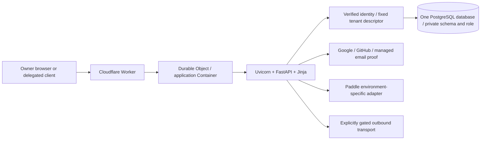

# timeKER - full current dossier and PH3 prompt handoff

Snapshot 2026-10-18; reviewed candidate `4bb5c424d6e7d270cdca1479283896be77d581c3`. Generated reading copy of
the canonical index and sixteen chapters. Private PH2 production prelaunch is
technically verified; personal enrollment/catalog/plan choice and UAT remain pending.
PH3 feature prompts follow; permanent PROD and Stage retain separate custody.
No product test, database operation or deployment is performed by generation.

# timeKER — current codebase dossier and PH3 prompt handoff

Snapshot **2026-10-18**, candidate `4bb5c424d6e7d270cdca1479283896be77d581c3`. Ed Lopez has approved a bounded private PH2 production prelaunch under D076. The candidate uses Paddle Sandbox and existing fixed-owner Google enrollment; generic/public/email-public/Stage onboarding stay false, and Live/Sending jobs stay disabled. Production migration, deployment and hosted readback are technically verified. Personal Google proof/acknowledgment, owner catalog verification/plan choice and UAT remain pending. PH3 feature prompts still follow this release.

This is a descriptive public review snapshot. Canonical contracts remain in the
application repository. No implementation, provider activation, data mutation,
human acceptance or production authority follows from this package.

## Exact provenance

| Item | Current snapshot |
| --- | --- |
| Analyzed source | `edlopezpm-ops/timeKER-Stage`, branch `main`, commit `4bb5c424d6e7d270cdca1479283896be77d581c3` |
| Frozen PH2 baseline | `39bcde0e99e8993d4de861a9c0c1da56a9e8e9a6`, tag `ph2-closeout-2026-10-18` |
| Candidate lineage | Includes frozen PH2, the bounded private prelaunch changes and original PROD main/retained draft ancestry; preserves the reviewed current tree |
| Last verified Stage source | `e282985ea74e89e1665351c22f91706498495e93`, Stage 29; release readback 2026-10-18T03:42:14.067017+00:00 |
| Last verified schema | `ph3_009_read_indexes`, nine actual runtime schemas; five quarantines retained |
| Stage URL | https://stage-timeker.aekr.io |
| Retained original production baseline | `edlopezpm-ops/timeKER-PROD`, historical main `dfb2538ec81d07f1c91fdf2bdc5096d4d0313609`; retained in candidate ancestry. New private production deployment technically verified |
| Production URL | https://timeker.aekr.io |
| Inventory | 506 tracked paths; 294 Python files; 180 literal route decorators; 54 mapped class/table declarations; 49 Settings fields; 90 Jinja templates; 1118 declared test functions |
| Generation | Fresh offline AST/TOML/JSON/Git inventories. Database structure inherits the original empty PostgreSQL18.4 reconstruction after 45 structural inputs were checked unchanged; no new DDL/database/product-test execution |

Source pointers are pinned to the analyzed commit and actual one-based lines.
Private source links can require repository access; the narrative and complete
inventories here support documentation review without pretending code access.
Runtime facts are retained dated receipts, not live continuous monitoring.

## Read the dossier

Use [timeKER-FULL-DOSSIER.md](timeKER-FULL-DOSSIER.md) for one continuous reading
copy, or the chapters below. The dated 2026-10-18 combined copy has identical bytes.

| Chapter | Content |
| --- | --- |
| [Architecture and stack](01-architecture-and-stack.md) | Monolith, edge/container/database topology, workers, read paths and public-file caching. |
| [Data model and transactions](02-data-model-and-transactions.md) | Owner/schema boundaries, exact minutes/money, immutable artifacts and transaction protocols. |
| [Product and workflows](03-product-and-user-workflows.md) | Current complete navigation/business flows, lifecycle, pagination, native choices and cache refresh. |
| [Authentication and admission](04-authentication-registration-and-access.md) | Existing/new owners, immutable proof, linking, finite slots, session/CSRF/CAPTCHA and actual gaps. |
| [Integrations and effects](05-integrations-and-external-effects.md) | MCP/scopes, imports, token lifecycle, separate delivery channels, Sandbox and jobs. |
| [Deployment and operations](06-deployment-and-operations-sop.md) | Current retained Stage 29/schema 009, safe SOP, custody, recovery and authorized private prelaunch with technical execution verified and personal acceptance still pending. |
| [Security, privacy and evidence](07-security-privacy-quality-and-evidence.md) | Controls, exact source-bound test/release attribution, historical failures and unverified acceptance. |
| [PH2 closure and PH3 continuation](08-PAUSE-AND-CONTINUE.md) | Current continuation; administrative closure and all transferred P2/EXT residuals. |
| [Improvement review](09-improvement-review-guide-and-open-decisions.md) | Current delivered baseline, remaining decisions and bounded review priorities. |
| [Routes and templates](10-http-routes-and-templates.md) | Complete offline literal route-decorator and Jinja inventories. |
| [Models/configuration/dependencies](11-models-configuration-and-dependencies.md) | Complete mapped-class/field, Settings, migration and lockfile appendices. |
| [Source/test manifest](12-source-map-tests-and-manifest.md) | Every tracked source path with raw-byte hash and complete static test/module catalogs. |
| [Production/Stage differences](13-production-stage-differences.md) | Exact source-tree comparison and dated environment differences; permanent repositories, exact candidate lineage and verified bounded production execution. |
| [PH3 prompt-refresh brief](14-phase3-prompt-refresh-brief.md) | Instructions and acceptance boundaries for revising the owner-supplied PH3 prompts. |
| [Complete database reference](15-database-reference.md) | All tables/columns, schemas and unknown live names, relationship map, final SQL functions/triggers, procedures inventory and native metadata/DDL exports. |
| [Code flow and maintenance](16-code-flow-and-maintenance.md) | Module flowcharts, exact function/transaction/error traces, browser flow, troubleshooting maps and complete Python AST symbol/call-site index. |

## Current delivery truth

Original D052–D058 feature modules exist. Remaining P2-01 actual MCP/two-owner/
token lifecycle, P2-02 human Stage UAT and P2-03 operational/recovery decisions
are explicitly transferred. Later Apple/offboarding, actual Sandbox lifecycle,
commercial owner UAT, Sending selection, personal prelaunch enrollment/acceptance and later public/Live gates remain separate. The bounded technical prelaunch readback is verified.
Stage follow-ups include work-record/client lifecycle, consistent pagination and
status, stable visible Project IDs, weekly Timecards summaries, Dashboard
fixed-five details/rhythm, K navigation, measured read-path performance, native
reference choices and Settings public-file refresh. Review these existing flows
before proposing them as new PH3 work.

Retained full base source 3e1d564 passed 2,153 backend/296 browser cases; final
Settings source e282985 passed 8 backend/4 browser focused cases and 7 static checks.
These source-bound denominators are not added as one unique-feature count.
Stage 29 readback passed 31 anonymous GETs/15 matching source assets. Separate schema 009
proof retained 486 business-table fingerprints across nine schemas. Human UAT,
hosted restore, actual external MCP and paid-PROD readiness remain unestablished.

Administrative closure verified 28 archive batches/8,149files with raw hashes and
inverse maps, recoverable Quoting checkout custody, independent PH3 Git storage
and 500 unchanged tracked raw-file hashes. The generic scaffold validator still
rejects unchanged mandatory product AGENTS; the Project Map passed. Local
custody is not off-host recovery. Current tests/migrations/contracts remain active.

## Integrity and limitations

[source-snapshot-manifest.json](source-snapshot-manifest.json) pins all source
paths/raw bytes/hashes and Git blob IDs. [PACKAGE-MANIFEST.json](PACKAGE-MANIFEST.json)
and [SHA256SUMS.txt](SHA256SUMS.txt) bind current review-package files.
[PACKAGE-VERIFICATION.json](PACKAGE-VERIFICATION.json) records actual package checks, inherited local reconstruction and current limits. Package integrity is not product correctness, security
certification, UAT, deployment or recovery proof.

No private archives, business records, actual uploaded contracts, environment
credentials, session tokens, invoice PDFs, backup/key material or machine-local
paths are published. Historical dated entry names are small compatibility pointers;
the previous dossier remains recoverable in this repository's Git history.

<!-- timeker-final-release-evidence -->
## Verified private prelaunch and remaining personal actions

The bounded private PH2 production prelaunch is technically verified under D076. The deployed runtime is `5b0fb0d29f506d04e4a6af3ebd8a193089af7214`, with both retained production schemas at `ph3_009_read_indexes`. Paddle remains Sandbox; generic/public/email-public/Stage onboarding, Live and Sending jobs remain false. Existing inbound Mail capture remains enabled. Personal fresh Google proof, explicit acknowledgment, owner catalog verification/plan choice and human UAT remain pending. PH3 feature prompts still follow; no future feature prompt has been implemented.

GitGuardian remains failed for the known historical transport test fixture: its password is fake, but the fixture references an actual Stage project rather than a placeholder. The signal is retained and is not reported as a passing check. Supabase Preview is SKIPPED because this branch lacks a Supabase Branch association; this does not replace the separately verified production database/readiness evidence.

Exact runtime/image, preservation, local recovery and qualified QA evidence are in [chapter06](06-deployment-and-operations-sop.md#9-verified-private-ph2-production-prelaunch).
<!-- /timeker-final-release-evidence -->

<!-- timeker-final-repository-promotion -->
## Permanent repositories and completed promotion

Both permanent GitHub `main` branches now resolve to `4bb5c424d6e7d270cdca1479283896be77d581c3`, tree `e0dd4c64d603b3e8c551342395b9683389821f25`. The annotated baseline tag `ph2-prelaunch-2026-10-18` peels to the same checkpoint on both repositories. Promotion evidence: [PROD PR](https://github.com/edlopezpm-ops/timeKER-PROD/pull/3) (merged `2026-10-18T16:49:42Z`), [Stage PR](https://github.com/edlopezpm-ops/timeKER-Stage/pull/5) (merged `2026-10-18T16:49:56Z`). The active Stage work branch is `codex/ph3-stage`. Old Stage PRs2/3 are closed with their branches retained; no Stage PR remains open at the recorded handoff. Frozen PH2 remains `39bcde0e99e8993d4de861a9c0c1da56a9e8e9a6`.

The final documentary checkpoint keeps all244 raw runtime-file hashes identical to the tested/deployed runtime `5b0fb0d29f506d04e4a6af3ebd8a193089af7214`. Shared Git lineage does not merge production and Stage databases, provider configuration or identity custody. The permanent repositories remain [timeKER-Stage](https://github.com/edlopezpm-ops/timeKER-Stage) and [timeKER-PROD](https://github.com/edlopezpm-ops/timeKER-PROD); future feature prompts continue on Stage.
<!-- /timeker-final-repository-promotion -->

---

# 01 — Architecture and stack

## Review baseline

This chapter describes the source prepared for Phase 3 on 2026-10-18. The
reviewed source is `edlopezpm-ops/timeKER-Stage` commit `4bb5c424d6e7d270cdca1479283896be77d581c3`, branch
`main`, derived from the closed PH2 tag `ph2-closeout-2026-10-18`
at `39bcde0e99e8993d4de861a9c0c1da56a9e8e9a6`. Permanent repositories are timeKER-Stage and timeKER-PROD; PH3 names the next feature scope, not a temporary repository.

The owner authorized the bounded private PH2 production prelaunch. Production migration/deployment/readback are technically verified; PH3 feature prompts follow on Stage. Execution is supported by the separate release records; approval alone does not establish personal enrollment, human UAT, public/Live readiness or hosted recovery. This dossier is a source review, not an
instruction to merge, configure a provider, migrate a database or deploy.

Last retained hosted evidence identifies Stage 29, runtime source `e282985`, and
schema head `ph3_009_read_indexes`. These facts come from canonical records;
this refresh did not contact Stage or run application tests. The later reviewed prelaunch delta changes bounded configuration/provider/capability behavior; its bounded private production activation and readback are technically verified.

Sources: [continuation boundary](https://github.com/edlopezpm-ops/timeKER-Stage/blob/4bb5c424d6e7d270cdca1479283896be77d581c3/CONTINUE.md),
[closeout](https://github.com/edlopezpm-ops/timeKER-Stage/blob/4bb5c424d6e7d270cdca1479283896be77d581c3/docs/PHASE2_CLOSEOUT.md),
`docs/STATUS.md`, `HOSTING.md`.

## 1. System shape

timeKER is one deployable application and one PostgreSQL database per
environment. FastAPI serves same-origin HTML and endpoints; Jinja renders values
calculated by Python services. HTMX and small local scripts progressively enhance
native links and forms. It is not a SPA, ERP, payroll system or tax engine.



The Durable Object provides Container identity and lifecycle management. Its
platform SQLite declaration is not a second business database. There is no
Redis, Celery, Kafka, independent inference backend or business microservice split.
New owners consume finite operator-prepared schema/role slots; requests never
create databases, schemas or roles. One tenant permanently means one owner/user.
Clients, projects and cases are records inside that owner's workspace.

Sources: `AGENTS.md`, `app/tenancy.py`, `app/admission.py`,
`deploy/cloudflare/src/index.ts`, `docs/PROJECT_BRIEF.md`.

## 2. Declared stack and packaging

| Area | Layer | Current source declaration | Key details |
| --- | --- | --- | --- |
| Python | Backend | `>=3.12`; Docker build/runtime use `python:3.13-slim` | Language for application services, business rules and request handling. The minimum supported version and container version are distinct declarations. |
| Packaging | Build / tooling | `uv.lock`, Hatchling; application package `timeker` version `0.1.0` | uv locks dependencies; Hatchling builds the Python package. Deployment installs locked runtime dependencies. |
| Application | Backend / UI / frontend | FastAPI, Uvicorn, Jinja2, vendored HTMX | FastAPI handles routes; Uvicorn serves ASGI; Jinja2 renders the UI on the server; HTMX updates page fragments in the browser. Same-origin, progressively enhanced pages; no SPA. |
| Persistence | Backend / data | Synchronous SQLAlchemy 2, psycopg 3, PostgreSQL, Alembic | SQLAlchemy and psycopg access PostgreSQL; Alembic versions schema changes. Business records and immutable issued artifacts persist in the database. |
| Authentication/security | Backend / security | Authlib, HTTPX, ItsDangerous, cryptography | OAuth integration, provider HTTP requests, signed values and encryption. Identity proof, workspace authorization and provider activation remain separate controls. |
| Documents | Backend / PDF | WeasyPrint; pypdf for test text inspection | WeasyPrint renders PDFs on the server; pypdf extracts text during tests to inspect content and totals. |
| Time/configuration | Backend / configuration | tzdata, python-dotenv; explicit environment configuration | IANA time-zone data and environment loading. Business time zones remain explicit; technical timestamps use UTC. |
| Verification | QA / tooling | pytest, Ruff, mypy, Playwright and vendored axe | Backend tests, linting, static type checks, browser flows and accessibility checks. Tool availability does not establish that a test was executed. |
| Edge | Infrastructure / edge | Cloudflare Workers/Containers SDK, TypeScript, Wrangler | A TypeScript Worker proxies requests to the Python container; the Container SDK manages its lifecycle. Wrangler is the operator CLI. |
| Local development | Development environment / tooling | Docker Compose and operator/local CLI commands | Local application/database services and explicit setup or maintenance commands. Development configuration is separate from hosted Stage and production. |

Exact locked versions and configuration declarations belong to chapter 11 and
the source lockfiles. A declared or locked version is not a live-process query.
Docker copies uv `0.13.0`, installs with `uv sync --locked --no-dev`, and supplies
Pango/Harfbuzz/fonts for PDF rendering. The application runs under an
unprivileged user on port 8000 with Uvicorn access logging disabled.

The image does not migrate the database at startup. Local Compose uses a
separate migration service; hosted migrations/grants are separately operated.
The production and Stage Worker profiles are distinct. Build/package inputs
explicitly select product directories; private governance, environment files,
browser sessions, generated output and archives are outside release content.

Sources: `pyproject.toml`, `uv.lock`, `Dockerfile`, `compose.yaml`,
`.dockerignore`, `deploy/cloudflare/package.json`.

## 3. Edge and Container pipeline

The Stage Worker validates environment combinations against its canonical origin,
database/TLS target, identity registry, provider flags and prepared-slot inventory.
Missing or incompatible configuration fails closed. Secret values are neither
needed nor reproduced in this public review package.

Ingress requires the canonical HTTPS origin, rejects upgrades, and blocks public
access to decoded internal/contact surfaces in the Stage profile. The proxy
removes caller forwarding, identity and hop-by-hop headers, then constructs the
trusted origin/forwarding information itself. Relevant authentication POSTs
receive a recomputed HMAC-derived network key rather than a caller-selected key.

The fixed Container listens on 8000 and sleeps after ten idle minutes. Active
requests and streams renew activity. Startup waits for the application port with
a bounded 60-second budget and request cancellation. Responses stream; a dropped
stream cannot be replayed as a new response. Bounded failures return unavailable
without exposing provider errors or request/business content.

The Stage adapter enables proxy-header handling only behind this controlled
ingress. The standalone Docker command disables proxy headers. Stage declares
one basic Container and a maximum of one instance; deployment scaling is not
introduced by the performance changes.

Stage source now includes the Case-only `17 2 * * *` schedule. Its configured
presence does not prove an actual scheduled run. Scheduled statement Sending
remains disabled; the Case schedule is not permission to activate it.

Sources: `deploy/cloudflare/src/proxy.ts`,
[Stage entrypoint](https://github.com/edlopezpm-ops/timeKER-Stage/blob/4bb5c424d6e7d270cdca1479283896be77d581c3/deploy/cloudflare/src/index.ts#L6),
`deploy/cloudflare/src/stage-archive.ts`, `deploy/cloudflare/wrangler.jsonc`.

## 4. Request, authentication and tenant boundaries

`create_app` assembles frozen base settings, the tenant registry, request-scoped
settings/database/contact facades, public asset fingerprints, authentication,
privacy handling and routers. Public OpenAPI/Swagger/ReDoc endpoints are disabled.
Startup readiness runs outside the event loop and engines are disposed at shutdown.

Application-added incoming middleware is effectively:

```text
request_context → SessionMiddleware → TrustedHostMiddleware → TenantMiddleware
  → framework routing/dependencies → endpoint → services/data access
```

Request context assigns a UUID, records a sanitized terminal outcome/duration,
and applies security/cache headers. Hosted cookies are Secure, HttpOnly,
SameSite=Lax signed sessions with a one-hour lifetime. Signing is not encryption;
sessions carry bounded identity/flow correlation, not passwords/provider tokens.
Protected requests recheck the active owner, retained immutable provider binding
and session revision. Enrollment can restrict access until explicit acknowledgment
and first-plan requirements are satisfied.

Tenant selection follows verified server-side mappings. ContextVar state is
bound and reset per request; connection factories have fixed schema/role identity.
Default public/auth infrastructure routing grants no default-owner business
access. Delegated credentials supply only a locator before their digest,
grant, scope, expiry and revocation are authenticated.

Ordinary owner mutations validate CSRF, bounded forms and applicable origin
checks, then execute within `sessionmaker.begin()` in a worker. Specialized
webhooks, upload, OAuth and dispatch routes define their own explicit boundaries.
Business audit writes share the business transaction; diagnostics are separate.

Sources: `app/main.py:118`, `app/main.py:196`, `app/main.py:379`,
`app/auth.py`, `app/tenancy.py:469`, `app/enrollment.py`.

## 5. Persistence and performance architecture

SQLAlchemy uses synchronous connections with `pool_pre_ping`, bounded pool
sizes, zero overflow, a ten-second pool timeout, hidden SQL parameters and
`expire_on_commit=False`. Tenant factories verify actual database role/schema
on connection. Runtime roles do not own schema objects or migrate them.

The delivered performance changes reduce repeated work without caching
authorization, private pages or business decisions:

- Billing lists, reports and Dashboard reuse grouped unreversed-payment totals.
  Mutations still obtain fresh checks under their transaction/locks.
- Dashboard's enhanced request prepares only its selected detail group. Complete
  top counts/totals remain full-scope; each displayed group uses five rows.
- Quoting hydrates page-level revision, line and artifact metadata in batches;
  binary PDF columns stay deferred until an authorized artifact operation.
- Timecard history support queries use visible card IDs rather than loading
  unrelated history relationships.
- Tenant/admission readiness batches relation, role, privilege and empty-slot
  checks while retaining current database checks rather than caching decisions.
- Blocking GET, readiness and admission-directory units run in framework workers
  with request-local tenant context and Session ownership. A Session is not
  handed among concurrently executing tasks.
- Migration 009 adds stable recent-list indexes for invoices, audit events and
  active Mail. It does not rewrite business records or add a search engine.

`/health/live` is the cheap process probe used by Docker. `/health/ready` performs
explicit deeper schema/role/admission checks and reports a bounded ready or
unavailable result. Current expected head is `ph3_009_read_indexes`.

Sources: `app/db.py`, `app/main.py:739`, `app/billing.py:475`,
`app/reports.py:108`, `app/quoting.py:404`, `app/tenancy.py:348`,
`alembic/versions/ph3_009_read_indexes.py`.

## 6. Browser rendering, assets and references

Startup hashes known public assets once. Canonical `?v=<sha256>` GET/HEAD
responses with successful status use immutable public caching and no Set-Cookie.
Unversioned known assets revalidate. Incorrect versions, errors and private
responses remain no-store; owner content is never included in that public cache.
Dashboard fragments explicitly retain `private, no-store` and the appropriate
HTMX Vary headers.

Settings' Clear cache refreshes a fixed inventory of 22 versioned same-origin
public files with omitted credentials, three workers and a 20-second attempt
timeout. It drains response bodies, verifies public immutable policy, reports
accessible progress/failure and permits retry. It preserves unsaved forms and
sign-in; it neither clears all browser/CDN caches nor reloads running scripts.

Country/currency choices come from vendored ISO reference data; IANA timezone
choices come from local tzdata. Native selects preserve explicit defaults,
optional blanks, submitted errors and existing legacy values. No remote lookup,
locale-based country inference or inferred legal/tax fact is introduced.

Sources: `app/static_assets.py`, `app/reference_choices.py`,
`app/web/templates/components.html`, `app/web/templates/settings.html`,
`app/web/static/settings_cache.js`, `app/web/static/workspace.js`.

## 7. Domain modules and effects

| Domain | Principal source boundaries under `app/` |
| --- | --- |
| Clients/projects/cases | `clients.py`, `client_sources.py`, `cases.py`, `work_lifecycle.py` |
| Weekly time/import | `timecards.py`, `time_commands.py`, `time_import.py` |
| Financial statements | `billing.py`, `project_billing_routes.py`, `reports.py`, `pdf.py` |
| Estimates/private documents | `quoting.py`, `library.py`, their routes/models |
| Two outbound workflows | `sending.py` and separately `proposal_sending.py` |
| Individual plans/provider ledger | `subscriptions.py`, `subscription_billing.py`, `paddle.py` |
| Identity/admission | `auth.py`, `social_auth.py`, `email_auth.py`, `admission.py` |
| Delegated tools | `integration_auth.py`, `integration_routes.py`, `client_drafts.py` |
| Retained custody | `archiving.py`, `mail_service.py`, `project_attachments.py` |
| Shared controls | `settings.py`, `privacy.py`, `contact.py`, `logging.py`, `audit.py` |

PDF rendering uses escaped allowlisted templates and denies external/local asset
fetches. Published artifacts are retrieved from retained bytes with integrity
checks. Encrypted sensitive settings require tenant-specific key custody.
Diagnostics allow only bounded operational fields; business audit content,
identity details, notes, credentials and artifact bytes stay out of logs.

For PH3 proposals, retain these boundaries and identify the exact source path,
affected tenant/transaction, user-visible behavior and needed evidence. Residual
assistant proof, human UAT, recovery/custody, provider lifecycle rehearsal and
personal enrollment/acceptance and later public/Live readiness remain open in `docs/STATUS.md`; the bounded private prelaunch readback is verified.

---

# 02 — Data model and transaction semantics

## Review baseline

This chapter describes declarations and service behavior at source `4bb5c424d6e7d270cdca1479283896be77d581c3`
in `edlopezpm-ops/timeKER-Stage`, the reviewed private-prelaunch candidate branch. PH2 is administratively
closed at tag `ph2-closeout-2026-10-18` / `39bcde0`; the retained Stage runtime
is Stage 29 / `e282985`. The expected migration head is
`ph3_009_read_indexes`. The initial general dossier refresh queried no database,
real record, key or provider. The later [complete database reference](database/README.md)
reconstructs all 26 migrations in a new empty local database and provides all 55
physical table layouts, 90 foreign keys and final SQL definitions. It queried no
hosted database or business records.

The entity catalog below is explanatory. Chapter 11 supplies the complete
declaration index; source models/migrations remain authoritative. Historical
`ph2_` and `ph3_` migration prefixes are permanent identifiers, not the current
delivery phase or instructions to rerun migrations.

Sources: [models](https://github.com/edlopezpm-ops/timeKER-Stage/blob/4bb5c424d6e7d270cdca1479283896be77d581c3/app/models.py),
`app/db.py`, `docs/PHASE2_CLOSEOUT.md`, `docs/STATUS.md`.

## 1. Physical tenancy and ownership

One PostgreSQL database holds isolated private schemas and fixed runtime roles.
The server resolves a verified identity or authenticated delegated grant to a
registered tenant descriptor. Requests cannot select arbitrary schema names,
database URLs or roles. Each connection checks its actual role/schema; runtime
roles cannot create or own application objects or obtain reciprocal tenant access.

Tenant-local `User` is the active owner. Business entities generally inherit a
UUID primary key and UTC created/updated timestamps from `Entity`. Human-facing
object numbers are separate database-generated identifiers. Several parent rows
have explicit SQLAlchemy optimistic version columns; row locks and database
constraints additionally protect shared mutations.

The central admission directory records retained immutable subjects and prepared
workspace allocation. It lives in the same database, with separate directory
semantics; it is not a shared business-record pool. Admission uses an explicitly
prepared finite inventory and cross-transaction recovery states rather than
privileged runtime provisioning.

Sources: `app/models.py:47`, `app/tenancy.py`, `app/repositories.py`,
`app/admission_models.py`, `app/admission_operations.py`,
`app/workspace_operations.py`, `scripts/postgres-runtime-grants.sql`.

## 2. Entity groups and relationships

| Group | Entities and retained purpose |
| --- | --- |
| Owner/configuration | `User`, `AppSettings`, `Audit`; active identity, settings and business history |
| Client/project | `Client`, `Contact`, `ClientSourceReference`, `Project`, `ProjectAgreement` |
| Recorded work | `Timecard`, `TimeEntry`, `Case`, `CaseTimeAllocation` |
| Statements/payments | `Invoice`, `InvoiceLine`, `Reservation`, `Artifact`, `Payment`, `CreditMemo` |
| Imported/contributed time | `TimeImportRecord`, `TimeContribution`, `TimeOperation` |
| Delegated integration | `IntegrationGrant`, `IntegrationCode`, `IntegrationToken`, `IntegrationOperation`, `ClientDraft` |
| Individual subscription | `WorkspaceSubscription`, `SubscriptionOperation` |
| Provider subscription ledger | `BillingAccount`, `BillingOperation`, `BillingEvent` |
| Tenant-local enrollment | `OwnerIdentity`, `OwnerRegistration`, `EmailAuthChallenge` |
| Central admission | `WorkspaceAdmission`, `AdmissionIdentity`, `PublicEmailChallenge` |
| Statement collections | `SendingPreferences`, `SendingPlan`, `SendingDelivery`, `SendingAttempt` |
| Estimates | `Quote`, `QuoteRevision`, `QuoteLine`, `QuoteArtifact` |
| Private documents | `LibraryDocument`, `LibraryUpload`, `LibraryDocumentVersion` |
| Commercial-document outbox | `ProposalSendingDelivery`, `ProposalSendingAttempt` |
| Mail custody | `MailMessage`, `MailAddress`, `MailAttachment` |
| Support abuse admission | `ContactAttempt`; bounded reservation/digests, not support-message storage |

Relationships retain UUID associations: client → project → case; weekly card →
entry; entry ↔ case through allocated integer minutes; invoice → lines,
reservations, artifacts and payments. A case requires its real client and project.
A quotation revision is bound to its case/client/project context. Library
documents can optionally reference that context without becoming agreements.

`ClientSourceReference` retains one owner-provided URL or bounded uploaded file
per client. It provides evidence custody without automatic URL fetching or
conversion into authoritative legal/tax facts. Project agreement bytes and
published commercial/financial artifacts have separate immutable custody.

Sources: `app/models.py`, `app/*_models.py`; chapter 11 lists each concrete
model source file and declaration.

## 3. Current identity, lifecycle and work invariants

Client states are `draft`, `active`, `archived`; there is no Client Closed
state. Service validation normalizes new/edited codes to exactly four uppercase
ASCII letters. Incomplete clients can remain Draft. Activation validates the
required profile and active-plan capacity; it is not legal verification.

Project states are `draft`, `active`, `closed`, `archived`. Project types are
`time_and_materials`, `fixed_fee`, `on_call_support`, `on_demand_support_tm`
and `on_demand_support_ff`. Optional budget/currency and agreement type/reference
must form valid pairs. Human-facing Project ID is stored `object_id + 9999`,
so the first displayed value is 10000; UUID and stored identity are unchanged.

Cases have generated numbers starting at 10001, an optional retained legacy
number, explicit type and status, bounded description, owner/client/project and
lifecycle timestamps. Their statuses are Open, In progress, Waiting, Resolved,
Closed. Flexible fields are JSONB extension values validated by shared services.

Timecards store Monday service-week dates, owner, client or internal scope,
status, total integer minutes and optimistic version. Ordinary and internal
scopes have separate uniqueness/association rules. Internal work is nonbillable
and may omit a project; optional internal case links remain validated.

TimeEntry stores one project/day cell or internal day cell, integer minutes,
category, description, billable flag and optional Decimal rate override. Case
allocations reference existing entries; their aggregate cannot exceed recorded
minutes. Allocation is attribution, not additional billable time or money.

Parent close/archive transitions disclose consequences and require confirmation.
Open child projects/cases and linked nonempty Draft timecards block unsafe
transitions. Work history is retained rather than cascaded away. Reactivation
can consume active-plan capacity and must revalidate it.

Sources: `app/models.py:69`, `app/models.py:112`, `app/models.py:184`,
`app/models.py:233`, `app/record_references.py`, `app/clients.py`,
`app/forms.py`, `app/work_lifecycle.py`, `app/flexfields.py`.

## 4. Money, time and derived financial state

Money uses Python Decimal and PostgreSQL NUMERIC; financial services reject
binary floats. Billable duration is stored as integer minutes. Accepted decimal
hour input must resolve to whole minutes; H:MM is supported. A daily entry is
bounded by 24 hours, and a card by a seven-day week.

Time-based line amounts aggregate exact minutes at the applicable rate before
rounding the monetary result with decimal half-up rounding. Weekly periods run
Monday–Sunday in the configured IANA contract timezone. Browser-local decorative
time is separate from those service dates and business-day calculations.

The original verified client contract uses a combined 20-hour weekly cap, no
minimum and America/Santiago service weeks. These are contract data. No tax,
withholding, bank detail, legal identifier, exchange rate or gross-up value may
be invented. A commercial statement is not an official Chilean SII tax document.

Invoice stored states are Draft, Issued, Sent and Void. Partially Paid, Paid and
Overdue are derived from dates and unreversed payments. List/report services
batch exact payment sums for one read set; this does not become a stale Session
cache or replace current transactional checks during mutation.

Fixed-fee/manual-extra lines have zero synthetic time and rate. Their amount and
commercial metadata record an explicit project charge. A partial unique index
prevents two nonvoid base fixed-fee claims; manual extras retain a distinct
project/reference claim and explicit overbilling authorization.

Sources: `app/domain.py`, `app/billing.py:118`, `app/billing.py:150`,
`app/billing.py:475`, `app/models.py:280`, `app/models.py:341`,
`app/project_terms.py`, `docs/contracts/ALCO_CONTRACT_SOURCE_NOTES.md`.

## 5. Transaction boundaries

### Ordinary writes and concurrent work

Ordinary form mutations enter one database transaction in a framework worker.
Authorization/CSRF precede the service call. Optimistic versions detect stale
edits; required row locks serialize finalization, allocation, reservation,
issuance and payments. Numbering/capacity advisory locks apply before relevant
resource locks. Individual services preserve their documented lock order.

Weekly saves preserve retained entry identities and source contributions.
Reduction/removal cannot silently discard allocated or imported work. Finalize
locks the card, verifies version, contract limits and explicit override evidence.
Reopen is allowed only when billing reservations and other guards permit it.
Void is a retained historical state, not deletion.

Import preview validates bounded JSON/CSV before explicit commit. Source and
record identity, canonical payload digests, operation keys, contribution versions
and retained receipts distinguish replay from changed content. Corrections target
the contributing source within an editable Draft; they do not overwrite another
source's minutes or mutate Finalized/Invoiced history.

Sources: `app/main.py:379`, `app/repositories.py`, `app/timecards.py`,
`app/time_commands.py`, `app/time_import.py`, `app/time_command_models.py`.

### Drafts, issuance, payments and cancellation

A time draft reserves eligible unreserved entries from the requested dates.
Reservations use entry identity as a unique claim, preventing double billing.
A card already labeled Invoiced may still contain other unreserved eligible
entries for a different period; the label is not a substitute for reservation
checks. Project-based drafts use the separate commercial claims described above.

Issuance rechecks project/currency/budget conditions and explicit commercial-term
confirmation. In one transaction it records issue date, JSON snapshot, stored
PDF bytes, SHA-256, renderer version, state changes and audit. Later download
verifies stored bytes; draft preview can render anew. Operational sent/due-date
changes cannot rewrite frozen content.

Payments are positive, within the current issued balance, in invoice currency,
and dated within the allowed business interval. A payment can stop related
Sending. Reversal retains the original row and requires a reason. Full issued
cancellation retains an immutable credit memo and original artifact; it requires
the permitted payment state and releases reservations/claims through guarded
logic. Draft cancellation is distinct from an issued credit.

Sources: `app/billing.py:201`, `app/billing.py:396`, `app/billing.py:458`,
`app/billing.py:572`, `app/billing.py:608`, `app/billing.py:658`,
`app/credit_memo_models.py`.

### Identity, admission, quotas and provider operations

OwnerIdentity binds immutable issuer/subject, never an unverified email merge.
OwnerRegistration retains explicit terms/privacy/catalog versions and selected
offer. Challenges retain bounded state, expiry and attempts; no app-owned
password store is introduced. Public challenge destination custody is encrypted.

WorkspaceAdmission and AdmissionIdentity coordinate directory reservation,
tenant-local bootstrap and activation across explicit transactions. Their
reserved/pending/active/blocked/revoked states allow incomplete work to fail
closed. Runtime never falls back to another owner's workspace.

Subscription capacity uses a tenant-wide transaction advisory lock. Counts cover
active clients and active projects under active clients; project limits are
tenant totals. Operation receipts protect bounded retries. The SaaS provider
ledger is distinct from service-statement payments and commercial documents.

Paddle operations and signed events retain mode-specific identity, digests,
idempotency and observed outcomes. Database commits cannot atomically guarantee
an external provider action; uncertain outcomes require reconciliation rather
than an invented success. Sandbox evidence cannot activate Live.

Sources: `app/enrollment_models.py`, `app/admission_models.py`,
`app/admission.py`, `app/subscriptions.py`, `app/subscription_billing.py`,
`app/subscription_billing_models.py`.

### Publication, sending and retained custody

Quote publication and Library publication freeze snapshots, PDF bytes, hashes
and version identity. Revisions preserve the prior published record; originals
remain separate from rendered versions. Binary upload/artifact fields are
deferred on normal lists. Explicit authorized downloads retrieve and verify
the requested retained file.

Statement Sending and commercial-document Sending have separate delivery and
attempt models. Preparation/confirmation, guarded claims, provider calls and
recorded terminal outcomes are explicit stages. A transport uncertainty is not
safe permission to resend. Stop, void/payment changes, environment gates and
immutable artifact identity remain enforceable at dispatch.

Mail imports retain normalized bounded content and separate immutable files,
not arbitrary remote HTML execution. Age archive is six calendar months for
timecards/Mail, with export-only custody and no automatic deletion or normal
restore. Settings retention fields record operator policy rather than deleting
history automatically.

Sources: `app/quoting.py`, `app/library.py`, `app/sending.py`,
`app/proposal_sending.py`, `app/mail_service.py`, `app/archiving.py`.

## 6. Migrations, read behavior and PH3 review

Current linear head is 009: work records/source custody/internal work and guards
arrive in 007, incomplete Client Draft lifecycle in 008, and three stable recent
list indexes in 009. Downgrade 008 refuses to erase unresolved Draft clients.
Do not rename or remove historical migrations because PH2 is closed.

The recent indexes order invoice and audit records by creation/UUID and active
Mail by owner/receipt/UUID. They do not speed every substring filter or remove
later-offset costs. Pagination preserves complete filtered counts and financial
aggregates while slicing the displayed rows; list limits never limit exports or
billing eligibility.

Database guards complement services for immutable artifacts, legal parent
associations, financial reservations, work allocations and role boundaries.
Their installed state, migration correctness and recovery require explicit
evidence; source presence alone cannot establish hosted installation.

Canonical closure carries assistant end-to-end proof, owner UAT, operational
backup/restore/custody choices and later provider rehearsals into PH3. Retained
migration-preservation evidence is attributed in `docs/STATUS.md`. The database
extension adds empty local migration/catalog/DDL checks only; it adds no hosted
migration, recovery or product-test PASS.

Sources: `alembic/versions/ph3_007_work_records.py`,
`alembic/versions/ph3_008_client_lifecycle.py`,
`alembic/versions/ph3_009_read_indexes.py`, `app/pagination.py`,
`docs/PERFORMANCE_IMPROVEMENTS_2026-10-17.md`, `docs/STATUS.md`.

---

# 03 — Product and user workflows

## Current review boundary

Source `4bb5c424d6e7d270cdca1479283896be77d581c3` on prepared `main` is the 2026-10-18 review baseline.
PH2 is administratively closed. Its private production prelaunch is technically verified; Stage continues and PH3 awaits owner prompts.

Last retained hosted evidence is Stage 29 / runtime source `e282985` /
schema `ph3_009_read_indexes`. This chapter explains source-delivered behavior;
it does not report new human UAT, new provider proof or a fresh hosted check.
Current residuals are in `docs/STATUS.md`, including actual assistant connection,
owner UAT and operational recovery/custody.

Sources: [canonical product brief](https://github.com/edlopezpm-ops/timeKER-Stage/blob/4bb5c424d6e7d270cdca1479283896be77d581c3/docs/PROJECT_BRIEF.md),
`docs/design/DESIGN_SPEC.md`, `docs/PHASE2_CLOSEOUT.md`, `CONTINUE.md`.

## 1. Product model, navigation and interaction

One private workspace belongs to one individual owner. Clients contain projects;
cases organize work inside real client/project context. Timecards record actual
minutes. Estimates describe proposed effort, Library holds private documents,
and Billing issues commercial service statements. SaaS plan billing is separate
from manually tracked client-statement payments.

The authenticated rail contains Dashboard, Clients, Projects, Timecards, Cases,
Mail, Quoting, Billing, Sending, Library, Reports, Archive, Settings and Audit
history. Environment capability gates control applicable entries and routes.
Archive remains below Reports; Timecards is below Projects and Quoting above
Billing. Production visibility must not be inferred from Stage navigation.

The ivory/teal/navy shell retains the exact timeKER wordmark, translucent cards
and decorative borderless clock. The clock shows browser-local time with a
continuous seconds hand, reduced-motion handling and static 9:00 fallback.
Contract weeks and business dates use explicit domain timezones instead.

A fixed topbar offers a centered search icon. Enhanced search opens above the
current screen, preserves underlying unsaved forms, restores focus and supports
Escape. Native `/search` remains available. Sections retain empty headings and
up to five direct links per result category.

Forms retain input/inline errors, accessible save feedback and native GET/POST.
Opened forms/details use a 44px icon-only named Back control with visible focus.
Back/forward chevrons reuse the wordmark's navy/teal K-arm geometry.

Sources: `app/web/templates/base.html`, `app/web/templates/navigation_icons.html`,
`app/web/static/workspace.js`, `app/search_routes.py`,
`app/workspace_search.py`, `docs/design/DESIGN_SPEC.md`.

## 2. Lists, references and shared status

Lists and histories use ten records by default, configurable from one to fifty
in Settings. Pagination remains inside the results card with record/page counts.
Enhanced navigation updates that card while preserving neighboring forms,
focus and scroll. Native links retain filters and support browser history.

Independent selector defaults are 50 choices per page and 1000 matching results.
List/selector limits never reduce billing eligibility, aggregates or exports.

The five Dashboard detail groups are a deliberate exception: at most five rows
each regardless of Settings. Every Status column uses shared labeled badges;
color supplements readable text. Compact histories retain date/event/detail.

Country, invoice/budget currency and service/default timezone use native
dropdowns from local reference data. Existing defaults, blank optional values,
submitted errors and historical values are preserved. The UI does not infer a
country, tax identity or contractual fact from browser locale.

Sources: `app/pagination.py`, `app/lookups.py`, `app/settings.py`,
`app/reference_choices.py`, `app/web/templates/components.html`,
`app/web/static/status.css`, `app/web/static/workspace.js`.

## 3. Landing, plans, registration and privacy

Landing provides separate Sign up/Sign in routes, concise product information,
legal/privacy panels and About plans. The center has no separate View plans
shortcut. Google, GitHub and configured managed email are supported source
methods; configuration alone does not prove successful human enrollment.
Apple remains design/preparation work.

Registration requires explicit versioned acknowledgment. An empty new workspace
requires explicit first-plan activation; an acknowledged owner with retained
client history may retain workspace access, while plan/capacity guards still
control growth. An existing identity signs in to its own
workspace; a verified new owner consumes a prepared private slot. Account
security links/revokes methods through fresh proof, never an email-string merge.

The current source catalog is Free (1 active client/1 active project, USD0),
Solo (5/10, USD7 monthly or USD70 annually), Pro (no commercial client/project
cap, USD12 monthly or USD120 annually). Projects are tenant totals. Free has no
card requirement or trial expiry. Tax/commercial acceptance and Live activation
remain separate decisions; these are source catalog terms, not a new quotation.

Cookie/privacy choices distinguish essential operation from optional usage.
Withdrawal and applicable privacy signals remain respected. Support contact,
where enabled, sends only an explicitly submitted message to the fixed operator
mailbox with CAPTCHA and durable abuse controls; Stage's public adapter gates it.

Sources: `app/web/templates/landing.html`, `app/enrollment.py`,
`app/enrollment_routes.py`, `app/subscriptions.py`, `app/privacy.py`,
`app/contact.py`, `app/web/templates/auth_methods.html`.

## 4. Dashboard

The five actionable summaries are This week hours, Draft statements, Outstanding
statements, Finalized unbilled time and Overdue statements. Complete counts,
minutes and financial totals cover their entire eligible scope. Selecting a
summary opens its own detail group with independent fixed-five paging.

Switching metric/rhythm preserves each group's page. Enhanced Previous/Next
replaces the selected detail panel only; late inactive responses cannot reopen
it or steal scroll/focus. Native GET/back/forward remains functional. Responses
are private/no-store; the optimization is reduced work, not a private-data cache.

The client workload panel shows up to four active clients with recorded hours
and project/case/timecard context over its documented 28-day period. It opens
Clients. The rhythm panel switches between fourteen daily bars and fourteen
Monday-first calendar weeks, including the current UTC week and thirteen prior
weeks. Its perimeter/heading opens Timecards, separate from chart switching.

The contribution grid retains exact daily minutes, seven weekday initials,
shared duration bins, legend and blank future padding. Weekdays use green;
weekends use violet with the same bins. Rounded cells, unequal gutters and an
opaque canvas address the reported grid illusion without changing recorded
values. Subjective comfort/visual acceptance remains an owner decision.

Sources: `app/main.py:739`, `app/dashboard.py`, `app/reports.py:108`,
`app/web/templates/dashboard.html`, `app/web/templates/dashboard_detail.html`,
`app/web/static/app.js`.

## 5. Clients, projects and cases

Clients can be searched, filtered, sorted, paged and opened for their profile,
contacts, projects, commercial terms, statements and history. Client Edit is
the normal status control: Draft, Active, Archived. New clients derive Draft
or Active from completeness. Codes are four ASCII letters, uppercase on save,
with inline duplicate feedback.

Draft permits missing activation details. Active requires basic valid profile,
Tax ID, legal representative name, billing email and contractual email, plus
available plan capacity. Missing values remain explicit; a Draft does not imply
a verified legal profile. An optional source URL/upload stays privately retained
as evidence with explicit edit/download actions, without automatic fact inference.

Projects retain name/description, real client, visible Project ID starting at
10000, lifecycle, billable/rate metadata and optional additional fields. Project
type can be Time and Materials, Fixed Fee, On Call Support or the two On Demand
support variants. Optional budget/currency and Contract/SAL/SOW reference pairs
record actual owner-provided arrangements. One private agreement upload up to
5 MiB remains immutable.

Cases retain real client/project, generated case number, type, title, bounded
description, status and optional flexible fields. Owners can review, edit and
allocate existing time entries; allocations cannot create extra time. Mass edit
uses the same validation/ownership boundaries.

Closing/archiving parents requires confirmation and checks open children or
linked nonempty Draft timecards. Closed/archived records leave normal new-work
selectors; retained work, files, billing and history remain readable through
their appropriate surfaces. Reactivation must meet capacity/lifecycle rules.

Sources: `app/clients.py`, `app/client_sources.py`, `app/project_routes.py`,
`app/project_attachments.py`, `app/record_references.py`, `app/cases.py`,
`app/case_routes.py`, `app/work_lifecycle.py`.

## 6. Weekly timecards and reviewed imports

A normal card belongs to one owner/client/Monday-start week with project/day
cells. Internal time can omit client/project, optionally link an owned case and
is always nonbillable. H:MM and exact-minute decimal-hour input persist integer
minutes. Notes remain optional sensitive business content.

Load week restores active-project structure. Owners can add/select/remove unused
Draft rows without deleting projects or protected work. Duplicate copies the
structure into the next week with empty durations. Save Draft, Finalize and
audited Reopen retain version/cap/reservation rules. Above-cap finalization needs
an explicit owner reason and authorization reference. Historical Voided cards
remain readable; new timecard voiding is prohibited.

The four top tiles now show Ongoing timecards, Ongoing projects, Fill rate and
the decorative local clock. Counts cover the viewed Monday–Sunday week across
all owner clients/internal work, excluding voided/archived scope and earlier-week
carry. Saved empty Drafts count as cards; projects count distinct real IDs with
entries in the scoped week. Fill rate shows Draft and Finalized counts, not a
percentage; Invoiced counts as Finalized. Zero is explicit. Current-card status
and unsaved/read-only feedback stay beside the editor.

JSON/CSV import provides preview before explicit commit. Strict source records,
payload hashes, idempotency keys and contribution receipts support replay and
bounded Draft corrections. Imported or allocated time cannot be silently
overwritten by another source, reduced below protected allocations or changed
after finalization/invoicing.

Sources: `app/main.py:1030`, `app/timecards.py:20`, `app/timecards.py:55`,
`app/time_import.py`, `app/time_import_routes.py`, `app/time_commands.py`,
`app/web/templates/timecards.html`, `app/web/static/timecards.js`.

## 7. Billing, immutable PDFs and manual payments

Owners create a time-based Draft for a client/date period from eligible finalized
unreserved work, review grouped lines and detailed time, adjust permitted draft
values, then explicitly issue. Exact minutes aggregate before monetary rounding.
Contract/source discrepancies require confirmation before issuance.

Fixed-fee and applicable support projects have an explicit base-fee action using
their stored fee/currency and service dates. A nonvoid base fee cannot be charged
twice. Manual extras require enabled overbilling, positive amount, reason and
unique reference; they do not fabricate hours or reserve time.

Draft PDF preview may regenerate. Issue freezes JSON snapshot, bytes, hash and
renderer identity. Issued downloads return those checked stored bytes; no
in-place edit is permitted. Spanish/English documents include actual supplied
details, exact totals and the commercial-statement qualification. Missing legal,
tax or bank values are never invented.

Mark as sent records delivery and default due date; due corrections require an
audited reason. Owner-entered payments use statement currency, allowed date and
current balance. Reversal preserves history. Paid/partial/overdue displays are
derived. Draft cancellation differs from full issued cancellation, which retains
an immutable credit memo and original artifact and requires permitted payment
state before releasing billing claims.

Sources: `app/billing.py`, `app/project_billing_routes.py`, `app/pdf.py`,
`app/credit_memo_models.py`, `app/web/templates/invoice.html`.

## 8. Quoting, Library and two outbound workflows

Quoting supports effort-only HLEs and optionally priced T&M/fixed estimates.
A working estimate requires a case, deriving its client/project. Create service
case opens the existing form with Services selected and returns to the composer.
Min/max integer-minute ranges, assumptions, exclusions and validity remain
owner-edited. An estimate creates neither actual work nor an invoice.

Publish retains an immutable revision/snapshot/PDF/checksum. Editing a published
estimate begins a new revision. Library holds working SOW/SLA/agreement wording,
reusable templates and complete owner uploads in PDF/DOCX/TXT/Markdown up to
5 MiB. Working documents require case context; reusable templates may be unbound.
Editable text, retained originals and published versions remain distinct.

Commercial Sending reviews one published estimate/Library version or explicitly
selected retained original with recipient, subject, body and exact attachment.
It has its own manual outbox, durable claim, attempt history, stop and guarded
retry. It does not schedule collections or record client payments.

Issued-statement Sending separately binds a reviewed unpaid immutable statement,
recipient and rendered text. Follow-ups are opt-in/bounded and stop on payment,
void, individual Stop or Stop all. Early follow-up uses a fresh explicit review
while retaining its original schedule. Partial payment stops the plan; reversal
does not resume it. Definitive rejection may permit explicit retry; uncertain
provider acceptance must not replay. Provider acceptance is not recipient reading.
Scheduled statement jobs remain disabled and actual sends need separate authority.

Sources: `app/quoting.py`, `app/quoting_routes.py`, `app/library.py`,
`app/library_routes.py`, `app/proposal_sending.py`, `app/sending.py`.

## 9. Mail, archive and reports

Mail imports bounded owner-selected .eml content with explicit client/optional
project/case association. Normalized text/headers and separate immutable files
remain private; original MIME is not retained. Sender/Date are unverified
reference data, not work approval. Capture addresses are revocable and configured;
the feature is not full inbox synchronization or an outbound mail client.

Timecards/Mail older than six calendar months become export-only Archive records.
Timecards use service-week end in contract timezone; Mail uses trusted receipt or
explicit historical receipt, not sender Date. This is retained custody, not
deletion, backup, statutory policy or a restore-to-normal-screen action.
Financial relationships and eligible finalized unbilled work remain preserved.

Reports retain monthly client hours, billable work estimates, finalized unbilled
time, statement aging and CSV. Display pagination does not truncate totals or
exports. Fixed fees remain separate from hourly estimates.

Sources: `app/mail_service.py`, `app/mail_routes.py`, `app/archiving.py`,
`app/archive_routes.py`, `app/reports.py`.

## 10. Settings, integrations and next decisions

Settings manages issuer details, encrypted payment instructions, PDF language/
paper/footer, defaults, independent list/selector limits and recorded retention
policy. It links Subscription, Assistant connections, Client drafts, readiness
and audit; secrets are never shown. Clear cache explicitly refreshes 22 known
versioned public app files, preserving sign-in, data and unsaved forms. It shows
progress/retry and native help; it does not automatically reload the page.

Subscription exposes current individual plan/capacity and explicit Sandbox
checkout/change/portal actions. Contextual upgrade controls do not block unrelated
work. First Solo-monthly Sandbox purchase has retained provider evidence; annual,
3DS, changes, cancellation/retention and renewal failure/grace need rehearsal.
A synthetic Stage Pro grant is not paid-provider evidence or a PROD entitlement.

Assistant connections use scoped OAuth/MCP/API access and operator-registered
clients. Proposed clients remain owner-reviewed drafts. Actual platform/tool
discovery, reciprocal owner isolation and refresh/revocation remain carried
residuals; source implementation does not prove a human assistant session.

PH3 prompts should build from these delivered workflows, name genuine gaps and
retain acceptance boundaries. Human UAT, grid comfort, latest performance/Settings
acceptance, Apple/offboarding, operational recovery and private prelaunch verification and later public/Live
PROD readiness remain open. No new implementation or rollout follows from this
review package.

Sources: `app/settings.py`, `app/web/templates/settings.html`,
`app/web/static/settings_cache.js`, `app/subscription_routes.py`,
`app/integration_routes.py`, `app/client_drafts.py`, `docs/STATUS.md`.

---

# 04 — Authentication, registration and access

Source snapshot: **2026-10-18**, PH3 commit
`4bb5c424d6e7d270cdca1479283896be77d581c3` on `main`.
PH2 is administratively closed at tag `ph2-closeout-2026-10-18`
(commit `39bcde0e99e8993d4de861a9c0c1da56a9e8e9a6`). PH3 is prepared and
awaits the owner's feature prompts on Stage. The bounded PH2 private production prelaunch is now authorized; migration/deployment/readback are technically verified; personal enrollment remains pending.

This chapter describes source and retained evidence. Preparing this public
reference did not authenticate, send a code, accept an agreement, query a database,
change a provider or deploy. Source readiness is separate from human acceptance.
[Current continuation](https://github.com/edlopezpm-ops/timeKER-Stage/blob/4bb5c424d6e7d270cdca1479283896be77d581c3/CONTINUE.md#L1) and
[residuals](https://github.com/edlopezpm-ops/timeKER-Stage/blob/4bb5c424d6e7d270cdca1479283896be77d581c3/docs/STATUS.md#L94) govern the handoff.

## 1. Current authentication surface

Google, GitHub and managed Supabase email are implemented sign-in methods.
Their configuration and visibility do not prove that every real owner/provider
combination has completed sign-in, linking and recovery. Apple remains deferred:
there is no implemented Apple runtime adapter/callback or exposed method.

| Capability | Source boundary | Retained Stage state |
| --- | --- | --- |
| Google | OIDC proof through Authlib, configured client and hosted checks | Configured; normal human proof remains required |
| GitHub | OAuth code/state/S256 plus fresh verified API identity | Configured; no repository permission is requested |
| Managed email | Explicit Supabase provider and pinned service configuration | Configured; OTP remains owner-controlled |
| Generic onboarding | Explicit capability; default off | Stage admission uses its retained directory |
| Public signup | Separate flag and finite prepared inventory | Stage only, subject to readiness and available slots |
| Email public signup | Separate capability layered over local admission | Does not follow merely from email sign-in configuration |
| Local login | Explicit development option | Rejected in hosted profiles |
| Apple | Design/deferred work | Unimplemented/unverified |

Definitions: [configuration](https://github.com/edlopezpm-ops/timeKER-Stage/blob/4bb5c424d6e7d270cdca1479283896be77d581c3/app/config.py#L41),
[provider visibility](https://github.com/edlopezpm-ops/timeKER-Stage/blob/4bb5c424d6e7d270cdca1479283896be77d581c3/app/social_auth.py#L17),
[provider registration](https://github.com/edlopezpm-ops/timeKER-Stage/blob/4bb5c424d6e7d270cdca1479283896be77d581c3/app/main.py#L174).
Dossier generation made no production override query. Actual observed production
overrides come from the separately retained release/control-plane receipts;
checked-in defaults and historical Stage facts do not replace that evidence.

## 1.1. Approved private production prelaunch

D076 selects production canonical origin with `TIMEKER_PRELAUNCH_ENABLED=true` and `paddle_sandbox`. Generic onboarding, public signup, email-public signup and Stage onboarding are false; Paddle Live and Sending jobs stay disabled. Closed production remains the default. The flag includes prelaunch in `enrollment_active`, reusing the existing fixed-owner branch rather than public admission. Sources: [app/config.py](https://github.com/edlopezpm-ops/timeKER-Stage/blob/4bb5c424d6e7d270cdca1479283896be77d581c3/app/config.py#L183), [app/config.py](https://github.com/edlopezpm-ops/timeKER-Stage/blob/4bb5c424d6e7d270cdca1479283896be77d581c3/app/config.py#L203), [deploy/cloudflare/src/proxy.ts](https://github.com/edlopezpm-ops/timeKER-Stage/blob/4bb5c424d6e7d270cdca1479283896be77d581c3/deploy/cloudflare/src/proxy.ts#L131), [docs/DECISIONS.md](https://github.com/edlopezpm-ops/timeKER-Stage/blob/4bb5c424d6e7d270cdca1479283896be77d581c3/docs/DECISIONS.md#L1102).

1. A configured fixed owner personally starts normal Google authentication with CSRF/CAPTCHA and fresh provider proof.
2. With generic onboarding false, the callback resolves the existing production registry and active local owner. It does not allocate a public slot or create an arbitrary new tenant.
3. An owner without a retained local identity proceeds only through the existing pending registration path; fresh immutable issuer/subject proof and explicit versioned acknowledgment establish the normal binding/registration. Existing conflicting/revoked or differently linked histories are not silently overwritten.
4. Workspace readiness and first-plan checks remain in force. Sandbox provider confirmation, rather than a checkout return, controls a paid test entitlement.

No operator backfill, accepted terms, copied Stage identity, synthetic grant or old browser session substitutes for personal proof. Public/generic launch still needs complete active-owner identity coverage and prepared admission capacity. Sources: [app/main.py](https://github.com/edlopezpm-ops/timeKER-Stage/blob/4bb5c424d6e7d270cdca1479283896be77d581c3/app/main.py#L615), [app/enrollment.py](https://github.com/edlopezpm-ops/timeKER-Stage/blob/4bb5c424d6e7d270cdca1479283896be77d581c3/app/enrollment.py#L179), [tests/integration/test_prelaunch_auth.py](https://github.com/edlopezpm-ops/timeKER-Stage/blob/4bb5c424d6e7d270cdca1479283896be77d581c3/tests/integration/test_prelaunch_auth.py#L1). These are source traces and test definitions; actual production enrollment/UAT remains pending.

## 2. Identity and workspace invariants

The product uses one owner/user per private workspace. Clients, Projects and
Cases are business records within it, not additional SaaS members. There is no
implemented team membership, shared-owner account, arbitrary workspace switch or
owner-transfer product.

The authentication key is immutable **issuer + subject**. A verified email is
an identity claim and contact attribute; it is not sufficient authority to merge
accounts or link a different provider. Google uses its OIDC subject, GitHub its
numeric account ID, and managed email the verified provider UUID and fixed issuer.

The central identity directory locates a candidate tenant. Authentication then
rechecks the exact active local identity and active owner. A directory locator
alone cannot authorize a workspace; no unmatched identity falls back to the
default owner's schema.
[Local authentication](https://github.com/edlopezpm-ops/timeKER-Stage/blob/4bb5c424d6e7d270cdca1479283896be77d581c3/app/auth.py#L36),
[directory resolution](https://github.com/edlopezpm-ops/timeKER-Stage/blob/4bb5c424d6e7d270cdca1479283896be77d581c3/app/admission.py#L64) and
[identity validation](https://github.com/edlopezpm-ops/timeKER-Stage/blob/4bb5c424d6e7d270cdca1479283896be77d581c3/app/enrollment.py#L30) enforce these boundaries.

The legacy generic-off Google compatibility path still checks its configured
allowlist and existing owner row. It is separate from generic admission. Later
generic/public activation requires independently verified immutable-owner coverage;
private fixed-owner prelaunch uses personal fresh Google proof and explicit
registration instead of pre-bootstrap coverage. Email matching must not silently
bootstrap the new directory.
[Legacy owner check](https://github.com/edlopezpm-ops/timeKER-Stage/blob/4bb5c424d6e7d270cdca1479283896be77d581c3/app/auth.py#L19),
[bootstrap gate](https://github.com/edlopezpm-ops/timeKER-Stage/blob/4bb5c424d6e7d270cdca1479283896be77d581c3/docs/OPERATIONS.md#L197).

## 3. Existing owner, new owner and linking are separate flows

| User intent | Required behavior | Evidence still needed |
| --- | --- | --- |
| Existing owner | Sign in through an already linked immutable identity | Human sign-in/recovery on the correct private workspace |
| New owner | Explicit signup, verified proof, available prepared slot, acknowledgment and first-plan activation | Fresh end-to-end admission with a separate fictional owner |
| Add a method | Authenticate existing owner freshly, then prove the new method through Account security | Real dual-proof linking and subsequent sign-in/revocation |
| Recover access | Use a retained linked method or separately authorized operator procedure | Human recovery exercise; no automatic email merge |

An email-only account is not automatically linked when someone later presses
Google on Sign up. The safe supported route is an already linked sign-in, then
Account security and fresh independent proof of the additional provider.
[Admission](https://github.com/edlopezpm-ops/timeKER-Stage/blob/4bb5c424d6e7d270cdca1479283896be77d581c3/app/admission.py#L142) and
[explicit linking](https://github.com/edlopezpm-ops/timeKER-Stage/blob/4bb5c424d6e7d270cdca1479283896be77d581c3/app/admission.py#L225) retain that distinction.

## 4. Entry pages, CSRF and the shared challenge

`/sign-in` and `/sign-up` render distinct native forms. The selected method start
supplies an explicit intent, offer, closed return value and notice versions.
A query-string page view does not allocate a workspace, accept terms or select a
paid subscription. GET provider-start URLs return to the entry flow; POST starts
perform CSRF, origin, form-shape and anti-bot checks.
[Flow selection](https://github.com/edlopezpm-ops/timeKER-Stage/blob/4bb5c424d6e7d270cdca1479283896be77d581c3/app/enrollment_routes.py#L20) and
[provider start](https://github.com/edlopezpm-ops/timeKER-Stage/blob/4bb5c424d6e7d270cdca1479283896be77d581c3/app/main.py#L484) are the source boundaries.

One shared Cloudflare Turnstile widget serves the independent method forms.
Only the chosen form receives its current solved token. Expiration or consumption
requires a new token. The direct social flow verifies success, expected action
and exact canonical hostname server-side; provider errors fail closed.
[Server verification](https://github.com/edlopezpm-ops/timeKER-Stage/blob/4bb5c424d6e7d270cdca1479283896be77d581c3/app/bot_check.py#L13) and
[shared controller](https://github.com/edlopezpm-ops/timeKER-Stage/blob/4bb5c424d6e7d270cdca1479283896be77d581c3/app/web/static/auth_challenge.js#L1).

Managed email deliberately passes the token to Supabase, which owns that CAPTCHA
verification. Consuming the same token locally first would replay it at the
provider. A shared widget is not permission to reuse one token across attempts.
[Email send boundary](https://github.com/edlopezpm-ops/timeKER-Stage/blob/4bb5c424d6e7d270cdca1479283896be77d581c3/app/email_auth.py#L128).

The pre-authentication CSRF value survives a provider-start session reset so a
retained form in another open tab does not lose that token prematurely. Successful
authentication still replaces session state and rotates CSRF. This correction is
source-backed; it does not prove the precise sequence behind an earlier report.
[Pre-auth preservation](https://github.com/edlopezpm-ops/timeKER-Stage/blob/4bb5c424d6e7d270cdca1479283896be77d581c3/app/main.py#L533),
[session issuance](https://github.com/edlopezpm-ops/timeKER-Stage/blob/4bb5c424d6e7d270cdca1479283896be77d581c3/app/enrollment_routes.py#L36).

## 5. Google and GitHub proof

Google uses Authlib OIDC discovery and validation, an ID token and verified claims.
GitHub uses code/state/S256 and fixed token/API endpoints; fresh `/user` and
verified email API responses establish its numeric identity. `user:email` is the
requested GitHub scope, without repository access. Provider tokens are transient
backend proof and are not persisted as the app's session or account password.
[Google/GitHub setup](https://github.com/edlopezpm-ops/timeKER-Stage/blob/4bb5c424d6e7d270cdca1479283896be77d581c3/app/main.py#L174),
[GitHub proof](https://github.com/edlopezpm-ops/timeKER-Stage/blob/4bb5c424d6e7d270cdca1479283896be77d581c3/app/social_auth.py#L28).

The callback validates the exact issuer, routes immutable identities, rechecks
local binding and owner, records only eligible notice evidence, then chooses a
registration, subscription, Account security or Dashboard destination.
[Callback implementation](https://github.com/edlopezpm-ops/timeKER-Stage/blob/4bb5c424d6e7d270cdca1479283896be77d581c3/app/main.py#L566).

The visible recovery message is deliberately broad. Its catch-all covers proof,
linking, routing and operational failures. It cannot by itself prove a particular
OAuth-console error or `AUTH_PROVIDER_NOT_LINKED`. Capacity exhaustion separately
returns bounded temporary-unavailability feedback. Diagnose only with fresh
normal reproduction and sanitized request/event evidence.
[Failure classification](https://github.com/edlopezpm-ops/timeKER-Stage/blob/4bb5c424d6e7d270cdca1479283896be77d581c3/app/main.py#L662).

## 6. Managed email challenge lifecycle

The app delegates sending and verification to the configured Supabase service.
Existing invited-user confirmation resend and ordinary OTP are explicit delivery
choices. Public provider-account creation requires the separate enabled signup
capability; an existing-account action must not quietly create a new owner.
[Delivery modes](https://github.com/edlopezpm-ops/timeKER-Stage/blob/4bb5c424d6e7d270cdca1479283896be77d581c3/app/email_auth.py#L24).

An OTP verification response is not trusted solely for its embedded user object.
The backend fetches fresh provider `/user` proof, checks confirmed matching email,
rejects anonymous identities and normalizes the provider UUID subject.
[Verification](https://github.com/edlopezpm-ops/timeKER-Stage/blob/4bb5c424d6e7d270cdca1479283896be77d581c3/app/email_auth.py#L152).

Challenges bind purpose, intent/offer, session nonce, expiry and attempt count.
The public-admission path retains encrypted submitted address and keyed session/
network digests in its directory challenge. Fixed-owner challenges remain scoped
to that owner. The stored state is not an OTP vault. The local challenge window
is ten minutes and verification attempts are bounded; stale or consumed proof
must be replaced through a normal new flow.
[Owner challenge](https://github.com/edlopezpm-ops/timeKER-Stage/blob/4bb5c424d6e7d270cdca1479283896be77d581c3/app/email_auth.py#L180),
[public challenge](https://github.com/edlopezpm-ops/timeKER-Stage/blob/4bb5c424d6e7d270cdca1479283896be77d581c3/app/admission.py#L322).

The challenge view exposes only its session's escaped submitted destination.
Repeated start handling preserves a valid pending challenge when appropriate;
ordinary entry-page refresh is not a resend instruction. The user personally
reads and enters codes. Neither this dossier nor an assistant may retrieve an
inbox, extract OTPs or bypass identity proof to complete acceptance.
[Email flow controller](https://github.com/edlopezpm-ops/timeKER-Stage/blob/4bb5c424d6e7d270cdca1479283896be77d581c3/app/enrollment_routes.py#L359).

## 7. Versioned acknowledgment and first plan

The entry flow captures exact current notice/Terms/Privacy/catalog versions.
After successful immutable identity proof, the eligible sign-in/signup notice
can create the retained registration acknowledgment. A failed provider flow,
ordinary page view or link-only action does not create that acknowledgment.
[Notice capture and recording](https://github.com/edlopezpm-ops/timeKER-Stage/blob/4bb5c424d6e7d270cdca1479283896be77d581c3/app/enrollment.py#L179).

Flows missing the current notice use the explicit Continue registration fallback;
legacy acknowledgment compatibility remains validated by the service. No agent
accepts the notice for a person. Referencing the catalog does not itself buy a
plan, authorize a charge or assert commercial/legal eligibility.
[Registration acceptance](https://github.com/edlopezpm-ops/timeKER-Stage/blob/4bb5c424d6e7d270cdca1479283896be77d581c3/app/enrollment.py#L218).

An empty new workspace requires acknowledgment and explicit first-plan activation.
For acknowledged retained workspaces, `workspace_ready` also permits existing
Client history without assigning a plan, and preserves history after verified
paid access expires. Capacity guards independently block unsupported growth;
history access never creates an implicit Free plan. Free activation has its own
operation key, capacity lock and state checks; paid plans use the separate
subscription flow. Pending registration may expose bounded registration/security/
subscription recovery surfaces without granting ordinary business access.
[Retained-history readiness](https://github.com/edlopezpm-ops/timeKER-Stage/blob/4bb5c424d6e7d270cdca1479283896be77d581c3/app/enrollment.py#L126),
[Free activation](https://github.com/edlopezpm-ops/timeKER-Stage/blob/4bb5c424d6e7d270cdca1479283896be77d581c3/app/enrollment_routes.py#L231),
[workspace gate](https://github.com/edlopezpm-ops/timeKER-Stage/blob/4bb5c424d6e7d270cdca1479283896be77d581c3/app/auth.py#L87).

## 8. Account security and revocation

Sensitive linking requires fresh existing-owner context, normally within ten
minutes, plus independent new-method proof. Generic admission reserves the global
subject and checks the local binding. The older fixed-owner compatibility path
has its additional managed-email proof restriction. Email text is never enough.
[Freshness](https://github.com/edlopezpm-ops/timeKER-Stage/blob/4bb5c424d6e7d270cdca1479283896be77d581c3/app/enrollment_routes.py#L64),
[social link proof](https://github.com/edlopezpm-ops/timeKER-Stage/blob/4bb5c424d6e7d270cdca1479283896be77d581c3/app/main.py#L514).

Revocation is explicit and cannot remove the final usable sign-in method through
an ordinary convenience action. Local identity history and directory state are
retained. Reauthentication/session revision and method revocation are separate
from deleting an account, legal offboarding or removing retained financial data.
[Identity revocation](https://github.com/edlopezpm-ops/timeKER-Stage/blob/4bb5c424d6e7d270cdca1479283896be77d581c3/app/admission.py#L266),
[local invariant](https://github.com/edlopezpm-ops/timeKER-Stage/blob/4bb5c424d6e7d270cdca1479283896be77d581c3/app/enrollment.py#L157).

## 9. Sessions and owner authorization

Hosted sessions use a signed `__Host-timeker-session` cookie, one-hour lifetime,
Secure/HttpOnly/SameSite=Lax, host-only scope and Path `/`. Signing provides
integrity, not secrecy. The session contains bounded identity/routing state;
provider tokens, OTPs and private business documents do not belong in it.
[Session middleware](https://github.com/edlopezpm-ops/timeKER-Stage/blob/4bb5c424d6e7d270cdca1479283896be77d581c3/app/main.py#L160).

Each protected request checks the actual active owner, selected tenant, canonical
email association, current session revision and retained provider binding where
enrollment is active. Logout is a CSRF-protected POST. Browser business mutations
require session CSRF and same-origin validation; signed machine routes and OAuth
callbacks have their distinct correlation/authentication contracts.
[Principal checks](https://github.com/edlopezpm-ops/timeKER-Stage/blob/4bb5c424d6e7d270cdca1479283896be77d581c3/app/auth.py#L51),
[form validation](https://github.com/edlopezpm-ops/timeKER-Stage/blob/4bb5c424d6e7d270cdca1479283896be77d581c3/app/auth.py#L109).

## 10. Finite tenant allocation and readiness

Each workspace has an operator-prepared private PostgreSQL schema and restricted
runtime role. New-owner admission reserves an exact finite slot through the
central directory, initializes that identity in the selected workspace, reads it
back, and activates the retained mapping. Partial failure preserves reservation
identity; retries reconcile it rather than reallocating another owner's slot.
[Reserve/initialize/activate](https://github.com/edlopezpm-ops/timeKER-Stage/blob/4bb5c424d6e7d270cdca1479283896be77d581c3/app/admission.py#L142).

There is no runtime DDL, admin-credential path, schema creation on demand, default
workspace fallback or email-based account merge. Readiness checks actual configured
relations, privileges, role boundaries and prepared inventory. Quarantined schemas
are not routable slots. Nine actual schemas at migration 009 is a historical
verified inventory, not a claim of nine currently free signup slots.
[Registry](https://github.com/edlopezpm-ops/timeKER-Stage/blob/4bb5c424d6e7d270cdca1479283896be77d581c3/app/tenancy.py#L1),
[retained environment](https://github.com/edlopezpm-ops/timeKER-Stage/blob/4bb5c424d6e7d270cdca1479283896be77d581c3/HOSTING.md#L207).

## 11. Required PH3 evidence

P2-02 remains normal human Stage sign-in/signup/link/recovery UAT with existing and
newly admitted fictional owners and explicit private-workspace checks. P2-01 adds
actual assistant OAuth/tool discovery and token lifecycle; source/unit tests do
not close those external-client gates. Apple/account deletion/offboarding remain
EXT-01, with real-provider prerequisites and acceptance still open.
[Transferred residuals](https://github.com/edlopezpm-ops/timeKER-Stage/blob/4bb5c424d6e7d270cdca1479283896be77d581c3/docs/STATUS.md#L94).

Record the exact client surface, fresh proof, expected destination, durable
readback and accept/reject result. A public page, HTTP 200/303, installed plugin,
expired OTP, generic callback message or prior source receipt is insufficient.
PH3 feature prompts and any later public/Live production activation remain separate decisions.

---

# 05 — Integrations and external effects

Source snapshot: **2026-10-18**, PH3 commit
`4bb5c424d6e7d270cdca1479283896be77d581c3`.
PH2 is administratively closed; PH3 is prepared on `main` and awaits
owner prompts. Existing Stage continues. One current reviewed production candidate
now carries the owner-approved private PH2 prelaunch; migration/deployment/readback are technically verified. This documentation refresh performed no
provider call, send, charge, database operation, authentication or deployment.
[Continuation](https://github.com/edlopezpm-ops/timeKER-Stage/blob/4bb5c424d6e7d270cdca1479283896be77d581c3/CONTINUE.md#L1).

## 1. Distinct integration authorities

| Surface | Implemented boundary | Current acceptance/activation limit |
| --- | --- | --- |
| Google/GitHub/email | User authentication and explicit linking | Normal human proof/UAT remains open |
| OAuth/MCP/API | Delegated, scoped owner business tools | Actual external-client acceptance remains P2-01 |
| Time import | Reviewed bounded JSON/CSV Draft contributions | Does not finalize cards or bill automatically |
| Managed auth email | Supabase-controlled verification delivery | Authentication SMTP is a separate custody domain |
| Support contact | Fixed operator destination and durable abuse controls | Separate environment-specific enablement |
| Statement Sending | Reviewed issued-statement delivery and bounded follow-ups | Scheduled Sending remains disabled |
| Commercial Sending | Explicit selected published quote/document version | Separate ledger/review; no automatic collections |
| Inbound mail | Bounded import or signed capture into an owned context | Capture activation remains separately controlled |
| Paddle | The owner's software subscription | Sandbox proof is not Live merchant readiness |
| Case retention | Signed Stage-only Case archive job | Configured schedule; actual invocation unobserved |

Configuration is not a blanket permission to perform an external effect. Business
intent, current owner authority, immutable artifact/version, provider readiness
and environment-specific gates remain independent.
[Capabilities](https://github.com/edlopezpm-ops/timeKER-Stage/blob/4bb5c424d6e7d270cdca1479283896be77d581c3/app/config.py#L35).

## 2. Delegated OAuth and the actual MCP subset

The existing application exposes authorization-server/protected-resource metadata,
`/oauth/authorize`, `/oauth/token`, `/oauth/revoke`, `/mcp` and the same bounded
business tools through `/api/integration/tools/{name}`. The bridge reuses the
application's services, ownership checks and transactions; it is not a second
backend or an inference proxy.
[OAuth public router](https://github.com/edlopezpm-ops/timeKER-Stage/blob/4bb5c424d6e7d270cdca1479283896be77d581c3/app/integration_routes.py#L668),
[API transport](https://github.com/edlopezpm-ops/timeKER-Stage/blob/4bb5c424d6e7d270cdca1479283896be77d581c3/app/integration_routes.py#L864).

MCP is a finite stateless JSON Streamable HTTP subset. Supported protocol strings
are `2025-03-26`, `2025-06-18` and `2025-11-25`. The route validates media type,
Accept headers, Origin, protocol, JSON-RPC shape and a 32 KiB body limit. It accepts
bounded initialization, ping, tool discovery/calls and specific notifications.
There is no implemented SSE/session-stream service or automatic client registration.
[MCP constants](https://github.com/edlopezpm-ops/timeKER-Stage/blob/4bb5c424d6e7d270cdca1479283896be77d581c3/app/integration_routes.py#L45),
[request validation](https://github.com/edlopezpm-ops/timeKER-Stage/blob/4bb5c424d6e7d270cdca1479283896be77d581c3/app/integration_routes.py#L891).

### Scopes and tools

| Scope | Exposed tools | Mutation boundary |
| --- | --- | --- |
| `clients:read` | `search_clients` | Read actual owned client/project identities |
| `clients:draft` | `create_client_draft` | Proposed client only; no active publication |
| `cases:read` | `list_open_cases`, `get_case` | Read actual owned Cases |
| `cases:write` | `create_case`, `edit_case`, `close_case` | Confirmed, versioned Case changes |
| `time:read` | `list_time_entries` | Explicit week and actual contribution versions |
| `time:write` | `create_time_entry`, `edit_time_entry`, `delete_time_entry` | This connection's Draft contributions only |
| `bills:read` | `list_bills`, `get_bill`, `list_credit_memos` | Read bounded statements/memos; no issuer-bank settings |
| `dashboard:read` | `get_week_summary` | Recorded data for an explicit week |

These are eight scopes and fifteen tools, not an unrestricted CRUD interface.
No tool finalizes a timecard, issues/voids a statement, records/refunds a payment,
purchases a plan, sends email or grants another owner access.
[Scope definitions](https://github.com/edlopezpm-ops/timeKER-Stage/blob/4bb5c424d6e7d270cdca1479283896be77d581c3/app/integration_auth.py#L24),
[tool catalog](https://github.com/edlopezpm-ops/timeKER-Stage/blob/4bb5c424d6e7d270cdca1479283896be77d581c3/app/integration_routes.py#L61).

### Consent, routing and token lifecycle

Clients are operator-registered with exact fixed HTTPS callbacks; wildcards,
credential-bearing redirects and dynamic public registration are rejected.
Authorization uses code flow with mandatory PKCE S256, bounded state, exact
requested scopes and resource audience. The consent page identifies the selected
client/callback. RFC9207 issuer identification supports the registered shared
callback without weakening redirect matching.
[Client validation](https://github.com/edlopezpm-ops/timeKER-Stage/blob/4bb5c424d6e7d270cdca1479283896be77d581c3/app/integration_auth.py#L147),
[authorization contract](https://github.com/edlopezpm-ops/timeKER-Stage/blob/4bb5c424d6e7d270cdca1479283896be77d581c3/app/integration_auth.py#L197).

Credentials are opaque; database records hold hashes. Their selector can locate
only a fixed trusted tenant descriptor. It does not make a submitted tenant ID,
email or assistant argument authoritative. Each use rechecks the credential hash,
expiry, owner activity, registered client, resource and current grant/scopes.
[Access authentication](https://github.com/edlopezpm-ops/timeKER-Stage/blob/4bb5c424d6e7d270cdca1479283896be77d581c3/app/integration_auth.py#L231).

Access tokens last 600 seconds. Authorization codes last five minutes; grants and
refresh lifetime are bounded to 30 days. Refresh credentials rotate; replay of used
code/refresh material revokes the relevant grant rather than silently renewing it.
Owner revocation is retained and subsequent access fails closed.
[Grant/code lifecycle](https://github.com/edlopezpm-ops/timeKER-Stage/blob/4bb5c424d6e7d270cdca1479283896be77d581c3/app/integration_auth.py#L323),
[refresh replay](https://github.com/edlopezpm-ops/timeKER-Stage/blob/4bb5c424d6e7d270cdca1479283896be77d581c3/app/integration_auth.py#L385),
[token persistence](https://github.com/edlopezpm-ops/timeKER-Stage/blob/4bb5c424d6e7d270cdca1479283896be77d581c3/app/integration_auth.py#L484).

### Confirmed writes and replay

Write calls require `confirmed=true`, stable idempotency identity and relevant
optimistic versions. Time commands preserve source-owned contributions and manual/
other-source minutes. Case/proposed-client operations retain a grant-local key and
canonical payload digest: an exact replay returns the result; a conflicting reuse
fails. A tool result's business text is explicitly untrusted data, not an
instruction or new authorization.
[Write implementation](https://github.com/edlopezpm-ops/timeKER-Stage/blob/4bb5c424d6e7d270cdca1479283896be77d581c3/app/integration_routes.py#L515),
[shared call boundary](https://github.com/edlopezpm-ops/timeKER-Stage/blob/4bb5c424d6e7d270cdca1479283896be77d581c3/app/integration_routes.py#L591).

### Actual client evidence still missing

The private connection package and Settings onboarding exist. Source/local tests
cover protocol, scope, isolation and replay behavior. They do not establish a
completed real ChatGPT/Claude/client connection. OpenAI is the selected first
client in the documented contract; Dot/voice support is not inferred.
[Connection decision](https://github.com/edlopezpm-ops/timeKER-Stage/blob/4bb5c424d6e7d270cdca1479283896be77d581c3/docs/DECISIONS.md#L520).

P2-01 requires normal human OAuth Allow, actual tool discovery, bounded reads by
two fictional owners, reciprocal isolation, confirmed idempotent Draft correction,
refresh rotation and revocation stopping the real client's access. Record the
actual host/client surface. Installing a plugin or making a synthetic bearer
request cannot substitute for this evidence.
[Residual P2-01](https://github.com/edlopezpm-ops/timeKER-Stage/blob/4bb5c424d6e7d270cdca1479283896be77d581c3/docs/STATUS.md#L98).

## 3. Reviewed imports and contribution provenance

The canonical import format is `timeker.daily-time-import.v1`, with strict UTF-8
JSON or exact CSV columns, a 256 KiB payload ceiling and 200-entry limit. Stable batch
and source-record IDs bind replay. Entries use actual owned client/project IDs,
explicit work dates, integer minutes and bounded Case allocation; services enforce
timezone, project and weekly-cap rules.
[Import parser](https://github.com/edlopezpm-ops/timeKER-Stage/blob/4bb5c424d6e7d270cdca1479283896be77d581c3/app/time_import.py#L1).

Preview exposes labels, totals, conflicts and versions before an atomic Draft-only
commit. Populated-cell conflicts do not silently merge/overwrite manual work.
Contribution corrections retain source provenance and versions. No import infers
authorization, reopens finalized history, overrides contract caps, finalizes a
card, creates an invoice or starts an external send.
[Import contract D054](https://github.com/edlopezpm-ops/timeKER-Stage/blob/4bb5c424d6e7d270cdca1479283896be77d581c3/docs/DECISIONS.md#L472).

## 4. Email channels have separate custody

Authentication email belongs to the managed provider. The app requests the
configured verification action; the owner enters the code. Supabase authentication
SMTP credentials must not be extracted or repurposed for outbound business email.
[Managed email](https://github.com/edlopezpm-ops/timeKER-Stage/blob/4bb5c424d6e7d270cdca1479283896be77d581c3/app/email_auth.py#L101).

Support contact is a separate fixed-operator channel, with bounded user-submitted
content, CSRF, contact-action CAPTCHA, durable quotas and duplicate/uncertain-send
protection. It is not an arbitrary relay or a statement distribution endpoint.
[Contact controller](https://github.com/edlopezpm-ops/timeKER-Stage/blob/4bb5c424d6e7d270cdca1479283896be77d581c3/app/contact.py#L1).

### Statement Sending

Statement Sending selects an eligible issued statement and its retained PDF/hash,
uses reviewed editable templates and recipient, and stores a delivery plan/history.
It does not regenerate or alter issued PDFs, invoice dates/terms, payment records
or receipt dates. Provider acceptance is not client receipt, inbox placement or
payment. Client payment tracking remains manual.
[Statement service](https://github.com/edlopezpm-ops/timeKER-Stage/blob/4bb5c424d6e7d270cdca1479283896be77d581c3/app/sending.py#L1).

A durable uncertain claim is committed before provider I/O. If a result is
ambiguous, the system retains uncertainty instead of automatically trying again.
Known retryable failures have bounded explicit retry; owner Stop, payment and
void eligibility stop applicable follow-ups. Rechecks and locks protect current
eligibility near the effect boundary.
[Stop/retry](https://github.com/edlopezpm-ops/timeKER-Stage/blob/4bb5c424d6e7d270cdca1479283896be77d581c3/app/sending.py#L288),
[dispatch](https://github.com/edlopezpm-ops/timeKER-Stage/blob/4bb5c424d6e7d270cdca1479283896be77d581c3/app/sending.py#L513).

The transport uses separate configured outbound credentials. No undocumented
provider idempotency guarantee is assumed. A scheduled internal endpoint exists,
but `sending_jobs_enabled` remains false in retained Stage configuration. Manual
reviewed dispatch and future scheduled activation are different decisions.
[Transport](https://github.com/edlopezpm-ops/timeKER-Stage/blob/4bb5c424d6e7d270cdca1479283896be77d581c3/app/sending_transport.py#L1),
[job gate](https://github.com/edlopezpm-ops/timeKER-Stage/blob/4bb5c424d6e7d270cdca1479283896be77d581c3/app/internal_routes.py#L20).

### Quoting, Library and commercial Sending

Commercial Sending selects an immutable published quote or Library artifact and
its exact attachment/hash, reviews the addressed content and uses a separate
commercial outbox. HLE publication does not require inventing a contract; working
commercial documents retain their owned Case/project association.
[Commercial service](https://github.com/edlopezpm-ops/timeKER-Stage/blob/4bb5c424d6e7d270cdca1479283896be77d581c3/app/proposal_sending.py#L100).

This path has its own review digest, explicit confirmation, attempt history,
uncertain claim and stop/retry rules. Publishing an estimate/document never
sends it automatically, creates time, invoices a client or starts collections.
Authenticated hosted creation/edit/upload/publication/send-review UAT remains
EXT-03; no real customer send is implied by simulated Sent fixture history.
[Commercial dispatch](https://github.com/edlopezpm-ops/timeKER-Stage/blob/4bb5c424d6e7d270cdca1479283896be77d581c3/app/proposal_sending.py#L230),
[transport](https://github.com/edlopezpm-ops/timeKER-Stage/blob/4bb5c424d6e7d270cdca1479283896be77d581c3/app/proposal_sending_transport.py#L1).

## 5. Inbound correspondence and archive

Manual EML import is owner-only and bounded before parsing. Conservative MIME
size/depth/part limits, escaped text, immutable attachments, sanitized forced
attachment downloads and owner-scoped raw-hash deduplication protect retained
correspondence. Sender, Message-ID and Date are untrusted content, not identity,
work authorization or archive-clock authority.
[Mail parsing/ingestion](https://github.com/edlopezpm-ops/timeKER-Stage/blob/4bb5c424d6e7d270cdca1479283896be77d581c3/app/mail_service.py#L23).

Optional capture uses a separate signed edge-to-container transport. Timestamp,
route, recipient and body hash are HMAC-bound; input is bounded and expired
signatures fail. Public proxy paths do not expose an open internal relay. A
committed response is different from a redirect or public login page.
[Internal authentication](https://github.com/edlopezpm-ops/timeKER-Stage/blob/4bb5c424d6e7d270cdca1479283896be77d581c3/app/internal_routes.py#L82).

Archive is retained export-only state, not deletion. The existing Stage schedule
is **02:17 UTC daily**, invoking only Case retention for Cases closed at least
90 days. The signed Case endpoint leaves mail/timecard archive scope untouched.
An actual scheduled invocation has not been observed; configured cron is not
execution evidence. Scheduled Sending remains disabled.
[Stage scheduler](https://github.com/edlopezpm-ops/timeKER-Stage/blob/4bb5c424d6e7d270cdca1479283896be77d581c3/deploy/cloudflare/src/index.ts#L63),
[Case-only job](https://github.com/edlopezpm-ops/timeKER-Stage/blob/4bb5c424d6e7d270cdca1479283896be77d581c3/app/internal_routes.py#L108),
[retention predicate](https://github.com/edlopezpm-ops/timeKER-Stage/blob/4bb5c424d6e7d270cdca1479283896be77d581c3/app/archiving.py#L120).

## 6. Paddle subscription effects

Paddle bills the owner's timeKER subscription. It does not charge that owner's
clients or collect issued service statements. Checkout/portal readiness, signed
webhooks, retained event identity, mode-specific provider records and service
state determine entitlement; a browser success redirect alone is insufficient.
[Provider/webhook boundary](https://github.com/edlopezpm-ops/timeKER-Stage/blob/4bb5c424d6e7d270cdca1479283896be77d581c3/app/paddle.py#L183),
[billing service](https://github.com/edlopezpm-ops/timeKER-Stage/blob/4bb5c424d6e7d270cdca1479283896be77d581c3/app/subscription_billing.py#L1).

The retained real-provider rehearsal covers a first Solo-monthly **Sandbox**
test-card purchase, signed paid event and portal Paid readback. Annual/3DS,
confirmed plan changes, cancellation/retention and failed-renewal/grace still need
bounded real-provider rehearsal. Synthetic Stage capacity and simulated manual
payments are not provider payment evidence.
[Current provider limits](https://github.com/edlopezpm-ops/timeKER-Stage/blob/4bb5c424d6e7d270cdca1479283896be77d581c3/docs/STATUS.md#L130).

Live requires independently configured Live merchant/catalog/credentials/webhooks
and explicit production capabilities. Changing environment name cannot promote
Sandbox credentials/history into Live. Mixed/foreign mode history fails closed;
Live merchant eligibility and general PROD admission remain open gates.
[Mode/capability validation](https://github.com/edlopezpm-ops/timeKER-Stage/blob/4bb5c424d6e7d270cdca1479283896be77d581c3/app/config.py#L174).

## 7. PH3 external-effect acceptance

Use exact owner-selected scope, actual client/provider mode, fresh human proof,
confirmed recipient/artifact/version and durable readback. Preserve uncertain
results; reconcile before retrying. Do not copy sessions, authentication SMTP,
Sandbox history or synthetic entitlements into production. P2-01/P2-02/P2-03 and
EXT-01 through EXT-05 remain explicit work, not approval-only bookkeeping.
[Current queue](https://github.com/edlopezpm-ops/timeKER-Stage/blob/4bb5c424d6e7d270cdca1479283896be77d581c3/docs/STATUS.md#L94).

---

# 06 — Deployment and operations SOP

Snapshot: **2026-10-18**, PH3 source `4bb5c424d6e7d270cdca1479283896be77d581c3`. PH2 is administratively closed at `39bcde0e99e8993d4de861a9c0c1da56a9e8e9a6`, tag `ph2-closeout-2026-10-18`. PH3 continues the existing Stage and awaits the owner's feature prompts. This chapter documents source and retained receipts; no operational command, provider request, database connection, deployment or customer effect was executed to produce it. Canonical entry: [CONTINUE.md:1](https://github.com/edlopezpm-ops/timeKER-Stage/blob/4bb5c424d6e7d270cdca1479283896be77d581c3/CONTINUE.md#L1); current operational record: [HOSTING.md:1](https://github.com/edlopezpm-ops/timeKER-Stage/blob/4bb5c424d6e7d270cdca1479283896be77d581c3/HOSTING.md#L1).

## 1. Current authority and operator entry

Ed Lopez authorized PH2 closeout, reversible archive, consolidation and an independent PH3 clone. The next owner prompt selects bounded PH3 feature work. Administrative preparation does not grant provider, identity, database or production authority. Preserve Stage and production services; the transition does not stop services, revoke accounts, cancel subscriptions or activate schedules. See [continuation and pending work](08-PAUSE-AND-CONTINUE.md).

Before a future authorized operation, read current AGENTS, brief, STATUS, operative decisions, design references, privacy/legal documents, HOSTING and relevant operations/deployment sections. Resolve branch, HEAD, dirty state, source/image, target environment, inventory and receipt ownership. Dated historical examples belong to their own run; they do not replace current configuration or authorize replay. Sources: [AGENTS.md:1](https://github.com/edlopezpm-ops/timeKER-Stage/blob/4bb5c424d6e7d270cdca1479283896be77d581c3/AGENTS.md#L1), [CONTINUE.md:35](https://github.com/edlopezpm-ops/timeKER-Stage/blob/4bb5c424d6e7d270cdca1479283896be77d581c3/CONTINUE.md#L35), [docs/OPERATIONS.md:1](https://github.com/edlopezpm-ops/timeKER-Stage/blob/4bb5c424d6e7d270cdca1479283896be77d581c3/docs/OPERATIONS.md#L1).

## 2. Runtime topology and environment separation

One FastAPI/Jinja/HTMX application uses SQLAlchemy/Alembic, PostgreSQL and server-side WeasyPrint. Stage is `https://stage-timeker.aekr.io`. Its Cloudflare Worker routes same-origin requests through one Durable Object/container binding. The profile selects a basic container and `max_instances: 1`, disables workers.dev/preview URLs and platform logs/traces. This supplies no high-availability or autoscaling promise. PostgreSQL persists outside ephemeral container disk. Sources: [deploy/cloudflare/wrangler.jsonc:1](https://github.com/edlopezpm-ops/timeKER-Stage/blob/4bb5c424d6e7d270cdca1479283896be77d581c3/deploy/cloudflare/wrangler.jsonc#L1), [Dockerfile:1](https://github.com/edlopezpm-ops/timeKER-Stage/blob/4bb5c424d6e7d270cdca1479283896be77d581c3/Dockerfile#L1), [app/db.py:1](https://github.com/edlopezpm-ops/timeKER-Stage/blob/4bb5c424d6e7d270cdca1479283896be77d581c3/app/db.py#L1).

The container serves port 8000, sleeps after ten idle minutes and waits up to sixty seconds for port readiness while preserving request cancellation. Active streams retain activity. The adapter strips untrusted forwarding headers, supplies trusted forwarding context and suppresses raw SDK exceptions. Uvicorn access logging is disabled. The Docker process probe uses `/health/live`; `/health/ready` remains the deeper explicit database/schema/role check. A listening port or liveness response alone does not establish readiness. Sources: [deploy/cloudflare/src/index.ts:6](https://github.com/edlopezpm-ops/timeKER-Stage/blob/4bb5c424d6e7d270cdca1479283896be77d581c3/deploy/cloudflare/src/index.ts#L6), [deploy/cloudflare/src/proxy.ts:1](https://github.com/edlopezpm-ops/timeKER-Stage/blob/4bb5c424d6e7d270cdca1479283896be77d581c3/deploy/cloudflare/src/proxy.ts#L1), [Dockerfile:22](https://github.com/edlopezpm-ops/timeKER-Stage/blob/4bb5c424d6e7d270cdca1479283896be77d581c3/Dockerfile#L22), [app/tenancy.py:481](https://github.com/edlopezpm-ops/timeKER-Stage/blob/4bb5c424d6e7d270cdca1479283896be77d581c3/app/tenancy.py#L481).

Stage uses `wrangler.jsonc`; prepared production configuration/adapter are separate source. Keep origins, database projects, registry descriptors, provider keys, sessions/encryption/internal transport, admission slots and billing datasets environment-specific. Do not copy Stage fixtures, synthetic Pro grants or provider sessions into production. Source defaults are not a fresh production override readback. Sources: [docs/OPERATIONS.md:98](https://github.com/edlopezpm-ops/timeKER-Stage/blob/4bb5c424d6e7d270cdca1479283896be77d581c3/docs/OPERATIONS.md#L98), [app/config.py:75](https://github.com/edlopezpm-ops/timeKER-Stage/blob/4bb5c424d6e7d270cdca1479283896be77d581c3/app/config.py#L75), [HOSTING.md:204](https://github.com/edlopezpm-ops/timeKER-Stage/blob/4bb5c424d6e7d270cdca1479283896be77d581c3/HOSTING.md#L204).

The Stage Worker has a Case-only daily `17 2 * * *` handler, 02:17 UTC. Source/configuration and retained readback establish its presence; actual scheduled execution remains unobserved. It does not dispatch statements. Scheduled Sending remains disabled. Production's archive/mail handlers remain a separate profile. Sources: [deploy/cloudflare/src/index.ts:62](https://github.com/edlopezpm-ops/timeKER-Stage/blob/4bb5c424d6e7d270cdca1479283896be77d581c3/deploy/cloudflare/src/index.ts#L62), [deploy/cloudflare/wrangler.jsonc:11](https://github.com/edlopezpm-ops/timeKER-Stage/blob/4bb5c424d6e7d270cdca1479283896be77d581c3/deploy/cloudflare/wrangler.jsonc#L11), [docs/OPERATIONS.md:30](https://github.com/edlopezpm-ops/timeKER-Stage/blob/4bb5c424d6e7d270cdca1479283896be77d581c3/docs/OPERATIONS.md#L30), [HOSTING.md:220](https://github.com/edlopezpm-ops/timeKER-Stage/blob/4bb5c424d6e7d270cdca1479283896be77d581c3/HOSTING.md#L220).

## 3. Last verified Stage release

These are retained dated observations, not continuous monitoring or fresh runtime verification by this dossier.

| Item | Retained value |
| --- | --- |
| Tested/deployed runtime source | `e282985ea74e89e1665351c22f91706498495e93` |
| Worker | `retained resource identifier omitted` |
| Deployment | `retained resource identifier omitted`, 100 percent at readback |
| Container application | `retained resource identifier omitted`, version/running 29 |
| Image SHA-256 | `fb3399f00baa2ee9efda0f0dd3e460cc2c706a4ce820133e8af429690948c80c` |
| Final readback | `2026-10-18T03:42:14.067017+00:00` |
| HTTP/asset selection | 31 anonymous GET checks; 15 source-matching versioned assets |
| Health | live 200 in 0.125 s; ready 200 in 4.184 s |
| Provider metadata | One running instance; no active rollout/provider errors; active 1 / healthy 0 |
| Schema | Nine runtime schemas last verified at `ph3_009_read_indexes`; five quarantines unchanged |
| Preserved configuration | 25 plain values, 20 encrypted binding names, existing namespace/resources and Case-only cron |

Source: [HOSTING.md:183](https://github.com/edlopezpm-ops/timeKER-Stage/blob/4bb5c424d6e7d270cdca1479283896be77d581c3/HOSTING.md#L183). Preserve healthy 0 as recorded; HTTP 200 does not change that counter. Anonymous GETs do not establish authenticated owner UAT or reverify database persistence. A separate authenticated Clear cache check fetched 22 known public files, preserved an unsaved synthetic value and retained sign-in; it is one feature check. Temporary registry credentials were logged out at `2026-10-18T03:43:23.1891360Z`; that receipt does not describe a future operator session.

The current reviewed prelaunch candidate is `4bb5c424d6e7d270cdca1479283896be77d581c3`. Git publication alone does not deploy the candidate. Original PROD custody/registry has been reconciled into the maintained hosting record; [chapter 13](13-production-stage-differences.md) compares the two sources.

## 4. PostgreSQL, tenancy and connection budgets

Verified identity or a scoped opaque integration credential resolves a trusted fixed descriptor server-side. User/model input cannot select schema, DSN or role. Connections verify expected role/schema. Runtime roles remain nonowner and cannot create/migrate objects, bypass isolation or fall back to the default owner's workspace. Admission slots are operator-prepared; runtime DDL is prohibited. Sources: [app/tenancy.py:1](https://github.com/edlopezpm-ops/timeKER-Stage/blob/4bb5c424d6e7d270cdca1479283896be77d581c3/app/tenancy.py#L1), [app/admission_operations.py:1](https://github.com/edlopezpm-ops/timeKER-Stage/blob/4bb5c424d6e7d270cdca1479283896be77d581c3/app/admission_operations.py#L1), [scripts/postgres-runtime-grants.sql:1](https://github.com/edlopezpm-ops/timeKER-Stage/blob/4bb5c424d6e7d270cdca1479283896be77d581c3/scripts/postgres-runtime-grants.sql#L1).

SQLAlchemy hides parameters, disables echo, uses pre-ping, zero overflow and bounded pool waiting. The generic factory defaults to five connections; registry tenant/slot factories use two. Budget all instances multiplied by potentially active pools plus migration, backup/provider and reserve connections. Fifty local workspaces do not prove hosted capacity. Keep reviewed session-pooler/TLS verification; transaction pooling requires separate identity/search_path/prepared-statement/guard compatibility proof. Sources: [app/db.py:9](https://github.com/edlopezpm-ops/timeKER-Stage/blob/4bb5c424d6e7d270cdca1479283896be77d581c3/app/db.py#L9), [app/tenancy.py:240](https://github.com/edlopezpm-ops/timeKER-Stage/blob/4bb5c424d6e7d270cdca1479283896be77d581c3/app/tenancy.py#L240), [docs/OPERATIONS.md:711](https://github.com/edlopezpm-ops/timeKER-Stage/blob/4bb5c424d6e7d270cdca1479283896be77d581c3/docs/OPERATIONS.md#L711), [deploy/cloudflare/src/proxy.ts:1](https://github.com/edlopezpm-ops/timeKER-Stage/blob/4bb5c424d6e7d270cdca1479283896be77d581c3/deploy/cloudflare/src/proxy.ts#L1).

Deep readiness checks maintained head/tables/role authority and foreign boundaries. Inventory the relevant retained/prepared/allocated schemas freshly before a future operation; the last nine-schema inventory is not a permanent allocation map. Quarantines are not signup slots. Sources: [app/db.py:6](https://github.com/edlopezpm-ops/timeKER-Stage/blob/4bb5c424d6e7d270cdca1479283896be77d581c3/app/db.py#L6), [HOSTING.md:206](https://github.com/edlopezpm-ops/timeKER-Stage/blob/4bb5c424d6e7d270cdca1479283896be77d581c3/HOSTING.md#L206).

## 5. Disposable local setup and verification

PH3 has source/minimal governance, not old operators, environments, databases, credentials, browser sessions, installed dependencies or historical output. Prepare a new authorized local environment. Keep PostgreSQL data/logs outside synchronized storage. Preserve real filesystem/resource failures without inventing a cause; serialize heavy backend/browser/Docker work when measured capacity requires it.

The examples below apply only to a new fictional local target. Configure loopback PostgreSQL ending `_test`, synthetic keys and a separate DDL fixture authority. Fixtures migrate/TRUNCATE their own targets. Never point them at Stage, production, valuable existing data or real customer records. Guards reject hosted environment names and non-loopback/non-`_test` targets. Sources: [tests/conftest.py:23](https://github.com/edlopezpm-ops/timeKER-Stage/blob/4bb5c424d6e7d270cdca1479283896be77d581c3/tests/conftest.py#L23), [README.md:52](https://github.com/edlopezpm-ops/timeKER-Stage/blob/4bb5c424d6e7d270cdca1479283896be77d581c3/README.md#L52).

```sh
uv sync --locked
uv run timeker migrate
uv run timeker seed --profile fixture
uv run timeker doctor
uv run uvicorn app.main:app --host 127.0.0.1 --port 8000 --no-access-log
```

`doctor` executes a database `SELECT 1` and imports/reports the WeasyPrint version; it does not render a PDF or prove hosted readiness. Fictional seeding is distinct from private real-data import. Development login is explicitly nonproduction. Compose/demo overrides require separate local database/volume custody and are not hosted deployment profiles. Sources: [app/cli.py:54](https://github.com/edlopezpm-ops/timeKER-Stage/blob/4bb5c424d6e7d270cdca1479283896be77d581c3/app/cli.py#L54), [compose.yaml:1](https://github.com/edlopezpm-ops/timeKER-Stage/blob/4bb5c424d6e7d270cdca1479283896be77d581c3/compose.yaml#L1), [compose.demo.yaml:1](https://github.com/edlopezpm-ops/timeKER-Stage/blob/4bb5c424d6e7d270cdca1479283896be77d581c3/compose.demo.yaml#L1).

Use new receipt/log/XML names and source attribution for required checks. Concurrent backend/browser selections require separate targets; downgrade tests require a separate disposable migration database. Browser port 8019 cannot be shared concurrently; external E2E origin is limited to the isolated local demo at `http://127.0.0.1:8029`. Fixtures use synthetic mail/payment data. Install matching Playwright/Pango dependencies only for the selected tests. Sources: [tests/e2e/conftest.py:14](https://github.com/edlopezpm-ops/timeKER-Stage/blob/4bb5c424d6e7d270cdca1479283896be77d581c3/tests/e2e/conftest.py#L14), [tests/migration_target.py:1](https://github.com/edlopezpm-ops/timeKER-Stage/blob/4bb5c424d6e7d270cdca1479283896be77d581c3/tests/migration_target.py#L1).

```sh
uv run pytest tests --ignore=tests/e2e -q --tb=short
uv run ruff check app tests --no-cache
uv run mypy app
node --check app/web/static/app.js
node --check app/web/static/workspace.js
node --check app/web/static/settings_cache.js
uv run pytest tests/e2e -q --tb=short
```

These commands were not run for the dossier. Include disposable migration/guard, affected browser/accessibility, deterministic PDF totals and logging-redaction evidence when applicable. Keep exact selections, raw failures and role boundaries; do not sum overlapping suites into unique feature coverage. See [quality/evidence](07-security-privacy-quality-and-evidence.md) and [AGENTS.md:186](https://github.com/edlopezpm-ops/timeKER-Stage/blob/4bb5c424d6e7d270cdca1479283896be77d581c3/AGENTS.md#L186).

Retained base source `3e1d564ff56cafbd133533c784afa5e4780e5f53` passed 2,153 backend and 296 browser cases, zero failures/errors/skips in each selection, plus six static checks. Settings source `e282985` separately passed eight backend/four browser cases and seven static checks; this does not create a fresh full-suite claim. Earlier failed attempts remain retained. Administrative closure/clone ran source/Git/document/static checks without rerunning unchanged product suites. Sources: [docs/STATUS.md:143](https://github.com/edlopezpm-ops/timeKER-Stage/blob/4bb5c424d6e7d270cdca1479283896be77d581c3/docs/STATUS.md#L143), [docs/PHASE2_CLOSEOUT.md:85](https://github.com/edlopezpm-ops/timeKER-Stage/blob/4bb5c424d6e7d270cdca1479283896be77d581c3/docs/PHASE2_CLOSEOUT.md#L85).

## 6. Reviewed build and Stage release procedure

The multi-stage image uses locked nondevelopment dependencies, native Pango/fonts and UID 10001. Build inputs are explicit; Git ignore alone does not exclude private files from packaging. Do not include private governance, operators, credentials, real PDFs or databases. Sources: [Dockerfile:1](https://github.com/edlopezpm-ops/timeKER-Stage/blob/4bb5c424d6e7d270cdca1479283896be77d581c3/Dockerfile#L1), [.dockerignore:1](https://github.com/edlopezpm-ops/timeKER-Stage/blob/4bb5c424d6e7d270cdca1479283896be77d581c3/.dockerignore#L1).

For a separately authorized release:

1. Pin branch/HEAD/dirty state, bounded changes, prior runtime identities and exact target resources; preserve unrelated work.
2. Run source-bound local checks on disposable targets. Retain failures and justified unchanged-coverage attribution.
3. If schema changes are needed, inventory all applicable workspaces; verify encrypted backup, migration/grants/guards and the database procedure below before an image requiring the new head.
4. Check binding names, plain configuration, namespace/resources, origin and protected inventory validators. Never print secret values; reject mixed profiles.
5. Run the reviewed strict full-Docker/Worker dry-run and retain native output/image digest/input seals. A failed build is not deployment.
6. With current authority, deploy sealed inputs through the fixed Stage profile. The established family uses `wrangler deploy --strict --keep-vars`. Historical private wrappers are not automatically reusable operators.
7. Wait for actual deployment/container convergence; read version/image/running instance, rollout/errors and binding preservation before matching assets and authorized health/public checks.
8. Exercise only separately authorized normal authenticated/human/provider flows; attribute them separately from anonymous health.
9. Record commands, results, failures, compatible recovery boundary and pending acceptance in canonical docs. Close temporary task credentials through selected custody.

CLI exit zero, Git push, a visible form or one 403/503 cannot replace convergence/readback or completed human flow. The retained no-Builds/Actions-disabled observation was not refreshed for administrative closure. Sources: [HOSTING.md:228](https://github.com/edlopezpm-ops/timeKER-Stage/blob/4bb5c424d6e7d270cdca1479283896be77d581c3/HOSTING.md#L228), [deploy/cloudflare/README.md:1](https://github.com/edlopezpm-ops/timeKER-Stage/blob/4bb5c424d6e7d270cdca1479283896be77d581c3/deploy/cloudflare/README.md#L1), [docs/DEPLOYMENT.md:1](https://github.com/edlopezpm-ops/timeKER-Stage/blob/4bb5c424d6e7d270cdca1479283896be77d581c3/docs/DEPLOYMENT.md#L1).

## 7. Backup, forward migration and restore

### Inventory and protected backup

Inventory retained/prepared/allocated/quarantined schemas, exact heads/owners/runtime roles/grants/markers. Existing approved schema owners migrate; runtime credentials are not DDL authority. Do not change owner/password/role attributes to pass a migration. Credentials/keys stay in protected custody, absent from public text and shell history.

Use the reviewed consistent snapshot/custom-dump orchestration; encrypt protected payloads and retain independent integrity/TOC metadata. Unrelated dumps do not create one consistent multi-schema snapshot. `pg_dump`, `pg_restore --list` and reviewed `pg_restore --no-owner --exit-on-error` into a new isolated target identify tools, not a selected connection or execution instruction. Sources: [docs/OPERATIONS.md:142](https://github.com/edlopezpm-ops/timeKER-Stage/blob/4bb5c424d6e7d270cdca1479283896be77d581c3/docs/OPERATIONS.md#L142), [docs/OPERATIONS.md:758](https://github.com/edlopezpm-ops/timeKER-Stage/blob/4bb5c424d6e7d270cdca1479283896be77d581c3/docs/OPERATIONS.md#L758).

Separate schema 009 custody covered nine schemas/495 snapshot tables. Apply/fresh verify preserved 486 business-table full-column fingerprints, sequence values, definitions/ACLs, runtime grants and five quarantines; 36 guards/schema and 72 reciprocal SQLSTATE 42501 denials before/after passed. Only three additive B-trees and reviewed head/slot markers changed. Stage 29 image-only GET checks do not repeat this proof. Decrypt/TOC checks are not hosted restore. Sources: [HOSTING.md:197](https://github.com/edlopezpm-ops/timeKER-Stage/blob/4bb5c424d6e7d270cdca1479283896be77d581c3/HOSTING.md#L197), [alembic/versions/ph3_009_read_indexes.py:1](https://github.com/edlopezpm-ops/timeKER-Stage/blob/4bb5c424d6e7d270cdca1479283896be77d581c3/alembic/versions/ph3_009_read_indexes.py#L1), [docs/STATUS.md:173](https://github.com/edlopezpm-ops/timeKER-Stage/blob/4bb5c424d6e7d270cdca1479283896be77d581c3/docs/STATUS.md#L173).

### Apply and independently verify

Rehearse the exact forward migration on a new disposable/restored target with compatible source and reviewed fixture-owner authority. Before hosted DDL, verify source/backup/pins, expected server/database/TLS, original immutable owner identity, actual restricted runtime authority and retained fingerprints/guards. Apply only reviewed migration/grants; journal each schema transaction separately. Verify heads/structures/full retained fingerprints, ownership/search paths, table/sequence grants, no runtime DDL and reciprocal denials under actual restricted roles. Include slot markers and central/noncentral directory boundaries.

Per-schema commits are not a globally atomic upgrade. On failure/uncertainty, stop and retain outcomes, backup/source/image/pins. Independently inspect actual committed heads/data/grants/markers before bounded forward continuation. Never blindly replay a carrier, reseed/reset, change ownership or downgrade populated history. Guard-only downgrades may retain protections; old writers can still be incompatible with stable IDs/immutable history. Sources: [docs/OPERATIONS.md:142](https://github.com/edlopezpm-ops/timeKER-Stage/blob/4bb5c424d6e7d270cdca1479283896be77d581c3/docs/OPERATIONS.md#L142), [scripts/postgres-runtime-grants.sql:1](https://github.com/edlopezpm-ops/timeKER-Stage/blob/4bb5c424d6e7d270cdca1479283896be77d581c3/scripts/postgres-runtime-grants.sql#L1), [alembic/versions/ph3_007_work_records.py:1](https://github.com/edlopezpm-ops/timeKER-Stage/blob/4bb5c424d6e7d270cdca1479283896be77d581c3/alembic/versions/ph3_007_work_records.py#L1).

### Restore and external effects

Restore/cutover is separately selected. Rehearse in a new isolated database with compatible image, separate key custody and effects disabled. Verify all retained/prepared schemas; roles/grants/search paths/guards; heads; issued bytes/checksums; balances/contributions/import/audit receipts; admission slots; integrations/revocations; Mail attachments; and subscription/delivery uncertainty. Do not revive stale sessions/provider credentials publicly.

Restore cannot undo an accepted email, purchase/webhook or refresh rotation. Reconcile post-snapshot provider effects/revocations before writers/retry. A restored Pending row does not authorize resend/recharge. Roll back an image only with compatible schema/immutable-writer semantics; otherwise prepare forward repair. Local rehearsals do not establish a current hosted restore, funded backup service, RPO or RTO. Sources: [docs/OPERATIONS.md:711](https://github.com/edlopezpm-ops/timeKER-Stage/blob/4bb5c424d6e7d270cdca1479283896be77d581c3/docs/OPERATIONS.md#L711), [docs/OPERATIONS.md:758](https://github.com/edlopezpm-ops/timeKER-Stage/blob/4bb5c424d6e7d270cdca1479283896be77d581c3/docs/OPERATIONS.md#L758), [docs/STATUS.md:94](https://github.com/edlopezpm-ops/timeKER-Stage/blob/4bb5c424d6e7d270cdca1479283896be77d581c3/docs/STATUS.md#L94).

Archiving controls visibility/export while retaining references/history. It is neither backup nor storage reclamation. Issued artifacts remain immutable. Do not schedule destructive purges; retention/rights/holds and off-host/key custody remain selected operational decisions. Sources: [docs/OPERATIONS.md:758](https://github.com/edlopezpm-ops/timeKER-Stage/blob/4bb5c424d6e7d270cdca1479283896be77d581c3/docs/OPERATIONS.md#L758), [docs/OPERATIONS.md:8](https://github.com/edlopezpm-ops/timeKER-Stage/blob/4bb5c424d6e7d270cdca1479283896be77d581c3/docs/OPERATIONS.md#L8).

## 8. Incidents, diagnostics and uncertainty

Diagnostics allow sanitized UTC event/request/execution/entity IDs, registered route/method/status, duration and terminal outcome. Business audit belongs in its database transaction. Suppress raw exception/SQL/access/provider output. Logging failure cannot alter a committed result. Never copy tokens, cookies, headers/query strings, addresses, business text, contracts, bank/tax data or PDF bytes into diagnostics/tickets. Sources: [app/logging.py:1](https://github.com/edlopezpm-ops/timeKER-Stage/blob/4bb5c424d6e7d270cdca1479283896be77d581c3/app/logging.py#L1), [app/audit.py:1](https://github.com/edlopezpm-ops/timeKER-Stage/blob/4bb5c424d6e7d270cdca1479283896be77d581c3/app/audit.py#L1), [tests/unit/test_logging.py:1](https://github.com/edlopezpm-ops/timeKER-Stage/blob/4bb5c424d6e7d270cdca1479283896be77d581c3/tests/unit/test_logging.py#L1).

| Symptom | Bounded response |
| --- | --- |
| Rollout/cold-start 503 | Preserve safe timing/request ID; inspect rollout/image/instance/readiness, allow convergence, never replay a mutation. |
| Readiness/schema/role mismatch | Fail closed; compare inventory/head/grants/guards/expected role. No bypass. |
| Generic auth/CSRF error | Trace safe typed reason/exact normal flow; require fresh human proof. Generic text alone does not identify a provider cause. |
| Sending/Paddle timeout after claim | Retain uncertainty; reconcile exact provider acceptance before retry. |
| Partial DDL/deploy | Retain journal/backup/old and new source/image; inspect committed state before continuation. |
| Local filesystem/resource fault | Retain failure; isolate owned PostgreSQL storage outside sync, measure resources; do not kill unrelated processes. |
| Damaged source/artifact | Preserve original bytes/hash privately; restore only owned intended content, verify identity and rerun affected checks. |

## 9. Verified private PH2 production prelaunch


The bounded private PH2 production prelaunch is technically verified under D076. The deployed runtime is `5b0fb0d29f506d04e4a6af3ebd8a193089af7214`, with both retained production schemas at `ph3_009_read_indexes`. Paddle remains Sandbox; generic/public/email-public/Stage onboarding, Live and Sending jobs remain false. Existing inbound Mail capture remains enabled. Personal fresh Google proof, explicit acknowledgment, owner catalog verification/plan choice and human UAT remain pending. PH3 feature prompts still follow; no future feature prompt has been implemented.

| Technical observation | Verified release fact |
| --- | --- |
| Runtime source | `5b0fb0d29f506d04e4a6af3ebd8a193089af7214` |
| Worker version | `d7618b2e-0ff5-410c-b6db-63482e3ca355` |
| Deployment | `c20208fa-4510-45da-a3ad-f7204fa22645` |
| Container configuration / running versions | `13` / `[13]` |
| Container image digest | `sha256:9323ae9e842b70695b56f83c579dc939d91f8f210b8a39ba31bbaf79aa38b464` |
| Retained production schemas | Both `ph3_009_read_indexes`; no Stage data or identity copy |
| Preservation | All 40 old business-table projections preserved; issued artifact/history/role custody retained |
| Runtime restoration | Original LOGIN attributes restored; TLS verification and four actual reciprocal 42501 denials; no postLOGIN projection drift |
| Production HTTP | `/health/live` 200/status `ok`; `/health/ready` 200/status `ready`; private preview and invitation-only pages; 13 exact raw-source static assets |
| Unsigned webhook | Empty unsigned JSON rejected with HTTP400 and `event_rejected`; no verified billing event applied |
| Stage observation | Two read-only health GETs returned 200; this production rollout did not redeploy Stage |
| Activation | Sandbox/private prelaunch only; generic/public/email-public/Stage onboarding, Live, outbound Sending/jobs remain disabled; existing inbound Mail capture retained |
| Personal actions | Fresh Google/explicit acknowledgment, owner Verify catalog/plan choice and UAT pending |

The exact frozen encrypted backup `95db86b295a7c21c1ac0f64adc70a94d25cc1e7329a92b4f57c35ac14a4cb678` was restored and migrated only in an owned local rehearsal in 8.985 seconds; the local cluster was stopped. This is exact-ciphertext local recovery evidence, without a hosted restore or accepted hosted RPO/RTO claim.

Release verification retains the earlier 2,229 backend-case / 304 browser-case aggregate only at its original source and scope. The final five-template subscription correction freshly reran 429 backend cases including 49 added unit cases, and 13 browser cases including three added browser cases. These are overlapping blocks, not extra counts to sum into the earlier aggregate. The other 239 of 244 packaged runtime files were byte-identical to the prior candidate; 239 describes files, not browser tests. The full earlier backend/browser matrix was not freshly rerun for the final documentation pin. Dossier generation runs no product tests.

GitGuardian remains failed for the known historical transport test fixture: its password is fake, but the fixture references an actual Stage project rather than a placeholder. The signal is retained and is not reported as a passing check. Supabase Preview is SKIPPED because this branch lacks a Supabase Branch association; this does not replace the separately verified production database/readiness evidence.

These are retained release observations at `2026-10-18T16:39:19.019735+00:00`, not continuous monitoring. The final source checkpoint may add release documentation to the deployed runtime; each pin is labeled separately. Canonical authority: [HOSTING.md](https://github.com/edlopezpm-ops/timeKER-Stage/blob/4bb5c424d6e7d270cdca1479283896be77d581c3/HOSTING.md#L1), [docs/STATUS.md](https://github.com/edlopezpm-ops/timeKER-Stage/blob/4bb5c424d6e7d270cdca1479283896be77d581c3/docs/STATUS.md#L1), [CONTINUE.md](https://github.com/edlopezpm-ops/timeKER-Stage/blob/4bb5c424d6e7d270cdca1479283896be77d581c3/CONTINUE.md#L1).

## 10. Custody and evidence limits

PH2 archive validation retained **28 batches, 8,149 files and 1,580,224,720 bytes** with raw hashes/inverse restoration mappings. The separate Quoting move retained 823 files, one junction and 61,863,545 file bytes. This is local recoverable custody, not public payload, off-host backup or hosted recovery. Current tests/migrations/contracts/design references remain active. Historical payload requires bounded owner retrieval authority. Source: [docs/PHASE2_CLOSEOUT.md:57](https://github.com/edlopezpm-ops/timeKER-Stage/blob/4bb5c424d6e7d270cdca1479283896be77d581c3/docs/PHASE2_CLOSEOUT.md#L57).

Historical initial PH3 preparation checked 503 tracked files. The current prelaunch candidate is separately inventoried at 506 paths. Only CONTINUE, README and STATUS changed for startup; the other 500 raw files match closed PH2. Git storage has no alternates/shared commondir, with independent corresponding object/pack file identities. Markdown and the 32-ID map passed. Generic scaffold validation failed on unchanged mandatory product `AGENTS.md`; preserve product authority and the minor compatibility concern rather than claiming PASS. Sources: [docs/PHASE2_CLOSEOUT.md:85](https://github.com/edlopezpm-ops/timeKER-Stage/blob/4bb5c424d6e7d270cdca1479283896be77d581c3/docs/PHASE2_CLOSEOUT.md#L85), [CONTINUE.md:17](https://github.com/edlopezpm-ops/timeKER-Stage/blob/4bb5c424d6e7d270cdca1479283896be77d581c3/CONTINUE.md#L17).

Outcome remains `DONE_WITH_CONCERNS`: administrative delivery is closed/prepared; real MCP, human UAT, hosted recovery and Live/production acceptance remain open. The public dossier contains safe source explanations/provenance, without private keys, archived payload or business records.

---

# 07 — Security, privacy, quality and evidence

Source snapshot: **2026-10-18**, PH3 commit
`4bb5c424d6e7d270cdca1479283896be77d581c3`.
PH2 is administratively closed and PH3 source is prepared. Await the owner's
feature prompts; continue the existing Stage. The current reviewed production
candidate contains the approved private PH2 prelaunch. Production technical execution is verified; later PH3 feature prompts are separate.
[Current continuation](https://github.com/edlopezpm-ops/timeKER-Stage/blob/4bb5c424d6e7d270cdca1479283896be77d581c3/CONTINUE.md#L1).

This chapter separates implemented controls, retained source-bound engineering
results and open acceptance/operational gates. The public documentation refresh
ran no product test, security scan, database/provider operation, authentication,
restore or deployment. It provides no new security certification or legal opinion.
[Closure and limits](https://github.com/edlopezpm-ops/timeKER-Stage/blob/4bb5c424d6e7d270cdca1479283896be77d581c3/docs/PHASE2_CLOSEOUT.md#L1).

## 1. Trust boundaries

The browser, direct identity providers, managed email provider, Cloudflare edge,
application, tenant runtime role, operator/migrator, assistant client, outbound
provider and subscription provider are distinct actors. CAPTCHA is a bounded
anti-bot check; identity proof, tenant selection, authorization, business intent
and permission for an external effect remain separate decisions.

One owner/user belongs to one private workspace. Browser/model-supplied UUIDs,
email addresses, forwarded headers or tool text cannot choose a trusted tenant.
The server selects a retained descriptor from immutable identity/token proof,
then checks local owner/binding state. No default-workspace fallback, runtime DDL,
email-based merge or shared-owner/team model is implemented.
[Principal boundary](https://github.com/edlopezpm-ops/timeKER-Stage/blob/4bb5c424d6e7d270cdca1479283896be77d581c3/app/auth.py#L51),
[tenant registry](https://github.com/edlopezpm-ops/timeKER-Stage/blob/4bb5c424d6e7d270cdca1479283896be77d581c3/app/tenancy.py#L1),
[admission](https://github.com/edlopezpm-ops/timeKER-Stage/blob/4bb5c424d6e7d270cdca1479283896be77d581c3/app/admission.py#L142).

## 2. Browser sessions and request policy

| Control | Implemented behavior | Interpretation |
| --- | --- | --- |
| Signed session | Hosted host-only `__Host-timeker-session`, one-hour lifetime, Secure/HttpOnly/SameSite=Lax | Signature protects integrity; cookie content is not encrypted storage |
| Session validity | Current active owner, selected tenant, canonical association, session revision and provider binding | Old session state cannot override revocation or admission |
| Browser mutation | CSRF token, same-origin checks and bounded form parsing | Valid identity does not authorize an unconfirmed business change |
| Callback correlation | Provider state/nonce/proof and exact flow intent | Callback GET is not an ordinary CSRF-exempt business writer |
| Host/origin | Explicit trusted hosts and canonical hosted HTTPS | Development login is rejected on hosted profiles |
| Response protection | CSP, frame denial, nosniff, referrer/permission policy and hosted HSTS | Required provider origins remain narrowly scoped |
| Native recovery | Bounded browser HTML or machine JSON errors | Generic feedback does not prove the precise internal cause |

[Session construction](https://github.com/edlopezpm-ops/timeKER-Stage/blob/4bb5c424d6e7d270cdca1479283896be77d581c3/app/main.py#L160),
[response middleware](https://github.com/edlopezpm-ops/timeKER-Stage/blob/4bb5c424d6e7d270cdca1479283896be77d581c3/app/main.py#L195),
[form/CSRF validation](https://github.com/edlopezpm-ops/timeKER-Stage/blob/4bb5c424d6e7d270cdca1479283896be77d581c3/app/auth.py#L109).
Provider tokens, OTPs, private records and financial documents do not belong in
signed cookies. Do not copy a PROD session into Stage or a separate assistant.

Private owner HTML, PDFs, JSON and sensitive responses remain private/no-store.
The performance increment deliberately adds caching only for successful known
public static GET/HEAD files with exact startup content versions; those responses
do not renew a session cookie. Unversioned public files revalidate. Unknown/wrong
versions and errors do not inherit immutable public policy.
[Static classifier](https://github.com/edlopezpm-ops/timeKER-Stage/blob/4bb5c424d6e7d270cdca1479283896be77d581c3/app/static_assets.py#L15),
[response policy](https://github.com/edlopezpm-ops/timeKER-Stage/blob/4bb5c424d6e7d270cdca1479283896be77d581c3/app/main.py#L255).

Settings Clear cache explicitly refetches 22 known public app files with reload/
omit semantics, bounded concurrency and timeout. It preserves sign-in, settings,
records and unsaved forms; it does not erase all browser/site caches or reload
unsaved work. This is separate from private-data cache policy.
[Retained feature evidence](https://github.com/edlopezpm-ops/timeKER-Stage/blob/4bb5c424d6e7d270cdca1479283896be77d581c3/docs/STATUS.md#L153).

## 3. Authentication and anti-abuse

Direct Google/GitHub starts require CSRF and the shared authentication CAPTCHA.
Social verification checks provider success, expected action and canonical
hostname; unavailable/invalid proof fails closed. Email passes its CAPTCHA to
Supabase for provider-side consumption, avoiding a local-then-provider replay.
[Social CAPTCHA](https://github.com/edlopezpm-ops/timeKER-Stage/blob/4bb5c424d6e7d270cdca1479283896be77d581c3/app/bot_check.py#L13),
[email CAPTCHA](https://github.com/edlopezpm-ops/timeKER-Stage/blob/4bb5c424d6e7d270cdca1479283896be77d581c3/app/email_auth.py#L128).

Immutable issuer/subject binding, exact local owner checks and explicit dual-proof
linking prevent an unverified email match from merging accounts. Registration
notice capture, fresh authentication, retained acknowledgment and first-plan
activation remain distinct. Codes/consent are supplied by the human owner.
[Linking](https://github.com/edlopezpm-ops/timeKER-Stage/blob/4bb5c424d6e7d270cdca1479283896be77d581c3/app/admission.py#L225),
[notice acceptance](https://github.com/edlopezpm-ops/timeKER-Stage/blob/4bb5c424d6e7d270cdca1479283896be77d581c3/app/enrollment.py#L237).

The social callback has a broad failure boundary. Historical CSRF/CSP corrections
and `AUTH_PROVIDER_NOT_LINKED` source branches do not identify every reported
rejection. Diagnosis needs fresh normal reproduction plus sanitized correlation,
not token dumps, copied sessions or guessed OAuth-console causes.
[Callback failures](https://github.com/edlopezpm-ops/timeKER-Stage/blob/4bb5c424d6e7d270cdca1479283896be77d581c3/app/main.py#L662).

Public admission uses finite operator-prepared slots. Reservations retain exact
identity/slot IDs through partial failures; conflicted/nonempty/quarantined slots
fail closed and are not recycled by an ordinary request. Directory readiness is
fresh, server-side metadata verification, not a model-selected workspace or an
unbounded auto-provisioning promise.
[Reservation lifecycle](https://github.com/edlopezpm-ops/timeKER-Stage/blob/4bb5c424d6e7d270cdca1479283896be77d581c3/app/admission.py#L142),
[negative/isolation test source](https://github.com/edlopezpm-ops/timeKER-Stage/blob/4bb5c424d6e7d270cdca1479283896be77d581c3/tests/integration/test_public_admission.py#L186).

## 4. Database and financial invariants

PostgreSQL runtime roles remain nonowner and restricted to their own schema.
Operator/migrator authority is separate from runtime and disposable-test DDL
ownership. Row locks, version checks, audit records and database guard functions
preserve state transitions and immutable artifacts. Tenant selection alone is
not a replacement for real role/grant and reciprocal-isolation checks.
[Runtime role tests](https://github.com/edlopezpm-ops/timeKER-Stage/blob/4bb5c424d6e7d270cdca1479283896be77d581c3/tests/integration/test_public_admission.py#L216).

Durations use integer minutes and money uses Decimal/PostgreSQL NUMERIC. Weekly
contract dates/timezones are explicit business data. Templates do not calculate
money or invent taxes, rates or identifiers. Unknown commercial/legal fields stay
unknown until the owner supplies an approved factual source.
[Models](https://github.com/edlopezpm-ops/timeKER-Stage/blob/4bb5c424d6e7d270cdca1479283896be77d581c3/app/models.py#L83),
[product rules](https://github.com/edlopezpm-ops/timeKER-Stage/blob/4bb5c424d6e7d270cdca1479283896be77d581c3/AGENTS.md#L1).

Issuance freezes a JSON snapshot, PDF bytes and checksum. An issued document is
not edited in place. Full cancellation creates its retained immutable credit
memo while preserving the original artifact; it does not execute a client refund.
Payment tracking is explicit and separate from provider subscription billing.
[Issue](https://github.com/edlopezpm-ops/timeKER-Stage/blob/4bb5c424d6e7d270cdca1479283896be77d581c3/app/billing.py#L396),
[cancellation](https://github.com/edlopezpm-ops/timeKER-Stage/blob/4bb5c424d6e7d270cdca1479283896be77d581c3/app/billing.py#L658).

Statement/commercial Sending claim uncertainty durably before provider I/O.
Interrupted or ambiguous acceptance is not blindly replayed. Owner Stop, current
eligibility, payment/void rules and versioned review remain effect boundaries.
No transport guarantee is invented to make a test or status appear successful.
[Statement dispatch](https://github.com/edlopezpm-ops/timeKER-Stage/blob/4bb5c424d6e7d270cdca1479283896be77d581c3/app/sending.py#L513),
[commercial dispatch](https://github.com/edlopezpm-ops/timeKER-Stage/blob/4bb5c424d6e7d270cdca1479283896be77d581c3/app/proposal_sending.py#L230).

## 5. Encryption and retained content

Live sensitive payment settings use a deployment-provided Fernet key, kept out of
source and diagnostic output. At issuance, payment instructions may be frozen in
private JSON/PDF artifacts; those individual immutable artifacts are not all
Fernet-wrapped. Restricted access, environment/database/backup custody and actual
operational encryption must be assessed separately.
[Payment-setting encryption](https://github.com/edlopezpm-ops/timeKER-Stage/blob/4bb5c424d6e7d270cdca1479283896be77d581c3/app/settings.py#L138),
[issued snapshot construction](https://github.com/edlopezpm-ops/timeKER-Stage/blob/4bb5c424d6e7d270cdca1479283896be77d581c3/app/billing.py#L325).

A successful encrypted snapshot/decrypt/hash/TOC check is not a hosted restore.
Off-host custody, key custody, backup cadence, tenant recovery, retention/rights/
holds, RPO/RTO and selected budgets remain P2-03. Local evidence retention is not
an off-host backup or an accepted recovery service level.
[Operational residual](https://github.com/edlopezpm-ops/timeKER-Stage/blob/4bb5c424d6e7d270cdca1479283896be77d581c3/docs/STATUS.md#L100).

## 6. Imports, uploads and PDF rendering

| Input/artifact | Bounded behavior | Remaining limit |
| --- | --- | --- |
| Time JSON/CSV | Strict UTF-8/shape, 256 KiB/200 rows, source IDs, versions, reviewed Draft commit | No automatic authorization/finalization/billing |
| EML | 5 MiB raw, bounded headers/body/MIME depth/parts, escaped retained text | Untrusted correspondence; sender fields are not authentication |
| Mail/project attachments | Bounded immutable bytes, safe download name, forced attachment/no-store | No malware-scanning or active-content safety guarantee |
| Private Library | Bounded original files/text and versioned immutable publication | PDF is not falsely presented as editable converted text |
| Generated PDFs | Controlled templates and URL fetch denial | Valid output still needs totals/text/layout evidence when affected |

[Import bounds](https://github.com/edlopezpm-ops/timeKER-Stage/blob/4bb5c424d6e7d270cdca1479283896be77d581c3/app/time_import.py#L14),
[mail parser](https://github.com/edlopezpm-ops/timeKER-Stage/blob/4bb5c424d6e7d270cdca1479283896be77d581c3/app/mail_service.py#L23),
[project files](https://github.com/edlopezpm-ops/timeKER-Stage/blob/4bb5c424d6e7d270cdca1479283896be77d581c3/app/project_attachments.py#L18),
[Library bounds](https://github.com/edlopezpm-ops/timeKER-Stage/blob/4bb5c424d6e7d270cdca1479283896be77d581c3/app/library.py#L24),
[PDF asset denial](https://github.com/edlopezpm-ops/timeKER-Stage/blob/4bb5c424d6e7d270cdca1479283896be77d581c3/app/pdf.py#L13).

Downloads recheck owner, tenant and parent association. Binary content is not
rendered inline as trusted active material or emitted to diagnostics. CSV exports
neutralize spreadsheet formula prefixes. Retained issued/published bytes and
archive markers continue to constrain direct and indirect access paths.

Archive is one-way retained/export-only state, not disposal. The Case-only daily
02:17 UTC Stage job is configured for 90-day closed Cases, with no observed scheduled
execution. It does not activate scheduled Sending or a new timecard/mail schedule.
[Archive service](https://github.com/edlopezpm-ops/timeKER-Stage/blob/4bb5c424d6e7d270cdca1479283896be77d581c3/app/archiving.py#L60),
[Stage scheduler](https://github.com/edlopezpm-ops/timeKER-Stage/blob/4bb5c424d6e7d270cdca1479283896be77d581c3/deploy/cloudflare/src/index.ts#L63).

## 7. Diagnostic logs versus business audit

Python standard logging produces structured production JSON and readable local
output. Fixed event names and a strict typed safe-field allowlist retain UTC,
severity, request/execution UUID, route template, method, status, duration/count
and terminal outcome. Unsupported values and exception details are redacted.
[Safe fields/format](https://github.com/edlopezpm-ops/timeKER-Stage/blob/4bb5c424d6e7d270cdca1479283896be77d581c3/app/logging.py#L32).

Do not log OAuth/OTP material, cookies, authorization headers, raw URLs/query
strings, credentials, client/contact names, email/IP addresses, tax/bank details,
time descriptions, line text, contract notes or PDF bytes. Root/access/SQL and
third-party log streams are suppressed or replaced; raw provider debug logging
would bypass the intended boundary. Logging failure cannot change a committed
business result.
[Logger configuration](https://github.com/edlopezpm-ops/timeKER-Stage/blob/4bb5c424d6e7d270cdca1479283896be77d581c3/app/logging.py#L81),
[failure isolation](https://github.com/edlopezpm-ops/timeKER-Stage/blob/4bb5c424d6e7d270cdca1479283896be77d581c3/app/logging.py#L104).

Business audit is a separate private transactional database record with owner-only
history. Its authorized business metadata can include personal/business data;
diagnostic redaction does not imply that the business database contains no PII.
Review both custody domains when changing data handling.
[Audit service](https://github.com/edlopezpm-ops/timeKER-Stage/blob/4bb5c424d6e7d270cdca1479283896be77d581c3/app/audit.py#L1).

## 8. Privacy, policy acknowledgment and legal limits

Terms/Privacy/catalog notice versions bind to an eligible successful identity
flow or explicit registration Continue action. Page views, failed proof and
link-only actions do not accept a new policy for someone. Optional tracking
preferences remain separate from required functional authentication/security.
[Notice contract](https://github.com/edlopezpm-ops/timeKER-Stage/blob/4bb5c424d6e7d270cdca1479283896be77d581c3/app/enrollment.py#L179).

Privacy choices use a separately signed host-only preference cookie with 180-day
lifetime. GPC/DNT refusal takes priority. Optional measurement remains disabled;
no active marketing vendor or global regulatory compliance is asserted. Withdrawal
of nonessential choices does not remove required session protection.
[Preferences](https://github.com/edlopezpm-ops/timeKER-Stage/blob/4bb5c424d6e7d270cdca1479283896be77d581c3/app/privacy.py#L13),
[optional measurement](https://github.com/edlopezpm-ops/timeKER-Stage/blob/4bb5c424d6e7d270cdca1479283896be77d581c3/app/usage.py#L1).

Owner/controller/entity facts, legal retention/rights/holds/disposal, transfer
assessments and commercial launch facts remain decisions for the appropriate
release boundary. A support form, privacy page, Sandbox payment or versioned
acknowledgment is not a worldwide compliance conclusion. Older canonical prose
must be interpreted with its stated environment/date and current STATUS/source;
legacy production-only descriptions do not erase later delivered Stage features.
[Discovery record](https://github.com/edlopezpm-ops/timeKER-Stage/blob/4bb5c424d6e7d270cdca1479283896be77d581c3/docs/legal/PRIVACY_DISCOVERY.md#L1).

## 9. Current retained quality evidence

| Evidence | Recorded result | Exact scope/limit |
| --- | --- | --- |
| Base performance source `3e1d564ff56cafbd133533c784afa5e4780e5f53` | 2,153 backend and 296 browser cases; six static checks | Full r2 selections on that source; separate denominators, not an additive feature count |
| Settings source `e282985ea74e89e1665351c22f91706498495e93` | Eight backend/four browser cases; seven static checks | Fresh focused follow-up; unchanged core inherits base evidence only |
| Migration 009 | Nine schemas, 495 snapshot tables, 486 unchanged business-table fingerprints | Three reviewed indexes; retained roles/grants/guards/sequences/quarantines; not a restore |
| Isolation at that migration | 72 reciprocal 42501 denials before/after; 36 guards/schema | Source/role/schema-bound engineering proof, not human workspace UAT |
| Last Stage 29 release | Strict Docker release/readback, 31 GETs/15 matching assets, live/ready 200 | Dated public/asset proof; not continuous monitoring or current authenticated feature acceptance |
| Administrative closure | Archive/Git/document/clone checks; bounded Full Audit with observations | Documentation/custody assurance, with inherited/reduced review context |
| Generic scaffold validator | F1-A FAIL on unchanged required root `AGENTS.md` | Minor compatibility concern retained; no scaffold PASS claimed |

[Source-bound results](https://github.com/edlopezpm-ops/timeKER-Stage/blob/4bb5c424d6e7d270cdca1479283896be77d581c3/docs/STATUS.md#L151),
[migration preservation](https://github.com/edlopezpm-ops/timeKER-Stage/blob/4bb5c424d6e7d270cdca1479283896be77d581c3/docs/STATUS.md#L173),
[release registry](https://github.com/edlopezpm-ops/timeKER-Stage/blob/4bb5c424d6e7d270cdca1479283896be77d581c3/HOSTING.md#L183),
[closure verification and scaffold concern](https://github.com/edlopezpm-ops/timeKER-Stage/blob/4bb5c424d6e7d270cdca1479283896be77d581c3/docs/PHASE2_CLOSEOUT.md#L85).

Backend evidence includes migration, immutable PDF/payment and logging/redaction
cases; browser selections use synthetic records and affected accessibility/native
flows. The base run retained seven backend/two browser warnings. Earlier failed
runs, fixture-authority problems, the corrected missed-await defect and the
Settings no-JavaScript fallback failure remain attributed without PASS credit.
Later successful attempts do not erase those source-specific failures.
[Retained failures](https://github.com/edlopezpm-ops/timeKER-Stage/blob/4bb5c424d6e7d270cdca1479283896be77d581c3/docs/STATUS.md#L183).

The backend's disposable DDL-owner fixture is explicitly bounded, with elevated
role flags false. Browser and separate isolation fixtures preserve nonowner
boundaries. Test authority is not hosted runtime authority. Earlier local
restore/capacity exercises do not establish hosted RPO/RTO or sustained capacity.
[Fixture limits](https://github.com/edlopezpm-ops/timeKER-Stage/blob/4bb5c424d6e7d270cdca1479283896be77d581c3/docs/STATUS.md#L169),
[local restore test source](https://github.com/edlopezpm-ops/timeKER-Stage/blob/4bb5c424d6e7d270cdca1479283896be77d581c3/tests/integration/test_recovery_rehearsal.py#L401).

## 10. What PH3 must still establish

P2-01 requires actual external-client OAuth/discovery/two-owner isolation/token
lifecycle. P2-02 requires human Stage authentication and business UAT. P2-03
requires adopted and verified operations/recovery. EXT-01 through EXT-05 retain
Apple/offboarding, remaining Sandbox lifecycle, commercial UAT, Sending decisions
and remaining personal prelaunch enrollment/catalog verification/plan choice/UAT plus later public/Live activation. The bounded private technical release is verified under D076. Latest feature/perceptual acceptance
and actual scheduled Case execution remain open.
[Single residual queue](https://github.com/edlopezpm-ops/timeKER-Stage/blob/4bb5c424d6e7d270cdca1479283896be77d581c3/docs/STATUS.md#L94).

No fresh full product suite, repository security scan, human UAT, hosted restore,
Live merchant proof or production readiness is created by this dossier update.
Future prompts should name a bounded measurable gap, expected actor/credential,
synthetic data, meaningful negative cases and evidence required for acceptance.
Do not treat a source inventory, mock, public 200, provider acceptance or backup
hash as proof of an unrelated gate. Preserve current money/isolation/immutability
contracts and the authorized private prelaunch verification and later separately selected public/Live release.

<!-- timeker-final-release-evidence -->
## Verified release and remaining personal actions

The bounded private PH2 production prelaunch is technically verified under D076. The deployed runtime is `5b0fb0d29f506d04e4a6af3ebd8a193089af7214`, with both retained production schemas at `ph3_009_read_indexes`. Paddle remains Sandbox; generic/public/email-public/Stage onboarding, Live and Sending jobs remain false. Existing inbound Mail capture remains enabled. Personal fresh Google proof, explicit acknowledgment, owner catalog verification/plan choice and human UAT remain pending. PH3 feature prompts still follow; no future feature prompt has been implemented.

Release verification retains the earlier 2,229 backend-case / 304 browser-case aggregate only at its original source and scope. The final five-template subscription correction freshly reran 429 backend cases including 49 added unit cases, and 13 browser cases including three added browser cases. These are overlapping blocks, not extra counts to sum into the earlier aggregate. The other 239 of 244 packaged runtime files were byte-identical to the prior candidate; 239 describes files, not browser tests. The full earlier backend/browser matrix was not freshly rerun for the final documentation pin. Dossier generation runs no product tests.

GitGuardian remains failed for the known historical transport test fixture: its password is fake, but the fixture references an actual Stage project rather than a placeholder. The signal is retained and is not reported as a passing check. Supabase Preview is SKIPPED because this branch lacks a Supabase Branch association; this does not replace the separately verified production database/readiness evidence.

Exact technical release facts are retained in [chapter06](06-deployment-and-operations-sop.md#9-verified-private-ph2-production-prelaunch).
<!-- /timeker-final-release-evidence -->

---

# 08 — PH2 closed; private production prelaunch technically verified; PH3 prompts pending

Snapshot: **2026-10-18**, source `4bb5c424d6e7d270cdca1479283896be77d581c3`. This stable filename is retained for dossier links; the former 2026-10-16 pause text is superseded by the later owner-authorized administrative transition. The active source entry is [CONTINUE.md:1](https://github.com/edlopezpm-ops/timeKER-Stage/blob/4bb5c424d6e7d270cdca1479283896be77d581c3/CONTINUE.md#L1). This chapter mirrors it and does not create a competing specification.

Outcome: DONE_WITH_CONCERNS

Delivery state: consolidated candidate `4bb5c424d6e7d270cdca1479283896be77d581c3` retains frozen PH2 and original production ancestry, including the older candidate, while preserving the reviewed current tree. Permanent repositories are `edlopezpm-ops/timeKER-Stage` and `edlopezpm-ops/timeKER-PROD`; their database/configuration/identity custody stays independent.

Product state: Ed Lopez has approved a bounded private PH2 production prelaunch under D076. The candidate uses Paddle Sandbox and existing fixed-owner Google enrollment; generic/public/email-public/Stage onboarding stay false, and Live/Sending jobs stay disabled. Production migration, deployment and hosted readback are technically verified. Personal Google proof/acknowledgment, owner catalog verification/plan choice and UAT remain pending. PH3 feature prompts still follow this release. Last retained Stage evidence remains Stage29/source e282985/schema009. The production execution fields below come from actual release receipts, independently of source-merge metadata.

Gate/authority state: Ed Lopez explicitly authorized the bounded PH2 production prelaunch, superseding D075's wait-for-PH3 promotion rule. Personal Google proof/acknowledgment, UAT, hosted recovery, general admission and Live remain distinct. The review repository itself creates no execution permission. Sources: [CONTINUE.md](https://github.com/edlopezpm-ops/timeKER-Stage/blob/4bb5c424d6e7d270cdca1479283896be77d581c3/CONTINUE.md#L35), [docs/DECISIONS.md](https://github.com/edlopezpm-ops/timeKER-Stage/blob/4bb5c424d6e7d270cdca1479283896be77d581c3/docs/DECISIONS.md#L1102).

## Current source and retained runtime

| Boundary | Current documented state |
| --- | --- |
| PH3 analysis checkpoint | `4bb5c424d6e7d270cdca1479283896be77d581c3` on `main` |
| Closed PH2 checkpoint | `39bcde0e99e8993d4de861a9c0c1da56a9e8e9a6` / `ph2-closeout-2026-10-18` |
| Last runtime release | Stage 29/source `e282985`; final readback `2026-10-18T03:42:14.067017+00:00` |
| Database evidence | Nine runtime schemas last verified at head 009; five quarantines unchanged |
| Human/provider limits | Actual MCP, normal identity/UAT, remaining Sandbox lifecycle and hosted recovery remain pending |
| Scheduling | Case-only daily 02:17 UTC cron configured; execution not observed; scheduled Sending off |
| Production baseline | Original main `dfb2538ec81d07f1c91fdf2bdc5096d4d0313609` retained in candidate ancestry; new private production migration/deployment/readback technically verified |
| Reviewed prelaunch candidate | Current source `4bb5c424d6e7d270cdca1479283896be77d581c3`; retains the old production draft ancestry and later consolidated Stage tree |

These are source/dated receipt facts, not continuous monitoring. Exact Worker/deployment/image and health metadata are in [chapter 06](06-deployment-and-operations-sop.md) and [HOSTING.md:183](https://github.com/edlopezpm-ops/timeKER-Stage/blob/4bb5c424d6e7d270cdca1479283896be77d581c3/HOSTING.md#L183).

## Exact carried-forward queue

The canonical residual table is [docs/STATUS.md:94](https://github.com/edlopezpm-ops/timeKER-Stage/blob/4bb5c424d6e7d270cdca1479283896be77d581c3/docs/STATUS.md#L94). Its requirements are retained here for prompt preparation.

| ID | Required work in a separately authorized PH3 scope | Evidence required to close |
| --- | --- | --- |
| P2-01 | Complete a real assistant/MCP connection through normal human OAuth allow; discover and invoke tools | Actual tool discovery and bounded reads with two separate fictional owners; reciprocal isolation; confirmed idempotent Draft creation/correction; refresh rotation and revocation stop access. Record actual host/client surface; do not infer dot/voice support. |
| P2-02 | Owner functional UAT on Stage with existing and newly admitted accounts | Sign-in/signup/provider linking and recovery; correct private workspace; import preview/commit/replay/correction; clients/proposals/Cases/timecards; invoice/credit/payment/report/history behavior. Use synthetic business data and fresh normal identity proof. Record defects and accept/reject explicitly. |
| P2-03 | Resolve operational closure decisions and verify the selected approach | Backup cadence, off-host custody and key custody, tenant restore/runbook, retention/rights/holds, actual hosting/pool/storage/mail budget and selected recovery objectives. Existing local capacity/restore proofs and backup checks do not supply hosted RPO/RTO. |

No additional unimplemented module was identified within the documented original
D052–D058 feature contract. This is not 100% product acceptance: P2-01 and P2-02
have not been executed end to end. Commercial/operational decisions remain distinct.

## Subsequent scope carried into PH3

| ID | Scope | Current gap |
| --- | --- | --- |
| EXT-01 | Apple/account lifecycle | Design only. Developer eligibility/configuration, provider adapter/callback/correlation, relay, revoke/notifications, complete account deletion/offboarding and actual provider/browser tests remain unimplemented/unverified. |
| EXT-02 | Phase3 subscription provider rehearsal | First Solo monthly Sandbox purchase passed historically. Annual/3DS, confirmed plan changes, retention/cancellation and failed-renewal/grace still need bounded real-provider rehearsal. Live merchant setup/activation remains separate and deferred. |
| EXT-03 | Quoting/Library/commercial Sending owner UAT | Source/local tests and public Stage readback passed. Authenticated owner creation/edit/upload/publication/review flows on hosted Stage remain to be exercised. No real client contract was uploaded or customer message sent during this increment. |
| EXT-04 | Sending operational selection | Manual review/confirmation framework exists. Scheduled statement jobs remain off. Decide/authorize any future job activation and exact addressed test separately; uncertain acceptance is never replayed. |
| EXT-05 | Private prelaunch and later full rollout | Private prelaunch technical release verified; personal Google/acknowledgment/catalog verification/plan choice/UAT and later public/Live/hosted recovery acceptance remain open |


Additional retained limits: human acceptance of the latest navigation/performance/
Settings changes remains open. The Case-only 02:17 UTC cron is configured, but an
actual scheduled execution has not been observed. Sending jobs remain disabled.
Live merchant/catalog/credentials/webhooks, general-admission/offboarding and
current production overrides need their own later review. The synthetic Stage
Pro grant is not a paid-provider event and must not be copied into production.

Source: [docs/STATUS.md:94](https://github.com/edlopezpm-ops/timeKER-Stage/blob/4bb5c424d6e7d270cdca1479283896be77d581c3/docs/STATUS.md#L94). These rows are not one implementation sprint. A selected PH3 prompt supplies scope/acceptance; authorization for one row does not activate the others.

## What is already delivered

Preserve original PH2 credit memos, strict reviewed Draft imports/contributions/corrections, proposed clients, scoped OAuth/API/MCP services and Settings connection guidance. Later Stage source includes individual enrollment/Sandbox subscriptions; Google/GitHub/managed-email admission/linking; shared challenge/versioned sign-in notice; reviewed Sending; Case-bound Quoting/private Library; work-record/lifecycle/search/pagination refinements; Dashboard detail/rhythm behavior; owner-wide weekly Timecards summaries; K/Back navigation; native reference choices; measured read optimizations; and Settings public-file refresh. Apple runtime/offboarding and the acceptance rows above remain separate. Sources: [docs/PROJECT_BRIEF.md:1](https://github.com/edlopezpm-ops/timeKER-Stage/blob/4bb5c424d6e7d270cdca1479283896be77d581c3/docs/PROJECT_BRIEF.md#L1), [docs/DECISIONS.md:946](https://github.com/edlopezpm-ops/timeKER-Stage/blob/4bb5c424d6e7d270cdca1479283896be77d581c3/docs/DECISIONS.md#L946), [docs/DECISIONS.md:984](https://github.com/edlopezpm-ops/timeKER-Stage/blob/4bb5c424d6e7d270cdca1479283896be77d581c3/docs/DECISIONS.md#L984), [docs/DECISIONS.md:1061](https://github.com/edlopezpm-ops/timeKER-Stage/blob/4bb5c424d6e7d270cdca1479283896be77d581c3/docs/DECISIONS.md#L1061).

No additional unimplemented module was identified in original D052–D058. Administrative closure transfers unresolved proof and decisions; it does not convert them into completed acceptance or erase failures.

## Archive and clone custody

Reversible local archive covers 28 batches/8,149 files/1,580,224,720 bytes, plus the separate native Quoting move. Current tests, migrations, contracts, design references and operative decisions remain active. Prior payload is not included in this public dossier or PH3 clone. Initial PH3 preparation historically proved all 500 nonstartup tracked files unchanged; the later prelaunch candidate has its own complete source manifest, independent Git storage and no old runtime/private environment copied. The generic root-AGENTS scaffold-validator incompatibility remains documented; Project Map validation passed. Source: [docs/PHASE2_CLOSEOUT.md:57](https://github.com/edlopezpm-ops/timeKER-Stage/blob/4bb5c424d6e7d270cdca1479283896be77d581c3/docs/PHASE2_CLOSEOUT.md#L57).

## Entry procedure for the next PH3 prompt

1. Read canonical CONTINUE, AGENTS, STATUS, PH2_CLOSEOUT, HOSTING, operative decisions/design/contracts and applicable private governance. Historical payload stays outside ordinary context.
2. Record the owner's bounded prompt, exclusions and acceptance evidence. Missing business/legal/provider decisions remain unknown until supplied.
3. Verify current branch/HEAD/dirty state and relevant actual environment only within that scope. Preserve unrelated work and failed receipts.
4. Reuse delivered services/tests/migrations and retained evidence. Do not replay old seeds/imports, migrations, purchases, sends or release carriers.
5. Keep normal login/MFA/OTP/provider consent and UAT with the owner. Never read mailbox proof, copy sessions or synthesize acceptance.
6. Execute/verify only the selected PH3 scope and update canonical continuity. Keep a later PROD candidate, merge, migration/configuration and deployment separately authorized.

Source: [CONTINUE.md:35](https://github.com/edlopezpm-ops/timeKER-Stage/blob/4bb5c424d6e7d270cdca1479283896be77d581c3/CONTINUE.md#L35). No timer, tool availability, pending PR or saved package begins feature work. The technical prelaunch release is recorded; the subsequent feature task is the owner's PH3 prompt, with personal enrollment/acceptance still separate.

<!-- timeker-final-release-evidence -->
## Verified release and remaining personal actions

The bounded private PH2 production prelaunch is technically verified under D076. The deployed runtime is `5b0fb0d29f506d04e4a6af3ebd8a193089af7214`, with both retained production schemas at `ph3_009_read_indexes`. Paddle remains Sandbox; generic/public/email-public/Stage onboarding, Live and Sending jobs remain false. Existing inbound Mail capture remains enabled. Personal fresh Google proof, explicit acknowledgment, owner catalog verification/plan choice and human UAT remain pending. PH3 feature prompts still follow; no future feature prompt has been implemented.

The exact frozen encrypted backup `95db86b295a7c21c1ac0f64adc70a94d25cc1e7329a92b4f57c35ac14a4cb678` was restored and migrated only in an owned local rehearsal in 8.985 seconds; the local cluster was stopped. This is exact-ciphertext local recovery evidence, without a hosted restore or accepted hosted RPO/RTO claim.

Exact technical release facts are retained in [chapter06](06-deployment-and-operations-sop.md#9-verified-private-ph2-production-prelaunch).
<!-- /timeker-final-release-evidence -->

<!-- timeker-final-repository-promotion -->
## Permanent repositories and completed promotion

Both permanent GitHub `main` branches now resolve to `4bb5c424d6e7d270cdca1479283896be77d581c3`, tree `e0dd4c64d603b3e8c551342395b9683389821f25`. The annotated baseline tag `ph2-prelaunch-2026-10-18` peels to the same checkpoint on both repositories. Promotion evidence: [PROD PR](https://github.com/edlopezpm-ops/timeKER-PROD/pull/3) (merged `2026-10-18T16:49:42Z`), [Stage PR](https://github.com/edlopezpm-ops/timeKER-Stage/pull/5) (merged `2026-10-18T16:49:56Z`). The active Stage work branch is `codex/ph3-stage`. Old Stage PRs2/3 are closed with their branches retained; no Stage PR remains open at the recorded handoff. Frozen PH2 remains `39bcde0e99e8993d4de861a9c0c1da56a9e8e9a6`.

The final documentary checkpoint keeps all244 raw runtime-file hashes identical to the tested/deployed runtime `5b0fb0d29f506d04e4a6af3ebd8a193089af7214`. Shared Git lineage does not merge production and Stage databases, provider configuration or identity custody. The permanent repositories remain [timeKER-Stage](https://github.com/edlopezpm-ops/timeKER-Stage) and [timeKER-PROD](https://github.com/edlopezpm-ops/timeKER-PROD); future feature prompts continue on Stage.
<!-- /timeker-final-repository-promotion -->

---

# 09 — PH3 prompt preparation and open decisions

Snapshot: **2026-10-18**, source `4bb5c424d6e7d270cdca1479283896be77d581c3`. PH2 bookkeeping is closed, PH3 is prepared, and the owner will provide feature prompts. Use this chapter to review the product and formulate bounded work. It starts no implementation and creates no competing specification. Read [canonical CONTINUE][continue] and the [exact queue](08-PAUSE-AND-CONTINUE.md).

## 1. Keep four evidence questions separate

1. **Capability:** Which service, route, model, migration and maintained test implements the behavior?
2. **Activation:** Is it configured in the selected environment? Source defaults/packages do not establish runtime state.
3. **Execution:** Did the actual actor/client/provider flow run, or a local/synthetic selection? Retain target, source, date, role and result.
4. **Acceptance:** Has the owner accepted the behavior or approved the specific release? Tests/readback and administrative closeout do not supply this decision.

A single completion percentage cannot answer all four. Outcome, delivery, product and gate/authority remain distinct. PH2 closure transfers P2-01/P2-02/P2-03 and EXT-01 through EXT-05 explicitly. Source: [STATUS][status].

## 2. Inspect delivered work before proposing replacements

| Area | Existing behavior to reuse | Review question |
| --- | --- | --- |
| Navigation | Branded server-rendered pages, wordmark K/chevrons, icon-only Back, enhanced/native destinations | Which concrete journey loses context? Preserve keyboard/no-JS accessibility. |
| Records/search | Owner-scoped search/lookups, stable references, mass editing, Settings page size and independent card paging | What reproducible missing-result/state defect remains? Avoid rebuilding delivered search/paging. |
| Dashboard | Complete aggregates, independent detail/rhythm state, fixed-five Outstanding paging and selective detail preparation | Are totals, period meaning and native/HTMX transitions understandable? |
| Timecards | Integer minutes, contract weeks, retained correction/history and owner-wide selected-week metrics | Which week/filter/save/finalize case fails expectations? Preserve cohort semantics and IDs. |
| Performance | Grouped exact payment totals, batched metadata, blocking reads/readiness in workers, three indexes and versioned public assets | Does matched measurement identify a remaining bottleneck? Preserve freshness and tenant authority. |
| Public-file refresh | Settings reloads 22 known public files with bounded concurrency/timeouts and unsaved-state preservation | Is progress/retry clear? It does not clear all browser/CDN caches or replace running scripts. |
| Identity | Immutable issuer/subject, explicit linking, prepared slots, acknowledgment/first plan and shared challenge/notice | Do normal existing/new owners reach the correct private workspace? Human proof remains required. |
| Assistant/import | Idempotent reviewed Draft import, scoped OAuth/PKCE/API/MCP and connection guidance | Can the actual host discover/use tools for two isolated owners and honor rotation/revocation? |
| Commercial | Case-bound Quoting/HLE, private Library/templates/uploads/publications and independent Sending | Can the owner complete synthetic creation/edit/upload/publication/review without undocumented prerequisites? |
| Subscriptions | Individual Free/Solo/Pro capacity and durable Paddle Sandbox lifecycle/receipts | Which remaining real-provider scenarios need evidence before Live is considered? |
| Money/delivery | Exact-minute/Decimal totals, immutable issuance/full cancellation memos, manual payments, Sending/Stop/retry | Are uncertainty, confirmation and manual/scheduled effects clear? Preserve no-blind-replay behavior. |

Sources: [commercial contract][commercial], [work records][work], [dense workspace decisions][dense], [weekly metrics][weekly], [performance decisions][performance], [measured results][measure].

The base cohort and Settings spot check serve different purposes. Retained medians do not prove field Core Web Vitals, capacity, individual-change causation or human acceptance. Do not duplicate delivered optimizations without identifying a remaining defect.

## 3. Existing required proof and decisions

| ID | Current gap | Suitable bounded result |
| --- | --- | --- |
| P2-01 | Actual assistant OAuth/tool discovery, reciprocal isolation, idempotent Draft correction and token lifecycle | Real-client receipts for two fictional owners, exact supported surface and refresh/revocation outcomes |
| P2-02 | Human Stage UAT for identity and business workflows | Owner walkthrough with explicit accept/reject and reproducible defects |
| P2-03 | Selected backup/key/off-host custody, restore, retention/holds, budgets and recovery objectives | Owner-adopted operating contract and separately authorized proof |
| EXT-01 | Apple and complete lifecycle/offboarding | Approved identity/data lifecycle contract before adapters, notifications/revocation or deletion writers |
| EXT-02 | Actual Sandbox annual/3DS/change/cancellation/retention/failed-renewal/grace rehearsal | Provider/tenant/cycle/signed-event evidence; Live activation separate |
| EXT-03 | Hosted Quoting/Library/commercial Sending UAT | Normal authenticated synthetic creation/edit/upload/publication/review |
| EXT-04 | Sending operating selection | Decision on manual/jobs/recipient scope and bounded authorized rehearsal; jobs off |
| EXT-05 | Authorized private PH2 prelaunch and later public/Live release | Current private-prelaunch diff, personally completed fixed-owner Google/acknowledgment, independent overrides/migrations/grants/custody, fresh deployment/readback; later public/Live authority separate |

Source: [canonical residuals][residuals]. Latest navigation/performance/Settings acceptance and actual Case-cron execution remain explicit limits. Configured cron is not observed execution; a synthetic Pro grant is not a paid-provider event.

## 4. Review dimensions

| Dimension | Questions and evidence |
| --- | --- |
| Product/domain | What observed need is unmet? Reuse the owning service/caller. Preserve ownership, HLE without mandatory SOW/SLA, immutable issuance, integer minutes and Decimal totals. |
| Concurrency | Which locks/idempotency/guards protect the transition? Verify races/negative paths with actual restricted roles and unchanged foreign data. |
| Capacity | What admitted-owner/concurrency/storage/mail workload is funded? Measure the selected host/request mix; fifty local schemas do not prove hosted capacity. |
| Documents | Keep original attachment, edited text, template and numbered publication distinct; preserve ownership, bounded parsing and prior hashes. |
| Privacy/lifecycle | Which export/deletion/offboarding/retention/hold promises are adopted, by whom and for which purpose/provider? Preserve financial history and unknown legal/controller facts. |
| Diagnostics/security | Prefer safe typed reasons; keep audit separate. Do not add raw exceptions, payload telemetry or enumeration detail. |
| Recovery | Define key/backup/off-host/cutover custody and required hosted RPO/RTO/provider reconciliation. Archive/decrypt/TOC checks are insufficient. |
| Accessibility | Identify keyboard/no-JS/reduced-motion/physical-device/assistive-technology evidence; attribute automated and human observations separately. |
| Delivery | Include later Stage changes, compatible writers/schema/history, actual overrides and exact authority. |

Retain one deployable app and one PostgreSQL database per environment. Reuse approved capabilities. New dependencies, Redis/Celery, SPA or microservice split require demonstrated need and a canonical decision. Preserve mandatory durability, authorization, financial/provider and acceptance boundaries. Sources: [stack/boundaries][agents], [operating limits][operations].

## 5. Decisions a prompt must not invent

Unknown tax/legal identifiers, contract clauses, bank facts, exchange rates, controller/retention obligations, merchant eligibility, backup objectives and actual client facts stay pending until an approved source is supplied. Template wording is not an adopted agreement; Quoting does not imply signature/purchase/charge. Scheduled Sending, public plugin distribution, teams/shared owners, tenant switching, mailbox synchronization and arbitrary assistant financial writers are not missing original PH2 modules.

Apple is design-only. Actual ChatGPT/Claude host behavior, voice/dot support and distribution cannot be inferred from a package. Authentication SMTP remains separate from Sending. Fresh normal owner identity proof remains required; existing sessions do not supply UAT. Sources: [brief][brief], [remaining scope][extensions].

## 6. Shape of the next prompt

Specify the journey and before/after behavior; bounded scope/exclusions; canonical sources and reused capability; unresolved decisions; actor/tenant/provider/effect limits; deterministic acceptance; disposable/negative tests; evidence attribution; and compatible repair boundary. Identify required human proof and authorized external effects. Preserve unrelated pending rows.

A useful review request identifies one selected journey, a reproducible issue, its authorized environment and acceptance evidence, then asks for the smallest coherent correction at the existing boundary. It preserves provider/legal/production/destructive-action authority. This prepares a prompt; it does not authorize execution.

The owner selects the next journey, actual assistant host/device scope, lifecycle promises, funded operating targets and final acceptance evidence. Await that PH3 prompt. Sources: [CONTINUE][continue], [D075 closure][closure].

## 7. Source and custody

This analysis follows PH2 consolidation and the reviewed bounded production-prelaunch candidate. Initial clone checks below are retained historical evidence, not a claim that the current candidate differs only in startup documents. Tests/migrations/contracts/design references remain active. Superseded operators/test output have local recoverable custody: 28 batches/8,149 files, outside this public package. It does not supply off-host recovery. Independent PH3 bytes/object/link/map checks passed; generic root-AGENTS scaffold compatibility remains an explicit concern. Sources: [custody][custody], [verification limits][verification].

Approved behavior changes belong in canonical source documents when the owner provides the next scope.

[continue]: https://github.com/edlopezpm-ops/timeKER-Stage/blob/4bb5c424d6e7d270cdca1479283896be77d581c3/CONTINUE.md#L1
[status]: https://github.com/edlopezpm-ops/timeKER-Stage/blob/4bb5c424d6e7d270cdca1479283896be77d581c3/docs/STATUS.md#L52
[commercial]: https://github.com/edlopezpm-ops/timeKER-Stage/blob/4bb5c424d6e7d270cdca1479283896be77d581c3/docs/DECISIONS.md#L945
[work]: https://github.com/edlopezpm-ops/timeKER-Stage/blob/4bb5c424d6e7d270cdca1479283896be77d581c3/docs/DECISIONS.md#L983
[dense]: https://github.com/edlopezpm-ops/timeKER-Stage/blob/4bb5c424d6e7d270cdca1479283896be77d581c3/docs/DECISIONS.md#L1011
[weekly]: https://github.com/edlopezpm-ops/timeKER-Stage/blob/4bb5c424d6e7d270cdca1479283896be77d581c3/docs/DECISIONS.md#L1036
[performance]: https://github.com/edlopezpm-ops/timeKER-Stage/blob/4bb5c424d6e7d270cdca1479283896be77d581c3/docs/DECISIONS.md#L1060
[measure]: https://github.com/edlopezpm-ops/timeKER-Stage/blob/4bb5c424d6e7d270cdca1479283896be77d581c3/docs/PERFORMANCE_IMPROVEMENTS_2026-10-17.md#L1
[residuals]: https://github.com/edlopezpm-ops/timeKER-Stage/blob/4bb5c424d6e7d270cdca1479283896be77d581c3/docs/STATUS.md#L72
[agents]: https://github.com/edlopezpm-ops/timeKER-Stage/blob/4bb5c424d6e7d270cdca1479283896be77d581c3/AGENTS.md#L55
[operations]: https://github.com/edlopezpm-ops/timeKER-Stage/blob/4bb5c424d6e7d270cdca1479283896be77d581c3/docs/OPERATIONS.md#L711
[brief]: https://github.com/edlopezpm-ops/timeKER-Stage/blob/4bb5c424d6e7d270cdca1479283896be77d581c3/docs/PROJECT_BRIEF.md#L1
[extensions]: https://github.com/edlopezpm-ops/timeKER-Stage/blob/4bb5c424d6e7d270cdca1479283896be77d581c3/docs/STATUS.md#L84
[closure]: https://github.com/edlopezpm-ops/timeKER-Stage/blob/4bb5c424d6e7d270cdca1479283896be77d581c3/docs/DECISIONS.md#L1079
[custody]: https://github.com/edlopezpm-ops/timeKER-Stage/blob/4bb5c424d6e7d270cdca1479283896be77d581c3/docs/PHASE2_CLOSEOUT.md#L49
[verification]: https://github.com/edlopezpm-ops/timeKER-Stage/blob/4bb5c424d6e7d270cdca1479283896be77d581c3/docs/PHASE2_CLOSEOUT.md#L77

---

# HTTP routes and Jinja templates

Snapshot: 2026-10-18. Source commit `4bb5c424d6e7d270cdca1479283896be77d581c3` on `main`.
Generated offline from tracked source only. No app import, product-test execution, database query, provider/identity action or deployment. Static counts do not describe executed tests or live routing/database state.

## 180 literal route decorators

Router/include/mount prefixes and runtime registration are not evaluated. `API_ROUTE` retains its literal decorator kind rather than inventing methods. Authorization and feature flags must be reviewed in the named handlers/dependencies; presence is not activation.

| Method kind | Literal path | Handler | Source |
| --- | --- | --- | --- |
| GET | `/archive/export/timecards.csv` | `router.export_timecards` | [`app/archive_routes.py:89`](https://github.com/edlopezpm-ops/timeKER-Stage/blob/4bb5c424d6e7d270cdca1479283896be77d581c3/app/archive_routes.py#L89) |
| GET | `/archive/export/mail.csv` | `router.export_mail` | [`app/archive_routes.py:168`](https://github.com/edlopezpm-ops/timeKER-Stage/blob/4bb5c424d6e7d270cdca1479283896be77d581c3/app/archive_routes.py#L168) |
| POST | `/settings/archiving/run` | `router.archive_now_action` | [`app/archive_routes.py:223`](https://github.com/edlopezpm-ops/timeKER-Stage/blob/4bb5c424d6e7d270cdca1479283896be77d581c3/app/archive_routes.py#L223) |
| GET | `/cases` | `router.case_list` | [`app/case_routes.py:124`](https://github.com/edlopezpm-ops/timeKER-Stage/blob/4bb5c424d6e7d270cdca1479283896be77d581c3/app/case_routes.py#L124) |
| GET | `/cases/mass-edit` | `router.case_mass_edit` | [`app/case_routes.py:245`](https://github.com/edlopezpm-ops/timeKER-Stage/blob/4bb5c424d6e7d270cdca1479283896be77d581c3/app/case_routes.py#L245) |
| POST | `/cases/mass-edit` | `router.case_mass_save` | [`app/case_routes.py:249`](https://github.com/edlopezpm-ops/timeKER-Stage/blob/4bb5c424d6e7d270cdca1479283896be77d581c3/app/case_routes.py#L249) |
| GET | `/cases/new` | `router.new_case` | [`app/case_routes.py:282`](https://github.com/edlopezpm-ops/timeKER-Stage/blob/4bb5c424d6e7d270cdca1479283896be77d581c3/app/case_routes.py#L282) |
| POST | `/cases/new` | `router.create_case` | [`app/case_routes.py:286`](https://github.com/edlopezpm-ops/timeKER-Stage/blob/4bb5c424d6e7d270cdca1479283896be77d581c3/app/case_routes.py#L286) |
| GET | `/cases/{case_id}` | `router.case_detail` | [`app/case_routes.py:326`](https://github.com/edlopezpm-ops/timeKER-Stage/blob/4bb5c424d6e7d270cdca1479283896be77d581c3/app/case_routes.py#L326) |
| GET | `/cases/{case_id}/edit` | `router.edit_case` | [`app/case_routes.py:356`](https://github.com/edlopezpm-ops/timeKER-Stage/blob/4bb5c424d6e7d270cdca1479283896be77d581c3/app/case_routes.py#L356) |
| POST | `/cases/{case_id}/edit` | `router.update_case` | [`app/case_routes.py:360`](https://github.com/edlopezpm-ops/timeKER-Stage/blob/4bb5c424d6e7d270cdca1479283896be77d581c3/app/case_routes.py#L360) |
| POST | `/cases/{case_id}/archive` | `router.archive_case` | [`app/case_routes.py:378`](https://github.com/edlopezpm-ops/timeKER-Stage/blob/4bb5c424d6e7d270cdca1479283896be77d581c3/app/case_routes.py#L378) |
| GET | `/timecards/entries/{entry_id}/cases` | `router.allocations` | [`app/case_routes.py:434`](https://github.com/edlopezpm-ops/timeKER-Stage/blob/4bb5c424d6e7d270cdca1479283896be77d581c3/app/case_routes.py#L434) |
| POST | `/timecards/entries/{entry_id}/cases` | `router.allocation_save` | [`app/case_routes.py:438`](https://github.com/edlopezpm-ops/timeKER-Stage/blob/4bb5c424d6e7d270cdca1479283896be77d581c3/app/case_routes.py#L438) |
| GET | `/archive` | `router.archive` | [`app/case_routes.py:469`](https://github.com/edlopezpm-ops/timeKER-Stage/blob/4bb5c424d6e7d270cdca1479283896be77d581c3/app/case_routes.py#L469) |
| GET | `/legal/policies` | `routes.legal_policies` | [`app/enrollment_routes.py:80`](https://github.com/edlopezpm-ops/timeKER-Stage/blob/4bb5c424d6e7d270cdca1479283896be77d581c3/app/enrollment_routes.py#L80) |
| GET | `/sign-in` | `routes.sign_in` | [`app/enrollment_routes.py:128`](https://github.com/edlopezpm-ops/timeKER-Stage/blob/4bb5c424d6e7d270cdca1479283896be77d581c3/app/enrollment_routes.py#L128) |
| GET | `/sign-up` | `routes.sign_up` | [`app/enrollment_routes.py:132`](https://github.com/edlopezpm-ops/timeKER-Stage/blob/4bb5c424d6e7d270cdca1479283896be77d581c3/app/enrollment_routes.py#L132) |
| GET | `/registration` | `routes.registration` | [`app/enrollment_routes.py:185`](https://github.com/edlopezpm-ops/timeKER-Stage/blob/4bb5c424d6e7d270cdca1479283896be77d581c3/app/enrollment_routes.py#L185) |
| POST | `/registration/ack` | `routes.acknowledge` | [`app/enrollment_routes.py:189`](https://github.com/edlopezpm-ops/timeKER-Stage/blob/4bb5c424d6e7d270cdca1479283896be77d581c3/app/enrollment_routes.py#L189) |
| POST | `/registration/free` | `routes.activate_free` | [`app/enrollment_routes.py:231`](https://github.com/edlopezpm-ops/timeKER-Stage/blob/4bb5c424d6e7d270cdca1479283896be77d581c3/app/enrollment_routes.py#L231) |
| GET | `/settings/security` | `routes.security` | [`app/enrollment_routes.py:306`](https://github.com/edlopezpm-ops/timeKER-Stage/blob/4bb5c424d6e7d270cdca1479283896be77d581c3/app/enrollment_routes.py#L306) |
| POST | `/settings/security/email/revoke` | `routes.revoke_email` | [`app/enrollment_routes.py:310`](https://github.com/edlopezpm-ops/timeKER-Stage/blob/4bb5c424d6e7d270cdca1479283896be77d581c3/app/enrollment_routes.py#L310) |
| POST | `/auth/email/start` | `routes.email_start` | [`app/enrollment_routes.py:512`](https://github.com/edlopezpm-ops/timeKER-Stage/blob/4bb5c424d6e7d270cdca1479283896be77d581c3/app/enrollment_routes.py#L512) |
| POST | `/settings/security/email/start` | `routes.email_link_start` | [`app/enrollment_routes.py:516`](https://github.com/edlopezpm-ops/timeKER-Stage/blob/4bb5c424d6e7d270cdca1479283896be77d581c3/app/enrollment_routes.py#L516) |
| POST | `/auth/email/verify` | `routes.email_verify` | [`app/enrollment_routes.py:690`](https://github.com/edlopezpm-ops/timeKER-Stage/blob/4bb5c424d6e7d270cdca1479283896be77d581c3/app/enrollment_routes.py#L690) |
| POST | `/settings/security/email/verify` | `routes.email_link_verify` | [`app/enrollment_routes.py:694`](https://github.com/edlopezpm-ops/timeKER-Stage/blob/4bb5c424d6e7d270cdca1479283896be77d581c3/app/enrollment_routes.py#L694) |
| GET | `/.well-known/oauth-authorization-server` | `router.server_metadata` | [`app/integration_routes.py:671`](https://github.com/edlopezpm-ops/timeKER-Stage/blob/4bb5c424d6e7d270cdca1479283896be77d581c3/app/integration_routes.py#L671) |
| GET | `/.well-known/oauth-protected-resource` | `router.resource_metadata` | [`app/integration_routes.py:693`](https://github.com/edlopezpm-ops/timeKER-Stage/blob/4bb5c424d6e7d270cdca1479283896be77d581c3/app/integration_routes.py#L693) |
| GET | `/.well-known/oauth-protected-resource/mcp` | `router.resource_metadata` | [`app/integration_routes.py:694`](https://github.com/edlopezpm-ops/timeKER-Stage/blob/4bb5c424d6e7d270cdca1479283896be77d581c3/app/integration_routes.py#L694) |
| GET | `/.well-known/oauth-protected-resource/api/integration` | `router.resource_metadata` | [`app/integration_routes.py:695`](https://github.com/edlopezpm-ops/timeKER-Stage/blob/4bb5c424d6e7d270cdca1479283896be77d581c3/app/integration_routes.py#L695) |
| GET | `/oauth/authorize` | `router.authorization_page` | [`app/integration_routes.py:712`](https://github.com/edlopezpm-ops/timeKER-Stage/blob/4bb5c424d6e7d270cdca1479283896be77d581c3/app/integration_routes.py#L712) |
| POST | `/oauth/authorize` | `router.authorize` | [`app/integration_routes.py:748`](https://github.com/edlopezpm-ops/timeKER-Stage/blob/4bb5c424d6e7d270cdca1479283896be77d581c3/app/integration_routes.py#L748) |
| POST | `/oauth/token` | `router.token` | [`app/integration_routes.py:776`](https://github.com/edlopezpm-ops/timeKER-Stage/blob/4bb5c424d6e7d270cdca1479283896be77d581c3/app/integration_routes.py#L776) |
| POST | `/oauth/revoke` | `router.revoke_token` | [`app/integration_routes.py:811`](https://github.com/edlopezpm-ops/timeKER-Stage/blob/4bb5c424d6e7d270cdca1479283896be77d581c3/app/integration_routes.py#L811) |
| GET | `/mcp` | `router.no_stream` | [`app/integration_routes.py:844`](https://github.com/edlopezpm-ops/timeKER-Stage/blob/4bb5c424d6e7d270cdca1479283896be77d581c3/app/integration_routes.py#L844) |
| DELETE | `/mcp` | `router.no_stream` | [`app/integration_routes.py:845`](https://github.com/edlopezpm-ops/timeKER-Stage/blob/4bb5c424d6e7d270cdca1479283896be77d581c3/app/integration_routes.py#L845) |
| POST | `/api/integration/tools/{name}` | `router.api_tool` | [`app/integration_routes.py:864`](https://github.com/edlopezpm-ops/timeKER-Stage/blob/4bb5c424d6e7d270cdca1479283896be77d581c3/app/integration_routes.py#L864) |
| POST | `/mcp` | `router.mcp` | [`app/integration_routes.py:891`](https://github.com/edlopezpm-ops/timeKER-Stage/blob/4bb5c424d6e7d270cdca1479283896be77d581c3/app/integration_routes.py#L891) |
| GET | `/settings/integrations` | `router.integrations` | [`app/integration_routes.py:1047`](https://github.com/edlopezpm-ops/timeKER-Stage/blob/4bb5c424d6e7d270cdca1479283896be77d581c3/app/integration_routes.py#L1047) |
| POST | `/settings/integrations/{grant_id}/revoke` | `router.revoke` | [`app/integration_routes.py:1068`](https://github.com/edlopezpm-ops/timeKER-Stage/blob/4bb5c424d6e7d270cdca1479283896be77d581c3/app/integration_routes.py#L1068) |
| GET | `/client-drafts` | `router.drafts` | [`app/integration_routes.py:1082`](https://github.com/edlopezpm-ops/timeKER-Stage/blob/4bb5c424d6e7d270cdca1479283896be77d581c3/app/integration_routes.py#L1082) |
| POST | `/internal/sending` | `router.sending_job` | [`app/internal_routes.py:20`](https://github.com/edlopezpm-ops/timeKER-Stage/blob/4bb5c424d6e7d270cdca1479283896be77d581c3/app/internal_routes.py#L20) |
| POST | `/internal/archive/cases` | `router.archive_job` | [`app/internal_routes.py:108`](https://github.com/edlopezpm-ops/timeKER-Stage/blob/4bb5c424d6e7d270cdca1479283896be77d581c3/app/internal_routes.py#L108) |
| POST | `/internal/archive` | `router.archive_job` | [`app/internal_routes.py:109`](https://github.com/edlopezpm-ops/timeKER-Stage/blob/4bb5c424d6e7d270cdca1479283896be77d581c3/app/internal_routes.py#L109) |
| POST | `/internal/mail` | `router.receive_mail` | [`app/internal_routes.py:133`](https://github.com/edlopezpm-ops/timeKER-Stage/blob/4bb5c424d6e7d270cdca1479283896be77d581c3/app/internal_routes.py#L133) |
| GET | `/library` | `router.library_list` | [`app/library_routes.py:92`](https://github.com/edlopezpm-ops/timeKER-Stage/blob/4bb5c424d6e7d270cdca1479283896be77d581c3/app/library_routes.py#L92) |
| GET | `/library/new` | `router.new_document` | [`app/library_routes.py:106`](https://github.com/edlopezpm-ops/timeKER-Stage/blob/4bb5c424d6e7d270cdca1479283896be77d581c3/app/library_routes.py#L106) |
| GET | `/quoting/documents/new` | `router.new_document` | [`app/library_routes.py:107`](https://github.com/edlopezpm-ops/timeKER-Stage/blob/4bb5c424d6e7d270cdca1479283896be77d581c3/app/library_routes.py#L107) |
| POST | `/library` | `router.create_document` | [`app/library_routes.py:111`](https://github.com/edlopezpm-ops/timeKER-Stage/blob/4bb5c424d6e7d270cdca1479283896be77d581c3/app/library_routes.py#L111) |
| GET | `/library/{document_id}` | `router.document_detail` | [`app/library_routes.py:119`](https://github.com/edlopezpm-ops/timeKER-Stage/blob/4bb5c424d6e7d270cdca1479283896be77d581c3/app/library_routes.py#L119) |
| POST | `/library/{document_id}/save` | `router.save_document` | [`app/library_routes.py:123`](https://github.com/edlopezpm-ops/timeKER-Stage/blob/4bb5c424d6e7d270cdca1479283896be77d581c3/app/library_routes.py#L123) |
| POST | `/library/{document_id}/upload` | `router.upload_document` | [`app/library_routes.py:130`](https://github.com/edlopezpm-ops/timeKER-Stage/blob/4bb5c424d6e7d270cdca1479283896be77d581c3/app/library_routes.py#L130) |
| POST | `/library/{document_id}/publish` | `router.publish_document` | [`app/library_routes.py:142`](https://github.com/edlopezpm-ops/timeKER-Stage/blob/4bb5c424d6e7d270cdca1479283896be77d581c3/app/library_routes.py#L142) |
| POST | `/library/{document_id}/new-draft` | `router.create_draft` | [`app/library_routes.py:149`](https://github.com/edlopezpm-ops/timeKER-Stage/blob/4bb5c424d6e7d270cdca1479283896be77d581c3/app/library_routes.py#L149) |
| GET | `/library/{document_id}/uploads/{upload_id}` | `router.original_download` | [`app/library_routes.py:155`](https://github.com/edlopezpm-ops/timeKER-Stage/blob/4bb5c424d6e7d270cdca1479283896be77d581c3/app/library_routes.py#L155) |
| GET | `/library/versions/{version_id}/pdf` | `router.pdf_download` | [`app/library_routes.py:166`](https://github.com/edlopezpm-ops/timeKER-Stage/blob/4bb5c424d6e7d270cdca1479283896be77d581c3/app/library_routes.py#L166) |
| GET | `/library/versions/{version_id}/attachment` | `router.attachment_download` | [`app/library_routes.py:172`](https://github.com/edlopezpm-ops/timeKER-Stage/blob/4bb5c424d6e7d270cdca1479283896be77d581c3/app/library_routes.py#L172) |
| GET | `/mail` | `router.mail_list` | [`app/mail_routes.py:108`](https://github.com/edlopezpm-ops/timeKER-Stage/blob/4bb5c424d6e7d270cdca1479283896be77d581c3/app/mail_routes.py#L108) |
| GET | `/mail/import` | `router.mail_import_form` | [`app/mail_routes.py:206`](https://github.com/edlopezpm-ops/timeKER-Stage/blob/4bb5c424d6e7d270cdca1479283896be77d581c3/app/mail_routes.py#L206) |
| POST | `/mail/import` | `router.mail_import` | [`app/mail_routes.py:210`](https://github.com/edlopezpm-ops/timeKER-Stage/blob/4bb5c424d6e7d270cdca1479283896be77d581c3/app/mail_routes.py#L210) |
| GET | `/mail/addresses` | `router.address_list` | [`app/mail_routes.py:268`](https://github.com/edlopezpm-ops/timeKER-Stage/blob/4bb5c424d6e7d270cdca1479283896be77d581c3/app/mail_routes.py#L268) |
| POST | `/mail/addresses` | `router.address_create` | [`app/mail_routes.py:272`](https://github.com/edlopezpm-ops/timeKER-Stage/blob/4bb5c424d6e7d270cdca1479283896be77d581c3/app/mail_routes.py#L272) |
| POST | `/mail/addresses/{address_id}/revoke` | `router.address_revoke` | [`app/mail_routes.py:297`](https://github.com/edlopezpm-ops/timeKER-Stage/blob/4bb5c424d6e7d270cdca1479283896be77d581c3/app/mail_routes.py#L297) |
| GET | `/mail/{message_id}` | `router.mail_detail` | [`app/mail_routes.py:306`](https://github.com/edlopezpm-ops/timeKER-Stage/blob/4bb5c424d6e7d270cdca1479283896be77d581c3/app/mail_routes.py#L306) |
| GET | `/mail/{message_id}/attachments/{attachment_id}` | `router.active_attachment` | [`app/mail_routes.py:394`](https://github.com/edlopezpm-ops/timeKER-Stage/blob/4bb5c424d6e7d270cdca1479283896be77d581c3/app/mail_routes.py#L394) |
| GET | `/archive/export/mail/{message_id}/attachments/{attachment_id}` | `router.archived_attachment` | [`app/mail_routes.py:398`](https://github.com/edlopezpm-ops/timeKER-Stage/blob/4bb5c424d6e7d270cdca1479283896be77d581c3/app/mail_routes.py#L398) |
| GET | `/archive/export/mail-attachments.csv` | `router.attachment_manifest` | [`app/mail_routes.py:402`](https://github.com/edlopezpm-ops/timeKER-Stage/blob/4bb5c424d6e7d270cdca1479283896be77d581c3/app/mail_routes.py#L402) |
| GET | `/` | `app.landing` | [`app/main.py:418`](https://github.com/edlopezpm-ops/timeKER-Stage/blob/4bb5c424d6e7d270cdca1479283896be77d581c3/app/main.py#L418) |
| POST | `/contact` | `app.contact_submit` | [`app/main.py:424`](https://github.com/edlopezpm-ops/timeKER-Stage/blob/4bb5c424d6e7d270cdca1479283896be77d581c3/app/main.py#L424) |
| POST | `/auth/local` | `app.local_login` | [`app/main.py:457`](https://github.com/edlopezpm-ops/timeKER-Stage/blob/4bb5c424d6e7d270cdca1479283896be77d581c3/app/main.py#L457) |
| GET | `/auth/google` | `app.google_entry` | [`app/main.py:479`](https://github.com/edlopezpm-ops/timeKER-Stage/blob/4bb5c424d6e7d270cdca1479283896be77d581c3/app/main.py#L479) |
| GET | `/auth/github` | `app.google_entry` | [`app/main.py:480`](https://github.com/edlopezpm-ops/timeKER-Stage/blob/4bb5c424d6e7d270cdca1479283896be77d581c3/app/main.py#L480) |
| POST | `/auth/google` | `app.google_login` | [`app/main.py:484`](https://github.com/edlopezpm-ops/timeKER-Stage/blob/4bb5c424d6e7d270cdca1479283896be77d581c3/app/main.py#L484) |
| POST | `/auth/github` | `app.google_login` | [`app/main.py:485`](https://github.com/edlopezpm-ops/timeKER-Stage/blob/4bb5c424d6e7d270cdca1479283896be77d581c3/app/main.py#L485) |
| GET | `/auth/google/callback` | `app.google_callback` | [`app/main.py:551`](https://github.com/edlopezpm-ops/timeKER-Stage/blob/4bb5c424d6e7d270cdca1479283896be77d581c3/app/main.py#L551) |
| GET | `/auth/github/callback` | `app.google_callback` | [`app/main.py:552`](https://github.com/edlopezpm-ops/timeKER-Stage/blob/4bb5c424d6e7d270cdca1479283896be77d581c3/app/main.py#L552) |
| GET | `/health/live` | `app.live` | [`app/main.py:702`](https://github.com/edlopezpm-ops/timeKER-Stage/blob/4bb5c424d6e7d270cdca1479283896be77d581c3/app/main.py#L702) |
| GET | `/health/ready` | `app.ready` | [`app/main.py:706`](https://github.com/edlopezpm-ops/timeKER-Stage/blob/4bb5c424d6e7d270cdca1479283896be77d581c3/app/main.py#L706) |
| POST | `/auth/logout` | `app.logout` | [`app/main.py:723`](https://github.com/edlopezpm-ops/timeKER-Stage/blob/4bb5c424d6e7d270cdca1479283896be77d581c3/app/main.py#L723) |
| GET | `/dashboard` | `protected.dashboard` | [`app/main.py:738`](https://github.com/edlopezpm-ops/timeKER-Stage/blob/4bb5c424d6e7d270cdca1479283896be77d581c3/app/main.py#L738) |
| GET | `/clients` | `protected.client_list` | [`app/main.py:820`](https://github.com/edlopezpm-ops/timeKER-Stage/blob/4bb5c424d6e7d270cdca1479283896be77d581c3/app/main.py#L820) |
| GET | `/clients/new` | `protected.new_client` | [`app/main.py:887`](https://github.com/edlopezpm-ops/timeKER-Stage/blob/4bb5c424d6e7d270cdca1479283896be77d581c3/app/main.py#L887) |
| POST | `/clients/new` | `protected.create_client` | [`app/main.py:893`](https://github.com/edlopezpm-ops/timeKER-Stage/blob/4bb5c424d6e7d270cdca1479283896be77d581c3/app/main.py#L893) |
| GET | `/clients/{client_id}` | `protected.client_detail` | [`app/main.py:943`](https://github.com/edlopezpm-ops/timeKER-Stage/blob/4bb5c424d6e7d270cdca1479283896be77d581c3/app/main.py#L943) |
| GET | `/clients/{client_id}/edit` | `protected.edit_client` | [`app/main.py:947`](https://github.com/edlopezpm-ops/timeKER-Stage/blob/4bb5c424d6e7d270cdca1479283896be77d581c3/app/main.py#L947) |
| POST | `/clients/{client_id}/edit` | `protected.client_save` | [`app/main.py:953`](https://github.com/edlopezpm-ops/timeKER-Stage/blob/4bb5c424d6e7d270cdca1479283896be77d581c3/app/main.py#L953) |
| POST | `/clients/{client_id}/projects` | `protected.project_save` | [`app/main.py:965`](https://github.com/edlopezpm-ops/timeKER-Stage/blob/4bb5c424d6e7d270cdca1479283896be77d581c3/app/main.py#L965) |
| POST | `/clients/{client_id}/contacts` | `protected.contact_save` | [`app/main.py:981`](https://github.com/edlopezpm-ops/timeKER-Stage/blob/4bb5c424d6e7d270cdca1479283896be77d581c3/app/main.py#L981) |
| POST | `/clients/{client_id}/contract` | `protected.contract_confirm` | [`app/main.py:996`](https://github.com/edlopezpm-ops/timeKER-Stage/blob/4bb5c424d6e7d270cdca1479283896be77d581c3/app/main.py#L996) |
| GET | `/clients/{client_id}/sources/{reference_id}` | `protected.client_source_download` | [`app/main.py:1022`](https://github.com/edlopezpm-ops/timeKER-Stage/blob/4bb5c424d6e7d270cdca1479283896be77d581c3/app/main.py#L1022) |
| GET | `/timecards` | `protected.timecard_list` | [`app/main.py:1029`](https://github.com/edlopezpm-ops/timeKER-Stage/blob/4bb5c424d6e7d270cdca1479283896be77d581c3/app/main.py#L1029) |
| POST | `/timecards/save` | `protected.timecard_save` | [`app/main.py:1252`](https://github.com/edlopezpm-ops/timeKER-Stage/blob/4bb5c424d6e7d270cdca1479283896be77d581c3/app/main.py#L1252) |
| POST | `/timecards/remove-drafts` | `protected.remove_timecard_drafts` | [`app/main.py:1286`](https://github.com/edlopezpm-ops/timeKER-Stage/blob/4bb5c424d6e7d270cdca1479283896be77d581c3/app/main.py#L1286) |
| POST | `/timecards/add-project` | `protected.add_timecard_project` | [`app/main.py:1309`](https://github.com/edlopezpm-ops/timeKER-Stage/blob/4bb5c424d6e7d270cdca1479283896be77d581c3/app/main.py#L1309) |
| POST | `/timecards/{card_id}/finalize` | `protected.timecard_finalize` | [`app/main.py:1327`](https://github.com/edlopezpm-ops/timeKER-Stage/blob/4bb5c424d6e7d270cdca1479283896be77d581c3/app/main.py#L1327) |
| POST | `/timecards/{card_id}/reopen` | `protected.timecard_reopen` | [`app/main.py:1344`](https://github.com/edlopezpm-ops/timeKER-Stage/blob/4bb5c424d6e7d270cdca1479283896be77d581c3/app/main.py#L1344) |
| POST | `/timecards/{card_id}/duplicate` | `protected.duplicate` | [`app/main.py:1354`](https://github.com/edlopezpm-ops/timeKER-Stage/blob/4bb5c424d6e7d270cdca1479283896be77d581c3/app/main.py#L1354) |
| GET | `/billing` | `protected.invoice_list` | [`app/main.py:1415`](https://github.com/edlopezpm-ops/timeKER-Stage/blob/4bb5c424d6e7d270cdca1479283896be77d581c3/app/main.py#L1415) |
| POST | `/billing/create` | `protected.invoice_create` | [`app/main.py:1419`](https://github.com/edlopezpm-ops/timeKER-Stage/blob/4bb5c424d6e7d270cdca1479283896be77d581c3/app/main.py#L1419) |
| GET | `/billing/{invoice_id}` | `protected.invoice_detail` | [`app/main.py:1439`](https://github.com/edlopezpm-ops/timeKER-Stage/blob/4bb5c424d6e7d270cdca1479283896be77d581c3/app/main.py#L1439) |
| GET | `/billing/{invoice_id}/pdf` | `protected.invoice_pdf` | [`app/main.py:1461`](https://github.com/edlopezpm-ops/timeKER-Stage/blob/4bb5c424d6e7d270cdca1479283896be77d581c3/app/main.py#L1461) |
| POST | `/billing/{invoice_id}/{operation}` | `protected.invoice_action` | [`app/main.py:1479`](https://github.com/edlopezpm-ops/timeKER-Stage/blob/4bb5c424d6e7d270cdca1479283896be77d581c3/app/main.py#L1479) |
| GET | `/credit-memos/{memo_id}` | `protected.credit_memo_detail` | [`app/main.py:1522`](https://github.com/edlopezpm-ops/timeKER-Stage/blob/4bb5c424d6e7d270cdca1479283896be77d581c3/app/main.py#L1522) |
| GET | `/credit-memos/{memo_id}/pdf` | `protected.credit_memo_pdf` | [`app/main.py:1528`](https://github.com/edlopezpm-ops/timeKER-Stage/blob/4bb5c424d6e7d270cdca1479283896be77d581c3/app/main.py#L1528) |
| POST | `/payments/{payment_id}/reverse` | `protected.payment_reverse` | [`app/main.py:1542`](https://github.com/edlopezpm-ops/timeKER-Stage/blob/4bb5c424d6e7d270cdca1479283896be77d581c3/app/main.py#L1542) |
| GET | `/reports` | `protected.reports_page` | [`app/main.py:1552`](https://github.com/edlopezpm-ops/timeKER-Stage/blob/4bb5c424d6e7d270cdca1479283896be77d581c3/app/main.py#L1552) |
| GET | `/reports/export.csv` | `protected.csv_export` | [`app/main.py:1561`](https://github.com/edlopezpm-ops/timeKER-Stage/blob/4bb5c424d6e7d270cdca1479283896be77d581c3/app/main.py#L1561) |
| GET | `/settings` | `protected.settings_page` | [`app/main.py:1620`](https://github.com/edlopezpm-ops/timeKER-Stage/blob/4bb5c424d6e7d270cdca1479283896be77d581c3/app/main.py#L1620) |
| POST | `/settings/limits` | `protected.save_limits` | [`app/main.py:1624`](https://github.com/edlopezpm-ops/timeKER-Stage/blob/4bb5c424d6e7d270cdca1479283896be77d581c3/app/main.py#L1624) |
| POST | `/settings/records` | `protected.save_record_limits` | [`app/main.py:1633`](https://github.com/edlopezpm-ops/timeKER-Stage/blob/4bb5c424d6e7d270cdca1479283896be77d581c3/app/main.py#L1633) |
| GET | `/lookups/{kind}` | `protected.lookup_page` | [`app/main.py:1638`](https://github.com/edlopezpm-ops/timeKER-Stage/blob/4bb5c424d6e7d270cdca1479283896be77d581c3/app/main.py#L1638) |
| POST | `/settings` | `protected.save_settings` | [`app/main.py:1679`](https://github.com/edlopezpm-ops/timeKER-Stage/blob/4bb5c424d6e7d270cdca1479283896be77d581c3/app/main.py#L1679) |
| GET | `/audit` | `protected.audit_page` | [`app/main.py:1689`](https://github.com/edlopezpm-ops/timeKER-Stage/blob/4bb5c424d6e7d270cdca1479283896be77d581c3/app/main.py#L1689) |
| POST | `/privacy/preferences` | `router.save_preferences` | [`app/privacy.py:74`](https://github.com/edlopezpm-ops/timeKER-Stage/blob/4bb5c424d6e7d270cdca1479283896be77d581c3/app/privacy.py#L74) |
| GET | `/project-billing/{project_id}` | `router.detail` | [`app/project_billing_routes.py:55`](https://github.com/edlopezpm-ops/timeKER-Stage/blob/4bb5c424d6e7d270cdca1479283896be77d581c3/app/project_billing_routes.py#L55) |
| POST | `/project-billing/{project_id}/{operation}` | `router.action` | [`app/project_billing_routes.py:59`](https://github.com/edlopezpm-ops/timeKER-Stage/blob/4bb5c424d6e7d270cdca1479283896be77d581c3/app/project_billing_routes.py#L59) |
| GET | `/projects` | `router.project_list` | [`app/project_routes.py:146`](https://github.com/edlopezpm-ops/timeKER-Stage/blob/4bb5c424d6e7d270cdca1479283896be77d581c3/app/project_routes.py#L146) |
| GET | `/projects/new` | `router.project_new` | [`app/project_routes.py:220`](https://github.com/edlopezpm-ops/timeKER-Stage/blob/4bb5c424d6e7d270cdca1479283896be77d581c3/app/project_routes.py#L220) |
| GET | `/projects/{project_id}/edit` | `router.project_edit` | [`app/project_routes.py:224`](https://github.com/edlopezpm-ops/timeKER-Stage/blob/4bb5c424d6e7d270cdca1479283896be77d581c3/app/project_routes.py#L224) |
| POST | `/projects` | `router.project_create` | [`app/project_routes.py:274`](https://github.com/edlopezpm-ops/timeKER-Stage/blob/4bb5c424d6e7d270cdca1479283896be77d581c3/app/project_routes.py#L274) |
| POST | `/projects/{project_id}` | `router.project_update` | [`app/project_routes.py:278`](https://github.com/edlopezpm-ops/timeKER-Stage/blob/4bb5c424d6e7d270cdca1479283896be77d581c3/app/project_routes.py#L278) |
| POST | `/projects/{project_id}/archive` | `router.project_archive` | [`app/project_routes.py:282`](https://github.com/edlopezpm-ops/timeKER-Stage/blob/4bb5c424d6e7d270cdca1479283896be77d581c3/app/project_routes.py#L282) |
| GET | `/projects/{project_id}/agreements/{agreement_id}` | `router.agreement_download` | [`app/project_routes.py:326`](https://github.com/edlopezpm-ops/timeKER-Stage/blob/4bb5c424d6e7d270cdca1479283896be77d581c3/app/project_routes.py#L326) |
| GET | `/sending/proposals` | `router.index` | [`app/proposal_sending_routes.py:37`](https://github.com/edlopezpm-ops/timeKER-Stage/blob/4bb5c424d6e7d270cdca1479283896be77d581c3/app/proposal_sending_routes.py#L37) |
| GET | `/sending/proposals/prepare/{source}/{artifact_id}` | `router.prepare_form` | [`app/proposal_sending_routes.py:45`](https://github.com/edlopezpm-ops/timeKER-Stage/blob/4bb5c424d6e7d270cdca1479283896be77d581c3/app/proposal_sending_routes.py#L45) |
| POST | `/sending/proposals/prepare/{source}/{artifact_id}/review` | `router.prepare` | [`app/proposal_sending_routes.py:49`](https://github.com/edlopezpm-ops/timeKER-Stage/blob/4bb5c424d6e7d270cdca1479283896be77d581c3/app/proposal_sending_routes.py#L49) |
| GET | `/sending/proposals/{delivery_id}` | `router.review_form` | [`app/proposal_sending_routes.py:69`](https://github.com/edlopezpm-ops/timeKER-Stage/blob/4bb5c424d6e7d270cdca1479283896be77d581c3/app/proposal_sending_routes.py#L69) |
| POST | `/sending/proposals/{delivery_id}/edit` | `router.edit` | [`app/proposal_sending_routes.py:73`](https://github.com/edlopezpm-ops/timeKER-Stage/blob/4bb5c424d6e7d270cdca1479283896be77d581c3/app/proposal_sending_routes.py#L73) |
| POST | `/sending/proposals/{delivery_id}/dispatch` | `router.dispatch` | [`app/proposal_sending_routes.py:81`](https://github.com/edlopezpm-ops/timeKER-Stage/blob/4bb5c424d6e7d270cdca1479283896be77d581c3/app/proposal_sending_routes.py#L81) |
| POST | `/sending/proposals/{delivery_id}/stop` | `router.stop` | [`app/proposal_sending_routes.py:99`](https://github.com/edlopezpm-ops/timeKER-Stage/blob/4bb5c424d6e7d270cdca1479283896be77d581c3/app/proposal_sending_routes.py#L99) |
| GET | `/sending/proposals/{delivery_id}/attachment` | `router.attachment` | [`app/proposal_sending_routes.py:105`](https://github.com/edlopezpm-ops/timeKER-Stage/blob/4bb5c424d6e7d270cdca1479283896be77d581c3/app/proposal_sending_routes.py#L105) |
| GET | `/quoting` | `router.index` | [`app/quoting_routes.py:147`](https://github.com/edlopezpm-ops/timeKER-Stage/blob/4bb5c424d6e7d270cdca1479283896be77d581c3/app/quoting_routes.py#L147) |
| GET | `/quoting/new` | `router.new` | [`app/quoting_routes.py:162`](https://github.com/edlopezpm-ops/timeKER-Stage/blob/4bb5c424d6e7d270cdca1479283896be77d581c3/app/quoting_routes.py#L162) |
| POST | `/quoting/new` | `router.create` | [`app/quoting_routes.py:191`](https://github.com/edlopezpm-ops/timeKER-Stage/blob/4bb5c424d6e7d270cdca1479283896be77d581c3/app/quoting_routes.py#L191) |
| GET | `/quoting/{quote_id}` | `router.detail` | [`app/quoting_routes.py:195`](https://github.com/edlopezpm-ops/timeKER-Stage/blob/4bb5c424d6e7d270cdca1479283896be77d581c3/app/quoting_routes.py#L195) |
| GET | `/quoting/{quote_id}/edit` | `router.edit` | [`app/quoting_routes.py:203`](https://github.com/edlopezpm-ops/timeKER-Stage/blob/4bb5c424d6e7d270cdca1479283896be77d581c3/app/quoting_routes.py#L203) |
| POST | `/quoting/{quote_id}/edit` | `router.update` | [`app/quoting_routes.py:207`](https://github.com/edlopezpm-ops/timeKER-Stage/blob/4bb5c424d6e7d270cdca1479283896be77d581c3/app/quoting_routes.py#L207) |
| POST | `/quoting/{quote_id}/publish` | `router.publish` | [`app/quoting_routes.py:214`](https://github.com/edlopezpm-ops/timeKER-Stage/blob/4bb5c424d6e7d270cdca1479283896be77d581c3/app/quoting_routes.py#L214) |
| POST | `/quoting/{quote_id}/revise` | `router.revise` | [`app/quoting_routes.py:223`](https://github.com/edlopezpm-ops/timeKER-Stage/blob/4bb5c424d6e7d270cdca1479283896be77d581c3/app/quoting_routes.py#L223) |
| POST | `/quoting/{quote_id}/archive` | `router.archive` | [`app/quoting_routes.py:231`](https://github.com/edlopezpm-ops/timeKER-Stage/blob/4bb5c424d6e7d270cdca1479283896be77d581c3/app/quoting_routes.py#L231) |
| GET | `/quoting/{quote_id}/pdf` | `router.download` | [`app/quoting_routes.py:236`](https://github.com/edlopezpm-ops/timeKER-Stage/blob/4bb5c424d6e7d270cdca1479283896be77d581c3/app/quoting_routes.py#L236) |
| GET | `/search` | `routes.workspace_search` | [`app/search_routes.py:12`](https://github.com/edlopezpm-ops/timeKER-Stage/blob/4bb5c424d6e7d270cdca1479283896be77d581c3/app/search_routes.py#L12) |
| GET | `/sending/deliveries/{delivery_id}/follow-up/review` | `router.followup_review` | [`app/sending_dispatch_routes.py:22`](https://github.com/edlopezpm-ops/timeKER-Stage/blob/4bb5c424d6e7d270cdca1479283896be77d581c3/app/sending_dispatch_routes.py#L22) |
| POST | `/sending/deliveries/{delivery_id}/follow-up/dispatch` | `router.followup_dispatch` | [`app/sending_dispatch_routes.py:33`](https://github.com/edlopezpm-ops/timeKER-Stage/blob/4bb5c424d6e7d270cdca1479283896be77d581c3/app/sending_dispatch_routes.py#L33) |
| POST | `/sending/deliveries/{delivery_id}/dispatch` | `router.dispatch` | [`app/sending_dispatch_routes.py:59`](https://github.com/edlopezpm-ops/timeKER-Stage/blob/4bb5c424d6e7d270cdca1479283896be77d581c3/app/sending_dispatch_routes.py#L59) |
| GET | `/sending` | `router.index` | [`app/sending_routes.py:99`](https://github.com/edlopezpm-ops/timeKER-Stage/blob/4bb5c424d6e7d270cdca1479283896be77d581c3/app/sending_routes.py#L99) |
| GET | `/sending/prepare/{invoice_id}` | `router.prepare_form` | [`app/sending_routes.py:103`](https://github.com/edlopezpm-ops/timeKER-Stage/blob/4bb5c424d6e7d270cdca1479283896be77d581c3/app/sending_routes.py#L103) |
| POST | `/sending/prepare/{invoice_id}/review` | `router.review` | [`app/sending_routes.py:107`](https://github.com/edlopezpm-ops/timeKER-Stage/blob/4bb5c424d6e7d270cdca1479283896be77d581c3/app/sending_routes.py#L107) |
| POST | `/sending/prepare/{invoice_id}/edit` | `router.edit` | [`app/sending_routes.py:116`](https://github.com/edlopezpm-ops/timeKER-Stage/blob/4bb5c424d6e7d270cdca1479283896be77d581c3/app/sending_routes.py#L116) |
| POST | `/sending/prepare/{invoice_id}` | `router.prepare` | [`app/sending_routes.py:120`](https://github.com/edlopezpm-ops/timeKER-Stage/blob/4bb5c424d6e7d270cdca1479283896be77d581c3/app/sending_routes.py#L120) |
| POST | `/sending/templates` | `router.templates` | [`app/sending_routes.py:139`](https://github.com/edlopezpm-ops/timeKER-Stage/blob/4bb5c424d6e7d270cdca1479283896be77d581c3/app/sending_routes.py#L139) |
| POST | `/sending/plans/{plan_id}/stop` | `router.stop` | [`app/sending_routes.py:155`](https://github.com/edlopezpm-ops/timeKER-Stage/blob/4bb5c424d6e7d270cdca1479283896be77d581c3/app/sending_routes.py#L155) |
| POST | `/sending/stop-all` | `router.stop_all` | [`app/sending_routes.py:162`](https://github.com/edlopezpm-ops/timeKER-Stage/blob/4bb5c424d6e7d270cdca1479283896be77d581c3/app/sending_routes.py#L162) |
| POST | `/sending/resume` | `router.resume` | [`app/sending_routes.py:169`](https://github.com/edlopezpm-ops/timeKER-Stage/blob/4bb5c424d6e7d270cdca1479283896be77d581c3/app/sending_routes.py#L169) |
| POST | `/sending/deliveries/{delivery_id}/retry` | `router.retry` | [`app/sending_routes.py:176`](https://github.com/edlopezpm-ops/timeKER-Stage/blob/4bb5c424d6e7d270cdca1479283896be77d581c3/app/sending_routes.py#L176) |
| GET | `/settings/subscription/checkout` | `routes.checkout_return` | [`app/subscription_payment_routes.py:92`](https://github.com/edlopezpm-ops/timeKER-Stage/blob/4bb5c424d6e7d270cdca1479283896be77d581c3/app/subscription_payment_routes.py#L92) |
| GET | `/settings/subscription/checkout/{operation_id}` | `routes.checkout_page` | [`app/subscription_payment_routes.py:106`](https://github.com/edlopezpm-ops/timeKER-Stage/blob/4bb5c424d6e7d270cdca1479283896be77d581c3/app/subscription_payment_routes.py#L106) |
| POST | `/settings/subscription/checkout` | `routes.checkout` | [`app/subscription_payment_routes.py:128`](https://github.com/edlopezpm-ops/timeKER-Stage/blob/4bb5c424d6e7d270cdca1479283896be77d581c3/app/subscription_payment_routes.py#L128) |
| POST | `/settings/subscription/provider/verify` | `routes.catalog` | [`app/subscription_payment_routes.py:153`](https://github.com/edlopezpm-ops/timeKER-Stage/blob/4bb5c424d6e7d270cdca1479283896be77d581c3/app/subscription_payment_routes.py#L153) |
| POST | `/settings/subscription/portal` | `routes.portal` | [`app/subscription_payment_routes.py:164`](https://github.com/edlopezpm-ops/timeKER-Stage/blob/4bb5c424d6e7d270cdca1479283896be77d581c3/app/subscription_payment_routes.py#L164) |
| POST | `/settings/subscription/checkout/reconcile` | `routes.reconcile_checkout` | [`app/subscription_payment_routes.py:180`](https://github.com/edlopezpm-ops/timeKER-Stage/blob/4bb5c424d6e7d270cdca1479283896be77d581c3/app/subscription_payment_routes.py#L180) |
| POST | `/settings/subscription/cancel` | `routes.cancel` | [`app/subscription_payment_routes.py:199`](https://github.com/edlopezpm-ops/timeKER-Stage/blob/4bb5c424d6e7d270cdca1479283896be77d581c3/app/subscription_payment_routes.py#L199) |
| POST | `/settings/subscription/change/preview` | `routes.change_preview` | [`app/subscription_payment_routes.py:219`](https://github.com/edlopezpm-ops/timeKER-Stage/blob/4bb5c424d6e7d270cdca1479283896be77d581c3/app/subscription_payment_routes.py#L219) |
| POST | `/settings/subscription/renewal/check` | `routes.renewal_check` | [`app/subscription_payment_routes.py:276`](https://github.com/edlopezpm-ops/timeKER-Stage/blob/4bb5c424d6e7d270cdca1479283896be77d581c3/app/subscription_payment_routes.py#L276) |
| POST | `/settings/subscription/retention/preview` | `routes.retention_preview` | [`app/subscription_payment_routes.py:293`](https://github.com/edlopezpm-ops/timeKER-Stage/blob/4bb5c424d6e7d270cdca1479283896be77d581c3/app/subscription_payment_routes.py#L293) |
| POST | `/settings/subscription/retention/confirm` | `routes.retention_confirm` | [`app/subscription_payment_routes.py:328`](https://github.com/edlopezpm-ops/timeKER-Stage/blob/4bb5c424d6e7d270cdca1479283896be77d581c3/app/subscription_payment_routes.py#L328) |
| POST | `/settings/subscription/retention/reconcile` | `routes.retention_reconcile` | [`app/subscription_payment_routes.py:349`](https://github.com/edlopezpm-ops/timeKER-Stage/blob/4bb5c424d6e7d270cdca1479283896be77d581c3/app/subscription_payment_routes.py#L349) |
| POST | `/settings/subscription/change/confirm` | `routes.change_confirm` | [`app/subscription_payment_routes.py:368`](https://github.com/edlopezpm-ops/timeKER-Stage/blob/4bb5c424d6e7d270cdca1479283896be77d581c3/app/subscription_payment_routes.py#L368) |
| POST | `/subscriptions/paddle/webhook` | `routes.webhook` | [`app/subscription_payment_routes.py:395`](https://github.com/edlopezpm-ops/timeKER-Stage/blob/4bb5c424d6e7d270cdca1479283896be77d581c3/app/subscription_payment_routes.py#L395) |
| GET | `/settings/subscription` | `routes.subscription` | [`app/subscription_routes.py:110`](https://github.com/edlopezpm-ops/timeKER-Stage/blob/4bb5c424d6e7d270cdca1479283896be77d581c3/app/subscription_routes.py#L110) |
| POST | `/settings/subscription/preview` | `routes.preview` | [`app/subscription_routes.py:114`](https://github.com/edlopezpm-ops/timeKER-Stage/blob/4bb5c424d6e7d270cdca1479283896be77d581c3/app/subscription_routes.py#L114) |
| POST | `/settings/subscription/free` | `routes.enroll` | [`app/subscription_routes.py:133`](https://github.com/edlopezpm-ops/timeKER-Stage/blob/4bb5c424d6e7d270cdca1479283896be77d581c3/app/subscription_routes.py#L133) |
| GET | `/timecards/import` | `router.import_form` | [`app/time_import_routes.py:115`](https://github.com/edlopezpm-ops/timeKER-Stage/blob/4bb5c424d6e7d270cdca1479283896be77d581c3/app/time_import_routes.py#L115) |
| GET | `/timecards/contributions` | `router.contribution_list` | [`app/time_import_routes.py:119`](https://github.com/edlopezpm-ops/timeKER-Stage/blob/4bb5c424d6e7d270cdca1479283896be77d581c3/app/time_import_routes.py#L119) |
| GET | `/timecards/contributions/{contribution_id}` | `router.contribution_form` | [`app/time_import_routes.py:206`](https://github.com/edlopezpm-ops/timeKER-Stage/blob/4bb5c424d6e7d270cdca1479283896be77d581c3/app/time_import_routes.py#L206) |
| POST | `/timecards/contributions/{contribution_id}` | `router.correct_contribution` | [`app/time_import_routes.py:213`](https://github.com/edlopezpm-ops/timeKER-Stage/blob/4bb5c424d6e7d270cdca1479283896be77d581c3/app/time_import_routes.py#L213) |
| POST | `/timecards/import` | `router.preview_file` | [`app/time_import_routes.py:271`](https://github.com/edlopezpm-ops/timeKER-Stage/blob/4bb5c424d6e7d270cdca1479283896be77d581c3/app/time_import_routes.py#L271) |
| POST | `/timecards/import/commit` | `router.commit_file` | [`app/time_import_routes.py:296`](https://github.com/edlopezpm-ops/timeKER-Stage/blob/4bb5c424d6e7d270cdca1479283896be77d581c3/app/time_import_routes.py#L296) |
| POST | `/privacy/usage` | `router.collect_usage` | [`app/usage.py:42`](https://github.com/edlopezpm-ops/timeKER-Stage/blob/4bb5c424d6e7d270cdca1479283896be77d581c3/app/usage.py#L42) |

## 90 Jinja HTML templates

| Template | Source |
| --- | --- |
| account_security.html | [`app/web/templates/account_security.html`](https://github.com/edlopezpm-ops/timeKER-Stage/blob/4bb5c424d6e7d270cdca1479283896be77d581c3/app/web/templates/account_security.html) |
| archive.html | [`app/web/templates/archive.html`](https://github.com/edlopezpm-ops/timeKER-Stage/blob/4bb5c424d6e7d270cdca1479283896be77d581c3/app/web/templates/archive.html) |
| archived_timecard.html | [`app/web/templates/archived_timecard.html`](https://github.com/edlopezpm-ops/timeKER-Stage/blob/4bb5c424d6e7d270cdca1479283896be77d581c3/app/web/templates/archived_timecard.html) |
| assistant_connection_guide.html | [`app/web/templates/assistant_connection_guide.html`](https://github.com/edlopezpm-ops/timeKER-Stage/blob/4bb5c424d6e7d270cdca1479283896be77d581c3/app/web/templates/assistant_connection_guide.html) |
| audit.html | [`app/web/templates/audit.html`](https://github.com/edlopezpm-ops/timeKER-Stage/blob/4bb5c424d6e7d270cdca1479283896be77d581c3/app/web/templates/audit.html) |
| auth_challenge.html | [`app/web/templates/auth_challenge.html`](https://github.com/edlopezpm-ops/timeKER-Stage/blob/4bb5c424d6e7d270cdca1479283896be77d581c3/app/web/templates/auth_challenge.html) |
| auth_layout.html | [`app/web/templates/auth_layout.html`](https://github.com/edlopezpm-ops/timeKER-Stage/blob/4bb5c424d6e7d270cdca1479283896be77d581c3/app/web/templates/auth_layout.html) |
| auth_methods.html | [`app/web/templates/auth_methods.html`](https://github.com/edlopezpm-ops/timeKER-Stage/blob/4bb5c424d6e7d270cdca1479283896be77d581c3/app/web/templates/auth_methods.html) |
| auth_notice.html | [`app/web/templates/auth_notice.html`](https://github.com/edlopezpm-ops/timeKER-Stage/blob/4bb5c424d6e7d270cdca1479283896be77d581c3/app/web/templates/auth_notice.html) |
| auth_notice_fields.html | [`app/web/templates/auth_notice_fields.html`](https://github.com/edlopezpm-ops/timeKER-Stage/blob/4bb5c424d6e7d270cdca1479283896be77d581c3/app/web/templates/auth_notice_fields.html) |
| auth_provider_button.html | [`app/web/templates/auth_provider_button.html`](https://github.com/edlopezpm-ops/timeKER-Stage/blob/4bb5c424d6e7d270cdca1479283896be77d581c3/app/web/templates/auth_provider_button.html) |
| auth_provider_forms.html | [`app/web/templates/auth_provider_forms.html`](https://github.com/edlopezpm-ops/timeKER-Stage/blob/4bb5c424d6e7d270cdca1479283896be77d581c3/app/web/templates/auth_provider_forms.html) |
| base.html | [`app/web/templates/base.html`](https://github.com/edlopezpm-ops/timeKER-Stage/blob/4bb5c424d6e7d270cdca1479283896be77d581c3/app/web/templates/base.html) |
| billing.html | [`app/web/templates/billing.html`](https://github.com/edlopezpm-ops/timeKER-Stage/blob/4bb5c424d6e7d270cdca1479283896be77d581c3/app/web/templates/billing.html) |
| capacity_prompt.html | [`app/web/templates/capacity_prompt.html`](https://github.com/edlopezpm-ops/timeKER-Stage/blob/4bb5c424d6e7d270cdca1479283896be77d581c3/app/web/templates/capacity_prompt.html) |
| case_allocations.html | [`app/web/templates/case_allocations.html`](https://github.com/edlopezpm-ops/timeKER-Stage/blob/4bb5c424d6e7d270cdca1479283896be77d581c3/app/web/templates/case_allocations.html) |
| case_detail.html | [`app/web/templates/case_detail.html`](https://github.com/edlopezpm-ops/timeKER-Stage/blob/4bb5c424d6e7d270cdca1479283896be77d581c3/app/web/templates/case_detail.html) |
| case_form.html | [`app/web/templates/case_form.html`](https://github.com/edlopezpm-ops/timeKER-Stage/blob/4bb5c424d6e7d270cdca1479283896be77d581c3/app/web/templates/case_form.html) |
| case_mass_edit.html | [`app/web/templates/case_mass_edit.html`](https://github.com/edlopezpm-ops/timeKER-Stage/blob/4bb5c424d6e7d270cdca1479283896be77d581c3/app/web/templates/case_mass_edit.html) |
| case_mass_edit_content.html | [`app/web/templates/case_mass_edit_content.html`](https://github.com/edlopezpm-ops/timeKER-Stage/blob/4bb5c424d6e7d270cdca1479283896be77d581c3/app/web/templates/case_mass_edit_content.html) |
| cases.html | [`app/web/templates/cases.html`](https://github.com/edlopezpm-ops/timeKER-Stage/blob/4bb5c424d6e7d270cdca1479283896be77d581c3/app/web/templates/cases.html) |
| client_detail.html | [`app/web/templates/client_detail.html`](https://github.com/edlopezpm-ops/timeKER-Stage/blob/4bb5c424d6e7d270cdca1479283896be77d581c3/app/web/templates/client_detail.html) |
| client_drafts.html | [`app/web/templates/client_drafts.html`](https://github.com/edlopezpm-ops/timeKER-Stage/blob/4bb5c424d6e7d270cdca1479283896be77d581c3/app/web/templates/client_drafts.html) |
| client_form.html | [`app/web/templates/client_form.html`](https://github.com/edlopezpm-ops/timeKER-Stage/blob/4bb5c424d6e7d270cdca1479283896be77d581c3/app/web/templates/client_form.html) |
| clients.html | [`app/web/templates/clients.html`](https://github.com/edlopezpm-ops/timeKER-Stage/blob/4bb5c424d6e7d270cdca1479283896be77d581c3/app/web/templates/clients.html) |
| clock.html | [`app/web/templates/clock.html`](https://github.com/edlopezpm-ops/timeKER-Stage/blob/4bb5c424d6e7d270cdca1479283896be77d581c3/app/web/templates/clock.html) |
| components.html | [`app/web/templates/components.html`](https://github.com/edlopezpm-ops/timeKER-Stage/blob/4bb5c424d6e7d270cdca1479283896be77d581c3/app/web/templates/components.html) |
| contact_form.html | [`app/web/templates/contact_form.html`](https://github.com/edlopezpm-ops/timeKER-Stage/blob/4bb5c424d6e7d270cdca1479283896be77d581c3/app/web/templates/contact_form.html) |
| cookie_preferences.html | [`app/web/templates/cookie_preferences.html`](https://github.com/edlopezpm-ops/timeKER-Stage/blob/4bb5c424d6e7d270cdca1479283896be77d581c3/app/web/templates/cookie_preferences.html) |
| credit_memo.html | [`app/web/templates/credit_memo.html`](https://github.com/edlopezpm-ops/timeKER-Stage/blob/4bb5c424d6e7d270cdca1479283896be77d581c3/app/web/templates/credit_memo.html) |
| credit_memo_pdf.html | [`app/web/templates/credit_memo_pdf.html`](https://github.com/edlopezpm-ops/timeKER-Stage/blob/4bb5c424d6e7d270cdca1479283896be77d581c3/app/web/templates/credit_memo_pdf.html) |
| dashboard.html | [`app/web/templates/dashboard.html`](https://github.com/edlopezpm-ops/timeKER-Stage/blob/4bb5c424d6e7d270cdca1479283896be77d581c3/app/web/templates/dashboard.html) |
| dashboard_detail.html | [`app/web/templates/dashboard_detail.html`](https://github.com/edlopezpm-ops/timeKER-Stage/blob/4bb5c424d6e7d270cdca1479283896be77d581c3/app/web/templates/dashboard_detail.html) |
| email/invitation.html | [`app/web/templates/email/invitation.html`](https://github.com/edlopezpm-ops/timeKER-Stage/blob/4bb5c424d6e7d270cdca1479283896be77d581c3/app/web/templates/email/invitation.html) |
| error.html | [`app/web/templates/error.html`](https://github.com/edlopezpm-ops/timeKER-Stage/blob/4bb5c424d6e7d270cdca1479283896be77d581c3/app/web/templates/error.html) |
| flexfields.html | [`app/web/templates/flexfields.html`](https://github.com/edlopezpm-ops/timeKER-Stage/blob/4bb5c424d6e7d270cdca1479283896be77d581c3/app/web/templates/flexfields.html) |
| help.html | [`app/web/templates/help.html`](https://github.com/edlopezpm-ops/timeKER-Stage/blob/4bb5c424d6e7d270cdca1479283896be77d581c3/app/web/templates/help.html) |
| invoice.html | [`app/web/templates/invoice.html`](https://github.com/edlopezpm-ops/timeKER-Stage/blob/4bb5c424d6e7d270cdca1479283896be77d581c3/app/web/templates/invoice.html) |
| landing.html | [`app/web/templates/landing.html`](https://github.com/edlopezpm-ops/timeKER-Stage/blob/4bb5c424d6e7d270cdca1479283896be77d581c3/app/web/templates/landing.html) |
| landing_info.html | [`app/web/templates/landing_info.html`](https://github.com/edlopezpm-ops/timeKER-Stage/blob/4bb5c424d6e7d270cdca1479283896be77d581c3/app/web/templates/landing_info.html) |
| legal_policies.html | [`app/web/templates/legal_policies.html`](https://github.com/edlopezpm-ops/timeKER-Stage/blob/4bb5c424d6e7d270cdca1479283896be77d581c3/app/web/templates/legal_policies.html) |
| legal_policy_content.html | [`app/web/templates/legal_policy_content.html`](https://github.com/edlopezpm-ops/timeKER-Stage/blob/4bb5c424d6e7d270cdca1479283896be77d581c3/app/web/templates/legal_policy_content.html) |
| library.html | [`app/web/templates/library.html`](https://github.com/edlopezpm-ops/timeKER-Stage/blob/4bb5c424d6e7d270cdca1479283896be77d581c3/app/web/templates/library.html) |
| library_document.html | [`app/web/templates/library_document.html`](https://github.com/edlopezpm-ops/timeKER-Stage/blob/4bb5c424d6e7d270cdca1479283896be77d581c3/app/web/templates/library_document.html) |
| library_document_pdf.html | [`app/web/templates/library_document_pdf.html`](https://github.com/edlopezpm-ops/timeKER-Stage/blob/4bb5c424d6e7d270cdca1479283896be77d581c3/app/web/templates/library_document_pdf.html) |
| lookup.html | [`app/web/templates/lookup.html`](https://github.com/edlopezpm-ops/timeKER-Stage/blob/4bb5c424d6e7d270cdca1479283896be77d581c3/app/web/templates/lookup.html) |
| lookup_fragment.html | [`app/web/templates/lookup_fragment.html`](https://github.com/edlopezpm-ops/timeKER-Stage/blob/4bb5c424d6e7d270cdca1479283896be77d581c3/app/web/templates/lookup_fragment.html) |
| mail.html | [`app/web/templates/mail.html`](https://github.com/edlopezpm-ops/timeKER-Stage/blob/4bb5c424d6e7d270cdca1479283896be77d581c3/app/web/templates/mail.html) |
| mail_addresses.html | [`app/web/templates/mail_addresses.html`](https://github.com/edlopezpm-ops/timeKER-Stage/blob/4bb5c424d6e7d270cdca1479283896be77d581c3/app/web/templates/mail_addresses.html) |
| mail_assignment.html | [`app/web/templates/mail_assignment.html`](https://github.com/edlopezpm-ops/timeKER-Stage/blob/4bb5c424d6e7d270cdca1479283896be77d581c3/app/web/templates/mail_assignment.html) |
| mail_detail.html | [`app/web/templates/mail_detail.html`](https://github.com/edlopezpm-ops/timeKER-Stage/blob/4bb5c424d6e7d270cdca1479283896be77d581c3/app/web/templates/mail_detail.html) |
| mail_import.html | [`app/web/templates/mail_import.html`](https://github.com/edlopezpm-ops/timeKER-Stage/blob/4bb5c424d6e7d270cdca1479283896be77d581c3/app/web/templates/mail_import.html) |
| navigation_icons.html | [`app/web/templates/navigation_icons.html`](https://github.com/edlopezpm-ops/timeKER-Stage/blob/4bb5c424d6e7d270cdca1479283896be77d581c3/app/web/templates/navigation_icons.html) |
| privacy_controls.html | [`app/web/templates/privacy_controls.html`](https://github.com/edlopezpm-ops/timeKER-Stage/blob/4bb5c424d6e7d270cdca1479283896be77d581c3/app/web/templates/privacy_controls.html) |
| project_billing.html | [`app/web/templates/project_billing.html`](https://github.com/edlopezpm-ops/timeKER-Stage/blob/4bb5c424d6e7d270cdca1479283896be77d581c3/app/web/templates/project_billing.html) |
| project_form.html | [`app/web/templates/project_form.html`](https://github.com/edlopezpm-ops/timeKER-Stage/blob/4bb5c424d6e7d270cdca1479283896be77d581c3/app/web/templates/project_form.html) |
| projects.html | [`app/web/templates/projects.html`](https://github.com/edlopezpm-ops/timeKER-Stage/blob/4bb5c424d6e7d270cdca1479283896be77d581c3/app/web/templates/projects.html) |
| proposal_sending.html | [`app/web/templates/proposal_sending.html`](https://github.com/edlopezpm-ops/timeKER-Stage/blob/4bb5c424d6e7d270cdca1479283896be77d581c3/app/web/templates/proposal_sending.html) |
| proposal_sending_prepare.html | [`app/web/templates/proposal_sending_prepare.html`](https://github.com/edlopezpm-ops/timeKER-Stage/blob/4bb5c424d6e7d270cdca1479283896be77d581c3/app/web/templates/proposal_sending_prepare.html) |
| proposal_sending_readiness.html | [`app/web/templates/proposal_sending_readiness.html`](https://github.com/edlopezpm-ops/timeKER-Stage/blob/4bb5c424d6e7d270cdca1479283896be77d581c3/app/web/templates/proposal_sending_readiness.html) |
| proposal_sending_review.html | [`app/web/templates/proposal_sending_review.html`](https://github.com/edlopezpm-ops/timeKER-Stage/blob/4bb5c424d6e7d270cdca1479283896be77d581c3/app/web/templates/proposal_sending_review.html) |
| public_plans.html | [`app/web/templates/public_plans.html`](https://github.com/edlopezpm-ops/timeKER-Stage/blob/4bb5c424d6e7d270cdca1479283896be77d581c3/app/web/templates/public_plans.html) |
| quote_detail.html | [`app/web/templates/quote_detail.html`](https://github.com/edlopezpm-ops/timeKER-Stage/blob/4bb5c424d6e7d270cdca1479283896be77d581c3/app/web/templates/quote_detail.html) |
| quote_form.html | [`app/web/templates/quote_form.html`](https://github.com/edlopezpm-ops/timeKER-Stage/blob/4bb5c424d6e7d270cdca1479283896be77d581c3/app/web/templates/quote_form.html) |
| quote_pdf.html | [`app/web/templates/quote_pdf.html`](https://github.com/edlopezpm-ops/timeKER-Stage/blob/4bb5c424d6e7d270cdca1479283896be77d581c3/app/web/templates/quote_pdf.html) |
| quoting.html | [`app/web/templates/quoting.html`](https://github.com/edlopezpm-ops/timeKER-Stage/blob/4bb5c424d6e7d270cdca1479283896be77d581c3/app/web/templates/quoting.html) |
| registration.html | [`app/web/templates/registration.html`](https://github.com/edlopezpm-ops/timeKER-Stage/blob/4bb5c424d6e7d270cdca1479283896be77d581c3/app/web/templates/registration.html) |
| reports.html | [`app/web/templates/reports.html`](https://github.com/edlopezpm-ops/timeKER-Stage/blob/4bb5c424d6e7d270cdca1479283896be77d581c3/app/web/templates/reports.html) |
| search.html | [`app/web/templates/search.html`](https://github.com/edlopezpm-ops/timeKER-Stage/blob/4bb5c424d6e7d270cdca1479283896be77d581c3/app/web/templates/search.html) |
| sending.html | [`app/web/templates/sending.html`](https://github.com/edlopezpm-ops/timeKER-Stage/blob/4bb5c424d6e7d270cdca1479283896be77d581c3/app/web/templates/sending.html) |
| sending_followup_review.html | [`app/web/templates/sending_followup_review.html`](https://github.com/edlopezpm-ops/timeKER-Stage/blob/4bb5c424d6e7d270cdca1479283896be77d581c3/app/web/templates/sending_followup_review.html) |
| sending_prepare.html | [`app/web/templates/sending_prepare.html`](https://github.com/edlopezpm-ops/timeKER-Stage/blob/4bb5c424d6e7d270cdca1479283896be77d581c3/app/web/templates/sending_prepare.html) |
| sending_readiness.html | [`app/web/templates/sending_readiness.html`](https://github.com/edlopezpm-ops/timeKER-Stage/blob/4bb5c424d6e7d270cdca1479283896be77d581c3/app/web/templates/sending_readiness.html) |
| sending_review.html | [`app/web/templates/sending_review.html`](https://github.com/edlopezpm-ops/timeKER-Stage/blob/4bb5c424d6e7d270cdca1479283896be77d581c3/app/web/templates/sending_review.html) |
| settings.html | [`app/web/templates/settings.html`](https://github.com/edlopezpm-ops/timeKER-Stage/blob/4bb5c424d6e7d270cdca1479283896be77d581c3/app/web/templates/settings.html) |
| settings_integrations.html | [`app/web/templates/settings_integrations.html`](https://github.com/edlopezpm-ops/timeKER-Stage/blob/4bb5c424d6e7d270cdca1479283896be77d581c3/app/web/templates/settings_integrations.html) |
| sign_in.html | [`app/web/templates/sign_in.html`](https://github.com/edlopezpm-ops/timeKER-Stage/blob/4bb5c424d6e7d270cdca1479283896be77d581c3/app/web/templates/sign_in.html) |
| sign_up.html | [`app/web/templates/sign_up.html`](https://github.com/edlopezpm-ops/timeKER-Stage/blob/4bb5c424d6e7d270cdca1479283896be77d581c3/app/web/templates/sign_up.html) |
| statement.html | [`app/web/templates/statement.html`](https://github.com/edlopezpm-ops/timeKER-Stage/blob/4bb5c424d6e7d270cdca1479283896be77d581c3/app/web/templates/statement.html) |
| subscription.html | [`app/web/templates/subscription.html`](https://github.com/edlopezpm-ops/timeKER-Stage/blob/4bb5c424d6e7d270cdca1479283896be77d581c3/app/web/templates/subscription.html) |
| subscription_account.html | [`app/web/templates/subscription_account.html`](https://github.com/edlopezpm-ops/timeKER-Stage/blob/4bb5c424d6e7d270cdca1479283896be77d581c3/app/web/templates/subscription_account.html) |
| subscription_change_review.html | [`app/web/templates/subscription_change_review.html`](https://github.com/edlopezpm-ops/timeKER-Stage/blob/4bb5c424d6e7d270cdca1479283896be77d581c3/app/web/templates/subscription_change_review.html) |
| subscription_checkout.html | [`app/web/templates/subscription_checkout.html`](https://github.com/edlopezpm-ops/timeKER-Stage/blob/4bb5c424d6e7d270cdca1479283896be77d581c3/app/web/templates/subscription_checkout.html) |
| subscription_command.html | [`app/web/templates/subscription_command.html`](https://github.com/edlopezpm-ops/timeKER-Stage/blob/4bb5c424d6e7d270cdca1479283896be77d581c3/app/web/templates/subscription_command.html) |
| subscription_payment_controls.html | [`app/web/templates/subscription_payment_controls.html`](https://github.com/edlopezpm-ops/timeKER-Stage/blob/4bb5c424d6e7d270cdca1479283896be77d581c3/app/web/templates/subscription_payment_controls.html) |
| subscription_portal.html | [`app/web/templates/subscription_portal.html`](https://github.com/edlopezpm-ops/timeKER-Stage/blob/4bb5c424d6e7d270cdca1479283896be77d581c3/app/web/templates/subscription_portal.html) |
| subscription_retention_review.html | [`app/web/templates/subscription_retention_review.html`](https://github.com/edlopezpm-ops/timeKER-Stage/blob/4bb5c424d6e7d270cdca1479283896be77d581c3/app/web/templates/subscription_retention_review.html) |
| time_import.html | [`app/web/templates/time_import.html`](https://github.com/edlopezpm-ops/timeKER-Stage/blob/4bb5c424d6e7d270cdca1479283896be77d581c3/app/web/templates/time_import.html) |
| timecards.html | [`app/web/templates/timecards.html`](https://github.com/edlopezpm-ops/timeKER-Stage/blob/4bb5c424d6e7d270cdca1479283896be77d581c3/app/web/templates/timecards.html) |
| workspace_search_dialog.html | [`app/web/templates/workspace_search_dialog.html`](https://github.com/edlopezpm-ops/timeKER-Stage/blob/4bb5c424d6e7d270cdca1479283896be77d581c3/app/web/templates/workspace_search_dialog.html) |

---

# Models, configuration, migrations and dependencies

Snapshot: 2026-10-18. Source commit `4bb5c424d6e7d270cdca1479283896be77d581c3` on `main`.
Generated offline from tracked source only. No app import, product-test execution, database query, provider/identity action or deployment. Static counts do not describe executed tests or live routing/database state.

## 54 mapped class/table declarations

Fields below are directly declared annotated attributes, including relationships; common Base/mixin fields are inherited separately. This is not a database reflection or proof of deployed grants/indexes. No row values or secrets are included.

### `workspace_admissions` — `WorkspaceAdmission`

[`app/admission_models.py:12`](https://github.com/edlopezpm-ops/timeKER-Stage/blob/4bb5c424d6e7d270cdca1479283896be77d581c3/app/admission_models.py#L12); bases: `Entity`, `Base`.

| Attribute | Annotation | Persistence/relationship declaration |
| --- | --- | --- |
| `slot_id` | `Mapped[UUID]` | `mapped_column(unique=True)` |
| `owner_id` | `Mapped[UUID]` | `mapped_column(unique=True)` |
| `email` | `Mapped[str]` | `mapped_column(String(254), unique=True)` |
| `issuer` | `Mapped[str]` | `mapped_column(String(255))` |
| `subject` | `Mapped[str]` | `mapped_column(String(255))` |
| `state` | `Mapped[str]` | `mapped_column(String(12), default='reserved')` |

### `admission_identities` — `AdmissionIdentity`

[`app/admission_models.py:26`](https://github.com/edlopezpm-ops/timeKER-Stage/blob/4bb5c424d6e7d270cdca1479283896be77d581c3/app/admission_models.py#L26); bases: `Entity`, `Base`.

| Attribute | Annotation | Persistence/relationship declaration |
| --- | --- | --- |
| `tenant_id` | `Mapped[UUID]` | `mapped_column()` |
| `owner_id` | `Mapped[UUID]` | `mapped_column()` |
| `identity_id` | `Mapped[UUID]` | `mapped_column()` |
| `issuer` | `Mapped[str]` | `mapped_column(String(255))` |
| `subject` | `Mapped[str]` | `mapped_column(String(255))` |
| `verified_email` | `Mapped[str]` | `mapped_column(String(254))` |
| `state` | `Mapped[str]` | `mapped_column(String(12), default='pending')` |

### `public_email_challenges` — `PublicEmailChallenge`

[`app/admission_models.py:43`](https://github.com/edlopezpm-ops/timeKER-Stage/blob/4bb5c424d6e7d270cdca1479283896be77d581c3/app/admission_models.py#L43); bases: `Entity`, `Base`.

| Attribute | Annotation | Persistence/relationship declaration |
| --- | --- | --- |
| `destination` | `Mapped[str]` | `mapped_column(Text)` |
| `address_digest` | `Mapped[str]` | `mapped_column(String(64), index=True)` |
| `session_digest` | `Mapped[str]` | `mapped_column(String(64), index=True)` |
| `network_digest` | `Mapped[str]` | `mapped_column(String(64), index=True)` |
| `intent` | `Mapped[str]` | `mapped_column(String(12))` |
| `offer` | `Mapped[str]` | `mapped_column(String(20))` |
| `return_to` | `Mapped[str]` | `mapped_column(String(30), default='')` |
| `state` | `Mapped[str]` | `mapped_column(String(12), default='reserved')` |
| `attempts` | `Mapped[int]` | `mapped_column(Integer, default=0)` |
| `expires_at` | `Mapped[datetime]` | `mapped_column(DateTime(timezone=True), index=True)` |

### `credit_memos` — `CreditMemo`

[`app/credit_memo_models.py:14`](https://github.com/edlopezpm-ops/timeKER-Stage/blob/4bb5c424d6e7d270cdca1479283896be77d581c3/app/credit_memo_models.py#L14); bases: `Entity`, `Base`.

| Attribute | Annotation | Persistence/relationship declaration |
| --- | --- | --- |
| `invoice_id` | `Mapped[UUID]` | `mapped_column(ForeignKey('invoices.id'), unique=True)` |
| `number` | `Mapped[str]` | `mapped_column(String(60), unique=True)` |
| `actor_id` | `Mapped[UUID]` | `mapped_column(ForeignKey('users.id'))` |
| `issue_date` | `Mapped[date]` | `mapped_column(Date)` |
| `currency` | `Mapped[str]` | `mapped_column(String(3))` |
| `total` | `Mapped[Decimal]` | `mapped_column(Numeric(14, 2))` |
| `reason` | `Mapped[str]` | `mapped_column(Text)` |
| `snapshot` | `Mapped[dict]` | `mapped_column(JSONB)` |
| `filename` | `Mapped[str]` | `mapped_column(String(180))` |
| `pdf_bytes` | `Mapped[bytes]` | `mapped_column(LargeBinary, deferred=True, deferred_raiseload=True)` |
| `sha256` | `Mapped[str]` | `mapped_column(String(64))` |
| `renderer_version` | `Mapped[str]` | `mapped_column(String(40))` |

### `owner_identities` — `OwnerIdentity`

[`app/enrollment_models.py:12`](https://github.com/edlopezpm-ops/timeKER-Stage/blob/4bb5c424d6e7d270cdca1479283896be77d581c3/app/enrollment_models.py#L12); bases: `Entity`, `Base`.

| Attribute | Annotation | Persistence/relationship declaration |
| --- | --- | --- |
| `owner_id` | `Mapped[UUID]` | `mapped_column(ForeignKey('users.id'))` |
| `issuer` | `Mapped[str]` | `mapped_column(String(255))` |
| `subject` | `Mapped[str]` | `mapped_column(String(255))` |
| `verified_email` | `Mapped[str]` | `mapped_column(String(254))` |
| `revoked_at` | `Mapped[datetime &#124; None]` | `mapped_column(DateTime(timezone=True))` |

### `owner_registrations` — `OwnerRegistration`

[`app/enrollment_models.py:26`](https://github.com/edlopezpm-ops/timeKER-Stage/blob/4bb5c424d6e7d270cdca1479283896be77d581c3/app/enrollment_models.py#L26); bases: `Entity`, `Base`.

| Attribute | Annotation | Persistence/relationship declaration |
| --- | --- | --- |
| `owner_id` | `Mapped[UUID]` | `mapped_column(ForeignKey('users.id'))` |
| `terms_version` | `Mapped[str]` | `mapped_column(String(60))` |
| `privacy_version` | `Mapped[str]` | `mapped_column(String(60))` |
| `catalog_version` | `Mapped[str]` | `mapped_column(String(60))` |
| `offer` | `Mapped[str]` | `mapped_column(String(20))` |
| `accepted_at` | `Mapped[datetime]` | `mapped_column(DateTime(timezone=True))` |

### `email_auth_challenges` — `EmailAuthChallenge`

[`app/enrollment_models.py:42`](https://github.com/edlopezpm-ops/timeKER-Stage/blob/4bb5c424d6e7d270cdca1479283896be77d581c3/app/enrollment_models.py#L42); bases: `Entity`, `Base`.

| Attribute | Annotation | Persistence/relationship declaration |
| --- | --- | --- |
| `owner_id` | `Mapped[UUID]` | `mapped_column(ForeignKey('users.id'))` |
| `session_digest` | `Mapped[str]` | `mapped_column(String(64))` |
| `intent` | `Mapped[str]` | `mapped_column(String(12))` |
| `offer` | `Mapped[str]` | `mapped_column(String(20))` |
| `state` | `Mapped[str]` | `mapped_column(String(12))` |
| `attempts` | `Mapped[int]` | `mapped_column(Integer, default=0)` |
| `expires_at` | `Mapped[datetime]` | `mapped_column(DateTime(timezone=True))` |

### `integration_grants` — `IntegrationGrant`

[`app/integration_models.py:21`](https://github.com/edlopezpm-ops/timeKER-Stage/blob/4bb5c424d6e7d270cdca1479283896be77d581c3/app/integration_models.py#L21); bases: `Entity`, `Base`.

| Attribute | Annotation | Persistence/relationship declaration |
| --- | --- | --- |
| `owner_id` | `Mapped[UUID]` | `mapped_column(ForeignKey('users.id'), index=True)` |
| `tenant_id` | `Mapped[UUID]` | `mapped_column(Uuid)` |
| `client_id` | `Mapped[str]` | `mapped_column(String(120))` |
| `label` | `Mapped[str]` | `mapped_column(String(120))` |
| `scopes` | `Mapped[list]` | `mapped_column(JSONB)` |
| `resource` | `Mapped[str]` | `mapped_column(String(300))` |
| `expires_at` | `Mapped[datetime]` | `mapped_column(DateTime(timezone=True))` |
| `revoked_at` | `Mapped[datetime &#124; None]` | `mapped_column(DateTime(timezone=True))` |

### `integration_codes` — `IntegrationCode`

[`app/integration_models.py:33`](https://github.com/edlopezpm-ops/timeKER-Stage/blob/4bb5c424d6e7d270cdca1479283896be77d581c3/app/integration_models.py#L33); bases: `Entity`, `Base`.

| Attribute | Annotation | Persistence/relationship declaration |
| --- | --- | --- |
| `grant_id` | `Mapped[UUID]` | `mapped_column(ForeignKey('integration_grants.id'), index=True)` |
| `digest` | `Mapped[str]` | `mapped_column(String(64), unique=True)` |
| `redirect_uri` | `Mapped[str]` | `mapped_column(String(1000))` |
| `code_challenge` | `Mapped[str]` | `mapped_column(String(128))` |
| `code_challenge_method` | `Mapped[str]` | `mapped_column(String(10), default='S256')` |
| `scope` | `Mapped[str]` | `mapped_column(String(500))` |
| `expires_at` | `Mapped[datetime]` | `mapped_column(DateTime(timezone=True))` |
| `used_at` | `Mapped[datetime &#124; None]` | `mapped_column(DateTime(timezone=True))` |

### `integration_tokens` — `IntegrationToken`

[`app/integration_models.py:51`](https://github.com/edlopezpm-ops/timeKER-Stage/blob/4bb5c424d6e7d270cdca1479283896be77d581c3/app/integration_models.py#L51); bases: `Entity`, `Base`.

| Attribute | Annotation | Persistence/relationship declaration |
| --- | --- | --- |
| `grant_id` | `Mapped[UUID]` | `mapped_column(ForeignKey('integration_grants.id'), index=True)` |
| `digest` | `Mapped[str]` | `mapped_column(String(64), unique=True)` |
| `kind` | `Mapped[str]` | `mapped_column(String(10))` |
| `scope` | `Mapped[str]` | `mapped_column(String(500))` |
| `client_id` | `Mapped[str]` | `mapped_column(String(120))` |
| `expires_at` | `Mapped[datetime]` | `mapped_column(DateTime(timezone=True), index=True)` |
| `used_at` | `Mapped[datetime &#124; None]` | `mapped_column(DateTime(timezone=True))` |

### `integration_operations` — `IntegrationOperation`

[`app/integration_models.py:69`](https://github.com/edlopezpm-ops/timeKER-Stage/blob/4bb5c424d6e7d270cdca1479283896be77d581c3/app/integration_models.py#L69); bases: `Entity`, `Base`.

| Attribute | Annotation | Persistence/relationship declaration |
| --- | --- | --- |
| `grant_id` | `Mapped[UUID]` | `mapped_column(ForeignKey('integration_grants.id'), index=True)` |
| `key_digest` | `Mapped[str]` | `mapped_column(String(64))` |
| `payload_digest` | `Mapped[str]` | `mapped_column(String(64))` |
| `tool` | `Mapped[str]` | `mapped_column(String(60))` |
| `result` | `Mapped[dict]` | `mapped_column(JSONB)` |

### `client_drafts` — `ClientDraft`

[`app/integration_models.py:79`](https://github.com/edlopezpm-ops/timeKER-Stage/blob/4bb5c424d6e7d270cdca1479283896be77d581c3/app/integration_models.py#L79); bases: `Entity`, `Base`.

| Attribute | Annotation | Persistence/relationship declaration |
| --- | --- | --- |
| `owner_id` | `Mapped[UUID]` | `mapped_column(ForeignKey('users.id'), index=True)` |
| `payload` | `Mapped[dict]` | `mapped_column(JSONB)` |
| `version` | `Mapped[int]` | `mapped_column(Integer, default=1)` |

### `library_documents` — `LibraryDocument`

[`app/library_models.py:26`](https://github.com/edlopezpm-ops/timeKER-Stage/blob/4bb5c424d6e7d270cdca1479283896be77d581c3/app/library_models.py#L26); bases: `Entity`, `Base`.

| Attribute | Annotation | Persistence/relationship declaration |
| --- | --- | --- |
| `object_id` | `Mapped[int]` | `mapped_column(BigInteger, Identity(always=True), unique=True)` |
| `flexfields` | `Mapped[dict]` | `mapped_column(JSONB, default=dict, server_default='{}')` |
| `owner_id` | `Mapped[UUID]` | `mapped_column(ForeignKey('users.id'), index=True)` |
| `title` | `Mapped[str]` | `mapped_column(String(180))` |
| `kind` | `Mapped[str]` | `mapped_column(String(16))` |
| `status` | `Mapped[str]` | `mapped_column(String(12), default='draft')` |
| `content` | `Mapped[str]` | `mapped_column(Text, default='')` |
| `is_template` | `Mapped[bool]` | `mapped_column(Boolean, default=False)` |
| `case_id` | `Mapped[UUID &#124; None]` | `mapped_column(ForeignKey('cases.id'), index=True)` |
| `client_id` | `Mapped[UUID &#124; None]` | `mapped_column(ForeignKey('clients.id'), index=True)` |
| `project_id` | `Mapped[UUID &#124; None]` | `mapped_column(ForeignKey('projects.id'), index=True)` |
| `source_template` | `Mapped[str &#124; None]` | `mapped_column(String(40))` |
| `source_upload_id` | `Mapped[UUID &#124; None]` | `mapped_column(Uuid)` |
| `revision` | `Mapped[int]` | `mapped_column(Integer, default=1)` |

### `library_uploads` — `LibraryUpload`

[`app/library_models.py:52`](https://github.com/edlopezpm-ops/timeKER-Stage/blob/4bb5c424d6e7d270cdca1479283896be77d581c3/app/library_models.py#L52); bases: `Entity`, `Base`.

| Attribute | Annotation | Persistence/relationship declaration |
| --- | --- | --- |
| `document_id` | `Mapped[UUID]` | `mapped_column(ForeignKey('library_documents.id'), index=True)` |
| `uploaded_by` | `Mapped[UUID]` | `mapped_column(ForeignKey('users.id'))` |
| `filename` | `Mapped[str]` | `mapped_column(String(180))` |
| `content_type` | `Mapped[str]` | `mapped_column(String(128))` |
| `size` | `Mapped[int]` | `mapped_column(Integer)` |
| `sha256` | `Mapped[str]` | `mapped_column(String(64))` |
| `payload` | `Mapped[bytes]` | `mapped_column(LargeBinary, deferred=True, deferred_raiseload=True)` |

### `library_document_versions` — `LibraryDocumentVersion`

[`app/library_models.py:68`](https://github.com/edlopezpm-ops/timeKER-Stage/blob/4bb5c424d6e7d270cdca1479283896be77d581c3/app/library_models.py#L68); bases: `Entity`, `Base`.

| Attribute | Annotation | Persistence/relationship declaration |
| --- | --- | --- |
| `document_id` | `Mapped[UUID]` | `mapped_column(ForeignKey('library_documents.id'), index=True)` |
| `owner_id` | `Mapped[UUID]` | `mapped_column(ForeignKey('users.id'), index=True)` |
| `number` | `Mapped[int]` | `mapped_column(Integer)` |
| `snapshot` | `Mapped[dict]` | `mapped_column(JSONB)` |
| `source_upload_id` | `Mapped[UUID &#124; None]` | `mapped_column(ForeignKey('library_uploads.id'))` |
| `pdf_bytes` | `Mapped[bytes]` | `mapped_column(LargeBinary, deferred=True, deferred_raiseload=True)` |
| `pdf_size` | `Mapped[int]` | `mapped_column(Integer)` |
| `pdf_sha256` | `Mapped[str]` | `mapped_column(String(64))` |
| `filename` | `Mapped[str]` | `mapped_column(String(180))` |
| `renderer_version` | `Mapped[str]` | `mapped_column(String(80))` |
| `published_at` | `Mapped[datetime]` | `mapped_column(DateTime(timezone=True))` |

### `mail_messages` — `MailMessage`

[`app/mail_models.py:22`](https://github.com/edlopezpm-ops/timeKER-Stage/blob/4bb5c424d6e7d270cdca1479283896be77d581c3/app/mail_models.py#L22); bases: `Entity`, `Base`.

| Attribute | Annotation | Persistence/relationship declaration |
| --- | --- | --- |
| `owner_id` | `Mapped[UUID]` | `mapped_column(ForeignKey('users.id'), index=True)` |
| `client_id` | `Mapped[UUID]` | `mapped_column(ForeignKey('clients.id'), index=True)` |
| `project_id` | `Mapped[UUID &#124; None]` | `mapped_column(ForeignKey('projects.id'), index=True)` |
| `case_id` | `Mapped[UUID &#124; None]` | `mapped_column(ForeignKey('cases.id'), index=True)` |
| `message_id` | `Mapped[str &#124; None]` | `mapped_column(String(998))` |
| `sha256` | `Mapped[str]` | `mapped_column(String(64))` |
| `subject` | `Mapped[str]` | `mapped_column(String(998))` |
| `sender` | `Mapped[str]` | `mapped_column(String(2000))` |
| `recipients` | `Mapped[str]` | `mapped_column(String(4000))` |
| `body` | `Mapped[str]` | `mapped_column(Text)` |
| `message_at` | `Mapped[datetime &#124; None]` | `mapped_column(DateTime(timezone=True))` |
| `received_at` | `Mapped[datetime]` | `mapped_column(DateTime(timezone=True))` |
| `archived_basis_at` | `Mapped[datetime]` | `mapped_column(DateTime(timezone=True), index=True)` |
| `archive_basis_source` | `Mapped[str]` | `mapped_column(String(20))` |
| `archived_at` | `Mapped[datetime &#124; None]` | `mapped_column(DateTime(timezone=True), index=True)` |
| `source` | `Mapped[str]` | `mapped_column(String(10))` |
| `attachment_count` | `Mapped[int]` | `mapped_column(Integer)` |

### `mail_addresses` — `MailAddress`

[`app/mail_models.py:49`](https://github.com/edlopezpm-ops/timeKER-Stage/blob/4bb5c424d6e7d270cdca1479283896be77d581c3/app/mail_models.py#L49); bases: `Entity`, `Base`.

| Attribute | Annotation | Persistence/relationship declaration |
| --- | --- | --- |
| `owner_id` | `Mapped[UUID]` | `mapped_column(ForeignKey('users.id'), index=True)` |
| `client_id` | `Mapped[UUID]` | `mapped_column(ForeignKey('clients.id'), index=True)` |
| `project_id` | `Mapped[UUID &#124; None]` | `mapped_column(ForeignKey('projects.id'), index=True)` |
| `case_id` | `Mapped[UUID &#124; None]` | `mapped_column(ForeignKey('cases.id'), index=True)` |
| `token_digest` | `Mapped[str]` | `mapped_column(String(64), unique=True)` |
| `revoked_at` | `Mapped[datetime &#124; None]` | `mapped_column(DateTime(timezone=True))` |

### `mail_attachments` — `MailAttachment`

[`app/mail_models.py:64`](https://github.com/edlopezpm-ops/timeKER-Stage/blob/4bb5c424d6e7d270cdca1479283896be77d581c3/app/mail_models.py#L64); bases: `Entity`, `Base`.

| Attribute | Annotation | Persistence/relationship declaration |
| --- | --- | --- |
| `message_id` | `Mapped[UUID]` | `mapped_column(ForeignKey('mail_messages.id'), index=True)` |
| `position` | `Mapped[int]` | `mapped_column(Integer)` |
| `filename` | `Mapped[str]` | `mapped_column(String(180))` |
| `declared_content_type` | `Mapped[str]` | `mapped_column(String(128), default='application/octet-stream')` |
| `size` | `Mapped[int]` | `mapped_column(Integer)` |
| `sha256` | `Mapped[str]` | `mapped_column(String(64))` |
| `payload` | `Mapped[bytes]` | `mapped_column(LargeBinary, deferred=True, deferred_raiseload=True)` |

### `contact_attempts` — `ContactAttempt`

[`app/models.py:33`](https://github.com/edlopezpm-ops/timeKER-Stage/blob/4bb5c424d6e7d270cdca1479283896be77d581c3/app/models.py#L33); bases: `Base`.

| Attribute | Annotation | Persistence/relationship declaration |
| --- | --- | --- |
| `id` | `Mapped[UUID]` | `mapped_column(Uuid, primary_key=True)` |
| `created_at` | `Mapped[datetime]` | `mapped_column(DateTime(timezone=True), index=True)` |
| `session_digest` | `Mapped[str]` | `mapped_column(String(64))` |
| `address_digest` | `Mapped[str]` | `mapped_column(String(64))` |
| `network_digest` | `Mapped[str]` | `mapped_column(String(64))` |
| `payload_digest` | `Mapped[str]` | `mapped_column(String(64))` |
| `status` | `Mapped[str]` | `mapped_column(String(12))` |

### `users` — `User`

[`app/models.py:59`](https://github.com/edlopezpm-ops/timeKER-Stage/blob/4bb5c424d6e7d270cdca1479283896be77d581c3/app/models.py#L59); bases: `Entity`, `Base`.

| Attribute | Annotation | Persistence/relationship declaration |
| --- | --- | --- |
| `email` | `Mapped[str]` | `mapped_column(String(254), unique=True)` |
| `display_name` | `Mapped[str]` | `mapped_column(String(100))` |
| `role` | `Mapped[str]` | `mapped_column(String(20), default='owner')` |
| `active` | `Mapped[bool]` | `mapped_column(Boolean, default=True)` |
| `last_login_at` | `Mapped[datetime &#124; None]` | `mapped_column(DateTime(timezone=True))` |
| `session_revision` | `Mapped[int]` | `mapped_column(Integer, default=0)` |

### `clients` — `Client`

[`app/models.py:69`](https://github.com/edlopezpm-ops/timeKER-Stage/blob/4bb5c424d6e7d270cdca1479283896be77d581c3/app/models.py#L69); bases: `Entity`, `Base`.

| Attribute | Annotation | Persistence/relationship declaration |
| --- | --- | --- |
| `object_id` | `Mapped[int]` | `mapped_column(BigInteger, Identity(always=True), unique=True)` |
| `flexfields` | `Mapped[dict]` | `mapped_column(JSONB, default=dict, server_default='{}')` |
| `code` | `Mapped[str]` | `mapped_column(String(30), unique=True)` |
| `legal_name` | `Mapped[str]` | `mapped_column(String(200))` |
| `display_name` | `Mapped[str]` | `mapped_column(String(120), index=True)` |
| `country_code` | `Mapped[str]` | `mapped_column(String(2))` |
| `status` | `Mapped[str]` | `mapped_column(String(20), default='draft', server_default='draft', index=True)` |
| `timezone` | `Mapped[str]` | `mapped_column(String(80), default='UTC')` |
| `language` | `Mapped[str]` | `mapped_column(String(2), default='en')` |
| `currency` | `Mapped[str]` | `mapped_column(String(3), default='USD')` |
| `rate` | `Mapped[Decimal]` | `mapped_column(Numeric(14, 2))` |
| `weekly_limit_minutes` | `Mapped[int &#124; None]` | `mapped_column(Integer)` |
| `payment_terms_days` | `Mapped[int]` | `mapped_column(Integer, default=15)` |
| `profile` | `Mapped[dict]` | `mapped_column(JSONB, default=dict)` |
| `contract` | `Mapped[dict]` | `mapped_column(JSONB, default=dict)` |
| `archived_at` | `Mapped[datetime &#124; None]` | `mapped_column(DateTime(timezone=True))` |
| `version` | `Mapped[int]` | `mapped_column(Integer, default=1)` |

### `contacts` — `Contact`

[`app/models.py:99`](https://github.com/edlopezpm-ops/timeKER-Stage/blob/4bb5c424d6e7d270cdca1479283896be77d581c3/app/models.py#L99); bases: `Entity`, `Base`.

| Attribute | Annotation | Persistence/relationship declaration |
| --- | --- | --- |
| `client_id` | `Mapped[UUID]` | `mapped_column(ForeignKey('clients.id'), index=True)` |
| `name` | `Mapped[str]` | `mapped_column(String(100))` |
| `title` | `Mapped[str &#124; None]` | `mapped_column(String(100))` |
| `email` | `Mapped[str &#124; None]` | `mapped_column(String(254))` |
| `phone` | `Mapped[str &#124; None]` | `mapped_column(String(50))` |
| `contact_type` | `Mapped[str]` | `mapped_column(String(40), default='general')` |
| `may_request_work` | `Mapped[bool]` | `mapped_column(Boolean, default=False)` |
| `may_approve_hours` | `Mapped[bool]` | `mapped_column(Boolean, default=False)` |
| `active` | `Mapped[bool]` | `mapped_column(Boolean, default=True)` |

### `projects` — `Project`

[`app/models.py:112`](https://github.com/edlopezpm-ops/timeKER-Stage/blob/4bb5c424d6e7d270cdca1479283896be77d581c3/app/models.py#L112); bases: `Entity`, `Base`.

| Attribute | Annotation | Persistence/relationship declaration |
| --- | --- | --- |
| `object_id` | `Mapped[int]` | `mapped_column(BigInteger, Identity(always=True), unique=True)` |
| `flexfields` | `Mapped[dict]` | `mapped_column(JSONB, default=dict, server_default='{}')` |
| `client_id` | `Mapped[UUID]` | `mapped_column(ForeignKey('clients.id'), index=True)` |
| `code` | `Mapped[str]` | `mapped_column(String(30))` |
| `name` | `Mapped[str]` | `mapped_column(String(150))` |
| `description` | `Mapped[str &#124; None]` | `mapped_column(Text)` |
| `status` | `Mapped[str]` | `mapped_column(String(20), default='draft')` |
| `billable` | `Mapped[bool]` | `mapped_column(Boolean, default=True)` |
| `rate_override` | `Mapped[Decimal &#124; None]` | `mapped_column(Numeric(14, 2))` |
| `project_type` | `Mapped[str &#124; None]` | `mapped_column(String(40))` |
| `budget_amount` | `Mapped[Decimal &#124; None]` | `mapped_column(Numeric(14, 2))` |
| `budget_currency` | `Mapped[str &#124; None]` | `mapped_column(String(3))` |
| `agreement_type` | `Mapped[str &#124; None]` | `mapped_column(String(10))` |
| `agreement_reference` | `Mapped[str &#124; None]` | `mapped_column(String(200))` |
| `allow_overbilling` | `Mapped[bool]` | `mapped_column(Boolean, default=False, server_default='false')` |

### `client_source_references` — `ClientSourceReference`

[`app/models.py:153`](https://github.com/edlopezpm-ops/timeKER-Stage/blob/4bb5c424d6e7d270cdca1479283896be77d581c3/app/models.py#L153); bases: `Entity`, `Base`.

| Attribute | Annotation | Persistence/relationship declaration |
| --- | --- | --- |
| `client_id` | `Mapped[UUID]` | `mapped_column(ForeignKey('clients.id'), unique=True)` |
| `uploaded_by` | `Mapped[UUID]` | `mapped_column(ForeignKey('users.id'))` |
| `filename` | `Mapped[str]` | `mapped_column(String(180))` |
| `media_type` | `Mapped[str]` | `mapped_column(String(80))` |
| `content` | `Mapped[bytes &#124; None]` | `mapped_column(LargeBinary, deferred=True, deferred_raiseload=True)` |
| `url` | `Mapped[str &#124; None]` | `mapped_column(Text)` |
| `sha256` | `Mapped[str &#124; None]` | `mapped_column(String(64))` |

### `project_agreements` — `ProjectAgreement`

[`app/models.py:169`](https://github.com/edlopezpm-ops/timeKER-Stage/blob/4bb5c424d6e7d270cdca1479283896be77d581c3/app/models.py#L169); bases: `Entity`, `Base`.

| Attribute | Annotation | Persistence/relationship declaration |
| --- | --- | --- |
| `project_id` | `Mapped[UUID]` | `mapped_column(ForeignKey('projects.id'), unique=True)` |
| `uploaded_by` | `Mapped[UUID]` | `mapped_column(ForeignKey('users.id'))` |
| `filename` | `Mapped[str]` | `mapped_column(String(180))` |
| `size` | `Mapped[int]` | `mapped_column(Integer)` |
| `sha256` | `Mapped[str]` | `mapped_column(String(64))` |
| `payload` | `Mapped[bytes]` | `mapped_column(LargeBinary, deferred=True, deferred_raiseload=True)` |

### `timecards` — `Timecard`

[`app/models.py:184`](https://github.com/edlopezpm-ops/timeKER-Stage/blob/4bb5c424d6e7d270cdca1479283896be77d581c3/app/models.py#L184); bases: `Entity`, `Base`.

| Attribute | Annotation | Persistence/relationship declaration |
| --- | --- | --- |
| `object_id` | `Mapped[int]` | `mapped_column(BigInteger, Identity(always=True), unique=True)` |
| `flexfields` | `Mapped[dict]` | `mapped_column(JSONB, default=dict, server_default='{}')` |
| `is_internal` | `Mapped[bool]` | `mapped_column(Boolean, default=False, server_default='false')` |
| `internal_case_id` | `Mapped[UUID &#124; None]` | `mapped_column(ForeignKey('cases.id'))` |
| `archived_at` | `Mapped[datetime &#124; None]` | `mapped_column(DateTime(timezone=True), index=True)` |
| `owner_id` | `Mapped[UUID]` | `mapped_column(ForeignKey('users.id'))` |
| `client_id` | `Mapped[UUID &#124; None]` | `mapped_column(ForeignKey('clients.id'), index=True)` |
| `week_start` | `Mapped[date]` | `mapped_column(Date, index=True)` |
| `status` | `Mapped[str]` | `mapped_column(String(20), default='Draft', index=True)` |
| `total_minutes` | `Mapped[int]` | `mapped_column(Integer, default=0)` |
| `finalized_at` | `Mapped[datetime &#124; None]` | `mapped_column(DateTime(timezone=True))` |
| `cap_override_reason` | `Mapped[str &#124; None]` | `mapped_column(Text)` |
| `cap_override_reference` | `Mapped[str &#124; None]` | `mapped_column(String(200))` |
| `version` | `Mapped[int]` | `mapped_column(Integer, default=1)` |
| `entries` | `Mapped[list['TimeEntry']]` | `relationship(cascade='all, delete-orphan', order_by='TimeEntry.work_date')` |

### `time_entries` — `TimeEntry`

[`app/models.py:215`](https://github.com/edlopezpm-ops/timeKER-Stage/blob/4bb5c424d6e7d270cdca1479283896be77d581c3/app/models.py#L215); bases: `Entity`, `Base`.

| Attribute | Annotation | Persistence/relationship declaration |
| --- | --- | --- |
| `timecard_id` | `Mapped[UUID]` | `mapped_column(ForeignKey('timecards.id'), index=True)` |
| `project_id` | `Mapped[UUID &#124; None]` | `mapped_column(ForeignKey('projects.id'))` |
| `work_date` | `Mapped[date]` | `mapped_column(Date, index=True)` |
| `minutes` | `Mapped[int]` | `mapped_column(Integer)` |
| `category` | `Mapped[str]` | `mapped_column(String(40), default='consulting')` |
| `description` | `Mapped[str &#124; None]` | `mapped_column(Text)` |
| `billable` | `Mapped[bool]` | `mapped_column(Boolean, default=True)` |
| `rate_override` | `Mapped[Decimal &#124; None]` | `mapped_column(Numeric(14, 2))` |

### `cases` — `Case`

[`app/models.py:233`](https://github.com/edlopezpm-ops/timeKER-Stage/blob/4bb5c424d6e7d270cdca1479283896be77d581c3/app/models.py#L233); bases: `Entity`, `Base`.

| Attribute | Annotation | Persistence/relationship declaration |
| --- | --- | --- |
| `flexfields` | `Mapped[dict]` | `mapped_column(JSONB, default=dict, server_default='{}')` |
| `client_id` | `Mapped[UUID]` | `mapped_column(ForeignKey('clients.id'), index=True)` |
| `project_id` | `Mapped[UUID]` | `mapped_column(ForeignKey('projects.id'), index=True)` |
| `owner_id` | `Mapped[UUID]` | `mapped_column(ForeignKey('users.id'), index=True)` |
| `number` | `Mapped[int]` | `mapped_column(BigInteger, Identity(always=True, start=10001), unique=True)` |
| `object_id` | `Mapped[int]` | `synonym('number')` |
| `legacy_number` | `Mapped[str &#124; None]` | `mapped_column(String(30))` |
| `case_type` | `Mapped[str]` | `mapped_column(String(20))` |
| `title` | `Mapped[str]` | `mapped_column(String(200))` |
| `description` | `Mapped[str &#124; None]` | `mapped_column(Text)` |
| `status` | `Mapped[str]` | `mapped_column(String(20), default='Open', index=True)` |
| `opened_at` | `Mapped[datetime]` | `mapped_column(DateTime(timezone=True), default=lambda: datetime.now(UTC))` |
| `resolved_at` | `Mapped[datetime &#124; None]` | `mapped_column(DateTime(timezone=True))` |
| `closed_at` | `Mapped[datetime &#124; None]` | `mapped_column(DateTime(timezone=True))` |
| `archived_at` | `Mapped[datetime &#124; None]` | `mapped_column(DateTime(timezone=True), index=True)` |
| `version` | `Mapped[int]` | `mapped_column(Integer, default=1)` |

### `case_time_allocations` — `CaseTimeAllocation`

[`app/models.py:266`](https://github.com/edlopezpm-ops/timeKER-Stage/blob/4bb5c424d6e7d270cdca1479283896be77d581c3/app/models.py#L266); bases: `Entity`, `Base`.

| Attribute | Annotation | Persistence/relationship declaration |
| --- | --- | --- |
| `entry_id` | `Mapped[UUID]` | `mapped_column(ForeignKey('time_entries.id'), index=True)` |
| `case_id` | `Mapped[UUID]` | `mapped_column(ForeignKey('cases.id'), index=True)` |
| `minutes` | `Mapped[int]` | `mapped_column(Integer)` |
| `actor_id` | `Mapped[UUID]` | `mapped_column(ForeignKey('users.id'))` |
| `version` | `Mapped[int]` | `mapped_column(Integer, default=1)` |

### `invoices` — `Invoice`

[`app/models.py:280`](https://github.com/edlopezpm-ops/timeKER-Stage/blob/4bb5c424d6e7d270cdca1479283896be77d581c3/app/models.py#L280); bases: `Entity`, `Base`.

| Attribute | Annotation | Persistence/relationship declaration |
| --- | --- | --- |
| `object_id` | `Mapped[int]` | `mapped_column(BigInteger, Identity(always=True), unique=True)` |
| `flexfields` | `Mapped[dict]` | `mapped_column(JSONB, default=dict, server_default='{}')` |
| `client_id` | `Mapped[UUID]` | `mapped_column(ForeignKey('clients.id'), index=True)` |
| `fixed_fee_project_id` | `Mapped[UUID &#124; None]` | `mapped_column(ForeignKey('projects.id'))` |
| `manual_extra_project_id` | `Mapped[UUID &#124; None]` | `mapped_column(ForeignKey('projects.id'))` |
| `manual_extra_reference` | `Mapped[str &#124; None]` | `mapped_column(String(200))` |
| `number` | `Mapped[str]` | `mapped_column(String(60), unique=True)` |
| `period_start` | `Mapped[date]` | `mapped_column(Date)` |
| `period_end` | `Mapped[date]` | `mapped_column(Date)` |
| `issue_date` | `Mapped[date &#124; None]` | `mapped_column(Date)` |
| `delivered_at` | `Mapped[date &#124; None]` | `mapped_column(Date)` |
| `due_date` | `Mapped[date &#124; None]` | `mapped_column(Date, index=True)` |
| `status` | `Mapped[str]` | `mapped_column(String(20), default='Draft', index=True)` |
| `currency` | `Mapped[str]` | `mapped_column(String(3))` |
| `subtotal` | `Mapped[Decimal]` | `mapped_column(Numeric(14, 2))` |
| `adjustments` | `Mapped[dict]` | `mapped_column(JSONB, default=dict)` |
| `total` | `Mapped[Decimal]` | `mapped_column(Numeric(14, 2))` |
| `snapshot` | `Mapped[dict &#124; None]` | `mapped_column(JSONB)` |
| `issued_at` | `Mapped[datetime &#124; None]` | `mapped_column(DateTime(timezone=True))` |
| `voided_at` | `Mapped[datetime &#124; None]` | `mapped_column(DateTime(timezone=True))` |
| `void_reason` | `Mapped[str &#124; None]` | `mapped_column(Text)` |
| `version` | `Mapped[int]` | `mapped_column(Integer, default=1)` |
| `lines` | `Mapped[list['InvoiceLine']]` | `relationship(cascade='all, delete-orphan', order_by='InvoiceLine.sort_order')` |

### `invoice_lines` — `InvoiceLine`

[`app/models.py:341`](https://github.com/edlopezpm-ops/timeKER-Stage/blob/4bb5c424d6e7d270cdca1479283896be77d581c3/app/models.py#L341); bases: `Entity`, `Base`.

| Attribute | Annotation | Persistence/relationship declaration |
| --- | --- | --- |
| `invoice_id` | `Mapped[UUID]` | `mapped_column(ForeignKey('invoices.id'), index=True)` |
| `project_id` | `Mapped[UUID]` | `mapped_column(ForeignKey('projects.id'))` |
| `description` | `Mapped[str]` | `mapped_column(String(200))` |
| `service_period` | `Mapped[str]` | `mapped_column(String(40))` |
| `quantity_minutes` | `Mapped[int]` | `mapped_column(Integer)` |
| `unit_rate` | `Mapped[Decimal]` | `mapped_column(Numeric(14, 2))` |
| `amount` | `Mapped[Decimal]` | `mapped_column(Numeric(14, 2))` |
| `basis` | `Mapped[str]` | `mapped_column(String(20), default='time', server_default='time')` |
| `charge_metadata` | `Mapped[dict]` | `mapped_column(JSONB, default=dict, server_default=text("'{}'::jsonb"))` |
| `sort_order` | `Mapped[int]` | `mapped_column(Integer)` |

### `invoice_time_entries` — `Reservation`

[`app/models.py:365`](https://github.com/edlopezpm-ops/timeKER-Stage/blob/4bb5c424d6e7d270cdca1479283896be77d581c3/app/models.py#L365); bases: `Base`.

| Attribute | Annotation | Persistence/relationship declaration |
| --- | --- | --- |
| `entry_id` | `Mapped[UUID]` | `mapped_column(ForeignKey('time_entries.id'), primary_key=True)` |
| `invoice_id` | `Mapped[UUID]` | `mapped_column(ForeignKey('invoices.id'), index=True)` |

### `invoice_artifacts` — `Artifact`

[`app/models.py:371`](https://github.com/edlopezpm-ops/timeKER-Stage/blob/4bb5c424d6e7d270cdca1479283896be77d581c3/app/models.py#L371); bases: `Entity`, `Base`.

| Attribute | Annotation | Persistence/relationship declaration |
| --- | --- | --- |
| `invoice_id` | `Mapped[UUID]` | `mapped_column(ForeignKey('invoices.id'), unique=True)` |
| `filename` | `Mapped[str]` | `mapped_column(String(150))` |
| `pdf_bytes` | `Mapped[bytes]` | `mapped_column(LargeBinary)` |
| `sha256` | `Mapped[str]` | `mapped_column(String(64))` |
| `renderer_version` | `Mapped[str]` | `mapped_column(String(40))` |

### `payments` — `Payment`

[`app/models.py:380`](https://github.com/edlopezpm-ops/timeKER-Stage/blob/4bb5c424d6e7d270cdca1479283896be77d581c3/app/models.py#L380); bases: `Entity`, `Base`.

| Attribute | Annotation | Persistence/relationship declaration |
| --- | --- | --- |
| `invoice_id` | `Mapped[UUID]` | `mapped_column(ForeignKey('invoices.id'), index=True)` |
| `paid_at` | `Mapped[date]` | `mapped_column(Date)` |
| `amount` | `Mapped[Decimal]` | `mapped_column(Numeric(14, 2))` |
| `currency` | `Mapped[str]` | `mapped_column(String(3))` |
| `method` | `Mapped[str]` | `mapped_column(String(40))` |
| `reference` | `Mapped[str &#124; None]` | `mapped_column(String(200))` |
| `note` | `Mapped[str &#124; None]` | `mapped_column(Text)` |
| `created_by` | `Mapped[UUID]` | `mapped_column(ForeignKey('users.id'))` |
| `reversed_at` | `Mapped[datetime &#124; None]` | `mapped_column(DateTime(timezone=True))` |

### `audit_events` — `Audit`

[`app/models.py:394`](https://github.com/edlopezpm-ops/timeKER-Stage/blob/4bb5c424d6e7d270cdca1479283896be77d581c3/app/models.py#L394); bases: `Entity`, `Base`.

| Attribute | Annotation | Persistence/relationship declaration |
| --- | --- | --- |
| `actor_id` | `Mapped[UUID &#124; None]` | `mapped_column(ForeignKey('users.id'))` |
| `request_id` | `Mapped[UUID]` | `mapped_column(Uuid)` |
| `event_type` | `Mapped[str]` | `mapped_column(String(60))` |
| `entity_type` | `Mapped[str]` | `mapped_column(String(30))` |
| `entity_id` | `Mapped[UUID]` | `mapped_column(Uuid, index=True)` |
| `details` | `Mapped[dict]` | `mapped_column(JSONB, default=dict)` |

### `app_settings` — `AppSettings`

[`app/models.py:404`](https://github.com/edlopezpm-ops/timeKER-Stage/blob/4bb5c424d6e7d270cdca1479283896be77d581c3/app/models.py#L404); bases: `Entity`, `Base`.

| Attribute | Annotation | Persistence/relationship declaration |
| --- | --- | --- |
| `key` | `Mapped[str]` | `mapped_column(String(30), unique=True)` |
| `value` | `Mapped[dict]` | `mapped_column(JSONB, default=dict)` |
| `encrypted_value` | `Mapped[bytes &#124; None]` | `mapped_column(LargeBinary)` |

### `proposal_sending_deliveries` — `ProposalSendingDelivery`

[`app/proposal_sending_models.py:22`](https://github.com/edlopezpm-ops/timeKER-Stage/blob/4bb5c424d6e7d270cdca1479283896be77d581c3/app/proposal_sending_models.py#L22); bases: `Entity`, `Base`.

| Attribute | Annotation | Persistence/relationship declaration |
| --- | --- | --- |
| `owner_id` | `Mapped[UUID]` | `mapped_column(ForeignKey('users.id'), index=True)` |
| `case_id` | `Mapped[UUID]` | `mapped_column(ForeignKey('cases.id'), index=True)` |
| `quote_artifact_id` | `Mapped[UUID &#124; None]` | `mapped_column(ForeignKey('quote_artifacts.id'))` |
| `library_version_id` | `Mapped[UUID &#124; None]` | `mapped_column(ForeignKey('library_document_versions.id'))` |
| `artifact_revision_id` | `Mapped[UUID]` | `mapped_column(Uuid)` |
| `revision_number` | `Mapped[int]` | `mapped_column(Integer)` |
| `document_kind` | `Mapped[str]` | `mapped_column(String(12))` |
| `attachment_filename` | `Mapped[str]` | `mapped_column(String(180))` |
| `attachment_content_type` | `Mapped[str]` | `mapped_column(String(100))` |
| `attachment_bytes` | `Mapped[bytes]` | `mapped_column(LargeBinary, deferred=True)` |
| `attachment_sha256` | `Mapped[str]` | `mapped_column(String(64))` |
| `recipient` | `Mapped[str]` | `mapped_column(String(254))` |
| `subject` | `Mapped[str]` | `mapped_column(String(200))` |
| `body` | `Mapped[str]` | `mapped_column(Text)` |
| `operation_key` | `Mapped[UUID]` | `mapped_column(Uuid)` |
| `version` | `Mapped[int]` | `mapped_column(Integer, default=1)` |
| `state` | `Mapped[str]` | `mapped_column(String(12), default='draft', index=True)` |
| `attempt_count` | `Mapped[int]` | `mapped_column(Integer, default=0)` |
| `last_code` | `Mapped[str &#124; None]` | `mapped_column(String(40))` |
| `confirmed_at` | `Mapped[datetime &#124; None]` | `mapped_column(DateTime(timezone=True))` |
| `sent_at` | `Mapped[datetime &#124; None]` | `mapped_column(DateTime(timezone=True))` |
| `stopped_at` | `Mapped[datetime &#124; None]` | `mapped_column(DateTime(timezone=True))` |

### `proposal_sending_attempts` — `ProposalSendingAttempt`

[`app/proposal_sending_models.py:58`](https://github.com/edlopezpm-ops/timeKER-Stage/blob/4bb5c424d6e7d270cdca1479283896be77d581c3/app/proposal_sending_models.py#L58); bases: `Entity`, `Base`.

| Attribute | Annotation | Persistence/relationship declaration |
| --- | --- | --- |
| `delivery_id` | `Mapped[UUID]` | `mapped_column(ForeignKey('proposal_sending_deliveries.id'), index=True)` |
| `number` | `Mapped[int]` | `mapped_column(Integer)` |
| `state` | `Mapped[str]` | `mapped_column(String(12))` |
| `code` | `Mapped[str]` | `mapped_column(String(40))` |
| `completed_at` | `Mapped[datetime &#124; None]` | `mapped_column(DateTime(timezone=True))` |

### `quotes` — `Quote`

[`app/quoting_models.py:30`](https://github.com/edlopezpm-ops/timeKER-Stage/blob/4bb5c424d6e7d270cdca1479283896be77d581c3/app/quoting_models.py#L30); bases: `Entity`, `Base`.

| Attribute | Annotation | Persistence/relationship declaration |
| --- | --- | --- |
| `owner_id` | `Mapped[UUID]` | `mapped_column(ForeignKey('users.id'), index=True)` |
| `number` | `Mapped[int]` | `mapped_column(BigInteger, Identity(always=True), unique=True)` |
| `object_id` | `Mapped[int]` | `synonym('number')` |
| `operation_key` | `Mapped[UUID]` | `mapped_column(Uuid, default=uuid4)` |
| `create_digest` | `Mapped[str]` | `mapped_column(String(64))` |
| `archived_at` | `Mapped[datetime &#124; None]` | `mapped_column(DateTime(timezone=True), index=True)` |
| `version` | `Mapped[int]` | `mapped_column(Integer, default=1)` |

### `quote_revisions` — `QuoteRevision`

[`app/quoting_models.py:46`](https://github.com/edlopezpm-ops/timeKER-Stage/blob/4bb5c424d6e7d270cdca1479283896be77d581c3/app/quoting_models.py#L46); bases: `Entity`, `Base`.

| Attribute | Annotation | Persistence/relationship declaration |
| --- | --- | --- |
| `flexfields` | `Mapped[dict]` | `mapped_column(JSONB, default=dict, server_default='{}')` |
| `quote_id` | `Mapped[UUID]` | `mapped_column(ForeignKey('quotes.id'), index=True)` |
| `parent_revision_id` | `Mapped[UUID &#124; None]` | `mapped_column(ForeignKey('quote_revisions.id'))` |
| `number` | `Mapped[int]` | `mapped_column(Integer)` |
| `status` | `Mapped[str]` | `mapped_column(String(12), default='draft')` |
| `title` | `Mapped[str]` | `mapped_column(String(200))` |
| `prepared_for` | `Mapped[str &#124; None]` | `mapped_column(String(200))` |
| `case_id` | `Mapped[UUID]` | `mapped_column(ForeignKey('cases.id'), index=True)` |
| `client_id` | `Mapped[UUID]` | `mapped_column(ForeignKey('clients.id'), index=True)` |
| `project_id` | `Mapped[UUID]` | `mapped_column(ForeignKey('projects.id'), index=True)` |
| `preset` | `Mapped[str]` | `mapped_column(String(30), default='quick_effort')` |
| `currency` | `Mapped[str &#124; None]` | `mapped_column(String(3))` |
| `assumptions` | `Mapped[str &#124; None]` | `mapped_column(Text)` |
| `exclusions` | `Mapped[str &#124; None]` | `mapped_column(Text)` |
| `valid_until` | `Mapped[date &#124; None]` | `mapped_column(Date)` |
| `version` | `Mapped[int]` | `mapped_column(Integer, default=1)` |

### `quote_lines` — `QuoteLine`

[`app/quoting_models.py:79`](https://github.com/edlopezpm-ops/timeKER-Stage/blob/4bb5c424d6e7d270cdca1479283896be77d581c3/app/quoting_models.py#L79); bases: `Entity`, `Base`.

| Attribute | Annotation | Persistence/relationship declaration |
| --- | --- | --- |
| `revision_id` | `Mapped[UUID]` | `mapped_column(ForeignKey('quote_revisions.id'), index=True)` |
| `position` | `Mapped[int]` | `mapped_column(Integer)` |
| `label` | `Mapped[str]` | `mapped_column(String(500))` |
| `scope_type` | `Mapped[str]` | `mapped_column(String(12), default='task')` |
| `min_minutes` | `Mapped[int]` | `mapped_column(Integer)` |
| `max_minutes` | `Mapped[int]` | `mapped_column(Integer)` |
| `pricing_model` | `Mapped[str &#124; None]` | `mapped_column(String(30))` |
| `unit_rate` | `Mapped[Decimal &#124; None]` | `mapped_column(Numeric(14, 2))` |
| `fixed_amount` | `Mapped[Decimal &#124; None]` | `mapped_column(Numeric(14, 2))` |

### `quote_artifacts` — `QuoteArtifact`

[`app/quoting_models.py:105`](https://github.com/edlopezpm-ops/timeKER-Stage/blob/4bb5c424d6e7d270cdca1479283896be77d581c3/app/quoting_models.py#L105); bases: `Entity`, `Base`.

| Attribute | Annotation | Persistence/relationship declaration |
| --- | --- | --- |
| `revision_id` | `Mapped[UUID]` | `mapped_column(ForeignKey('quote_revisions.id'), unique=True)` |
| `owner_id` | `Mapped[UUID]` | `mapped_column(ForeignKey('users.id'), index=True)` |
| `snapshot` | `Mapped[dict]` | `mapped_column(JSONB)` |
| `filename` | `Mapped[str]` | `mapped_column(String(180))` |
| `pdf_bytes` | `Mapped[bytes]` | `mapped_column(LargeBinary, deferred=True, deferred_raiseload=True)` |
| `size` | `Mapped[int]` | `mapped_column(Integer)` |
| `sha256` | `Mapped[str]` | `mapped_column(String(64))` |
| `renderer_version` | `Mapped[str]` | `mapped_column(String(80))` |
| `published_at` | `Mapped[datetime]` | `mapped_column(DateTime(timezone=True))` |

### `sending_preferences` — `SendingPreferences`

[`app/sending_models.py:21`](https://github.com/edlopezpm-ops/timeKER-Stage/blob/4bb5c424d6e7d270cdca1479283896be77d581c3/app/sending_models.py#L21); bases: `Entity`, `Base`.

| Attribute | Annotation | Persistence/relationship declaration |
| --- | --- | --- |
| `owner_id` | `Mapped[UUID]` | `mapped_column(ForeignKey('users.id'), unique=True)` |
| `paused` | `Mapped[bool]` | `mapped_column(Boolean, default=False)` |
| `initial_subject` | `Mapped[str]` | `mapped_column(String(200))` |
| `initial_body` | `Mapped[str]` | `mapped_column(Text)` |
| `followup_subject` | `Mapped[str]` | `mapped_column(String(200))` |
| `followup_body` | `Mapped[str]` | `mapped_column(Text)` |

### `sending_plans` — `SendingPlan`

[`app/sending_models.py:31`](https://github.com/edlopezpm-ops/timeKER-Stage/blob/4bb5c424d6e7d270cdca1479283896be77d581c3/app/sending_models.py#L31); bases: `Entity`, `Base`.

| Attribute | Annotation | Persistence/relationship declaration |
| --- | --- | --- |
| `owner_id` | `Mapped[UUID]` | `mapped_column(ForeignKey('users.id'), index=True)` |
| `invoice_id` | `Mapped[UUID]` | `mapped_column(ForeignKey('invoices.id'), unique=True)` |
| `artifact_id` | `Mapped[UUID]` | `mapped_column(ForeignKey('invoice_artifacts.id'))` |
| `artifact_sha256` | `Mapped[str]` | `mapped_column(String(64))` |
| `recipient` | `Mapped[str]` | `mapped_column(String(254))` |
| `subject` | `Mapped[str]` | `mapped_column(String(200))` |
| `body` | `Mapped[str]` | `mapped_column(Text)` |
| `followup_subject` | `Mapped[str]` | `mapped_column(String(200))` |
| `followup_body` | `Mapped[str]` | `mapped_column(Text)` |
| `followup_interval_days` | `Mapped[int]` | `mapped_column(Integer)` |
| `followup_max` | `Mapped[int]` | `mapped_column(Integer)` |
| `stopped_at` | `Mapped[datetime &#124; None]` | `mapped_column(DateTime(timezone=True))` |
| `stop_reason` | `Mapped[str &#124; None]` | `mapped_column(String(30))` |

### `sending_deliveries` — `SendingDelivery`

[`app/sending_models.py:55`](https://github.com/edlopezpm-ops/timeKER-Stage/blob/4bb5c424d6e7d270cdca1479283896be77d581c3/app/sending_models.py#L55); bases: `Entity`, `Base`.

| Attribute | Annotation | Persistence/relationship declaration |
| --- | --- | --- |
| `owner_id` | `Mapped[UUID]` | `mapped_column(ForeignKey('users.id'), index=True)` |
| `plan_id` | `Mapped[UUID]` | `mapped_column(ForeignKey('sending_plans.id'), index=True)` |
| `sequence` | `Mapped[int]` | `mapped_column(Integer)` |
| `state` | `Mapped[str]` | `mapped_column(String(12), default='pending', index=True)` |
| `scheduled_at` | `Mapped[datetime]` | `mapped_column(DateTime(timezone=True), index=True)` |
| `sent_at` | `Mapped[datetime &#124; None]` | `mapped_column(DateTime(timezone=True))` |
| `failure_code` | `Mapped[str &#124; None]` | `mapped_column(String(40))` |
| `attempt_count` | `Mapped[int]` | `mapped_column(Integer, default=0)` |

### `sending_attempts` — `SendingAttempt`

[`app/sending_models.py:72`](https://github.com/edlopezpm-ops/timeKER-Stage/blob/4bb5c424d6e7d270cdca1479283896be77d581c3/app/sending_models.py#L72); bases: `Entity`, `Base`.

| Attribute | Annotation | Persistence/relationship declaration |
| --- | --- | --- |
| `delivery_id` | `Mapped[UUID]` | `mapped_column(ForeignKey('sending_deliveries.id'), index=True)` |
| `number` | `Mapped[int]` | `mapped_column(Integer)` |
| `state` | `Mapped[str]` | `mapped_column(String(12))` |
| `code` | `Mapped[str]` | `mapped_column(String(40))` |
| `provider_reference` | `Mapped[str &#124; None]` | `mapped_column(String(200))` |
| `completed_at` | `Mapped[datetime &#124; None]` | `mapped_column(DateTime(timezone=True))` |

### `subscription_billing_accounts` — `BillingAccount`

[`app/subscription_billing_models.py:24`](https://github.com/edlopezpm-ops/timeKER-Stage/blob/4bb5c424d6e7d270cdca1479283896be77d581c3/app/subscription_billing_models.py#L24); bases: `Base`.

| Attribute | Annotation | Persistence/relationship declaration |
| --- | --- | --- |
| `id` | `Mapped[int]` | `mapped_column(Integer, Identity(), primary_key=True)` |
| `current` | `Mapped[bool]` | `mapped_column(Boolean, default=True)` |
| `owner_id` | `Mapped[UUID]` | `mapped_column(ForeignKey('users.id'))` |
| `customer_id` | `Mapped[str]` | `mapped_column(String(30))` |
| `subscription_id` | `Mapped[str]` | `mapped_column(String(30), unique=True)` |
| `checkout_id` | `Mapped[UUID]` | `mapped_column(ForeignKey('subscription_billing_operations.id'))` |
| `provider_status` | `Mapped[str]` | `mapped_column(String(12))` |
| `provider_offer` | `Mapped[str]` | `mapped_column(String(20))` |
| `entitlement_offer` | `Mapped[str]` | `mapped_column(String(20))` |
| `paid_through` | `Mapped[datetime]` | `mapped_column(DateTime(timezone=True))` |
| `proven_period_start` | `Mapped[datetime]` | `mapped_column(DateTime(timezone=True))` |
| `past_due_since` | `Mapped[datetime &#124; None]` | `mapped_column(DateTime(timezone=True))` |
| `failed_period_start` | `Mapped[datetime &#124; None]` | `mapped_column(DateTime(timezone=True))` |
| `failed_transaction_id` | `Mapped[str &#124; None]` | `mapped_column(String(30))` |
| `provider_updated_at` | `Mapped[datetime]` | `mapped_column(DateTime(timezone=True))` |
| `pending_offer` | `Mapped[str &#124; None]` | `mapped_column(String(20))` |
| `pending_effective_at` | `Mapped[datetime &#124; None]` | `mapped_column(DateTime(timezone=True))` |
| `pending_selection` | `Mapped[dict &#124; None]` | `mapped_column(JSONB)` |
| `requires_selection` | `Mapped[bool]` | `mapped_column(Boolean, default=False)` |
| `version` | `Mapped[int]` | `mapped_column(Integer, default=1)` |
| `created_at` | `Mapped[datetime]` | `mapped_column(DateTime(timezone=True), default=lambda: datetime.now(UTC))` |
| `updated_at` | `Mapped[datetime]` | `mapped_column(DateTime(timezone=True), default=lambda: datetime.now(UTC), onupdate=lambda: datetime.now(UTC))` |

### `subscription_billing_operations` — `BillingOperation`

[`app/subscription_billing_models.py:71`](https://github.com/edlopezpm-ops/timeKER-Stage/blob/4bb5c424d6e7d270cdca1479283896be77d581c3/app/subscription_billing_models.py#L71); bases: `Entity`, `Base`.

| Attribute | Annotation | Persistence/relationship declaration |
| --- | --- | --- |
| `owner_id` | `Mapped[UUID]` | `mapped_column(ForeignKey('users.id'))` |
| `key_digest` | `Mapped[str]` | `mapped_column(String(64))` |
| `payload_digest` | `Mapped[str]` | `mapped_column(String(64))` |
| `action` | `Mapped[str]` | `mapped_column(String(30))` |
| `state` | `Mapped[str]` | `mapped_column(String(12), default='reserved')` |
| `intent` | `Mapped[dict]` | `mapped_column(JSONB)` |
| `transaction_id` | `Mapped[str &#124; None]` | `mapped_column(String(30), unique=True)` |
| `result` | `Mapped[dict]` | `mapped_column(JSONB, default=dict)` |

### `subscription_billing_events` — `BillingEvent`

[`app/subscription_billing_models.py:89`](https://github.com/edlopezpm-ops/timeKER-Stage/blob/4bb5c424d6e7d270cdca1479283896be77d581c3/app/subscription_billing_models.py#L89); bases: `Entity`, `Base`.

| Attribute | Annotation | Persistence/relationship declaration |
| --- | --- | --- |
| `provider_event_id` | `Mapped[str]` | `mapped_column(String(30), unique=True)` |
| `raw_digest` | `Mapped[str]` | `mapped_column(String(64))` |
| `event_type` | `Mapped[str]` | `mapped_column(String(80))` |
| `outcome` | `Mapped[str]` | `mapped_column(String(24))` |
| `facts` | `Mapped[dict]` | `mapped_column(JSONB)` |

### `workspace_subscriptions` — `WorkspaceSubscription`

[`app/subscription_models.py:13`](https://github.com/edlopezpm-ops/timeKER-Stage/blob/4bb5c424d6e7d270cdca1479283896be77d581c3/app/subscription_models.py#L13); bases: `Base`.

| Attribute | Annotation | Persistence/relationship declaration |
| --- | --- | --- |
| `id` | `Mapped[int]` | `mapped_column(Integer, primary_key=True, default=1, autoincrement=False)` |
| `owner_id` | `Mapped[UUID]` | `mapped_column(ForeignKey('users.id'))` |
| `plan_code` | `Mapped[str]` | `mapped_column(String(12))` |
| `catalog_revision` | `Mapped[str]` | `mapped_column(String(60))` |
| `version` | `Mapped[int]` | `mapped_column(Integer, default=1)` |
| `access_expires_at` | `Mapped[datetime &#124; None]` | `mapped_column(DateTime(timezone=True))` |
| `created_at` | `Mapped[datetime]` | `mapped_column(DateTime(timezone=True), default=lambda: datetime.now(UTC))` |
| `updated_at` | `Mapped[datetime]` | `mapped_column(DateTime(timezone=True), default=lambda: datetime.now(UTC), onupdate=lambda: datetime.now(UTC))` |

### `subscription_operations` — `SubscriptionOperation`

[`app/subscription_models.py:37`](https://github.com/edlopezpm-ops/timeKER-Stage/blob/4bb5c424d6e7d270cdca1479283896be77d581c3/app/subscription_models.py#L37); bases: `Entity`, `Base`.

| Attribute | Annotation | Persistence/relationship declaration |
| --- | --- | --- |
| `owner_id` | `Mapped[UUID]` | `mapped_column(ForeignKey('users.id'))` |
| `key_digest` | `Mapped[str]` | `mapped_column(String(64))` |
| `payload_digest` | `Mapped[str]` | `mapped_column(String(64))` |
| `action` | `Mapped[str]` | `mapped_column(String(80))` |
| `result` | `Mapped[dict]` | `mapped_column(JSONB)` |

### `time_import_records` — `TimeImportRecord`

[`app/time_command_models.py:13`](https://github.com/edlopezpm-ops/timeKER-Stage/blob/4bb5c424d6e7d270cdca1479283896be77d581c3/app/time_command_models.py#L13); bases: `Entity`, `Base`.

| Attribute | Annotation | Persistence/relationship declaration |
| --- | --- | --- |
| `actor_id` | `Mapped[UUID]` | `mapped_column(ForeignKey('users.id'))` |
| `source` | `Mapped[str]` | `mapped_column(String(100))` |
| `source_record_id` | `Mapped[str]` | `mapped_column(String(128))` |
| `batch_id` | `Mapped[str]` | `mapped_column(String(128))` |
| `payload_hash` | `Mapped[str]` | `mapped_column(String(64))` |

### `time_contributions` — `TimeContribution`

[`app/time_command_models.py:26`](https://github.com/edlopezpm-ops/timeKER-Stage/blob/4bb5c424d6e7d270cdca1479283896be77d581c3/app/time_command_models.py#L26); bases: `Entity`, `Base`.

| Attribute | Annotation | Persistence/relationship declaration |
| --- | --- | --- |
| `actor_id` | `Mapped[UUID]` | `mapped_column(ForeignKey('users.id'))` |
| `source` | `Mapped[str]` | `mapped_column(String(100))` |
| `source_item_id` | `Mapped[str]` | `mapped_column(String(128))` |
| `import_record_id` | `Mapped[UUID &#124; None]` | `mapped_column(ForeignKey('time_import_records.id'))` |
| `timecard_id` | `Mapped[UUID]` | `mapped_column(ForeignKey('timecards.id'), index=True)` |
| `project_id` | `Mapped[UUID]` | `mapped_column(ForeignKey('projects.id'))` |
| `work_date` | `Mapped[date]` | `mapped_column(Date)` |
| `entry_id` | `Mapped[UUID &#124; None]` | `mapped_column(ForeignKey('time_entries.id'), index=True)` |
| `case_id` | `Mapped[UUID &#124; None]` | `mapped_column(ForeignKey('cases.id'))` |
| `minutes` | `Mapped[int]` | `mapped_column(Integer)` |
| `description` | `Mapped[str]` | `mapped_column(Text, default='')` |
| `version` | `Mapped[int]` | `mapped_column(Integer, default=1)` |

### `time_operations` — `TimeOperation`

[`app/time_command_models.py:49`](https://github.com/edlopezpm-ops/timeKER-Stage/blob/4bb5c424d6e7d270cdca1479283896be77d581c3/app/time_command_models.py#L49); bases: `Entity`, `Base`.

| Attribute | Annotation | Persistence/relationship declaration |
| --- | --- | --- |
| `actor_id` | `Mapped[UUID]` | `mapped_column(ForeignKey('users.id'))` |
| `source` | `Mapped[str]` | `mapped_column(String(100))` |
| `idempotency_key` | `Mapped[str]` | `mapped_column(String(128))` |
| `payload_hash` | `Mapped[str]` | `mapped_column(String(64))` |
| `operation` | `Mapped[str]` | `mapped_column(String(20))` |
| `result` | `Mapped[dict]` | `mapped_column(JSONB)` |

## 49 Settings fields

[`app/config.py:14`](https://github.com/edlopezpm-ops/timeKER-Stage/blob/4bb5c424d6e7d270cdca1479283896be77d581c3/app/config.py#L14). Names and types are source metadata; string/provider/identity/connection values are deliberately omitted. Properties and environment loaders are behavior, not extra dataclass fields.

| Name | Type | Declared default category |
| --- | --- | --- |
| `environment` | `str` | development |
| `database_url` | `str` | Declared; value omitted |
| `database_role` | `str` | Declared; value omitted |
| `database_schema` | `str` | Empty string |
| `tenant_registry_json` | `str` | Declared; value omitted |
| `tenant_slots_json` | `str` | Declared; value omitted |
| `tenant_demo` | `bool` | False |
| `base_url` | `str` | Declared; value omitted |
| `session_secret` | `str` | Empty string |
| `encryption_key` | `str` | Empty string |
| `google_client_id` | `str` | Empty string |
| `google_client_secret` | `str` | Empty string |
| `github_client_id` | `str` | Empty string |
| `github_client_secret` | `str` | Declared; value omitted |
| `turnstile_site_key` | `str` | Empty string |
| `turnstile_secret_key` | `str` | Empty string |
| `dev_login` | `bool` | False |
| `allowlist` | `tuple[str, ...]` | Declared; value omitted |
| `trusted_hosts` | `tuple[str, ...]` | Declared; value omitted |
| `invoice_prefix` | `str` | Declared; value omitted |
| `contact_delivery` | `str` | disabled |
| `mail_domain` | `str` | Empty string |
| `mail_address_domain` | `str` | Empty string |
| `optional_usage_enabled` | `bool` | False |
| `mail_capture_enabled` | `bool` | False |
| `internal_secret` | `str` | Empty string |
| `integration_enabled` | `bool` | False |
| `integration_clients_json` | `str` | Declared; value omitted |
| `subscription_provider` | `str` | disabled |
| `paddle_live_enabled` | `bool` | False |
| `prelaunch_enabled` | `bool` | False |
| `paddle_api_key` | `str` | Declared; value omitted |
| `paddle_client_token` | `str` | Declared; value omitted |
| `paddle_webhook_secret` | `str` | Declared; value omitted |
| `paddle_price_ids_json` | `str` | Declared; value omitted |
| `paddle_retention_discount_id` | `str` | Empty string |
| `stage_onboarding_enabled` | `bool` | False |
| `onboarding_enabled` | `bool` | False |
| `public_signup_enabled` | `bool` | False |
| `email_public_signup_enabled` | `bool` | False |
| `email_auth_provider` | `str` | disabled |
| `email_auth_url` | `str` | Empty string |
| `email_auth_publishable_key` | `str` | Declared; value omitted |
| `sending_provider` | `str` | disabled |
| `sending_sender` | `str` | Declared; value omitted |
| `sending_account_id` | `str` | Empty string |
| `sending_api_token` | `str` | Declared; value omitted |
| `sending_jobs_enabled` | `bool` | False |
| `sending_production_enabled` | `bool` | False |

## Migration declarations

Historical revision names containing `ph2` or `ph3` are retained identifiers; administrative phase naming never renumbers migration history. The last verified Stage head is `ph3_009_read_indexes` across nine actual schemas. A source chain is not a fresh hosted inventory.

| Revision | Parent | Source |
| --- | --- | --- |
| 3f3c0f09ecf4 | e672c40fa912 | [`alembic/versions/3f3c0f09ecf4_mail_custody_and_six_month_archive.py`](https://github.com/edlopezpm-ops/timeKER-Stage/blob/4bb5c424d6e7d270cdca1479283896be77d581c3/alembic/versions/3f3c0f09ecf4_mail_custody_and_six_month_archive.py) |
| 7e416c6444fe | None | [`alembic/versions/7e416c6444fe_baseline.py`](https://github.com/edlopezpm-ops/timeKER-Stage/blob/4bb5c424d6e7d270cdca1479283896be77d581c3/alembic/versions/7e416c6444fe_baseline.py) |
| a10d45de891c | f409a1ac1700 | [`alembic/versions/a10d45de891c_issued_status_guard.py`](https://github.com/edlopezpm-ops/timeKER-Stage/blob/4bb5c424d6e7d270cdca1479283896be77d581c3/alembic/versions/a10d45de891c_issued_status_guard.py) |
| a82d43cf6120 | f710bc319ae2 | [`alembic/versions/a82d43cf6120_project_workflow_and_agreements.py`](https://github.com/edlopezpm-ops/timeKER-Stage/blob/4bb5c424d6e7d270cdca1479283896be77d581c3/alembic/versions/a82d43cf6120_project_workflow_and_agreements.py) |
| b07c9d621a30 | a10d45de891c | [`alembic/versions/b07c9d621a30_pin_guard_schema.py`](https://github.com/edlopezpm-ops/timeKER-Stage/blob/4bb5c424d6e7d270cdca1479283896be77d581c3/alembic/versions/b07c9d621a30_pin_guard_schema.py) |
| c41894d13cb7 | 3f3c0f09ecf4 | [`alembic/versions/c41894d13cb7_project_commercial_metadata.py`](https://github.com/edlopezpm-ops/timeKER-Stage/blob/4bb5c424d6e7d270cdca1479283896be77d581c3/alembic/versions/c41894d13cb7_project_commercial_metadata.py) |
| c46f2f62a011 | 7e416c6444fe | [`alembic/versions/c46f2f62a011_immutable_artifacts.py`](https://github.com/edlopezpm-ops/timeKER-Stage/blob/4bb5c424d6e7d270cdca1479283896be77d581c3/alembic/versions/c46f2f62a011_immutable_artifacts.py) |
| d3517d81ce20 | b07c9d621a30 | [`alembic/versions/d3517d81ce20_contact_reservations.py`](https://github.com/edlopezpm-ops/timeKER-Stage/blob/4bb5c424d6e7d270cdca1479283896be77d581c3/alembic/versions/d3517d81ce20_contact_reservations.py) |
| d529b08f14a2 | c41894d13cb7 | [`alembic/versions/d529b08f14a2_project_billing.py`](https://github.com/edlopezpm-ops/timeKER-Stage/blob/4bb5c424d6e7d270cdca1479283896be77d581c3/alembic/versions/d529b08f14a2_project_billing.py) |
| e3b42aea781a | c46f2f62a011 | [`alembic/versions/e3b42aea781a_parent_guards_and_sessions.py`](https://github.com/edlopezpm-ops/timeKER-Stage/blob/4bb5c424d6e7d270cdca1479283896be77d581c3/alembic/versions/e3b42aea781a_parent_guards_and_sessions.py) |
| e640ab7230cd | d529b08f14a2 | [`alembic/versions/e640ab7230cd_case_identity_and_types.py`](https://github.com/edlopezpm-ops/timeKER-Stage/blob/4bb5c424d6e7d270cdca1479283896be77d581c3/alembic/versions/e640ab7230cd_case_identity_and_types.py) |
| e672c40fa912 | d3517d81ce20 | [`alembic/versions/e672c40fa912_cases_and_allocations.py`](https://github.com/edlopezpm-ops/timeKER-Stage/blob/4bb5c424d6e7d270cdca1479283896be77d581c3/alembic/versions/e672c40fa912_cases_and_allocations.py) |
| f409a1ac1700 | e3b42aea781a | [`alembic/versions/f409a1ac1700_parent_lock_guards.py`](https://github.com/edlopezpm-ops/timeKER-Stage/blob/4bb5c424d6e7d270cdca1479283896be77d581c3/alembic/versions/f409a1ac1700_parent_lock_guards.py) |
| f710bc319ae2 | e640ab7230cd | [`alembic/versions/f710bc319ae2_mail_attachment_custody.py`](https://github.com/edlopezpm-ops/timeKER-Stage/blob/4bb5c424d6e7d270cdca1479283896be77d581c3/alembic/versions/f710bc319ae2_mail_attachment_custody.py) |
| ph2_001_credit_memos | a82d43cf6120 | [`alembic/versions/ph2_001_credit_memos.py`](https://github.com/edlopezpm-ops/timeKER-Stage/blob/4bb5c424d6e7d270cdca1479283896be77d581c3/alembic/versions/ph2_001_credit_memos.py) |
| ph2_002_time_commands | ph2_001_credit_memos | [`alembic/versions/ph2_002_time_commands.py`](https://github.com/edlopezpm-ops/timeKER-Stage/blob/4bb5c424d6e7d270cdca1479283896be77d581c3/alembic/versions/ph2_002_time_commands.py) |
| ph2_003_integrations | ph2_002_time_commands | [`alembic/versions/ph2_003_integrations.py`](https://github.com/edlopezpm-ops/timeKER-Stage/blob/4bb5c424d6e7d270cdca1479283896be77d581c3/alembic/versions/ph2_003_integrations.py) |
| ph3_001_subscriptions | ph2_003_integrations | [`alembic/versions/ph3_001_subscriptions.py`](https://github.com/edlopezpm-ops/timeKER-Stage/blob/4bb5c424d6e7d270cdca1479283896be77d581c3/alembic/versions/ph3_001_subscriptions.py) |
| ph3_002_sandbox_billing | ph3_001_subscriptions | [`alembic/versions/ph3_002_sandbox_billing.py`](https://github.com/edlopezpm-ops/timeKER-Stage/blob/4bb5c424d6e7d270cdca1479283896be77d581c3/alembic/versions/ph3_002_sandbox_billing.py) |
| ph3_003_onboarding_auth | ph3_002_sandbox_billing | [`alembic/versions/ph3_003_onboarding_auth.py`](https://github.com/edlopezpm-ops/timeKER-Stage/blob/4bb5c424d6e7d270cdca1479283896be77d581c3/alembic/versions/ph3_003_onboarding_auth.py) |
| ph3_004_sending | ph3_003_onboarding_auth | [`alembic/versions/ph3_004_sending.py`](https://github.com/edlopezpm-ops/timeKER-Stage/blob/4bb5c424d6e7d270cdca1479283896be77d581c3/alembic/versions/ph3_004_sending.py) |
| ph3_005_public_admission | ph3_004_sending | [`alembic/versions/ph3_005_public_admission.py`](https://github.com/edlopezpm-ops/timeKER-Stage/blob/4bb5c424d6e7d270cdca1479283896be77d581c3/alembic/versions/ph3_005_public_admission.py) |
| ph3_006_quoting_library | ph3_005_public_admission | [`alembic/versions/ph3_006_quoting_library.py`](https://github.com/edlopezpm-ops/timeKER-Stage/blob/4bb5c424d6e7d270cdca1479283896be77d581c3/alembic/versions/ph3_006_quoting_library.py) |
| ph3_007_work_records | ph3_006_quoting_library | [`alembic/versions/ph3_007_work_records.py`](https://github.com/edlopezpm-ops/timeKER-Stage/blob/4bb5c424d6e7d270cdca1479283896be77d581c3/alembic/versions/ph3_007_work_records.py) |
| ph3_008_client_lifecycle | ph3_007_work_records | [`alembic/versions/ph3_008_client_lifecycle.py`](https://github.com/edlopezpm-ops/timeKER-Stage/blob/4bb5c424d6e7d270cdca1479283896be77d581c3/alembic/versions/ph3_008_client_lifecycle.py) |
| ph3_009_read_indexes | ph3_008_client_lifecycle | [`alembic/versions/ph3_009_read_indexes.py`](https://github.com/edlopezpm-ops/timeKER-Stage/blob/4bb5c424d6e7d270cdca1479283896be77d581c3/alembic/versions/ph3_009_read_indexes.py) |

## Python project declarations

Python requirement `>=3.12`; project version `0.1.0`.

| Group | Requirement |
| --- | --- |
| runtime | fastapi>=0.115,<1 |
| runtime | uvicorn>=0.34,<1 |
| runtime | sqlalchemy>=2.0,<3 |
| runtime | alembic>=1.15,<2 |
| runtime | psycopg[binary]>=3.2,<4 |
| runtime | jinja2>=3.1,<4 |
| runtime | python-multipart>=0.0.20,<1 |
| runtime | authlib>=1.6,<2 |
| runtime | httpx>=0.28,<1 |
| runtime | itsdangerous>=2.2,<3 |
| runtime | cryptography>=45,<49 |
| runtime | weasyprint>=66,<71 |
| runtime | tzdata>=2025.2 |
| runtime | python-dotenv>=1.1,<2 |

| Group | Requirement |
| --- | --- |
| development | pytest>=8,<10 |
| development | ruff>=0.12,<1 |
| development | mypy>=1.16,<2 |
| development | pypdf>=5,<7 |
| development | playwright>=1.55,<2 |

## Complete uv.lock package inventory (61)

Locked versions are snapshot facts, not recommendations or a current vulnerability assessment.

| Package | Version |
| --- | --- |
| alembic | 1.20.0 |
| annotated-doc | 0.0.5 |
| annotated-types | 0.8.0 |
| anyio | 4.15.1 |
| authlib | 1.8.0 |
| brotli | 1.2.0 |
| brotlicffi | 1.2.0.2 |
| certifi | 2026.7.22 |
| cffi | 2.1.1 |
| click | 8.5.0 |
| colorama | 0.4.6 |
| cryptography | 48.0.1 |
| cssselect2 | 0.10.1 |
| fastapi | 0.143.0 |
| fonttools | 4.66.1 |
| greenlet | 3.5.6 |
| h11 | 0.16.0 |
| httpcore | 1.0.9 |
| httpx | 0.28.1 |
| idna | 3.20 |
| iniconfig | 2.3.1 |
| itsdangerous | 2.2.0 |
| jinja2 | 3.1.6 |
| joserfc | 1.7.5 |
| librt | 0.16.0 |
| mako | 1.4.3 |
| markupsafe | 3.0.4 |
| mypy | 1.20.2 |
| mypy-extensions | 1.1.0 |
| opentelemetry-api | 1.45.1 |
| packaging | 26.3 |
| pathspec | 1.1.1 |
| pillow | 12.3.0 |
| playwright | 1.63.0 |
| pluggy | 1.6.0 |
| psycopg | 3.3.6 |
| psycopg-binary | 3.3.6 |
| pycparser | 3.11 |
| pydantic | 2.14.0 |
| pydantic-core | 2.50.0 |
| pydyf | 0.12.1 |
| pyee | 13.0.1 |
| pygments | 2.21.0 |
| pypdf | 6.20.0 |
| pyphen | 0.18.1 |
| pytest | 9.1.1 |
| python-dotenv | 1.2.4 |
| python-multipart | 0.0.32 |
| ruff | 0.17.0 |
| sqlalchemy | 2.1.4 |
| starlette | 1.7.0 |
| timeker | 0.1.0 |
| tinycss2 | 1.5.1 |
| tinyhtml5 | 2.1.0 |
| typing-extensions | 4.16.0 |
| typing-inspection | 0.4.4 |
| tzdata | 2026.5 |
| uvicorn | 0.54.0 |
| weasyprint | 70.0 |
| webencodings | 0.6.1 |
| zopfli | 0.4.3 |

## Worker package declarations

[`deploy/cloudflare/package.json`](https://github.com/edlopezpm-ops/timeKER-Stage/blob/4bb5c424d6e7d270cdca1479283896be77d581c3/deploy/cloudflare/package.json)

| Group | Package | Version |
| --- | --- | --- |
| dependencies | @cloudflare/containers | 0.3.7 |
| devDependencies | @cloudflare/workers-types | 5.20261011.1 |
| devDependencies | @types/node | 26.6.5 |
| devDependencies | typescript | 7.0.2 |
| devDependencies | wrangler | 4.149.0 |

---

# Source map, tests and complete snapshot manifest

Snapshot: 2026-10-18. Source commit `4bb5c424d6e7d270cdca1479283896be77d581c3` on `main`.
Generated offline from tracked source only. No app import, product-test execution, database query, provider/identity action or deployment. Static counts do not describe executed tests or live routing/database state.

## Product Python modules

| File | Module responsibility / docstring | Functions at all scopes | Classes |
| --- | --- | --- | --- |
| [`app/__init__.py`](https://github.com/edlopezpm-ops/timeKER-Stage/blob/4bb5c424d6e7d270cdca1479283896be77d581c3/app/__init__.py) | See narrative chapters and source | 0 | 0 |
| [`app/admission.py`](https://github.com/edlopezpm-ops/timeKER-Stage/blob/4bb5c424d6e7d270cdca1479283896be77d581c3/app/admission.py) | Durable admission across the central directory and fixed private-role factories. | 20 | 1 |
| [`app/admission_models.py`](https://github.com/edlopezpm-ops/timeKER-Stage/blob/4bb5c424d6e7d270cdca1479283896be77d581c3/app/admission_models.py) | Central admission records; never owned by an unverified or invented user. | 0 | 3 |
| [`app/admission_operations.py`](https://github.com/edlopezpm-ops/timeKER-Stage/blob/4bb5c424d6e7d270cdca1479283896be77d581c3/app/admission_operations.py) | Explicit directory reconciliation and read-only admission readiness. | 3 | 0 |
| [`app/archive_routes.py`](https://github.com/edlopezpm-ops/timeKER-Stage/blob/4bb5c424d6e7d270cdca1479283896be77d581c3/app/archive_routes.py) | Owner-only, bounded CSV exports; archived records never hydrate normal screens. | 8 | 0 |
| [`app/archiving.py`](https://github.com/edlopezpm-ops/timeKER-Stage/blob/4bb5c424d6e7d270cdca1479283896be77d581c3/app/archiving.py) | One-way, export-only archive markers; financial records remain in PostgreSQL. | 7 | 0 |
| [`app/audit.py`](https://github.com/edlopezpm-ops/timeKER-Stage/blob/4bb5c424d6e7d270cdca1479283896be77d581c3/app/audit.py) | See narrative chapters and source | 1 | 0 |
| [`app/auth.py`](https://github.com/edlopezpm-ops/timeKER-Stage/blob/4bb5c424d6e7d270cdca1479283896be77d581c3/app/auth.py) | Canonical owner authentication with immutable identity and fixed tenant boundaries. | 8 | 1 |
| [`app/billing.py`](https://github.com/edlopezpm-ops/timeKER-Stage/blob/4bb5c424d6e7d270cdca1479283896be77d581c3/app/billing.py) | Transactional invoice reservation, issuance and exact payment accounting. | 28 | 0 |
| [`app/bot_check.py`](https://github.com/edlopezpm-ops/timeKER-Stage/blob/4bb5c424d6e7d270cdca1479283896be77d581c3/app/bot_check.py) | Verify the sign-in challenge before OAuth. Never log tokens or provider bodies. | 1 | 0 |
| [`app/case_routes.py`](https://github.com/edlopezpm-ops/timeKER-Stage/blob/4bb5c424d6e7d270cdca1479283896be77d581c3/app/case_routes.py) | Owner-only case and retained-archive screens. | 23 | 0 |
| [`app/cases.py`](https://github.com/edlopezpm-ops/timeKER-Stage/blob/4bb5c424d6e7d270cdca1479283896be77d581c3/app/cases.py) | Owner-scoped work cases and exact-minute attribution, without separate billing. | 7 | 0 |
| [`app/cli.py`](https://github.com/edlopezpm-ops/timeKER-Stage/blob/4bb5c424d6e7d270cdca1479283896be77d581c3/app/cli.py) | Management commands with safe terminal events and no credential output. | 1 | 0 |
| [`app/client_drafts.py`](https://github.com/edlopezpm-ops/timeKER-Stage/blob/4bb5c424d6e7d270cdca1479283896be77d581c3/app/client_drafts.py) | Assistant proposals remain separate from active, billable client records. | 2 | 0 |
| [`app/client_sources.py`](https://github.com/edlopezpm-ops/timeKER-Stage/blob/4bb5c424d6e7d270cdca1479283896be77d581c3/app/client_sources.py) | Bounded private client source documents or owner-provided HTTPS references. | 6 | 0 |
| [`app/clients.py`](https://github.com/edlopezpm-ops/timeKER-Stage/blob/4bb5c424d6e7d270cdca1479283896be77d581c3/app/clients.py) | See narrative chapters and source | 7 | 0 |
| [`app/config.py`](https://github.com/edlopezpm-ops/timeKER-Stage/blob/4bb5c424d6e7d270cdca1479283896be77d581c3/app/config.py) | Explicit environment configuration, validated before serving requests. | 7 | 1 |
| [`app/contact.py`](https://github.com/edlopezpm-ops/timeKER-Stage/blob/4bb5c424d6e7d270cdca1479283896be77d581c3/app/contact.py) | Public support contact: bounded inputs, durable admission and private delivery. | 10 | 1 |
| [`app/credit_memo_models.py`](https://github.com/edlopezpm-ops/timeKER-Stage/blob/4bb5c424d6e7d270cdca1479283896be77d581c3/app/credit_memo_models.py) | Immutable full-cancellation artifacts, separate from original invoice PDFs. | 0 | 1 |
| [`app/dashboard.py`](https://github.com/edlopezpm-ops/timeKER-Stage/blob/4bb5c424d6e7d270cdca1479283896be77d581c3/app/dashboard.py) | Owner-scoped dashboard summaries from recorded work, without activity telemetry. | 2 | 0 |
| [`app/db.py`](https://github.com/edlopezpm-ops/timeKER-Stage/blob/4bb5c424d6e7d270cdca1479283896be77d581c3/app/db.py) | Database/session boundaries; production never creates tables implicitly. | 2 | 0 |
| [`app/demo.py`](https://github.com/edlopezpm-ops/timeKER-Stage/blob/4bb5c424d6e7d270cdca1479283896be77d581c3/app/demo.py) | Fictional local review dataset; never merge it into an operational database. | 1 | 0 |
| [`app/domain.py`](https://github.com/edlopezpm-ops/timeKER-Stage/blob/4bb5c424d6e7d270cdca1479283896be77d581c3/app/domain.py) | Exact duration, business-week and currency functions. | 6 | 1 |
| [`app/email_auth.py`](https://github.com/edlopezpm-ops/timeKER-Stage/blob/4bb5c424d6e7d270cdca1479283896be77d581c3/app/email_auth.py) | Fixed Supabase email OTP transport; provider credentials remain transient server memory. | 14 | 2 |
| [`app/enrollment.py`](https://github.com/edlopezpm-ops/timeKER-Stage/blob/4bb5c424d6e7d270cdca1479283896be77d581c3/app/enrollment.py) | Explicit individual registration; verified identity never assigns a paid tier. | 15 | 0 |
| [`app/enrollment_models.py`](https://github.com/edlopezpm-ops/timeKER-Stage/blob/4bb5c424d6e7d270cdca1479283896be77d581c3/app/enrollment_models.py) | Tenant-local explicit registration and immutable external identity bindings. | 0 | 3 |
| [`app/enrollment_routes.py`](https://github.com/edlopezpm-ops/timeKER-Stage/blob/4bb5c424d6e7d270cdca1479283896be77d581c3/app/enrollment_routes.py) | Explicit same-origin registration and managed email authentication forms. | 25 | 0 |
| [`app/flexfields.py`](https://github.com/edlopezpm-ops/timeKER-Stage/blob/4bb5c424d6e7d270cdca1479283896be77d581c3/app/flexfields.py) | Eight optional owner fields, matching the bounded Leudani slot contract. | 2 | 0 |
| [`app/forms.py`](https://github.com/edlopezpm-ops/timeKER-Stage/blob/4bb5c424d6e7d270cdca1479283896be77d581c3/app/forms.py) | Field validation shared by server-rendered editing flows. | 5 | 1 |
| [`app/integration_auth.py`](https://github.com/edlopezpm-ops/timeKER-Stage/blob/4bb5c424d6e7d270cdca1479283896be77d581c3/app/integration_auth.py) | Authlib OAuth code/PKCE adapter and tenant-local revocable delegated credentials. | 48 | 9 |
| [`app/integration_models.py`](https://github.com/edlopezpm-ops/timeKER-Stage/blob/4bb5c424d6e7d270cdca1479283896be77d581c3/app/integration_models.py) | Tenant-local delegated authority, hashed credentials and retained operation receipts. | 4 | 5 |
| [`app/integration_routes.py`](https://github.com/edlopezpm-ops/timeKER-Stage/blob/4bb5c424d6e7d270cdca1479283896be77d581c3/app/integration_routes.py) | Bounded same-origin OAuth, JSON API and stateless Streamable HTTP MCP adapters. | 29 | 0 |
| [`app/internal_routes.py`](https://github.com/edlopezpm-ops/timeKER-Stage/blob/4bb5c424d6e7d270cdca1479283896be77d581c3/app/internal_routes.py) | Authenticated, bounded edge-to-container jobs; never a public mail relay. | 5 | 0 |
| [`app/library.py`](https://github.com/edlopezpm-ops/timeKER-Stage/blob/4bb5c424d6e7d270cdca1479283896be77d581c3/app/library.py) | Owner-only document drafts, bounded imports and frozen publication versions. | 14 | 0 |
| [`app/library_models.py`](https://github.com/edlopezpm-ops/timeKER-Stage/blob/4bb5c424d6e7d270cdca1479283896be77d581c3/app/library_models.py) | Private editable documents and retained, immutable publication artifacts. | 0 | 3 |
| [`app/library_routes.py`](https://github.com/edlopezpm-ops/timeKER-Stage/blob/4bb5c424d6e7d270cdca1479283896be77d581c3/app/library_routes.py) | Native owner forms for the private Library and document composer. | 18 | 0 |
| [`app/logging.py`](https://github.com/edlopezpm-ops/timeKER-Stage/blob/4bb5c424d6e7d270cdca1479283896be77d581c3/app/logging.py) | kommiBo-style JSON events with a stricter typed safe-field boundary. | 5 | 1 |
| [`app/lookups.py`](https://github.com/edlopezpm-ops/timeKER-Stage/blob/4bb5c424d6e7d270cdca1479283896be77d581c3/app/lookups.py) | Bounded, scoped choices shared by native forms and progressive enhancement. | 6 | 0 |
| [`app/mail_models.py`](https://github.com/edlopezpm-ops/timeKER-Stage/blob/4bb5c424d6e7d270cdca1479283896be77d581c3/app/mail_models.py) | Private normalized mail and separately loaded extracted attachments. | 0 | 3 |
| [`app/mail_routes.py`](https://github.com/edlopezpm-ops/timeKER-Stage/blob/4bb5c424d6e7d270cdca1479283896be77d581c3/app/mail_routes.py) | Owner mail import, private reading and revocable capture-address management. | 19 | 0 |
| [`app/mail_service.py`](https://github.com/edlopezpm-ops/timeKER-Stage/blob/4bb5c424d6e7d270cdca1479283896be77d581c3/app/mail_service.py) | Bounded MIME normalization, explicit assignment and idempotent mail custody. | 13 | 1 |
| [`app/main.py`](https://github.com/edlopezpm-ops/timeKER-Stage/blob/4bb5c424d6e7d270cdca1479283896be77d581c3/app/main.py) | Application factory, security middleware and same-origin route composition. | 68 | 1 |
| [`app/models.py`](https://github.com/edlopezpm-ops/timeKER-Stage/blob/4bb5c424d6e7d270cdca1479283896be77d581c3/app/models.py) | PostgreSQL domain entities with integer time and fixed precision money. | 0 | 20 |
| [`app/paddle.py`](https://github.com/edlopezpm-ops/timeKER-Stage/blob/4bb5c424d6e7d270cdca1479283896be77d581c3/app/paddle.py) | Pinned Paddle environment transports; persisted authority and reconciliation live elsewhere. | 40 | 5 |
| [`app/pagination.py`](https://github.com/edlopezpm-ops/timeKER-Stage/blob/4bb5c424d6e7d270cdca1479283896be77d581c3/app/pagination.py) | Owner-configured, server-side pages with stable native navigation URLs. | 6 | 1 |
| [`app/pdf.py`](https://github.com/edlopezpm-ops/timeKER-Stage/blob/4bb5c424d6e7d270cdca1479283896be77d581c3/app/pdf.py) | On-demand escaped PDF generation; no asset URL is allowed. | 2 | 0 |
| [`app/privacy.py`](https://github.com/edlopezpm-ops/timeKER-Stage/blob/4bb5c424d6e7d270cdca1479283896be77d581c3/app/privacy.py) | Product-local privacy preferences; optional usage requires a fresh explicit choice. | 6 | 1 |
| [`app/project_attachments.py`](https://github.com/edlopezpm-ops/timeKER-Stage/blob/4bb5c424d6e7d270cdca1479283896be77d581c3/app/project_attachments.py) | One bounded, immutable private agreement per project; download-only custody. | 4 | 0 |
| [`app/project_billing_routes.py`](https://github.com/edlopezpm-ops/timeKER-Stage/blob/4bb5c424d6e7d270cdca1479283896be77d581c3/app/project_billing_routes.py) | Owner billing controls for an explicitly selected client project. | 6 | 0 |
| [`app/project_routes.py`](https://github.com/edlopezpm-ops/timeKER-Stage/blob/4bb5c424d6e7d270cdca1479283896be77d581c3/app/project_routes.py) | Owner project screens sharing the existing audited project service. | 14 | 0 |
| [`app/project_terms.py`](https://github.com/edlopezpm-ops/timeKER-Stage/blob/4bb5c424d6e7d270cdca1479283896be77d581c3/app/project_terms.py) | Project commercial terms shared by editing and explicit billing workflows. | 1 | 0 |
| [`app/proposal_sending.py`](https://github.com/edlopezpm-ops/timeKER-Stage/blob/4bb5c424d6e7d270cdca1479283896be77d581c3/app/proposal_sending.py) | Manual commercial document outbox, independent of invoices and collections.  A committed uncertain claim precedes every provider call. An interrupted call is never automatically replayed. Callers supply the authenticated tenant factory, never a schema, provider credential, recipient from a URL, or payment state. | 15 | 2 |
| [`app/proposal_sending_models.py`](https://github.com/edlopezpm-ops/timeKER-Stage/blob/4bb5c424d6e7d270cdca1479283896be77d581c3/app/proposal_sending_models.py) | Separate, retained owner-confirmed commercial document delivery records. | 0 | 2 |
| [`app/proposal_sending_routes.py`](https://github.com/edlopezpm-ops/timeKER-Stage/blob/4bb5c424d6e7d270cdca1479283896be77d581c3/app/proposal_sending_routes.py) | Owner-only commercial review and manual delivery; no collection actions. | 13 | 0 |
| [`app/proposal_sending_transport.py`](https://github.com/edlopezpm-ops/timeKER-Stage/blob/4bb5c424d6e7d270cdca1479283896be77d581c3/app/proposal_sending_transport.py) | Typed commercial attachments over the existing separately configured sender.  Provider contract: https://developers.cloudflare.com/api/resources/email_sending/methods/send/ No idempotency guarantee is inferred. Durable manual claims belong to the outbox. | 9 | 2 |
| [`app/quoting.py`](https://github.com/edlopezpm-ops/timeKER-Stage/blob/4bb5c424d6e7d270cdca1479283896be77d581c3/app/quoting.py) | Exact-minute estimates; publication never creates time, invoices or agreement acceptance. | 28 | 0 |
| [`app/quoting_models.py`](https://github.com/edlopezpm-ops/timeKER-Stage/blob/4bb5c424d6e7d270cdca1479283896be77d581c3/app/quoting_models.py) | Case-bound estimates and immutable, privately published PDF revisions. | 0 | 4 |
| [`app/quoting_routes.py`](https://github.com/edlopezpm-ops/timeKER-Stage/blob/4bb5c424d6e7d270cdca1479283896be77d581c3/app/quoting_routes.py) | Case-bound estimate workbench and native, versioned editing flows. | 21 | 0 |
| [`app/record_references.py`](https://github.com/edlopezpm-ops/timeKER-Stage/blob/4bb5c424d6e7d270cdca1479283896be77d581c3/app/record_references.py) | Stable human-facing project references without changing persisted identities. | 2 | 0 |
| [`app/reference_choices.py`](https://github.com/edlopezpm-ops/timeKER-Stage/blob/4bb5c424d6e7d270cdca1479283896be77d581c3/app/reference_choices.py) | Cached, local reference choices; stored legacy values remain a form concern. | 4 | 0 |
| [`app/reports.py`](https://github.com/edlopezpm-ops/timeKER-Stage/blob/4bb5c424d6e7d270cdca1479283896be77d581c3/app/reports.py) | Small operational reports, values prepared before template rendering. | 5 | 0 |
| [`app/repositories.py`](https://github.com/edlopezpm-ops/timeKER-Stage/blob/4bb5c424d6e7d270cdca1479283896be77d581c3/app/repositories.py) | Shared persistence queries and lock acquisition, never template logic. | 3 | 0 |
| [`app/search_routes.py`](https://github.com/edlopezpm-ops/timeKER-Stage/blob/4bb5c424d6e7d270cdca1479283896be77d581c3/app/search_routes.py) | Owner-only global search with a native page and progressive modal response. | 2 | 0 |
| [`app/seed.py`](https://github.com/edlopezpm-ops/timeKER-Stage/blob/4bb5c424d6e7d270cdca1479283896be77d581c3/app/seed.py) | Idempotent supplied private seed and separate deterministic synthetic profile. | 1 | 0 |
| [`app/sending.py`](https://github.com/edlopezpm-ops/timeKER-Stage/blob/4bb5c424d6e7d270cdca1479283896be77d581c3/app/sending.py) | Explicit statement sending with durable claims and conservative delivery uncertainty.  Provider acceptance is not client receipt or payment. No function changes invoice receipt dates, payment terms, PDF bytes, or payment records. Tenant routing belongs to the existing fixed-schema session factory; callers never supply a schema. | 24 | 2 |
| [`app/sending_dispatch_routes.py`](https://github.com/edlopezpm-ops/timeKER-Stage/blob/4bb5c424d6e7d270cdca1479283896be77d581c3/app/sending_dispatch_routes.py) | Owner-requested dispatch, with the same tenant and CSRF boundary as Billing. | 5 | 0 |
| [`app/sending_models.py`](https://github.com/edlopezpm-ops/timeKER-Stage/blob/4bb5c424d6e7d270cdca1479283896be77d581c3/app/sending_models.py) | Retained owner-approved outbound statement plans and delivery history. | 0 | 4 |
| [`app/sending_routes.py`](https://github.com/edlopezpm-ops/timeKER-Stage/blob/4bb5c424d6e7d270cdca1479283896be77d581c3/app/sending_routes.py) | Owner review and controls for explicitly enabled immutable statement delivery. | 18 | 0 |
| [`app/sending_transport.py`](https://github.com/edlopezpm-ops/timeKER-Stage/blob/4bb5c424d6e7d270cdca1479283896be77d581c3/app/sending_transport.py) | Separate outbound transport; never reads authentication SMTP settings.  Cloudflare has no documented send idempotency contract. The durable outbox owns duplicate prevention. Ambiguous replies must never cause an automatic replay. | 3 | 1 |
| [`app/settings.py`](https://github.com/edlopezpm-ops/timeKER-Stage/blob/4bb5c424d6e7d270cdca1479283896be77d581c3/app/settings.py) | See narrative chapters and source | 8 | 0 |
| [`app/social_auth.py`](https://github.com/edlopezpm-ops/timeKER-Stage/blob/4bb5c424d6e7d270cdca1479283896be77d581c3/app/social_auth.py) | Direct Google and GitHub provider proof and readiness. | 3 | 1 |
| [`app/static_assets.py`](https://github.com/edlopezpm-ops/timeKER-Stage/blob/4bb5c424d6e7d270cdca1479283896be77d581c3/app/static_assets.py) | Startup asset fingerprints and cache policy for public static files only. | 3 | 1 |
| [`app/subscription_billing.py`](https://github.com/edlopezpm-ops/timeKER-Stage/blob/4bb5c424d6e7d270cdca1479283896be77d581c3/app/subscription_billing.py) | Verified Paddle Sandbox capacity; browser returns never confer entitlement. | 48 | 0 |
| [`app/subscription_billing_models.py`](https://github.com/edlopezpm-ops/timeKER-Stage/blob/4bb5c424d6e7d270cdca1479283896be77d581c3/app/subscription_billing_models.py) | Sandbox merchant bindings, durable effect intents and verified event receipts. | 0 | 3 |
| [`app/subscription_models.py`](https://github.com/edlopezpm-ops/timeKER-Stage/blob/4bb5c424d6e7d270cdca1479283896be77d581c3/app/subscription_models.py) | Tenant-local capacity assignment and immutable owner operation receipts. | 0 | 2 |
| [`app/subscription_payment_routes.py`](https://github.com/edlopezpm-ops/timeKER-Stage/blob/4bb5c424d6e7d270cdca1479283896be77d581c3/app/subscription_payment_routes.py) | Owner-only subscription commands and authenticated environment-pinned event ingress. | 19 | 0 |
| [`app/subscription_routes.py`](https://github.com/edlopezpm-ops/timeKER-Stage/blob/4bb5c424d6e7d270cdca1479283896be77d581c3/app/subscription_routes.py) | Single-owner subscription review and explicit, history-preserving Free enrollment. | 7 | 0 |
| [`app/subscriptions.py`](https://github.com/edlopezpm-ops/timeKER-Stage/blob/4bb5c424d6e7d270cdca1479283896be77d581c3/app/subscriptions.py) | Approved catalog and one transactional tenant-wide active-capacity boundary. | 17 | 2 |
| [`app/tenancy.py`](https://github.com/edlopezpm-ops/timeKER-Stage/blob/4bb5c424d6e7d270cdca1479283896be77d581c3/app/tenancy.py) | Deployment-selected tenants; immutable fixed-role factories and request-local context. | 20 | 7 |
| [`app/tenant_demo.py`](https://github.com/edlopezpm-ops/timeKER-Stage/blob/4bb5c424d6e7d270cdca1479283896be77d581c3/app/tenant_demo.py) | Explicit, idempotent fictional dataset for a registered isolated demo tenant. | 1 | 0 |
| [`app/time_command_models.py`](https://github.com/edlopezpm-ops/timeKER-Stage/blob/4bb5c424d6e7d270cdca1479283896be77d581c3/app/time_command_models.py) | Tenant-local source contributions and durable time-operation receipts. | 0 | 3 |
| [`app/time_commands.py`](https://github.com/edlopezpm-ops/timeKER-Stage/blob/4bb5c424d6e7d270cdca1479283896be77d581c3/app/time_commands.py) | Atomic source-owned Draft time commands shared by imports and integrations. | 17 | 0 |
| [`app/time_import.py`](https://github.com/edlopezpm-ops/timeKER-Stage/blob/4bb5c424d6e7d270cdca1479283896be77d581c3/app/time_import.py) | Closed, bounded JSON and CSV time import with a shared canonical schema. | 11 | 0 |
| [`app/time_import_routes.py`](https://github.com/edlopezpm-ops/timeKER-Stage/blob/4bb5c424d6e7d270cdca1479283896be77d581c3/app/time_import_routes.py) | Bounded owner upload, exact preview and signed atomic import confirmation. | 14 | 0 |
| [`app/timecards.py`](https://github.com/edlopezpm-ops/timeKER-Stage/blob/4bb5c424d6e7d270cdca1479283896be77d581c3/app/timecards.py) | See narrative chapters and source | 7 | 0 |
| [`app/usage.py`](https://github.com/edlopezpm-ops/timeKER-Stage/blob/4bb5c424d6e7d270cdca1479283896be77d581c3/app/usage.py) | Bounded optional category counts in existing sanitized logs, never business data. | 4 | 1 |
| [`app/work_history.py`](https://github.com/edlopezpm-ops/timeKER-Stage/blob/4bb5c424d6e7d270cdca1479283896be77d581c3/app/work_history.py) | A short owner-readable timeline over the retained business audit trail. | 3 | 0 |
| [`app/work_lifecycle.py`](https://github.com/edlopezpm-ops/timeKER-Stage/blob/4bb5c424d6e7d270cdca1479283896be77d581c3/app/work_lifecycle.py) | Guard retained work before an owner closes or archives its parent. | 6 | 0 |
| [`app/workspace_operations.py`](https://github.com/edlopezpm-ops/timeKER-Stage/blob/4bb5c424d6e7d270cdca1479283896be77d581c3/app/workspace_operations.py) | Explicit, transactional preparation of the protected admission slot inventory. | 14 | 1 |
| [`app/workspace_search.py`](https://github.com/edlopezpm-ops/timeKER-Stage/blob/4bb5c424d6e7d270cdca1479283896be77d581c3/app/workspace_search.py) | Bounded literal search within the server-selected private workspace. | 3 | 0 |

## Declared test functions (1118)

These are AST function declarations, not collected/parameterized pytest cases and not execution results. Names do not prove assertions or coverage.

| File | Declared test functions |
| --- | --- |
| [`tests/e2e/test_archive_browser.py`](https://github.com/edlopezpm-ops/timeKER-Stage/blob/4bb5c424d6e7d270cdca1479283896be77d581c3/tests/e2e/test_archive_browser.py) | 1 |
| [`tests/e2e/test_browser.py`](https://github.com/edlopezpm-ops/timeKER-Stage/blob/4bb5c424d6e7d270cdca1479283896be77d581c3/tests/e2e/test_browser.py) | 4 |
| [`tests/e2e/test_case_mass_edit_browser.py`](https://github.com/edlopezpm-ops/timeKER-Stage/blob/4bb5c424d6e7d270cdca1479283896be77d581c3/tests/e2e/test_case_mass_edit_browser.py) | 1 |
| [`tests/e2e/test_case_workflow_browser.py`](https://github.com/edlopezpm-ops/timeKER-Stage/blob/4bb5c424d6e7d270cdca1479283896be77d581c3/tests/e2e/test_case_workflow_browser.py) | 2 |
| [`tests/e2e/test_clock.py`](https://github.com/edlopezpm-ops/timeKER-Stage/blob/4bb5c424d6e7d270cdca1479283896be77d581c3/tests/e2e/test_clock.py) | 3 |
| [`tests/e2e/test_contact_browser.py`](https://github.com/edlopezpm-ops/timeKER-Stage/blob/4bb5c424d6e7d270cdca1479283896be77d581c3/tests/e2e/test_contact_browser.py) | 2 |
| [`tests/e2e/test_cookie_flow_browser.py`](https://github.com/edlopezpm-ops/timeKER-Stage/blob/4bb5c424d6e7d270cdca1479283896be77d581c3/tests/e2e/test_cookie_flow_browser.py) | 1 |
| [`tests/e2e/test_cookie_preferences_browser.py`](https://github.com/edlopezpm-ops/timeKER-Stage/blob/4bb5c424d6e7d270cdca1479283896be77d581c3/tests/e2e/test_cookie_preferences_browser.py) | 3 |
| [`tests/e2e/test_credit_memos_browser.py`](https://github.com/edlopezpm-ops/timeKER-Stage/blob/4bb5c424d6e7d270cdca1479283896be77d581c3/tests/e2e/test_credit_memos_browser.py) | 2 |
| [`tests/e2e/test_dashboard_detail_pagination_browser.py`](https://github.com/edlopezpm-ops/timeKER-Stage/blob/4bb5c424d6e7d270cdca1479283896be77d581c3/tests/e2e/test_dashboard_detail_pagination_browser.py) | 1 |
| [`tests/e2e/test_dashboard_outstanding_pagination_browser.py`](https://github.com/edlopezpm-ops/timeKER-Stage/blob/4bb5c424d6e7d270cdca1479283896be77d581c3/tests/e2e/test_dashboard_outstanding_pagination_browser.py) | 1 |
| [`tests/e2e/test_delegated_oauth_browser.py`](https://github.com/edlopezpm-ops/timeKER-Stage/blob/4bb5c424d6e7d270cdca1479283896be77d581c3/tests/e2e/test_delegated_oauth_browser.py) | 4 |
| [`tests/e2e/test_ker_navigation_browser.py`](https://github.com/edlopezpm-ops/timeKER-Stage/blob/4bb5c424d6e7d270cdca1479283896be77d581c3/tests/e2e/test_ker_navigation_browser.py) | 1 |
| [`tests/e2e/test_live_checkout_browser.py`](https://github.com/edlopezpm-ops/timeKER-Stage/blob/4bb5c424d6e7d270cdca1479283896be77d581c3/tests/e2e/test_live_checkout_browser.py) | 4 |
| [`tests/e2e/test_lookups_browser.py`](https://github.com/edlopezpm-ops/timeKER-Stage/blob/4bb5c424d6e7d270cdca1479283896be77d581c3/tests/e2e/test_lookups_browser.py) | 2 |
| [`tests/e2e/test_mail_attachments_browser.py`](https://github.com/edlopezpm-ops/timeKER-Stage/blob/4bb5c424d6e7d270cdca1479283896be77d581c3/tests/e2e/test_mail_attachments_browser.py) | 1 |
| [`tests/e2e/test_mail_browser.py`](https://github.com/edlopezpm-ops/timeKER-Stage/blob/4bb5c424d6e7d270cdca1479283896be77d581c3/tests/e2e/test_mail_browser.py) | 1 |
| [`tests/e2e/test_oauth_csp_browser.py`](https://github.com/edlopezpm-ops/timeKER-Stage/blob/4bb5c424d6e7d270cdca1479283896be77d581c3/tests/e2e/test_oauth_csp_browser.py) | 2 |
| [`tests/e2e/test_onboarding_browser.py`](https://github.com/edlopezpm-ops/timeKER-Stage/blob/4bb5c424d6e7d270cdca1479283896be77d581c3/tests/e2e/test_onboarding_browser.py) | 14 |
| [`tests/e2e/test_owner_work_refinements_browser.py`](https://github.com/edlopezpm-ops/timeKER-Stage/blob/4bb5c424d6e7d270cdca1479283896be77d581c3/tests/e2e/test_owner_work_refinements_browser.py) | 1 |
| [`tests/e2e/test_paddle_overlay_browser.py`](https://github.com/edlopezpm-ops/timeKER-Stage/blob/4bb5c424d6e7d270cdca1479283896be77d581c3/tests/e2e/test_paddle_overlay_browser.py) | 1 |
| [`tests/e2e/test_prelaunch_checkout_browser.py`](https://github.com/edlopezpm-ops/timeKER-Stage/blob/4bb5c424d6e7d270cdca1479283896be77d581c3/tests/e2e/test_prelaunch_checkout_browser.py) | 4 |
| [`tests/e2e/test_project_billing_browser.py`](https://github.com/edlopezpm-ops/timeKER-Stage/blob/4bb5c424d6e7d270cdca1479283896be77d581c3/tests/e2e/test_project_billing_browser.py) | 1 |
| [`tests/e2e/test_projects_browser.py`](https://github.com/edlopezpm-ops/timeKER-Stage/blob/4bb5c424d6e7d270cdca1479283896be77d581c3/tests/e2e/test_projects_browser.py) | 2 |
| [`tests/e2e/test_proposal_sending_browser.py`](https://github.com/edlopezpm-ops/timeKER-Stage/blob/4bb5c424d6e7d270cdca1479283896be77d581c3/tests/e2e/test_proposal_sending_browser.py) | 1 |
| [`tests/e2e/test_quoting_library_browser.py`](https://github.com/edlopezpm-ops/timeKER-Stage/blob/4bb5c424d6e7d270cdca1479283896be77d581c3/tests/e2e/test_quoting_library_browser.py) | 3 |
| [`tests/e2e/test_quoting_lookup_browser.py`](https://github.com/edlopezpm-ops/timeKER-Stage/blob/4bb5c424d6e7d270cdca1479283896be77d581c3/tests/e2e/test_quoting_lookup_browser.py) | 1 |
| [`tests/e2e/test_record_pagination_browser.py`](https://github.com/edlopezpm-ops/timeKER-Stage/blob/4bb5c424d6e7d270cdca1479283896be77d581c3/tests/e2e/test_record_pagination_browser.py) | 4 |
| [`tests/e2e/test_reference_fields_browser.py`](https://github.com/edlopezpm-ops/timeKER-Stage/blob/4bb5c424d6e7d270cdca1479283896be77d581c3/tests/e2e/test_reference_fields_browser.py) | 1 |
| [`tests/e2e/test_sending_browser.py`](https://github.com/edlopezpm-ops/timeKER-Stage/blob/4bb5c424d6e7d270cdca1479283896be77d581c3/tests/e2e/test_sending_browser.py) | 3 |
| [`tests/e2e/test_sending_manual_followup_browser.py`](https://github.com/edlopezpm-ops/timeKER-Stage/blob/4bb5c424d6e7d270cdca1479283896be77d581c3/tests/e2e/test_sending_manual_followup_browser.py) | 1 |
| [`tests/e2e/test_session_recovery_browser.py`](https://github.com/edlopezpm-ops/timeKER-Stage/blob/4bb5c424d6e7d270cdca1479283896be77d581c3/tests/e2e/test_session_recovery_browser.py) | 1 |
| [`tests/e2e/test_settings_cache_refresh_browser.py`](https://github.com/edlopezpm-ops/timeKER-Stage/blob/4bb5c424d6e7d270cdca1479283896be77d581c3/tests/e2e/test_settings_cache_refresh_browser.py) | 2 |
| [`tests/e2e/test_shared_auth_challenge.py`](https://github.com/edlopezpm-ops/timeKER-Stage/blob/4bb5c424d6e7d270cdca1479283896be77d581c3/tests/e2e/test_shared_auth_challenge.py) | 5 |
| [`tests/e2e/test_stage_refinements.py`](https://github.com/edlopezpm-ops/timeKER-Stage/blob/4bb5c424d6e7d270cdca1479283896be77d581c3/tests/e2e/test_stage_refinements.py) | 3 |
| [`tests/e2e/test_subscription_browser.py`](https://github.com/edlopezpm-ops/timeKER-Stage/blob/4bb5c424d6e7d270cdca1479283896be77d581c3/tests/e2e/test_subscription_browser.py) | 2 |
| [`tests/e2e/test_time_import_browser.py`](https://github.com/edlopezpm-ops/timeKER-Stage/blob/4bb5c424d6e7d270cdca1479283896be77d581c3/tests/e2e/test_time_import_browser.py) | 1 |
| [`tests/e2e/test_timecard_local_clock.py`](https://github.com/edlopezpm-ops/timeKER-Stage/blob/4bb5c424d6e7d270cdca1479283896be77d581c3/tests/e2e/test_timecard_local_clock.py) | 1 |
| [`tests/e2e/test_timecard_productivity_browser.py`](https://github.com/edlopezpm-ops/timeKER-Stage/blob/4bb5c424d6e7d270cdca1479283896be77d581c3/tests/e2e/test_timecard_productivity_browser.py) | 4 |
| [`tests/e2e/test_timecard_selection.py`](https://github.com/edlopezpm-ops/timeKER-Stage/blob/4bb5c424d6e7d270cdca1479283896be77d581c3/tests/e2e/test_timecard_selection.py) | 4 |
| [`tests/e2e/test_timecard_week_metrics_browser.py`](https://github.com/edlopezpm-ops/timeKER-Stage/blob/4bb5c424d6e7d270cdca1479283896be77d581c3/tests/e2e/test_timecard_week_metrics_browser.py) | 1 |
| [`tests/e2e/test_ui_refresh_browser.py`](https://github.com/edlopezpm-ops/timeKER-Stage/blob/4bb5c424d6e7d270cdca1479283896be77d581c3/tests/e2e/test_ui_refresh_browser.py) | 6 |
| [`tests/e2e/test_work_management.py`](https://github.com/edlopezpm-ops/timeKER-Stage/blob/4bb5c424d6e7d270cdca1479283896be77d581c3/tests/e2e/test_work_management.py) | 3 |
| [`tests/e2e/test_workflow_feedback_browser.py`](https://github.com/edlopezpm-ops/timeKER-Stage/blob/4bb5c424d6e7d270cdca1479283896be77d581c3/tests/e2e/test_workflow_feedback_browser.py) | 4 |
| [`tests/e2e/test_workspace_search_browser.py`](https://github.com/edlopezpm-ops/timeKER-Stage/blob/4bb5c424d6e7d270cdca1479283896be77d581c3/tests/e2e/test_workspace_search_browser.py) | 4 |
| [`tests/integration/test_archiving.py`](https://github.com/edlopezpm-ops/timeKER-Stage/blob/4bb5c424d6e7d270cdca1479283896be77d581c3/tests/integration/test_archiving.py) | 13 |
| [`tests/integration/test_auth_get_sessions.py`](https://github.com/edlopezpm-ops/timeKER-Stage/blob/4bb5c424d6e7d270cdca1479283896be77d581c3/tests/integration/test_auth_get_sessions.py) | 6 |
| [`tests/integration/test_auth_notice.py`](https://github.com/edlopezpm-ops/timeKER-Stage/blob/4bb5c424d6e7d270cdca1479283896be77d581c3/tests/integration/test_auth_notice.py) | 9 |
| [`tests/integration/test_case_lists.py`](https://github.com/edlopezpm-ops/timeKER-Stage/blob/4bb5c424d6e7d270cdca1479283896be77d581c3/tests/integration/test_case_lists.py) | 5 |
| [`tests/integration/test_case_mass_edit.py`](https://github.com/edlopezpm-ops/timeKER-Stage/blob/4bb5c424d6e7d270cdca1479283896be77d581c3/tests/integration/test_case_mass_edit.py) | 6 |
| [`tests/integration/test_case_retention.py`](https://github.com/edlopezpm-ops/timeKER-Stage/blob/4bb5c424d6e7d270cdca1479283896be77d581c3/tests/integration/test_case_retention.py) | 4 |
| [`tests/integration/test_case_workflow.py`](https://github.com/edlopezpm-ops/timeKER-Stage/blob/4bb5c424d6e7d270cdca1479283896be77d581c3/tests/integration/test_case_workflow.py) | 5 |
| [`tests/integration/test_cases.py`](https://github.com/edlopezpm-ops/timeKER-Stage/blob/4bb5c424d6e7d270cdca1479283896be77d581c3/tests/integration/test_cases.py) | 18 |
| [`tests/integration/test_cases_migration.py`](https://github.com/edlopezpm-ops/timeKER-Stage/blob/4bb5c424d6e7d270cdca1479283896be77d581c3/tests/integration/test_cases_migration.py) | 2 |
| [`tests/integration/test_client_codes.py`](https://github.com/edlopezpm-ops/timeKER-Stage/blob/4bb5c424d6e7d270cdca1479283896be77d581c3/tests/integration/test_client_codes.py) | 12 |
| [`tests/integration/test_contact.py`](https://github.com/edlopezpm-ops/timeKER-Stage/blob/4bb5c424d6e7d270cdca1479283896be77d581c3/tests/integration/test_contact.py) | 12 |
| [`tests/integration/test_credit_memos.py`](https://github.com/edlopezpm-ops/timeKER-Stage/blob/4bb5c424d6e7d270cdca1479283896be77d581c3/tests/integration/test_credit_memos.py) | 16 |
| [`tests/integration/test_dashboard_contribution_scope.py`](https://github.com/edlopezpm-ops/timeKER-Stage/blob/4bb5c424d6e7d270cdca1479283896be77d581c3/tests/integration/test_dashboard_contribution_scope.py) | 3 |
| [`tests/integration/test_dashboard_detail_pagination.py`](https://github.com/edlopezpm-ops/timeKER-Stage/blob/4bb5c424d6e7d270cdca1479283896be77d581c3/tests/integration/test_dashboard_detail_pagination.py) | 4 |
| [`tests/integration/test_dashboard_outstanding_pagination.py`](https://github.com/edlopezpm-ops/timeKER-Stage/blob/4bb5c424d6e7d270cdca1479283896be77d581c3/tests/integration/test_dashboard_outstanding_pagination.py) | 4 |
| [`tests/integration/test_dashboard_performance.py`](https://github.com/edlopezpm-ops/timeKER-Stage/blob/4bb5c424d6e7d270cdca1479283896be77d581c3/tests/integration/test_dashboard_performance.py) | 5 |
| [`tests/integration/test_delegated_integration.py`](https://github.com/edlopezpm-ops/timeKER-Stage/blob/4bb5c424d6e7d270cdca1479283896be77d581c3/tests/integration/test_delegated_integration.py) | 7 |
| [`tests/integration/test_email_start_retries.py`](https://github.com/edlopezpm-ops/timeKER-Stage/blob/4bb5c424d6e7d270cdca1479283896be77d581c3/tests/integration/test_email_start_retries.py) | 16 |
| [`tests/integration/test_financial_query_growth.py`](https://github.com/edlopezpm-ops/timeKER-Stage/blob/4bb5c424d6e7d270cdca1479283896be77d581c3/tests/integration/test_financial_query_growth.py) | 7 |
| [`tests/integration/test_hardening.py`](https://github.com/edlopezpm-ops/timeKER-Stage/blob/4bb5c424d6e7d270cdca1479283896be77d581c3/tests/integration/test_hardening.py) | 17 |
| [`tests/integration/test_internal_jobs.py`](https://github.com/edlopezpm-ops/timeKER-Stage/blob/4bb5c424d6e7d270cdca1479283896be77d581c3/tests/integration/test_internal_jobs.py) | 2 |
| [`tests/integration/test_ker_navigation.py`](https://github.com/edlopezpm-ops/timeKER-Stage/blob/4bb5c424d6e7d270cdca1479283896be77d581c3/tests/integration/test_ker_navigation.py) | 3 |
| [`tests/integration/test_library.py`](https://github.com/edlopezpm-ops/timeKER-Stage/blob/4bb5c424d6e7d270cdca1479283896be77d581c3/tests/integration/test_library.py) | 9 |
| [`tests/integration/test_live_billing.py`](https://github.com/edlopezpm-ops/timeKER-Stage/blob/4bb5c424d6e7d270cdca1479283896be77d581c3/tests/integration/test_live_billing.py) | 4 |
| [`tests/integration/test_lookups.py`](https://github.com/edlopezpm-ops/timeKER-Stage/blob/4bb5c424d6e7d270cdca1479283896be77d581c3/tests/integration/test_lookups.py) | 10 |
| [`tests/integration/test_mail.py`](https://github.com/edlopezpm-ops/timeKER-Stage/blob/4bb5c424d6e7d270cdca1479283896be77d581c3/tests/integration/test_mail.py) | 15 |
| [`tests/integration/test_mail_attachments.py`](https://github.com/edlopezpm-ops/timeKER-Stage/blob/4bb5c424d6e7d270cdca1479283896be77d581c3/tests/integration/test_mail_attachments.py) | 12 |
| [`tests/integration/test_mail_case_reference.py`](https://github.com/edlopezpm-ops/timeKER-Stage/blob/4bb5c424d6e7d270cdca1479283896be77d581c3/tests/integration/test_mail_case_reference.py) | 3 |
| [`tests/integration/test_migrations.py`](https://github.com/edlopezpm-ops/timeKER-Stage/blob/4bb5c424d6e7d270cdca1479283896be77d581c3/tests/integration/test_migrations.py) | 3 |
| [`tests/integration/test_oauth.py`](https://github.com/edlopezpm-ops/timeKER-Stage/blob/4bb5c424d6e7d270cdca1479283896be77d581c3/tests/integration/test_oauth.py) | 1 |
| [`tests/integration/test_onboarding_auth.py`](https://github.com/edlopezpm-ops/timeKER-Stage/blob/4bb5c424d6e7d270cdca1479283896be77d581c3/tests/integration/test_onboarding_auth.py) | 27 |
| [`tests/integration/test_optional_usage.py`](https://github.com/edlopezpm-ops/timeKER-Stage/blob/4bb5c424d6e7d270cdca1479283896be77d581c3/tests/integration/test_optional_usage.py) | 4 |
| [`tests/integration/test_owner_work_refinements.py`](https://github.com/edlopezpm-ops/timeKER-Stage/blob/4bb5c424d6e7d270cdca1479283896be77d581c3/tests/integration/test_owner_work_refinements.py) | 11 |
| [`tests/integration/test_prelaunch_auth.py`](https://github.com/edlopezpm-ops/timeKER-Stage/blob/4bb5c424d6e7d270cdca1479283896be77d581c3/tests/integration/test_prelaunch_auth.py) | 2 |
| [`tests/integration/test_privacy_preferences.py`](https://github.com/edlopezpm-ops/timeKER-Stage/blob/4bb5c424d6e7d270cdca1479283896be77d581c3/tests/integration/test_privacy_preferences.py) | 10 |
| [`tests/integration/test_project_attachments.py`](https://github.com/edlopezpm-ops/timeKER-Stage/blob/4bb5c424d6e7d270cdca1479283896be77d581c3/tests/integration/test_project_attachments.py) | 7 |
| [`tests/integration/test_project_attachments_migration.py`](https://github.com/edlopezpm-ops/timeKER-Stage/blob/4bb5c424d6e7d270cdca1479283896be77d581c3/tests/integration/test_project_attachments_migration.py) | 2 |
| [`tests/integration/test_project_billing_routes.py`](https://github.com/edlopezpm-ops/timeKER-Stage/blob/4bb5c424d6e7d270cdca1479283896be77d581c3/tests/integration/test_project_billing_routes.py) | 1 |
| [`tests/integration/test_project_lifecycle_work.py`](https://github.com/edlopezpm-ops/timeKER-Stage/blob/4bb5c424d6e7d270cdca1479283896be77d581c3/tests/integration/test_project_lifecycle_work.py) | 1 |
| [`tests/integration/test_projects.py`](https://github.com/edlopezpm-ops/timeKER-Stage/blob/4bb5c424d6e7d270cdca1479283896be77d581c3/tests/integration/test_projects.py) | 13 |
| [`tests/integration/test_proposal_sending.py`](https://github.com/edlopezpm-ops/timeKER-Stage/blob/4bb5c424d6e7d270cdca1479283896be77d581c3/tests/integration/test_proposal_sending.py) | 14 |
| [`tests/integration/test_public_admission.py`](https://github.com/edlopezpm-ops/timeKER-Stage/blob/4bb5c424d6e7d270cdca1479283896be77d581c3/tests/integration/test_public_admission.py) | 31 |
| [`tests/integration/test_quoting.py`](https://github.com/edlopezpm-ops/timeKER-Stage/blob/4bb5c424d6e7d270cdca1479283896be77d581c3/tests/integration/test_quoting.py) | 15 |
| [`tests/integration/test_quoting_list_performance.py`](https://github.com/edlopezpm-ops/timeKER-Stage/blob/4bb5c424d6e7d270cdca1479283896be77d581c3/tests/integration/test_quoting_list_performance.py) | 3 |
| [`tests/integration/test_quoting_routes.py`](https://github.com/edlopezpm-ops/timeKER-Stage/blob/4bb5c424d6e7d270cdca1479283896be77d581c3/tests/integration/test_quoting_routes.py) | 10 |
| [`tests/integration/test_record_fields.py`](https://github.com/edlopezpm-ops/timeKER-Stage/blob/4bb5c424d6e7d270cdca1479283896be77d581c3/tests/integration/test_record_fields.py) | 4 |
| [`tests/integration/test_record_pagination.py`](https://github.com/edlopezpm-ops/timeKER-Stage/blob/4bb5c424d6e7d270cdca1479283896be77d581c3/tests/integration/test_record_pagination.py) | 9 |
| [`tests/integration/test_recovery_rehearsal.py`](https://github.com/edlopezpm-ops/timeKER-Stage/blob/4bb5c424d6e7d270cdca1479283896be77d581c3/tests/integration/test_recovery_rehearsal.py) | 2 |
| [`tests/integration/test_reference_fields.py`](https://github.com/edlopezpm-ops/timeKER-Stage/blob/4bb5c424d6e7d270cdca1479283896be77d581c3/tests/integration/test_reference_fields.py) | 3 |
| [`tests/integration/test_report_pagination.py`](https://github.com/edlopezpm-ops/timeKER-Stage/blob/4bb5c424d6e7d270cdca1479283896be77d581c3/tests/integration/test_report_pagination.py) | 1 |
| [`tests/integration/test_routes.py`](https://github.com/edlopezpm-ops/timeKER-Stage/blob/4bb5c424d6e7d270cdca1479283896be77d581c3/tests/integration/test_routes.py) | 6 |
| [`tests/integration/test_save_feedback.py`](https://github.com/edlopezpm-ops/timeKER-Stage/blob/4bb5c424d6e7d270cdca1479283896be77d581c3/tests/integration/test_save_feedback.py) | 5 |
| [`tests/integration/test_sending_dispatch.py`](https://github.com/edlopezpm-ops/timeKER-Stage/blob/4bb5c424d6e7d270cdca1479283896be77d581c3/tests/integration/test_sending_dispatch.py) | 12 |
| [`tests/integration/test_sending_isolation.py`](https://github.com/edlopezpm-ops/timeKER-Stage/blob/4bb5c424d6e7d270cdca1479283896be77d581c3/tests/integration/test_sending_isolation.py) | 7 |
| [`tests/integration/test_sending_manual_followup.py`](https://github.com/edlopezpm-ops/timeKER-Stage/blob/4bb5c424d6e7d270cdca1479283896be77d581c3/tests/integration/test_sending_manual_followup.py) | 5 |
| [`tests/integration/test_sending_routes.py`](https://github.com/edlopezpm-ops/timeKER-Stage/blob/4bb5c424d6e7d270cdca1479283896be77d581c3/tests/integration/test_sending_routes.py) | 6 |
| [`tests/integration/test_session_recovery.py`](https://github.com/edlopezpm-ops/timeKER-Stage/blob/4bb5c424d6e7d270cdca1479283896be77d581c3/tests/integration/test_session_recovery.py) | 1 |
| [`tests/integration/test_settings_cache_refresh.py`](https://github.com/edlopezpm-ops/timeKER-Stage/blob/4bb5c424d6e7d270cdca1479283896be77d581c3/tests/integration/test_settings_cache_refresh.py) | 1 |
| [`tests/integration/test_social_auth.py`](https://github.com/edlopezpm-ops/timeKER-Stage/blob/4bb5c424d6e7d270cdca1479283896be77d581c3/tests/integration/test_social_auth.py) | 9 |
| [`tests/integration/test_static_asset_cache.py`](https://github.com/edlopezpm-ops/timeKER-Stage/blob/4bb5c424d6e7d270cdca1479283896be77d581c3/tests/integration/test_static_asset_cache.py) | 6 |
| [`tests/integration/test_subscription_billing.py`](https://github.com/edlopezpm-ops/timeKER-Stage/blob/4bb5c424d6e7d270cdca1479283896be77d581c3/tests/integration/test_subscription_billing.py) | 26 |
| [`tests/integration/test_subscription_capacity.py`](https://github.com/edlopezpm-ops/timeKER-Stage/blob/4bb5c424d6e7d270cdca1479283896be77d581c3/tests/integration/test_subscription_capacity.py) | 15 |
| [`tests/integration/test_subscription_domain.py`](https://github.com/edlopezpm-ops/timeKER-Stage/blob/4bb5c424d6e7d270cdca1479283896be77d581c3/tests/integration/test_subscription_domain.py) | 12 |
| [`tests/integration/test_subscription_http.py`](https://github.com/edlopezpm-ops/timeKER-Stage/blob/4bb5c424d6e7d270cdca1479283896be77d581c3/tests/integration/test_subscription_http.py) | 9 |
| [`tests/integration/test_subscription_payments_http.py`](https://github.com/edlopezpm-ops/timeKER-Stage/blob/4bb5c424d6e7d270cdca1479283896be77d581c3/tests/integration/test_subscription_payments_http.py) | 10 |
| [`tests/integration/test_subscription_retention.py`](https://github.com/edlopezpm-ops/timeKER-Stage/blob/4bb5c424d6e7d270cdca1479283896be77d581c3/tests/integration/test_subscription_retention.py) | 17 |
| [`tests/integration/test_tenancy.py`](https://github.com/edlopezpm-ops/timeKER-Stage/blob/4bb5c424d6e7d270cdca1479283896be77d581c3/tests/integration/test_tenancy.py) | 11 |
| [`tests/integration/test_tenancy_capacity.py`](https://github.com/edlopezpm-ops/timeKER-Stage/blob/4bb5c424d6e7d270cdca1479283896be77d581c3/tests/integration/test_tenancy_capacity.py) | 3 |
| [`tests/integration/test_tenant_demo.py`](https://github.com/edlopezpm-ops/timeKER-Stage/blob/4bb5c424d6e7d270cdca1479283896be77d581c3/tests/integration/test_tenant_demo.py) | 1 |
| [`tests/integration/test_time_commands.py`](https://github.com/edlopezpm-ops/timeKER-Stage/blob/4bb5c424d6e7d270cdca1479283896be77d581c3/tests/integration/test_time_commands.py) | 13 |
| [`tests/integration/test_time_import_http.py`](https://github.com/edlopezpm-ops/timeKER-Stage/blob/4bb5c424d6e7d270cdca1479283896be77d581c3/tests/integration/test_time_import_http.py) | 4 |
| [`tests/integration/test_timecard_cross_module.py`](https://github.com/edlopezpm-ops/timeKER-Stage/blob/4bb5c424d6e7d270cdca1479283896be77d581c3/tests/integration/test_timecard_cross_module.py) | 6 |
| [`tests/integration/test_timecard_productivity.py`](https://github.com/edlopezpm-ops/timeKER-Stage/blob/4bb5c424d6e7d270cdca1479283896be77d581c3/tests/integration/test_timecard_productivity.py) | 13 |
| [`tests/integration/test_timecard_week_metrics.py`](https://github.com/edlopezpm-ops/timeKER-Stage/blob/4bb5c424d6e7d270cdca1479283896be77d581c3/tests/integration/test_timecard_week_metrics.py) | 7 |
| [`tests/integration/test_ui_refresh.py`](https://github.com/edlopezpm-ops/timeKER-Stage/blob/4bb5c424d6e7d270cdca1479283896be77d581c3/tests/integration/test_ui_refresh.py) | 6 |
| [`tests/integration/test_usage_browser_flow.py`](https://github.com/edlopezpm-ops/timeKER-Stage/blob/4bb5c424d6e7d270cdca1479283896be77d581c3/tests/integration/test_usage_browser_flow.py) | 1 |
| [`tests/integration/test_work_forms.py`](https://github.com/edlopezpm-ops/timeKER-Stage/blob/4bb5c424d6e7d270cdca1479283896be77d581c3/tests/integration/test_work_forms.py) | 2 |
| [`tests/integration/test_workflow.py`](https://github.com/edlopezpm-ops/timeKER-Stage/blob/4bb5c424d6e7d270cdca1479283896be77d581c3/tests/integration/test_workflow.py) | 8 |
| [`tests/integration/test_workspace_operations.py`](https://github.com/edlopezpm-ops/timeKER-Stage/blob/4bb5c424d6e7d270cdca1479283896be77d581c3/tests/integration/test_workspace_operations.py) | 14 |
| [`tests/integration/test_workspace_overview_search.py`](https://github.com/edlopezpm-ops/timeKER-Stage/blob/4bb5c424d6e7d270cdca1479283896be77d581c3/tests/integration/test_workspace_overview_search.py) | 7 |
| [`tests/test_project_billing.py`](https://github.com/edlopezpm-ops/timeKER-Stage/blob/4bb5c424d6e7d270cdca1479283896be77d581c3/tests/test_project_billing.py) | 14 |
| [`tests/test_project_billing_reports.py`](https://github.com/edlopezpm-ops/timeKER-Stage/blob/4bb5c424d6e7d270cdca1479283896be77d581c3/tests/test_project_billing_reports.py) | 2 |
| [`tests/test_record_references.py`](https://github.com/edlopezpm-ops/timeKER-Stage/blob/4bb5c424d6e7d270cdca1479283896be77d581c3/tests/test_record_references.py) | 3 |
| [`tests/test_sending.py`](https://github.com/edlopezpm-ops/timeKER-Stage/blob/4bb5c424d6e7d270cdca1479283896be77d581c3/tests/test_sending.py) | 21 |
| [`tests/test_tenancy_config.py`](https://github.com/edlopezpm-ops/timeKER-Stage/blob/4bb5c424d6e7d270cdca1479283896be77d581c3/tests/test_tenancy_config.py) | 11 |
| [`tests/unit/test_archive_dates.py`](https://github.com/edlopezpm-ops/timeKER-Stage/blob/4bb5c424d6e7d270cdca1479283896be77d581c3/tests/unit/test_archive_dates.py) | 8 |
| [`tests/unit/test_bot_check.py`](https://github.com/edlopezpm-ops/timeKER-Stage/blob/4bb5c424d6e7d270cdca1479283896be77d581c3/tests/unit/test_bot_check.py) | 4 |
| [`tests/unit/test_client_code_validation.py`](https://github.com/edlopezpm-ops/timeKER-Stage/blob/4bb5c424d6e7d270cdca1479283896be77d581c3/tests/unit/test_client_code_validation.py) | 2 |
| [`tests/unit/test_dashboard_calendar.py`](https://github.com/edlopezpm-ops/timeKER-Stage/blob/4bb5c424d6e7d270cdca1479283896be77d581c3/tests/unit/test_dashboard_calendar.py) | 2 |
| [`tests/unit/test_domain.py`](https://github.com/edlopezpm-ops/timeKER-Stage/blob/4bb5c424d6e7d270cdca1479283896be77d581c3/tests/unit/test_domain.py) | 8 |
| [`tests/unit/test_email_auth.py`](https://github.com/edlopezpm-ops/timeKER-Stage/blob/4bb5c424d6e7d270cdca1479283896be77d581c3/tests/unit/test_email_auth.py) | 12 |
| [`tests/unit/test_financial_values.py`](https://github.com/edlopezpm-ops/timeKER-Stage/blob/4bb5c424d6e7d270cdca1479283896be77d581c3/tests/unit/test_financial_values.py) | 3 |
| [`tests/unit/test_flexfields.py`](https://github.com/edlopezpm-ops/timeKER-Stage/blob/4bb5c424d6e7d270cdca1479283896be77d581c3/tests/unit/test_flexfields.py) | 4 |
| [`tests/unit/test_integration_contracts.py`](https://github.com/edlopezpm-ops/timeKER-Stage/blob/4bb5c424d6e7d270cdca1479283896be77d581c3/tests/unit/test_integration_contracts.py) | 10 |
| [`tests/unit/test_invitation_template.py`](https://github.com/edlopezpm-ops/timeKER-Stage/blob/4bb5c424d6e7d270cdca1479283896be77d581c3/tests/unit/test_invitation_template.py) | 3 |
| [`tests/unit/test_ker_navigation.py`](https://github.com/edlopezpm-ops/timeKER-Stage/blob/4bb5c424d6e7d270cdca1479283896be77d581c3/tests/unit/test_ker_navigation.py) | 3 |
| [`tests/unit/test_library.py`](https://github.com/edlopezpm-ops/timeKER-Stage/blob/4bb5c424d6e7d270cdca1479283896be77d581c3/tests/unit/test_library.py) | 9 |
| [`tests/unit/test_live_templates.py`](https://github.com/edlopezpm-ops/timeKER-Stage/blob/4bb5c424d6e7d270cdca1479283896be77d581c3/tests/unit/test_live_templates.py) | 11 |
| [`tests/unit/test_logging.py`](https://github.com/edlopezpm-ops/timeKER-Stage/blob/4bb5c424d6e7d270cdca1479283896be77d581c3/tests/unit/test_logging.py) | 4 |
| [`tests/unit/test_migration_target.py`](https://github.com/edlopezpm-ops/timeKER-Stage/blob/4bb5c424d6e7d270cdca1479283896be77d581c3/tests/unit/test_migration_target.py) | 4 |
| [`tests/unit/test_onboarding_templates.py`](https://github.com/edlopezpm-ops/timeKER-Stage/blob/4bb5c424d6e7d270cdca1479283896be77d581c3/tests/unit/test_onboarding_templates.py) | 25 |
| [`tests/unit/test_paddle.py`](https://github.com/edlopezpm-ops/timeKER-Stage/blob/4bb5c424d6e7d270cdca1479283896be77d581c3/tests/unit/test_paddle.py) | 30 |
| [`tests/unit/test_paddle_templates.py`](https://github.com/edlopezpm-ops/timeKER-Stage/blob/4bb5c424d6e7d270cdca1479283896be77d581c3/tests/unit/test_paddle_templates.py) | 8 |
| [`tests/unit/test_pagination.py`](https://github.com/edlopezpm-ops/timeKER-Stage/blob/4bb5c424d6e7d270cdca1479283896be77d581c3/tests/unit/test_pagination.py) | 5 |
| [`tests/unit/test_prelaunch_capabilities.py`](https://github.com/edlopezpm-ops/timeKER-Stage/blob/4bb5c424d6e7d270cdca1479283896be77d581c3/tests/unit/test_prelaunch_capabilities.py) | 23 |
| [`tests/unit/test_production_capabilities.py`](https://github.com/edlopezpm-ops/timeKER-Stage/blob/4bb5c424d6e7d270cdca1479283896be77d581c3/tests/unit/test_production_capabilities.py) | 11 |
| [`tests/unit/test_proposal_sending.py`](https://github.com/edlopezpm-ops/timeKER-Stage/blob/4bb5c424d6e7d270cdca1479283896be77d581c3/tests/unit/test_proposal_sending.py) | 6 |
| [`tests/unit/test_proposal_sending_transport.py`](https://github.com/edlopezpm-ops/timeKER-Stage/blob/4bb5c424d6e7d270cdca1479283896be77d581c3/tests/unit/test_proposal_sending_transport.py) | 8 |
| [`tests/unit/test_public_admission_proof.py`](https://github.com/edlopezpm-ops/timeKER-Stage/blob/4bb5c424d6e7d270cdca1479283896be77d581c3/tests/unit/test_public_admission_proof.py) | 6 |
| [`tests/unit/test_quote_pagination.py`](https://github.com/edlopezpm-ops/timeKER-Stage/blob/4bb5c424d6e7d270cdca1479283896be77d581c3/tests/unit/test_quote_pagination.py) | 1 |
| [`tests/unit/test_quoting.py`](https://github.com/edlopezpm-ops/timeKER-Stage/blob/4bb5c424d6e7d270cdca1479283896be77d581c3/tests/unit/test_quoting.py) | 8 |
| [`tests/unit/test_quoting_routes.py`](https://github.com/edlopezpm-ops/timeKER-Stage/blob/4bb5c424d6e7d270cdca1479283896be77d581c3/tests/unit/test_quoting_routes.py) | 7 |
| [`tests/unit/test_readiness_worker.py`](https://github.com/edlopezpm-ops/timeKER-Stage/blob/4bb5c424d6e7d270cdca1479283896be77d581c3/tests/unit/test_readiness_worker.py) | 1 |
| [`tests/unit/test_reference_choices.py`](https://github.com/edlopezpm-ops/timeKER-Stage/blob/4bb5c424d6e7d270cdca1479283896be77d581c3/tests/unit/test_reference_choices.py) | 8 |
| [`tests/unit/test_retention.py`](https://github.com/edlopezpm-ops/timeKER-Stage/blob/4bb5c424d6e7d270cdca1479283896be77d581c3/tests/unit/test_retention.py) | 11 |
| [`tests/unit/test_sending_templates.py`](https://github.com/edlopezpm-ops/timeKER-Stage/blob/4bb5c424d6e7d270cdca1479283896be77d581c3/tests/unit/test_sending_templates.py) | 9 |
| [`tests/unit/test_sending_transport.py`](https://github.com/edlopezpm-ops/timeKER-Stage/blob/4bb5c424d6e7d270cdca1479283896be77d581c3/tests/unit/test_sending_transport.py) | 9 |
| [`tests/unit/test_settings_cache_refresh.py`](https://github.com/edlopezpm-ops/timeKER-Stage/blob/4bb5c424d6e7d270cdca1479283896be77d581c3/tests/unit/test_settings_cache_refresh.py) | 1 |
| [`tests/unit/test_social_auth_proof.py`](https://github.com/edlopezpm-ops/timeKER-Stage/blob/4bb5c424d6e7d270cdca1479283896be77d581c3/tests/unit/test_social_auth_proof.py) | 8 |
| [`tests/unit/test_static_assets.py`](https://github.com/edlopezpm-ops/timeKER-Stage/blob/4bb5c424d6e7d270cdca1479283896be77d581c3/tests/unit/test_static_assets.py) | 6 |
| [`tests/unit/test_status_palette.py`](https://github.com/edlopezpm-ops/timeKER-Stage/blob/4bb5c424d6e7d270cdca1479283896be77d581c3/tests/unit/test_status_palette.py) | 3 |
| [`tests/unit/test_subscription_templates.py`](https://github.com/edlopezpm-ops/timeKER-Stage/blob/4bb5c424d6e7d270cdca1479283896be77d581c3/tests/unit/test_subscription_templates.py) | 8 |
| [`tests/unit/test_subscriptions.py`](https://github.com/edlopezpm-ops/timeKER-Stage/blob/4bb5c424d6e7d270cdca1479283896be77d581c3/tests/unit/test_subscriptions.py) | 7 |
| [`tests/unit/test_templates.py`](https://github.com/edlopezpm-ops/timeKER-Stage/blob/4bb5c424d6e7d270cdca1479283896be77d581c3/tests/unit/test_templates.py) | 7 |
| [`tests/unit/test_time_import.py`](https://github.com/edlopezpm-ops/timeKER-Stage/blob/4bb5c424d6e7d270cdca1479283896be77d581c3/tests/unit/test_time_import.py) | 4 |

## Complete tracked source manifest (506 files)

Raw-byte SHA-256 values pin the actual clean PH3 checkout, including its preserved LF/CRLF mix. `source-snapshot-manifest.json` also records each Git blob ID so normalized repository content is reproducible across platforms. No application source body, private payload, credential value or business record is included.

| Source path | Raw bytes | Raw SHA-256 |
| --- | --- | --- |
| [`.dockerignore`](https://github.com/edlopezpm-ops/timeKER-Stage/blob/4bb5c424d6e7d270cdca1479283896be77d581c3/.dockerignore) | 265 | `b77bc6e9de7081e00e50649ffa90084fe9f11e679cf00a31fa6aa3f25342b616` |
| [`.env.example`](https://github.com/edlopezpm-ops/timeKER-Stage/blob/4bb5c424d6e7d270cdca1479283896be77d581c3/.env.example) | 2445 | `43239cb0e72b855f7bf63cddb9600b459c4f36d36478b770fabbbf33c509f638` |
| [`.gitignore`](https://github.com/edlopezpm-ops/timeKER-Stage/blob/4bb5c424d6e7d270cdca1479283896be77d581c3/.gitignore) | 355 | `4d1eb50795b2ae91bf132e52e3e4c3a154e65aa36025d824669f8cd791ffd59e` |
| [`AGENTS.md`](https://github.com/edlopezpm-ops/timeKER-Stage/blob/4bb5c424d6e7d270cdca1479283896be77d581c3/AGENTS.md) | 10962 | `3185f12d2a9800d741c6f311a7935d0cddcb49bb84f3680c7553e18ba3b024f3` |
| [`CONTINUE.md`](https://github.com/edlopezpm-ops/timeKER-Stage/blob/4bb5c424d6e7d270cdca1479283896be77d581c3/CONTINUE.md) | 3761 | `89d79baf6f809fc2364d0487047be15fc66b2840783671cc46e1fe81796af249` |
| [`DESIGN_SPEC.md`](https://github.com/edlopezpm-ops/timeKER-Stage/blob/4bb5c424d6e7d270cdca1479283896be77d581c3/DESIGN_SPEC.md) | 105 | `1dcdc793794f85b6e1eb25da093bf34a2ef05f3a956f75b6f1f9abcf970a2d7e` |
| [`Dockerfile`](https://github.com/edlopezpm-ops/timeKER-Stage/blob/4bb5c424d6e7d270cdca1479283896be77d581c3/Dockerfile) | 1109 | `b7bf17cab8bdf129bc9057052be378a29188ea22b86950c3c960e421e462be2e` |
| [`HOSTING.md`](https://github.com/edlopezpm-ops/timeKER-Stage/blob/4bb5c424d6e7d270cdca1479283896be77d581c3/HOSTING.md) | 21840 | `050b57bf8ca898e3f81dc3f44cbd742adb07322c70bf2a7af08a1af564081669` |
| [`PROJECT_BRIEF.md`](https://github.com/edlopezpm-ops/timeKER-Stage/blob/4bb5c424d6e7d270cdca1479283896be77d581c3/PROJECT_BRIEF.md) | 88 | `84c2261f536d103ccb66abee3170dc2dbd22c491de1fa89798f936bc2dc6e1bc` |
| [`PROJECT_MAP.md`](https://github.com/edlopezpm-ops/timeKER-Stage/blob/4bb5c424d6e7d270cdca1479283896be77d581c3/PROJECT_MAP.md) | 4708 | `1978459d51f4eb0a80e5f3c938432606b1902f528c1a14fdda0cc6c201fd9ff3` |
| [`README.md`](https://github.com/edlopezpm-ops/timeKER-Stage/blob/4bb5c424d6e7d270cdca1479283896be77d581c3/README.md) | 6885 | `b213294ad3a6af79347de24d7696a6e85858cd92ff71f8db98ea52ca19bd723e` |
| [`alembic.ini`](https://github.com/edlopezpm-ops/timeKER-Stage/blob/4bb5c424d6e7d270cdca1479283896be77d581c3/alembic.ini) | 81 | `3b3710b419fc9ad123bed2f66c2339ef6950d80f19be4ea349da7252a65d6109` |
| [`alembic/env.py`](https://github.com/edlopezpm-ops/timeKER-Stage/blob/4bb5c424d6e7d270cdca1479283896be77d581c3/alembic/env.py) | 1389 | `77776dbcf4097173c6ffac8af501b6ef1fd69fed77dd1f217815c4eb564e7334` |
| [`alembic/script.py.mako`](https://github.com/edlopezpm-ops/timeKER-Stage/blob/4bb5c424d6e7d270cdca1479283896be77d581c3/alembic/script.py.mako) | 336 | `8f879277ac6deaf82170914242d03b74088910182807ba3657fa746fc4e5f36d` |
| [`alembic/versions/3f3c0f09ecf4_mail_custody_and_six_month_archive.py`](https://github.com/edlopezpm-ops/timeKER-Stage/blob/4bb5c424d6e7d270cdca1479283896be77d581c3/alembic/versions/3f3c0f09ecf4_mail_custody_and_six_month_archive.py) | 9512 | `5546dbd4d323183823febd3ca212dd74e83b7d2081710cd2f5056d1648c72c88` |
| [`alembic/versions/7e416c6444fe_baseline.py`](https://github.com/edlopezpm-ops/timeKER-Stage/blob/4bb5c424d6e7d270cdca1479283896be77d581c3/alembic/versions/7e416c6444fe_baseline.py) | 17724 | `8570667b383600a021ec36cdab00f2a3851c50dc5aad8ec5d742fad45b91d0c7` |
| [`alembic/versions/a10d45de891c_issued_status_guard.py`](https://github.com/edlopezpm-ops/timeKER-Stage/blob/4bb5c424d6e7d270cdca1479283896be77d581c3/alembic/versions/a10d45de891c_issued_status_guard.py) | 2317 | `96a89b00f181fbed439d78cce295958bf6be88033b39b9f40f1b26f9653bfcf2` |
| [`alembic/versions/a82d43cf6120_project_workflow_and_agreements.py`](https://github.com/edlopezpm-ops/timeKER-Stage/blob/4bb5c424d6e7d270cdca1479283896be77d581c3/alembic/versions/a82d43cf6120_project_workflow_and_agreements.py) | 3908 | `73649633d2736af6891f91024d3f61491b40d5e285ba16ba326f7c00efc4a0a9` |
| [`alembic/versions/b07c9d621a30_pin_guard_schema.py`](https://github.com/edlopezpm-ops/timeKER-Stage/blob/4bb5c424d6e7d270cdca1479283896be77d581c3/alembic/versions/b07c9d621a30_pin_guard_schema.py) | 930 | `3d3412bd0df933a257df60ba61d1c0458a7d0dd8f21441aeb108414ed2eff7ab` |
| [`alembic/versions/c41894d13cb7_project_commercial_metadata.py`](https://github.com/edlopezpm-ops/timeKER-Stage/blob/4bb5c424d6e7d270cdca1479283896be77d581c3/alembic/versions/c41894d13cb7_project_commercial_metadata.py) | 2028 | `335cd2864120a186f11cbbce4e2906f2e1ab22f71edfb2013d0f354aa9f29bce` |
| [`alembic/versions/c46f2f62a011_immutable_artifacts.py`](https://github.com/edlopezpm-ops/timeKER-Stage/blob/4bb5c424d6e7d270cdca1479283896be77d581c3/alembic/versions/c46f2f62a011_immutable_artifacts.py) | 4504 | `e101d2922ca2f5d842055548cf57ae49539763eb1433bb35af6a22a1f3645f55` |
| [`alembic/versions/d3517d81ce20_contact_reservations.py`](https://github.com/edlopezpm-ops/timeKER-Stage/blob/4bb5c424d6e7d270cdca1479283896be77d581c3/alembic/versions/d3517d81ce20_contact_reservations.py) | 990 | `7642340c9545f651c410f986d11e93d973c0f71faded34a590ce0e5bbaf422d7` |
| [`alembic/versions/d529b08f14a2_project_billing.py`](https://github.com/edlopezpm-ops/timeKER-Stage/blob/4bb5c424d6e7d270cdca1479283896be77d581c3/alembic/versions/d529b08f14a2_project_billing.py) | 14083 | `8cde2a842be37f6e2edeb2388398e5772b94335b2bc251a2d7e40a64799a54ad` |
| [`alembic/versions/e3b42aea781a_parent_guards_and_sessions.py`](https://github.com/edlopezpm-ops/timeKER-Stage/blob/4bb5c424d6e7d270cdca1479283896be77d581c3/alembic/versions/e3b42aea781a_parent_guards_and_sessions.py) | 3204 | `2514f05093a597f52a618b2141526e137755c5c728e32704b749ebfce97eedc4` |
| [`alembic/versions/e640ab7230cd_case_identity_and_types.py`](https://github.com/edlopezpm-ops/timeKER-Stage/blob/4bb5c424d6e7d270cdca1479283896be77d581c3/alembic/versions/e640ab7230cd_case_identity_and_types.py) | 8560 | `6a50cd2b360207042a7f5c31c9326d89cb4318e20efdbd7f5cda78c19c5163fd` |
| [`alembic/versions/e672c40fa912_cases_and_allocations.py`](https://github.com/edlopezpm-ops/timeKER-Stage/blob/4bb5c424d6e7d270cdca1479283896be77d581c3/alembic/versions/e672c40fa912_cases_and_allocations.py) | 9693 | `c342d896866a8bf90e98f8c432050cb5979550ed3181137970fc326e223037a9` |
| [`alembic/versions/f409a1ac1700_parent_lock_guards.py`](https://github.com/edlopezpm-ops/timeKER-Stage/blob/4bb5c424d6e7d270cdca1479283896be77d581c3/alembic/versions/f409a1ac1700_parent_lock_guards.py) | 2346 | `4cee6118c21cb895b9c1a183739ac1837e4ece5331af376c59255a68911c340a` |
| [`alembic/versions/f710bc319ae2_mail_attachment_custody.py`](https://github.com/edlopezpm-ops/timeKER-Stage/blob/4bb5c424d6e7d270cdca1479283896be77d581c3/alembic/versions/f710bc319ae2_mail_attachment_custody.py) | 3847 | `bac187ef38a608d5c794e8495e383c42dfb69ea8d6ea8645dd4a4f52baea2a7a` |
| [`alembic/versions/ph2_001_credit_memos.py`](https://github.com/edlopezpm-ops/timeKER-Stage/blob/4bb5c424d6e7d270cdca1479283896be77d581c3/alembic/versions/ph2_001_credit_memos.py) | 6674 | `c8d79b29322e46bb5d68a04bfa6953e32fdb7526ca3aac4c6fc6db45c502dbf7` |
| [`alembic/versions/ph2_002_time_commands.py`](https://github.com/edlopezpm-ops/timeKER-Stage/blob/4bb5c424d6e7d270cdca1479283896be77d581c3/alembic/versions/ph2_002_time_commands.py) | 10349 | `2760dd9b1efc7a4bba705468d8915204bae2068c1a49ac681c60ff3b800b986c` |
| [`alembic/versions/ph2_003_integrations.py`](https://github.com/edlopezpm-ops/timeKER-Stage/blob/4bb5c424d6e7d270cdca1479283896be77d581c3/alembic/versions/ph2_003_integrations.py) | 4445 | `aaca02a6e9db2e2515393e1ba12264574f305a1cbd332f8527f956958451360c` |
| [`alembic/versions/ph3_001_subscriptions.py`](https://github.com/edlopezpm-ops/timeKER-Stage/blob/4bb5c424d6e7d270cdca1479283896be77d581c3/alembic/versions/ph3_001_subscriptions.py) | 3849 | `8a671d6355bd80b43239596e94fa94dc8f7ede7835e52d168a8a429498096d8a` |
| [`alembic/versions/ph3_002_sandbox_billing.py`](https://github.com/edlopezpm-ops/timeKER-Stage/blob/4bb5c424d6e7d270cdca1479283896be77d581c3/alembic/versions/ph3_002_sandbox_billing.py) | 7851 | `ad8af64c3f14f8143d02dc9efe767ce68402639399166a22e916fa341e4cef09` |
| [`alembic/versions/ph3_003_onboarding_auth.py`](https://github.com/edlopezpm-ops/timeKER-Stage/blob/4bb5c424d6e7d270cdca1479283896be77d581c3/alembic/versions/ph3_003_onboarding_auth.py) | 5521 | `8b4d28cf64781e7cd198f5769733f143ffe12d21186d08737d3962d92138a0d2` |
| [`alembic/versions/ph3_004_sending.py`](https://github.com/edlopezpm-ops/timeKER-Stage/blob/4bb5c424d6e7d270cdca1479283896be77d581c3/alembic/versions/ph3_004_sending.py) | 9470 | `e269d73e8a835f46987e4ea304a25f6b5bdb89bfa3eba0541a1ebb765debc24e` |
| [`alembic/versions/ph3_005_public_admission.py`](https://github.com/edlopezpm-ops/timeKER-Stage/blob/4bb5c424d6e7d270cdca1479283896be77d581c3/alembic/versions/ph3_005_public_admission.py) | 6258 | `59036e375d5875b42d8de8d134b71d5ed8ed7056df122b4f2ac6df4d272ea2bc` |
| [`alembic/versions/ph3_006_quoting_library.py`](https://github.com/edlopezpm-ops/timeKER-Stage/blob/4bb5c424d6e7d270cdca1479283896be77d581c3/alembic/versions/ph3_006_quoting_library.py) | 30675 | `8a851a397894f99dedb11fa3a322346327ca22407f209ee3f6647d371b58bd38` |
| [`alembic/versions/ph3_007_work_records.py`](https://github.com/edlopezpm-ops/timeKER-Stage/blob/4bb5c424d6e7d270cdca1479283896be77d581c3/alembic/versions/ph3_007_work_records.py) | 24767 | `5de9f8aee0166f1eed32abdec3000f9633d41dd6aecb0256057d6a46638c41b3` |
| [`alembic/versions/ph3_008_client_lifecycle.py`](https://github.com/edlopezpm-ops/timeKER-Stage/blob/4bb5c424d6e7d270cdca1479283896be77d581c3/alembic/versions/ph3_008_client_lifecycle.py) | 1320 | `9f2e5027dabe0256522c224b412453d79d64df9fee7f9ff570f3bd7f4ceac1d8` |
| [`alembic/versions/ph3_009_read_indexes.py`](https://github.com/edlopezpm-ops/timeKER-Stage/blob/4bb5c424d6e7d270cdca1479283896be77d581c3/alembic/versions/ph3_009_read_indexes.py) | 989 | `95e6579d5993aa015445e91f56a073125f227e2728f0f11451ef46bceff5355b` |
| [`app/__init__.py`](https://github.com/edlopezpm-ops/timeKER-Stage/blob/4bb5c424d6e7d270cdca1479283896be77d581c3/app/__init__.py) | 0 | `e3b0c44298fc1c149afbf4c8996fb92427ae41e4649b934ca495991b7852b855` |
| [`app/admission.py`](https://github.com/edlopezpm-ops/timeKER-Stage/blob/4bb5c424d6e7d270cdca1479283896be77d581c3/app/admission.py) | 21225 | `0c1b63f9debbed17322fc79f529014f2cdd3834044949b6c0e7ecec3706a78b8` |
| [`app/admission_models.py`](https://github.com/edlopezpm-ops/timeKER-Stage/blob/4bb5c424d6e7d270cdca1479283896be77d581c3/app/admission_models.py) | 2817 | `dc8149b178ca17241e5617b149a7e759618f4501b4f4fa3f37ac9ae929fa6d82` |
| [`app/admission_operations.py`](https://github.com/edlopezpm-ops/timeKER-Stage/blob/4bb5c424d6e7d270cdca1479283896be77d581c3/app/admission_operations.py) | 8002 | `fac6b66ace9f8ed864c1d5e51ed619308e9c5619ffe0dde61d93e6b060443dd5` |
| [`app/archive_routes.py`](https://github.com/edlopezpm-ops/timeKER-Stage/blob/4bb5c424d6e7d270cdca1479283896be77d581c3/app/archive_routes.py) | 8654 | `e7593836df627b8b0d79783de66434ae99d242e5ed8fc3872b45b3dc7b5020bf` |
| [`app/archiving.py`](https://github.com/edlopezpm-ops/timeKER-Stage/blob/4bb5c424d6e7d270cdca1479283896be77d581c3/app/archiving.py) | 8087 | `7be273c2ef6b70b70443949756e8110d705453433b3e7b47b4d7d072ed968430` |
| [`app/audit.py`](https://github.com/edlopezpm-ops/timeKER-Stage/blob/4bb5c424d6e7d270cdca1479283896be77d581c3/app/audit.py) | 481 | `a46e464b8db010fd3ef47b7d931b99744ced06a6c15e356d074a77eb9806d5a8` |
| [`app/auth.py`](https://github.com/edlopezpm-ops/timeKER-Stage/blob/4bb5c424d6e7d270cdca1479283896be77d581c3/app/auth.py) | 5267 | `580faa0592f9be8133db78a3e18eb7227838a3e99813b8f55a88eec2c498941b` |
| [`app/billing.py`](https://github.com/edlopezpm-ops/timeKER-Stage/blob/4bb5c424d6e7d270cdca1479283896be77d581c3/app/billing.py) | 31538 | `26c868e306e9dc9c1e7129b17680d73cc18313d9594bda01e90ec68181e616e9` |
| [`app/bot_check.py`](https://github.com/edlopezpm-ops/timeKER-Stage/blob/4bb5c424d6e7d270cdca1479283896be77d581c3/app/bot_check.py) | 1494 | `2863beef71e5ac4791e71a3561aa8380acee689150a41c12f87a3a7765a45b2f` |
| [`app/case_routes.py`](https://github.com/edlopezpm-ops/timeKER-Stage/blob/4bb5c424d6e7d270cdca1479283896be77d581c3/app/case_routes.py) | 22743 | `2dcabe45643897df4b3088b3bf5454de0ccb375be775c42281ef3299a60532f0` |
| [`app/cases.py`](https://github.com/edlopezpm-ops/timeKER-Stage/blob/4bb5c424d6e7d270cdca1479283896be77d581c3/app/cases.py) | 13081 | `ae33205efa12b46fd85037f8c0479f1788786059c84eb782a0c6843412cbe8fa` |
| [`app/cli.py`](https://github.com/edlopezpm-ops/timeKER-Stage/blob/4bb5c424d6e7d270cdca1479283896be77d581c3/app/cli.py) | 6216 | `120e5b1dddb256335bb8eb2336ce6bc45e4ed9855aac0de14c36c65366556db9` |
| [`app/client_drafts.py`](https://github.com/edlopezpm-ops/timeKER-Stage/blob/4bb5c424d6e7d270cdca1479283896be77d581c3/app/client_drafts.py) | 2356 | `c25a759c44732499616f26187c931b3e76af2831f8630a3474af979eb6ce900d` |
| [`app/client_sources.py`](https://github.com/edlopezpm-ops/timeKER-Stage/blob/4bb5c424d6e7d270cdca1479283896be77d581c3/app/client_sources.py) | 5592 | `08efd63c7b78a3bdd3a14eaab8d93d8abe69185fc4bfb2556f06811ad27825e3` |
| [`app/clients.py`](https://github.com/edlopezpm-ops/timeKER-Stage/blob/4bb5c424d6e7d270cdca1479283896be77d581c3/app/clients.py) | 15980 | `c66d4e32e0fd354150af5717ac1d952464ff2688d5596c55767f7e691fdcfddf` |
| [`app/config.py`](https://github.com/edlopezpm-ops/timeKER-Stage/blob/4bb5c424d6e7d270cdca1479283896be77d581c3/app/config.py) | 14112 | `0cdf336021c1e0aa9f57eeddaa2890f8923b186eeb90184f8fa5d6610a8712d0` |
| [`app/contact.py`](https://github.com/edlopezpm-ops/timeKER-Stage/blob/4bb5c424d6e7d270cdca1479283896be77d581c3/app/contact.py) | 9641 | `1a643a8dc3f1be76778d16d29fa4f8544072d2e111f423550dfd528d99b357f3` |
| [`app/credit_memo_models.py`](https://github.com/edlopezpm-ops/timeKER-Stage/blob/4bb5c424d6e7d270cdca1479283896be77d581c3/app/credit_memo_models.py) | 1447 | `19971f8d366cdab98e7ccd0fd44926c5b7b89b6061eda5d65a13eae88f1dddfe` |
| [`app/dashboard.py`](https://github.com/edlopezpm-ops/timeKER-Stage/blob/4bb5c424d6e7d270cdca1479283896be77d581c3/app/dashboard.py) | 4714 | `f243a01ee9e431b11365c6b3cac7a1acdfbffb6a081de90df0f374cdb23526c4` |
| [`app/data/COPYRIGHT.pycountry.txt`](https://github.com/edlopezpm-ops/timeKER-Stage/blob/4bb5c424d6e7d270cdca1479283896be77d581c3/app/data/COPYRIGHT.pycountry.txt) | 2054 | `f4b01617064bcd9e9fe3db62ec9c6ef8d0afcc388dda58d9b2935a551d7960e4` |
| [`app/data/LICENSE.pycountry.txt`](https://github.com/edlopezpm-ops/timeKER-Stage/blob/4bb5c424d6e7d270cdca1479283896be77d581c3/app/data/LICENSE.pycountry.txt) | 24463 | `3fa39c6e18a3a4411082b64c164deae1d8f47b03a4d45304c1f0ae478626e382` |
| [`app/data/README.md`](https://github.com/edlopezpm-ops/timeKER-Stage/blob/4bb5c424d6e7d270cdca1479283896be77d581c3/app/data/README.md) | 1932 | `4760f982facbddd9f61b477fc4d8b9563b2a4d500f1c65aac6d07f93ce81fee4` |
| [`app/data/iso_3166-1.json`](https://github.com/edlopezpm-ops/timeKER-Stage/blob/4bb5c424d6e7d270cdca1479283896be77d581c3/app/data/iso_3166-1.json) | 43284 | `f01b812b57fba9f31ff621bf33e7c7570a01964dbeb5be2167e94decf538c89f` |
| [`app/data/iso_4217.json`](https://github.com/edlopezpm-ops/timeKER-Stage/blob/4bb5c424d6e7d270cdca1479283896be77d581c3/app/data/iso_4217.json) | 16319 | `a84a5b83c38591e87569b2e0ba184ed867386e00f2b5a93349a0cd1ded6b6ccf` |
| [`app/db.py`](https://github.com/edlopezpm-ops/timeKER-Stage/blob/4bb5c424d6e7d270cdca1479283896be77d581c3/app/db.py) | 1092 | `fd7fef0f3511e94d740eb2878349e0a02f0fb2c0382b1eae9a06007bd44adf50` |
| [`app/demo.py`](https://github.com/edlopezpm-ops/timeKER-Stage/blob/4bb5c424d6e7d270cdca1479283896be77d581c3/app/demo.py) | 6170 | `0d6001f34d760b3c9bff4e60d72ab73da21405adfadf82d45d216f25eb846aeb` |
| [`app/domain.py`](https://github.com/edlopezpm-ops/timeKER-Stage/blob/4bb5c424d6e7d270cdca1479283896be77d581c3/app/domain.py) | 2396 | `d63afdf63d9fd40f45426f2c88482f74185efc361225ad6ea195d8ae21dddb70` |
| [`app/email_auth.py`](https://github.com/edlopezpm-ops/timeKER-Stage/blob/4bb5c424d6e7d270cdca1479283896be77d581c3/app/email_auth.py) | 8909 | `db24f443e5512f013277a3b075dd66d846cf1cf6988e4aa6b96f5b91ce642067` |
| [`app/enrollment.py`](https://github.com/edlopezpm-ops/timeKER-Stage/blob/4bb5c424d6e7d270cdca1479283896be77d581c3/app/enrollment.py) | 9966 | `9e42373a0670371700bcc8b3d772b434406ff0cee01ac5145343f6b0529b9661` |
| [`app/enrollment_models.py`](https://github.com/edlopezpm-ops/timeKER-Stage/blob/4bb5c424d6e7d270cdca1479283896be77d581c3/app/enrollment_models.py) | 2402 | `cc28a549353c52c5c0abbdbceb0db19c88bf4774ba2fddc5c20dd6f37a2a1c0d` |
| [`app/enrollment_routes.py`](https://github.com/edlopezpm-ops/timeKER-Stage/blob/4bb5c424d6e7d270cdca1479283896be77d581c3/app/enrollment_routes.py) | 36027 | `a3998de8ce63ad635412b853fc8667d8dae65947706ef076d81d5bd3d00cf0ff` |
| [`app/flexfields.py`](https://github.com/edlopezpm-ops/timeKER-Stage/blob/4bb5c424d6e7d270cdca1479283896be77d581c3/app/flexfields.py) | 2434 | `1882b10eb980459912e06a76ef747209b799f60d9ab59987b6ecd8c74cc511b0` |
| [`app/forms.py`](https://github.com/edlopezpm-ops/timeKER-Stage/blob/4bb5c424d6e7d270cdca1479283896be77d581c3/app/forms.py) | 4373 | `0853ec143e8042173756d54f0a4ae23ee12e208c6a3ce6cf8a53021498c263d3` |
| [`app/integration_auth.py`](https://github.com/edlopezpm-ops/timeKER-Stage/blob/4bb5c424d6e7d270cdca1479283896be77d581c3/app/integration_auth.py) | 19111 | `954d534e609376db32270c4592e3da28824515e7104a12b719912effad2456c6` |
| [`app/integration_models.py`](https://github.com/edlopezpm-ops/timeKER-Stage/blob/4bb5c424d6e7d270cdca1479283896be77d581c3/app/integration_models.py) | 3303 | `b34fd0f5ae069977ba78b800f18b7329b9a86ce420592d0a4bc17c4efff9766b` |
| [`app/integration_routes.py`](https://github.com/edlopezpm-ops/timeKER-Stage/blob/4bb5c424d6e7d270cdca1479283896be77d581c3/app/integration_routes.py) | 43510 | `a6c558527b3dc3030bd885c78027008a3670520d35383f3305ab9b57056a2996` |
| [`app/internal_routes.py`](https://github.com/edlopezpm-ops/timeKER-Stage/blob/4bb5c424d6e7d270cdca1479283896be77d581c3/app/internal_routes.py) | 7913 | `ab16a622f5f44b9a211d020a3f8d1e0ce5919cddfef8e1c7a36755d3178fcc6f` |
| [`app/library.py`](https://github.com/edlopezpm-ops/timeKER-Stage/blob/4bb5c424d6e7d270cdca1479283896be77d581c3/app/library.py) | 25286 | `65aa0bbabbafcf7aa8aaac5dd431ec5928e033cb81906c982d559e954bfddc81` |
| [`app/library_models.py`](https://github.com/edlopezpm-ops/timeKER-Stage/blob/4bb5c424d6e7d270cdca1479283896be77d581c3/app/library_models.py) | 4093 | `31cf9525e21fa7e711b6dfd0ace11a7a06752f63f6339e6be77a1feb3cbec7dc` |
| [`app/library_routes.py`](https://github.com/edlopezpm-ops/timeKER-Stage/blob/4bb5c424d6e7d270cdca1479283896be77d581c3/app/library_routes.py) | 10437 | `0e47b3b14946e5353d186abb908661db1e47d0c0613ba4aa44cf23e0782f3c69` |
| [`app/logging.py`](https://github.com/edlopezpm-ops/timeKER-Stage/blob/4bb5c424d6e7d270cdca1479283896be77d581c3/app/logging.py) | 3667 | `3d18cb7338c745f175a95901a58b0f7f329b8857dfc26d3f74e10665f4e9d676` |
| [`app/lookups.py`](https://github.com/edlopezpm-ops/timeKER-Stage/blob/4bb5c424d6e7d270cdca1479283896be77d581c3/app/lookups.py) | 5805 | `b433ba638ec9a5cf88f904492c54725ed33dc8e8fb3bcbb0b33154c124988c43` |
| [`app/mail_models.py`](https://github.com/edlopezpm-ops/timeKER-Stage/blob/4bb5c424d6e7d270cdca1479283896be77d581c3/app/mail_models.py) | 3671 | `de5d6203acc78fd54236b653bc379b2c0a1950844aca06abe872799d7d5104ed` |
| [`app/mail_routes.py`](https://github.com/edlopezpm-ops/timeKER-Stage/blob/4bb5c424d6e7d270cdca1479283896be77d581c3/app/mail_routes.py) | 18616 | `15720d79d8dceb63a7e459db75ed8d0645aeba528f42e7c926012505ddbff942` |
| [`app/mail_service.py`](https://github.com/edlopezpm-ops/timeKER-Stage/blob/4bb5c424d6e7d270cdca1479283896be77d581c3/app/mail_service.py) | 12998 | `29f109c355d2e985a2e1ac97819b23e98443c2cd969cfcba73b9737bbbac71f1` |
| [`app/main.py`](https://github.com/edlopezpm-ops/timeKER-Stage/blob/4bb5c424d6e7d270cdca1479283896be77d581c3/app/main.py) | 81559 | `e919301265bf35ab18507a49ff4953a16ffae9958d2843b65f94c4af21e4ed23` |
| [`app/models.py`](https://github.com/edlopezpm-ops/timeKER-Stage/blob/4bb5c424d6e7d270cdca1479283896be77d581c3/app/models.py) | 20583 | `4dc6233d743ffd43bea41585e6423c5b80a89a96b497155f88774182f88b8b70` |
| [`app/paddle.py`](https://github.com/edlopezpm-ops/timeKER-Stage/blob/4bb5c424d6e7d270cdca1479283896be77d581c3/app/paddle.py) | 27521 | `a4a84895a0aa041e02de95d24358f7cb6fbf006b1b0ff3c4f95f1646e0d1a367` |
| [`app/pagination.py`](https://github.com/edlopezpm-ops/timeKER-Stage/blob/4bb5c424d6e7d270cdca1479283896be77d581c3/app/pagination.py) | 2330 | `517df621a3f89da8a75e231315773fed84e74f94532106b7035759972eb1040e` |
| [`app/pdf.py`](https://github.com/edlopezpm-ops/timeKER-Stage/blob/4bb5c424d6e7d270cdca1479283896be77d581c3/app/pdf.py) | 1722 | `daff94ba6dd182472ecc7f37277cef2042d3433e0922cebc7cc7dcc74c25fda9` |
| [`app/privacy.py`](https://github.com/edlopezpm-ops/timeKER-Stage/blob/4bb5c424d6e7d270cdca1479283896be77d581c3/app/privacy.py) | 5073 | `11d50b154251250dd54a601713c34ccd86a9ea235aba38738989b5c232ade569` |
| [`app/project_attachments.py`](https://github.com/edlopezpm-ops/timeKER-Stage/blob/4bb5c424d6e7d270cdca1479283896be77d581c3/app/project_attachments.py) | 4084 | `ba5e96917ba2bed7b6dd84dc2791405ba26d18faf411f1db211ce34135b045bc` |
| [`app/project_billing_routes.py`](https://github.com/edlopezpm-ops/timeKER-Stage/blob/4bb5c424d6e7d270cdca1479283896be77d581c3/app/project_billing_routes.py) | 4380 | `62692b3b21d2fb75a27266b9219877b15a69f8be4041bc8aaa05a46c99b41f02` |
| [`app/project_routes.py`](https://github.com/edlopezpm-ops/timeKER-Stage/blob/4bb5c424d6e7d270cdca1479283896be77d581c3/app/project_routes.py) | 13699 | `4d11b4729383c7bd67cbbcf30cf0c9d4a006966dd2eb319adb9def82e4018411` |
| [`app/project_terms.py`](https://github.com/edlopezpm-ops/timeKER-Stage/blob/4bb5c424d6e7d270cdca1479283896be77d581c3/app/project_terms.py) | 2507 | `afca055671b6d0459ecfd931b078fb5eddb78efe10568d0bf2d15d5a270df107` |
| [`app/proposal_sending.py`](https://github.com/edlopezpm-ops/timeKER-Stage/blob/4bb5c424d6e7d270cdca1479283896be77d581c3/app/proposal_sending.py) | 14224 | `29362e637a348ac241d3c1af6ad70e785fcb94a3a5949e2b9ae1b280f67bfac8` |
| [`app/proposal_sending_models.py`](https://github.com/edlopezpm-ops/timeKER-Stage/blob/4bb5c424d6e7d270cdca1479283896be77d581c3/app/proposal_sending_models.py) | 3364 | `78a724d0ecfc1db0ce5ad8b333680ae0bdbe5ad64c1b38e5b5df74bbd82c0d41` |
| [`app/proposal_sending_routes.py`](https://github.com/edlopezpm-ops/timeKER-Stage/blob/4bb5c424d6e7d270cdca1479283896be77d581c3/app/proposal_sending_routes.py) | 6951 | `c66cdb170dfbfb3ea3b417e340b691d5091c52d5d9353f8ca13ef7980f60c5d0` |
| [`app/proposal_sending_transport.py`](https://github.com/edlopezpm-ops/timeKER-Stage/blob/4bb5c424d6e7d270cdca1479283896be77d581c3/app/proposal_sending_transport.py) | 6006 | `46bb13a7e8d59a19ced5ac8c95b032449b070125f783d339a3339085be55d89b` |
| [`app/quoting.py`](https://github.com/edlopezpm-ops/timeKER-Stage/blob/4bb5c424d6e7d270cdca1479283896be77d581c3/app/quoting.py) | 22859 | `6f5cc3ee39a9056a3485b0d4f5c3bb2a10b409548aaf6680ff770db64eb2627e` |
| [`app/quoting_models.py`](https://github.com/edlopezpm-ops/timeKER-Stage/blob/4bb5c424d6e7d270cdca1479283896be77d581c3/app/quoting_models.py) | 5934 | `24910fd16be91df9e117f6ead470e3e9dde084045d257ba7061f4b1e6a888991` |
| [`app/quoting_routes.py`](https://github.com/edlopezpm-ops/timeKER-Stage/blob/4bb5c424d6e7d270cdca1479283896be77d581c3/app/quoting_routes.py) | 13343 | `ab8760856e4958cf91b9ebe47b2a2a844c11f26dd63503f1045a07db9da6c37a` |
| [`app/record_references.py`](https://github.com/edlopezpm-ops/timeKER-Stage/blob/4bb5c424d6e7d270cdca1479283896be77d581c3/app/record_references.py) | 792 | `e7ab56e18f6a30fe9f29f795e200e670017f8480b31d829ef5b7cd73217a10b5` |
| [`app/reference_choices.py`](https://github.com/edlopezpm-ops/timeKER-Stage/blob/4bb5c424d6e7d270cdca1479283896be77d581c3/app/reference_choices.py) | 1321 | `ba1637bfe2df15d46350e8593e7e9e5119404585c3c5ead2fbec0a7ba57e1529` |
| [`app/reports.py`](https://github.com/edlopezpm-ops/timeKER-Stage/blob/4bb5c424d6e7d270cdca1479283896be77d581c3/app/reports.py) | 12635 | `1e1509b7c6e1df4cb059bbe0845c91a5e409188c4a09b3f295ba654bd75cd87f` |
| [`app/repositories.py`](https://github.com/edlopezpm-ops/timeKER-Stage/blob/4bb5c424d6e7d270cdca1479283896be77d581c3/app/repositories.py) | 1860 | `561396ae7d6ee6728b19a86baeb88d8f591ce819e289062c41b89adc90fe7cd8` |
| [`app/search_routes.py`](https://github.com/edlopezpm-ops/timeKER-Stage/blob/4bb5c424d6e7d270cdca1479283896be77d581c3/app/search_routes.py) | 942 | `3374521b6ac5d6e26c55f176d2ce1e3bf735e90286960e49681bf2d74674c541` |
| [`app/seed.py`](https://github.com/edlopezpm-ops/timeKER-Stage/blob/4bb5c424d6e7d270cdca1479283896be77d581c3/app/seed.py) | 3965 | `4009105e059783c2584b5d0e8fe3cd8b67f91847615c01d111690bb659503bde` |
| [`app/sending.py`](https://github.com/edlopezpm-ops/timeKER-Stage/blob/4bb5c424d6e7d270cdca1479283896be77d581c3/app/sending.py) | 27096 | `54109ad28c289bbfcb415fd556c002c4cdb651a292a09e737fa18dace0ad547b` |
| [`app/sending_dispatch_routes.py`](https://github.com/edlopezpm-ops/timeKER-Stage/blob/4bb5c424d6e7d270cdca1479283896be77d581c3/app/sending_dispatch_routes.py) | 3214 | `10e6ca799e17cb6f3acc8fe474f21159c262e3987664cdb18fe13ac5a3a544aa` |
| [`app/sending_models.py`](https://github.com/edlopezpm-ops/timeKER-Stage/blob/4bb5c424d6e7d270cdca1479283896be77d581c3/app/sending_models.py) | 3659 | `5e2540ac381f7f85016700bab1639187f86609a342f4c3ba62d8f519a7f738b7` |
| [`app/sending_routes.py`](https://github.com/edlopezpm-ops/timeKER-Stage/blob/4bb5c424d6e7d270cdca1479283896be77d581c3/app/sending_routes.py) | 8665 | `96d134fa87766a80ef46a7df7f0eee545cf4d75114e4251dfbfcd1de525f5392` |
| [`app/sending_transport.py`](https://github.com/edlopezpm-ops/timeKER-Stage/blob/4bb5c424d6e7d270cdca1479283896be77d581c3/app/sending_transport.py) | 5223 | `87566951cfe2a1a38bf78650b4322281a9d3fc579293264fa276c8815bc6a74f` |
| [`app/settings.py`](https://github.com/edlopezpm-ops/timeKER-Stage/blob/4bb5c424d6e7d270cdca1479283896be77d581c3/app/settings.py) | 6519 | `7653208aa42c2d40c40485f6b6b86c7a9ae574d9a11ec85a2118d843d4ba30f3` |
| [`app/social_auth.py`](https://github.com/edlopezpm-ops/timeKER-Stage/blob/4bb5c424d6e7d270cdca1479283896be77d581c3/app/social_auth.py) | 3159 | `16ca8368511d60857cd3ca928b469d996f52fa0a1a28fea463df1794a1dbbbc9` |
| [`app/static_assets.py`](https://github.com/edlopezpm-ops/timeKER-Stage/blob/4bb5c424d6e7d270cdca1479283896be77d581c3/app/static_assets.py) | 2170 | `be5f61745af96e9a730b826367c3d94db0db62bb070e5bca7f1d9b98adf58d46` |
| [`app/subscription_billing.py`](https://github.com/edlopezpm-ops/timeKER-Stage/blob/4bb5c424d6e7d270cdca1479283896be77d581c3/app/subscription_billing.py) | 70626 | `53936d4dbf846483aafecf2fe7daa91e9807f3f0e3ad697fd7f345619178fbd7` |
| [`app/subscription_billing_models.py`](https://github.com/edlopezpm-ops/timeKER-Stage/blob/4bb5c424d6e7d270cdca1479283896be77d581c3/app/subscription_billing_models.py) | 4422 | `6d7e872cb2c38646c8eaea8859c0da4412a6bed26ea20d96ab91d6f1e6cbce58` |
| [`app/subscription_models.py`](https://github.com/edlopezpm-ops/timeKER-Stage/blob/4bb5c424d6e7d270cdca1479283896be77d581c3/app/subscription_models.py) | 2089 | `3a04dfbdcaf1922272d72ac788ef2179160156962dfb64402a40fdcac9501743` |
| [`app/subscription_payment_routes.py`](https://github.com/edlopezpm-ops/timeKER-Stage/blob/4bb5c424d6e7d270cdca1479283896be77d581c3/app/subscription_payment_routes.py) | 20001 | `a66dd4e3f88a242d7c85a8e2cb9e110f99cd1f43ade1f2cb00dc50029dbef3c0` |
| [`app/subscription_routes.py`](https://github.com/edlopezpm-ops/timeKER-Stage/blob/4bb5c424d6e7d270cdca1479283896be77d581c3/app/subscription_routes.py) | 6450 | `122a1bdd40a236c8fbea7d52732291e1f51a895e8f1d4fe6afe29dcffb89920f` |
| [`app/subscriptions.py`](https://github.com/edlopezpm-ops/timeKER-Stage/blob/4bb5c424d6e7d270cdca1479283896be77d581c3/app/subscriptions.py) | 16240 | `e9cce91ef4287afd5f7cc0931681f9b1359795ca42b036e47c1adcfe4ac5d9fd` |
| [`app/tenancy.py`](https://github.com/edlopezpm-ops/timeKER-Stage/blob/4bb5c424d6e7d270cdca1479283896be77d581c3/app/tenancy.py) | 23607 | `93211d39a9a73ac7ff964eec909be76f25f44dd8c3ff139770cb47b8e7f04beb` |
| [`app/tenant_demo.py`](https://github.com/edlopezpm-ops/timeKER-Stage/blob/4bb5c424d6e7d270cdca1479283896be77d581c3/app/tenant_demo.py) | 9444 | `b0d5609aba928c7ecaef018aeb677521af22dd0648165fd63a7c5b85f577a7be` |
| [`app/time_command_models.py`](https://github.com/edlopezpm-ops/timeKER-Stage/blob/4bb5c424d6e7d270cdca1479283896be77d581c3/app/time_command_models.py) | 2777 | `5d19880baee473007d13ac2b7e26f390be645bb532efe82adca7310a598a8ddb` |
| [`app/time_commands.py`](https://github.com/edlopezpm-ops/timeKER-Stage/blob/4bb5c424d6e7d270cdca1479283896be77d581c3/app/time_commands.py) | 26021 | `0953e5f22da94c48e9f8717c2dd88ecd47223705cd9fd169ebc8fc1fca2435f0` |
| [`app/time_import.py`](https://github.com/edlopezpm-ops/timeKER-Stage/blob/4bb5c424d6e7d270cdca1479283896be77d581c3/app/time_import.py) | 9214 | `b995c8dfdce546fb1a8a245bbdbf3646e823b88dde9c66d8613cdf0e9dbc2ece` |
| [`app/time_import_routes.py`](https://github.com/edlopezpm-ops/timeKER-Stage/blob/4bb5c424d6e7d270cdca1479283896be77d581c3/app/time_import_routes.py) | 13642 | `7007db8a0a654b83b3b45c028e70c80d0acb9dec557173f538a3f9d0bf7c16c7` |
| [`app/timecards.py`](https://github.com/edlopezpm-ops/timeKER-Stage/blob/4bb5c424d6e7d270cdca1479283896be77d581c3/app/timecards.py) | 15733 | `49d6767b097e3e09ab2aaa32d1b847f6d5c6f63ed4d5fd0cf98c8362af64fa8a` |
| [`app/usage.py`](https://github.com/edlopezpm-ops/timeKER-Stage/blob/4bb5c424d6e7d270cdca1479283896be77d581c3/app/usage.py) | 2862 | `22d85b100c90de845ea1ed37dcf76209c1899d62836e0458030c5d2a3483eae0` |
| [`app/web/static/AEKR-BANNER-LICENSE.txt`](https://github.com/edlopezpm-ops/timeKER-Stage/blob/4bb5c424d6e7d270cdca1479283896be77d581c3/app/web/static/AEKR-BANNER-LICENSE.txt) | 1377 | `b249deb3a468f304b956702f1b850666a08d5b883eb53b536cf15adae3af5703` |
| [`app/web/static/AEKR-FOOTER-LICENSE.txt`](https://github.com/edlopezpm-ops/timeKER-Stage/blob/4bb5c424d6e7d270cdca1479283896be77d581c3/app/web/static/AEKR-FOOTER-LICENSE.txt) | 745 | `6c0984d9a671a761730ad8157b5f9072053963f904feb4807c9e5e17d944f506` |
| [`app/web/static/HTMX_LICENSE`](https://github.com/edlopezpm-ops/timeKER-Stage/blob/4bb5c424d6e7d270cdca1479283896be77d581c3/app/web/static/HTMX_LICENSE) | 655 | `126cfb5670a927207a43f0387ce4cb5f853337116c39a18b02cb8198403d471e` |
| [`app/web/static/aekr-banner.png`](https://github.com/edlopezpm-ops/timeKER-Stage/blob/4bb5c424d6e7d270cdca1479283896be77d581c3/app/web/static/aekr-banner.png) | 1006315 | `81a60d8e3d28b2e0934cecd22c703af20e2bddd164f68a0888193647c1b816fc` |
| [`app/web/static/aekr-mark.svg`](https://github.com/edlopezpm-ops/timeKER-Stage/blob/4bb5c424d6e7d270cdca1479283896be77d581c3/app/web/static/aekr-mark.svg) | 1139 | `e6adbcafa4a1ad203c41303876588da23bf1c3e54a5e9b841088fbc9b2727b74` |
| [`app/web/static/app.css`](https://github.com/edlopezpm-ops/timeKER-Stage/blob/4bb5c424d6e7d270cdca1479283896be77d581c3/app/web/static/app.css) | 42367 | `5cb13866587d46967c13795b263298d53c109ef30f6f5e447066833bf964012e` |
| [`app/web/static/app.js`](https://github.com/edlopezpm-ops/timeKER-Stage/blob/4bb5c424d6e7d270cdca1479283896be77d581c3/app/web/static/app.js) | 28318 | `02145151005cc31ffe8e40a8782719805a17a5bfd3ed66f15ad08cc0afd9cf9c` |
| [`app/web/static/auth_challenge.js`](https://github.com/edlopezpm-ops/timeKER-Stage/blob/4bb5c424d6e7d270cdca1479283896be77d581c3/app/web/static/auth_challenge.js) | 2674 | `1cfd12c6e544bc9c1cfbc04cbec5437ad874a9fd1cee5acb3fe3d9b0a589b81d` |
| [`app/web/static/cases.css`](https://github.com/edlopezpm-ops/timeKER-Stage/blob/4bb5c424d6e7d270cdca1479283896be77d581c3/app/web/static/cases.css) | 919 | `24e56bcd6edbae0f99d252a90d52c73126b8903853577c67af4745e8af522a53` |
| [`app/web/static/cases.js`](https://github.com/edlopezpm-ops/timeKER-Stage/blob/4bb5c424d6e7d270cdca1479283896be77d581c3/app/web/static/cases.js) | 2953 | `1ca6885ab8018d88667f0e6b3718d77be29da397c097f73c92474c2e59f4b329` |
| [`app/web/static/contact.js`](https://github.com/edlopezpm-ops/timeKER-Stage/blob/4bb5c424d6e7d270cdca1479283896be77d581c3/app/web/static/contact.js) | 2551 | `419e8c8bdd2159cc76f44752c64a0d90f2a9ea7a8f6066eb33b323e514b1ad69` |
| [`app/web/static/favicon.svg`](https://github.com/edlopezpm-ops/timeKER-Stage/blob/4bb5c424d6e7d270cdca1479283896be77d581c3/app/web/static/favicon.svg) | 264 | `dbfbdd7496e12575e50310ae8aea14eca03e51884da18d66a45125b5527bb895` |
| [`app/web/static/github-invertocat.svg`](https://github.com/edlopezpm-ops/timeKER-Stage/blob/4bb5c424d6e7d270cdca1479283896be77d581c3/app/web/static/github-invertocat.svg) | 1313 | `b5e2f4b3f953f075de7016faa952d6ce3ec7492aa7b32408505ec25857962d89` |
| [`app/web/static/google-g.png`](https://github.com/edlopezpm-ops/timeKER-Stage/blob/4bb5c424d6e7d270cdca1479283896be77d581c3/app/web/static/google-g.png) | 33661 | `d1ce9c2af0b10a7333abc99bc706f9a6a199e5b65bf3e3009624f076b8638e6a` |
| [`app/web/static/google-sans-OFL.txt`](https://github.com/edlopezpm-ops/timeKER-Stage/blob/4bb5c424d6e7d270cdca1479283896be77d581c3/app/web/static/google-sans-OFL.txt) | 4396 | `0d6194f5ba9661c627db09279762e664e78d3970f8c2c1dc7696257e542f62c5` |
| [`app/web/static/google-sans-medium.ttf`](https://github.com/edlopezpm-ops/timeKER-Stage/blob/4bb5c424d6e7d270cdca1479283896be77d581c3/app/web/static/google-sans-medium.ttf) | 4632 | `8ed4ae383dd28799a8b141eebaa16277e9c3b174fbf93728437b87bd15b25dbd` |
| [`app/web/static/htmx.min.js`](https://github.com/edlopezpm-ops/timeKER-Stage/blob/4bb5c424d6e7d270cdca1479283896be77d581c3/app/web/static/htmx.min.js) | 51250 | `22283ef68cb7545914f0a88a1bdedc7256a703d1d580c1d255217d0a50d31313` |
| [`app/web/static/paddle_checkout.css`](https://github.com/edlopezpm-ops/timeKER-Stage/blob/4bb5c424d6e7d270cdca1479283896be77d581c3/app/web/static/paddle_checkout.css) | 859 | `72400de6d05511eee436436f8603f44d925ee84c4beca409e76c858afee74a40` |
| [`app/web/static/paddle_checkout.js`](https://github.com/edlopezpm-ops/timeKER-Stage/blob/4bb5c424d6e7d270cdca1479283896be77d581c3/app/web/static/paddle_checkout.js) | 2746 | `af409ab0d037a4a6f1b82655abcc0c82389f12b9050218eab11857ef9e6904bb` |
| [`app/web/static/settings_cache.js`](https://github.com/edlopezpm-ops/timeKER-Stage/blob/4bb5c424d6e7d270cdca1479283896be77d581c3/app/web/static/settings_cache.js) | 3483 | `802f55b9c0fed4d2390f3c7f4f0e82a9e0254cec831d826d50c0c43bfc8f4e7b` |
| [`app/web/static/status.css`](https://github.com/edlopezpm-ops/timeKER-Stage/blob/4bb5c424d6e7d270cdca1479283896be77d581c3/app/web/static/status.css) | 2095 | `33b0f501dea53a76da7674f9cf70df19cb3c4bd39f2dc4cc57de199a7456f257` |
| [`app/web/static/timecards.css`](https://github.com/edlopezpm-ops/timeKER-Stage/blob/4bb5c424d6e7d270cdca1479283896be77d581c3/app/web/static/timecards.css) | 2064 | `db53816559104bebb2cec5f9e9086e81879109dd474053f4618499e235f0fd5f` |
| [`app/web/static/timecards.js`](https://github.com/edlopezpm-ops/timeKER-Stage/blob/4bb5c424d6e7d270cdca1479283896be77d581c3/app/web/static/timecards.js) | 1439 | `cd94d9801eba2ea9774db286d626ce260d0715c888c1346e0c4005b44346f68f` |
| [`app/web/static/usage.js`](https://github.com/edlopezpm-ops/timeKER-Stage/blob/4bb5c424d6e7d270cdca1479283896be77d581c3/app/web/static/usage.js) | 2970 | `63bf9cd2e1016b15f318ebc7441165b537f0805e9023fbcdb788670eb5e1a6da` |
| [`app/web/static/wordmark-monochrome.svg`](https://github.com/edlopezpm-ops/timeKER-Stage/blob/4bb5c424d6e7d270cdca1479283896be77d581c3/app/web/static/wordmark-monochrome.svg) | 547 | `f1f20a3add773a417e96950435c02eae8c35ae671e60b5d00aa1e7cef86d9277` |
| [`app/web/static/wordmark.svg`](https://github.com/edlopezpm-ops/timeKER-Stage/blob/4bb5c424d6e7d270cdca1479283896be77d581c3/app/web/static/wordmark.svg) | 547 | `559cac515e74f6091efb06a3bd4bd145a0d1c87bdf2f33c8ce651a69419d9698` |
| [`app/web/static/workspace.css`](https://github.com/edlopezpm-ops/timeKER-Stage/blob/4bb5c424d6e7d270cdca1479283896be77d581c3/app/web/static/workspace.css) | 10135 | `888fdadde2f685587c57881b8a58941f3e1d8e6536744864532a26693edb44cb` |
| [`app/web/static/workspace.js`](https://github.com/edlopezpm-ops/timeKER-Stage/blob/4bb5c424d6e7d270cdca1479283896be77d581c3/app/web/static/workspace.js) | 8394 | `a9e21b349f54e7684624bb09029658d3fcf005a3b5e15b2af2c05253f8440771` |
| [`app/web/templates/account_security.html`](https://github.com/edlopezpm-ops/timeKER-Stage/blob/4bb5c424d6e7d270cdca1479283896be77d581c3/app/web/templates/account_security.html) | 4598 | `e1bc042d8a8b4f27c0a7f7a0baf5a984b40df4e0994ca766389e67209ac154fe` |
| [`app/web/templates/archive.html`](https://github.com/edlopezpm-ops/timeKER-Stage/blob/4bb5c424d6e7d270cdca1479283896be77d581c3/app/web/templates/archive.html) | 4509 | `2eaf043d4eed487514b22c70872ca0ddc3626724fe9cd89eadc4be03be086526` |
| [`app/web/templates/archived_timecard.html`](https://github.com/edlopezpm-ops/timeKER-Stage/blob/4bb5c424d6e7d270cdca1479283896be77d581c3/app/web/templates/archived_timecard.html) | 402 | `36dcea0f13c3397862bb30f4acfbba6e28f4f76b133507e1b5dc775682e84d52` |
| [`app/web/templates/assistant_connection_guide.html`](https://github.com/edlopezpm-ops/timeKER-Stage/blob/4bb5c424d6e7d270cdca1479283896be77d581c3/app/web/templates/assistant_connection_guide.html) | 6986 | `8a2c07bf743eeeb1cdc9696fcdf43cd516e9322dd63fc39fe7c2a0aa17e2fe58` |
| [`app/web/templates/audit.html`](https://github.com/edlopezpm-ops/timeKER-Stage/blob/4bb5c424d6e7d270cdca1479283896be77d581c3/app/web/templates/audit.html) | 736 | `0d67c1940da37236916f479ec4c08aaa35ccc1e03bb53e8f5e68d03cf26721a6` |
| [`app/web/templates/auth_challenge.html`](https://github.com/edlopezpm-ops/timeKER-Stage/blob/4bb5c424d6e7d270cdca1479283896be77d581c3/app/web/templates/auth_challenge.html) | 537 | `b6e66d0d3683fd4f2a40a5f0418b9debbfc79cd298044a84d36f67a43b3e277d` |
| [`app/web/templates/auth_layout.html`](https://github.com/edlopezpm-ops/timeKER-Stage/blob/4bb5c424d6e7d270cdca1479283896be77d581c3/app/web/templates/auth_layout.html) | 1173 | `aed83bb655c693e3f7d4d3aea74de8fffcbbff96332c4da6e52da3eb21adc9ae` |
| [`app/web/templates/auth_methods.html`](https://github.com/edlopezpm-ops/timeKER-Stage/blob/4bb5c424d6e7d270cdca1479283896be77d581c3/app/web/templates/auth_methods.html) | 3145 | `0828303ecd09586d388d5f7d3ac7f6b056598cd049c7316e6d7a459caa426020` |
| [`app/web/templates/auth_notice.html`](https://github.com/edlopezpm-ops/timeKER-Stage/blob/4bb5c424d6e7d270cdca1479283896be77d581c3/app/web/templates/auth_notice.html) | 458 | `b7c324fe8fe015c376ae0cedde72dc2bc012b10a9602cdb233cc96963990d695` |
| [`app/web/templates/auth_notice_fields.html`](https://github.com/edlopezpm-ops/timeKER-Stage/blob/4bb5c424d6e7d270cdca1479283896be77d581c3/app/web/templates/auth_notice_fields.html) | 129 | `6b1e0c063294e046adcbde8be9f85ad19421cbbd21e812c33b3656a96eb7e405` |
| [`app/web/templates/auth_provider_button.html`](https://github.com/edlopezpm-ops/timeKER-Stage/blob/4bb5c424d6e7d270cdca1479283896be77d581c3/app/web/templates/auth_provider_button.html) | 395 | `5b2becd69bce9a6f66eade79c6dc81ed1eb16b456568a5aa91f74d84060b842a` |
| [`app/web/templates/auth_provider_forms.html`](https://github.com/edlopezpm-ops/timeKER-Stage/blob/4bb5c424d6e7d270cdca1479283896be77d581c3/app/web/templates/auth_provider_forms.html) | 892 | `02e49bd36fe0b3211ed50eacb0adeace049f40a19d74fa904f55dda509557d1a` |
| [`app/web/templates/base.html`](https://github.com/edlopezpm-ops/timeKER-Stage/blob/4bb5c424d6e7d270cdca1479283896be77d581c3/app/web/templates/base.html) | 5206 | `80b71e1c0e0b861ab056dbe8910a866a6d84eb0b96fd71ad3baa37a2e273a76a` |
| [`app/web/templates/billing.html`](https://github.com/edlopezpm-ops/timeKER-Stage/blob/4bb5c424d6e7d270cdca1479283896be77d581c3/app/web/templates/billing.html) | 4955 | `4cd1807eed7b886728a7c6f4f905e4d6545466bd451634d9e26330fd71ccbc2e` |
| [`app/web/templates/capacity_prompt.html`](https://github.com/edlopezpm-ops/timeKER-Stage/blob/4bb5c424d6e7d270cdca1479283896be77d581c3/app/web/templates/capacity_prompt.html) | 2143 | `7045f8dff4e889993bf1bd4a7683090e8c937562492a8bb3180c7e022f078f29` |
| [`app/web/templates/case_allocations.html`](https://github.com/edlopezpm-ops/timeKER-Stage/blob/4bb5c424d6e7d270cdca1479283896be77d581c3/app/web/templates/case_allocations.html) | 2233 | `932817d670fdbe238b326df99092061a3679210edd4e57189232066b3e5fad55` |
| [`app/web/templates/case_detail.html`](https://github.com/edlopezpm-ops/timeKER-Stage/blob/4bb5c424d6e7d270cdca1479283896be77d581c3/app/web/templates/case_detail.html) | 4137 | `d113d33eb6871aa98e503e6cc1494a950c5727b0eb85b6e064fbb53f98abf2a9` |
| [`app/web/templates/case_form.html`](https://github.com/edlopezpm-ops/timeKER-Stage/blob/4bb5c424d6e7d270cdca1479283896be77d581c3/app/web/templates/case_form.html) | 3517 | `344b9e1f0fcd61557edf4cd2b4bf42e0dafe0aa953c113c4b2ba4381e47d0867` |
| [`app/web/templates/case_mass_edit.html`](https://github.com/edlopezpm-ops/timeKER-Stage/blob/4bb5c424d6e7d270cdca1479283896be77d581c3/app/web/templates/case_mass_edit.html) | 334 | `a107c4ee64a1decb9590920d555d1aba0158737ae9f88fa89894514fcaf03f10` |
| [`app/web/templates/case_mass_edit_content.html`](https://github.com/edlopezpm-ops/timeKER-Stage/blob/4bb5c424d6e7d270cdca1479283896be77d581c3/app/web/templates/case_mass_edit_content.html) | 3257 | `12ce11ff9b53b8d86591530fb1b42f52d2f8178be85c5321f361134a9a5f6beb` |
| [`app/web/templates/cases.html`](https://github.com/edlopezpm-ops/timeKER-Stage/blob/4bb5c424d6e7d270cdca1479283896be77d581c3/app/web/templates/cases.html) | 4517 | `8e2a66d545d0971df3c7f303d06300bca70bd7836be3c7fb21838bd08e1c3272` |
| [`app/web/templates/client_detail.html`](https://github.com/edlopezpm-ops/timeKER-Stage/blob/4bb5c424d6e7d270cdca1479283896be77d581c3/app/web/templates/client_detail.html) | 7057 | `31e63d763df4d256c821f3e0939682a81a706530714066dc68e91846b8c20ad9` |
| [`app/web/templates/client_drafts.html`](https://github.com/edlopezpm-ops/timeKER-Stage/blob/4bb5c424d6e7d270cdca1479283896be77d581c3/app/web/templates/client_drafts.html) | 866 | `47f75f39f6ce8820bd006064be60dc4355f64744bd6d53a9474a4764295bd6d5` |
| [`app/web/templates/client_form.html`](https://github.com/edlopezpm-ops/timeKER-Stage/blob/4bb5c424d6e7d270cdca1479283896be77d581c3/app/web/templates/client_form.html) | 4301 | `77a22825b0b7f9206f370efd2980f820589578aa55bfa239d9215346d24ccafd` |
| [`app/web/templates/clients.html`](https://github.com/edlopezpm-ops/timeKER-Stage/blob/4bb5c424d6e7d270cdca1479283896be77d581c3/app/web/templates/clients.html) | 2513 | `590159c8458a3c6dc1391b3efe2999c65f521a89a8e7034e36c565531116aa18` |
| [`app/web/templates/clock.html`](https://github.com/edlopezpm-ops/timeKER-Stage/blob/4bb5c424d6e7d270cdca1479283896be77d581c3/app/web/templates/clock.html) | 905 | `39a5bec237e823308d4f494a6c9157005b09021cd71aea79e83584e3f1d69061` |
| [`app/web/templates/components.html`](https://github.com/edlopezpm-ops/timeKER-Stage/blob/4bb5c424d6e7d270cdca1479283896be77d581c3/app/web/templates/components.html) | 8616 | `00fdf0bb813e24b30bf5aafd016d63a1812e39c1e3f9b49a439824682324533e` |
| [`app/web/templates/contact_form.html`](https://github.com/edlopezpm-ops/timeKER-Stage/blob/4bb5c424d6e7d270cdca1479283896be77d581c3/app/web/templates/contact_form.html) | 1765 | `8e4c4a5a5b83eaa02191cbe9a21a4eae5f4c92da762be6e0f3e7713e28566791` |
| [`app/web/templates/cookie_preferences.html`](https://github.com/edlopezpm-ops/timeKER-Stage/blob/4bb5c424d6e7d270cdca1479283896be77d581c3/app/web/templates/cookie_preferences.html) | 3044 | `3bf524b03c5c49e8e73e0b69220ac720b9bc22aa4862777dca744ebf53618f4a` |
| [`app/web/templates/credit_memo.html`](https://github.com/edlopezpm-ops/timeKER-Stage/blob/4bb5c424d6e7d270cdca1479283896be77d581c3/app/web/templates/credit_memo.html) | 1140 | `bb693567112b90f6d4f347e472fd464d3ef73723d7953e6ecc2c66784da4553a` |
| [`app/web/templates/credit_memo_pdf.html`](https://github.com/edlopezpm-ops/timeKER-Stage/blob/4bb5c424d6e7d270cdca1479283896be77d581c3/app/web/templates/credit_memo_pdf.html) | 3187 | `89fbf822508336ac9bfa52fefcf35a0c0d9f0825e2d526f53a10f31f60bfd157` |
| [`app/web/templates/dashboard.html`](https://github.com/edlopezpm-ops/timeKER-Stage/blob/4bb5c424d6e7d270cdca1479283896be77d581c3/app/web/templates/dashboard.html) | 10571 | `9c23611ac5acd71b2455fd1f7424597dd9469e86d6f6bbd94ba94f8ae27218a5` |
| [`app/web/templates/dashboard_detail.html`](https://github.com/edlopezpm-ops/timeKER-Stage/blob/4bb5c424d6e7d270cdca1479283896be77d581c3/app/web/templates/dashboard_detail.html) | 1203 | `6142b2776a6cae8c44b2cdd1934a416f114207ae0f04b843d7c6fb49e9f04456` |
| [`app/web/templates/email/invitation.html`](https://github.com/edlopezpm-ops/timeKER-Stage/blob/4bb5c424d6e7d270cdca1479283896be77d581c3/app/web/templates/email/invitation.html) | 3800 | `34aa22cec3c776c9840b25f945c47f981d7450e6c294b6fd0984c5a7814dafd6` |
| [`app/web/templates/error.html`](https://github.com/edlopezpm-ops/timeKER-Stage/blob/4bb5c424d6e7d270cdca1479283896be77d581c3/app/web/templates/error.html) | 831 | `c851a3056f9b18367c89977d053440ff77a9220228964795947f398b212483bc` |
| [`app/web/templates/flexfields.html`](https://github.com/edlopezpm-ops/timeKER-Stage/blob/4bb5c424d6e7d270cdca1479283896be77d581c3/app/web/templates/flexfields.html) | 1003 | `465eaca2851c2097e2f43fd8f92f281f9598dbc6c6fd8e18492daed95ecd6b1f` |
| [`app/web/templates/help.html`](https://github.com/edlopezpm-ops/timeKER-Stage/blob/4bb5c424d6e7d270cdca1479283896be77d581c3/app/web/templates/help.html) | 19172 | `f3ed6ace9e46a0afcc44d3362a0309b343dc4bccc50f9035df16ebb403d9940c` |
| [`app/web/templates/invoice.html`](https://github.com/edlopezpm-ops/timeKER-Stage/blob/4bb5c424d6e7d270cdca1479283896be77d581c3/app/web/templates/invoice.html) | 7294 | `512a6d280ecd19bdafdf06145019ac66aaa5a7032b99e442619057d4f3ae03d6` |
| [`app/web/templates/landing.html`](https://github.com/edlopezpm-ops/timeKER-Stage/blob/4bb5c424d6e7d270cdca1479283896be77d581c3/app/web/templates/landing.html) | 2520 | `4c3724a5766640f463bfabb5f1cc643cb625638ec3347261c04b141b4ca1f3a6` |
| [`app/web/templates/landing_info.html`](https://github.com/edlopezpm-ops/timeKER-Stage/blob/4bb5c424d6e7d270cdca1479283896be77d581c3/app/web/templates/landing_info.html) | 5363 | `a35130850abea52f87f6343785e6b67049b7a6f79d9365457c68d2d1e97d464e` |
| [`app/web/templates/legal_policies.html`](https://github.com/edlopezpm-ops/timeKER-Stage/blob/4bb5c424d6e7d270cdca1479283896be77d581c3/app/web/templates/legal_policies.html) | 1009 | `4c981453094e807c3894fdb046cfc427765e809faa88853a9a521244b2a190f0` |
| [`app/web/templates/legal_policy_content.html`](https://github.com/edlopezpm-ops/timeKER-Stage/blob/4bb5c424d6e7d270cdca1479283896be77d581c3/app/web/templates/legal_policy_content.html) | 10609 | `cbb2833cef3159a63bb0864cedf864db55ab4c83ebc086c682d59d1dfc37a741` |
| [`app/web/templates/library.html`](https://github.com/edlopezpm-ops/timeKER-Stage/blob/4bb5c424d6e7d270cdca1479283896be77d581c3/app/web/templates/library.html) | 1876 | `abeab02a607ea235592486430d81753ed77f02aba4ab26cbaa2875abe268b7d6` |
| [`app/web/templates/library_document.html`](https://github.com/edlopezpm-ops/timeKER-Stage/blob/4bb5c424d6e7d270cdca1479283896be77d581c3/app/web/templates/library_document.html) | 6043 | `d7b209dbaa5b61629100d1aca4b64e24b39ac7ef181d64629e46822218a025ac` |
| [`app/web/templates/library_document_pdf.html`](https://github.com/edlopezpm-ops/timeKER-Stage/blob/4bb5c424d6e7d270cdca1479283896be77d581c3/app/web/templates/library_document_pdf.html) | 1015 | `78f467d030c2647d19c846ea5d688ae467208eb743be4657c94ee39eeb55c934` |
| [`app/web/templates/lookup.html`](https://github.com/edlopezpm-ops/timeKER-Stage/blob/4bb5c424d6e7d270cdca1479283896be77d581c3/app/web/templates/lookup.html) | 3023 | `8ddce4062ddca92e263fa0226d61cecd41a9ef2f1708fb6ec198b38cf2548048` |
| [`app/web/templates/lookup_fragment.html`](https://github.com/edlopezpm-ops/timeKER-Stage/blob/4bb5c424d6e7d270cdca1479283896be77d581c3/app/web/templates/lookup_fragment.html) | 131 | `9293bc58c28ad53221b7d0df5dc06027936b6e2c51e68e713a30e1e73997adcb` |
| [`app/web/templates/mail.html`](https://github.com/edlopezpm-ops/timeKER-Stage/blob/4bb5c424d6e7d270cdca1479283896be77d581c3/app/web/templates/mail.html) | 2389 | `f17eb67f459aab9ee7ace95fe110534843012c0bce7e368aa5a128ad43741c35` |
| [`app/web/templates/mail_addresses.html`](https://github.com/edlopezpm-ops/timeKER-Stage/blob/4bb5c424d6e7d270cdca1479283896be77d581c3/app/web/templates/mail_addresses.html) | 1632 | `9dd2bdeb2551d3da7e8065e61a5ca9a77490eb207ac4ab738d7f9502dbd9aee5` |
| [`app/web/templates/mail_assignment.html`](https://github.com/edlopezpm-ops/timeKER-Stage/blob/4bb5c424d6e7d270cdca1479283896be77d581c3/app/web/templates/mail_assignment.html) | 346 | `b4e78b1aa4ed02faad317533f03bd9a2ebf4e7c2af087e7e2143415d1ba1fbb3` |
| [`app/web/templates/mail_detail.html`](https://github.com/edlopezpm-ops/timeKER-Stage/blob/4bb5c424d6e7d270cdca1479283896be77d581c3/app/web/templates/mail_detail.html) | 2492 | `7556cc3db89fcebc2e4b1f0633469483ce158661471f503dc45ecfcf063afa5e` |
| [`app/web/templates/mail_import.html`](https://github.com/edlopezpm-ops/timeKER-Stage/blob/4bb5c424d6e7d270cdca1479283896be77d581c3/app/web/templates/mail_import.html) | 1687 | `42e8bc430ca4d8e1252d09851c2af178049cd0eb01fee0bc19ab90c65da0b22d` |
| [`app/web/templates/navigation_icons.html`](https://github.com/edlopezpm-ops/timeKER-Stage/blob/4bb5c424d6e7d270cdca1479283896be77d581c3/app/web/templates/navigation_icons.html) | 2458 | `443d2d9a727045f6a4a1b7ca4f779bde53006b02fa3fcb7076a81b1da2fff2c7` |
| [`app/web/templates/privacy_controls.html`](https://github.com/edlopezpm-ops/timeKER-Stage/blob/4bb5c424d6e7d270cdca1479283896be77d581c3/app/web/templates/privacy_controls.html) | 192 | `4a4007a01f0ef8bee3851d8dda5d8fe5a43f358b3e77dda83347af8be96bb44f` |
| [`app/web/templates/project_billing.html`](https://github.com/edlopezpm-ops/timeKER-Stage/blob/4bb5c424d6e7d270cdca1479283896be77d581c3/app/web/templates/project_billing.html) | 5195 | `abe0ae70677c56eaeb1657350618e5de1e9f05b12e2738319a5ca5c9a59695cb` |
| [`app/web/templates/project_form.html`](https://github.com/edlopezpm-ops/timeKER-Stage/blob/4bb5c424d6e7d270cdca1479283896be77d581c3/app/web/templates/project_form.html) | 7667 | `91d36b3dd9ffb253c29b25cfd45b3fbeba6dee13eca96b371a9803448cea1055` |
| [`app/web/templates/projects.html`](https://github.com/edlopezpm-ops/timeKER-Stage/blob/4bb5c424d6e7d270cdca1479283896be77d581c3/app/web/templates/projects.html) | 2865 | `f8d7acf25dac4076da0f569399856ab1a5c7065e4e09ba162528900dcf9dca29` |
| [`app/web/templates/proposal_sending.html`](https://github.com/edlopezpm-ops/timeKER-Stage/blob/4bb5c424d6e7d270cdca1479283896be77d581c3/app/web/templates/proposal_sending.html) | 1453 | `19a223b0bf38b5b4f73a5d821585331ca4e801f041cb02cb8f345b43d33c0102` |
| [`app/web/templates/proposal_sending_prepare.html`](https://github.com/edlopezpm-ops/timeKER-Stage/blob/4bb5c424d6e7d270cdca1479283896be77d581c3/app/web/templates/proposal_sending_prepare.html) | 1676 | `49b7366dcac7cb07ea457b37c04d11247a1dad30438472160b0392eb41e63c77` |
| [`app/web/templates/proposal_sending_readiness.html`](https://github.com/edlopezpm-ops/timeKER-Stage/blob/4bb5c424d6e7d270cdca1479283896be77d581c3/app/web/templates/proposal_sending_readiness.html) | 237 | `ff66bd0775aad025b04c9b9265b6dca8e3cf9e0e1b04ac86e80f8447aabb7318` |
| [`app/web/templates/proposal_sending_review.html`](https://github.com/edlopezpm-ops/timeKER-Stage/blob/4bb5c424d6e7d270cdca1479283896be77d581c3/app/web/templates/proposal_sending_review.html) | 4159 | `2091d95fcc8d82fb832e4d34038cd0ae8047317e0516d7d144af283c010c1001` |
| [`app/web/templates/public_plans.html`](https://github.com/edlopezpm-ops/timeKER-Stage/blob/4bb5c424d6e7d270cdca1479283896be77d581c3/app/web/templates/public_plans.html) | 2933 | `937f1c13e6909a26c9eba218b9c7c7a6ed62c51d11ccbc5e5203a2aaf04001ae` |
| [`app/web/templates/quote_detail.html`](https://github.com/edlopezpm-ops/timeKER-Stage/blob/4bb5c424d6e7d270cdca1479283896be77d581c3/app/web/templates/quote_detail.html) | 4463 | `6e47f193b15bca4166f03ae7461ca92616e0ce103d56cff075c910d0b0c89abc` |
| [`app/web/templates/quote_form.html`](https://github.com/edlopezpm-ops/timeKER-Stage/blob/4bb5c424d6e7d270cdca1479283896be77d581c3/app/web/templates/quote_form.html) | 4616 | `f2823ce10da3e6bde1213326bba0539248a9301d9a794d07eec2fb971f2d1176` |
| [`app/web/templates/quote_pdf.html`](https://github.com/edlopezpm-ops/timeKER-Stage/blob/4bb5c424d6e7d270cdca1479283896be77d581c3/app/web/templates/quote_pdf.html) | 2513 | `b60782825fc9747bf8140db565388599277dafb7718eaa4dd20660142d53974d` |
| [`app/web/templates/quoting.html`](https://github.com/edlopezpm-ops/timeKER-Stage/blob/4bb5c424d6e7d270cdca1479283896be77d581c3/app/web/templates/quoting.html) | 3687 | `c205b4d8cc816a53657e32fca68a8df916f3c63dd55c1f340a0149519cc6eecc` |
| [`app/web/templates/registration.html`](https://github.com/edlopezpm-ops/timeKER-Stage/blob/4bb5c424d6e7d270cdca1479283896be77d581c3/app/web/templates/registration.html) | 4060 | `376ee84d4ce4f3163d5ca88303a3fae3669bab04d4365541a60c6e7753331629` |
| [`app/web/templates/reports.html`](https://github.com/edlopezpm-ops/timeKER-Stage/blob/4bb5c424d6e7d270cdca1479283896be77d581c3/app/web/templates/reports.html) | 1948 | `6ee03de756647484a578bef8989b5524fb31b1bfdeeb0b4ae08da6d5f5b57ca5` |
| [`app/web/templates/search.html`](https://github.com/edlopezpm-ops/timeKER-Stage/blob/4bb5c424d6e7d270cdca1479283896be77d581c3/app/web/templates/search.html) | 987 | `9f6c9b8def05bcce09bfff57859bb5a593510d497b1b1c1297dca43b86c12eb3` |
| [`app/web/templates/sending.html`](https://github.com/edlopezpm-ops/timeKER-Stage/blob/4bb5c424d6e7d270cdca1479283896be77d581c3/app/web/templates/sending.html) | 8190 | `090a5a9a1c6647092fb44eb857c28ed5df3440f1a3e38d4be88e7c265631e2a6` |
| [`app/web/templates/sending_followup_review.html`](https://github.com/edlopezpm-ops/timeKER-Stage/blob/4bb5c424d6e7d270cdca1479283896be77d581c3/app/web/templates/sending_followup_review.html) | 1802 | `dc766434820f9932e51f72f6e6b339c089a24f4fe30da56eddd8643585c2a974` |
| [`app/web/templates/sending_prepare.html`](https://github.com/edlopezpm-ops/timeKER-Stage/blob/4bb5c424d6e7d270cdca1479283896be77d581c3/app/web/templates/sending_prepare.html) | 2997 | `c7fedfa82eaa1b839712b78faebeaf2a39807ed2f397842b1a72804799093850` |
| [`app/web/templates/sending_readiness.html`](https://github.com/edlopezpm-ops/timeKER-Stage/blob/4bb5c424d6e7d270cdca1479283896be77d581c3/app/web/templates/sending_readiness.html) | 562 | `aa7c4bf4a69c9eb27c077352e6ec9dffdacc543a55145f7f3e29fb366e9241d3` |
| [`app/web/templates/sending_review.html`](https://github.com/edlopezpm-ops/timeKER-Stage/blob/4bb5c424d6e7d270cdca1479283896be77d581c3/app/web/templates/sending_review.html) | 2282 | `f91cf419fab58e91f086b2be0ef62defdbff0775211115256422c1ccc6953e1a` |
| [`app/web/templates/settings.html`](https://github.com/edlopezpm-ops/timeKER-Stage/blob/4bb5c424d6e7d270cdca1479283896be77d581c3/app/web/templates/settings.html) | 8592 | `687b0daccdc2aec9128787d14241458be74e25ebbf5d54fbc435d363a741b213` |
| [`app/web/templates/settings_integrations.html`](https://github.com/edlopezpm-ops/timeKER-Stage/blob/4bb5c424d6e7d270cdca1479283896be77d581c3/app/web/templates/settings_integrations.html) | 2801 | `47bdc142f1465565970189879c30d4de2047786a8cb8288f15835fadc8f23529` |
| [`app/web/templates/sign_in.html`](https://github.com/edlopezpm-ops/timeKER-Stage/blob/4bb5c424d6e7d270cdca1479283896be77d581c3/app/web/templates/sign_in.html) | 571 | `2ecf58d8e8b8e8d1a3442c5ac668279fc9b72babe86651de7bce51cbeb482cf7` |
| [`app/web/templates/sign_up.html`](https://github.com/edlopezpm-ops/timeKER-Stage/blob/4bb5c424d6e7d270cdca1479283896be77d581c3/app/web/templates/sign_up.html) | 721 | `6e8319bf937c48fb665f430d0453d4dd4053231e4efbbd4c02bb3f35b0fd45f7` |
| [`app/web/templates/statement.html`](https://github.com/edlopezpm-ops/timeKER-Stage/blob/4bb5c424d6e7d270cdca1479283896be77d581c3/app/web/templates/statement.html) | 4509 | `29f3c2d0726f07b0726df89d704f4b7f15aa3a519c6053dc7c9eac79025d3c8d` |
| [`app/web/templates/subscription.html`](https://github.com/edlopezpm-ops/timeKER-Stage/blob/4bb5c424d6e7d270cdca1479283896be77d581c3/app/web/templates/subscription.html) | 6789 | `a1ab0b007a235a2447aca43e3416c6554cd37d05ee9908ac3cd7ec9004aa5638` |
| [`app/web/templates/subscription_account.html`](https://github.com/edlopezpm-ops/timeKER-Stage/blob/4bb5c424d6e7d270cdca1479283896be77d581c3/app/web/templates/subscription_account.html) | 11776 | `1894b3fc3ca00191917dba1e794108b37992d091e189ea39e88033ae83a0f90e` |
| [`app/web/templates/subscription_change_review.html`](https://github.com/edlopezpm-ops/timeKER-Stage/blob/4bb5c424d6e7d270cdca1479283896be77d581c3/app/web/templates/subscription_change_review.html) | 4069 | `8699dd3e3fe8018906dca2950ae3d3a5a3ccd2259668276745fe4e3b98dc2343` |
| [`app/web/templates/subscription_checkout.html`](https://github.com/edlopezpm-ops/timeKER-Stage/blob/4bb5c424d6e7d270cdca1479283896be77d581c3/app/web/templates/subscription_checkout.html) | 3997 | `3a04193f7f4f039063959c69ff4f9c6bc93728422453ea61ec65afbd04b09502` |
| [`app/web/templates/subscription_command.html`](https://github.com/edlopezpm-ops/timeKER-Stage/blob/4bb5c424d6e7d270cdca1479283896be77d581c3/app/web/templates/subscription_command.html) | 458 | `f6c360a10b5f3b47e4c7f216ec4cd0585e5a058aa5dd977101ca4d2558c89433` |
| [`app/web/templates/subscription_payment_controls.html`](https://github.com/edlopezpm-ops/timeKER-Stage/blob/4bb5c424d6e7d270cdca1479283896be77d581c3/app/web/templates/subscription_payment_controls.html) | 3479 | `23a67ec037944d2199d2eef98dd7ce13a56fc26241f635f4a85eabc943e6825f` |
| [`app/web/templates/subscription_portal.html`](https://github.com/edlopezpm-ops/timeKER-Stage/blob/4bb5c424d6e7d270cdca1479283896be77d581c3/app/web/templates/subscription_portal.html) | 1731 | `c8ff25aa400ef6b73904a6d3f80fcd0527b3f728482c57fd83b5bc1887bd4056` |
| [`app/web/templates/subscription_retention_review.html`](https://github.com/edlopezpm-ops/timeKER-Stage/blob/4bb5c424d6e7d270cdca1479283896be77d581c3/app/web/templates/subscription_retention_review.html) | 4037 | `1a6a3a60340c33e4db399be63898d5ef3fa1a0ca8f66167fb26fb23ba7bc0197` |
| [`app/web/templates/time_import.html`](https://github.com/edlopezpm-ops/timeKER-Stage/blob/4bb5c424d6e7d270cdca1479283896be77d581c3/app/web/templates/time_import.html) | 7483 | `77b5ff2ed5985dfe58cd8a832eef5d1d9704974e203d22d65390d544d967f7ba` |
| [`app/web/templates/timecards.html`](https://github.com/edlopezpm-ops/timeKER-Stage/blob/4bb5c424d6e7d270cdca1479283896be77d581c3/app/web/templates/timecards.html) | 11729 | `c312e502d3e484a433993d261d88e4235db8d02235a9a0da25f4bf569a24a8e0` |
| [`app/web/templates/workspace_search_dialog.html`](https://github.com/edlopezpm-ops/timeKER-Stage/blob/4bb5c424d6e7d270cdca1479283896be77d581c3/app/web/templates/workspace_search_dialog.html) | 1126 | `2b1eb04b0501ba8a8d369c6bd74c41c81ea22bd08aa05de89b70a4ceefca260d` |
| [`app/work_history.py`](https://github.com/edlopezpm-ops/timeKER-Stage/blob/4bb5c424d6e7d270cdca1479283896be77d581c3/app/work_history.py) | 4540 | `9260dd6c87e1754209db9c9e9c1a5c64403489ca6c237d3dd494cb31903c3b24` |
| [`app/work_lifecycle.py`](https://github.com/edlopezpm-ops/timeKER-Stage/blob/4bb5c424d6e7d270cdca1479283896be77d581c3/app/work_lifecycle.py) | 3627 | `6df2ab2139991026bbe154bb354bdcc4e3f92b2dc0597538df8acf700189477f` |
| [`app/workspace_operations.py`](https://github.com/edlopezpm-ops/timeKER-Stage/blob/4bb5c424d6e7d270cdca1479283896be77d581c3/app/workspace_operations.py) | 20154 | `9aa97fed67ce9d6d269d3595573da2728353449a0fc23ec6af2d5ae7f01d9164` |
| [`app/workspace_search.py`](https://github.com/edlopezpm-ops/timeKER-Stage/blob/4bb5c424d6e7d270cdca1479283896be77d581c3/app/workspace_search.py) | 5037 | `4a524b6e2f04f2a310cadf18fdf2a2723dc036bd5ba6c2a8401ec13d4122d096` |
| [`assets/AEKR-BANNER-LICENSE.txt`](https://github.com/edlopezpm-ops/timeKER-Stage/blob/4bb5c424d6e7d270cdca1479283896be77d581c3/assets/AEKR-BANNER-LICENSE.txt) | 1377 | `b249deb3a468f304b956702f1b850666a08d5b883eb53b536cf15adae3af5703` |
| [`assets/aekr-banner.png`](https://github.com/edlopezpm-ops/timeKER-Stage/blob/4bb5c424d6e7d270cdca1479283896be77d581c3/assets/aekr-banner.png) | 1006315 | `81a60d8e3d28b2e0934cecd22c703af20e2bddd164f68a0888193647c1b816fc` |
| [`compose.demo.yaml`](https://github.com/edlopezpm-ops/timeKER-Stage/blob/4bb5c424d6e7d270cdca1479283896be77d581c3/compose.demo.yaml) | 1141 | `5928622b2129b37659b3b5a92e0063453afc9efae6653c6a0cb14d65910cf3ff` |
| [`compose.yaml`](https://github.com/edlopezpm-ops/timeKER-Stage/blob/4bb5c424d6e7d270cdca1479283896be77d581c3/compose.yaml) | 1104 | `3e1999404ed732dc821badd87aee1cbebd0826ac4abc71bc7e93dbd004b1a22a` |
| [`deploy/cloudflare/FOOTER_RELEASE.md`](https://github.com/edlopezpm-ops/timeKER-Stage/blob/4bb5c424d6e7d270cdca1479283896be77d581c3/deploy/cloudflare/FOOTER_RELEASE.md) | 1523 | `eea548b12b7e397b83e48c41b684d1ffbd3688fe511edafd005b8f26b5f66887` |
| [`deploy/cloudflare/README.md`](https://github.com/edlopezpm-ops/timeKER-Stage/blob/4bb5c424d6e7d270cdca1479283896be77d581c3/deploy/cloudflare/README.md) | 6227 | `3e897947cde72f2a23a95b374ee21e35db0246f3d9abe37ab1d83f750a26a2ce` |
| [`deploy/cloudflare/STAGE_RELEASE.md`](https://github.com/edlopezpm-ops/timeKER-Stage/blob/4bb5c424d6e7d270cdca1479283896be77d581c3/deploy/cloudflare/STAGE_RELEASE.md) | 49148 | `aea0fe66ef937ee67b47f80745e73511cac23da7845e47a2ebe69251fd1c7d4e` |
| [`deploy/cloudflare/VERIFICATION.md`](https://github.com/edlopezpm-ops/timeKER-Stage/blob/4bb5c424d6e7d270cdca1479283896be77d581c3/deploy/cloudflare/VERIFICATION.md) | 1468 | `b2b54576c703b4fd1778a7c8f019bfb46486e65a833682fcff2c7208746e546d` |
| [`deploy/cloudflare/package-lock.json`](https://github.com/edlopezpm-ops/timeKER-Stage/blob/4bb5c424d6e7d270cdca1479283896be77d581c3/deploy/cloudflare/package-lock.json) | 65950 | `d38f58d45749157bda291534887be349f0de563497d1746f3973475eee9604f9` |
| [`deploy/cloudflare/package.json`](https://github.com/edlopezpm-ops/timeKER-Stage/blob/4bb5c424d6e7d270cdca1479283896be77d581c3/deploy/cloudflare/package.json) | 543 | `a7f3c84c1b3459c76546be02ea683c7f60d034615ae77db97d83a9bba18e692d` |
| [`deploy/cloudflare/src/contact.ts`](https://github.com/edlopezpm-ops/timeKER-Stage/blob/4bb5c424d6e7d270cdca1479283896be77d581c3/deploy/cloudflare/src/contact.ts) | 3599 | `2ec19fa5f750418b04b0d4823d51dc99dabc87274285dc45a51e0d9ce8a30eba` |
| [`deploy/cloudflare/src/index.ts`](https://github.com/edlopezpm-ops/timeKER-Stage/blob/4bb5c424d6e7d270cdca1479283896be77d581c3/deploy/cloudflare/src/index.ts) | 3230 | `9b5fc1377c7aa3a6924e4f41ccc657d6fa438af459da3449e17465c14cf0af56` |
| [`deploy/cloudflare/src/internal.ts`](https://github.com/edlopezpm-ops/timeKER-Stage/blob/4bb5c424d6e7d270cdca1479283896be77d581c3/deploy/cloudflare/src/internal.ts) | 2868 | `3daceccc63d698d19fa847998384ddae9ee6465b4bb656d238794a1497f15ad2` |
| [`deploy/cloudflare/src/production-proxy.ts`](https://github.com/edlopezpm-ops/timeKER-Stage/blob/4bb5c424d6e7d270cdca1479283896be77d581c3/deploy/cloudflare/src/production-proxy.ts) | 6166 | `e80a529a383c6c56ac468c67c81fd4ab3aefe274d20f458e68ad46c9476943fa` |
| [`deploy/cloudflare/src/production.ts`](https://github.com/edlopezpm-ops/timeKER-Stage/blob/4bb5c424d6e7d270cdca1479283896be77d581c3/deploy/cloudflare/src/production.ts) | 3592 | `1b92a1024b3111fd9f0c1da3d5c5facf7a3551154cfdd54d981e5dcab1992d81` |
| [`deploy/cloudflare/src/proxy.ts`](https://github.com/edlopezpm-ops/timeKER-Stage/blob/4bb5c424d6e7d270cdca1479283896be77d581c3/deploy/cloudflare/src/proxy.ts) | 22126 | `f9874be18de60c24c24636004ac2d6165d9b3c77e000d183486ae6f31f9154c2` |
| [`deploy/cloudflare/src/stage-archive.ts`](https://github.com/edlopezpm-ops/timeKER-Stage/blob/4bb5c424d6e7d270cdca1479283896be77d581c3/deploy/cloudflare/src/stage-archive.ts) | 876 | `2ed5e25bdc37a12599e87b6af64bbf6cd925df7b137e7f2f69dd312e62e71966` |
| [`deploy/cloudflare/test/contact.test.mjs`](https://github.com/edlopezpm-ops/timeKER-Stage/blob/4bb5c424d6e7d270cdca1479283896be77d581c3/deploy/cloudflare/test/contact.test.mjs) | 4161 | `431a092817e2f291b4fd9138b8bfe8d4fc05cc8392a15a18c03061ceb8de32a2` |
| [`deploy/cloudflare/test/internal.test.mjs`](https://github.com/edlopezpm-ops/timeKER-Stage/blob/4bb5c424d6e7d270cdca1479283896be77d581c3/deploy/cloudflare/test/internal.test.mjs) | 2079 | `5c69d1a045a368c32918600d108ba5f4a1c9c33a20a831c9979b6475d75b4112` |
| [`deploy/cloudflare/test/paddle.test.mjs`](https://github.com/edlopezpm-ops/timeKER-Stage/blob/4bb5c424d6e7d270cdca1479283896be77d581c3/deploy/cloudflare/test/paddle.test.mjs) | 9319 | `53fd0278605a220aa5fb364193bd834878688cb15ae4a09c10ae99f6cbafd292` |
| [`deploy/cloudflare/test/production.test.mjs`](https://github.com/edlopezpm-ops/timeKER-Stage/blob/4bb5c424d6e7d270cdca1479283896be77d581c3/deploy/cloudflare/test/production.test.mjs) | 13983 | `9f2dd356f35bb942e6196c1a994dc1409c406813148e0199fe195ea864df37ed` |
| [`deploy/cloudflare/test/proxy.test.mjs`](https://github.com/edlopezpm-ops/timeKER-Stage/blob/4bb5c424d6e7d270cdca1479283896be77d581c3/deploy/cloudflare/test/proxy.test.mjs) | 23415 | `aaa86796e39d7dca1b9424c563d2b55f6b705e40bc552752ce257f1dbbbb3c8d` |
| [`deploy/cloudflare/test/sending.test.mjs`](https://github.com/edlopezpm-ops/timeKER-Stage/blob/4bb5c424d6e7d270cdca1479283896be77d581c3/deploy/cloudflare/test/sending.test.mjs) | 1470 | `9c22661bd0cb7525faa6f26fd3d3b649a7cd4bdb93475aa3f3c8f049dbc5afb7` |
| [`deploy/cloudflare/test/stage-archive.test.mjs`](https://github.com/edlopezpm-ops/timeKER-Stage/blob/4bb5c424d6e7d270cdca1479283896be77d581c3/deploy/cloudflare/test/stage-archive.test.mjs) | 3538 | `a736a2420bcaff74f47ca6315e02b309fed9135e50b851680ea6bdd45a445439` |
| [`deploy/cloudflare/tsconfig.json`](https://github.com/edlopezpm-ops/timeKER-Stage/blob/4bb5c424d6e7d270cdca1479283896be77d581c3/deploy/cloudflare/tsconfig.json) | 372 | `35be468245d9e9ad995b8dccc54e347a0b416673dfbc21a3a75c0c8487d0e89a` |
| [`deploy/cloudflare/worker-configuration.d.ts`](https://github.com/edlopezpm-ops/timeKER-Stage/blob/4bb5c424d6e7d270cdca1479283896be77d581c3/deploy/cloudflare/worker-configuration.d.ts) | 627843 | `a5e3eadefbbc50d2504265f7ac55095c4a9ed658e1a1776de4bab973ce065518` |
| [`deploy/cloudflare/worker-production-configuration.d.ts`](https://github.com/edlopezpm-ops/timeKER-Stage/blob/4bb5c424d6e7d270cdca1479283896be77d581c3/deploy/cloudflare/worker-production-configuration.d.ts) | 3635 | `8da4b0820ee3ae1e91590997ad4d434ef6ccf1294581ef4844a720135f9aa435` |
| [`deploy/cloudflare/wrangler.jsonc`](https://github.com/edlopezpm-ops/timeKER-Stage/blob/4bb5c424d6e7d270cdca1479283896be77d581c3/deploy/cloudflare/wrangler.jsonc) | 3198 | `8b5b984f0746816faa2ecd49625398b7637f9bab5d1883a2e737ce222d804cad` |
| [`deploy/cloudflare/wrangler.production.jsonc`](https://github.com/edlopezpm-ops/timeKER-Stage/blob/4bb5c424d6e7d270cdca1479283896be77d581c3/deploy/cloudflare/wrangler.production.jsonc) | 3031 | `9be6314b301b35c2d0c7d979b0d480a1c423f30bf27be8e9296cdebef97812ab` |
| [`deploy/postgres/README.md`](https://github.com/edlopezpm-ops/timeKER-Stage/blob/4bb5c424d6e7d270cdca1479283896be77d581c3/deploy/postgres/README.md) | 7591 | `72f54bbd99ebd3ae9a61c455fd38bbcef3a435cd31aece8d09df1c62e86b3350` |
| [`deploy/postgres/supabase-ca.crt`](https://github.com/edlopezpm-ops/timeKER-Stage/blob/4bb5c424d6e7d270cdca1479283896be77d581c3/deploy/postgres/supabase-ca.crt) | 1390 | `1dcaafbf6fda7f21e34ff35825c1a1354408ea11e5839157e690af851c73453a` |
| [`deploy/supabase/stage-auth-code.html`](https://github.com/edlopezpm-ops/timeKER-Stage/blob/4bb5c424d6e7d270cdca1479283896be77d581c3/deploy/supabase/stage-auth-code.html) | 1635 | `3f89a005f7cd35516541bcc14d3f736e50b2155705b6ecd5adc131a68f1937f9` |
| [`deploy/supabase/stage-auth-invitation.html`](https://github.com/edlopezpm-ops/timeKER-Stage/blob/4bb5c424d6e7d270cdca1479283896be77d581c3/deploy/supabase/stage-auth-invitation.html) | 2047 | `75c6274020fa2744f4f62977b53db875473d53dde4e266bcd77ae1e911bd0d6b` |
| [`docs/ARCHITECTURE.md`](https://github.com/edlopezpm-ops/timeKER-Stage/blob/4bb5c424d6e7d270cdca1479283896be77d581c3/docs/ARCHITECTURE.md) | 7550 | `00559e74bd63e0f52b05ecef4b0c7d03a6eb698b5d4ebba9c191f09fdbd38ee7` |
| [`docs/CONTACT.md`](https://github.com/edlopezpm-ops/timeKER-Stage/blob/4bb5c424d6e7d270cdca1479283896be77d581c3/docs/CONTACT.md) | 4831 | `91f2658bacea8e2ab0005ef8a6aaa39f0e75bafaf3b6be27bf0d0ea76a23b5d6` |
| [`docs/DECISIONS.md`](https://github.com/edlopezpm-ops/timeKER-Stage/blob/4bb5c424d6e7d270cdca1479283896be77d581c3/docs/DECISIONS.md) | 99894 | `c18a0bb11f406575e7012c9740926203f84d96ca124281f5523ab536e9baa68a` |
| [`docs/DEPLOYMENT.md`](https://github.com/edlopezpm-ops/timeKER-Stage/blob/4bb5c424d6e7d270cdca1479283896be77d581c3/docs/DEPLOYMENT.md) | 31607 | `b75e88fce7d33371949a8245e23b3e37673db5f4f1dd9a460cff2b2fc95d2640` |
| [`docs/MAIL.md`](https://github.com/edlopezpm-ops/timeKER-Stage/blob/4bb5c424d6e7d270cdca1479283896be77d581c3/docs/MAIL.md) | 5612 | `d863a3116bca8105a034399daf305eeb0e471f31cab7069357191f7dea1e196f` |
| [`docs/OPERATIONS.md`](https://github.com/edlopezpm-ops/timeKER-Stage/blob/4bb5c424d6e7d270cdca1479283896be77d581c3/docs/OPERATIONS.md) | 58985 | `6ed4feedf93a0c5813f630a83ef0220f8ef8253c0b32a342e2c93b8e8337e4cc` |
| [`docs/PERFORMANCE_ANALYSIS_2026-10-17.md`](https://github.com/edlopezpm-ops/timeKER-Stage/blob/4bb5c424d6e7d270cdca1479283896be77d581c3/docs/PERFORMANCE_ANALYSIS_2026-10-17.md) | 25332 | `4c36993df2c10b496a1a10f7d5be1f411f6ebcc7549bcd3f74beb7ea1b6a7768` |
| [`docs/PERFORMANCE_IMPROVEMENTS_2026-10-17.md`](https://github.com/edlopezpm-ops/timeKER-Stage/blob/4bb5c424d6e7d270cdca1479283896be77d581c3/docs/PERFORMANCE_IMPROVEMENTS_2026-10-17.md) | 11474 | `248454437e055f27aa377983b21e12492f06b50d8608d5952ea1ccf6c58442c3` |
| [`docs/PHASE2_CLOSEOUT.md`](https://github.com/edlopezpm-ops/timeKER-Stage/blob/4bb5c424d6e7d270cdca1479283896be77d581c3/docs/PHASE2_CLOSEOUT.md) | 8238 | `22cff8a2bcfeb117406f34948d8477c14d089a2eb0e980af70d7b5f79394bc92` |
| [`docs/PROJECT_BRIEF.md`](https://github.com/edlopezpm-ops/timeKER-Stage/blob/4bb5c424d6e7d270cdca1479283896be77d581c3/docs/PROJECT_BRIEF.md) | 28124 | `59a97ecd8f321787a01536fd65f96969a5d9f90a70b5c4eb9706cd408a867020` |
| [`docs/SECURITY.md`](https://github.com/edlopezpm-ops/timeKER-Stage/blob/4bb5c424d6e7d270cdca1479283896be77d581c3/docs/SECURITY.md) | 6206 | `d17593256bfb616ef3f7d0b7b40cfb57b8bf8accbc3bfb8509513e90f87686a0` |
| [`docs/STATUS.md`](https://github.com/edlopezpm-ops/timeKER-Stage/blob/4bb5c424d6e7d270cdca1479283896be77d581c3/docs/STATUS.md) | 30478 | `16b24640504505736761063530ad410f6227daa92f2a176b4a4709c2520c1ec8` |
| [`docs/contracts/ALCO_CONTRACT_SOURCE_NOTES.md`](https://github.com/edlopezpm-ops/timeKER-Stage/blob/4bb5c424d6e7d270cdca1479283896be77d581c3/docs/contracts/ALCO_CONTRACT_SOURCE_NOTES.md) | 3769 | `e186d9c2ba0396096560b29bdde3d703d35c88eedfe43da6c304a7f32bca4cfe` |
| [`docs/design/DESIGN_SPEC.md`](https://github.com/edlopezpm-ops/timeKER-Stage/blob/4bb5c424d6e7d270cdca1479283896be77d581c3/docs/design/DESIGN_SPEC.md) | 35217 | `f2116d2b5d034eb47a767aa9ee8854ac3df83b63834115023bffbafb17c79bd4` |
| [`docs/design/EXPANSION_DISCOVERY.md`](https://github.com/edlopezpm-ops/timeKER-Stage/blob/4bb5c424d6e7d270cdca1479283896be77d581c3/docs/design/EXPANSION_DISCOVERY.md) | 64042 | `0ddf620a9c419beae34090c1fb279785aab0379bf7f7e7724be6b3354faf84df` |
| [`docs/design/reference/01_landing.png`](https://github.com/edlopezpm-ops/timeKER-Stage/blob/4bb5c424d6e7d270cdca1479283896be77d581c3/docs/design/reference/01_landing.png) | 1257131 | `f978f5cf3bcd3ef3303d7c48f7ba191c11cd079115953d850071e97d94ba39f5` |
| [`docs/design/reference/02_clients.png`](https://github.com/edlopezpm-ops/timeKER-Stage/blob/4bb5c424d6e7d270cdca1479283896be77d581c3/docs/design/reference/02_clients.png) | 1551563 | `ea102adb3a0761627c5e6a960c479a59b2167b2de478267cfcdbf4f1be9d2cb8` |
| [`docs/design/reference/03_timecards.png`](https://github.com/edlopezpm-ops/timeKER-Stage/blob/4bb5c424d6e7d270cdca1479283896be77d581c3/docs/design/reference/03_timecards.png) | 1548579 | `24756269e8054f18bbe81630b42b7abd90886fd7183ae07e7353768c4e70f305` |
| [`docs/design/reference/04_billing.png`](https://github.com/edlopezpm-ops/timeKER-Stage/blob/4bb5c424d6e7d270cdca1479283896be77d581c3/docs/design/reference/04_billing.png) | 1614190 | `1f84f651021f95149163afd31462954b62e008bfa907f0ec482731d0cad6615e` |
| [`docs/design/reference/05_navigation.png`](https://github.com/edlopezpm-ops/timeKER-Stage/blob/4bb5c424d6e7d270cdca1479283896be77d581c3/docs/design/reference/05_navigation.png) | 1206417 | `c947880b166e5af61fd0c5c78c6a7ba5b0c8db11037ffd1e0ed9871d4388cb08` |
| [`docs/email/assets/timeker-wordmark.png`](https://github.com/edlopezpm-ops/timeKER-Stage/blob/4bb5c424d6e7d270cdca1479283896be77d581c3/docs/email/assets/timeker-wordmark.png) | 10064 | `e88115d67ba119e71f36ded17fae0ccbdcc8ba348210c4388afe7276c24b9f2f` |
| [`docs/email/invitation-preview.html`](https://github.com/edlopezpm-ops/timeKER-Stage/blob/4bb5c424d6e7d270cdca1479283896be77d581c3/docs/email/invitation-preview.html) | 16817 | `6eecffbeff2f8367dbd0a686fbcdedadc202722d6cc17491d12f29b991760d1c` |
| [`docs/legal/AEKR_PRIVACY_BASELINE.md`](https://github.com/edlopezpm-ops/timeKER-Stage/blob/4bb5c424d6e7d270cdca1479283896be77d581c3/docs/legal/AEKR_PRIVACY_BASELINE.md) | 17663 | `bf321eb4ac83a5bf7551a39a5281f46ec83365b5044fbc35ea405d512cb86e0c` |
| [`docs/legal/COOKIE_PREFERENCES.md`](https://github.com/edlopezpm-ops/timeKER-Stage/blob/4bb5c424d6e7d270cdca1479283896be77d581c3/docs/legal/COOKIE_PREFERENCES.md) | 11053 | `3e114829341c5e1899f6ddd7b15e00b082c711c70dce49390e7d0eab19927119` |
| [`docs/legal/LANDING_COPY.md`](https://github.com/edlopezpm-ops/timeKER-Stage/blob/4bb5c424d6e7d270cdca1479283896be77d581c3/docs/legal/LANDING_COPY.md) | 16128 | `22242debe36f407b4f35a099880ce02fe15de977fb8d8c72c82307af150004e6` |
| [`docs/legal/PRIVACY_DISCOVERY.md`](https://github.com/edlopezpm-ops/timeKER-Stage/blob/4bb5c424d6e7d270cdca1479283896be77d581c3/docs/legal/PRIVACY_DISCOVERY.md) | 27170 | `3ff4daca4ef10d544b7e72bccf49d747aaa8aefad27278c15183925ede8a8fe3` |
| [`docs/optional-usage-implementation.md`](https://github.com/edlopezpm-ops/timeKER-Stage/blob/4bb5c424d6e7d270cdca1479283896be77d581c3/docs/optional-usage-implementation.md) | 9749 | `fbee22bba70be58010101396aa061382c00c15200c5500dd3466da6dc44e92f8` |
| [`integrations/README.md`](https://github.com/edlopezpm-ops/timeKER-Stage/blob/4bb5c424d6e7d270cdca1479283896be77d581c3/integrations/README.md) | 3922 | `4e64f12f43d9aa42ea28430d180b8b68c07803a51ecdcd14bbba97e1d5a0f61e` |
| [`integrations/timeker-stage/assets/logo.svg`](https://github.com/edlopezpm-ops/timeKER-Stage/blob/4bb5c424d6e7d270cdca1479283896be77d581c3/integrations/timeker-stage/assets/logo.svg) | 264 | `dbfbdd7496e12575e50310ae8aea14eca03e51884da18d66a45125b5527bb895` |
| [`integrations/timeker-stage/mcp.json`](https://github.com/edlopezpm-ops/timeKER-Stage/blob/4bb5c424d6e7d270cdca1479283896be77d581c3/integrations/timeker-stage/mcp.json) | 755 | `740350da2c2e4907e30982c7ad7a0cd2f78bfe36533614c608a673e80da082c4` |
| [`integrations/timeker-stage/plugin.json`](https://github.com/edlopezpm-ops/timeKER-Stage/blob/4bb5c424d6e7d270cdca1479283896be77d581c3/integrations/timeker-stage/plugin.json) | 1360 | `538b59b1149071a97e5139869191c37634634126065c525fbd330b4a8932e882` |
| [`integrations/timeker-stage/skills/timeker/SKILL.md`](https://github.com/edlopezpm-ops/timeKER-Stage/blob/4bb5c424d6e7d270cdca1479283896be77d581c3/integrations/timeker-stage/skills/timeker/SKILL.md) | 3377 | `35474bc1f387264a5803cf92c1d08baeab0131d09e7074b5d292c8f81edda814` |
| [`pyproject.toml`](https://github.com/edlopezpm-ops/timeKER-Stage/blob/4bb5c424d6e7d270cdca1479283896be77d581c3/pyproject.toml) | 1494 | `c506d200c701e09d9222f9f545a3f3065cc68e12f3044ebde59b1c3b6561ca7e` |
| [`scripts/dev.ps1`](https://github.com/edlopezpm-ops/timeKER-Stage/blob/4bb5c424d6e7d270cdca1479283896be77d581c3/scripts/dev.ps1) | 846 | `5f7e427d8938fbd93c878397235ffb1d93da90b538ebd3981c6a1c9715d5d5cb` |
| [`scripts/mailbox-credential.ps1`](https://github.com/edlopezpm-ops/timeKER-Stage/blob/4bb5c424d6e7d270cdca1479283896be77d581c3/scripts/mailbox-credential.ps1) | 1022 | `8ea369a6437147c3234623ed5979755ad6ddc51c3c9083ee331b81c77e43ff4e` |
| [`scripts/postgres-demo-init.sql`](https://github.com/edlopezpm-ops/timeKER-Stage/blob/4bb5c424d6e7d270cdca1479283896be77d581c3/scripts/postgres-demo-init.sql) | 227 | `5d6899892a69e7143c05e3160dea3dd37304e9e47dd85cef33160d3e1fcb2c05` |
| [`scripts/postgres-init.sql`](https://github.com/edlopezpm-ops/timeKER-Stage/blob/4bb5c424d6e7d270cdca1479283896be77d581c3/scripts/postgres-init.sql) | 222 | `8935807978bc8a134f4d3217c9331b5e8f12dc9c8cf8bb9f0d89a507cfaaeda2` |
| [`scripts/postgres-runtime-grants.sql`](https://github.com/edlopezpm-ops/timeKER-Stage/blob/4bb5c424d6e7d270cdca1479283896be77d581c3/scripts/postgres-runtime-grants.sql) | 2679 | `2afeed86df2753685931fd012a1194269c926faafd7c70652572e55f4cc0226c` |
| [`scripts/render_invitation.py`](https://github.com/edlopezpm-ops/timeKER-Stage/blob/4bb5c424d6e7d270cdca1479283896be77d581c3/scripts/render_invitation.py) | 2702 | `a40e18aa97da3ea53566d4db18ab8ee6768beb35dd6f762a7aa6f8ffa35fab70` |
| [`tests/conftest.py`](https://github.com/edlopezpm-ops/timeKER-Stage/blob/4bb5c424d6e7d270cdca1479283896be77d581c3/tests/conftest.py) | 3284 | `42ccdc44fd65f3897f16db611046713d8636dc828b4b168ed6d94b38dbf8df47` |
| [`tests/e2e/AXE_LICENSE`](https://github.com/edlopezpm-ops/timeKER-Stage/blob/4bb5c424d6e7d270cdca1479283896be77d581c3/tests/e2e/AXE_LICENSE) | 16283 | `daccd6f5b8e0fd07c0992116280fcddc77c2a612c4ebeb64d8b114ed9da1a10b` |
| [`tests/e2e/README.md`](https://github.com/edlopezpm-ops/timeKER-Stage/blob/4bb5c424d6e7d270cdca1479283896be77d581c3/tests/e2e/README.md) | 637 | `e0147846ca2bca614850837327ea876beb0049a9cabfd331e393bee72032252f` |
| [`tests/e2e/axe.min.js`](https://github.com/edlopezpm-ops/timeKER-Stage/blob/4bb5c424d6e7d270cdca1479283896be77d581c3/tests/e2e/axe.min.js) | 652151 | `ba9c5edf12647a66301ff4174e4f154fd9aadea4fc4871815f22be9b61922438` |
| [`tests/e2e/conftest.py`](https://github.com/edlopezpm-ops/timeKER-Stage/blob/4bb5c424d6e7d270cdca1479283896be77d581c3/tests/e2e/conftest.py) | 3290 | `9b351cd7e133b0603f0ffd31421f7cf025e547fd7293c5cd903603e0dc628891` |
| [`tests/e2e/test_archive_browser.py`](https://github.com/edlopezpm-ops/timeKER-Stage/blob/4bb5c424d6e7d270cdca1479283896be77d581c3/tests/e2e/test_archive_browser.py) | 5944 | `35631d3cc92fea4dc60949066a0823c8bf808888f681e6ada9c3e1ec41adaf18` |
| [`tests/e2e/test_browser.py`](https://github.com/edlopezpm-ops/timeKER-Stage/blob/4bb5c424d6e7d270cdca1479283896be77d581c3/tests/e2e/test_browser.py) | 8486 | `75b06faa68541fc1d116b9029f7a86c1c16ac85c5c3b3416509794b330277147` |
| [`tests/e2e/test_case_mass_edit_browser.py`](https://github.com/edlopezpm-ops/timeKER-Stage/blob/4bb5c424d6e7d270cdca1479283896be77d581c3/tests/e2e/test_case_mass_edit_browser.py) | 3691 | `298ea501d3d1347266c8a11ee5a921e8a4ae8cbcf7972eaed69a2e7c8ed95b6e` |
| [`tests/e2e/test_case_workflow_browser.py`](https://github.com/edlopezpm-ops/timeKER-Stage/blob/4bb5c424d6e7d270cdca1479283896be77d581c3/tests/e2e/test_case_workflow_browser.py) | 5106 | `8881e4d98d4fa058090470988ff56446834535c2c3767cbde347f982373423cc` |
| [`tests/e2e/test_clock.py`](https://github.com/edlopezpm-ops/timeKER-Stage/blob/4bb5c424d6e7d270cdca1479283896be77d581c3/tests/e2e/test_clock.py) | 3621 | `c9953115f70defbb624384a9fa8bcf65d7d97714ccf4caef7205cdbe35f14f4a` |
| [`tests/e2e/test_contact_browser.py`](https://github.com/edlopezpm-ops/timeKER-Stage/blob/4bb5c424d6e7d270cdca1479283896be77d581c3/tests/e2e/test_contact_browser.py) | 2996 | `9c2521fd49c0f260718850719d0faf226e1c2cf341266b33efbefb40ab8cadca` |
| [`tests/e2e/test_cookie_flow_browser.py`](https://github.com/edlopezpm-ops/timeKER-Stage/blob/4bb5c424d6e7d270cdca1479283896be77d581c3/tests/e2e/test_cookie_flow_browser.py) | 2132 | `3f213966d09694013db6cd7cd14e2776b21021b234b556709c9a04cf710f823e` |
| [`tests/e2e/test_cookie_preferences_browser.py`](https://github.com/edlopezpm-ops/timeKER-Stage/blob/4bb5c424d6e7d270cdca1479283896be77d581c3/tests/e2e/test_cookie_preferences_browser.py) | 8850 | `74a0310386553d2ae1c579392f44c58e6d409f68adac20b65542466ae79a0f2f` |
| [`tests/e2e/test_credit_memos_browser.py`](https://github.com/edlopezpm-ops/timeKER-Stage/blob/4bb5c424d6e7d270cdca1479283896be77d581c3/tests/e2e/test_credit_memos_browser.py) | 3322 | `c8a8455dfa12039a7b7e3943454409f134b063d145b2e77db3e2eea4e4758804` |
| [`tests/e2e/test_dashboard_detail_pagination_browser.py`](https://github.com/edlopezpm-ops/timeKER-Stage/blob/4bb5c424d6e7d270cdca1479283896be77d581c3/tests/e2e/test_dashboard_detail_pagination_browser.py) | 10264 | `4be745b122d9bbf9fdd1fb76bca526ce1057348c53abd5fc49ad746d64307ff5` |
| [`tests/e2e/test_dashboard_outstanding_pagination_browser.py`](https://github.com/edlopezpm-ops/timeKER-Stage/blob/4bb5c424d6e7d270cdca1479283896be77d581c3/tests/e2e/test_dashboard_outstanding_pagination_browser.py) | 6033 | `154bfa43ae670c58729abf34787a5983b4a8811fdd4d5cd4cc1de7a0a87e8371` |
| [`tests/e2e/test_delegated_oauth_browser.py`](https://github.com/edlopezpm-ops/timeKER-Stage/blob/4bb5c424d6e7d270cdca1479283896be77d581c3/tests/e2e/test_delegated_oauth_browser.py) | 13641 | `5276cb565f53b498a5022f8930195d9064d893bb45bee3bb65aac8961ffa1590` |
| [`tests/e2e/test_ker_navigation_browser.py`](https://github.com/edlopezpm-ops/timeKER-Stage/blob/4bb5c424d6e7d270cdca1479283896be77d581c3/tests/e2e/test_ker_navigation_browser.py) | 6865 | `a8fb6eb90695433490f9606d9ca2ee695eeb0d59958648e0820c66d7a8d0d2cd` |
| [`tests/e2e/test_live_checkout_browser.py`](https://github.com/edlopezpm-ops/timeKER-Stage/blob/4bb5c424d6e7d270cdca1479283896be77d581c3/tests/e2e/test_live_checkout_browser.py) | 18964 | `1ca111ecf91a475d0141f100f1dee51a0294e65b964afe5c75387b5896fb8dbc` |
| [`tests/e2e/test_lookups_browser.py`](https://github.com/edlopezpm-ops/timeKER-Stage/blob/4bb5c424d6e7d270cdca1479283896be77d581c3/tests/e2e/test_lookups_browser.py) | 3937 | `fd1a9f23ba1011d6b97356fad3467ae6d8abcbbf0514377d0aeefcf4ece22a5e` |
| [`tests/e2e/test_mail_attachments_browser.py`](https://github.com/edlopezpm-ops/timeKER-Stage/blob/4bb5c424d6e7d270cdca1479283896be77d581c3/tests/e2e/test_mail_attachments_browser.py) | 2422 | `c9a937b4b1d2ae473ac2c3fa2c105747ced5bead2dfa31971767e3f514c41d13` |
| [`tests/e2e/test_mail_browser.py`](https://github.com/edlopezpm-ops/timeKER-Stage/blob/4bb5c424d6e7d270cdca1479283896be77d581c3/tests/e2e/test_mail_browser.py) | 3679 | `da0b918b3ce78bba64e03b29ee59c39808b97bcff5a7bc23453f91d316a416bc` |
| [`tests/e2e/test_oauth_csp_browser.py`](https://github.com/edlopezpm-ops/timeKER-Stage/blob/4bb5c424d6e7d270cdca1479283896be77d581c3/tests/e2e/test_oauth_csp_browser.py) | 7535 | `88954281485f634c0612e06526b81966187922e98869054879c4153792e03e01` |
| [`tests/e2e/test_onboarding_browser.py`](https://github.com/edlopezpm-ops/timeKER-Stage/blob/4bb5c424d6e7d270cdca1479283896be77d581c3/tests/e2e/test_onboarding_browser.py) | 39414 | `475d7386296161db45fbfca77b74d7f4f5d44d348633ab8f4dd70ddc9be33c72` |
| [`tests/e2e/test_owner_work_refinements_browser.py`](https://github.com/edlopezpm-ops/timeKER-Stage/blob/4bb5c424d6e7d270cdca1479283896be77d581c3/tests/e2e/test_owner_work_refinements_browser.py) | 3586 | `2116b925a7f7c160fdf684d3b7b8bc76f4c486fc3380f01d9f16b6b6ba24719d` |
| [`tests/e2e/test_paddle_overlay_browser.py`](https://github.com/edlopezpm-ops/timeKER-Stage/blob/4bb5c424d6e7d270cdca1479283896be77d581c3/tests/e2e/test_paddle_overlay_browser.py) | 7167 | `5bab02f45836c03be23da99d8d83843ce45b53c1a96e219d17a5c27c5c69c678` |
| [`tests/e2e/test_prelaunch_checkout_browser.py`](https://github.com/edlopezpm-ops/timeKER-Stage/blob/4bb5c424d6e7d270cdca1479283896be77d581c3/tests/e2e/test_prelaunch_checkout_browser.py) | 10997 | `23753a0a73e7c1a754951ea90e88cd441e27913ee7f6dbf89b45183095577e57` |
| [`tests/e2e/test_project_billing_browser.py`](https://github.com/edlopezpm-ops/timeKER-Stage/blob/4bb5c424d6e7d270cdca1479283896be77d581c3/tests/e2e/test_project_billing_browser.py) | 3996 | `dc93b71a704b3e047802426b9e6e2986a2e1b2de24ec3fc3fa79516eab626cbe` |
| [`tests/e2e/test_projects_browser.py`](https://github.com/edlopezpm-ops/timeKER-Stage/blob/4bb5c424d6e7d270cdca1479283896be77d581c3/tests/e2e/test_projects_browser.py) | 6526 | `3e19820a16c842a17b35e537c8bb78accfe66d64a68ff88c201e0868ec43b601` |
| [`tests/e2e/test_proposal_sending_browser.py`](https://github.com/edlopezpm-ops/timeKER-Stage/blob/4bb5c424d6e7d270cdca1479283896be77d581c3/tests/e2e/test_proposal_sending_browser.py) | 6963 | `410739046fb1f78072ee66b7b973e5ee535630aae7d6592c72e1668dab690c2f` |
| [`tests/e2e/test_quoting_library_browser.py`](https://github.com/edlopezpm-ops/timeKER-Stage/blob/4bb5c424d6e7d270cdca1479283896be77d581c3/tests/e2e/test_quoting_library_browser.py) | 12928 | `d354df706d4e36aa4ce6aa5a2c9f13c250d53bbf24b80386d1f37effe5050e14` |
| [`tests/e2e/test_quoting_lookup_browser.py`](https://github.com/edlopezpm-ops/timeKER-Stage/blob/4bb5c424d6e7d270cdca1479283896be77d581c3/tests/e2e/test_quoting_lookup_browser.py) | 1764 | `e9873ac5642c0dc1ab1dd4d0aeba6a255a16f76e01519ab4d6e3ada00d200afc` |
| [`tests/e2e/test_record_pagination_browser.py`](https://github.com/edlopezpm-ops/timeKER-Stage/blob/4bb5c424d6e7d270cdca1479283896be77d581c3/tests/e2e/test_record_pagination_browser.py) | 9100 | `0be25e892a00c84f7f665349309c8de2ba87a7fd332a7643220df7dbfe6b4474` |
| [`tests/e2e/test_reference_fields_browser.py`](https://github.com/edlopezpm-ops/timeKER-Stage/blob/4bb5c424d6e7d270cdca1479283896be77d581c3/tests/e2e/test_reference_fields_browser.py) | 3491 | `241908079710929209be5c7558bfeebfc89e66b2782c8aff6c1fc7e5ce12a1d6` |
| [`tests/e2e/test_sending_browser.py`](https://github.com/edlopezpm-ops/timeKER-Stage/blob/4bb5c424d6e7d270cdca1479283896be77d581c3/tests/e2e/test_sending_browser.py) | 7444 | `5d8886cba4f372c59d8dfd84ee58a6e56361918b2895f2749cb3f82f9efc5c8b` |
| [`tests/e2e/test_sending_manual_followup_browser.py`](https://github.com/edlopezpm-ops/timeKER-Stage/blob/4bb5c424d6e7d270cdca1479283896be77d581c3/tests/e2e/test_sending_manual_followup_browser.py) | 3625 | `2ec4eb2f58a0fc12398373db2c41208a53eb188f65e4f51666ba65ebfd4ad4dc` |
| [`tests/e2e/test_session_recovery_browser.py`](https://github.com/edlopezpm-ops/timeKER-Stage/blob/4bb5c424d6e7d270cdca1479283896be77d581c3/tests/e2e/test_session_recovery_browser.py) | 732 | `ea3a8a56007fbe3990ce61b9e5e339cf006fd88edf2cf3fc45d6408b2b986239` |
| [`tests/e2e/test_settings_cache_refresh_browser.py`](https://github.com/edlopezpm-ops/timeKER-Stage/blob/4bb5c424d6e7d270cdca1479283896be77d581c3/tests/e2e/test_settings_cache_refresh_browser.py) | 6405 | `7f01a468635b087a9f24305eb7c7b39b01ea3846af4ef09e1c5ff2060998f1d4` |
| [`tests/e2e/test_shared_auth_challenge.py`](https://github.com/edlopezpm-ops/timeKER-Stage/blob/4bb5c424d6e7d270cdca1479283896be77d581c3/tests/e2e/test_shared_auth_challenge.py) | 14078 | `89a2f86c8703e40c897229316eb56c6f8b78be7abb6e8c19c69cfdadcd3559de` |
| [`tests/e2e/test_stage_refinements.py`](https://github.com/edlopezpm-ops/timeKER-Stage/blob/4bb5c424d6e7d270cdca1479283896be77d581c3/tests/e2e/test_stage_refinements.py) | 9718 | `9448829889e993dbb57d5d1c9ae9847de038baae877d34de48f8bbc0f4224af8` |
| [`tests/e2e/test_subscription_browser.py`](https://github.com/edlopezpm-ops/timeKER-Stage/blob/4bb5c424d6e7d270cdca1479283896be77d581c3/tests/e2e/test_subscription_browser.py) | 7282 | `535ae43d4fd473950707bff37ac68312cf371666503a334417da5216390cfd83` |
| [`tests/e2e/test_time_import_browser.py`](https://github.com/edlopezpm-ops/timeKER-Stage/blob/4bb5c424d6e7d270cdca1479283896be77d581c3/tests/e2e/test_time_import_browser.py) | 4991 | `081a5710effa4d7fc7a82c41a0f3a1ffb05428dea6624b9375696b3d479b1a11` |
| [`tests/e2e/test_timecard_local_clock.py`](https://github.com/edlopezpm-ops/timeKER-Stage/blob/4bb5c424d6e7d270cdca1479283896be77d581c3/tests/e2e/test_timecard_local_clock.py) | 3354 | `2eee58768f1ebdeef33020f536c47735de5532225b01861cbf890a15f0ddf15d` |
| [`tests/e2e/test_timecard_productivity_browser.py`](https://github.com/edlopezpm-ops/timeKER-Stage/blob/4bb5c424d6e7d270cdca1479283896be77d581c3/tests/e2e/test_timecard_productivity_browser.py) | 4933 | `114059820b817e5641b599c8353cd02b4779b702e8ccabbd386fbb6cea98cb02` |
| [`tests/e2e/test_timecard_selection.py`](https://github.com/edlopezpm-ops/timeKER-Stage/blob/4bb5c424d6e7d270cdca1479283896be77d581c3/tests/e2e/test_timecard_selection.py) | 5713 | `7e38b5664b0189ee0c58d1ccd04741382b667562992f5d7a03e094287845522b` |
| [`tests/e2e/test_timecard_week_metrics_browser.py`](https://github.com/edlopezpm-ops/timeKER-Stage/blob/4bb5c424d6e7d270cdca1479283896be77d581c3/tests/e2e/test_timecard_week_metrics_browser.py) | 10620 | `c6fe03a207184a8c466744b0892bd1f5250de94035416578962e21b53f7cadf0` |
| [`tests/e2e/test_ui_refresh_browser.py`](https://github.com/edlopezpm-ops/timeKER-Stage/blob/4bb5c424d6e7d270cdca1479283896be77d581c3/tests/e2e/test_ui_refresh_browser.py) | 11130 | `02143d2951bb1e33bc06f76b21531e47257501750bedda9a410ee214fa41074e` |
| [`tests/e2e/test_work_management.py`](https://github.com/edlopezpm-ops/timeKER-Stage/blob/4bb5c424d6e7d270cdca1479283896be77d581c3/tests/e2e/test_work_management.py) | 8950 | `9c8194949d7ed4d926fe2cd3659bdcfce800255cfe00900988154483c0b04fd0` |
| [`tests/e2e/test_workflow_feedback_browser.py`](https://github.com/edlopezpm-ops/timeKER-Stage/blob/4bb5c424d6e7d270cdca1479283896be77d581c3/tests/e2e/test_workflow_feedback_browser.py) | 4775 | `ca1431cf0a5ba17d6edbb01e1185a6a28cc3ba250e3e654def5860ebb1920f40` |
| [`tests/e2e/test_workspace_search_browser.py`](https://github.com/edlopezpm-ops/timeKER-Stage/blob/4bb5c424d6e7d270cdca1479283896be77d581c3/tests/e2e/test_workspace_search_browser.py) | 15618 | `5530764dcfea4816703c18aff4fc4ee7bcc31d5a0d4e8bcb0c30a5f95937d697` |
| [`tests/integration/test_archiving.py`](https://github.com/edlopezpm-ops/timeKER-Stage/blob/4bb5c424d6e7d270cdca1479283896be77d581c3/tests/integration/test_archiving.py) | 15513 | `956f2e8378d26cd0174942a07984cf735ae2570248ab7a65583fff7e952cb04b` |
| [`tests/integration/test_auth_get_sessions.py`](https://github.com/edlopezpm-ops/timeKER-Stage/blob/4bb5c424d6e7d270cdca1479283896be77d581c3/tests/integration/test_auth_get_sessions.py) | 12843 | `395010bd9eb7342aedbc89db6ba1522e7200a619ece322c881aa3e9cf0c43ead` |
| [`tests/integration/test_auth_notice.py`](https://github.com/edlopezpm-ops/timeKER-Stage/blob/4bb5c424d6e7d270cdca1479283896be77d581c3/tests/integration/test_auth_notice.py) | 17888 | `4a34d5b7e0e90a29bf9ee5f79faa2a010366c400c830de5b61244e19b1a20d43` |
| [`tests/integration/test_case_lists.py`](https://github.com/edlopezpm-ops/timeKER-Stage/blob/4bb5c424d6e7d270cdca1479283896be77d581c3/tests/integration/test_case_lists.py) | 7172 | `8abf9953436e848241dc1afae5e8e11f6f0445eb6675d15966cd8da8d591c728` |
| [`tests/integration/test_case_mass_edit.py`](https://github.com/edlopezpm-ops/timeKER-Stage/blob/4bb5c424d6e7d270cdca1479283896be77d581c3/tests/integration/test_case_mass_edit.py) | 7292 | `85ebd62425d08216681207d5ea78f3170be0b1687041f3bfec415f5191620412` |
| [`tests/integration/test_case_retention.py`](https://github.com/edlopezpm-ops/timeKER-Stage/blob/4bb5c424d6e7d270cdca1479283896be77d581c3/tests/integration/test_case_retention.py) | 4541 | `a16ca949660539c7ea91836fb6a25336897a049d70c888ed5ac3bde105700b68` |
| [`tests/integration/test_case_workflow.py`](https://github.com/edlopezpm-ops/timeKER-Stage/blob/4bb5c424d6e7d270cdca1479283896be77d581c3/tests/integration/test_case_workflow.py) | 5241 | `104051ea91da393e3487ed5fab69054bdf93a91ffca8da1c32b7d1e1b10810ce` |
| [`tests/integration/test_cases.py`](https://github.com/edlopezpm-ops/timeKER-Stage/blob/4bb5c424d6e7d270cdca1479283896be77d581c3/tests/integration/test_cases.py) | 25242 | `30106700ebaf725e2a8f7158901c39989ad15540c886503a692bb2477c79a205` |
| [`tests/integration/test_cases_migration.py`](https://github.com/edlopezpm-ops/timeKER-Stage/blob/4bb5c424d6e7d270cdca1479283896be77d581c3/tests/integration/test_cases_migration.py) | 5368 | `d9dce9e038cf3776eefe484d821e0ffa7eeaafe93ed60aa93694c3b9ca9db334` |
| [`tests/integration/test_client_codes.py`](https://github.com/edlopezpm-ops/timeKER-Stage/blob/4bb5c424d6e7d270cdca1479283896be77d581c3/tests/integration/test_client_codes.py) | 9557 | `cabcc34f1c5cbb39c18ca2274ed5c16f12dade77a007e199eae5417f9c9deeae` |
| [`tests/integration/test_contact.py`](https://github.com/edlopezpm-ops/timeKER-Stage/blob/4bb5c424d6e7d270cdca1479283896be77d581c3/tests/integration/test_contact.py) | 10687 | `35c3270e36d185c7d1021bb13434ab97f0fc13d92957fadfc13ef2c71e419e79` |
| [`tests/integration/test_credit_memos.py`](https://github.com/edlopezpm-ops/timeKER-Stage/blob/4bb5c424d6e7d270cdca1479283896be77d581c3/tests/integration/test_credit_memos.py) | 14892 | `e7a911fabbbfb2451364493b389689c1f00e82e67c168330075cfac0d7ba6953` |
| [`tests/integration/test_dashboard_contribution_scope.py`](https://github.com/edlopezpm-ops/timeKER-Stage/blob/4bb5c424d6e7d270cdca1479283896be77d581c3/tests/integration/test_dashboard_contribution_scope.py) | 7053 | `7a163f65b83f74e86771c0b0e36e461b5041611014f44d6509d8c2ef6ec5bc8e` |
| [`tests/integration/test_dashboard_detail_pagination.py`](https://github.com/edlopezpm-ops/timeKER-Stage/blob/4bb5c424d6e7d270cdca1479283896be77d581c3/tests/integration/test_dashboard_detail_pagination.py) | 10563 | `af86f3d8a1277f087ef0701e60ba388e65ef1e7b16365fdaf5addd4487b73d17` |
| [`tests/integration/test_dashboard_outstanding_pagination.py`](https://github.com/edlopezpm-ops/timeKER-Stage/blob/4bb5c424d6e7d270cdca1479283896be77d581c3/tests/integration/test_dashboard_outstanding_pagination.py) | 5489 | `c7ae4db4cb9ec7a0b1784d4db428184721f325b6c70693ce64862900433fc0e4` |
| [`tests/integration/test_dashboard_performance.py`](https://github.com/edlopezpm-ops/timeKER-Stage/blob/4bb5c424d6e7d270cdca1479283896be77d581c3/tests/integration/test_dashboard_performance.py) | 8961 | `c1ea30e898b1b01cbc6ec1c255c5ef0f95243a2fb4838e3bd8554348ccec3d59` |
| [`tests/integration/test_delegated_integration.py`](https://github.com/edlopezpm-ops/timeKER-Stage/blob/4bb5c424d6e7d270cdca1479283896be77d581c3/tests/integration/test_delegated_integration.py) | 18124 | `01f824d22dce256e52010afa6205a0f4d8f7096e9c8aaefbf71ec9e2e3319e29` |
| [`tests/integration/test_email_start_retries.py`](https://github.com/edlopezpm-ops/timeKER-Stage/blob/4bb5c424d6e7d270cdca1479283896be77d581c3/tests/integration/test_email_start_retries.py) | 25293 | `04ab05b32d03071a14ffb57fb7aae08cca0ef49b894c97955c36df54abd101a9` |
| [`tests/integration/test_financial_query_growth.py`](https://github.com/edlopezpm-ops/timeKER-Stage/blob/4bb5c424d6e7d270cdca1479283896be77d581c3/tests/integration/test_financial_query_growth.py) | 9930 | `fca2e3aed3d2adf0e9269d64097f3a66bb0a35154454559a9bb855ae22ab2f00` |
| [`tests/integration/test_hardening.py`](https://github.com/edlopezpm-ops/timeKER-Stage/blob/4bb5c424d6e7d270cdca1479283896be77d581c3/tests/integration/test_hardening.py) | 16867 | `899a39653e4f36f7f041db3fdd31114cbda889ab5f003e6fb49133dc82d22743` |
| [`tests/integration/test_internal_jobs.py`](https://github.com/edlopezpm-ops/timeKER-Stage/blob/4bb5c424d6e7d270cdca1479283896be77d581c3/tests/integration/test_internal_jobs.py) | 3242 | `6cf3c2b29a906c4986df0ea976dc7e95f7a9c792fe1d16c22a730a9176757114` |
| [`tests/integration/test_ker_navigation.py`](https://github.com/edlopezpm-ops/timeKER-Stage/blob/4bb5c424d6e7d270cdca1479283896be77d581c3/tests/integration/test_ker_navigation.py) | 4612 | `336ffe00abbd2ace8627acf5515962ce3c8ff9fed2634c6f1a9f04a914e51c7f` |
| [`tests/integration/test_library.py`](https://github.com/edlopezpm-ops/timeKER-Stage/blob/4bb5c424d6e7d270cdca1479283896be77d581c3/tests/integration/test_library.py) | 12756 | `7428fae6c2e443e5600f0ed8c1a1d4442cb49a54270638c05ce7d27f6b4bd001` |
| [`tests/integration/test_live_billing.py`](https://github.com/edlopezpm-ops/timeKER-Stage/blob/4bb5c424d6e7d270cdca1479283896be77d581c3/tests/integration/test_live_billing.py) | 9601 | `5baf8d645dee9ba97261d10f4a265f0b257ac4239ab56beb365afcd0ae630e3d` |
| [`tests/integration/test_lookups.py`](https://github.com/edlopezpm-ops/timeKER-Stage/blob/4bb5c424d6e7d270cdca1479283896be77d581c3/tests/integration/test_lookups.py) | 7665 | `0a0519b318d7a83c648b779e78377cf2878bb9368a422f369986a103e5109e72` |
| [`tests/integration/test_mail.py`](https://github.com/edlopezpm-ops/timeKER-Stage/blob/4bb5c424d6e7d270cdca1479283896be77d581c3/tests/integration/test_mail.py) | 16277 | `4b279c134f29c3a04871551dd8cf90045490dfad974f859d92f493eca56d1bff` |
| [`tests/integration/test_mail_attachments.py`](https://github.com/edlopezpm-ops/timeKER-Stage/blob/4bb5c424d6e7d270cdca1479283896be77d581c3/tests/integration/test_mail_attachments.py) | 13364 | `32a1e7f347def64930d9cadf9031bad5c3dec07388f0427cc38e7dba839ea242` |
| [`tests/integration/test_mail_case_reference.py`](https://github.com/edlopezpm-ops/timeKER-Stage/blob/4bb5c424d6e7d270cdca1479283896be77d581c3/tests/integration/test_mail_case_reference.py) | 3197 | `eaf45678909da7347d6d77e766d478666778b7a7ef33abb1becd58bfce491f5b` |
| [`tests/integration/test_migrations.py`](https://github.com/edlopezpm-ops/timeKER-Stage/blob/4bb5c424d6e7d270cdca1479283896be77d581c3/tests/integration/test_migrations.py) | 7042 | `d90e011a31a6f616b1051cf9e8a5970943398808d50db8f58126e15afcc6fc39` |
| [`tests/integration/test_oauth.py`](https://github.com/edlopezpm-ops/timeKER-Stage/blob/4bb5c424d6e7d270cdca1479283896be77d581c3/tests/integration/test_oauth.py) | 4321 | `22087f743f6a3f4465c16f39192159ed4b32c0283484a5c452e0c5228e6aa741` |
| [`tests/integration/test_onboarding_auth.py`](https://github.com/edlopezpm-ops/timeKER-Stage/blob/4bb5c424d6e7d270cdca1479283896be77d581c3/tests/integration/test_onboarding_auth.py) | 47259 | `57d98a68e9f41c5d03c3afa73673c778dcb934a133730771433d2ac845cf5066` |
| [`tests/integration/test_optional_usage.py`](https://github.com/edlopezpm-ops/timeKER-Stage/blob/4bb5c424d6e7d270cdca1479283896be77d581c3/tests/integration/test_optional_usage.py) | 3696 | `ec25c09fcd87ad5e8cec45797b675c36161ae5a4a4436810687ad6a36475ee81` |
| [`tests/integration/test_owner_work_refinements.py`](https://github.com/edlopezpm-ops/timeKER-Stage/blob/4bb5c424d6e7d270cdca1479283896be77d581c3/tests/integration/test_owner_work_refinements.py) | 11977 | `8973831b8a8488cb18a2600b3b545d7748055cf31a04df4a097ab9200de73463` |
| [`tests/integration/test_prelaunch_auth.py`](https://github.com/edlopezpm-ops/timeKER-Stage/blob/4bb5c424d6e7d270cdca1479283896be77d581c3/tests/integration/test_prelaunch_auth.py) | 11693 | `4bef4174035cf152401671d56242c6046ab535053458cb60e1c6275a5af43203` |
| [`tests/integration/test_privacy_preferences.py`](https://github.com/edlopezpm-ops/timeKER-Stage/blob/4bb5c424d6e7d270cdca1479283896be77d581c3/tests/integration/test_privacy_preferences.py) | 8397 | `f30bcfbc1469363d261cd0128d453c5809e1a71067c2e6a1543b0ad75bc93499` |
| [`tests/integration/test_project_attachments.py`](https://github.com/edlopezpm-ops/timeKER-Stage/blob/4bb5c424d6e7d270cdca1479283896be77d581c3/tests/integration/test_project_attachments.py) | 8800 | `21b965c67c54c4bad2ade0274736c4e2371bdb6ed25fe668cca29299fddd3090` |
| [`tests/integration/test_project_attachments_migration.py`](https://github.com/edlopezpm-ops/timeKER-Stage/blob/4bb5c424d6e7d270cdca1479283896be77d581c3/tests/integration/test_project_attachments_migration.py) | 2377 | `c7b3fd1be177bb5c90ebe487e6fab9fb6e34db97204b173729858cceabca9eea` |
| [`tests/integration/test_project_billing_routes.py`](https://github.com/edlopezpm-ops/timeKER-Stage/blob/4bb5c424d6e7d270cdca1479283896be77d581c3/tests/integration/test_project_billing_routes.py) | 2324 | `3443c9caf81bf93e9c1b02886825971bcea463be88d6ba8b04603fdf018f190b` |
| [`tests/integration/test_project_lifecycle_work.py`](https://github.com/edlopezpm-ops/timeKER-Stage/blob/4bb5c424d6e7d270cdca1479283896be77d581c3/tests/integration/test_project_lifecycle_work.py) | 1672 | `0688daa199bf7dd930ab2a20e741651ee06c80eee79fb3e401b0bdb3012f91f4` |
| [`tests/integration/test_projects.py`](https://github.com/edlopezpm-ops/timeKER-Stage/blob/4bb5c424d6e7d270cdca1479283896be77d581c3/tests/integration/test_projects.py) | 15276 | `e24786156d31c055f9df6594adc3e7bed6f5790b3cfc8883050dcc4b2e0e6c71` |
| [`tests/integration/test_proposal_sending.py`](https://github.com/edlopezpm-ops/timeKER-Stage/blob/4bb5c424d6e7d270cdca1479283896be77d581c3/tests/integration/test_proposal_sending.py) | 19303 | `fdee4c06178dc0957fab19816c6a3f4dcecd00ebe9f967f7bdd988522e128b43` |
| [`tests/integration/test_public_admission.py`](https://github.com/edlopezpm-ops/timeKER-Stage/blob/4bb5c424d6e7d270cdca1479283896be77d581c3/tests/integration/test_public_admission.py) | 57720 | `bdd911f694925fd27187e050cb321be1d36315c947546de181345b01add7a228` |
| [`tests/integration/test_quoting.py`](https://github.com/edlopezpm-ops/timeKER-Stage/blob/4bb5c424d6e7d270cdca1479283896be77d581c3/tests/integration/test_quoting.py) | 14860 | `9ddfd67455c2592af0acbdce3672edd3a5e96810bc00965854131474b6b6c4b5` |
| [`tests/integration/test_quoting_list_performance.py`](https://github.com/edlopezpm-ops/timeKER-Stage/blob/4bb5c424d6e7d270cdca1479283896be77d581c3/tests/integration/test_quoting_list_performance.py) | 6115 | `4ccc442aae7f1d9203b72c65a4cd5768638f83b3e352f50a013893eb0eb0bf00` |
| [`tests/integration/test_quoting_routes.py`](https://github.com/edlopezpm-ops/timeKER-Stage/blob/4bb5c424d6e7d270cdca1479283896be77d581c3/tests/integration/test_quoting_routes.py) | 8867 | `d4b671c30a8a6eaa8fd491fc39ac99728cc0024254f093639a652b5348b11253` |
| [`tests/integration/test_record_fields.py`](https://github.com/edlopezpm-ops/timeKER-Stage/blob/4bb5c424d6e7d270cdca1479283896be77d581c3/tests/integration/test_record_fields.py) | 2434 | `3b32d8f948f199c2fcc65bf935f612d961bfb7ca01c8e41478d8c4a311cab4bf` |
| [`tests/integration/test_record_pagination.py`](https://github.com/edlopezpm-ops/timeKER-Stage/blob/4bb5c424d6e7d270cdca1479283896be77d581c3/tests/integration/test_record_pagination.py) | 9702 | `2bdf00e5b08285ed726bc8fedbfc016b77af51d6ce737dfe6c85eba423b59fe5` |
| [`tests/integration/test_recovery_rehearsal.py`](https://github.com/edlopezpm-ops/timeKER-Stage/blob/4bb5c424d6e7d270cdca1479283896be77d581c3/tests/integration/test_recovery_rehearsal.py) | 22477 | `f1c4fc1d366183914a522664ccedd5b05d8af95e1c9e02f97c6a6e3911c2fa0e` |
| [`tests/integration/test_reference_fields.py`](https://github.com/edlopezpm-ops/timeKER-Stage/blob/4bb5c424d6e7d270cdca1479283896be77d581c3/tests/integration/test_reference_fields.py) | 3381 | `318f4ace61a9b3af98cbf98db5ab1399870ccd949d6a0307b976c68468cf1aa1` |
| [`tests/integration/test_report_pagination.py`](https://github.com/edlopezpm-ops/timeKER-Stage/blob/4bb5c424d6e7d270cdca1479283896be77d581c3/tests/integration/test_report_pagination.py) | 2268 | `47ff647dc1ea1a10f0c1378a4ec5d4c246bba1c39788370c9f1ae086c73c1fef` |
| [`tests/integration/test_routes.py`](https://github.com/edlopezpm-ops/timeKER-Stage/blob/4bb5c424d6e7d270cdca1479283896be77d581c3/tests/integration/test_routes.py) | 5577 | `becf98a21866855272ec27a90341590d8f7a12d34feacea143b5355ff236e4b7` |
| [`tests/integration/test_save_feedback.py`](https://github.com/edlopezpm-ops/timeKER-Stage/blob/4bb5c424d6e7d270cdca1479283896be77d581c3/tests/integration/test_save_feedback.py) | 5379 | `8f36afccd7c3d4fe835495ea15468928abfcb96317322ef3af5c9fca4366959a` |
| [`tests/integration/test_sending_dispatch.py`](https://github.com/edlopezpm-ops/timeKER-Stage/blob/4bb5c424d6e7d270cdca1479283896be77d581c3/tests/integration/test_sending_dispatch.py) | 18247 | `1075d4ddb8dfd5712381f1609f3619834eb6e521ea5feccbc6bd9f42a0eb1591` |
| [`tests/integration/test_sending_isolation.py`](https://github.com/edlopezpm-ops/timeKER-Stage/blob/4bb5c424d6e7d270cdca1479283896be77d581c3/tests/integration/test_sending_isolation.py) | 14406 | `e33a02ffe0d73ccf17e7237e0c2d1819d12ce60305456dced8ce6511965e523e` |
| [`tests/integration/test_sending_manual_followup.py`](https://github.com/edlopezpm-ops/timeKER-Stage/blob/4bb5c424d6e7d270cdca1479283896be77d581c3/tests/integration/test_sending_manual_followup.py) | 9365 | `193d82cebb3a6d7c18e5740ee686daf56cd029cededfb2684bc29619dbbcaa58` |
| [`tests/integration/test_sending_routes.py`](https://github.com/edlopezpm-ops/timeKER-Stage/blob/4bb5c424d6e7d270cdca1479283896be77d581c3/tests/integration/test_sending_routes.py) | 6869 | `108ece3b0295f7488d7b3b2e295eb66c0d1f6342b4142abfdd726c959d6874e3` |
| [`tests/integration/test_session_recovery.py`](https://github.com/edlopezpm-ops/timeKER-Stage/blob/4bb5c424d6e7d270cdca1479283896be77d581c3/tests/integration/test_session_recovery.py) | 856 | `fffe7ea2851bf157ab016cc2a6292a1e688d7413fd77f9d7eea92c46b5ec75df` |
| [`tests/integration/test_settings_cache_refresh.py`](https://github.com/edlopezpm-ops/timeKER-Stage/blob/4bb5c424d6e7d270cdca1479283896be77d581c3/tests/integration/test_settings_cache_refresh.py) | 1940 | `5daa7b3e0e89bd7f7a753a5d83315e4f3b6543019f30e73e5c2839cf4a266b6e` |
| [`tests/integration/test_social_auth.py`](https://github.com/edlopezpm-ops/timeKER-Stage/blob/4bb5c424d6e7d270cdca1479283896be77d581c3/tests/integration/test_social_auth.py) | 16440 | `0c44e8117be5e3f5c6c67e8a1600f8f1260199ec5398a62891640b1633d6f29e` |
| [`tests/integration/test_static_asset_cache.py`](https://github.com/edlopezpm-ops/timeKER-Stage/blob/4bb5c424d6e7d270cdca1479283896be77d581c3/tests/integration/test_static_asset_cache.py) | 6060 | `3f528fd34b0d4f955b2376c666217e3538aae6c7d330250e893171be724e0f50` |
| [`tests/integration/test_subscription_billing.py`](https://github.com/edlopezpm-ops/timeKER-Stage/blob/4bb5c424d6e7d270cdca1479283896be77d581c3/tests/integration/test_subscription_billing.py) | 49654 | `5a4a2e4fe01d52f53b6e2db4bd1e971a6fddc40427b6554eb66c1ad2037cf67f` |
| [`tests/integration/test_subscription_capacity.py`](https://github.com/edlopezpm-ops/timeKER-Stage/blob/4bb5c424d6e7d270cdca1479283896be77d581c3/tests/integration/test_subscription_capacity.py) | 20009 | `8800a02cf97bddbc4523378dd5ba490a3e06bb2f6f9b7d995e85855be36328ee` |
| [`tests/integration/test_subscription_domain.py`](https://github.com/edlopezpm-ops/timeKER-Stage/blob/4bb5c424d6e7d270cdca1479283896be77d581c3/tests/integration/test_subscription_domain.py) | 12685 | `9c177e5346993e3bf8bfb4b0169834473b86a2d2cceb0d357e7d11b9300844d3` |
| [`tests/integration/test_subscription_http.py`](https://github.com/edlopezpm-ops/timeKER-Stage/blob/4bb5c424d6e7d270cdca1479283896be77d581c3/tests/integration/test_subscription_http.py) | 11593 | `e3967f1561a7378c0c2256b4720abfd412a6b0cc16506f108189b28cc8883856` |
| [`tests/integration/test_subscription_payments_http.py`](https://github.com/edlopezpm-ops/timeKER-Stage/blob/4bb5c424d6e7d270cdca1479283896be77d581c3/tests/integration/test_subscription_payments_http.py) | 16127 | `ccb3fe20de185e1af25c62cc1e45e795a6a4374725bb5043dae34c2bd40872ed` |
| [`tests/integration/test_subscription_retention.py`](https://github.com/edlopezpm-ops/timeKER-Stage/blob/4bb5c424d6e7d270cdca1479283896be77d581c3/tests/integration/test_subscription_retention.py) | 27432 | `dbe343ebfdb86465797bdd9214d211cc66d3041cd85faee45abe99ca79489e6a` |
| [`tests/integration/test_tenancy.py`](https://github.com/edlopezpm-ops/timeKER-Stage/blob/4bb5c424d6e7d270cdca1479283896be77d581c3/tests/integration/test_tenancy.py) | 18872 | `a8b647d7883fb5e42ad17fcaf70f821a9a04fcb352604c11a941cc9f50f8029d` |
| [`tests/integration/test_tenancy_capacity.py`](https://github.com/edlopezpm-ops/timeKER-Stage/blob/4bb5c424d6e7d270cdca1479283896be77d581c3/tests/integration/test_tenancy_capacity.py) | 15157 | `fabc34d50cd1669ec4e6fe55012687ea9a82e84430fbd9dc93b0b54921182249` |
| [`tests/integration/test_tenant_demo.py`](https://github.com/edlopezpm-ops/timeKER-Stage/blob/4bb5c424d6e7d270cdca1479283896be77d581c3/tests/integration/test_tenant_demo.py) | 5002 | `a38d9de159cd7135829e10d8de2244c2142c114ce69e27e7e6e765796845e520` |
| [`tests/integration/test_time_commands.py`](https://github.com/edlopezpm-ops/timeKER-Stage/blob/4bb5c424d6e7d270cdca1479283896be77d581c3/tests/integration/test_time_commands.py) | 19304 | `65fd5474b2b87fdbde27205d39e49bfe94b319d541306a8f0886e52a2a0e6ab2` |
| [`tests/integration/test_time_import_http.py`](https://github.com/edlopezpm-ops/timeKER-Stage/blob/4bb5c424d6e7d270cdca1479283896be77d581c3/tests/integration/test_time_import_http.py) | 8067 | `05d3c89df2f9e298705595862eaf52693cea2490618e53c65a747413209c52c2` |
| [`tests/integration/test_timecard_cross_module.py`](https://github.com/edlopezpm-ops/timeKER-Stage/blob/4bb5c424d6e7d270cdca1479283896be77d581c3/tests/integration/test_timecard_cross_module.py) | 8656 | `84d8e175ad02caefe1759a52cc131ca2e2403dba6ac5d06cc995cab06f0dac82` |
| [`tests/integration/test_timecard_productivity.py`](https://github.com/edlopezpm-ops/timeKER-Stage/blob/4bb5c424d6e7d270cdca1479283896be77d581c3/tests/integration/test_timecard_productivity.py) | 15512 | `8a35cd139edd7bac6ddf21528a0f68f83fdd536892438ad03c281bc0e3345000` |
| [`tests/integration/test_timecard_week_metrics.py`](https://github.com/edlopezpm-ops/timeKER-Stage/blob/4bb5c424d6e7d270cdca1479283896be77d581c3/tests/integration/test_timecard_week_metrics.py) | 7894 | `5a3ca86fc185cc8b9c797cfcd60bc7b87ec8b8e6d2d4d5a19126c24139b62496` |
| [`tests/integration/test_ui_refresh.py`](https://github.com/edlopezpm-ops/timeKER-Stage/blob/4bb5c424d6e7d270cdca1479283896be77d581c3/tests/integration/test_ui_refresh.py) | 4778 | `c0618229b2c1b294bffa9a8b792f1f8fe89299361927d6b347cb09ea8706256f` |
| [`tests/integration/test_usage_browser_flow.py`](https://github.com/edlopezpm-ops/timeKER-Stage/blob/4bb5c424d6e7d270cdca1479283896be77d581c3/tests/integration/test_usage_browser_flow.py) | 5893 | `9917592dbb17cd8cff2d7462cb3637533afcbd8a581234dc85f627273cd5917f` |
| [`tests/integration/test_work_forms.py`](https://github.com/edlopezpm-ops/timeKER-Stage/blob/4bb5c424d6e7d270cdca1479283896be77d581c3/tests/integration/test_work_forms.py) | 2594 | `fac37c617ed10e1c29d5b71b965dfa1a86067c5cae76b067adbebca246d5c362` |
| [`tests/integration/test_workflow.py`](https://github.com/edlopezpm-ops/timeKER-Stage/blob/4bb5c424d6e7d270cdca1479283896be77d581c3/tests/integration/test_workflow.py) | 9533 | `e577487063642bc25f6f768dd5735c7cf7cb676e34812f8f8bdf5c66749e537d` |
| [`tests/integration/test_workspace_operations.py`](https://github.com/edlopezpm-ops/timeKER-Stage/blob/4bb5c424d6e7d270cdca1479283896be77d581c3/tests/integration/test_workspace_operations.py) | 20053 | `6e3d83272a06ce20b8c9421999ce1070f14c297b4c671cc45e503eca076f9d21` |
| [`tests/integration/test_workspace_overview_search.py`](https://github.com/edlopezpm-ops/timeKER-Stage/blob/4bb5c424d6e7d270cdca1479283896be77d581c3/tests/integration/test_workspace_overview_search.py) | 9191 | `33ae9904710c155a6763c79e301b077b69441d2b41b4419970c2020051465e31` |
| [`tests/migration_target.py`](https://github.com/edlopezpm-ops/timeKER-Stage/blob/4bb5c424d6e7d270cdca1479283896be77d581c3/tests/migration_target.py) | 631 | `5cc41c5267364228c60012de371c2d36b0f62bdea058249c098f6989fe706635` |
| [`tests/template_assets.py`](https://github.com/edlopezpm-ops/timeKER-Stage/blob/4bb5c424d6e7d270cdca1479283896be77d581c3/tests/template_assets.py) | 557 | `d871a4b3254ddcf61c7e261074350c9dfffce954e1b9d0ba8b4f6ef12d6a4171` |
| [`tests/test_project_billing.py`](https://github.com/edlopezpm-ops/timeKER-Stage/blob/4bb5c424d6e7d270cdca1479283896be77d581c3/tests/test_project_billing.py) | 14435 | `f6fc09e76ac50463deecfbdb0a058ac0dae43e01970d195d41026f8406eb9d59` |
| [`tests/test_project_billing_reports.py`](https://github.com/edlopezpm-ops/timeKER-Stage/blob/4bb5c424d6e7d270cdca1479283896be77d581c3/tests/test_project_billing_reports.py) | 4587 | `2a900833603b5cbd43af57f152c29c0ff6358bf3aa9bc07bdea14bbb04c420cb` |
| [`tests/test_record_references.py`](https://github.com/edlopezpm-ops/timeKER-Stage/blob/4bb5c424d6e7d270cdca1479283896be77d581c3/tests/test_record_references.py) | 861 | `5639bd279634888ed1db963c2d0210c421bbad1004245d92d540c3ef11241922` |
| [`tests/test_sending.py`](https://github.com/edlopezpm-ops/timeKER-Stage/blob/4bb5c424d6e7d270cdca1479283896be77d581c3/tests/test_sending.py) | 19831 | `a598938bf5f576bb63df2b6e5e07cef176e9a5f87ee0f65a620310898f38c77b` |
| [`tests/test_tenancy_config.py`](https://github.com/edlopezpm-ops/timeKER-Stage/blob/4bb5c424d6e7d270cdca1479283896be77d581c3/tests/test_tenancy_config.py) | 10765 | `0435c597922fea7cb8ed3293c67ab10b89df8fc1faa4dfd8b74fc4304d60d804` |
| [`tests/timecard_history.py`](https://github.com/edlopezpm-ops/timeKER-Stage/blob/4bb5c424d6e7d270cdca1479283896be77d581c3/tests/timecard_history.py) | 2418 | `a7f109b6971b3862a6b9136f34e31b041233eaeebd18f59b1b746fa377809618` |
| [`tests/unit/__init__.py`](https://github.com/edlopezpm-ops/timeKER-Stage/blob/4bb5c424d6e7d270cdca1479283896be77d581c3/tests/unit/__init__.py) | 82 | `92dcce4dd9d428604e749a05163c1c3489e7ed4319edea19067c0dc47b30987a` |
| [`tests/unit/test_archive_dates.py`](https://github.com/edlopezpm-ops/timeKER-Stage/blob/4bb5c424d6e7d270cdca1479283896be77d581c3/tests/unit/test_archive_dates.py) | 3078 | `66199f0b712e16dfefb8b96a3fec17e7c2fb227f97d915c623c67b3cc8f27a2f` |
| [`tests/unit/test_bot_check.py`](https://github.com/edlopezpm-ops/timeKER-Stage/blob/4bb5c424d6e7d270cdca1479283896be77d581c3/tests/unit/test_bot_check.py) | 2865 | `2d183fe6ea2bc275e1ca569f8c9ca9565f16ac9ccdb9abdde2cd223345211dc7` |
| [`tests/unit/test_client_code_validation.py`](https://github.com/edlopezpm-ops/timeKER-Stage/blob/4bb5c424d6e7d270cdca1479283896be77d581c3/tests/unit/test_client_code_validation.py) | 625 | `547cb4ed936b3010a6429ce3c2315affe718b53dae345997ac895b3284406679` |
| [`tests/unit/test_dashboard_calendar.py`](https://github.com/edlopezpm-ops/timeKER-Stage/blob/4bb5c424d6e7d270cdca1479283896be77d581c3/tests/unit/test_dashboard_calendar.py) | 1528 | `b8bedb40e3846afdeb9d267526760a359c2662727f28adf1c7ce5b633067e976` |
| [`tests/unit/test_domain.py`](https://github.com/edlopezpm-ops/timeKER-Stage/blob/4bb5c424d6e7d270cdca1479283896be77d581c3/tests/unit/test_domain.py) | 2082 | `8c6aa3ba05b8d990b26315964686138bf85479751f7aef4bc712075fb22fdb59` |
| [`tests/unit/test_email_auth.py`](https://github.com/edlopezpm-ops/timeKER-Stage/blob/4bb5c424d6e7d270cdca1479283896be77d581c3/tests/unit/test_email_auth.py) | 9066 | `d83dbc98b3e589b68d2fb764e083613490a512a43a9a61f50d5a1ffc0061b197` |
| [`tests/unit/test_financial_values.py`](https://github.com/edlopezpm-ops/timeKER-Stage/blob/4bb5c424d6e7d270cdca1479283896be77d581c3/tests/unit/test_financial_values.py) | 3199 | `69ebc8651a6a7139103f575310c167cfaf4b2bfc4ed471840251bbc4df69424f` |
| [`tests/unit/test_flexfields.py`](https://github.com/edlopezpm-ops/timeKER-Stage/blob/4bb5c424d6e7d270cdca1479283896be77d581c3/tests/unit/test_flexfields.py) | 1411 | `71052ed925cf2ded2c6e6fc7ffe06921898230bad3e1a12017116a61cfb372ff` |
| [`tests/unit/test_integration_contracts.py`](https://github.com/edlopezpm-ops/timeKER-Stage/blob/4bb5c424d6e7d270cdca1479283896be77d581c3/tests/unit/test_integration_contracts.py) | 9359 | `a2e8d62d722802961ef7d12bbeb621f2c57070b8b3efa657038a6c18c5794ae0` |
| [`tests/unit/test_invitation_template.py`](https://github.com/edlopezpm-ops/timeKER-Stage/blob/4bb5c424d6e7d270cdca1479283896be77d581c3/tests/unit/test_invitation_template.py) | 1780 | `7229845a77abec602a822d638012e1a4c7bcb59c640ed58b321dae372a2fb684` |
| [`tests/unit/test_ker_navigation.py`](https://github.com/edlopezpm-ops/timeKER-Stage/blob/4bb5c424d6e7d270cdca1479283896be77d581c3/tests/unit/test_ker_navigation.py) | 7097 | `64a8031b9fee8257d7f314b056247e691615a07c86977626777861461de3ee59` |
| [`tests/unit/test_library.py`](https://github.com/edlopezpm-ops/timeKER-Stage/blob/4bb5c424d6e7d270cdca1479283896be77d581c3/tests/unit/test_library.py) | 5908 | `e1bc3606f6d179f0003e5bfca3a27bb65abf58c64f188228e28b76700fd1fd2e` |
| [`tests/unit/test_live_templates.py`](https://github.com/edlopezpm-ops/timeKER-Stage/blob/4bb5c424d6e7d270cdca1479283896be77d581c3/tests/unit/test_live_templates.py) | 10819 | `abcc106d9407ce7450f824c4019e639fac6a19eede309ce9041a06f4c548b401` |
| [`tests/unit/test_logging.py`](https://github.com/edlopezpm-ops/timeKER-Stage/blob/4bb5c424d6e7d270cdca1479283896be77d581c3/tests/unit/test_logging.py) | 2940 | `dfc10aa7f71812c3a819004c25db2308e9b42f3b752f679d1ce699245aba1f7d` |
| [`tests/unit/test_migration_target.py`](https://github.com/edlopezpm-ops/timeKER-Stage/blob/4bb5c424d6e7d270cdca1479283896be77d581c3/tests/unit/test_migration_target.py) | 1818 | `acb8144c9fe2d5a12d606c91843a23bfa1ea85d8f937fd9cac0b2a7d12cc44e5` |
| [`tests/unit/test_onboarding_templates.py`](https://github.com/edlopezpm-ops/timeKER-Stage/blob/4bb5c424d6e7d270cdca1479283896be77d581c3/tests/unit/test_onboarding_templates.py) | 27575 | `259c6a91425d7b29a98c8193a7f0bf8f76807164386fe3c747e47efa39f8b64c` |
| [`tests/unit/test_paddle.py`](https://github.com/edlopezpm-ops/timeKER-Stage/blob/4bb5c424d6e7d270cdca1479283896be77d581c3/tests/unit/test_paddle.py) | 28481 | `e3d2ea3c03f67a84b8b305d7e7be3036b2985a67d9fae11c08a39841166ccad2` |
| [`tests/unit/test_paddle_templates.py`](https://github.com/edlopezpm-ops/timeKER-Stage/blob/4bb5c424d6e7d270cdca1479283896be77d581c3/tests/unit/test_paddle_templates.py) | 10340 | `ad89c393ca1d4381913876e83ab4faea42911e4a14cb1335133c39d4d3b642e2` |
| [`tests/unit/test_pagination.py`](https://github.com/edlopezpm-ops/timeKER-Stage/blob/4bb5c424d6e7d270cdca1479283896be77d581c3/tests/unit/test_pagination.py) | 5363 | `0280a1334c0ebdf3a33639e215265584a52f5f26b5319422c97e1591172572e2` |
| [`tests/unit/test_prelaunch_capabilities.py`](https://github.com/edlopezpm-ops/timeKER-Stage/blob/4bb5c424d6e7d270cdca1479283896be77d581c3/tests/unit/test_prelaunch_capabilities.py) | 17272 | `29594bef21eafd155fec4df27a06ab4be05723a49be2c5a3695a8431ea825a7c` |
| [`tests/unit/test_production_capabilities.py`](https://github.com/edlopezpm-ops/timeKER-Stage/blob/4bb5c424d6e7d270cdca1479283896be77d581c3/tests/unit/test_production_capabilities.py) | 13802 | `36226071e7a5e8a36b19246e95350713e7563b6b3011bb6790e5c89650e1ed2b` |
| [`tests/unit/test_proposal_sending.py`](https://github.com/edlopezpm-ops/timeKER-Stage/blob/4bb5c424d6e7d270cdca1479283896be77d581c3/tests/unit/test_proposal_sending.py) | 3718 | `16b06392ea4d854fc0842b6e15cb833573e312795d46c73a9e3cc1d4a9638b85` |
| [`tests/unit/test_proposal_sending_transport.py`](https://github.com/edlopezpm-ops/timeKER-Stage/blob/4bb5c424d6e7d270cdca1479283896be77d581c3/tests/unit/test_proposal_sending_transport.py) | 5818 | `292100edb54eead33012321dfba9a4dae98abf3ebb5976a4bea041ccae5650c7` |
| [`tests/unit/test_public_admission_proof.py`](https://github.com/edlopezpm-ops/timeKER-Stage/blob/4bb5c424d6e7d270cdca1479283896be77d581c3/tests/unit/test_public_admission_proof.py) | 3605 | `edf627e722d137b0298167f7a9584e78dd431805dc22dad026e7c4c7566c9124` |
| [`tests/unit/test_quote_pagination.py`](https://github.com/edlopezpm-ops/timeKER-Stage/blob/4bb5c424d6e7d270cdca1479283896be77d581c3/tests/unit/test_quote_pagination.py) | 2118 | `675cc29009907ec3aabd460651dfadce58be07754ac7494bee94ffd908d62294` |
| [`tests/unit/test_quoting.py`](https://github.com/edlopezpm-ops/timeKER-Stage/blob/4bb5c424d6e7d270cdca1479283896be77d581c3/tests/unit/test_quoting.py) | 4597 | `d88e22fdfcf7b8ef62d8c88bd5c4d8b137437e8e2bb67e6f1810b85e3a5d8d78` |
| [`tests/unit/test_quoting_routes.py`](https://github.com/edlopezpm-ops/timeKER-Stage/blob/4bb5c424d6e7d270cdca1479283896be77d581c3/tests/unit/test_quoting_routes.py) | 2341 | `d355df7d268c71d6a88e3bfd876af4f0f8eee31723685cddc265ee1ffec2b0da` |
| [`tests/unit/test_readiness_worker.py`](https://github.com/edlopezpm-ops/timeKER-Stage/blob/4bb5c424d6e7d270cdca1479283896be77d581c3/tests/unit/test_readiness_worker.py) | 1496 | `1f823858faa9408d4e73b934c133853dac58de2eb1815586bdc8b6b2481bba1f` |
| [`tests/unit/test_reference_choices.py`](https://github.com/edlopezpm-ops/timeKER-Stage/blob/4bb5c424d6e7d270cdca1479283896be77d581c3/tests/unit/test_reference_choices.py) | 4919 | `dd2ffd1964122f930aa91e698228434b489e4e2cb6b5595d7be46124f0662f96` |
| [`tests/unit/test_retention.py`](https://github.com/edlopezpm-ops/timeKER-Stage/blob/4bb5c424d6e7d270cdca1479283896be77d581c3/tests/unit/test_retention.py) | 13226 | `ba5fde46dc2d3b7c52e044ae0574267fceb592692065f923dd714283cc5e832e` |
| [`tests/unit/test_sending_templates.py`](https://github.com/edlopezpm-ops/timeKER-Stage/blob/4bb5c424d6e7d270cdca1479283896be77d581c3/tests/unit/test_sending_templates.py) | 8030 | `835bbd530fc5752637d973a423836542ae40628596af33e2aa4a8c4b184430ba` |
| [`tests/unit/test_sending_transport.py`](https://github.com/edlopezpm-ops/timeKER-Stage/blob/4bb5c424d6e7d270cdca1479283896be77d581c3/tests/unit/test_sending_transport.py) | 7008 | `6ef6b22da8b697b86b4c42ceeca483eb7efd937029003798fc4f528c0e552e54` |
| [`tests/unit/test_settings_cache_refresh.py`](https://github.com/edlopezpm-ops/timeKER-Stage/blob/4bb5c424d6e7d270cdca1479283896be77d581c3/tests/unit/test_settings_cache_refresh.py) | 5927 | `6acf6c740622957dcdd84dbb84434d69f9bdf3fa3953edeea834548de892b382` |
| [`tests/unit/test_social_auth_proof.py`](https://github.com/edlopezpm-ops/timeKER-Stage/blob/4bb5c424d6e7d270cdca1479283896be77d581c3/tests/unit/test_social_auth_proof.py) | 4612 | `5ad376191d1554e5a6c4c234d52a39f376573793eea450abd2ebd6b139a28fd6` |
| [`tests/unit/test_static_assets.py`](https://github.com/edlopezpm-ops/timeKER-Stage/blob/4bb5c424d6e7d270cdca1479283896be77d581c3/tests/unit/test_static_assets.py) | 3287 | `059b4a6e703dcf250903b3703b2c39678b394163801cfb46aeca2ea2dc773e1e` |
| [`tests/unit/test_status_palette.py`](https://github.com/edlopezpm-ops/timeKER-Stage/blob/4bb5c424d6e7d270cdca1479283896be77d581c3/tests/unit/test_status_palette.py) | 2768 | `1e01893cccd156072b544190c13f0168a04944341ec6c3a223b398150ad00999` |
| [`tests/unit/test_subscription_templates.py`](https://github.com/edlopezpm-ops/timeKER-Stage/blob/4bb5c424d6e7d270cdca1479283896be77d581c3/tests/unit/test_subscription_templates.py) | 8755 | `34ab6aab82af228ad3ef1fccd7f2996ac5f61b8ad2bfae09123809b0a797b822` |
| [`tests/unit/test_subscriptions.py`](https://github.com/edlopezpm-ops/timeKER-Stage/blob/4bb5c424d6e7d270cdca1479283896be77d581c3/tests/unit/test_subscriptions.py) | 3823 | `a7fffb8d85d4c207a7e2fed9229985193c65ce2e85082cf7112dd51bbe0b47a2` |
| [`tests/unit/test_templates.py`](https://github.com/edlopezpm-ops/timeKER-Stage/blob/4bb5c424d6e7d270cdca1479283896be77d581c3/tests/unit/test_templates.py) | 7256 | `b68e91d7650b3250a2cc5d260d53a1a960813f96a6a4c0456f91c83353c2b1b6` |
| [`tests/unit/test_time_import.py`](https://github.com/edlopezpm-ops/timeKER-Stage/blob/4bb5c424d6e7d270cdca1479283896be77d581c3/tests/unit/test_time_import.py) | 4146 | `c56578aae99ac65c6291543d6f0a3f3a1ecf6c5919cbe9da217b79f1e27bc511` |
| [`tests/usage-browser.mjs`](https://github.com/edlopezpm-ops/timeKER-Stage/blob/4bb5c424d6e7d270cdca1479283896be77d581c3/tests/usage-browser.mjs) | 6677 | `8c36561ff9b58bbd1371d0857e58cf478bd593b12d05172958e8944926f30ba9` |
| [`uv.lock`](https://github.com/edlopezpm-ops/timeKER-Stage/blob/4bb5c424d6e7d270cdca1479283896be77d581c3/uv.lock) | 297750 | `048be1b352509730adba10fe9e07e7d45a2128fbc055195afc122e02b4b20e8c` |

---

# 13 — Permanent PROD/Stage repositories and the private prelaunch candidate

Snapshot **2026-10-18**, reviewed candidate `4bb5c424d6e7d270cdca1479283896be77d581c3` on the permanent shared `main` lineage. Permanent repositories are [timeKER-PROD](https://github.com/edlopezpm-ops/timeKER-PROD) and [timeKER-Stage](https://github.com/edlopezpm-ops/timeKER-Stage). They share product lineage while retaining independent databases, configuration, identities and release histories. Phase numbers identify delivery scope, not temporary repositories.

The private PH2 production prelaunch under D076 is technically verified; personal Google/acknowledgment, catalog verification/plan choice and human UAT remain pending. PH3 feature prompts follow this bounded release. Sources: [CONTINUE](https://github.com/edlopezpm-ops/timeKER-Stage/blob/4bb5c424d6e7d270cdca1479283896be77d581c3/CONTINUE.md#L1), [D076](https://github.com/edlopezpm-ops/timeKER-Stage/blob/4bb5c424d6e7d270cdca1479283896be77d581c3/docs/DECISIONS.md#L1101), [current hosting registry](https://github.com/edlopezpm-ops/timeKER-Stage/blob/4bb5c424d6e7d270cdca1479283896be77d581c3/HOSTING.md#L1).

## Candidate ancestry and source identity

The candidate retains original production main `dfb2538ec81d07f1c91fdf2bdc5096d4d0313609` and original draft `4f60d228fb205cff09698b94d6749dd86d76164a` as ancestors, together with the later consolidated Stage lineage. The original draft is not substituted for later work. The candidate's reviewed Git tree is `e0dd4c64d603b3e8c551342395b9683389821f25`; a merge commit is source provenance, not deployment evidence.

Frozen PH2 remains `39bcde0e99e8993d4de861a9c0c1da56a9e8e9a6` / `ph2-closeout-2026-10-18`. D076 supersedes the earlier decision to wait for combined PH2+PH3 before any promotion. It does not implement future PH3 prompts or erase open P2/EXT acceptance, recovery, provider and commercial decisions.

## Environment and activation boundaries

| Boundary | Production | Stage |
| --- | --- | --- |
| Canonical URL | https://timeker.aekr.io | https://stage-timeker.aekr.io |
| Repository | timeKER-PROD | timeKER-Stage |
| Actual application evidence | Deployed runtime `5b0fb0d29f506d04e4a6af3ebd8a193089af7214`; container/running version `13`; both retained schemas head009 | Last retained Stage29/source e282985/schema009 evidence |
| Selected prelaunch | Explicit true for the bounded private candidate; source default false | No prelaunch flag activation; existing Stage policy retained |
| Admission | Existing fixed-owner Google path; generic/public/email-public/Stage onboarding false | Separate retained Google/GitHub/managed-email and prepared admission configuration |
| Personal identity | Fresh Google proof and explicit versioned acknowledgment performed by each owner; no operator backfill | Stage identity and acknowledgments are never copied to production |
| Billing provider | Explicit Paddle Sandbox; Live false | Retained Paddle Sandbox; source/provider history stays separate |
| Quoting/Library/Sending workspace | Ordinary production defaults closed; explicit prelaunch permits existing workspace capabilities | Existing delivered features retained |
| Outbound delivery | Sending provider and jobs disabled; visibility does not authorize messages | Scheduled Sending remains disabled; any addressed test needs separate authority |
| Contact/inbound Mail | Preserve current production contact and enabled inbound-capture runtime/domain/routing overrides | Existing separate Stage defaults and bindings retained |
| SQL/configuration | Existing production project, schema/roles, tenant registry, secrets, encrypted settings and issued artifacts preserved | Independent Stage SQL/schema/roles/registry/provider bindings; no copy into PROD |
| Actual release status | Technical backup/preservation, exact local recovery, migration/grants, deployment and canonical health/assets verified; personal flow pending | No Stage deployment belongs to this production promotion |

Sources: [settings validation](https://github.com/edlopezpm-ops/timeKER-Stage/blob/4bb5c424d6e7d270cdca1479283896be77d581c3/app/config.py#L174), [capabilities](https://github.com/edlopezpm-ops/timeKER-Stage/blob/4bb5c424d6e7d270cdca1479283896be77d581c3/app/config.py#L203), [edge policy](https://github.com/edlopezpm-ops/timeKER-Stage/blob/4bb5c424d6e7d270cdca1479283896be77d581c3/deploy/cloudflare/src/proxy.ts#L131), [checkout template](https://github.com/edlopezpm-ops/timeKER-Stage/blob/4bb5c424d6e7d270cdca1479283896be77d581c3/app/web/templates/subscription_checkout.html#L5), [preserved production custody](https://github.com/edlopezpm-ops/timeKER-Stage/blob/4bb5c424d6e7d270cdca1479283896be77d581c3/HOSTING.md#L1), [release checkpoint](https://github.com/edlopezpm-ops/timeKER-Stage/blob/4bb5c424d6e7d270cdca1479283896be77d581c3/docs/STATUS.md#L1).

Production is not a Stage Worker rename. Never copy Stage SQL records, identities, provider bindings, browser sessions, accepted notices, Sandbox purchase history or synthetic plan grants. Existing fixed owners supply personal fresh proof and acknowledgment through the normal registration path. Later generic/public launch still requires complete active-owner identity coverage and prepared admission capacity; Live merchant/catalog/webhook selection and hosted recovery remain separate.

The package refresh made no hosted/database/provider call. Exact production source/schema/Worker/deployment/container/image identities and readback are recorded from retained release receipts below; final source and deployed runtime pins remain distinct. A backup capture or TOC is not hosted restore or recovery acceptance. Dated production infrastructure details are retained without publishing operator author metadata in [HOSTING](https://github.com/edlopezpm-ops/timeKER-Stage/blob/4bb5c424d6e7d270cdca1479283896be77d581c3/HOSTING.md#L1); original full registry is pinned at [original PROD main](https://github.com/edlopezpm-ops/timeKER-PROD/blob/dfb2538ec81d07f1c91fdf2bdc5096d4d0313609/HOSTING.md).

## Static Git tree comparison with retained original production main

| Metadata category | Count |
| --- | ---: |
| Original tracked paths at `dfb2538` | 230 |
| Current candidate tracked paths at `4bb5c42` | 506 |
| Shared identical Git blobs | 102 |
| Shared different Git blobs | 128 |
| Candidate-only paths | 276 |
| Original-only paths | 0 |
| Changed/added/removed rows below | 404 |

Immutable `git ls-tree -r` object comparisons and `git diff --shortstat` report: `404 files changed, 56142 insertions(+), 1676 deletions(-)`. These are source metadata, not database records, executed tests, risk/readiness scores or deployed artifacts. The earlier initial PH3 clone's 503-file/500-nonstartup identity check remains historical; it does not describe this later candidate. Current exact counts and raw-byte source hashes are in [chapter12](12-source-map-tests-and-manifest.md).

The 45 migration/model/database/grants inputs match the original empty-schema reconstruction source by Git blob. The complete database catalog is inherited with explicit attribution and no DDL rerun; no hosted structural inventory or recovery is inferred. See [database provenance](database/PROVENANCE.json).

## Complete changed-path metadata

Text links pin line1 of each committed candidate file; binary links pin the blob. Original-only paths, if any, point to the retained original baseline. No private source body, credential or business record is copied into this comparison. These rows are an inventory, not an instruction to replace production files without the reviewed environment release procedure.

| Path | Source relationship |
| --- | --- |
| [.dockerignore](https://github.com/edlopezpm-ops/timeKER-Stage/blob/4bb5c424d6e7d270cdca1479283896be77d581c3/.dockerignore#L1) | Different Git blob |
| [.env.example](https://github.com/edlopezpm-ops/timeKER-Stage/blob/4bb5c424d6e7d270cdca1479283896be77d581c3/.env.example#L1) | Different Git blob |
| [.gitignore](https://github.com/edlopezpm-ops/timeKER-Stage/blob/4bb5c424d6e7d270cdca1479283896be77d581c3/.gitignore#L1) | Different Git blob |
| [AGENTS.md](https://github.com/edlopezpm-ops/timeKER-Stage/blob/4bb5c424d6e7d270cdca1479283896be77d581c3/AGENTS.md#L1) | Different Git blob |
| [CONTINUE.md](https://github.com/edlopezpm-ops/timeKER-Stage/blob/4bb5c424d6e7d270cdca1479283896be77d581c3/CONTINUE.md#L1) | Candidate only |
| [Dockerfile](https://github.com/edlopezpm-ops/timeKER-Stage/blob/4bb5c424d6e7d270cdca1479283896be77d581c3/Dockerfile#L1) | Different Git blob |
| [HOSTING.md](https://github.com/edlopezpm-ops/timeKER-Stage/blob/4bb5c424d6e7d270cdca1479283896be77d581c3/HOSTING.md#L1) | Different Git blob |
| [PROJECT_MAP.md](https://github.com/edlopezpm-ops/timeKER-Stage/blob/4bb5c424d6e7d270cdca1479283896be77d581c3/PROJECT_MAP.md#L1) | Different Git blob |
| [README.md](https://github.com/edlopezpm-ops/timeKER-Stage/blob/4bb5c424d6e7d270cdca1479283896be77d581c3/README.md#L1) | Different Git blob |
| [alembic/env.py](https://github.com/edlopezpm-ops/timeKER-Stage/blob/4bb5c424d6e7d270cdca1479283896be77d581c3/alembic/env.py#L1) | Different Git blob |
| [alembic/versions/ph2_001_credit_memos.py](https://github.com/edlopezpm-ops/timeKER-Stage/blob/4bb5c424d6e7d270cdca1479283896be77d581c3/alembic/versions/ph2_001_credit_memos.py#L1) | Candidate only |
| [alembic/versions/ph2_002_time_commands.py](https://github.com/edlopezpm-ops/timeKER-Stage/blob/4bb5c424d6e7d270cdca1479283896be77d581c3/alembic/versions/ph2_002_time_commands.py#L1) | Candidate only |
| [alembic/versions/ph2_003_integrations.py](https://github.com/edlopezpm-ops/timeKER-Stage/blob/4bb5c424d6e7d270cdca1479283896be77d581c3/alembic/versions/ph2_003_integrations.py#L1) | Candidate only |
| [alembic/versions/ph3_001_subscriptions.py](https://github.com/edlopezpm-ops/timeKER-Stage/blob/4bb5c424d6e7d270cdca1479283896be77d581c3/alembic/versions/ph3_001_subscriptions.py#L1) | Candidate only |
| [alembic/versions/ph3_002_sandbox_billing.py](https://github.com/edlopezpm-ops/timeKER-Stage/blob/4bb5c424d6e7d270cdca1479283896be77d581c3/alembic/versions/ph3_002_sandbox_billing.py#L1) | Candidate only |
| [alembic/versions/ph3_003_onboarding_auth.py](https://github.com/edlopezpm-ops/timeKER-Stage/blob/4bb5c424d6e7d270cdca1479283896be77d581c3/alembic/versions/ph3_003_onboarding_auth.py#L1) | Candidate only |
| [alembic/versions/ph3_004_sending.py](https://github.com/edlopezpm-ops/timeKER-Stage/blob/4bb5c424d6e7d270cdca1479283896be77d581c3/alembic/versions/ph3_004_sending.py#L1) | Candidate only |
| [alembic/versions/ph3_005_public_admission.py](https://github.com/edlopezpm-ops/timeKER-Stage/blob/4bb5c424d6e7d270cdca1479283896be77d581c3/alembic/versions/ph3_005_public_admission.py#L1) | Candidate only |
| [alembic/versions/ph3_006_quoting_library.py](https://github.com/edlopezpm-ops/timeKER-Stage/blob/4bb5c424d6e7d270cdca1479283896be77d581c3/alembic/versions/ph3_006_quoting_library.py#L1) | Candidate only |
| [alembic/versions/ph3_007_work_records.py](https://github.com/edlopezpm-ops/timeKER-Stage/blob/4bb5c424d6e7d270cdca1479283896be77d581c3/alembic/versions/ph3_007_work_records.py#L1) | Candidate only |
| [alembic/versions/ph3_008_client_lifecycle.py](https://github.com/edlopezpm-ops/timeKER-Stage/blob/4bb5c424d6e7d270cdca1479283896be77d581c3/alembic/versions/ph3_008_client_lifecycle.py#L1) | Candidate only |
| [alembic/versions/ph3_009_read_indexes.py](https://github.com/edlopezpm-ops/timeKER-Stage/blob/4bb5c424d6e7d270cdca1479283896be77d581c3/alembic/versions/ph3_009_read_indexes.py#L1) | Candidate only |
| [app/admission.py](https://github.com/edlopezpm-ops/timeKER-Stage/blob/4bb5c424d6e7d270cdca1479283896be77d581c3/app/admission.py#L1) | Candidate only |
| [app/admission_models.py](https://github.com/edlopezpm-ops/timeKER-Stage/blob/4bb5c424d6e7d270cdca1479283896be77d581c3/app/admission_models.py#L1) | Candidate only |
| [app/admission_operations.py](https://github.com/edlopezpm-ops/timeKER-Stage/blob/4bb5c424d6e7d270cdca1479283896be77d581c3/app/admission_operations.py#L1) | Candidate only |
| [app/archive_routes.py](https://github.com/edlopezpm-ops/timeKER-Stage/blob/4bb5c424d6e7d270cdca1479283896be77d581c3/app/archive_routes.py#L1) | Different Git blob |
| [app/archiving.py](https://github.com/edlopezpm-ops/timeKER-Stage/blob/4bb5c424d6e7d270cdca1479283896be77d581c3/app/archiving.py#L1) | Different Git blob |
| [app/auth.py](https://github.com/edlopezpm-ops/timeKER-Stage/blob/4bb5c424d6e7d270cdca1479283896be77d581c3/app/auth.py#L1) | Different Git blob |
| [app/billing.py](https://github.com/edlopezpm-ops/timeKER-Stage/blob/4bb5c424d6e7d270cdca1479283896be77d581c3/app/billing.py#L1) | Different Git blob |
| [app/case_routes.py](https://github.com/edlopezpm-ops/timeKER-Stage/blob/4bb5c424d6e7d270cdca1479283896be77d581c3/app/case_routes.py#L1) | Different Git blob |
| [app/cases.py](https://github.com/edlopezpm-ops/timeKER-Stage/blob/4bb5c424d6e7d270cdca1479283896be77d581c3/app/cases.py#L1) | Different Git blob |
| [app/cli.py](https://github.com/edlopezpm-ops/timeKER-Stage/blob/4bb5c424d6e7d270cdca1479283896be77d581c3/app/cli.py#L1) | Different Git blob |
| [app/client_drafts.py](https://github.com/edlopezpm-ops/timeKER-Stage/blob/4bb5c424d6e7d270cdca1479283896be77d581c3/app/client_drafts.py#L1) | Candidate only |
| [app/client_sources.py](https://github.com/edlopezpm-ops/timeKER-Stage/blob/4bb5c424d6e7d270cdca1479283896be77d581c3/app/client_sources.py#L1) | Candidate only |
| [app/clients.py](https://github.com/edlopezpm-ops/timeKER-Stage/blob/4bb5c424d6e7d270cdca1479283896be77d581c3/app/clients.py#L1) | Different Git blob |
| [app/config.py](https://github.com/edlopezpm-ops/timeKER-Stage/blob/4bb5c424d6e7d270cdca1479283896be77d581c3/app/config.py#L1) | Different Git blob |
| [app/credit_memo_models.py](https://github.com/edlopezpm-ops/timeKER-Stage/blob/4bb5c424d6e7d270cdca1479283896be77d581c3/app/credit_memo_models.py#L1) | Candidate only |
| [app/dashboard.py](https://github.com/edlopezpm-ops/timeKER-Stage/blob/4bb5c424d6e7d270cdca1479283896be77d581c3/app/dashboard.py#L1) | Candidate only |
| [app/data/COPYRIGHT.pycountry.txt](https://github.com/edlopezpm-ops/timeKER-Stage/blob/4bb5c424d6e7d270cdca1479283896be77d581c3/app/data/COPYRIGHT.pycountry.txt#L1) | Candidate only |
| [app/data/LICENSE.pycountry.txt](https://github.com/edlopezpm-ops/timeKER-Stage/blob/4bb5c424d6e7d270cdca1479283896be77d581c3/app/data/LICENSE.pycountry.txt#L1) | Candidate only |
| [app/data/README.md](https://github.com/edlopezpm-ops/timeKER-Stage/blob/4bb5c424d6e7d270cdca1479283896be77d581c3/app/data/README.md#L1) | Candidate only |
| [app/data/iso_3166-1.json](https://github.com/edlopezpm-ops/timeKER-Stage/blob/4bb5c424d6e7d270cdca1479283896be77d581c3/app/data/iso_3166-1.json#L1) | Candidate only |
| [app/data/iso_4217.json](https://github.com/edlopezpm-ops/timeKER-Stage/blob/4bb5c424d6e7d270cdca1479283896be77d581c3/app/data/iso_4217.json#L1) | Candidate only |
| [app/db.py](https://github.com/edlopezpm-ops/timeKER-Stage/blob/4bb5c424d6e7d270cdca1479283896be77d581c3/app/db.py#L1) | Different Git blob |
| [app/demo.py](https://github.com/edlopezpm-ops/timeKER-Stage/blob/4bb5c424d6e7d270cdca1479283896be77d581c3/app/demo.py#L1) | Different Git blob |
| [app/email_auth.py](https://github.com/edlopezpm-ops/timeKER-Stage/blob/4bb5c424d6e7d270cdca1479283896be77d581c3/app/email_auth.py#L1) | Candidate only |
| [app/enrollment.py](https://github.com/edlopezpm-ops/timeKER-Stage/blob/4bb5c424d6e7d270cdca1479283896be77d581c3/app/enrollment.py#L1) | Candidate only |
| [app/enrollment_models.py](https://github.com/edlopezpm-ops/timeKER-Stage/blob/4bb5c424d6e7d270cdca1479283896be77d581c3/app/enrollment_models.py#L1) | Candidate only |
| [app/enrollment_routes.py](https://github.com/edlopezpm-ops/timeKER-Stage/blob/4bb5c424d6e7d270cdca1479283896be77d581c3/app/enrollment_routes.py#L1) | Candidate only |
| [app/flexfields.py](https://github.com/edlopezpm-ops/timeKER-Stage/blob/4bb5c424d6e7d270cdca1479283896be77d581c3/app/flexfields.py#L1) | Candidate only |
| [app/forms.py](https://github.com/edlopezpm-ops/timeKER-Stage/blob/4bb5c424d6e7d270cdca1479283896be77d581c3/app/forms.py#L1) | Different Git blob |
| [app/integration_auth.py](https://github.com/edlopezpm-ops/timeKER-Stage/blob/4bb5c424d6e7d270cdca1479283896be77d581c3/app/integration_auth.py#L1) | Candidate only |
| [app/integration_models.py](https://github.com/edlopezpm-ops/timeKER-Stage/blob/4bb5c424d6e7d270cdca1479283896be77d581c3/app/integration_models.py#L1) | Candidate only |
| [app/integration_routes.py](https://github.com/edlopezpm-ops/timeKER-Stage/blob/4bb5c424d6e7d270cdca1479283896be77d581c3/app/integration_routes.py#L1) | Candidate only |
| [app/internal_routes.py](https://github.com/edlopezpm-ops/timeKER-Stage/blob/4bb5c424d6e7d270cdca1479283896be77d581c3/app/internal_routes.py#L1) | Different Git blob |
| [app/library.py](https://github.com/edlopezpm-ops/timeKER-Stage/blob/4bb5c424d6e7d270cdca1479283896be77d581c3/app/library.py#L1) | Candidate only |
| [app/library_models.py](https://github.com/edlopezpm-ops/timeKER-Stage/blob/4bb5c424d6e7d270cdca1479283896be77d581c3/app/library_models.py#L1) | Candidate only |
| [app/library_routes.py](https://github.com/edlopezpm-ops/timeKER-Stage/blob/4bb5c424d6e7d270cdca1479283896be77d581c3/app/library_routes.py#L1) | Candidate only |
| [app/logging.py](https://github.com/edlopezpm-ops/timeKER-Stage/blob/4bb5c424d6e7d270cdca1479283896be77d581c3/app/logging.py#L1) | Different Git blob |
| [app/lookups.py](https://github.com/edlopezpm-ops/timeKER-Stage/blob/4bb5c424d6e7d270cdca1479283896be77d581c3/app/lookups.py#L1) | Different Git blob |
| [app/mail_models.py](https://github.com/edlopezpm-ops/timeKER-Stage/blob/4bb5c424d6e7d270cdca1479283896be77d581c3/app/mail_models.py#L1) | Different Git blob |
| [app/mail_routes.py](https://github.com/edlopezpm-ops/timeKER-Stage/blob/4bb5c424d6e7d270cdca1479283896be77d581c3/app/mail_routes.py#L1) | Different Git blob |
| [app/main.py](https://github.com/edlopezpm-ops/timeKER-Stage/blob/4bb5c424d6e7d270cdca1479283896be77d581c3/app/main.py#L1) | Different Git blob |
| [app/models.py](https://github.com/edlopezpm-ops/timeKER-Stage/blob/4bb5c424d6e7d270cdca1479283896be77d581c3/app/models.py#L1) | Different Git blob |
| [app/paddle.py](https://github.com/edlopezpm-ops/timeKER-Stage/blob/4bb5c424d6e7d270cdca1479283896be77d581c3/app/paddle.py#L1) | Candidate only |
| [app/pagination.py](https://github.com/edlopezpm-ops/timeKER-Stage/blob/4bb5c424d6e7d270cdca1479283896be77d581c3/app/pagination.py#L1) | Candidate only |
| [app/pdf.py](https://github.com/edlopezpm-ops/timeKER-Stage/blob/4bb5c424d6e7d270cdca1479283896be77d581c3/app/pdf.py#L1) | Different Git blob |
| [app/project_billing_routes.py](https://github.com/edlopezpm-ops/timeKER-Stage/blob/4bb5c424d6e7d270cdca1479283896be77d581c3/app/project_billing_routes.py#L1) | Different Git blob |
| [app/project_routes.py](https://github.com/edlopezpm-ops/timeKER-Stage/blob/4bb5c424d6e7d270cdca1479283896be77d581c3/app/project_routes.py#L1) | Different Git blob |
| [app/proposal_sending.py](https://github.com/edlopezpm-ops/timeKER-Stage/blob/4bb5c424d6e7d270cdca1479283896be77d581c3/app/proposal_sending.py#L1) | Candidate only |
| [app/proposal_sending_models.py](https://github.com/edlopezpm-ops/timeKER-Stage/blob/4bb5c424d6e7d270cdca1479283896be77d581c3/app/proposal_sending_models.py#L1) | Candidate only |
| [app/proposal_sending_routes.py](https://github.com/edlopezpm-ops/timeKER-Stage/blob/4bb5c424d6e7d270cdca1479283896be77d581c3/app/proposal_sending_routes.py#L1) | Candidate only |
| [app/proposal_sending_transport.py](https://github.com/edlopezpm-ops/timeKER-Stage/blob/4bb5c424d6e7d270cdca1479283896be77d581c3/app/proposal_sending_transport.py#L1) | Candidate only |
| [app/quoting.py](https://github.com/edlopezpm-ops/timeKER-Stage/blob/4bb5c424d6e7d270cdca1479283896be77d581c3/app/quoting.py#L1) | Candidate only |
| [app/quoting_models.py](https://github.com/edlopezpm-ops/timeKER-Stage/blob/4bb5c424d6e7d270cdca1479283896be77d581c3/app/quoting_models.py#L1) | Candidate only |
| [app/quoting_routes.py](https://github.com/edlopezpm-ops/timeKER-Stage/blob/4bb5c424d6e7d270cdca1479283896be77d581c3/app/quoting_routes.py#L1) | Candidate only |
| [app/record_references.py](https://github.com/edlopezpm-ops/timeKER-Stage/blob/4bb5c424d6e7d270cdca1479283896be77d581c3/app/record_references.py#L1) | Candidate only |
| [app/reference_choices.py](https://github.com/edlopezpm-ops/timeKER-Stage/blob/4bb5c424d6e7d270cdca1479283896be77d581c3/app/reference_choices.py#L1) | Candidate only |
| [app/reports.py](https://github.com/edlopezpm-ops/timeKER-Stage/blob/4bb5c424d6e7d270cdca1479283896be77d581c3/app/reports.py#L1) | Different Git blob |
| [app/repositories.py](https://github.com/edlopezpm-ops/timeKER-Stage/blob/4bb5c424d6e7d270cdca1479283896be77d581c3/app/repositories.py#L1) | Different Git blob |
| [app/search_routes.py](https://github.com/edlopezpm-ops/timeKER-Stage/blob/4bb5c424d6e7d270cdca1479283896be77d581c3/app/search_routes.py#L1) | Candidate only |
| [app/seed.py](https://github.com/edlopezpm-ops/timeKER-Stage/blob/4bb5c424d6e7d270cdca1479283896be77d581c3/app/seed.py#L1) | Different Git blob |
| [app/sending.py](https://github.com/edlopezpm-ops/timeKER-Stage/blob/4bb5c424d6e7d270cdca1479283896be77d581c3/app/sending.py#L1) | Candidate only |
| [app/sending_dispatch_routes.py](https://github.com/edlopezpm-ops/timeKER-Stage/blob/4bb5c424d6e7d270cdca1479283896be77d581c3/app/sending_dispatch_routes.py#L1) | Candidate only |
| [app/sending_models.py](https://github.com/edlopezpm-ops/timeKER-Stage/blob/4bb5c424d6e7d270cdca1479283896be77d581c3/app/sending_models.py#L1) | Candidate only |
| [app/sending_routes.py](https://github.com/edlopezpm-ops/timeKER-Stage/blob/4bb5c424d6e7d270cdca1479283896be77d581c3/app/sending_routes.py#L1) | Candidate only |
| [app/sending_transport.py](https://github.com/edlopezpm-ops/timeKER-Stage/blob/4bb5c424d6e7d270cdca1479283896be77d581c3/app/sending_transport.py#L1) | Candidate only |
| [app/settings.py](https://github.com/edlopezpm-ops/timeKER-Stage/blob/4bb5c424d6e7d270cdca1479283896be77d581c3/app/settings.py#L1) | Different Git blob |
| [app/social_auth.py](https://github.com/edlopezpm-ops/timeKER-Stage/blob/4bb5c424d6e7d270cdca1479283896be77d581c3/app/social_auth.py#L1) | Candidate only |
| [app/static_assets.py](https://github.com/edlopezpm-ops/timeKER-Stage/blob/4bb5c424d6e7d270cdca1479283896be77d581c3/app/static_assets.py#L1) | Candidate only |
| [app/subscription_billing.py](https://github.com/edlopezpm-ops/timeKER-Stage/blob/4bb5c424d6e7d270cdca1479283896be77d581c3/app/subscription_billing.py#L1) | Candidate only |
| [app/subscription_billing_models.py](https://github.com/edlopezpm-ops/timeKER-Stage/blob/4bb5c424d6e7d270cdca1479283896be77d581c3/app/subscription_billing_models.py#L1) | Candidate only |
| [app/subscription_models.py](https://github.com/edlopezpm-ops/timeKER-Stage/blob/4bb5c424d6e7d270cdca1479283896be77d581c3/app/subscription_models.py#L1) | Candidate only |
| [app/subscription_payment_routes.py](https://github.com/edlopezpm-ops/timeKER-Stage/blob/4bb5c424d6e7d270cdca1479283896be77d581c3/app/subscription_payment_routes.py#L1) | Candidate only |
| [app/subscription_routes.py](https://github.com/edlopezpm-ops/timeKER-Stage/blob/4bb5c424d6e7d270cdca1479283896be77d581c3/app/subscription_routes.py#L1) | Candidate only |
| [app/subscriptions.py](https://github.com/edlopezpm-ops/timeKER-Stage/blob/4bb5c424d6e7d270cdca1479283896be77d581c3/app/subscriptions.py#L1) | Candidate only |
| [app/tenancy.py](https://github.com/edlopezpm-ops/timeKER-Stage/blob/4bb5c424d6e7d270cdca1479283896be77d581c3/app/tenancy.py#L1) | Different Git blob |
| [app/tenant_demo.py](https://github.com/edlopezpm-ops/timeKER-Stage/blob/4bb5c424d6e7d270cdca1479283896be77d581c3/app/tenant_demo.py#L1) | Different Git blob |
| [app/time_command_models.py](https://github.com/edlopezpm-ops/timeKER-Stage/blob/4bb5c424d6e7d270cdca1479283896be77d581c3/app/time_command_models.py#L1) | Candidate only |
| [app/time_commands.py](https://github.com/edlopezpm-ops/timeKER-Stage/blob/4bb5c424d6e7d270cdca1479283896be77d581c3/app/time_commands.py#L1) | Candidate only |
| [app/time_import.py](https://github.com/edlopezpm-ops/timeKER-Stage/blob/4bb5c424d6e7d270cdca1479283896be77d581c3/app/time_import.py#L1) | Candidate only |
| [app/time_import_routes.py](https://github.com/edlopezpm-ops/timeKER-Stage/blob/4bb5c424d6e7d270cdca1479283896be77d581c3/app/time_import_routes.py#L1) | Candidate only |
| [app/timecards.py](https://github.com/edlopezpm-ops/timeKER-Stage/blob/4bb5c424d6e7d270cdca1479283896be77d581c3/app/timecards.py#L1) | Different Git blob |
| [app/web/static/app.css](https://github.com/edlopezpm-ops/timeKER-Stage/blob/4bb5c424d6e7d270cdca1479283896be77d581c3/app/web/static/app.css#L1) | Different Git blob |
| [app/web/static/app.js](https://github.com/edlopezpm-ops/timeKER-Stage/blob/4bb5c424d6e7d270cdca1479283896be77d581c3/app/web/static/app.js#L1) | Different Git blob |
| [app/web/static/auth_challenge.js](https://github.com/edlopezpm-ops/timeKER-Stage/blob/4bb5c424d6e7d270cdca1479283896be77d581c3/app/web/static/auth_challenge.js#L1) | Candidate only |
| [app/web/static/cases.css](https://github.com/edlopezpm-ops/timeKER-Stage/blob/4bb5c424d6e7d270cdca1479283896be77d581c3/app/web/static/cases.css#L1) | Candidate only |
| [app/web/static/cases.js](https://github.com/edlopezpm-ops/timeKER-Stage/blob/4bb5c424d6e7d270cdca1479283896be77d581c3/app/web/static/cases.js#L1) | Candidate only |
| [app/web/static/github-invertocat.svg](https://github.com/edlopezpm-ops/timeKER-Stage/blob/4bb5c424d6e7d270cdca1479283896be77d581c3/app/web/static/github-invertocat.svg#L1) | Candidate only |
| [app/web/static/google-g.png](https://github.com/edlopezpm-ops/timeKER-Stage/blob/4bb5c424d6e7d270cdca1479283896be77d581c3/app/web/static/google-g.png) | Candidate only |
| [app/web/static/google-sans-OFL.txt](https://github.com/edlopezpm-ops/timeKER-Stage/blob/4bb5c424d6e7d270cdca1479283896be77d581c3/app/web/static/google-sans-OFL.txt#L1) | Candidate only |
| [app/web/static/google-sans-medium.ttf](https://github.com/edlopezpm-ops/timeKER-Stage/blob/4bb5c424d6e7d270cdca1479283896be77d581c3/app/web/static/google-sans-medium.ttf) | Candidate only |
| [app/web/static/paddle_checkout.css](https://github.com/edlopezpm-ops/timeKER-Stage/blob/4bb5c424d6e7d270cdca1479283896be77d581c3/app/web/static/paddle_checkout.css#L1) | Candidate only |
| [app/web/static/paddle_checkout.js](https://github.com/edlopezpm-ops/timeKER-Stage/blob/4bb5c424d6e7d270cdca1479283896be77d581c3/app/web/static/paddle_checkout.js#L1) | Candidate only |
| [app/web/static/settings_cache.js](https://github.com/edlopezpm-ops/timeKER-Stage/blob/4bb5c424d6e7d270cdca1479283896be77d581c3/app/web/static/settings_cache.js#L1) | Candidate only |
| [app/web/static/status.css](https://github.com/edlopezpm-ops/timeKER-Stage/blob/4bb5c424d6e7d270cdca1479283896be77d581c3/app/web/static/status.css#L1) | Candidate only |
| [app/web/static/timecards.css](https://github.com/edlopezpm-ops/timeKER-Stage/blob/4bb5c424d6e7d270cdca1479283896be77d581c3/app/web/static/timecards.css#L1) | Candidate only |
| [app/web/static/timecards.js](https://github.com/edlopezpm-ops/timeKER-Stage/blob/4bb5c424d6e7d270cdca1479283896be77d581c3/app/web/static/timecards.js#L1) | Candidate only |
| [app/web/static/workspace.css](https://github.com/edlopezpm-ops/timeKER-Stage/blob/4bb5c424d6e7d270cdca1479283896be77d581c3/app/web/static/workspace.css#L1) | Candidate only |
| [app/web/static/workspace.js](https://github.com/edlopezpm-ops/timeKER-Stage/blob/4bb5c424d6e7d270cdca1479283896be77d581c3/app/web/static/workspace.js#L1) | Candidate only |
| [app/web/templates/account_security.html](https://github.com/edlopezpm-ops/timeKER-Stage/blob/4bb5c424d6e7d270cdca1479283896be77d581c3/app/web/templates/account_security.html#L1) | Candidate only |
| [app/web/templates/archive.html](https://github.com/edlopezpm-ops/timeKER-Stage/blob/4bb5c424d6e7d270cdca1479283896be77d581c3/app/web/templates/archive.html#L1) | Different Git blob |
| [app/web/templates/archived_timecard.html](https://github.com/edlopezpm-ops/timeKER-Stage/blob/4bb5c424d6e7d270cdca1479283896be77d581c3/app/web/templates/archived_timecard.html#L1) | Different Git blob |
| [app/web/templates/assistant_connection_guide.html](https://github.com/edlopezpm-ops/timeKER-Stage/blob/4bb5c424d6e7d270cdca1479283896be77d581c3/app/web/templates/assistant_connection_guide.html#L1) | Candidate only |
| [app/web/templates/audit.html](https://github.com/edlopezpm-ops/timeKER-Stage/blob/4bb5c424d6e7d270cdca1479283896be77d581c3/app/web/templates/audit.html#L1) | Different Git blob |
| [app/web/templates/auth_challenge.html](https://github.com/edlopezpm-ops/timeKER-Stage/blob/4bb5c424d6e7d270cdca1479283896be77d581c3/app/web/templates/auth_challenge.html#L1) | Candidate only |
| [app/web/templates/auth_layout.html](https://github.com/edlopezpm-ops/timeKER-Stage/blob/4bb5c424d6e7d270cdca1479283896be77d581c3/app/web/templates/auth_layout.html#L1) | Candidate only |
| [app/web/templates/auth_methods.html](https://github.com/edlopezpm-ops/timeKER-Stage/blob/4bb5c424d6e7d270cdca1479283896be77d581c3/app/web/templates/auth_methods.html#L1) | Candidate only |
| [app/web/templates/auth_notice.html](https://github.com/edlopezpm-ops/timeKER-Stage/blob/4bb5c424d6e7d270cdca1479283896be77d581c3/app/web/templates/auth_notice.html#L1) | Candidate only |
| [app/web/templates/auth_notice_fields.html](https://github.com/edlopezpm-ops/timeKER-Stage/blob/4bb5c424d6e7d270cdca1479283896be77d581c3/app/web/templates/auth_notice_fields.html#L1) | Candidate only |
| [app/web/templates/auth_provider_button.html](https://github.com/edlopezpm-ops/timeKER-Stage/blob/4bb5c424d6e7d270cdca1479283896be77d581c3/app/web/templates/auth_provider_button.html#L1) | Candidate only |
| [app/web/templates/auth_provider_forms.html](https://github.com/edlopezpm-ops/timeKER-Stage/blob/4bb5c424d6e7d270cdca1479283896be77d581c3/app/web/templates/auth_provider_forms.html#L1) | Candidate only |
| [app/web/templates/base.html](https://github.com/edlopezpm-ops/timeKER-Stage/blob/4bb5c424d6e7d270cdca1479283896be77d581c3/app/web/templates/base.html#L1) | Different Git blob |
| [app/web/templates/billing.html](https://github.com/edlopezpm-ops/timeKER-Stage/blob/4bb5c424d6e7d270cdca1479283896be77d581c3/app/web/templates/billing.html#L1) | Different Git blob |
| [app/web/templates/capacity_prompt.html](https://github.com/edlopezpm-ops/timeKER-Stage/blob/4bb5c424d6e7d270cdca1479283896be77d581c3/app/web/templates/capacity_prompt.html#L1) | Candidate only |
| [app/web/templates/case_allocations.html](https://github.com/edlopezpm-ops/timeKER-Stage/blob/4bb5c424d6e7d270cdca1479283896be77d581c3/app/web/templates/case_allocations.html#L1) | Different Git blob |
| [app/web/templates/case_detail.html](https://github.com/edlopezpm-ops/timeKER-Stage/blob/4bb5c424d6e7d270cdca1479283896be77d581c3/app/web/templates/case_detail.html#L1) | Different Git blob |
| [app/web/templates/case_form.html](https://github.com/edlopezpm-ops/timeKER-Stage/blob/4bb5c424d6e7d270cdca1479283896be77d581c3/app/web/templates/case_form.html#L1) | Different Git blob |
| [app/web/templates/case_mass_edit.html](https://github.com/edlopezpm-ops/timeKER-Stage/blob/4bb5c424d6e7d270cdca1479283896be77d581c3/app/web/templates/case_mass_edit.html#L1) | Candidate only |
| [app/web/templates/case_mass_edit_content.html](https://github.com/edlopezpm-ops/timeKER-Stage/blob/4bb5c424d6e7d270cdca1479283896be77d581c3/app/web/templates/case_mass_edit_content.html#L1) | Candidate only |
| [app/web/templates/cases.html](https://github.com/edlopezpm-ops/timeKER-Stage/blob/4bb5c424d6e7d270cdca1479283896be77d581c3/app/web/templates/cases.html#L1) | Different Git blob |
| [app/web/templates/client_detail.html](https://github.com/edlopezpm-ops/timeKER-Stage/blob/4bb5c424d6e7d270cdca1479283896be77d581c3/app/web/templates/client_detail.html#L1) | Different Git blob |
| [app/web/templates/client_drafts.html](https://github.com/edlopezpm-ops/timeKER-Stage/blob/4bb5c424d6e7d270cdca1479283896be77d581c3/app/web/templates/client_drafts.html#L1) | Candidate only |
| [app/web/templates/client_form.html](https://github.com/edlopezpm-ops/timeKER-Stage/blob/4bb5c424d6e7d270cdca1479283896be77d581c3/app/web/templates/client_form.html#L1) | Different Git blob |
| [app/web/templates/clients.html](https://github.com/edlopezpm-ops/timeKER-Stage/blob/4bb5c424d6e7d270cdca1479283896be77d581c3/app/web/templates/clients.html#L1) | Different Git blob |
| [app/web/templates/components.html](https://github.com/edlopezpm-ops/timeKER-Stage/blob/4bb5c424d6e7d270cdca1479283896be77d581c3/app/web/templates/components.html#L1) | Different Git blob |
| [app/web/templates/credit_memo.html](https://github.com/edlopezpm-ops/timeKER-Stage/blob/4bb5c424d6e7d270cdca1479283896be77d581c3/app/web/templates/credit_memo.html#L1) | Candidate only |
| [app/web/templates/credit_memo_pdf.html](https://github.com/edlopezpm-ops/timeKER-Stage/blob/4bb5c424d6e7d270cdca1479283896be77d581c3/app/web/templates/credit_memo_pdf.html#L1) | Candidate only |
| [app/web/templates/dashboard.html](https://github.com/edlopezpm-ops/timeKER-Stage/blob/4bb5c424d6e7d270cdca1479283896be77d581c3/app/web/templates/dashboard.html#L1) | Different Git blob |
| [app/web/templates/dashboard_detail.html](https://github.com/edlopezpm-ops/timeKER-Stage/blob/4bb5c424d6e7d270cdca1479283896be77d581c3/app/web/templates/dashboard_detail.html#L1) | Candidate only |
| [app/web/templates/email/invitation.html](https://github.com/edlopezpm-ops/timeKER-Stage/blob/4bb5c424d6e7d270cdca1479283896be77d581c3/app/web/templates/email/invitation.html#L1) | Candidate only |
| [app/web/templates/error.html](https://github.com/edlopezpm-ops/timeKER-Stage/blob/4bb5c424d6e7d270cdca1479283896be77d581c3/app/web/templates/error.html#L1) | Different Git blob |
| [app/web/templates/flexfields.html](https://github.com/edlopezpm-ops/timeKER-Stage/blob/4bb5c424d6e7d270cdca1479283896be77d581c3/app/web/templates/flexfields.html#L1) | Candidate only |
| [app/web/templates/help.html](https://github.com/edlopezpm-ops/timeKER-Stage/blob/4bb5c424d6e7d270cdca1479283896be77d581c3/app/web/templates/help.html#L1) | Different Git blob |
| [app/web/templates/invoice.html](https://github.com/edlopezpm-ops/timeKER-Stage/blob/4bb5c424d6e7d270cdca1479283896be77d581c3/app/web/templates/invoice.html#L1) | Different Git blob |
| [app/web/templates/landing.html](https://github.com/edlopezpm-ops/timeKER-Stage/blob/4bb5c424d6e7d270cdca1479283896be77d581c3/app/web/templates/landing.html#L1) | Different Git blob |
| [app/web/templates/landing_info.html](https://github.com/edlopezpm-ops/timeKER-Stage/blob/4bb5c424d6e7d270cdca1479283896be77d581c3/app/web/templates/landing_info.html#L1) | Different Git blob |
| [app/web/templates/legal_policies.html](https://github.com/edlopezpm-ops/timeKER-Stage/blob/4bb5c424d6e7d270cdca1479283896be77d581c3/app/web/templates/legal_policies.html#L1) | Candidate only |
| [app/web/templates/legal_policy_content.html](https://github.com/edlopezpm-ops/timeKER-Stage/blob/4bb5c424d6e7d270cdca1479283896be77d581c3/app/web/templates/legal_policy_content.html#L1) | Candidate only |
| [app/web/templates/library.html](https://github.com/edlopezpm-ops/timeKER-Stage/blob/4bb5c424d6e7d270cdca1479283896be77d581c3/app/web/templates/library.html#L1) | Candidate only |
| [app/web/templates/library_document.html](https://github.com/edlopezpm-ops/timeKER-Stage/blob/4bb5c424d6e7d270cdca1479283896be77d581c3/app/web/templates/library_document.html#L1) | Candidate only |
| [app/web/templates/library_document_pdf.html](https://github.com/edlopezpm-ops/timeKER-Stage/blob/4bb5c424d6e7d270cdca1479283896be77d581c3/app/web/templates/library_document_pdf.html#L1) | Candidate only |
| [app/web/templates/lookup.html](https://github.com/edlopezpm-ops/timeKER-Stage/blob/4bb5c424d6e7d270cdca1479283896be77d581c3/app/web/templates/lookup.html#L1) | Different Git blob |
| [app/web/templates/mail.html](https://github.com/edlopezpm-ops/timeKER-Stage/blob/4bb5c424d6e7d270cdca1479283896be77d581c3/app/web/templates/mail.html#L1) | Different Git blob |
| [app/web/templates/mail_addresses.html](https://github.com/edlopezpm-ops/timeKER-Stage/blob/4bb5c424d6e7d270cdca1479283896be77d581c3/app/web/templates/mail_addresses.html#L1) | Different Git blob |
| [app/web/templates/mail_detail.html](https://github.com/edlopezpm-ops/timeKER-Stage/blob/4bb5c424d6e7d270cdca1479283896be77d581c3/app/web/templates/mail_detail.html#L1) | Different Git blob |
| [app/web/templates/mail_import.html](https://github.com/edlopezpm-ops/timeKER-Stage/blob/4bb5c424d6e7d270cdca1479283896be77d581c3/app/web/templates/mail_import.html#L1) | Different Git blob |
| [app/web/templates/navigation_icons.html](https://github.com/edlopezpm-ops/timeKER-Stage/blob/4bb5c424d6e7d270cdca1479283896be77d581c3/app/web/templates/navigation_icons.html#L1) | Different Git blob |
| [app/web/templates/project_billing.html](https://github.com/edlopezpm-ops/timeKER-Stage/blob/4bb5c424d6e7d270cdca1479283896be77d581c3/app/web/templates/project_billing.html#L1) | Different Git blob |
| [app/web/templates/project_form.html](https://github.com/edlopezpm-ops/timeKER-Stage/blob/4bb5c424d6e7d270cdca1479283896be77d581c3/app/web/templates/project_form.html#L1) | Different Git blob |
| [app/web/templates/projects.html](https://github.com/edlopezpm-ops/timeKER-Stage/blob/4bb5c424d6e7d270cdca1479283896be77d581c3/app/web/templates/projects.html#L1) | Different Git blob |
| [app/web/templates/proposal_sending.html](https://github.com/edlopezpm-ops/timeKER-Stage/blob/4bb5c424d6e7d270cdca1479283896be77d581c3/app/web/templates/proposal_sending.html#L1) | Candidate only |
| [app/web/templates/proposal_sending_prepare.html](https://github.com/edlopezpm-ops/timeKER-Stage/blob/4bb5c424d6e7d270cdca1479283896be77d581c3/app/web/templates/proposal_sending_prepare.html#L1) | Candidate only |
| [app/web/templates/proposal_sending_readiness.html](https://github.com/edlopezpm-ops/timeKER-Stage/blob/4bb5c424d6e7d270cdca1479283896be77d581c3/app/web/templates/proposal_sending_readiness.html#L1) | Candidate only |
| [app/web/templates/proposal_sending_review.html](https://github.com/edlopezpm-ops/timeKER-Stage/blob/4bb5c424d6e7d270cdca1479283896be77d581c3/app/web/templates/proposal_sending_review.html#L1) | Candidate only |
| [app/web/templates/public_plans.html](https://github.com/edlopezpm-ops/timeKER-Stage/blob/4bb5c424d6e7d270cdca1479283896be77d581c3/app/web/templates/public_plans.html#L1) | Candidate only |
| [app/web/templates/quote_detail.html](https://github.com/edlopezpm-ops/timeKER-Stage/blob/4bb5c424d6e7d270cdca1479283896be77d581c3/app/web/templates/quote_detail.html#L1) | Candidate only |
| [app/web/templates/quote_form.html](https://github.com/edlopezpm-ops/timeKER-Stage/blob/4bb5c424d6e7d270cdca1479283896be77d581c3/app/web/templates/quote_form.html#L1) | Candidate only |
| [app/web/templates/quote_pdf.html](https://github.com/edlopezpm-ops/timeKER-Stage/blob/4bb5c424d6e7d270cdca1479283896be77d581c3/app/web/templates/quote_pdf.html#L1) | Candidate only |
| [app/web/templates/quoting.html](https://github.com/edlopezpm-ops/timeKER-Stage/blob/4bb5c424d6e7d270cdca1479283896be77d581c3/app/web/templates/quoting.html#L1) | Candidate only |
| [app/web/templates/registration.html](https://github.com/edlopezpm-ops/timeKER-Stage/blob/4bb5c424d6e7d270cdca1479283896be77d581c3/app/web/templates/registration.html#L1) | Candidate only |
| [app/web/templates/reports.html](https://github.com/edlopezpm-ops/timeKER-Stage/blob/4bb5c424d6e7d270cdca1479283896be77d581c3/app/web/templates/reports.html#L1) | Different Git blob |
| [app/web/templates/search.html](https://github.com/edlopezpm-ops/timeKER-Stage/blob/4bb5c424d6e7d270cdca1479283896be77d581c3/app/web/templates/search.html#L1) | Candidate only |
| [app/web/templates/sending.html](https://github.com/edlopezpm-ops/timeKER-Stage/blob/4bb5c424d6e7d270cdca1479283896be77d581c3/app/web/templates/sending.html#L1) | Candidate only |
| [app/web/templates/sending_followup_review.html](https://github.com/edlopezpm-ops/timeKER-Stage/blob/4bb5c424d6e7d270cdca1479283896be77d581c3/app/web/templates/sending_followup_review.html#L1) | Candidate only |
| [app/web/templates/sending_prepare.html](https://github.com/edlopezpm-ops/timeKER-Stage/blob/4bb5c424d6e7d270cdca1479283896be77d581c3/app/web/templates/sending_prepare.html#L1) | Candidate only |
| [app/web/templates/sending_readiness.html](https://github.com/edlopezpm-ops/timeKER-Stage/blob/4bb5c424d6e7d270cdca1479283896be77d581c3/app/web/templates/sending_readiness.html#L1) | Candidate only |
| [app/web/templates/sending_review.html](https://github.com/edlopezpm-ops/timeKER-Stage/blob/4bb5c424d6e7d270cdca1479283896be77d581c3/app/web/templates/sending_review.html#L1) | Candidate only |
| [app/web/templates/settings.html](https://github.com/edlopezpm-ops/timeKER-Stage/blob/4bb5c424d6e7d270cdca1479283896be77d581c3/app/web/templates/settings.html#L1) | Different Git blob |
| [app/web/templates/settings_integrations.html](https://github.com/edlopezpm-ops/timeKER-Stage/blob/4bb5c424d6e7d270cdca1479283896be77d581c3/app/web/templates/settings_integrations.html#L1) | Candidate only |
| [app/web/templates/sign_in.html](https://github.com/edlopezpm-ops/timeKER-Stage/blob/4bb5c424d6e7d270cdca1479283896be77d581c3/app/web/templates/sign_in.html#L1) | Candidate only |
| [app/web/templates/sign_up.html](https://github.com/edlopezpm-ops/timeKER-Stage/blob/4bb5c424d6e7d270cdca1479283896be77d581c3/app/web/templates/sign_up.html#L1) | Candidate only |
| [app/web/templates/subscription.html](https://github.com/edlopezpm-ops/timeKER-Stage/blob/4bb5c424d6e7d270cdca1479283896be77d581c3/app/web/templates/subscription.html#L1) | Candidate only |
| [app/web/templates/subscription_account.html](https://github.com/edlopezpm-ops/timeKER-Stage/blob/4bb5c424d6e7d270cdca1479283896be77d581c3/app/web/templates/subscription_account.html#L1) | Candidate only |
| [app/web/templates/subscription_change_review.html](https://github.com/edlopezpm-ops/timeKER-Stage/blob/4bb5c424d6e7d270cdca1479283896be77d581c3/app/web/templates/subscription_change_review.html#L1) | Candidate only |
| [app/web/templates/subscription_checkout.html](https://github.com/edlopezpm-ops/timeKER-Stage/blob/4bb5c424d6e7d270cdca1479283896be77d581c3/app/web/templates/subscription_checkout.html#L1) | Candidate only |
| [app/web/templates/subscription_command.html](https://github.com/edlopezpm-ops/timeKER-Stage/blob/4bb5c424d6e7d270cdca1479283896be77d581c3/app/web/templates/subscription_command.html#L1) | Candidate only |
| [app/web/templates/subscription_payment_controls.html](https://github.com/edlopezpm-ops/timeKER-Stage/blob/4bb5c424d6e7d270cdca1479283896be77d581c3/app/web/templates/subscription_payment_controls.html#L1) | Candidate only |
| [app/web/templates/subscription_portal.html](https://github.com/edlopezpm-ops/timeKER-Stage/blob/4bb5c424d6e7d270cdca1479283896be77d581c3/app/web/templates/subscription_portal.html#L1) | Candidate only |
| [app/web/templates/subscription_retention_review.html](https://github.com/edlopezpm-ops/timeKER-Stage/blob/4bb5c424d6e7d270cdca1479283896be77d581c3/app/web/templates/subscription_retention_review.html#L1) | Candidate only |
| [app/web/templates/time_import.html](https://github.com/edlopezpm-ops/timeKER-Stage/blob/4bb5c424d6e7d270cdca1479283896be77d581c3/app/web/templates/time_import.html#L1) | Candidate only |
| [app/web/templates/timecards.html](https://github.com/edlopezpm-ops/timeKER-Stage/blob/4bb5c424d6e7d270cdca1479283896be77d581c3/app/web/templates/timecards.html#L1) | Different Git blob |
| [app/web/templates/workspace_search_dialog.html](https://github.com/edlopezpm-ops/timeKER-Stage/blob/4bb5c424d6e7d270cdca1479283896be77d581c3/app/web/templates/workspace_search_dialog.html#L1) | Candidate only |
| [app/work_history.py](https://github.com/edlopezpm-ops/timeKER-Stage/blob/4bb5c424d6e7d270cdca1479283896be77d581c3/app/work_history.py#L1) | Candidate only |
| [app/work_lifecycle.py](https://github.com/edlopezpm-ops/timeKER-Stage/blob/4bb5c424d6e7d270cdca1479283896be77d581c3/app/work_lifecycle.py#L1) | Candidate only |
| [app/workspace_operations.py](https://github.com/edlopezpm-ops/timeKER-Stage/blob/4bb5c424d6e7d270cdca1479283896be77d581c3/app/workspace_operations.py#L1) | Candidate only |
| [app/workspace_search.py](https://github.com/edlopezpm-ops/timeKER-Stage/blob/4bb5c424d6e7d270cdca1479283896be77d581c3/app/workspace_search.py#L1) | Candidate only |
| [deploy/cloudflare/FOOTER_RELEASE.md](https://github.com/edlopezpm-ops/timeKER-Stage/blob/4bb5c424d6e7d270cdca1479283896be77d581c3/deploy/cloudflare/FOOTER_RELEASE.md#L1) | Different Git blob |
| [deploy/cloudflare/README.md](https://github.com/edlopezpm-ops/timeKER-Stage/blob/4bb5c424d6e7d270cdca1479283896be77d581c3/deploy/cloudflare/README.md#L1) | Different Git blob |
| [deploy/cloudflare/STAGE_RELEASE.md](https://github.com/edlopezpm-ops/timeKER-Stage/blob/4bb5c424d6e7d270cdca1479283896be77d581c3/deploy/cloudflare/STAGE_RELEASE.md#L1) | Candidate only |
| [deploy/cloudflare/VERIFICATION.md](https://github.com/edlopezpm-ops/timeKER-Stage/blob/4bb5c424d6e7d270cdca1479283896be77d581c3/deploy/cloudflare/VERIFICATION.md#L1) | Different Git blob |
| [deploy/cloudflare/package-lock.json](https://github.com/edlopezpm-ops/timeKER-Stage/blob/4bb5c424d6e7d270cdca1479283896be77d581c3/deploy/cloudflare/package-lock.json#L1) | Different Git blob |
| [deploy/cloudflare/package.json](https://github.com/edlopezpm-ops/timeKER-Stage/blob/4bb5c424d6e7d270cdca1479283896be77d581c3/deploy/cloudflare/package.json#L1) | Different Git blob |
| [deploy/cloudflare/src/contact.ts](https://github.com/edlopezpm-ops/timeKER-Stage/blob/4bb5c424d6e7d270cdca1479283896be77d581c3/deploy/cloudflare/src/contact.ts#L1) | Different Git blob |
| [deploy/cloudflare/src/index.ts](https://github.com/edlopezpm-ops/timeKER-Stage/blob/4bb5c424d6e7d270cdca1479283896be77d581c3/deploy/cloudflare/src/index.ts#L1) | Different Git blob |
| [deploy/cloudflare/src/internal.ts](https://github.com/edlopezpm-ops/timeKER-Stage/blob/4bb5c424d6e7d270cdca1479283896be77d581c3/deploy/cloudflare/src/internal.ts#L1) | Different Git blob |
| [deploy/cloudflare/src/production-proxy.ts](https://github.com/edlopezpm-ops/timeKER-Stage/blob/4bb5c424d6e7d270cdca1479283896be77d581c3/deploy/cloudflare/src/production-proxy.ts#L1) | Candidate only |
| [deploy/cloudflare/src/production.ts](https://github.com/edlopezpm-ops/timeKER-Stage/blob/4bb5c424d6e7d270cdca1479283896be77d581c3/deploy/cloudflare/src/production.ts#L1) | Candidate only |
| [deploy/cloudflare/src/proxy.ts](https://github.com/edlopezpm-ops/timeKER-Stage/blob/4bb5c424d6e7d270cdca1479283896be77d581c3/deploy/cloudflare/src/proxy.ts#L1) | Different Git blob |
| [deploy/cloudflare/src/stage-archive.ts](https://github.com/edlopezpm-ops/timeKER-Stage/blob/4bb5c424d6e7d270cdca1479283896be77d581c3/deploy/cloudflare/src/stage-archive.ts#L1) | Candidate only |
| [deploy/cloudflare/test/paddle.test.mjs](https://github.com/edlopezpm-ops/timeKER-Stage/blob/4bb5c424d6e7d270cdca1479283896be77d581c3/deploy/cloudflare/test/paddle.test.mjs#L1) | Candidate only |
| [deploy/cloudflare/test/production.test.mjs](https://github.com/edlopezpm-ops/timeKER-Stage/blob/4bb5c424d6e7d270cdca1479283896be77d581c3/deploy/cloudflare/test/production.test.mjs#L1) | Candidate only |
| [deploy/cloudflare/test/proxy.test.mjs](https://github.com/edlopezpm-ops/timeKER-Stage/blob/4bb5c424d6e7d270cdca1479283896be77d581c3/deploy/cloudflare/test/proxy.test.mjs#L1) | Different Git blob |
| [deploy/cloudflare/test/sending.test.mjs](https://github.com/edlopezpm-ops/timeKER-Stage/blob/4bb5c424d6e7d270cdca1479283896be77d581c3/deploy/cloudflare/test/sending.test.mjs#L1) | Candidate only |
| [deploy/cloudflare/test/stage-archive.test.mjs](https://github.com/edlopezpm-ops/timeKER-Stage/blob/4bb5c424d6e7d270cdca1479283896be77d581c3/deploy/cloudflare/test/stage-archive.test.mjs#L1) | Candidate only |
| [deploy/cloudflare/tsconfig.json](https://github.com/edlopezpm-ops/timeKER-Stage/blob/4bb5c424d6e7d270cdca1479283896be77d581c3/deploy/cloudflare/tsconfig.json#L1) | Different Git blob |
| [deploy/cloudflare/worker-configuration.d.ts](https://github.com/edlopezpm-ops/timeKER-Stage/blob/4bb5c424d6e7d270cdca1479283896be77d581c3/deploy/cloudflare/worker-configuration.d.ts#L1) | Different Git blob |
| [deploy/cloudflare/worker-production-configuration.d.ts](https://github.com/edlopezpm-ops/timeKER-Stage/blob/4bb5c424d6e7d270cdca1479283896be77d581c3/deploy/cloudflare/worker-production-configuration.d.ts#L1) | Candidate only |
| [deploy/cloudflare/wrangler.jsonc](https://github.com/edlopezpm-ops/timeKER-Stage/blob/4bb5c424d6e7d270cdca1479283896be77d581c3/deploy/cloudflare/wrangler.jsonc#L1) | Different Git blob |
| [deploy/cloudflare/wrangler.production.jsonc](https://github.com/edlopezpm-ops/timeKER-Stage/blob/4bb5c424d6e7d270cdca1479283896be77d581c3/deploy/cloudflare/wrangler.production.jsonc#L1) | Candidate only |
| [deploy/postgres/README.md](https://github.com/edlopezpm-ops/timeKER-Stage/blob/4bb5c424d6e7d270cdca1479283896be77d581c3/deploy/postgres/README.md#L1) | Different Git blob |
| [deploy/supabase/stage-auth-code.html](https://github.com/edlopezpm-ops/timeKER-Stage/blob/4bb5c424d6e7d270cdca1479283896be77d581c3/deploy/supabase/stage-auth-code.html#L1) | Candidate only |
| [deploy/supabase/stage-auth-invitation.html](https://github.com/edlopezpm-ops/timeKER-Stage/blob/4bb5c424d6e7d270cdca1479283896be77d581c3/deploy/supabase/stage-auth-invitation.html#L1) | Candidate only |
| [docs/DECISIONS.md](https://github.com/edlopezpm-ops/timeKER-Stage/blob/4bb5c424d6e7d270cdca1479283896be77d581c3/docs/DECISIONS.md#L1) | Different Git blob |
| [docs/DEPLOYMENT.md](https://github.com/edlopezpm-ops/timeKER-Stage/blob/4bb5c424d6e7d270cdca1479283896be77d581c3/docs/DEPLOYMENT.md#L1) | Different Git blob |
| [docs/OPERATIONS.md](https://github.com/edlopezpm-ops/timeKER-Stage/blob/4bb5c424d6e7d270cdca1479283896be77d581c3/docs/OPERATIONS.md#L1) | Different Git blob |
| [docs/PERFORMANCE_ANALYSIS_2026-10-17.md](https://github.com/edlopezpm-ops/timeKER-Stage/blob/4bb5c424d6e7d270cdca1479283896be77d581c3/docs/PERFORMANCE_ANALYSIS_2026-10-17.md#L1) | Candidate only |
| [docs/PERFORMANCE_IMPROVEMENTS_2026-10-17.md](https://github.com/edlopezpm-ops/timeKER-Stage/blob/4bb5c424d6e7d270cdca1479283896be77d581c3/docs/PERFORMANCE_IMPROVEMENTS_2026-10-17.md#L1) | Candidate only |
| [docs/PHASE2_CLOSEOUT.md](https://github.com/edlopezpm-ops/timeKER-Stage/blob/4bb5c424d6e7d270cdca1479283896be77d581c3/docs/PHASE2_CLOSEOUT.md#L1) | Candidate only |
| [docs/PROJECT_BRIEF.md](https://github.com/edlopezpm-ops/timeKER-Stage/blob/4bb5c424d6e7d270cdca1479283896be77d581c3/docs/PROJECT_BRIEF.md#L1) | Different Git blob |
| [docs/STATUS.md](https://github.com/edlopezpm-ops/timeKER-Stage/blob/4bb5c424d6e7d270cdca1479283896be77d581c3/docs/STATUS.md#L1) | Different Git blob |
| [docs/design/DESIGN_SPEC.md](https://github.com/edlopezpm-ops/timeKER-Stage/blob/4bb5c424d6e7d270cdca1479283896be77d581c3/docs/design/DESIGN_SPEC.md#L1) | Different Git blob |
| [docs/design/EXPANSION_DISCOVERY.md](https://github.com/edlopezpm-ops/timeKER-Stage/blob/4bb5c424d6e7d270cdca1479283896be77d581c3/docs/design/EXPANSION_DISCOVERY.md#L1) | Different Git blob |
| [docs/email/assets/timeker-wordmark.png](https://github.com/edlopezpm-ops/timeKER-Stage/blob/4bb5c424d6e7d270cdca1479283896be77d581c3/docs/email/assets/timeker-wordmark.png) | Candidate only |
| [docs/email/invitation-preview.html](https://github.com/edlopezpm-ops/timeKER-Stage/blob/4bb5c424d6e7d270cdca1479283896be77d581c3/docs/email/invitation-preview.html#L1) | Candidate only |
| [docs/legal/LANDING_COPY.md](https://github.com/edlopezpm-ops/timeKER-Stage/blob/4bb5c424d6e7d270cdca1479283896be77d581c3/docs/legal/LANDING_COPY.md#L1) | Different Git blob |
| [docs/legal/PRIVACY_DISCOVERY.md](https://github.com/edlopezpm-ops/timeKER-Stage/blob/4bb5c424d6e7d270cdca1479283896be77d581c3/docs/legal/PRIVACY_DISCOVERY.md#L1) | Different Git blob |
| [integrations/README.md](https://github.com/edlopezpm-ops/timeKER-Stage/blob/4bb5c424d6e7d270cdca1479283896be77d581c3/integrations/README.md#L1) | Candidate only |
| [integrations/timeker-stage/assets/logo.svg](https://github.com/edlopezpm-ops/timeKER-Stage/blob/4bb5c424d6e7d270cdca1479283896be77d581c3/integrations/timeker-stage/assets/logo.svg#L1) | Candidate only |
| [integrations/timeker-stage/mcp.json](https://github.com/edlopezpm-ops/timeKER-Stage/blob/4bb5c424d6e7d270cdca1479283896be77d581c3/integrations/timeker-stage/mcp.json#L1) | Candidate only |
| [integrations/timeker-stage/plugin.json](https://github.com/edlopezpm-ops/timeKER-Stage/blob/4bb5c424d6e7d270cdca1479283896be77d581c3/integrations/timeker-stage/plugin.json#L1) | Candidate only |
| [integrations/timeker-stage/skills/timeker/SKILL.md](https://github.com/edlopezpm-ops/timeKER-Stage/blob/4bb5c424d6e7d270cdca1479283896be77d581c3/integrations/timeker-stage/skills/timeker/SKILL.md#L1) | Candidate only |
| [scripts/postgres-runtime-grants.sql](https://github.com/edlopezpm-ops/timeKER-Stage/blob/4bb5c424d6e7d270cdca1479283896be77d581c3/scripts/postgres-runtime-grants.sql#L1) | Different Git blob |
| [scripts/render_invitation.py](https://github.com/edlopezpm-ops/timeKER-Stage/blob/4bb5c424d6e7d270cdca1479283896be77d581c3/scripts/render_invitation.py#L1) | Candidate only |
| [tests/conftest.py](https://github.com/edlopezpm-ops/timeKER-Stage/blob/4bb5c424d6e7d270cdca1479283896be77d581c3/tests/conftest.py#L1) | Different Git blob |
| [tests/e2e/conftest.py](https://github.com/edlopezpm-ops/timeKER-Stage/blob/4bb5c424d6e7d270cdca1479283896be77d581c3/tests/e2e/conftest.py#L1) | Different Git blob |
| [tests/e2e/test_archive_browser.py](https://github.com/edlopezpm-ops/timeKER-Stage/blob/4bb5c424d6e7d270cdca1479283896be77d581c3/tests/e2e/test_archive_browser.py#L1) | Different Git blob |
| [tests/e2e/test_case_mass_edit_browser.py](https://github.com/edlopezpm-ops/timeKER-Stage/blob/4bb5c424d6e7d270cdca1479283896be77d581c3/tests/e2e/test_case_mass_edit_browser.py#L1) | Candidate only |
| [tests/e2e/test_credit_memos_browser.py](https://github.com/edlopezpm-ops/timeKER-Stage/blob/4bb5c424d6e7d270cdca1479283896be77d581c3/tests/e2e/test_credit_memos_browser.py#L1) | Candidate only |
| [tests/e2e/test_dashboard_detail_pagination_browser.py](https://github.com/edlopezpm-ops/timeKER-Stage/blob/4bb5c424d6e7d270cdca1479283896be77d581c3/tests/e2e/test_dashboard_detail_pagination_browser.py#L1) | Candidate only |
| [tests/e2e/test_dashboard_outstanding_pagination_browser.py](https://github.com/edlopezpm-ops/timeKER-Stage/blob/4bb5c424d6e7d270cdca1479283896be77d581c3/tests/e2e/test_dashboard_outstanding_pagination_browser.py#L1) | Candidate only |
| [tests/e2e/test_delegated_oauth_browser.py](https://github.com/edlopezpm-ops/timeKER-Stage/blob/4bb5c424d6e7d270cdca1479283896be77d581c3/tests/e2e/test_delegated_oauth_browser.py#L1) | Candidate only |
| [tests/e2e/test_ker_navigation_browser.py](https://github.com/edlopezpm-ops/timeKER-Stage/blob/4bb5c424d6e7d270cdca1479283896be77d581c3/tests/e2e/test_ker_navigation_browser.py#L1) | Candidate only |
| [tests/e2e/test_live_checkout_browser.py](https://github.com/edlopezpm-ops/timeKER-Stage/blob/4bb5c424d6e7d270cdca1479283896be77d581c3/tests/e2e/test_live_checkout_browser.py#L1) | Candidate only |
| [tests/e2e/test_oauth_csp_browser.py](https://github.com/edlopezpm-ops/timeKER-Stage/blob/4bb5c424d6e7d270cdca1479283896be77d581c3/tests/e2e/test_oauth_csp_browser.py#L1) | Different Git blob |
| [tests/e2e/test_onboarding_browser.py](https://github.com/edlopezpm-ops/timeKER-Stage/blob/4bb5c424d6e7d270cdca1479283896be77d581c3/tests/e2e/test_onboarding_browser.py#L1) | Candidate only |
| [tests/e2e/test_owner_work_refinements_browser.py](https://github.com/edlopezpm-ops/timeKER-Stage/blob/4bb5c424d6e7d270cdca1479283896be77d581c3/tests/e2e/test_owner_work_refinements_browser.py#L1) | Candidate only |
| [tests/e2e/test_paddle_overlay_browser.py](https://github.com/edlopezpm-ops/timeKER-Stage/blob/4bb5c424d6e7d270cdca1479283896be77d581c3/tests/e2e/test_paddle_overlay_browser.py#L1) | Candidate only |
| [tests/e2e/test_prelaunch_checkout_browser.py](https://github.com/edlopezpm-ops/timeKER-Stage/blob/4bb5c424d6e7d270cdca1479283896be77d581c3/tests/e2e/test_prelaunch_checkout_browser.py#L1) | Candidate only |
| [tests/e2e/test_projects_browser.py](https://github.com/edlopezpm-ops/timeKER-Stage/blob/4bb5c424d6e7d270cdca1479283896be77d581c3/tests/e2e/test_projects_browser.py#L1) | Different Git blob |
| [tests/e2e/test_proposal_sending_browser.py](https://github.com/edlopezpm-ops/timeKER-Stage/blob/4bb5c424d6e7d270cdca1479283896be77d581c3/tests/e2e/test_proposal_sending_browser.py#L1) | Candidate only |
| [tests/e2e/test_quoting_library_browser.py](https://github.com/edlopezpm-ops/timeKER-Stage/blob/4bb5c424d6e7d270cdca1479283896be77d581c3/tests/e2e/test_quoting_library_browser.py#L1) | Candidate only |
| [tests/e2e/test_quoting_lookup_browser.py](https://github.com/edlopezpm-ops/timeKER-Stage/blob/4bb5c424d6e7d270cdca1479283896be77d581c3/tests/e2e/test_quoting_lookup_browser.py#L1) | Candidate only |
| [tests/e2e/test_record_pagination_browser.py](https://github.com/edlopezpm-ops/timeKER-Stage/blob/4bb5c424d6e7d270cdca1479283896be77d581c3/tests/e2e/test_record_pagination_browser.py#L1) | Candidate only |
| [tests/e2e/test_reference_fields_browser.py](https://github.com/edlopezpm-ops/timeKER-Stage/blob/4bb5c424d6e7d270cdca1479283896be77d581c3/tests/e2e/test_reference_fields_browser.py#L1) | Candidate only |
| [tests/e2e/test_sending_browser.py](https://github.com/edlopezpm-ops/timeKER-Stage/blob/4bb5c424d6e7d270cdca1479283896be77d581c3/tests/e2e/test_sending_browser.py#L1) | Candidate only |
| [tests/e2e/test_sending_manual_followup_browser.py](https://github.com/edlopezpm-ops/timeKER-Stage/blob/4bb5c424d6e7d270cdca1479283896be77d581c3/tests/e2e/test_sending_manual_followup_browser.py#L1) | Candidate only |
| [tests/e2e/test_settings_cache_refresh_browser.py](https://github.com/edlopezpm-ops/timeKER-Stage/blob/4bb5c424d6e7d270cdca1479283896be77d581c3/tests/e2e/test_settings_cache_refresh_browser.py#L1) | Candidate only |
| [tests/e2e/test_shared_auth_challenge.py](https://github.com/edlopezpm-ops/timeKER-Stage/blob/4bb5c424d6e7d270cdca1479283896be77d581c3/tests/e2e/test_shared_auth_challenge.py#L1) | Candidate only |
| [tests/e2e/test_stage_refinements.py](https://github.com/edlopezpm-ops/timeKER-Stage/blob/4bb5c424d6e7d270cdca1479283896be77d581c3/tests/e2e/test_stage_refinements.py#L1) | Candidate only |
| [tests/e2e/test_subscription_browser.py](https://github.com/edlopezpm-ops/timeKER-Stage/blob/4bb5c424d6e7d270cdca1479283896be77d581c3/tests/e2e/test_subscription_browser.py#L1) | Candidate only |
| [tests/e2e/test_time_import_browser.py](https://github.com/edlopezpm-ops/timeKER-Stage/blob/4bb5c424d6e7d270cdca1479283896be77d581c3/tests/e2e/test_time_import_browser.py#L1) | Candidate only |
| [tests/e2e/test_timecard_local_clock.py](https://github.com/edlopezpm-ops/timeKER-Stage/blob/4bb5c424d6e7d270cdca1479283896be77d581c3/tests/e2e/test_timecard_local_clock.py#L1) | Different Git blob |
| [tests/e2e/test_timecard_productivity_browser.py](https://github.com/edlopezpm-ops/timeKER-Stage/blob/4bb5c424d6e7d270cdca1479283896be77d581c3/tests/e2e/test_timecard_productivity_browser.py#L1) | Candidate only |
| [tests/e2e/test_timecard_selection.py](https://github.com/edlopezpm-ops/timeKER-Stage/blob/4bb5c424d6e7d270cdca1479283896be77d581c3/tests/e2e/test_timecard_selection.py#L1) | Different Git blob |
| [tests/e2e/test_timecard_week_metrics_browser.py](https://github.com/edlopezpm-ops/timeKER-Stage/blob/4bb5c424d6e7d270cdca1479283896be77d581c3/tests/e2e/test_timecard_week_metrics_browser.py#L1) | Candidate only |
| [tests/e2e/test_ui_refresh_browser.py](https://github.com/edlopezpm-ops/timeKER-Stage/blob/4bb5c424d6e7d270cdca1479283896be77d581c3/tests/e2e/test_ui_refresh_browser.py#L1) | Different Git blob |
| [tests/e2e/test_work_management.py](https://github.com/edlopezpm-ops/timeKER-Stage/blob/4bb5c424d6e7d270cdca1479283896be77d581c3/tests/e2e/test_work_management.py#L1) | Different Git blob |
| [tests/e2e/test_workflow_feedback_browser.py](https://github.com/edlopezpm-ops/timeKER-Stage/blob/4bb5c424d6e7d270cdca1479283896be77d581c3/tests/e2e/test_workflow_feedback_browser.py#L1) | Different Git blob |
| [tests/e2e/test_workspace_search_browser.py](https://github.com/edlopezpm-ops/timeKER-Stage/blob/4bb5c424d6e7d270cdca1479283896be77d581c3/tests/e2e/test_workspace_search_browser.py#L1) | Candidate only |
| [tests/integration/test_archiving.py](https://github.com/edlopezpm-ops/timeKER-Stage/blob/4bb5c424d6e7d270cdca1479283896be77d581c3/tests/integration/test_archiving.py#L1) | Different Git blob |
| [tests/integration/test_auth_get_sessions.py](https://github.com/edlopezpm-ops/timeKER-Stage/blob/4bb5c424d6e7d270cdca1479283896be77d581c3/tests/integration/test_auth_get_sessions.py#L1) | Candidate only |
| [tests/integration/test_auth_notice.py](https://github.com/edlopezpm-ops/timeKER-Stage/blob/4bb5c424d6e7d270cdca1479283896be77d581c3/tests/integration/test_auth_notice.py#L1) | Candidate only |
| [tests/integration/test_case_lists.py](https://github.com/edlopezpm-ops/timeKER-Stage/blob/4bb5c424d6e7d270cdca1479283896be77d581c3/tests/integration/test_case_lists.py#L1) | Different Git blob |
| [tests/integration/test_case_mass_edit.py](https://github.com/edlopezpm-ops/timeKER-Stage/blob/4bb5c424d6e7d270cdca1479283896be77d581c3/tests/integration/test_case_mass_edit.py#L1) | Candidate only |
| [tests/integration/test_case_retention.py](https://github.com/edlopezpm-ops/timeKER-Stage/blob/4bb5c424d6e7d270cdca1479283896be77d581c3/tests/integration/test_case_retention.py#L1) | Candidate only |
| [tests/integration/test_case_workflow.py](https://github.com/edlopezpm-ops/timeKER-Stage/blob/4bb5c424d6e7d270cdca1479283896be77d581c3/tests/integration/test_case_workflow.py#L1) | Different Git blob |
| [tests/integration/test_cases.py](https://github.com/edlopezpm-ops/timeKER-Stage/blob/4bb5c424d6e7d270cdca1479283896be77d581c3/tests/integration/test_cases.py#L1) | Different Git blob |
| [tests/integration/test_cases_migration.py](https://github.com/edlopezpm-ops/timeKER-Stage/blob/4bb5c424d6e7d270cdca1479283896be77d581c3/tests/integration/test_cases_migration.py#L1) | Different Git blob |
| [tests/integration/test_client_codes.py](https://github.com/edlopezpm-ops/timeKER-Stage/blob/4bb5c424d6e7d270cdca1479283896be77d581c3/tests/integration/test_client_codes.py#L1) | Candidate only |
| [tests/integration/test_credit_memos.py](https://github.com/edlopezpm-ops/timeKER-Stage/blob/4bb5c424d6e7d270cdca1479283896be77d581c3/tests/integration/test_credit_memos.py#L1) | Candidate only |
| [tests/integration/test_dashboard_contribution_scope.py](https://github.com/edlopezpm-ops/timeKER-Stage/blob/4bb5c424d6e7d270cdca1479283896be77d581c3/tests/integration/test_dashboard_contribution_scope.py#L1) | Candidate only |
| [tests/integration/test_dashboard_detail_pagination.py](https://github.com/edlopezpm-ops/timeKER-Stage/blob/4bb5c424d6e7d270cdca1479283896be77d581c3/tests/integration/test_dashboard_detail_pagination.py#L1) | Candidate only |
| [tests/integration/test_dashboard_outstanding_pagination.py](https://github.com/edlopezpm-ops/timeKER-Stage/blob/4bb5c424d6e7d270cdca1479283896be77d581c3/tests/integration/test_dashboard_outstanding_pagination.py#L1) | Candidate only |
| [tests/integration/test_dashboard_performance.py](https://github.com/edlopezpm-ops/timeKER-Stage/blob/4bb5c424d6e7d270cdca1479283896be77d581c3/tests/integration/test_dashboard_performance.py#L1) | Candidate only |
| [tests/integration/test_delegated_integration.py](https://github.com/edlopezpm-ops/timeKER-Stage/blob/4bb5c424d6e7d270cdca1479283896be77d581c3/tests/integration/test_delegated_integration.py#L1) | Candidate only |
| [tests/integration/test_email_start_retries.py](https://github.com/edlopezpm-ops/timeKER-Stage/blob/4bb5c424d6e7d270cdca1479283896be77d581c3/tests/integration/test_email_start_retries.py#L1) | Candidate only |
| [tests/integration/test_financial_query_growth.py](https://github.com/edlopezpm-ops/timeKER-Stage/blob/4bb5c424d6e7d270cdca1479283896be77d581c3/tests/integration/test_financial_query_growth.py#L1) | Candidate only |
| [tests/integration/test_hardening.py](https://github.com/edlopezpm-ops/timeKER-Stage/blob/4bb5c424d6e7d270cdca1479283896be77d581c3/tests/integration/test_hardening.py#L1) | Different Git blob |
| [tests/integration/test_ker_navigation.py](https://github.com/edlopezpm-ops/timeKER-Stage/blob/4bb5c424d6e7d270cdca1479283896be77d581c3/tests/integration/test_ker_navigation.py#L1) | Candidate only |
| [tests/integration/test_library.py](https://github.com/edlopezpm-ops/timeKER-Stage/blob/4bb5c424d6e7d270cdca1479283896be77d581c3/tests/integration/test_library.py#L1) | Candidate only |
| [tests/integration/test_live_billing.py](https://github.com/edlopezpm-ops/timeKER-Stage/blob/4bb5c424d6e7d270cdca1479283896be77d581c3/tests/integration/test_live_billing.py#L1) | Candidate only |
| [tests/integration/test_lookups.py](https://github.com/edlopezpm-ops/timeKER-Stage/blob/4bb5c424d6e7d270cdca1479283896be77d581c3/tests/integration/test_lookups.py#L1) | Different Git blob |
| [tests/integration/test_mail.py](https://github.com/edlopezpm-ops/timeKER-Stage/blob/4bb5c424d6e7d270cdca1479283896be77d581c3/tests/integration/test_mail.py#L1) | Different Git blob |
| [tests/integration/test_migrations.py](https://github.com/edlopezpm-ops/timeKER-Stage/blob/4bb5c424d6e7d270cdca1479283896be77d581c3/tests/integration/test_migrations.py#L1) | Different Git blob |
| [tests/integration/test_onboarding_auth.py](https://github.com/edlopezpm-ops/timeKER-Stage/blob/4bb5c424d6e7d270cdca1479283896be77d581c3/tests/integration/test_onboarding_auth.py#L1) | Candidate only |
| [tests/integration/test_owner_work_refinements.py](https://github.com/edlopezpm-ops/timeKER-Stage/blob/4bb5c424d6e7d270cdca1479283896be77d581c3/tests/integration/test_owner_work_refinements.py#L1) | Candidate only |
| [tests/integration/test_prelaunch_auth.py](https://github.com/edlopezpm-ops/timeKER-Stage/blob/4bb5c424d6e7d270cdca1479283896be77d581c3/tests/integration/test_prelaunch_auth.py#L1) | Candidate only |
| [tests/integration/test_project_attachments.py](https://github.com/edlopezpm-ops/timeKER-Stage/blob/4bb5c424d6e7d270cdca1479283896be77d581c3/tests/integration/test_project_attachments.py#L1) | Different Git blob |
| [tests/integration/test_project_attachments_migration.py](https://github.com/edlopezpm-ops/timeKER-Stage/blob/4bb5c424d6e7d270cdca1479283896be77d581c3/tests/integration/test_project_attachments_migration.py#L1) | Different Git blob |
| [tests/integration/test_project_lifecycle_work.py](https://github.com/edlopezpm-ops/timeKER-Stage/blob/4bb5c424d6e7d270cdca1479283896be77d581c3/tests/integration/test_project_lifecycle_work.py#L1) | Different Git blob |
| [tests/integration/test_projects.py](https://github.com/edlopezpm-ops/timeKER-Stage/blob/4bb5c424d6e7d270cdca1479283896be77d581c3/tests/integration/test_projects.py#L1) | Different Git blob |
| [tests/integration/test_proposal_sending.py](https://github.com/edlopezpm-ops/timeKER-Stage/blob/4bb5c424d6e7d270cdca1479283896be77d581c3/tests/integration/test_proposal_sending.py#L1) | Candidate only |
| [tests/integration/test_public_admission.py](https://github.com/edlopezpm-ops/timeKER-Stage/blob/4bb5c424d6e7d270cdca1479283896be77d581c3/tests/integration/test_public_admission.py#L1) | Candidate only |
| [tests/integration/test_quoting.py](https://github.com/edlopezpm-ops/timeKER-Stage/blob/4bb5c424d6e7d270cdca1479283896be77d581c3/tests/integration/test_quoting.py#L1) | Candidate only |
| [tests/integration/test_quoting_list_performance.py](https://github.com/edlopezpm-ops/timeKER-Stage/blob/4bb5c424d6e7d270cdca1479283896be77d581c3/tests/integration/test_quoting_list_performance.py#L1) | Candidate only |
| [tests/integration/test_quoting_routes.py](https://github.com/edlopezpm-ops/timeKER-Stage/blob/4bb5c424d6e7d270cdca1479283896be77d581c3/tests/integration/test_quoting_routes.py#L1) | Candidate only |
| [tests/integration/test_record_fields.py](https://github.com/edlopezpm-ops/timeKER-Stage/blob/4bb5c424d6e7d270cdca1479283896be77d581c3/tests/integration/test_record_fields.py#L1) | Candidate only |
| [tests/integration/test_record_pagination.py](https://github.com/edlopezpm-ops/timeKER-Stage/blob/4bb5c424d6e7d270cdca1479283896be77d581c3/tests/integration/test_record_pagination.py#L1) | Candidate only |
| [tests/integration/test_recovery_rehearsal.py](https://github.com/edlopezpm-ops/timeKER-Stage/blob/4bb5c424d6e7d270cdca1479283896be77d581c3/tests/integration/test_recovery_rehearsal.py#L1) | Candidate only |
| [tests/integration/test_reference_fields.py](https://github.com/edlopezpm-ops/timeKER-Stage/blob/4bb5c424d6e7d270cdca1479283896be77d581c3/tests/integration/test_reference_fields.py#L1) | Candidate only |
| [tests/integration/test_report_pagination.py](https://github.com/edlopezpm-ops/timeKER-Stage/blob/4bb5c424d6e7d270cdca1479283896be77d581c3/tests/integration/test_report_pagination.py#L1) | Candidate only |
| [tests/integration/test_routes.py](https://github.com/edlopezpm-ops/timeKER-Stage/blob/4bb5c424d6e7d270cdca1479283896be77d581c3/tests/integration/test_routes.py#L1) | Different Git blob |
| [tests/integration/test_save_feedback.py](https://github.com/edlopezpm-ops/timeKER-Stage/blob/4bb5c424d6e7d270cdca1479283896be77d581c3/tests/integration/test_save_feedback.py#L1) | Different Git blob |
| [tests/integration/test_sending_dispatch.py](https://github.com/edlopezpm-ops/timeKER-Stage/blob/4bb5c424d6e7d270cdca1479283896be77d581c3/tests/integration/test_sending_dispatch.py#L1) | Candidate only |
| [tests/integration/test_sending_isolation.py](https://github.com/edlopezpm-ops/timeKER-Stage/blob/4bb5c424d6e7d270cdca1479283896be77d581c3/tests/integration/test_sending_isolation.py#L1) | Candidate only |
| [tests/integration/test_sending_manual_followup.py](https://github.com/edlopezpm-ops/timeKER-Stage/blob/4bb5c424d6e7d270cdca1479283896be77d581c3/tests/integration/test_sending_manual_followup.py#L1) | Candidate only |
| [tests/integration/test_sending_routes.py](https://github.com/edlopezpm-ops/timeKER-Stage/blob/4bb5c424d6e7d270cdca1479283896be77d581c3/tests/integration/test_sending_routes.py#L1) | Candidate only |
| [tests/integration/test_settings_cache_refresh.py](https://github.com/edlopezpm-ops/timeKER-Stage/blob/4bb5c424d6e7d270cdca1479283896be77d581c3/tests/integration/test_settings_cache_refresh.py#L1) | Candidate only |
| [tests/integration/test_social_auth.py](https://github.com/edlopezpm-ops/timeKER-Stage/blob/4bb5c424d6e7d270cdca1479283896be77d581c3/tests/integration/test_social_auth.py#L1) | Candidate only |
| [tests/integration/test_static_asset_cache.py](https://github.com/edlopezpm-ops/timeKER-Stage/blob/4bb5c424d6e7d270cdca1479283896be77d581c3/tests/integration/test_static_asset_cache.py#L1) | Candidate only |
| [tests/integration/test_subscription_billing.py](https://github.com/edlopezpm-ops/timeKER-Stage/blob/4bb5c424d6e7d270cdca1479283896be77d581c3/tests/integration/test_subscription_billing.py#L1) | Candidate only |
| [tests/integration/test_subscription_capacity.py](https://github.com/edlopezpm-ops/timeKER-Stage/blob/4bb5c424d6e7d270cdca1479283896be77d581c3/tests/integration/test_subscription_capacity.py#L1) | Candidate only |
| [tests/integration/test_subscription_domain.py](https://github.com/edlopezpm-ops/timeKER-Stage/blob/4bb5c424d6e7d270cdca1479283896be77d581c3/tests/integration/test_subscription_domain.py#L1) | Candidate only |
| [tests/integration/test_subscription_http.py](https://github.com/edlopezpm-ops/timeKER-Stage/blob/4bb5c424d6e7d270cdca1479283896be77d581c3/tests/integration/test_subscription_http.py#L1) | Candidate only |
| [tests/integration/test_subscription_payments_http.py](https://github.com/edlopezpm-ops/timeKER-Stage/blob/4bb5c424d6e7d270cdca1479283896be77d581c3/tests/integration/test_subscription_payments_http.py#L1) | Candidate only |
| [tests/integration/test_subscription_retention.py](https://github.com/edlopezpm-ops/timeKER-Stage/blob/4bb5c424d6e7d270cdca1479283896be77d581c3/tests/integration/test_subscription_retention.py#L1) | Candidate only |
| [tests/integration/test_tenancy.py](https://github.com/edlopezpm-ops/timeKER-Stage/blob/4bb5c424d6e7d270cdca1479283896be77d581c3/tests/integration/test_tenancy.py#L1) | Different Git blob |
| [tests/integration/test_tenancy_capacity.py](https://github.com/edlopezpm-ops/timeKER-Stage/blob/4bb5c424d6e7d270cdca1479283896be77d581c3/tests/integration/test_tenancy_capacity.py#L1) | Candidate only |
| [tests/integration/test_tenant_demo.py](https://github.com/edlopezpm-ops/timeKER-Stage/blob/4bb5c424d6e7d270cdca1479283896be77d581c3/tests/integration/test_tenant_demo.py#L1) | Different Git blob |
| [tests/integration/test_time_commands.py](https://github.com/edlopezpm-ops/timeKER-Stage/blob/4bb5c424d6e7d270cdca1479283896be77d581c3/tests/integration/test_time_commands.py#L1) | Candidate only |
| [tests/integration/test_time_import_http.py](https://github.com/edlopezpm-ops/timeKER-Stage/blob/4bb5c424d6e7d270cdca1479283896be77d581c3/tests/integration/test_time_import_http.py#L1) | Candidate only |
| [tests/integration/test_timecard_cross_module.py](https://github.com/edlopezpm-ops/timeKER-Stage/blob/4bb5c424d6e7d270cdca1479283896be77d581c3/tests/integration/test_timecard_cross_module.py#L1) | Candidate only |
| [tests/integration/test_timecard_productivity.py](https://github.com/edlopezpm-ops/timeKER-Stage/blob/4bb5c424d6e7d270cdca1479283896be77d581c3/tests/integration/test_timecard_productivity.py#L1) | Candidate only |
| [tests/integration/test_timecard_week_metrics.py](https://github.com/edlopezpm-ops/timeKER-Stage/blob/4bb5c424d6e7d270cdca1479283896be77d581c3/tests/integration/test_timecard_week_metrics.py#L1) | Candidate only |
| [tests/integration/test_usage_browser_flow.py](https://github.com/edlopezpm-ops/timeKER-Stage/blob/4bb5c424d6e7d270cdca1479283896be77d581c3/tests/integration/test_usage_browser_flow.py#L1) | Different Git blob |
| [tests/integration/test_workspace_operations.py](https://github.com/edlopezpm-ops/timeKER-Stage/blob/4bb5c424d6e7d270cdca1479283896be77d581c3/tests/integration/test_workspace_operations.py#L1) | Candidate only |
| [tests/integration/test_workspace_overview_search.py](https://github.com/edlopezpm-ops/timeKER-Stage/blob/4bb5c424d6e7d270cdca1479283896be77d581c3/tests/integration/test_workspace_overview_search.py#L1) | Candidate only |
| [tests/migration_target.py](https://github.com/edlopezpm-ops/timeKER-Stage/blob/4bb5c424d6e7d270cdca1479283896be77d581c3/tests/migration_target.py#L1) | Candidate only |
| [tests/template_assets.py](https://github.com/edlopezpm-ops/timeKER-Stage/blob/4bb5c424d6e7d270cdca1479283896be77d581c3/tests/template_assets.py#L1) | Candidate only |
| [tests/test_project_billing.py](https://github.com/edlopezpm-ops/timeKER-Stage/blob/4bb5c424d6e7d270cdca1479283896be77d581c3/tests/test_project_billing.py#L1) | Different Git blob |
| [tests/test_project_billing_reports.py](https://github.com/edlopezpm-ops/timeKER-Stage/blob/4bb5c424d6e7d270cdca1479283896be77d581c3/tests/test_project_billing_reports.py#L1) | Different Git blob |
| [tests/test_record_references.py](https://github.com/edlopezpm-ops/timeKER-Stage/blob/4bb5c424d6e7d270cdca1479283896be77d581c3/tests/test_record_references.py#L1) | Candidate only |
| [tests/test_sending.py](https://github.com/edlopezpm-ops/timeKER-Stage/blob/4bb5c424d6e7d270cdca1479283896be77d581c3/tests/test_sending.py#L1) | Candidate only |
| [tests/test_tenancy_config.py](https://github.com/edlopezpm-ops/timeKER-Stage/blob/4bb5c424d6e7d270cdca1479283896be77d581c3/tests/test_tenancy_config.py#L1) | Different Git blob |
| [tests/timecard_history.py](https://github.com/edlopezpm-ops/timeKER-Stage/blob/4bb5c424d6e7d270cdca1479283896be77d581c3/tests/timecard_history.py#L1) | Candidate only |
| [tests/unit/__init__.py](https://github.com/edlopezpm-ops/timeKER-Stage/blob/4bb5c424d6e7d270cdca1479283896be77d581c3/tests/unit/__init__.py#L1) | Candidate only |
| [tests/unit/test_client_code_validation.py](https://github.com/edlopezpm-ops/timeKER-Stage/blob/4bb5c424d6e7d270cdca1479283896be77d581c3/tests/unit/test_client_code_validation.py#L1) | Candidate only |
| [tests/unit/test_dashboard_calendar.py](https://github.com/edlopezpm-ops/timeKER-Stage/blob/4bb5c424d6e7d270cdca1479283896be77d581c3/tests/unit/test_dashboard_calendar.py#L1) | Candidate only |
| [tests/unit/test_email_auth.py](https://github.com/edlopezpm-ops/timeKER-Stage/blob/4bb5c424d6e7d270cdca1479283896be77d581c3/tests/unit/test_email_auth.py#L1) | Candidate only |
| [tests/unit/test_financial_values.py](https://github.com/edlopezpm-ops/timeKER-Stage/blob/4bb5c424d6e7d270cdca1479283896be77d581c3/tests/unit/test_financial_values.py#L1) | Candidate only |
| [tests/unit/test_flexfields.py](https://github.com/edlopezpm-ops/timeKER-Stage/blob/4bb5c424d6e7d270cdca1479283896be77d581c3/tests/unit/test_flexfields.py#L1) | Candidate only |
| [tests/unit/test_integration_contracts.py](https://github.com/edlopezpm-ops/timeKER-Stage/blob/4bb5c424d6e7d270cdca1479283896be77d581c3/tests/unit/test_integration_contracts.py#L1) | Candidate only |
| [tests/unit/test_invitation_template.py](https://github.com/edlopezpm-ops/timeKER-Stage/blob/4bb5c424d6e7d270cdca1479283896be77d581c3/tests/unit/test_invitation_template.py#L1) | Candidate only |
| [tests/unit/test_ker_navigation.py](https://github.com/edlopezpm-ops/timeKER-Stage/blob/4bb5c424d6e7d270cdca1479283896be77d581c3/tests/unit/test_ker_navigation.py#L1) | Candidate only |
| [tests/unit/test_library.py](https://github.com/edlopezpm-ops/timeKER-Stage/blob/4bb5c424d6e7d270cdca1479283896be77d581c3/tests/unit/test_library.py#L1) | Candidate only |
| [tests/unit/test_live_templates.py](https://github.com/edlopezpm-ops/timeKER-Stage/blob/4bb5c424d6e7d270cdca1479283896be77d581c3/tests/unit/test_live_templates.py#L1) | Candidate only |
| [tests/unit/test_logging.py](https://github.com/edlopezpm-ops/timeKER-Stage/blob/4bb5c424d6e7d270cdca1479283896be77d581c3/tests/unit/test_logging.py#L1) | Different Git blob |
| [tests/unit/test_migration_target.py](https://github.com/edlopezpm-ops/timeKER-Stage/blob/4bb5c424d6e7d270cdca1479283896be77d581c3/tests/unit/test_migration_target.py#L1) | Candidate only |
| [tests/unit/test_onboarding_templates.py](https://github.com/edlopezpm-ops/timeKER-Stage/blob/4bb5c424d6e7d270cdca1479283896be77d581c3/tests/unit/test_onboarding_templates.py#L1) | Candidate only |
| [tests/unit/test_paddle.py](https://github.com/edlopezpm-ops/timeKER-Stage/blob/4bb5c424d6e7d270cdca1479283896be77d581c3/tests/unit/test_paddle.py#L1) | Candidate only |
| [tests/unit/test_paddle_templates.py](https://github.com/edlopezpm-ops/timeKER-Stage/blob/4bb5c424d6e7d270cdca1479283896be77d581c3/tests/unit/test_paddle_templates.py#L1) | Candidate only |
| [tests/unit/test_pagination.py](https://github.com/edlopezpm-ops/timeKER-Stage/blob/4bb5c424d6e7d270cdca1479283896be77d581c3/tests/unit/test_pagination.py#L1) | Candidate only |
| [tests/unit/test_prelaunch_capabilities.py](https://github.com/edlopezpm-ops/timeKER-Stage/blob/4bb5c424d6e7d270cdca1479283896be77d581c3/tests/unit/test_prelaunch_capabilities.py#L1) | Candidate only |
| [tests/unit/test_production_capabilities.py](https://github.com/edlopezpm-ops/timeKER-Stage/blob/4bb5c424d6e7d270cdca1479283896be77d581c3/tests/unit/test_production_capabilities.py#L1) | Candidate only |
| [tests/unit/test_proposal_sending.py](https://github.com/edlopezpm-ops/timeKER-Stage/blob/4bb5c424d6e7d270cdca1479283896be77d581c3/tests/unit/test_proposal_sending.py#L1) | Candidate only |
| [tests/unit/test_proposal_sending_transport.py](https://github.com/edlopezpm-ops/timeKER-Stage/blob/4bb5c424d6e7d270cdca1479283896be77d581c3/tests/unit/test_proposal_sending_transport.py#L1) | Candidate only |
| [tests/unit/test_public_admission_proof.py](https://github.com/edlopezpm-ops/timeKER-Stage/blob/4bb5c424d6e7d270cdca1479283896be77d581c3/tests/unit/test_public_admission_proof.py#L1) | Candidate only |
| [tests/unit/test_quote_pagination.py](https://github.com/edlopezpm-ops/timeKER-Stage/blob/4bb5c424d6e7d270cdca1479283896be77d581c3/tests/unit/test_quote_pagination.py#L1) | Candidate only |
| [tests/unit/test_quoting.py](https://github.com/edlopezpm-ops/timeKER-Stage/blob/4bb5c424d6e7d270cdca1479283896be77d581c3/tests/unit/test_quoting.py#L1) | Candidate only |
| [tests/unit/test_quoting_routes.py](https://github.com/edlopezpm-ops/timeKER-Stage/blob/4bb5c424d6e7d270cdca1479283896be77d581c3/tests/unit/test_quoting_routes.py#L1) | Candidate only |
| [tests/unit/test_readiness_worker.py](https://github.com/edlopezpm-ops/timeKER-Stage/blob/4bb5c424d6e7d270cdca1479283896be77d581c3/tests/unit/test_readiness_worker.py#L1) | Candidate only |
| [tests/unit/test_reference_choices.py](https://github.com/edlopezpm-ops/timeKER-Stage/blob/4bb5c424d6e7d270cdca1479283896be77d581c3/tests/unit/test_reference_choices.py#L1) | Candidate only |
| [tests/unit/test_retention.py](https://github.com/edlopezpm-ops/timeKER-Stage/blob/4bb5c424d6e7d270cdca1479283896be77d581c3/tests/unit/test_retention.py#L1) | Candidate only |
| [tests/unit/test_sending_templates.py](https://github.com/edlopezpm-ops/timeKER-Stage/blob/4bb5c424d6e7d270cdca1479283896be77d581c3/tests/unit/test_sending_templates.py#L1) | Candidate only |
| [tests/unit/test_sending_transport.py](https://github.com/edlopezpm-ops/timeKER-Stage/blob/4bb5c424d6e7d270cdca1479283896be77d581c3/tests/unit/test_sending_transport.py#L1) | Candidate only |
| [tests/unit/test_settings_cache_refresh.py](https://github.com/edlopezpm-ops/timeKER-Stage/blob/4bb5c424d6e7d270cdca1479283896be77d581c3/tests/unit/test_settings_cache_refresh.py#L1) | Candidate only |
| [tests/unit/test_social_auth_proof.py](https://github.com/edlopezpm-ops/timeKER-Stage/blob/4bb5c424d6e7d270cdca1479283896be77d581c3/tests/unit/test_social_auth_proof.py#L1) | Candidate only |
| [tests/unit/test_static_assets.py](https://github.com/edlopezpm-ops/timeKER-Stage/blob/4bb5c424d6e7d270cdca1479283896be77d581c3/tests/unit/test_static_assets.py#L1) | Candidate only |
| [tests/unit/test_status_palette.py](https://github.com/edlopezpm-ops/timeKER-Stage/blob/4bb5c424d6e7d270cdca1479283896be77d581c3/tests/unit/test_status_palette.py#L1) | Candidate only |
| [tests/unit/test_subscription_templates.py](https://github.com/edlopezpm-ops/timeKER-Stage/blob/4bb5c424d6e7d270cdca1479283896be77d581c3/tests/unit/test_subscription_templates.py#L1) | Candidate only |
| [tests/unit/test_subscriptions.py](https://github.com/edlopezpm-ops/timeKER-Stage/blob/4bb5c424d6e7d270cdca1479283896be77d581c3/tests/unit/test_subscriptions.py#L1) | Candidate only |
| [tests/unit/test_templates.py](https://github.com/edlopezpm-ops/timeKER-Stage/blob/4bb5c424d6e7d270cdca1479283896be77d581c3/tests/unit/test_templates.py#L1) | Different Git blob |
| [tests/unit/test_time_import.py](https://github.com/edlopezpm-ops/timeKER-Stage/blob/4bb5c424d6e7d270cdca1479283896be77d581c3/tests/unit/test_time_import.py#L1) | Candidate only |

<!-- timeker-final-release-evidence -->
## Verified private production release

The bounded private PH2 production prelaunch is technically verified under D076. The deployed runtime is `5b0fb0d29f506d04e4a6af3ebd8a193089af7214`, with both retained production schemas at `ph3_009_read_indexes`. Paddle remains Sandbox; generic/public/email-public/Stage onboarding, Live and Sending jobs remain false. Existing inbound Mail capture remains enabled. Personal fresh Google proof, explicit acknowledgment, owner catalog verification/plan choice and human UAT remain pending. PH3 feature prompts still follow; no future feature prompt has been implemented.

| Technical observation | Verified release fact |
| --- | --- |
| Runtime source | `5b0fb0d29f506d04e4a6af3ebd8a193089af7214` |
| Worker version | `d7618b2e-0ff5-410c-b6db-63482e3ca355` |
| Deployment | `c20208fa-4510-45da-a3ad-f7204fa22645` |
| Container configuration / running versions | `13` / `[13]` |
| Container image digest | `sha256:9323ae9e842b70695b56f83c579dc939d91f8f210b8a39ba31bbaf79aa38b464` |
| Retained production schemas | Both `ph3_009_read_indexes`; no Stage data or identity copy |
| Preservation | All 40 old business-table projections preserved; issued artifact/history/role custody retained |
| Runtime restoration | Original LOGIN attributes restored; TLS verification and four actual reciprocal 42501 denials; no postLOGIN projection drift |
| Production HTTP | `/health/live` 200/status `ok`; `/health/ready` 200/status `ready`; private preview and invitation-only pages; 13 exact raw-source static assets |
| Unsigned webhook | Empty unsigned JSON rejected with HTTP400 and `event_rejected`; no verified billing event applied |
| Stage observation | Two read-only health GETs returned 200; this production rollout did not redeploy Stage |
| Activation | Sandbox/private prelaunch only; generic/public/email-public/Stage onboarding, Live, outbound Sending/jobs remain disabled; existing inbound Mail capture retained |
| Personal actions | Fresh Google/explicit acknowledgment, owner Verify catalog/plan choice and UAT pending |

The exact frozen encrypted backup `95db86b295a7c21c1ac0f64adc70a94d25cc1e7329a92b4f57c35ac14a4cb678` was restored and migrated only in an owned local rehearsal in 8.985 seconds; the local cluster was stopped. This is exact-ciphertext local recovery evidence, without a hosted restore or accepted hosted RPO/RTO claim.

Release verification retains the earlier 2,229 backend-case / 304 browser-case aggregate only at its original source and scope. The final five-template subscription correction freshly reran 429 backend cases including 49 added unit cases, and 13 browser cases including three added browser cases. These are overlapping blocks, not extra counts to sum into the earlier aggregate. The other 239 of 244 packaged runtime files were byte-identical to the prior candidate; 239 describes files, not browser tests. The full earlier backend/browser matrix was not freshly rerun for the final documentation pin. Dossier generation runs no product tests.

GitGuardian remains failed for the known historical transport test fixture: its password is fake, but the fixture references an actual Stage project rather than a placeholder. The signal is retained and is not reported as a passing check. Supabase Preview is SKIPPED because this branch lacks a Supabase Branch association; this does not replace the separately verified production database/readiness evidence.

These are retained release observations at `2026-10-18T16:39:19.019735+00:00`, not continuous monitoring. The final source checkpoint may add release documentation to the deployed runtime; each pin is labeled separately. Canonical authority: [HOSTING.md](https://github.com/edlopezpm-ops/timeKER-Stage/blob/4bb5c424d6e7d270cdca1479283896be77d581c3/HOSTING.md#L1), [docs/STATUS.md](https://github.com/edlopezpm-ops/timeKER-Stage/blob/4bb5c424d6e7d270cdca1479283896be77d581c3/docs/STATUS.md#L1), [CONTINUE.md](https://github.com/edlopezpm-ops/timeKER-Stage/blob/4bb5c424d6e7d270cdca1479283896be77d581c3/CONTINUE.md#L1).
<!-- /timeker-final-release-evidence -->

<!-- timeker-final-repository-promotion -->
## Permanent repositories and completed promotion

Both permanent GitHub `main` branches now resolve to `4bb5c424d6e7d270cdca1479283896be77d581c3`, tree `e0dd4c64d603b3e8c551342395b9683389821f25`. The annotated baseline tag `ph2-prelaunch-2026-10-18` peels to the same checkpoint on both repositories. Promotion evidence: [PROD PR](https://github.com/edlopezpm-ops/timeKER-PROD/pull/3) (merged `2026-10-18T16:49:42Z`), [Stage PR](https://github.com/edlopezpm-ops/timeKER-Stage/pull/5) (merged `2026-10-18T16:49:56Z`). The active Stage work branch is `codex/ph3-stage`. Old Stage PRs2/3 are closed with their branches retained; no Stage PR remains open at the recorded handoff. Frozen PH2 remains `39bcde0e99e8993d4de861a9c0c1da56a9e8e9a6`.

The final documentary checkpoint keeps all244 raw runtime-file hashes identical to the tested/deployed runtime `5b0fb0d29f506d04e4a6af3ebd8a193089af7214`. Shared Git lineage does not merge production and Stage databases, provider configuration or identity custody. The permanent repositories remain [timeKER-Stage](https://github.com/edlopezpm-ops/timeKER-Stage) and [timeKER-PROD](https://github.com/edlopezpm-ops/timeKER-PROD); future feature prompts continue on Stage.
<!-- /timeker-final-repository-promotion -->

---

# PH3 prompt-refresh brief — 2026-10-18

The owner will provide PH3 feature prompts after the bounded private production prelaunch. Use candidate `4bb5c424d6e7d270cdca1479283896be77d581c3` and the actual delivered baseline. It contains frozen PH2 and original PROD ancestry plus the reviewed prelaunch delta. Migration/deployment/readback are technically verified; personal Google/acknowledgment/catalog/plan choice and UAT remain pending. No forthcoming PH3 feature prompt has been implemented.

## Fixed handoff contract

- Maintain permanent timeKER-Stage/timeKER-PROD repositories with shared lineage and one monolith/database per environment. PH3 prompts continue on Stage; database/configuration/identity custody stays independent.
- Account for the now-authorized private PH2 prelaunch: existing fixed-owner Google registration, personally completed fresh proof/acknowledgment and Sandbox only. Generic/public/email-public/Stage onboarding, Live and Sending jobs stay false. Technical release results are verified; personal owner actions and acceptance remain pending; later public/Live or PH3 changes need their own scope.
- Preserve integer-minute duration, Decimal money, explicit business zones,
  immutable issued JSON/PDF/checksums, original financial history and manual
  payment tracking. Never invent tax/bank/legal/FX/contract facts.
- Preserve immutable issuer/subject proof, fresh explicit account linking,
  finite operator-prepared slots, owner authorization/CSRF, no runtime DDL/admin
  credential/default-workspace fallback and no unverified email merge.
- Keep authentication, support, inbound Mail, statement Sending and commercial
  document Sending as separately bounded flows. Scheduled statement Sending jobs
  remain disabled unless separately selected/authorized. The configured Case-only
  02:17 UTC cron has no observed scheduled execution. Do not infer mail/charge
  approval from UI.
- Use the supplied brand/reference system, SSR/HTMX/minimal local JavaScript,
  accessible native fallbacks, fresh private financial data and explicit
  environment/provider activation. Do not redesign architecture without evidence.

## Delivered baseline to account for

Original credit memos, strict reviewed imports/contributions, proposed clients
and scoped API/MCP; individual capacity/enrollment and Sandbox subscriptions;
Google/GitHub/managed email and finite signup; Quoting/Library and reviewed
Sending; work records/client lifecycle and mandatory activation fields;
pagination/status/visible IDs; timecard weekly metrics; Dashboard fixed-five
detail pages and rhythm; native K navigation/Back; grouped/batched read paths and
worker execution; versioned public assets/native reference choices; Settings
public-file refresh with unsaved-form preservation. Use chapters02–05 for actual
constraints before specifying changes. Existing delivery does not prove UAT.

## Carry-forward acceptance and decisions

| Queue | Required evidence or owner decision |
| --- | --- |
| P2-01 | Normal human OAuth allow, actual MCP discovery/use, two fictional owners' reciprocal isolation, idempotent Draft corrections, refresh rotation/revocation |
| P2-02 | Explicit human Stage UAT for existing/new identities, linking/recovery and business workflows; accept/reject and retain defects |
| P2-03 | Backup cadence/off-host/key custody, hosted tenant restore, retention/rights/holds, budgets and adopted RPO/RTO |
| EXT-01 | Apple and full account deletion/offboarding remain unimplemented or incomplete; obtain exact product/provider/retention contract |
| EXT-02 | Remaining actual Sandbox annual/3DS/change/cancel/failed-renewal/grace rehearsal; Live remains separate |
| EXT-03 | Authenticated hosted Quoting/Library/commercial Sending owner walkthrough |
| EXT-04 | Exact Sending operational selection/activation and addressed test authority; preserve retry uncertainty |
| EXT-05 | Private prelaunch technical release verified; personal Google/acknowledgment/catalog verification/plan choice/UAT and later public/Live/hosted recovery acceptance remain open |
| Follow-ups | Human/perceptual acceptance of latest UI/performance/Settings and actual Case-only cron observation |

Canonical residual details are mirrored in chapter08. Preserve unknowns and
separate owner decisions from engineering. A synthetic Stage Pro grant is not a
payment event or production entitlement. Public GETs/test counts/backup TOC
checks are not authenticated acceptance or hosted recovery proof.

## Requested output once prompts are supplied

For each original prompt, identify the intended outcome, already-delivered
behavior, remaining delta, current source contract, dependencies, exact acceptance
evidence and excluded effects. Rewrite only the necessary scope. Keep provenance
and explain additions/removals rather than silently dropping an unresolved gate.
Bundle overlapping prompts into coherent vertical increments when that removes
duplicated work; retain identity/provider/effect/release trust boundaries.

Provide a prioritized sequence with bounded work items, clear file/domain impact,
meaningful verification and failure/recovery rules. Mark actual owner choices
explicitly. Do not fabricate old prompt text, business policy, provider facts,
reviewed production readiness or support for a client/voice surface.

This repository authorizes review/proposal preparation only. Execution follows
the owner's later prompts in the maintained application checkout.

<!-- timeker-final-release-evidence -->
## Verified release and remaining personal actions

The bounded private PH2 production prelaunch is technically verified under D076. The deployed runtime is `5b0fb0d29f506d04e4a6af3ebd8a193089af7214`, with both retained production schemas at `ph3_009_read_indexes`. Paddle remains Sandbox; generic/public/email-public/Stage onboarding, Live and Sending jobs remain false. Existing inbound Mail capture remains enabled. Personal fresh Google proof, explicit acknowledgment, owner catalog verification/plan choice and human UAT remain pending. PH3 feature prompts still follow; no future feature prompt has been implemented.


Exact technical release facts are retained in [chapter06](06-deployment-and-operations-sop.md#9-verified-private-ph2-production-prelaunch).
<!-- /timeker-final-release-evidence -->

---

# 15 — Complete application database reference

The [database folder](database/README.md) contains the complete physical database
reference produced by the pinned PH3 source `4bb5c424d6e7d270cdca1479283896be77d581c3`
at migration head `ph3_009_read_indexes`.

The original extension at source `9fc9eebdaf9f52170530c8a28d34f6c8cd612c64` applied all 26 migrations to a new, empty, loopback-only
PostgreSQL 18.4 database, inspected native catalogs and ran Alembic metadata
comparison successfully. That original run imported models and executed local migrations only;
it did not start the application, seed/read business records, connect to a hosted
database or run product tests. The owned local server was stopped afterward.

| Reference object | Count |
| --- | --- |
| Application tables | 54 |
| Tables including `alembic_version` | 55 |
| Columns | 634 |
| Foreign keys | 90 |
| Indexes, including PK/unique backing indexes | 192 |
| Sequences | 8 |
| Final application PL/pgSQL functions | 36 |
| Application stored procedures | 0 |
| Application triggers | 61: 57 ordinary,4 deferred constraint triggers |
| PostgreSQL-generated FK triggers in this build | 360 |

Read the [schema inventory](database/01-schemas-and-tenancy.md),
[all table layouts](database/02-tables-and-layouts.md),
[full relationship map](database/03-relationships-and-map.md),
[all final function bodies](database/04-functions-and-procedures.md),
[every application trigger](database/05-application-triggers.md) and
[internal objects](database/06-internal-triggers-and-other-objects.md).
The [catalog JSON](database/catalog.json),
[schema-only SQL](database/reference-schema.sql) and
[provenance](database/PROVENANCE.json) supply machine-readable structure.

`timeker_reference` is a synthetic local name. The last retained Stage evidence
counts9 maintained schemas and 5 quarantines, but the complete exact live schema
names and provider/system inventory are unavailable in the permitted source.
Those unknowns are explicit; no live parity claim follows from reconstruction.
[Read-only inventory instructions](database/07-inspect-live-metadata.md) and
[SQL](database/inventory-live.sql) support collecting that metadata separately.

The migration-only reference retains default PUBLIC EXECUTE on6 older functions;
30 revoke it during migrations. The separate source runtime-grants policy revokes
all application-function PUBLIC access. Hosted role/grant installation was not
performed or freshly verified here; the schema-only export omits privileges.
SQLAlchemy client defaults and Python domain behavior remain separate from
PostgreSQL defaults, trigger guards and stored procedures.


## Reconstruction evidence inherited for this candidate

The original empty PostgreSQL18.4 reconstruction was performed against source `9fc9eebdaf9f52170530c8a28d34f6c8cd612c64`. This refresh compares 45 migration/model/database/grants source inputs by immutable Git blob and finds them unchanged at `4bb5c424d6e7d270cdca1479283896be77d581c3`. All tables/columns/functions/triggers/FKs/DDL references are retained. No migration, database connection, DDL replay or business-row read was repeated. Original native verification timestamps/results remain attributed in [PROVENANCE.json](database/PROVENANCE.json). Fresh generated inventories are static source evidence; production migration/readback are separately verified by the bounded release evidence; the reference catalog remains an inherited empty-schema reconstruction.

---

# 16 — Code flow and maintenance keystone

The [code-flow reference](code-flow/README.md) traces the pinned PH3 source
`4bb5c424d6e7d270cdca1479283896be77d581c3` through real functions, branches,
transactions, persistence guards, external effects and error outcomes.

Read the [single code-flow Markdown](code-flow/timeKER-CODE-FLOW-FULL.md), or the
eight module chapters in that folder. GitHub renders their Mermaid diagrams
directly. The modules cover runtime/requests, identity/admission, work/billing,
documents/Mail/Sending, integrations/subscriptions, operations/troubleshooting,
browser/UI and the complete Python symbol index.

The deterministic AST index covers 118 production/support Python modules,
103 classes, 945 functions/async declarations, 13,150 syntactic call sites and
438 internal declared-import edges; it includes 180 app literal route decorators.
It provides source locations rather than claiming runtime call resolution,
execution order, coverage or reachability. All browser scripts and Worker entry
boundaries are described separately in the relevant flow chapters.

Each narrative diagram explains its actual decision points, transaction owner,
durable state, failure/retry boundaries and existing test/source pointers. A
symptom map and incident evidence template support future troubleshooting. The
folder connects to the [full database reference](database/README.md), existing
route/test catalogs and current scope/authority boundaries.

This is a maintenance and future whitepaper/SDK foundation. No SDK, public API
compatibility guarantee, new feature, hosted validation or production authority
is created by the diagrams. Product/runtime tests were not rerun for this
source-only documentation extension.
