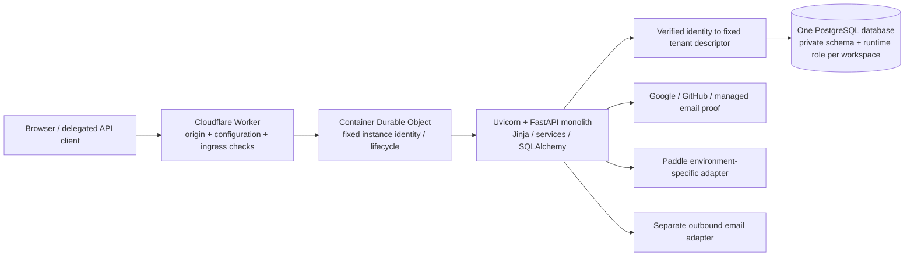
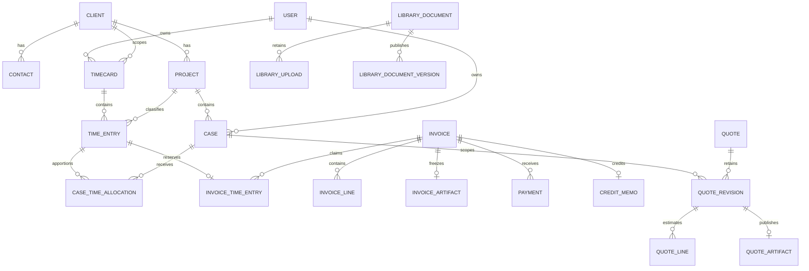

# timeKER — complete codebase dossier and HOC pause

Prepared on2026-10-16 for Ed Lopez. Stage source analysis is pinned to `48e854ff2107dffb217dfe7c487b1b9d36a7f41d`.
**Stage improvement work is PAUSED until direct HOC resume. PROD remains unchanged.**
This combined reading copy contains the full index and every chapter. Commands are documentation only. No product, provider, database or production action is authorized by this file.

## Contents

- [timeKER — full codebase dossier and HOC pause](#chapter-00)
- [01 — Architecture and stack](#chapter-01)
- [02 — Data model and transaction semantics](#chapter-02)
- [03 — Product and user workflows](#chapter-03)
- [04 — Authentication, registration and access](#chapter-04)
- [05 — Integrations and external effects](#chapter-05)
- [06 — Deployment and operations SOP](#chapter-06)
- [Security, privacy, quality and evidence](#chapter-07)
- [HOC pause and continuation — 2026-10-16](#chapter-08)
- [Improvement review guide and open decisions](#chapter-09)
- [HTTP route and template inventory](#chapter-10)
- [Models, configuration, migrations and dependencies](#chapter-11)
- [Source map, test catalog and snapshot manifest](#chapter-12)
- [Production baseline and Stage differences](#chapter-13)

---

<a id="chapter-00"></a>

<!-- Source chapter: 00-START-HERE.md -->

# timeKER — full codebase dossier and HOC pause

Prepared for Ed Lopez on 2026-10-16. Language: English, following the project's
source/documentation convention. This package supports a deep technical/product
review of the whole codebase and its operating model. It is a dated analysis
snapshot, not a competing active specification, source/data backup or permission
to execute the included operational commands.

**Stage improvement work is PAUSED until direct HOC resume. PROD remains as is.**
The current services/configuration/data are retained; no runtime shutdown or flag
change is part of the pause. Only documentation and verification of this package
were performed for this closeout. No database, provider, authentication, customer
send, payment, migration or deployment was executed to prepare it.

## Read this package

For one continuous Markdown document, open [timeKER-FULL-DOSSIER.md](timeKER-FULL-DOSSIER.md).
For focused review, use the chapters below. Both formats contain the same substantive
chapters; the combined file is generated from these files, not independently authored.

| Chapter | Content |
| --- | --- |
| [01 — Architecture and stack](01-architecture-and-stack.md) | System context, monolith, Worker/Container/PostgreSQL topology, layers, request lifecycle, actual stack/versions and runtime boundaries. |
| [02 — Data model and transactions](02-data-model-and-transactions.md) | Entity relationships, ownership, stored/derived states, constraints/guards, transaction protocols, money/minutes/time zones, history/immutability. |
| [03 — Product and user workflows](03-product-and-user-workflows.md) | Complete page/domain catalog and ordinary/error workflows: clients, projects/Cases, timecards, imports, reports, billing, credit memos, payments, Mail/archive, settings, plans, Quoting/Library and Sending. |
| [04 — Authentication, registration and access](04-authentication-registration-and-access.md) | Google/GitHub/managed email, shared Turnstile, identity binding/linking, notices/receipts, signup/admission slots, session/CSRF/roles, failure/recovery and absent Apple/deletion. |
| [05 — Integrations and external effects](05-integrations-and-external-effects.md) | OAuth/API/MCP tools/scopes, confirmation and token lifecycle, import, separate email channels, Paddle, signed webhooks/internal jobs, retry/uncertainty/idempotency boundaries. |
| [06 — Deployment and operations SOP](06-deployment-and-operations-sop.md) | Local setup, containers, environment/secret custody, actual Stage hosting, migration/grants, deployment/readback, backup/restore, incident handling and future HOC-gated production release steps. |
| [07 — Security, privacy, quality and evidence](07-security-privacy-quality-and-evidence.md) | Implemented controls, data/encryption/file limits, diagnostic/business audit distinction, policy/preferences, executed QA and honest pending verification. |
| [08 — Pause and continue](08-PAUSE-AND-CONTINUE.md) | Owner pause, exact retained snapshot, original Phase2 closure queue, later scope, receipts and resume procedure. This mirrors the canonical repository CONTINUE at closeout. |
| [09 — Improvement review guide](09-improvement-review-guide-and-open-decisions.md) | Source-backed review questions, measured change criteria, known open work and distinctions between capability, activation, execution and acceptance. No implementation is authorized by these prompts. |
| [10 — HTTP routes and templates](10-http-routes-and-templates.md) | Offline literal route-decorator catalog and Jinja template inventory, with extraction limits. |
| [11 — Models, configuration and dependencies](11-models-configuration-and-dependencies.md) | All53 mapped entities/fields,48 Settings fields, migration chain, complete Python lock inventory and Worker package inventory; credential values omitted. |
| [12 — Source map, tests and manifest](12-source-map-tests-and-manifest.md) | Every app module, static test-file catalog,414 tracked paths with byte/hash identity. Static counts are not executed-test counts. |
| [13 — PROD/Stage differences](13-production-stage-differences.md) | Exact untouched production baseline versus Stage, dated runtime identities, feature differences, complete tracked source delta and future release implications. |

## Snapshot and provenance

| Item | Snapshot |
| --- | --- |
| Primary analyzed codebase | `C:\Users\edlop\OneDrive\Documents\VS Code\timeker-PH2` |
| Stage source-analysis commit | `48e854ff2107dffb217dfe7c487b1b9d36a7f41d` on `codex/ph3-onboarding-auth` |
| Deployed Stage application source | `dbf73e52ca03726e7903dc74ef27e40339c06936`; analysis checkpoint adds documentation only |
| Stage URL | `https://stage-timeker.aekr.io` |
| Original production repository | `C:\Users\edlop\OneDrive\Documents\VS Code\timeKER`, main `dfb2538ec81d07f1c91fdf2bdc5096d4d0313609`, clean and unchanged |
| Production URL | `https://timeker.aekr.io` |
| Inventory method | Offline AST/TOML/JSON/Git tree reads, no application imports or live service discovery |
| Static inventory | 414 tracked paths,227 Python files,173 literal route declarations,53 mapped entities,48 Settings fields,892 declared test functions |
| Canonical source of product truth | Repository AGENTS, PROJECT_BRIEF, DECISIONS, DESIGN_SPEC, STATUS, HOSTING and relevant maintained contracts |
| Canonical pause/resume entry | `timeker-PH2/CONTINUE.md`, carried in chapter08 |

Later pause closeout edits are Markdown/continuation only. The exact baseline
manifest intentionally remains pinned to the analyzed commit rather than silently
changing source identity when the pause is committed. Source pointers refer to
that commit; some local documentation line numbers move after the pause prefix is
added. Application source references remain stable because no app code changed.

The package uses public source and maintained operator/product documents, with
selected already-recorded release metadata. Runtime identities are last verified
receipts, not fresh continuous monitoring. No source archive/private historical
payload was retrieved to generate the technical chapters. Actual uploaded client
contracts, database contents, private seeds, invoice PDFs and protected credential
values are excluded. Configuration names, public URLs, source hashes and schema
structure are included to make analysis precise.

## Current delivery truth

- The original Phase2 feature core is implemented in Stage. Real assistant/client
  OAuth allow, tool discovery/use with two owners, refresh/revocation and owner UAT
  remain open. A saved private plugin is not evidence of an authenticated connection.
- Later Stage functionality includes public signup into finite preprepared private
  workspaces, alternate sign-in, Free/Solo/Pro Sandbox subscriptions, separate
  statement Sending and Case-bound Quoting/Library/commercial Sending.
- Apple runtime/account deletion is absent. Remaining actual subscription-provider
  rehearsals, hosted commercial owner UAT, operational budgets/custody and a current
  production candidate/full rollout are separately tracked.
- Last backend gate is consolidated coverage of1,785 distinct cases, not a new
  all-green full run. The raw full run remains FAILED at1,784 PASS/one obsolete
  assertion; a complete761-unit rerun passed after the test-only correction.
  Final affected browser suite32 PASS and19 hosted public GET checks passed.
- The nine-schema Stage migration retained396 old table fingerprints and verified
  guards/grants/isolation. Its encrypted backup passed custody/inventory/hash checks;
  that operation did not perform a restore rehearsal.
- No human Stage acceptance, actual customer email, Apple activation, Live payment
  or production rollout is implied by automated checks or this package.

## Recommended reading sequence

1. Read08 for what is paused, retained and allowed to resume.
2. Read01–02 for system/data/transaction structure.
3. Read03–05 for exact product, identity and integration behavior.
4. Read06–07 for SOP, operational limits and actual assurance.
5. Use10–13 while inspecting source or comparing a proposed change.
6. Use09 to organize improvement analysis without treating open ideas as approved work.

## Verification files

- [source-snapshot-manifest.json](source-snapshot-manifest.json) pins baseline source paths/bytes/hashes and offline extraction counts.
- `PACKAGE-MANIFEST.json` and `SHA256SUMS.txt` pin the final delivered Desktop files.
- `PACKAGE-VERIFICATION.json` records actual offline package checks, limitations and final closeout source identity. These describe documentation validation, not product test execution or a security certification.

Keep all chapters together so relative links resolve. The combined MD can be read
alone for narrative/appendices, while its linked chapter files remain useful for
navigation. No ZIP, vendor upload, sharing permission or external publication is
required to use the local package.


---

<a id="chapter-01"></a>

<!-- Source chapter: 01-architecture-and-stack.md -->

# 01 — Architecture and stack

## Snapshot and provenance

This is a dated technical review snapshot, prepared on 2026-10-16 for the HOC
pause closeout. It is not an active specification, a deployment instruction or
authorization to resume Stage improvements. Stage work remains paused until an
explicit HOC resume. Production is unchanged by this review.

The reviewed repository is
`C:/Users/edlop/OneDrive/Documents/VS Code/timeker-PH2`, branch
`codex/ph3-onboarding-auth`, verified clean at
`48e854ff2107dffb217dfe7c487b1b9d36a7f41d` before the audit. Source pointers below
are relative to that repository and use one-based line numbers at this commit.
The implementation review used tracked Python, TypeScript, templates, migrations,
lockfiles and canonical documentation. No application modules were imported to
initialize the app, and no database, provider, credential store, environment file,
private contract or actual business record was accessed. No test or hosted check
was run for this dossier.

Deployment facts are attributed to the existing `docs/STATUS.md:3–59` record,
rather than a new live verification. That record identifies Stage application
runtime source `dbf73e52ca03726e7903dc74ef27e40339c06936`, Worker
`9a1cfc5f-73ec-4856-b3bb-ea9a2817168c`, application version 20, and image SHA-256
`9b04918f1171f93c5e7b6009c114846ba8b7f36390e2e3ad3e27cc879944f426`.
The reviewed HEAD also includes subsequent documentation/integration custody.
The original production checkout is separately recorded at
`dfb2538ec81d07f1c91fdf2bdc5096d4d0313609` (`docs/STATUS.md:120–126`). Source
capability in this Stage branch must not be described as deployed production
behavior.

## 1. System shape

timeKER is one deployable Python web application with same-origin server-rendered
HTML, a small local JavaScript layer and one PostgreSQL database per environment.
Cloudflare Workers provide the public adapter; a Durable Object identifies and
manages the application Container. PostgreSQL stores business records, immutable
artifacts, operation receipts and audit history. The Durable Object's platform
SQLite declaration is Container control infrastructure; it is not a second
business datastore. There is no Redis, Celery, Kafka, separate AI backend,
frontend SPA or independently deployed business microservice in this source.



The currently documented Stage topology contains four retained workspace schemas
and five prepared signup schemas. The central admission directory lives in the
default schema in the same database. A new account consumes a preprepared slot;
request handling does not create schemas, roles or databases. A tenant is
permanently one owner/user, not a team or a client organization. Clients, Projects
and Cases are records inside that owner's workspace.

Sources: `AGENTS.md:68–103`; `app/tenancy.py:96–315`;
`app/admission.py:142–207`; `deploy/cloudflare/wrangler.jsonc:1`;
`docs/PROJECT_BRIEF.md:3–11`; `docs/design/EXPANSION_DISCOVERY.md:168–180`.

## 2. Actual declared and locked stack

The table reports repository declarations and lockfile selections. It does not
claim the version of a newly inspected running process. `pyproject.toml` declares
Python `>=3.12`; Docker builds and runs `python:3.13-slim`. The image tags are not
patch-version or base-image-digest pins. The uv build stage uses `0.13.0`, and
`uv sync --locked --no-dev` installs the runtime environment.

| Component | Selected version / policy | Source |
| --- | --- | --- |
| Application package | `timeker 0.1.0`; Hatchling build; `timeker = app.cli:main` | `pyproject.toml:1–19` |
| Python / package install | `>=3.12`; Docker 3.13 slim; uv 0.13.0 | `pyproject.toml:10`; `Dockerfile:1–9` |
| FastAPI / Starlette | 0.143.0 / 1.7.0 | `uv.lock:306`; `uv.lock:1327` |
| Uvicorn | 0.54.0 | `uv.lock:1451` |
| SQLAlchemy / Alembic | 2.1.4 / 1.20.0 | `uv.lock:1255`; `uv.lock:11` |
| psycopg / binary wheel | 3.3.6 / 3.3.6 | `uv.lock:949`; `uv.lock:967` |
| PostgreSQL | Local Compose declares PostgreSQL 18; hosted patch version was not queried | `compose.yaml:1–16` |
| Jinja2 | 3.1.6 | `uv.lock:518` |
| HTMX | Vendored 2.0.8 | `app/web/static/htmx.min.js:1` |
| Authlib | 1.8.0 | `uv.lock:56` |
| HTTPX | 0.28.1 | `uv.lock:476` |
| ItsDangerous / cryptography | 2.2.0 / 48.0.1 | `uv.lock:509`; `uv.lock:240` |
| WeasyPrint | 70.0 | `uv.lock:1464` |
| Pydantic / multipart parser | 2.14.0 / 0.0.32 | `uv.lock:1027`; `uv.lock:1221` |
| Time-zone data / dotenv | 2026.5 / 1.2.4 | `uv.lock:1442`; `uv.lock:1212` |
| pytest / Ruff / mypy | 9.1.1 / 0.17.0 / 1.20.2 | `uv.lock:1196`; `uv.lock:1230`; `uv.lock:768` |
| Playwright / PDF text inspection | 1.63.0 / pypdf 6.20.0 | `uv.lock:921`; `uv.lock:1178` |
| Cloudflare Containers SDK | 0.3.7 | `deploy/cloudflare/package.json:11–13`; `deploy/cloudflare/package-lock.json:20` |
| Wrangler / TypeScript | 4.149.0 / 7.0.2 | `deploy/cloudflare/package.json:14–20` |
| Workers types | 5.20261011.1 | `deploy/cloudflare/package.json:14–20` |
| Worker compatibility | 2026-10-13; `nodejs_compat` | `deploy/cloudflare/wrangler.jsonc:6–7` |

Docker is a two-stage Python application build after the uv tool stage. Runtime
native packages provide Pango/Harfbuzz and DejaVu fonts for WeasyPrint. The process
runs as an unprivileged system user, exposes port 8000 and disables Uvicorn access
logging. The image does not run a migration automatically on startup. Local
Compose has an explicit migration service before the app; hosted schema upgrades
are separately operated and evidenced.

Sources: `Dockerfile:1–23`; `compose.yaml:17–34`; `app/db.py:1–29`.

## 3. Public edge and Container pipeline

1. The Worker first validates its environment against an explicit Stage policy:
   canonical origin, database target/TLS shape, registry, provider flags and finite
   slot inventory. Required values are injected through named bindings; values
   and credentials are not reproduced here. Invalid configuration fails closed.
2. Requests must use the canonical HTTPS origin. Upgrade requests are rejected.
   Public Stage ingress blocks decoded `/internal*` and `/contact*` paths.
3. The adapter removes caller forwarding/IP/target-port/hop-by-hop headers and
   caller-supplied timeKER identity headers. It supplies the canonical host and
   HTTPS forwarding headers. Relevant auth POSTs receive an HMAC-derived network
   key recomputed from Cloudflare ingress information, rather than trusting a
   caller-supplied key or passing a raw address into auth logs.
4. A fixed Durable Object/Container identity receives the request. The Container
   listens on 8000, sleeps after ten minutes of inactivity, and tracks active
   requests/streams so activity is renewed during a response.
5. Startup waits for port 8000 with a 60-second port-ready budget and the request's
   abort signal. The response body is streamed; a disconnected stream is not
   replayed. Sanitized failures become 503 with no-store/retry information.
6. The private Container entrypoint enables Uvicorn proxy-header handling because
   the adapter has removed and reconstructed those headers. The standalone
   Docker default disables proxy headers. These are distinct entrypoints.

Sources: `deploy/cloudflare/src/proxy.ts:241–339`;
`deploy/cloudflare/src/index.ts:5–66`; `Dockerfile:23`.

The Stage Worker declares one basic Container and `max_instances: 1`;
`workers.dev` and preview URLs are disabled. Worker and Container observability
are disabled in the checked profile. `logSafely` is deliberately a no-op in the
Stage adapter; source tests can inject a bounded observer. No statement dispatch
cron is defined by the Stage `index.ts` handler. Production has its own adapter
and profile; its handlers must not be inferred from this Stage entrypoint.

Sources: `deploy/cloudflare/wrangler.jsonc:1–32`;
`deploy/cloudflare/src/proxy.ts:27–30`;
`deploy/cloudflare/src/index.ts:61–66`;
`deploy/cloudflare/src/production.ts:1`;
`deploy/cloudflare/wrangler.production.jsonc:1`.

## 4. FastAPI request pipeline

`create_app` constructs the immutable base settings, tenant registry,
request-scoped settings facade, database router, rate limiter, privacy preference
handler and contact router. It disables public OpenAPI/Swagger/ReDoc routes.
The lifespan validates tenant readiness when the registry or onboarding requires
it and disposes all registered engines at shutdown.

Among application-added middleware, the effective incoming order is:

```text
request_context -> SessionMiddleware -> TrustedHostMiddleware -> TenantMiddleware
  -> framework exception handling / route dependencies -> endpoint -> service
```

`request_context` is registered last and therefore wraps the other user middleware.
It assigns a request UUID, measures elapsed time, converts unexpected errors to a
bounded HTML/JSON response, emits a sanitized terminal request event and applies
response security/cache headers. Starlette's framework error wrapper is outside
this user-middleware list. Session decoding precedes tenant selection; the tenant
middleware explicitly refuses to run without session middleware.

Sources: `app/main.py:115–167`; `app/main.py:189–263`;
`app/tenancy.py:476–516`.

Hosted session cookies use `__Host-timeker-session`, Secure, HttpOnly through
Starlette SessionMiddleware, SameSite=Lax and a one-hour maximum age. This is a
signed client-side session, not a server-side session table or general encrypted
payload store. Session fields include owner/tenant/revision and short-lived flow
correlation. Principal validation rechecks the retained User and immutable method
binding on protected requests; a stale session revision is rejected.

Sources: `app/main.py:154–167`; `app/auth.py:51–100`.

The tenant middleware refreshes retained admission overlays for non-static,
non-liveness requests. Browser sessions resolve only to registered descriptors.
Integration credentials contain a tenant locator used for routing, then their
secret digest, expiry, grant and scope are authenticated before resource access.
Public paths use the default descriptor for public/authentication infrastructure;
that is not authorization to access the default owner's business records. An
anonymous protected path redirects to the public landing. ContextVar binding is
reset in `finally`, and `DBRouter` always uses the bound tenant factory.

Sources: `app/tenancy.py:292–344`; `app/tenancy.py:437–453`;
`app/tenancy.py:480–516`; `app/integration_auth.py:70–102`.

Protected application routers depend on `authorized`, which calls `owner` and
stores the verified User in request state. Enrollment can restrict a signed-in
owner to registration or subscription/security screens until acknowledgment and
first-plan requirements are met. Standard mutating forms validate same-origin
when supplied, a session-bound constant-time CSRF token, bounded body/field counts
and native no-JavaScript submission. The shared `mutate` helper runs a synchronous
service inside `sessionmaker.begin()` in a thread pool, then redirects with a
saved notice; domain/constraint/stale-version errors produce bounded feedback.
Specialized upload, OAuth, webhook and dispatch routes use their own explicit
validated transaction boundaries rather than assuming this helper covers them.

Sources: `app/main.py:355–392`; `app/main.py:692–697`;
`app/auth.py:87–126`; `app/main.py:1528–1547`.

## 5. Module and surface map

| Boundary | Main implementation and responsibility |
| --- | --- |
| App composition, public pages, core owner screens | `app/main.py:115`; router assembly `app/main.py:1528–1547` |
| Configuration and capability gates | `app/config.py:14`; frozen Settings; validation and environment-specific provider combinations; properties at `app/config.py:193–211` |
| Fixed tenant/role/session routing | `app/tenancy.py:96`; registry and factories; `app/db.py:9`; fixed-identity connect hook |
| Owner and external-method authentication | `app/auth.py:19`; `app/social_auth.py:17`; `app/email_auth.py:102`; `app/enrollment_routes.py:1` |
| Public admission and preparation operations | `app/admission.py:142`; `app/admission_operations.py:15`; `app/workspace_operations.py:241`; no privileged runtime DDL |
| Canonical acknowledgment and first-plan gates | `app/enrollment.py:90`; notice capture/receipt at `app/enrollment.py:179–245`; `app/subscriptions.py:349` |
| Clients, Projects, Cases and lookups | `app/clients.py:1`; `app/project_routes.py:1`; `app/cases.py:1`; `app/lookups.py:1`; service validation plus owned association checks |
| Timecards/import/contribution commands | `app/timecards.py:11`; `app/time_import.py:1`; `app/time_commands.py:203`; source-aware Draft changes and receipts |
| Billing/payment/credit and project charging | `app/billing.py:117`; time draft at `app/billing.py:200`; issue/pay/void at `app/billing.py:392`, `521`, `607` |
| Reports and Archive | `app/reports.py:1`; `app/archiving.py:17`; `app/archive_routes.py:1`; bounded reads/exports and retained history |
| Mail custody and private project files | `app/mail_service.py:66`; `app/mail_routes.py:1`; `app/project_attachments.py:1`; normalized bounded file capture, no inbox sync |
| Delegated OAuth/API/MCP and proposals | `app/integration_auth.py:24`; `app/integration_routes.py:312`, `515`, `666`, `1042`; `app/client_drafts.py:1` |
| Tenant plan quota and billing provider | `app/subscriptions.py:52`; `app/subscription_billing.py:400`, `726`; `app/paddle.py:1`; separate SaaS ledger from service invoices |
| Issued-statement collection sending | `app/sending.py:213`, `544`; `app/sending_transport.py:1`; payment/void/Stop-aware plans and follow-ups |
| Estimates and private documents | `app/quoting.py:210`, `309`; `app/library.py:190`, `310`; immutable publication, retained originals and revisions |
| Commercial-document sending | `app/proposal_sending.py:139`, `227`; `app/proposal_sending_transport.py:1`; separate manual outbox |
| Internal provider/scheduled entrypoints | `app/internal_routes.py:20`, `108`, `129`; protected internal secret/tenant binding; public Stage edge blocks these paths |
| Privacy/contact/optional usage | `app/privacy.py:18`; `app/contact.py:1`; `app/usage.py:43`; explicit feature/privacy gates |
| Encrypted settings, audit and diagnostics | `app/settings.py:70`; `app/audit.py:1`; `app/logging.py:32` |
| PDF | `app/pdf.py:17`; shared escaped, allowlisted templates and denied asset fetching |
| CLI, demo and seed tooling | `app/cli.py:1`; `app/demo.py:1`; `app/tenant_demo.py:1`; `app/seed.py:1`; operator/local tooling, not anonymous provisioning |

The delegated surface exposes OAuth authorization-server/resource metadata,
`/oauth/authorize`, `/oauth/token`, `/oauth/revoke`, `/mcp`, and scoped REST tool
calls under `/api/integration/tools/{name}`. Its MCP bridge is implemented in this
application; the lockfile does not add a separate agent inference runtime. Tool
schemas are bounded and scope-filtered. Delegated proposed clients are drafts;
delegation does not issue invoices or grant an assistant unrestricted owner access.

Sources: `app/integration_routes.py:50–257`, `589–647`, `666–1039`;
`app/integration_auth.py:24–44`; `docs/PROJECT_BRIEF.md:658–669`.

## 6. Persistence, rendering and operational boundaries

SQLAlchemy uses synchronous psycopg connections, `pool_pre_ping`, bounded pools,
zero overflow, a ten-second pool timeout, hidden SQL parameters and
`expire_on_commit=False`. Tenant-specific factories use pool size two and verify
the actual database role and current schema on connect. Tenant routing is
schema/role isolation, not a retrofitted shared-table RLS tenancy design. Runtime
roles cannot own/migrate objects; separate schema owners operate migrations.

Sources: `app/db.py:9–29`; `app/tenancy.py:237–238`, `272–277`;
`app/workspace_operations.py:81–124`; `scripts/postgres-runtime-grants.sql:3–28`.

Jinja templates render complete HTML or lookup fragments. HTMX and local scripts
enhance existing forms, lookups, the decorative browser-local clock, notices,
CAPTCHA and Paddle checkout integration. Native mutation routes remain the
authoritative action path. Money and contract calculations belong in Python
services rather than templates. PDF rendering permits only four named templates,
escapes HTML and refuses all resource URLs, including local-file and remote
fetches. Published financial/commercial artifacts are stored in PostgreSQL and
retrieved with integrity checks rather than silently regenerated.

Sources: `app/main.py:87–89`, `265–306`; `app/web/templates/base.html:1`;
`app/pdf.py:13–49`; `app/billing.py:454–467`;
`app/quoting.py:349–360`; `app/library.py:365–397`.

`/health/live` reports process liveness. `/health/ready` executes registry/schema,
runtime-role and admission checks and returns only ready/unavailable. It is
deliberately more expensive than liveness; a warm public page alone is not
readiness proof. The source pins migration head `ph3_006_quoting_library`.

Sources: `app/main.py:678–690`; `app/tenancy.py:346–430`; `app/db.py:6`.

Diagnostics use an event/field allowlist, internal UUIDs, route templates and
sanitized outcomes. Unknown fields and exception text are redacted; noisy library
and access logging is suppressed. Diagnostic failures are swallowed so they do
not change a committed result. Business audit records are separate database rows
and may contain protected business evidence; they must not be exported into
diagnostic logs or a public dossier. Encrypted settings use per-tenant key custody;
this review did not read the keys or encrypted values.

Sources: `app/logging.py:10–109`; `app/audit.py:1`;
`app/settings.py:70–135`; `app/models.py:359–373`.

## 7. Stage, production and unfinished designs

The Stage profile enables bounded public signup, managed email, delegated
integration and Paddle Sandbox while leaving statement jobs, public contact,
Mail capture and optional usage disabled. Commercial Quoting/Library routes are
explicitly unavailable in the production environment. Separate production
capability gates exist in source for future approved provider combinations; their
existence does not activate them in the original production deployment.

Sources: `deploy/cloudflare/wrangler.jsonc:34–61`;
`app/config.py:193–211`; `deploy/cloudflare/src/proxy.ts:93–144`;
`docs/STATUS.md:120–126`.

The current documented Stage release passed anonymous GET/assets/health checks;
authenticated hosted interaction with the new commercial workflows remains a
normal owner/UAT step. Existing local suite evidence is attributed in
`docs/STATUS.md:61–81`; it is not a new execution for this dossier. The original
Phase2 core is implemented, but real assistant OAuth allow, tool discovery,
two-tenant platform use and refresh/revocation remain actual-client validation
gates. Apple has preparation documentation but no runtime adapter/callback or
complete lifecycle implementation. Teams, memberships and a workspace switcher
are excluded by the permanent single-owner contract. Off-host recovery promises,
account lifecycle/retention policy and measured storage/mail budgets remain
separate open decisions, not hidden implemented services.

Sources: `docs/STATUS.md:35–44`, `120–124`;
`docs/design/EXPANSION_DISCOVERY.md:1–14`, `150–180`, `324–345`;
`docs/PROJECT_BRIEF.md:658–669`.


---

<a id="chapter-02"></a>

<!-- Source chapter: 02-data-model-and-transactions.md -->

# 02 — Data model and transaction semantics

## Snapshot and provenance

This chapter is a dated review snapshot for the 2026-10-16 HOC pause closeout,
not an active schema specification or permission to execute an operation. Stage
improvements remain paused until explicit HOC resume; production is unchanged.

Source repository:
`C:/Users/edlop/OneDrive/Documents/VS Code/timeker-PH2`, branch
`codex/ph3-onboarding-auth`, reviewed at clean commit
`48e854ff2107dffb217dfe7c487b1b9d36a7f41d`. All source pointers are relative to
that repository and use one-based snapshot line numbers. This chapter was
prepared by reading model declarations, services, migrations, grant scripts and
canonical documentation. The companion schema/field appendix is derived statically from
Python AST; it does not import the application or reflect a live database.
No database, actual business data, environment/credential file or private contract
was read. No migration, test, external send or network call was performed.

## 1. Physical and ownership model

There are **53 mapped domain tables** in the reviewed source, plus Alembic's
`alembic_version` metadata table per migrated schema. The application uses one
PostgreSQL database per environment and a private schema/runtime role per owner
workspace. This is not a shared-table `tenant_id`/RLS design. For example, Clients
do not carry a universal tenant column: isolation comes from the server-resolved
fixed descriptor, restricted role, pinned schema and service authorization.
Some records also carry `owner_id` or `actor_id` for local ownership/audit.

The generic `require` repository helper looks up an ID in the bound database
session; it is not independently an owner-filtering authorization layer. Routes,
principal validation and domain services must apply their respective owner and
association checks. PostgreSQL FKs inside the tenant schema are supplemented by
cross-parent consistency guards; merely proving that two UUIDs exist is not
enough to associate them.

Sources: `app/models.py:29–66`; `app/repositories.py:12–19`;
`app/tenancy.py:237–277`, `328–344`, `445–453`;
`app/auth.py:51–100`; `scripts/postgres-runtime-grants.sql:3–28`.

`Entity` supplies UUID `id`, timezone-aware UTC `created_at` and `updated_at`.
Most domain classes inherit it. Exceptions are explicitly declared structures:
`ContactAttempt`, the entry-keyed invoice `Reservation`, the singleton integer-key
`WorkspaceSubscription`, and identity-keyed `BillingAccount`. Entity timestamps
do not mean that every row is mutable; immutable history is enforced separately.
Optimistic concurrency applies only where the model declares `version_id_col`
or a service explicitly checks a revision/version, not to every table by magic.

Sources: `app/models.py:33–66`, `330–333`;
`app/subscription_models.py:13–34`;
`app/subscription_billing_models.py:24–68`.

The three admission tables are physically installed in every schema, but their
authoritative copies are central. Only the default runtime has central
SELECT/INSERT/UPDATE; noncentral directory shadows are denied. Their tenant-local
owner/identity UUIDs are logical locators, deliberately not cross-schema FKs.
Admission performs explicit immutable identity and initialization readback across
separate transactions.

Sources: `app/admission_models.py:12–61`;
`app/admission_operations.py:79–90`; `app/admission.py:92–207`.

## 2. Entity and relationship map



The diagram omits secondary/audit links for readability; the complete 53-table
inventory and field-level FK declarations follow below and in the appendix.

### Core owner, client, work and financial records — 17 tables

| Table / class | Main relationships and semantics | Source |
| --- | --- | --- |
| `users` / User | Unique email; owner role/active flag, last login and session revision. The workspace contract permits one owner. | `app/models.py:59` |
| `clients` / Client | Root business record; profile/contract JSON, Decimal rate, currency, IANA zone, weekly cap, status and optimistic version. | `app/models.py:69` |
| `contacts` / Contact | Client FK; contact methods and explicit request-work/approve-hours metadata. | `app/models.py:95` |
| `projects` / Project | Client FK; type, active/closed/archive status, rate override, budget/currency pair, agreement reference pair and overbilling choice. | `app/models.py:108` |
| `project_agreements` / ProjectAgreement | One immutable private file per Project, uploader User FK, bytes/size/checksum. This is a project attachment, separate from Library. | `app/models.py:147` |
| `timecards` / Timecard | Owner + Client + Monday week uniqueness; entries, persisted exact total, state, archive marker, version and cap-override evidence. | `app/models.py:162` |
| `time_entries` / TimeEntry | Timecard + Project + work date; positive integer minutes, notes, billability and optional rate override. | `app/models.py:186` |
| `cases` / Case | Owner, Client and Project FKs; immutable schema-local numeric identity from 10001; type, state, optional description and archive marker. | `app/models.py:202` |
| `case_time_allocations` / CaseTimeAllocation | Entry-to-Case allocation, unique pair, integer minutes, actor and version. Allocated time cannot exceed parent time. | `app/models.py:233` |
| `invoices` / Invoice | Client; optional exclusive fixed-fee or manual-extra Project association; business dates, Decimal totals, snapshot and lifecycle/version. | `app/models.py:247` |
| `invoice_lines` / InvoiceLine | Invoice + optional Project; explicit time/fixed-fee/manual-extra basis, exact quantity/rate/amount and frozen charge metadata. | `app/models.py:306` |
| `invoice_time_entries` / Reservation | `entry_id` is the PK and FK; one entry can have only one current invoice claim. Invoice FK. | `app/models.py:330` |
| `invoice_artifacts` / Artifact | One per Invoice; retained filename, exact PDF bytes, SHA-256 and renderer version. | `app/models.py:336` |
| `payments` / Payment | Invoice and creator User FKs; positive Decimal amount and same currency; reversal timestamp rather than deletion. | `app/models.py:345` |
| `audit_events` / Audit | Actor, request and entity identifiers plus protected business details; append-only runtime grants. | `app/models.py:359` |
| `app_settings` / AppSettings | Unique key; JSON value or encrypted bytes, scoped to the current workspace. | `app/models.py:369` |
| `contact_attempts` / ContactAttempt | Durable abuse/delivery reservation using address/session/network/payload digests, timestamp and state; not a general contact mailbox. | `app/models.py:33` |

### Mail custody and credit artifacts — 4 tables

| Table / class | Main relationships and semantics | Source |
| --- | --- | --- |
| `mail_messages` / MailMessage | Owner, Client and optional Project/Case; canonical checksum, normalized bounded headers/plain text, source, receipt/archive basis and archive marker. | `app/mail_models.py:21` |
| `mail_addresses` / MailAddress | Revocable digest-only capture address bound to one owner and fixed association. | `app/mail_models.py:48` |
| `mail_attachments` / MailAttachment | Message/position uniqueness; retained inert original attachment bytes, bounded name/type/size/checksum. | `app/mail_models.py:58` |
| `credit_memos` / CreditMemo | Unique Invoice FK and number; actor, complete frozen original reference, full credit amount, reason and immutable PDF/checksum. | `app/credit_memo_models.py:14` |

### Source-aware time commands and delegated integration — 8 tables

| Table / class | Main relationships and semantics | Source |
| --- | --- | --- |
| `time_import_records` / TimeImportRecord | Unique actor/source/source-record identity and canonical payload hash. | `app/time_command_models.py:13` |
| `time_contributions` / TimeContribution | Actor/source/source-item uniqueness; optional import receipt, Timecard, Project, date, Entry and optional Case; own minutes/version. Zero is a retained tombstone. | `app/time_command_models.py:26` |
| `time_operations` / TimeOperation | Unique actor/source/idempotency key; immutable payload hash, action and result receipt. | `app/time_command_models.py:49` |
| `integration_grants` / IntegrationGrant | Owner/tenant/client/resource/scopes, expiry and revocation. | `app/integration_models.py:21` |
| `integration_codes` / IntegrationCode | Grant FK; digest-only one-use authorization code, redirect URI, S256 challenge, scope and expiry/use timestamp. | `app/integration_models.py:33` |
| `integration_tokens` / IntegrationToken | Grant FK; digest-only access/refresh credential, scope/client, expiry and use timestamp. | `app/integration_models.py:51` |
| `integration_operations` / IntegrationOperation | Unique grant/key digest; tool, payload digest and retained result. | `app/integration_models.py:69` |
| `client_drafts` / ClientDraft | Owner-scoped proposed-client JSON and optimistic version; cannot itself publish an active Client. | `app/integration_models.py:79` |

### Subscription assignment and provider billing — 5 tables

| Table / class | Main relationships and semantics | Source |
| --- | --- | --- |
| `workspace_subscriptions` / WorkspaceSubscription | Singleton `id=1`, owner, free/solo/pro assignment, catalog revision, version and optional paid-access expiry. | `app/subscription_models.py:13` |
| `subscription_operations` / SubscriptionOperation | Unique owner/key digest, payload digest, action and immutable result. | `app/subscription_models.py:37` |
| `subscription_billing_accounts` / BillingAccount | Integer identity; one current account per owner through a partial unique index. Provider customer/subscription/checkout bindings, proven paid period, pending changes and version. Retired accounts remain. | `app/subscription_billing_models.py:24` |
| `subscription_billing_operations` / BillingOperation | Unique owner/key digest and optional transaction ID; durable effect intent/result and reserved/confirmed/uncertain/failed state. | `app/subscription_billing_models.py:71` |
| `subscription_billing_events` / BillingEvent | Unique provider event ID, raw-body digest, event type, outcome and bounded verified facts. | `app/subscription_billing_models.py:89` |

These are timeKER SaaS-access records. They are not the consulting/service Invoice
and Payment ledger, and provider events cannot silently rewrite an issued service
artifact. The one current provider-account index and the local singleton plan
assignment serve different purposes.

### Local authentication, central admission and collections — 10 tables

| Table / class | Main relationships and semantics | Source |
| --- | --- | --- |
| `owner_identities` / OwnerIdentity | Owner FK; immutable issuer/subject, verified email metadata and revocation timestamp. | `app/enrollment_models.py:12` |
| `owner_registrations` / OwnerRegistration | Owner plus exact Terms/Privacy/catalog versions, selected offer and acceptance time; unique versioned receipt. Acceptance method/revision evidence lives in its Audit event. | `app/enrollment_models.py:26`; `app/enrollment.py:196` |
| `email_auth_challenges` / EmailAuthChallenge | Owner-scoped signed-session digest, signin/signup/link intent, offer, expiry, bounded attempts and retained state. | `app/enrollment_models.py:42` |
| `workspace_admissions` / WorkspaceAdmission | Central unique slot/owner/email/immutable provider anchor; reserved/active/blocked allocation. | `app/admission_models.py:12` |
| `admission_identities` / AdmissionIdentity | Central immutable issuer/subject locator to exact tenant/owner/local identity; active/pending/blocked/revoked. | `app/admission_models.py:26` |
| `public_email_challenges` / PublicEmailChallenge | Central ownerless encrypted destination context plus address/session/network digests; bounded intent/offer/security-return state. | `app/admission_models.py:43` |
| `sending_preferences` / SendingPreferences | One owner preference row; global pause and editable initial/follow-up templates. | `app/sending_models.py:21` |
| `sending_plans` / SendingPlan | One per issued Invoice; exact Artifact/checksum, recipient/frozen message and opt-in bounded follow-up policy; retained stop reason/time. | `app/sending_models.py:31` |
| `sending_deliveries` / SendingDelivery | Unique plan/sequence; original UTC schedule, pending/sent/failed/stopped/uncertain state, bounded attempts. | `app/sending_models.py:55` |
| `sending_attempts` / SendingAttempt | Unique delivery/attempt number; durable claim/result, bounded provider reference and completion time. | `app/sending_models.py:72` |

### Quoting, Library and commercial sending — 9 tables

| Table / class | Main relationships and semantics | Source |
| --- | --- | --- |
| `quotes` / Quote | Owner, generated unique number, owner-scoped create operation key/digest, soft archive and version. | `app/quoting_models.py:30` |
| `quote_revisions` / QuoteRevision | Quote and optional parent revision; unique numbered lineage, mandatory Case/Project/Client, text/preset/currency/validity and draft/published state. Partial unique index permits one Draft per Quote. | `app/quoting_models.py:45` |
| `quote_lines` / QuoteLine | Unique revision/position; task/case/project scope label, integer min/max minutes and optional exclusive T&M rate or fixed amount. | `app/quoting_models.py:77` |
| `quote_artifacts` / QuoteArtifact | One per Revision, owner, snapshot, exact PDF/size/SHA-256/renderer/publication timestamp. | `app/quoting_models.py:103` |
| `library_documents` / LibraryDocument | Owner and editable root, type/status/revision; a working document has Case/Client/Project, while a reusable template has none. Source-upload UUID is validated as same-document by service/guard. | `app/library_models.py:24` |
| `library_uploads` / LibraryUpload | Immutable document/uploading-owner original bytes, MIME/name/size/SHA-256. | `app/library_models.py:48` |
| `library_document_versions` / LibraryDocumentVersion | Unique document/number, owner, immutable snapshot/PDF and optional exact source upload. Snapshot selects PDF or original attachment format. | `app/library_models.py:64` |
| `proposal_sending_deliveries` / ProposalSendingDelivery | Owner/Case and exactly one frozen QuoteArtifact or Library version; exact generic attachment bytes/type/name/hash, message, create key, version, state and attempt/stop timestamps. | `app/proposal_sending_models.py:22` |
| `proposal_sending_attempts` / ProposalSendingAttempt | Unique delivery/number; retained claim/outcome/completion, immutable after completion. | `app/proposal_sending_models.py:58` |

## 3. State machines and derived state

Allowed database strings constrain storage. The service and triggers impose the
valid transitions and proof requirements; membership in an allowed string list
does not authorize an arbitrary transition.

| Aggregate | Storage states / transition rule |
| --- | --- |
| Client / Project | Client active/archived; Project active/closed/archived. New activation/reactivation must satisfy quota and parent checks; history remains readable. |
| Case | Open, In progress, Waiting, Resolved, Closed; archive is a separate timestamp. Case numeric identity and referenced commercial association are retained. |
| Timecard | Draft → Finalized → Invoiced. Eligible unreserved finalized time can reopen to Draft with a reason. Legacy Voided remains readable/reopenable where allowed; creating a new timecard void is refused. |
| Service Invoice | Draft → Issued → Sent; eligible cancellation → Void. Paid, Partially Paid and Overdue are calculated from unreversed payments/due date. Cancelled draft is represented by Void with no issued artifact/issued timestamp, not an extra database enum. |
| Payment | Created positive payment; an explicit reason can set `reversed_at` once. Deleting payment history is not the ordinary reversal operation. |
| Quote | One editable Draft revision → immutable Published; editing afterward creates a higher numbered draft. Root archive is one-way soft retention. |
| Library | Root draft → frozen (displayed as Published); explicit new draft increments revision. Published versions and uploads never become editable again. |
| Admission | Central reserved + pending locator → exact tenant initialization/readback → active + active. Conflicts can retain blocked state; there is no implicit reassignment. |
| Local/public email challenge | Reservation → ready → verifying → consumed or failed, with bounded attempts/expiry. Public delivery ambiguity also has uncertain. No challenge state by itself proves a new owner. |
| Owner acknowledgment | Immutable receipt for exact current document versions after verified auth and captured notice, or explicit Continue fallback. No acceptance on GET or failed proof; link mode does not auto-accept. |
| Subscription assignment | free/solo/pro with separate expiry/catalog/version. Expired paid access retains history, while capacity guards reject new growth without verified entitlement. |
| Provider billing | Account status active/canceled/past_due/paused/trialing; durable operations reserved/confirmed/uncertain/failed; effect only from validated provider evidence. |
| Delegated grant/code/token | Grant expiry/revocation timestamps, single-use code, rotating refresh credentials. Replay of consumed code/refresh can revoke the grant. |
| Collections delivery | pending → committed uncertain claim → sent/failed/uncertain, or stopped. Only definitive failure permits explicit bounded retry. Follow-up requires its predecessor sent and payment/void/pause/Stop checks. |
| Commercial delivery | draft → committed uncertain claim → sent/failed/uncertain. Failed may be explicitly retried, up to four total attempts. Stop is retained; sent/uncertain cannot be blindly replayed. A claimed send cannot be recalled. |
| Contact delivery | reserved/accepted/uncertain retains abuse/delivery reservation; ambiguous provider outcome is not an excuse to resend automatically. |

Sources: `app/models.py:88–91`, `125–142`, `178–182`, `222–229`, `297–300`;
`app/timecards.py:139–179`; `app/billing.py:471–564`, `577–682`;
`app/admission.py:142–207`; `app/enrollment.py:101–141`, `179–245`;
`app/integration_auth.py:349–419`; `app/sending.py:544–696`;
`app/proposal_sending.py:193–200`, `227–274`.

## 4. Money, minutes and business dates

Time is stored as integer minutes. Ordinary daily duration parsing accepts H:MM
or decimal-hour text only when it resolves to whole minutes; it rejects fractional
minutes, invalid minute components and values above 24 hours. Time entries require
positive minutes; weekly totals are bounded by 10,080 minutes. A Quote line uses a
separate estimate-specific integer range up to 5,256,000 minutes, not the ordinary
daily parser's maximum. Empty maximum estimate duration becomes its minimum.

Money accepts decimal text or `Decimal`, is finite/bounded, and has at most two
decimal places. Database monetary fields use `NUMERIC(14,2)`. Binary floats are
not the money representation. T&M billing groups exact minutes by Project, week
and effective rate before rounding each resulting line with ROUND_HALF_UP; it
does not round every intervention to one hour. Invoice totals sum those stored
line amounts. Quote totals accumulate exact Decimal extended values across all
priced lines before final two-decimal rounding. These are distinct documented
rounding boundaries, not an assertion that every module rounds identically.

Sources: `app/domain.py:13–60`; `app/models.py:169–197`, `261–263`, `312–314`;
`app/billing.py:236–279`; `app/quoting.py:82–120`;
`app/quoting_models.py:90–100`.

Blank price is not zero: an unpriced HLE remains Not priced with no invented
currency/rate. Explicit zero is preserved. Mixed priced/unpriced lines expose a
priced subtotal, excluding unpriced items. Priced work requires an explicit
currency or the existing selected Client currency. Project fixed fees and manual
extras use explicit line bases with zero time quantity, never fabricated worked
hours. A fixed-fee project has at most one nonvoid base-fee claim; separate manual
extras require the actual overbilling setting, amount, reason and unique reference.
Budget checks reserve/reject coherent charges rather than truncate eligible time.

Sources: `app/quoting.py:82–137`; `app/billing.py:64–198`, `249–257`;
`app/models.py:272–325`; `alembic/versions/d529b08f14a2_project_billing.py:86–212`.

Technical timestamps are UTC-aware. Work periods, issue/delivery/due/payment dates
are business dates, and client IANA zones determine business today/week/archiving
boundaries. Weekly periods start Monday. No payment operation invents FX; payment
currency must match the Invoice. Tax, withholding, bank fees or adjustments must
come from explicit saved data and validated owner input, not an external-rate or
tax-authority integration implied by the application.

Sources: `app/domain.py:52–67`; `app/billing.py:284–320`, `420`, `521–530`;
`app/archiving.py:17–56`; `app/models.py:254–258`, `348–350`.

## 5. Critical transaction boundaries

### 5.1 Ordinary owner mutations and concurrency

The shared route mutation helper opens `sessionmaker.begin()`, invokes the service
and commits only after the action returns; exceptions roll back the whole action.
Rendering an immutable PDF inside an issuing/publishing transaction can therefore
fail without committing a half-issued artifact. Services usually receive the
Session and do not unconditionally commit it. Specialized external effects have
separate reserve/claim/result transactions, described below.

Parent row locks and a consistent acquisition order protect work/financial graphs.
`lock_card` locks the Client before the Timecard; `lock_invoice` locks the Client,
associated Timecards in ID order and then the Invoice. Explicit expected versions
and SQLAlchemy optimistic versions reject stale forms. These controls do not
claim all commands run at SERIALIZABLE isolation, or that every form is inherently
idempotent.

Sources: `app/main.py:355–392`; `app/db.py:9–29`;
`app/repositories.py:22–52`; `app/timecards.py:27–44`.

### 5.2 Manual time, contributions, allocation and import

Manual save builds a whole week only after validating distinct same-client
Projects, seven days/notes, daily totals and preserved inactive-project history.
An owner cannot shrink or remove an Entry underneath retained Case allocations
or delegated/imported contributions. Finalize checks the current aggregate and
requires both reason and authorization reference for a cap override. Reopening
requires an unreserved finalized/legacy-voided card and a reason.

Contributions are source-owned portions of an aggregate Entry. Commands acquire
parent/card locks, apply a delta, preserve manual/other-source minutes and update
only the caller's contribution. Source deletion retains a zero-minute contribution
and history rather than erasing its receipt. Preview/commit imports retain
source-record identities and hashes; exact replay returns the retained operation
result, while conflicting reuse/stale context fails. Deferred allocation checks
prove contribution/Case allocation consistency at transaction completion.

Sources: `app/timecards.py:11–173`; `app/time_commands.py:40–75`, `77–169`,
`203–422`, `424–556`; `app/time_command_models.py:12–61`;
`alembic/versions/ph2_002_time_commands.py:70–145`.

### 5.3 Draft billing, issuance, payment and credit

Draft creation takes a PostgreSQL advisory transaction lock before numbering and
claiming eligible time. The reservation Entry PK prevents concurrent duplicate
billing. Effective rate and budget checks precede line insertion. Fixed-fee and
manual-extra commands use their own explicit charge invariants rather than
reusing worked-time quantities.

Issuance revalidates Project currency/type/budget and explicit commercial-source
confirmation, sets the business issue date, builds a snapshot, renders the PDF,
stores exact bytes/hash/renderer metadata, marks associated cards Invoiced and
writes Audit in the caller transaction. The issued snapshot and Artifact are
retained; downloads verify SHA-256 and return the original bytes. Only drafts
may be regenerated.

Payments lock the same financial graph, require a positive amount within the
unpaid balance and the same currency/date bounds, and stop collection sending in
that transaction. Reversing a payment adds a timestamp/audit reason; it does not
silently resume a stopped collection plan. Voiding an issued statement requires
zero unreversed payments, verifies the original PDF, creates one immutable full
credit memo referencing its original checksum, then releases time reservations
and stops sending. Draft cancellation releases claims and records Void history
without issuing a credit memo. Original issued artifacts are never rewritten.

Sources: `app/billing.py:33–51`, `117–281`, `392–467`, `521–564`, `577–682`;
`app/models.py:272–304`, `330–356`;
`alembic/versions/ph2_001_credit_memos.py:40–102`.

### 5.4 Admission and method linking are cross-transaction protocols

Public admission is not one database transaction spanning all schemas. Under the
central directory advisory lock it reserves one fixed slot plus stable owner and
identity UUIDs. A second transaction initializes exactly that empty tenant using
the slot's restricted runtime connection. Readback verifies the immutable local
User/OwnerIdentity before a final central activation transaction. Retained pending
or blocked states are reconciled through the same exact identities; retries do
not allocate a different owner or merge matching email accounts.

Existing bound issuer/subject resolves to its owner/workspace for both signin and
signup. An unknown signin does not allocate. Signup cannot claim a fixed owner's
email as a shortcut to linking. Explicit linking requires fresh proof of the
current owner and the new provider method. Revocation preserves the global
locator/tombstone and refuses removal of the final usable method.

Sources: `app/admission.py:58–207`, `210–307`;
`app/enrollment.py:30–87`, `157–175`.

The sign-in notice capture accepts only exact current revision/document-version
fields into the signed flow. Its receipt is recorded only after immutable
identity authentication succeeds. Missing/stale evidence goes to explicit
Continue fallback, with strict legacy compatibility. The Audit acceptance method
distinguishes sign-in notice, Continue and old checkboxes; catalog snapshot
reference does not mean a price/checkout agreement. Acknowledgment never implicitly
activates Free or changes a retained paid plan.

Sources: `app/enrollment.py:179–245`; `app/enrollment_routes.py:1`;
`app/enrollment_models.py:26–40`; `app/subscriptions.py:349`.

### 5.5 Quotas and subscription-provider effects

Quota checks acquire a schema-derived PostgreSQL advisory transaction lock and
count active Clients/Projects coherently inside the existing mutation. Parent
reactivation and selected downgraded inventory cannot evade these service checks.
Free/Solo/Pro limits are explicit catalog data in code; Pro's lack of a commercial
client/project cap does not imply unlimited storage, attachments or hosting.

Provider operations reserve an owner/key/payload-bound intent before contacting
Paddle. Checkout return pages or browser events are not payment proof. The
verified event handler validates environment/account/tenant/price/period and
reconciles a unique event receipt, provider account and entitlement under locks.
Uncertain effects are retained for reconciliation rather than blindly reissued.
Plan-change/retention confirmation binds a saved reviewed quote and rechecks it
before effects; cancellation/downgrade preserve the paid-period boundary.

Sources: `app/subscriptions.py:52–142`, `177–228`, `306–349`;
`app/subscription_billing.py:338–440`, `454–511`, `584–958`, `1028–1179`,
`1419–1504`, `1589`; `app/subscription_payment_routes.py:395–418`.

### 5.6 Publication and original-file custody

An HLE create key is scoped to owner and canonical request digest. Exact repeated
create returns its original first revision; a conflicting payload fails. Updates
require the expected version and editable Draft. Publish rechecks active owned
Case context, renders/validates a bounded PDF, inserts and flushes the artifact
before marking the revision Published. Database guards then see the required
artifact and freeze the revision/lines. Subsequent numbered drafts copy retained
published content rather than modifying it.

Library keeps editable roots distinct from immutable uploads and numbered
versions. Publication inserts and flushes version evidence before freezing the root.
An uploaded PDF stays exact original bytes. Other imported text can generate a
new PDF, while explicitly publishing an original file preserves that original
instead of pretending editor changes were applied to it. Frozen resolution checks
both the PDF and, when selected, same-document original bytes/hash. Templates
cannot be sent as Case-bound working documents. Case archive is allowed without
destroying access to frozen history; new working mutations require active context.

Sources: `app/quoting.py:210–279`, `294–360`;
`app/library.py:190–222`, `241–284`, `310–397`;
`alembic/versions/ph3_006_quoting_library.py:287–439`.

### 5.7 Two deliberately separate sending protocols

Collections sending binds an issued Invoice Artifact and payment-sensitive plan.
It commits an uncertain claim/attempt before provider I/O. The completing phase
reacquires the shared Invoice lock, rechecks payment/void/pause/Stop and holds the
financial serialization while making its one provider attempt and retaining the
result. Only accepted previous delivery permits the next opt-in follow-up. A
manual early follow-up additionally binds its exact reviewed digest and retains
the original schedule. Jobs remain disabled in the documented Stage profile.

Commercial sending snapshots exactly one published HLE or Library attachment
into a separate delivery row. Before claiming it validates owner/Case/source,
version-bound review digest, recipient/message, checksum/MIME and encoded email
budget. It commits uncertain before network I/O, contacts the transport outside
that claim transaction, then settles delivery/attempt in a new transaction.
Concurrent Stop remains retained even if an already claimed send subsequently
settles. It does not use Invoice/Payment rules or schedule automatic retries.

Both protocols cap four total attempts and preserve ambiguous outcomes without
replay. Sent means transport/provider acceptance, not proof of inbox placement,
recipient reading, signature, agreement or payment. Implementation/tests do not
authorize an addressed customer send.

Sources: `app/sending.py:213–285`, `347–367`, `470–544`, `544–696`;
`app/proposal_sending.py:100–163`, `193–200`, `227–274`;
`app/proposal_sending_transport.py:1`; `docs/STATUS.md:15–20`, `120–124`.

### 5.8 Archive and retained files

Archive is a six-calendar-month visibility/export policy, not physical erasure.
Timecard cutoff uses the Client's business zone and the end of its week; Mail uses
the retained archive basis. Batch marking uses bounded counts, an advisory lock
and skip-locked parent acquisition. Historical files, financial records and audit
remain in PostgreSQL. Mail capture/import normalizes reference data and inert
attachments; original MIME is not a full mailbox backup and no automatic inbox
synchronization follows from these models.

Sources: `app/archiving.py:13–95`; `app/archive_routes.py:1`;
`app/mail_service.py:66–165`, `180–279`; `app/mail_models.py:21–74`.

## 6. Database guard inventory — 32 functions at head006

These are trigger functions in each tenant schema, not public stored-procedure
APIs. Their search path is pinned to `pg_catalog`, the installed schema and
`pg_temp`; PUBLIC execution is revoked, and runtime grants do not give direct
EXECUTE. Triggers enforce the invariants when runtime writes use permitted DML.
Some invariants are deferred until transaction completion so an atomic parent/
artifact or contribution/allocation operation can finish coherently. Privileged
operators retain a distinct administrative blast radius and are not ordinary
application writers.

| Group (count) | Exact functions and principal protection | Definition / strengthening source |
| --- | --- | --- |
| Financial core (6) | `timeker_invoice_guard`, `timeker_artifact_guard`, `timeker_line_guard`, `timeker_entry_guard`, `timeker_issued_artifact_check`, `timeker_payment_guard`: freeze issued identity/lines/artifacts; protect reserved entries and payment/parent graph; deferred issued-artifact check. | `alembic/versions/c46f2f62a011_immutable_artifacts.py:13–75`; `alembic/versions/e3b42aea781a_parent_guards_and_sessions.py:19–56`; `alembic/versions/f409a1ac1700_parent_lock_guards.py:13–39`; `alembic/versions/a10d45de891c_issued_status_guard.py:1`; `alembic/versions/d529b08f14a2_project_billing.py:116–212` in the same directory |
| Cases/allocations (4) | `timeker_case_guard`, `timeker_allocation_guard`, `timeker_allocated_entry_guard`, `timeker_allocated_parent_guard`: same owner/client/project, valid day/minutes and protected parent/allocation associations. | `alembic/versions/e672c40fa912_cases_and_allocations.py:56–168`; identity extension `alembic/versions/e640ab7230cd_case_identity_and_types.py:1` |
| Archive/Mail (2) | `timeker_archive_guard`, `timeker_mail_guard`: retained archive markers and immutable normalized Mail receipt/reference basis. | `alembic/versions/3f3c0f09ecf4_mail_custody_and_six_month_archive.py:119–174` |
| Attachment/project terms (3) | `timeker_mail_attachment_guard`, `timeker_project_agreement_guard`, `timeker_project_billing_guard`: immutable same-parent files and protected charge/budget associations. | `alembic/versions/f710bc319ae2_mail_attachment_custody.py:36–65`; `alembic/versions/a82d43cf6120_project_workflow_and_agreements.py:38–63`; `alembic/versions/d529b08f14a2_project_billing.py:86–114` |
| Full cancellation (3) | `timeker_credit_memo_guard`, `timeker_credit_memo_final_guard`, `timeker_timecard_void_restriction`: one exact full credit for an issued void, deferred consistency, no new timecard void. | `alembic/versions/ph2_001_credit_memos.py:40–110` |
| Contributions/receipts (5) | `timeker_contribution_guard`, `timeker_entry_contribution_guard`, `timeker_allocation_contribution_guard`, `timeker_contribution_allocation_check`, `timeker_time_operation_guard`: source ownership, aggregate lower bounds, allocation consistency and immutable operation/import receipts. | `alembic/versions/ph2_002_time_commands.py:70–158` |
| Subscription/auth/delivery/admission (5) | `timeker_subscription_history_guard`, `timeker_subscription_billing_guard`, `timeker_registration_history_guard`, `timeker_sending_guard`, `timeker_admission_history_guard`: retained authority/effect/history transitions, immutable identity and bounded delivery semantics. | `alembic/versions/ph3_001_subscriptions.py:43–63`; `alembic/versions/ph3_002_sandbox_billing.py:97–132`; `alembic/versions/ph3_003_onboarding_auth.py:62–102`; `alembic/versions/ph3_004_sending.py:89–156`; `alembic/versions/ph3_005_public_admission.py:62–99` |
| Commercial documents (4) | `timeker_quote_guard`, `timeker_library_guard`, `timeker_commercial_case_guard`, `timeker_proposal_sending_guard`: revision/source/Case/attachment immutability and retained bounded sending claims/results. | `alembic/versions/ph3_006_quoting_library.py:287–525` |

Initial financial path pinning is also explicit in
`alembic/versions/b07c9d621a30_pin_guard_schema.py:13–33`. Later functions pin
themselves in their creating migration. Runtime grants are positive/limited DML,
not object ownership: append-only artifacts/receipts/audit get SELECT/INSERT;
retained roots get the explicitly maintained update permissions; Draft Quote
lines additionally permit DELETE. The grant file is reapplied with identifier-safe
schema/role substitution, followed by separate central-directory restrictions.

Sources: `scripts/postgres-runtime-grants.sql:3–28`;
`app/workspace_operations.py:51–124`, `178–220`;
`app/admission_operations.py:79–90`.

## 7. Migration, preservation and recovery evidence

The current source head is `ph3_006_quoting_library`. Alembic's environment loads
all model modules into one metadata registry and supports an explicitly supplied
connection so an operator can control each schema transaction. Runtime factory
startup never calls `create_all`. The newest migration contains frozen table DDL
and trigger definitions, adds Services to the Case type constraint and installs
nine commercial tables. It refuses downgrade if any commercial row or Services
Case is retained; this is not a destructive cleanup tool.

Sources: `app/db.py:6–29`; `alembic/env.py:4–47`;
`alembic/versions/ph3_006_quoting_library.py:15–281`, `528–544`.

Canonical Stage evidence records nine schemas upgraded to head006 in separate
committed transactions after a consistent encrypted custom-format backup. It
records 396 unchanged old non-Alembic table fingerprints, nine empty new tables
per schema, exact 32 guards/grants and 72 actual reciprocal role denials before
DDL plus 72 afterward. The five excluded prefix-mismatched schemas remain empty,
NOLOGIN and head005. This is attributed existing evidence, not a fresh database
inspection for this dossier. The head006 encrypted backup was verified for
custody/inventory/decrypt/hash, **not restored in a rehearsal**. Earlier synthetic
50-workspace/local-restore exercises do not convert it into current hosted restore
or RPO/RTO proof.

Sources: `docs/STATUS.md:47–59`; `docs/OPERATIONS.md:103–139`;
`docs/STATUS.md:618`; `docs/design/EXPANSION_DISCOVERY.md:809–820`.

Because migrations commit per schema, partial success must STOP rather than
blindly replay. Reconciliation must establish actual heads, preserved content,
grants, guard pins, keys/role custody, preparation markers and compatible image
before a bounded continuation. A production restore, tenant cutover, offboarding,
deletion/holds policy or new paid storage promise needs its own explicit authority;
the presence of archive/export models is not that policy.

## 8. Detailed declaration and source indexes

The separate [model, configuration and dependency appendix](11-models-configuration-and-dependencies.md)
contains the static declaration inventory, including every mapped class/table and
field. It avoids repeating that mechanically generated catalog in this analytical
chapter. `Entity` fields are inherited as described in section 1. Python
`Mapped[T | None]` denotes an optional mapped value; FK/type/default/unique/index/
deferred options must be read with the model declaration and creating/strengthening
migration. Trigger semantics in section 6 are not reducible to ORM declarations.

Use the [source map, tests and manifest](12-source-map-tests-and-manifest.md) for
the migration/module/test-file inventory and snapshot hashes, and the
[HTTP routes and templates appendix](10-http-routes-and-templates.md) to trace a
user action into its transaction entrypoint. These indexes describe the same
dated source snapshot; none executes a database operation or establishes human
acceptance.


---

<a id="chapter-03"></a>

<!-- Source chapter: 03-product-and-user-workflows.md -->

# 03 — Product and user workflows

**Dated codebase dossier — 16 October 2026.** Source checkout: `C:/Users/edlop/OneDrive/Documents/VS Code/timeker-PH2`; reviewed HEAD: `48e854ff2107dffb217dfe7c487b1b9d36a7f41d`. This is a descriptive snapshot, not an active specification or permission to continue improvements. The dossier was prepared by reading source, tests, templates and canonical documentation. No database, network, authentication, client document, message delivery or payment action was performed for this chapter. The official HOC pause and resumption instructions belong to the dossier index and continuation document.

The current canonical status records a Stage application built from `dbf73e52ca03726e7903dc74ef27e40339c06936`, followed by documentation/test reconciliation in the reviewed HEAD. It records the original production checkout as unchanged. Code present in this checkout, a documented successful Stage release, actual provider configuration, and human product acceptance are separate facts. Source: [docs/STATUS.md:1](<C:/Users/edlop/OneDrive/Documents/VS Code/timeker-PH2/docs/STATUS.md:1>), [HOSTING.md:8](<C:/Users/edlop/OneDrive/Documents/VS Code/timeker-PH2/HOSTING.md:8>), [docs/PROJECT_BRIEF.md:1](<C:/Users/edlop/OneDrive/Documents/VS Code/timeker-PH2/docs/PROJECT_BRIEF.md:1>).

## 1. Product model and navigation

timeKER is an owner workspace for managing clients, projects, cases, exact time, commercial statements and manual payment records. It is also a private document preparation space. One admitted account owns one isolated workspace; there is no team membership, shared-owner client portal or public document signing workflow. An assistant connection receives explicitly scoped delegated access rather than becoming another owner. Authentication and admission are detailed in chapter 04. Sources: [AGENTS.md:5](<C:/Users/edlop/OneDrive/Documents/VS Code/timeker-PH2/AGENTS.md:5>), [AGENTS.md:95](<C:/Users/edlop/OneDrive/Documents/VS Code/timeker-PH2/AGENTS.md:95>), [app/auth.py:87](<C:/Users/edlop/OneDrive/Documents/VS Code/timeker-PH2/app/auth.py:87>), [app/integration_auth.py:24](<C:/Users/edlop/OneDrive/Documents/VS Code/timeker-PH2/app/integration_auth.py:24>).

The current navigation order is Dashboard, Clients, Projects, Timecards, Cases, Mail, Quoting, Billing, Sending, Library, Reports and Archive. Settings and Audit are available to the owner. Quoting, Library and the commercial-document outbox are gated out of the production environment by `commercial_documents_available`; ordinary statement Sending has its own production activation flag. Source: [app/web/templates/base.html:5](<C:/Users/edlop/OneDrive/Documents/VS Code/timeker-PH2/app/web/templates/base.html:5>), [app/config.py:194](<C:/Users/edlop/OneDrive/Documents/VS Code/timeker-PH2/app/config.py:194>).

| Screen or entry | Main URL | User purpose | Principal retained state |
|---|---|---|---|
| Public landing/About | `/` | Sign in/up, review plans, policies, support and privacy choices | Necessary signed cookies; separate optional preference |
| Dashboard | `/dashboard` | Review current work, billing and recent operational activity | Reads existing work and billing records |
| Clients | `/clients` | Maintain client identity, contacts and billing configuration | `clients`, `contacts`, audit |
| Projects | `/projects` | Maintain work arrangement, budget and optional agreement source | `projects`, `project_agreements` |
| Timecards | `/timecards` | Enter and finalize exact weekly time | `timecards`, `time_entries` |
| Cases | `/cases` | Organize a work item and its assigned time/Mail | `cases`, `case_time_allocations` |
| Mail | `/mail` | Import/read assigned correspondence and retained files | `mail_messages`, `mail_attachments`, `mail_addresses` |
| Quoting | `/quoting` | Estimate effort or price; start working agreement drafts | `quotes`, `quote_revisions`, `quote_lines`, `quote_artifacts` |
| Billing | `/billing` | Draft, issue, download and track service statements | `invoices`, lines, reservations, artifacts, payments, credit memos |
| Sending: collections | `/sending` | Review and dispatch issued statements and bounded follow-ups | Sending preferences/plans/deliveries/attempts |
| Sending: commercial | `/sending/proposals` | Review and manually dispatch a frozen estimate/agreement | Proposal delivery and attempt history |
| Library | `/library` | Retain reusable templates, working documents, originals and versions | Library document/upload/version tables |
| Reports | `/reports` | Review monthly time/estimated billable values and aging | Derived from retained work and billing |
| Archive | `/archive` | Export aged timecards/Mail and review archived record categories | Retained rows and one-way age markers |
| Settings | `/settings` | Issuer, print, preferences, lookup limits and operational links | `app_settings`, separate subscription/integration state |

Route implementations: [app/main.py:714](<C:/Users/edlop/OneDrive/Documents/VS Code/timeker-PH2/app/main.py:714>), [app/main.py:748](<C:/Users/edlop/OneDrive/Documents/VS Code/timeker-PH2/app/main.py:748>), [app/project_routes.py:138](<C:/Users/edlop/OneDrive/Documents/VS Code/timeker-PH2/app/project_routes.py:138>), [app/main.py:945](<C:/Users/edlop/OneDrive/Documents/VS Code/timeker-PH2/app/main.py:945>), [app/case_routes.py:86](<C:/Users/edlop/OneDrive/Documents/VS Code/timeker-PH2/app/case_routes.py:86>), [app/mail_routes.py:121](<C:/Users/edlop/OneDrive/Documents/VS Code/timeker-PH2/app/mail_routes.py:121>), [app/quoting_routes.py:146](<C:/Users/edlop/OneDrive/Documents/VS Code/timeker-PH2/app/quoting_routes.py:146>), [app/main.py:1236](<C:/Users/edlop/OneDrive/Documents/VS Code/timeker-PH2/app/main.py:1236>), [app/sending_routes.py:34](<C:/Users/edlop/OneDrive/Documents/VS Code/timeker-PH2/app/sending_routes.py:34>), [app/proposal_sending_routes.py:37](<C:/Users/edlop/OneDrive/Documents/VS Code/timeker-PH2/app/proposal_sending_routes.py:37>), [app/library_routes.py:91](<C:/Users/edlop/OneDrive/Documents/VS Code/timeker-PH2/app/library_routes.py:91>), [app/main.py:1373](<C:/Users/edlop/OneDrive/Documents/VS Code/timeker-PH2/app/main.py:1373>), [app/case_routes.py:402](<C:/Users/edlop/OneDrive/Documents/VS Code/timeker-PH2/app/case_routes.py:402>), [app/main.py:1436](<C:/Users/edlop/OneDrive/Documents/VS Code/timeker-PH2/app/main.py:1436>).

### Shared interaction rules

- Pages are server-rendered Jinja, with native forms and minimal JavaScript. Mutations use POST, owner authorization and CSRF checks. Successful writes normally redirect; invalid business inputs render retained input with field errors. Optimistic versions and/or operation keys protect important repeated submissions. Sources: [app/main.py:265](<C:/Users/edlop/OneDrive/Documents/VS Code/timeker-PH2/app/main.py:265>), [app/main.py:355](<C:/Users/edlop/OneDrive/Documents/VS Code/timeker-PH2/app/main.py:355>), [app/auth.py:109](<C:/Users/edlop/OneDrive/Documents/VS Code/timeker-PH2/app/auth.py:109>).
- Searchable record selectors have bounded pages/searches, an explicit selected record and server-side validation. Their JavaScript refresh is progressive enhancement; native lookup submissions remain available. A working estimate/document uses a Case picker across the owner's active clients, then derives Client and Project server-side. It does not accept a user-supplied Client as permission to access another Case. Sources: [app/lookups.py:1](<C:/Users/edlop/OneDrive/Documents/VS Code/timeker-PH2/app/lookups.py:1>), [app/main.py:1449](<C:/Users/edlop/OneDrive/Documents/VS Code/timeker-PH2/app/main.py:1449>), [app/quoting_routes.py:109](<C:/Users/edlop/OneDrive/Documents/VS Code/timeker-PH2/app/quoting_routes.py:109>), [app/library_routes.py:56](<C:/Users/edlop/OneDrive/Documents/VS Code/timeker-PH2/app/library_routes.py:56>).
- The warm ivory/teal interface and decorative clock are defined by the supplied design references. The clock is browser-local; it is not the timestamp source for business records. Reduced motion and the static/no-JavaScript clock are separate presentation behavior. Source: [docs/design/DESIGN_SPEC.md:1](<C:/Users/edlop/OneDrive/Documents/VS Code/timeker-PH2/docs/design/DESIGN_SPEC.md:1>), [app/web/templates/clock.html:1](<C:/Users/edlop/OneDrive/Documents/VS Code/timeker-PH2/app/web/templates/clock.html:1>), [app/web/static/app.js:1](<C:/Users/edlop/OneDrive/Documents/VS Code/timeker-PH2/app/web/static/app.js:1>).
- Help, About/plan/policy windows, native links and printable policies are implemented in templates/static code. Keyboard/focus behavior is tested, but this dossier does not assert universal browser or global WCAG certification. Sources: [app/web/templates/help.html:1](<C:/Users/edlop/OneDrive/Documents/VS Code/timeker-PH2/app/web/templates/help.html:1>), [app/web/templates/landing_info.html:1](<C:/Users/edlop/OneDrive/Documents/VS Code/timeker-PH2/app/web/templates/landing_info.html:1>), [tests/e2e/test_onboarding_browser.py:68](<C:/Users/edlop/OneDrive/Documents/VS Code/timeker-PH2/tests/e2e/test_onboarding_browser.py:68>).

## 2. Landing, plans, support and privacy choices

An anonymous visitor opens `/`, reviews the product and About content, compares Free/Solo/Pro and selects Sign up or Sign in when onboarding is enabled. Existing signed-in sessions are routed toward the workspace. The separate auth pages display configured methods and the shared security check; the landing is not itself proof that any provider is operational. Sources: [app/main.py:394](<C:/Users/edlop/OneDrive/Documents/VS Code/timeker-PH2/app/main.py:394>), [app/web/templates/landing.html:1](<C:/Users/edlop/OneDrive/Documents/VS Code/timeker-PH2/app/web/templates/landing.html:1>), [app/web/templates/public_plans.html:1](<C:/Users/edlop/OneDrive/Documents/VS Code/timeker-PH2/app/web/templates/public_plans.html:1>).

The public support form accepts one reply email and a bounded plain-text message, with CSRF, a honeypot, the separate Turnstile `contact` action, durable admission/rate controls and a fixed operator delivery destination. Its delivery mode can be disabled, local preview or configured Cloudflare transport. A successful transport result is not a permission to send customer statements or to use authentication SMTP credentials. The app retains digests/status for abuse/idempotency rather than persisting the contact message as a business Mail record. Sources: [app/main.py:400](<C:/Users/edlop/OneDrive/Documents/VS Code/timeker-PH2/app/main.py:400>), [app/contact.py:31](<C:/Users/edlop/OneDrive/Documents/VS Code/timeker-PH2/app/contact.py:31>), [app/contact.py:134](<C:/Users/edlop/OneDrive/Documents/VS Code/timeker-PH2/app/contact.py:134>), [app/models.py:33](<C:/Users/edlop/OneDrive/Documents/VS Code/timeker-PH2/app/models.py:33>).

Terms, Privacy and Cookie content is linked from the interface and is also readable/printable/downloadable at `/legal/policies` without sign-in or JavaScript. Viewing the page is not registration acceptance. Optional measurement has a separate, signed 180-day preference. GPC or DNT refusal wins; advertising remains off. Measurement is accepted only when both deployment availability and an explicit preference permit it, and then records bounded page/click categories rather than business contents. Sources: [app/enrollment_routes.py:80](<C:/Users/edlop/OneDrive/Documents/VS Code/timeker-PH2/app/enrollment_routes.py:80>), [app/web/templates/legal_policy_content.html:1](<C:/Users/edlop/OneDrive/Documents/VS Code/timeker-PH2/app/web/templates/legal_policy_content.html:1>), [app/privacy.py:13](<C:/Users/edlop/OneDrive/Documents/VS Code/timeker-PH2/app/privacy.py:13>), [app/privacy.py:75](<C:/Users/edlop/OneDrive/Documents/VS Code/timeker-PH2/app/privacy.py:75>), [app/usage.py:41](<C:/Users/edlop/OneDrive/Documents/VS Code/timeker-PH2/app/usage.py:41>).

## 3. Dashboard

The Dashboard brings together current-week recorded time, active work, finalized unbilled work, drafts, outstanding/overdue statements and recent activity. Detail links lead to the underlying operational lists rather than creating new transactions. It computes from existing tenant records; visiting the page does not finalize time, prepare a bill or send anything. Sources: [app/main.py:714](<C:/Users/edlop/OneDrive/Documents/VS Code/timeker-PH2/app/main.py:714>), [app/reports.py:90](<C:/Users/edlop/OneDrive/Documents/VS Code/timeker-PH2/app/reports.py:90>), [app/reports.py:212](<C:/Users/edlop/OneDrive/Documents/VS Code/timeker-PH2/app/reports.py:212>), [app/web/templates/dashboard.html:1](<C:/Users/edlop/OneDrive/Documents/VS Code/timeker-PH2/app/web/templates/dashboard.html:1>).

Different notions of time remain explicit: the decorative browser clock, a client's IANA business timezone, technical UTC timestamps, work dates and statement periods are not interchangeable. Source: [app/domain.py:1](<C:/Users/edlop/OneDrive/Documents/VS Code/timeker-PH2/app/domain.py:1>), [app/archiving.py:31](<C:/Users/edlop/OneDrive/Documents/VS Code/timeker-PH2/app/archiving.py:31>), [app/billing.py:392](<C:/Users/edlop/OneDrive/Documents/VS Code/timeker-PH2/app/billing.py:392>).

## 4. Client records and proposed clients

### Active client workflow

The owner searches/filters/sorts/paginates Clients, opens a client and reviews Overview, Contacts, Projects, Contract & Billing, Invoices and Audit. Create/Edit retain distinct display/legal names, country/address/identity information when supplied, billing email, timezone, currency, rate, payment terms, cadence, weekly cap, no-minimum setting, document language and contract metadata. Missing information remains missing; the source does not manufacture legal identities, tax identifiers, bank data or contractual approval. Sources: [app/main.py:748](<C:/Users/edlop/OneDrive/Documents/VS Code/timeker-PH2/app/main.py:748>), [app/main.py:811](<C:/Users/edlop/OneDrive/Documents/VS Code/timeker-PH2/app/main.py:811>), [app/main.py:829](<C:/Users/edlop/OneDrive/Documents/VS Code/timeker-PH2/app/main.py:829>), [app/clients.py:24](<C:/Users/edlop/OneDrive/Documents/VS Code/timeker-PH2/app/clients.py:24>), [app/clients.py:278](<C:/Users/edlop/OneDrive/Documents/VS Code/timeker-PH2/app/clients.py:278>), [app/web/templates/client_detail.html:1](<C:/Users/edlop/OneDrive/Documents/VS Code/timeker-PH2/app/web/templates/client_detail.html:1>).

Contacts are maintained through the client detail, with client association checked in the service. Project creation is also reachable from the client. Active-client creation or reactivation uses the workspace capacity lock and quota; reactivating a client accounts for its active projects as well. Existing history is retained on archive. An explicit desired state, version and operation key support safe repeats instead of interpreting a retry as another toggle. Sources: [app/main.py:904](<C:/Users/edlop/OneDrive/Documents/VS Code/timeker-PH2/app/main.py:904>), [app/main.py:920](<C:/Users/edlop/OneDrive/Documents/VS Code/timeker-PH2/app/main.py:920>), [app/clients.py:118](<C:/Users/edlop/OneDrive/Documents/VS Code/timeker-PH2/app/clients.py:118>), [app/clients.py:164](<C:/Users/edlop/OneDrive/Documents/VS Code/timeker-PH2/app/clients.py:164>), [app/subscriptions.py:107](<C:/Users/edlop/OneDrive/Documents/VS Code/timeker-PH2/app/subscriptions.py:107>).

Contract & Billing has a separate explicit source-reconciliation confirmation with provenance. That confirmation is a prerequisite for issuing a real commercial statement; merely uploading a document, editing client fields or publishing a Library document does not satisfy it. This chapter does not reproduce any real client's contract or source discrepancies. Sources: [app/main.py:935](<C:/Users/edlop/OneDrive/Documents/VS Code/timeker-PH2/app/main.py:935>), [app/settings.py:135](<C:/Users/edlop/OneDrive/Documents/VS Code/timeker-PH2/app/settings.py:135>), [app/billing.py:392](<C:/Users/edlop/OneDrive/Documents/VS Code/timeker-PH2/app/billing.py:392>).

### Assistant-proposed client workflow

Delegated integrations can create a proposed client in `client_drafts`, and the owner can inspect those proposals at `/client-drafts`. That state is distinct from an active client and does not automatically consume/publish an operational client or override the owner's reconciliation. The route inventory contains proposal review, not a general public client-registration portal. Sources: [app/client_drafts.py:23](<C:/Users/edlop/OneDrive/Documents/VS Code/timeker-PH2/app/client_drafts.py:23>), [app/client_drafts.py:53](<C:/Users/edlop/OneDrive/Documents/VS Code/timeker-PH2/app/client_drafts.py:53>), [app/integration_routes.py:515](<C:/Users/edlop/OneDrive/Documents/VS Code/timeker-PH2/app/integration_routes.py:515>), [app/integration_routes.py:1080](<C:/Users/edlop/OneDrive/Documents/VS Code/timeker-PH2/app/integration_routes.py:1080>), [app/integration_models.py:79](<C:/Users/edlop/OneDrive/Documents/VS Code/timeker-PH2/app/integration_models.py:79>).

## 5. Projects, commercial arrangements and agreement uploads

Each project belongs to one client. The Projects list supports filtering, lifecycle review and navigation into editing/billing. Operating forms use names; the service creates internal project codes. Fields include name/description, billable flag, rate override, active/closed/archived status, project type and optional monetary budget. The five supported arrangements are Time and Materials, Fixed Fee, On Call Support, On Demand Support T&M and On Demand Support FF. A legacy project may remain unclassified until its owner supplies the real arrangement. Sources: [app/project_routes.py:138](<C:/Users/edlop/OneDrive/Documents/VS Code/timeker-PH2/app/project_routes.py:138>), [app/project_routes.py:208](<C:/Users/edlop/OneDrive/Documents/VS Code/timeker-PH2/app/project_routes.py:208>), [app/clients.py:164](<C:/Users/edlop/OneDrive/Documents/VS Code/timeker-PH2/app/clients.py:164>), [app/project_terms.py:6](<C:/Users/edlop/OneDrive/Documents/VS Code/timeker-PH2/app/project_terms.py:6>).

Budget semantics are independent of the Billable flag. Blank means no supplied monetary cap; zero is explicit. For the two fixed-fee arrangements the budget supplies the base project fee. Other arrangements use exact-minute hourly billing within the cumulative base budget. Existing billing restricts changing project type, currency or a fee already claimed by a live fixed-fee statement; a budget cannot be lowered below reserved base charges. Sources: [app/project_terms.py:17](<C:/Users/edlop/OneDrive/Documents/VS Code/timeker-PH2/app/project_terms.py:17>), [app/clients.py:196](<C:/Users/edlop/OneDrive/Documents/VS Code/timeker-PH2/app/clients.py:196>), [app/billing.py:64](<C:/Users/edlop/OneDrive/Documents/VS Code/timeker-PH2/app/billing.py:64>).

The optional project agreement fields are a paired type/reference. The current legacy enumeration is **Contract, SAL, SOW**; this is not silently renamed to the new Library's SLA. A private original agreement upload is bounded to 5 MiB and retained through the `project_agreements` model. The owner downloads the exact attached agreement through a project/attachment-bound route; it is not a public file URL or client signature. This older one-project attachment workflow is separate from Library's multi-version document workflow. Sources: [app/project_terms.py:14](<C:/Users/edlop/OneDrive/Documents/VS Code/timeker-PH2/app/project_terms.py:14>), [app/project_attachments.py:21](<C:/Users/edlop/OneDrive/Documents/VS Code/timeker-PH2/app/project_attachments.py:21>), [app/project_attachments.py:46](<C:/Users/edlop/OneDrive/Documents/VS Code/timeker-PH2/app/project_attachments.py:46>), [app/project_attachments.py:80](<C:/Users/edlop/OneDrive/Documents/VS Code/timeker-PH2/app/project_attachments.py:80>), [app/project_routes.py:313](<C:/Users/edlop/OneDrive/Documents/VS Code/timeker-PH2/app/project_routes.py:313>), [app/models.py:147](<C:/Users/edlop/OneDrive/Documents/VS Code/timeker-PH2/app/models.py:147>).

Closed or archived projects leave ordinary new-work selectors. Reopening/reactivation remains explicit and subject to client status and capacity. Historical time, bills and agreement files remain retained. Source: [app/project_routes.py:270](<C:/Users/edlop/OneDrive/Documents/VS Code/timeker-PH2/app/project_routes.py:270>), [app/clients.py:164](<C:/Users/edlop/OneDrive/Documents/VS Code/timeker-PH2/app/clients.py:164>).

## 6. Cases and allocation of time

Cases organize a work item under an active client/project. The owner creates/edits a title, optional description, a type and status. Types are Issue, Consulting, Dev Services, Design and Services. Statuses are Open, In progress, Waiting, Resolved and Closed, with technical resolved/closed timestamps recorded by transitions. Case number/reference is tenant-local and stable; search and lists include explicit lifecycle filters. Sources: [app/cases.py:25](<C:/Users/edlop/OneDrive/Documents/VS Code/timeker-PH2/app/cases.py:25>), [app/cases.py:47](<C:/Users/edlop/OneDrive/Documents/VS Code/timeker-PH2/app/cases.py:47>), [app/case_routes.py:86](<C:/Users/edlop/OneDrive/Documents/VS Code/timeker-PH2/app/case_routes.py:86>), [app/case_routes.py:219](<C:/Users/edlop/OneDrive/Documents/VS Code/timeker-PH2/app/case_routes.py:219>), [app/models.py:202](<C:/Users/edlop/OneDrive/Documents/VS Code/timeker-PH2/app/models.py:202>).

The detail combines assigned Mail and time activity. A Case reference such as `CASE-<number>` is a lookup reference, not authorization. Linked Mail counts can include archived records and explain why the active Mail list is smaller. Associations are explicit: a subject line or message text never creates a Case assignment. Sources: [app/case_routes.py:263](<C:/Users/edlop/OneDrive/Documents/VS Code/timeker-PH2/app/case_routes.py:263>), [app/cases.py:194](<C:/Users/edlop/OneDrive/Documents/VS Code/timeker-PH2/app/cases.py:194>), [app/mail_routes.py:121](<C:/Users/edlop/OneDrive/Documents/VS Code/timeker-PH2/app/mail_routes.py:121>), [docs/MAIL.md:1](<C:/Users/edlop/OneDrive/Documents/VS Code/timeker-PH2/docs/MAIL.md:1>).

An owner can allocate an entry's minutes to Cases through `/timecards/entries/{entry_id}/cases`. The service checks owner, editable timecard, same client/project and available minutes; allocation is a partition/reference to recorded time, not a second time entry or extra billable duration. A Case with retained allocations, Mail or capture references cannot freely move to another project; the newer commercial-document database guards also retain its canonical association. Sources: [app/case_routes.py:323](<C:/Users/edlop/OneDrive/Documents/VS Code/timeker-PH2/app/case_routes.py:323>), [app/cases.py:131](<C:/Users/edlop/OneDrive/Documents/VS Code/timeker-PH2/app/cases.py:131>), [app/cases.py:91](<C:/Users/edlop/OneDrive/Documents/VS Code/timeker-PH2/app/cases.py:91>), [alembic/versions/ph3_006_quoting_library.py:1](<C:/Users/edlop/OneDrive/Documents/VS Code/timeker-PH2/alembic/versions/ph3_006_quoting_library.py:1>).

Case archive/reactivate toggles `archived_at` with an expected version. It is independent of resolution status and the six-month export-only archive of time/Mail. Quoting's **Create service case** opens this existing form with Services selected, then returns to the selected estimate/SOW/SLA/contract composer using a closed return context rather than an arbitrary redirect. Sources: [app/cases.py:122](<C:/Users/edlop/OneDrive/Documents/VS Code/timeker-PH2/app/cases.py:122>), [app/case_routes.py:21](<C:/Users/edlop/OneDrive/Documents/VS Code/timeker-PH2/app/case_routes.py:21>), [app/case_routes.py:223](<C:/Users/edlop/OneDrive/Documents/VS Code/timeker-PH2/app/case_routes.py:223>), [tests/integration/test_quoting_routes.py:87](<C:/Users/edlop/OneDrive/Documents/VS Code/timeker-PH2/tests/integration/test_quoting_routes.py:87>).

## 7. Weekly timecards

1. Select a client and Monday-starting week in Timecards. One owner/client/week has one timecard; rows refer to that client's projects, with work dates Monday–Sunday.
2. Enter daily time and optional sensitive work notes. H:MM and decimal-hour convenience are converted by domain code; stored duration is an integer number of minutes.
3. Save the Draft. Versions reject stale competing edits. Existing delegated/imported contributions are accounted for rather than blindly replaced by the manual grid.
4. Optionally duplicate a prior week's structure; that action does not fabricate a new week's work minutes.
5. Finalize only an unchanged, nonempty Draft. A configured weekly combined cap is checked; an over-cap finalization requires the explicit reference/reason path.
6. A finalized unbilled timecard can be reopened by an audited owner action with a reason. Reserved/invoiced work is locked by its financial relationship. New timecard voiding is prohibited; historical Voided rows remain readable.

Sources: [app/main.py:945](<C:/Users/edlop/OneDrive/Documents/VS Code/timeker-PH2/app/main.py:945>), [app/main.py:1106](<C:/Users/edlop/OneDrive/Documents/VS Code/timeker-PH2/app/main.py:1106>), [app/main.py:1138](<C:/Users/edlop/OneDrive/Documents/VS Code/timeker-PH2/app/main.py:1138>), [app/main.py:1155](<C:/Users/edlop/OneDrive/Documents/VS Code/timeker-PH2/app/main.py:1155>), [app/main.py:1165](<C:/Users/edlop/OneDrive/Documents/VS Code/timeker-PH2/app/main.py:1165>), [app/timecards.py:11](<C:/Users/edlop/OneDrive/Documents/VS Code/timeker-PH2/app/timecards.py:11>), [app/timecards.py:139](<C:/Users/edlop/OneDrive/Documents/VS Code/timeker-PH2/app/timecards.py:139>), [app/timecards.py:160](<C:/Users/edlop/OneDrive/Documents/VS Code/timeker-PH2/app/timecards.py:160>), [app/timecards.py:176](<C:/Users/edlop/OneDrive/Documents/VS Code/timeker-PH2/app/timecards.py:176>), [app/timecards.py:182](<C:/Users/edlop/OneDrive/Documents/VS Code/timeker-PH2/app/timecards.py:182>), [app/models.py:162](<C:/Users/edlop/OneDrive/Documents/VS Code/timeker-PH2/app/models.py:162>).

Historical lists retain week, totals, status and invoice relationships. A finalized timecard is not itself a bill, payment or approval to send. Financial reports/billing can use retained finalized unbilled time even after the ordinary timecard UI moves it to aged Archive. Sources: [app/billing.py:200](<C:/Users/edlop/OneDrive/Documents/VS Code/timeker-PH2/app/billing.py:200>), [app/archiving.py:31](<C:/Users/edlop/OneDrive/Documents/VS Code/timeker-PH2/app/archiving.py:31>), [app/reports.py:17](<C:/Users/edlop/OneDrive/Documents/VS Code/timeker-PH2/app/reports.py:17>).

### Reviewed time import and corrections

`/timecards/import` accepts strictly bounded UTF-8 JSON or CSV, not a workbook or natural-language timesheet. Uploads are limited to 256 KiB/200 rows with a versioned canonical schema, exact CSV header order, consistent batch ID and explicit minute counts/identifiers. Invalid JSON duplicate keys/constants, malformed CSV and unknown formats are rejected. Source: [app/time_import.py:1](<C:/Users/edlop/OneDrive/Documents/VS Code/timeker-PH2/app/time_import.py:1>), [app/time_import.py:195](<C:/Users/edlop/OneDrive/Documents/VS Code/timeker-PH2/app/time_import.py:195>).

The first POST parses and previews without committing work. The commit uses the retained/session-bound signed preview, current ownership/versions and an explicit action. Canonical payload hashes and operation receipts make matching retries idempotent while rejecting a changed batch under the same key. The command layer locks the client/project/timecard, checks active parents and merges only the contribution it owns. Sources: [app/time_import_routes.py:29](<C:/Users/edlop/OneDrive/Documents/VS Code/timeker-PH2/app/time_import_routes.py:29>), [app/time_import_routes.py:271](<C:/Users/edlop/OneDrive/Documents/VS Code/timeker-PH2/app/time_import_routes.py:271>), [app/time_import_routes.py:296](<C:/Users/edlop/OneDrive/Documents/VS Code/timeker-PH2/app/time_import_routes.py:296>), [app/time_commands.py:40](<C:/Users/edlop/OneDrive/Documents/VS Code/timeker-PH2/app/time_commands.py:40>), [app/time_commands.py:424](<C:/Users/edlop/OneDrive/Documents/VS Code/timeker-PH2/app/time_commands.py:424>), [app/time_commands.py:556](<C:/Users/edlop/OneDrive/Documents/VS Code/timeker-PH2/app/time_commands.py:556>).

The Contributions list/detail supports explicit correction or removal of an editable draft contribution. Corrections preserve manual minutes, other-source contributions and coherent Case allocations. Imported/delegated records retain provenance and operation history in `time_contributions`, `time_import_records` and `time_operations`; imported text is not authority to issue a bill. Sources: [app/time_import_routes.py:119](<C:/Users/edlop/OneDrive/Documents/VS Code/timeker-PH2/app/time_import_routes.py:119>), [app/time_import_routes.py:206](<C:/Users/edlop/OneDrive/Documents/VS Code/timeker-PH2/app/time_import_routes.py:206>), [app/time_commands.py:304](<C:/Users/edlop/OneDrive/Documents/VS Code/timeker-PH2/app/time_commands.py:304>), [app/time_command_models.py:13](<C:/Users/edlop/OneDrive/Documents/VS Code/timeker-PH2/app/time_command_models.py:13>).

## 8. Billing, PDFs, credit memos and payments

### Time-based draft to issued statement

Billing creates a draft for an active client and selected period, at most one year. Eligible entries are billable, finalized/invoiced-card entries in the period with no existing reservation, excluding fixed-fee project time. A reservation prevents two drafts from claiming the same minutes. Rates resolve from entry override, project override, then client rate; minutes aggregate before monetary rounding. Project/week/rate grouping becomes the stored lines. Sources: [app/main.py:1173](<C:/Users/edlop/OneDrive/Documents/VS Code/timeker-PH2/app/main.py:1173>), [app/main.py:1240](<C:/Users/edlop/OneDrive/Documents/VS Code/timeker-PH2/app/main.py:1240>), [app/billing.py:200](<C:/Users/edlop/OneDrive/Documents/VS Code/timeker-PH2/app/billing.py:200>), [app/models.py:306](<C:/Users/edlop/OneDrive/Documents/VS Code/timeker-PH2/app/models.py:306>), [app/models.py:330](<C:/Users/edlop/OneDrive/Documents/VS Code/timeker-PH2/app/models.py:330>).

Draft adjustment accepts explicit gross-up, withholding, tax, bank-fee and other amounts with provenance when nonzero. It does not calculate a tax rate, legal withholding, automatic exchange rate or foreign currency conversion. Additional positive value against capped/project commercial charges must use the authorized extra-charge workflow rather than bypassing a project budget with Other. Sources: [app/billing.py:284](<C:/Users/edlop/OneDrive/Documents/VS Code/timeker-PH2/app/billing.py:284>), [app/domain.py:1](<C:/Users/edlop/OneDrive/Documents/VS Code/timeker-PH2/app/domain.py:1>).

Issuance rechecks the project's billing arrangement/budget and the client's explicit source reconciliation. It then freezes the JSON snapshot, issue date, issued UTC timestamp, PDF bytes, filename, renderer version and SHA-256. Related timecards become Invoiced. Rendering failure prevents successful issuance; the UI surfaces a renderer-unavailable result. An issued document is never edited in place by changing present-day client/settings fields. Sources: [app/billing.py:322](<C:/Users/edlop/OneDrive/Documents/VS Code/timeker-PH2/app/billing.py:322>), [app/billing.py:392](<C:/Users/edlop/OneDrive/Documents/VS Code/timeker-PH2/app/billing.py:392>), [app/main.py:1300](<C:/Users/edlop/OneDrive/Documents/VS Code/timeker-PH2/app/main.py:1300>), [app/models.py:336](<C:/Users/edlop/OneDrive/Documents/VS Code/timeker-PH2/app/models.py:336>).

### Project-based charges

`/project-billing/{project_id}` exposes the real budget, reserved base charges and remaining balance. The owner can explicitly create a fixed-fee base statement with service dates, or authorize overbilling and create a positive manual extra with reason and unique reference. A nonvoid fixed-fee base claim prevents repeatedly billing the same project fee across periods. Extras do not manufacture/reallocate time or release time entries from their reservations. Sources: [app/project_billing_routes.py:47](<C:/Users/edlop/OneDrive/Documents/VS Code/timeker-PH2/app/project_billing_routes.py:47>), [app/project_billing_routes.py:51](<C:/Users/edlop/OneDrive/Documents/VS Code/timeker-PH2/app/project_billing_routes.py:51>), [app/billing.py:108](<C:/Users/edlop/OneDrive/Documents/VS Code/timeker-PH2/app/billing.py:108>), [app/billing.py:117](<C:/Users/edlop/OneDrive/Documents/VS Code/timeker-PH2/app/billing.py:117>), [app/billing.py:149](<C:/Users/edlop/OneDrive/Documents/VS Code/timeker-PH2/app/billing.py:149>).

### Preview and download

Draft PDFs may be regenerated and carry draft presentation. Issued downloads reuse the immutable stored artifact and verify its checksum. Statement templates support Spanish/English, supplied issuer/client details, exact duration/amount detail and a time appendix. PDF rendering allows selected local templates/resources; no arbitrary remote URL fetching is part of a document. These are commercial service statements, not automatically official tax documents. Sources: [app/main.py:1282](<C:/Users/edlop/OneDrive/Documents/VS Code/timeker-PH2/app/main.py:1282>), [app/billing.py:454](<C:/Users/edlop/OneDrive/Documents/VS Code/timeker-PH2/app/billing.py:454>), [app/pdf.py:1](<C:/Users/edlop/OneDrive/Documents/VS Code/timeker-PH2/app/pdf.py:1>), [app/web/templates/statement.html:1](<C:/Users/edlop/OneDrive/Documents/VS Code/timeker-PH2/app/web/templates/statement.html:1>).

### Complete receipt and due date

**Mark as sent** records the owner's complete-receipt date for an Issued statement, validates it against issue/current client business dates, changes status to Sent and derives the due date from the frozen payment terms. A due-date correction requires a reason and cannot precede delivery. Provider acceptance in Sending is a different event and does not silently perform this financial action. Sources: [app/billing.py:500](<C:/Users/edlop/OneDrive/Documents/VS Code/timeker-PH2/app/billing.py:500>), [app/billing.py:513](<C:/Users/edlop/OneDrive/Documents/VS Code/timeker-PH2/app/billing.py:513>), [app/sending.py:544](<C:/Users/edlop/OneDrive/Documents/VS Code/timeker-PH2/app/sending.py:544>).

### Payments and reversal

Record Payment stores a positive amount within the outstanding issued balance, statement currency, valid business date, method and optional reference/note. It is a manual accounting record, not a bank/card charge. No automatic FX or conversion is offered. A payment, including a partial payment, stops the associated Sending plan. Reversal retains the original record, adds `reversed_at` and an audit reason; it never silently resumes follow-ups. Paid/partial/overdue labels are derived from the unreversed payment balance and due date. Sources: [app/billing.py:471](<C:/Users/edlop/OneDrive/Documents/VS Code/timeker-PH2/app/billing.py:471>), [app/billing.py:485](<C:/Users/edlop/OneDrive/Documents/VS Code/timeker-PH2/app/billing.py:485>), [app/billing.py:521](<C:/Users/edlop/OneDrive/Documents/VS Code/timeker-PH2/app/billing.py:521>), [app/billing.py:557](<C:/Users/edlop/OneDrive/Documents/VS Code/timeker-PH2/app/billing.py:557>), [app/models.py:345](<C:/Users/edlop/OneDrive/Documents/VS Code/timeker-PH2/app/models.py:345>).

### Cancel, void and full credit

- Cancel Draft requires an active owner and reason, retains the canceled record and releases its reservations without issuing a credit memo.
- Void Issued/Sent requires a reason and zero unreversed payments. It first freezes one full credit memo referencing the original snapshot and original PDF hash, including its own immutable PDF/checksum/number. It then marks the statement Void, releases claims, returns wholly unreserved timecards to Finalized and stops Sending.
- Repeating the same completed cancellation intent is handled consistently; changing retained history is rejected. There is no arbitrary partial-credit editor or silent deletion of an issued artifact in these routes.

Sources: [app/billing.py:567](<C:/Users/edlop/OneDrive/Documents/VS Code/timeker-PH2/app/billing.py:567>), [app/billing.py:577](<C:/Users/edlop/OneDrive/Documents/VS Code/timeker-PH2/app/billing.py:577>), [app/billing.py:607](<C:/Users/edlop/OneDrive/Documents/VS Code/timeker-PH2/app/billing.py:607>), [app/billing.py:673](<C:/Users/edlop/OneDrive/Documents/VS Code/timeker-PH2/app/billing.py:673>), [app/billing.py:685](<C:/Users/edlop/OneDrive/Documents/VS Code/timeker-PH2/app/billing.py:685>), [app/main.py:1343](<C:/Users/edlop/OneDrive/Documents/VS Code/timeker-PH2/app/main.py:1343>), [app/credit_memo_models.py:14](<C:/Users/edlop/OneDrive/Documents/VS Code/timeker-PH2/app/credit_memo_models.py:14>).

## 9. Quoting: estimates independent of agreements

Quoting is the central entry for Quick HLE, Time & materials, Fixed fee, SOW, SLA and service agreement presets. Every working estimate requires an owned Case; its Client and Project derive from that Case. Creating a Case through the composer returns to the selected preset. No SOW/SLA/contract is required for an HLE. Sources: [app/quoting_routes.py:102](<C:/Users/edlop/OneDrive/Documents/VS Code/timeker-PH2/app/quoting_routes.py:102>), [app/quoting_routes.py:146](<C:/Users/edlop/OneDrive/Documents/VS Code/timeker-PH2/app/quoting_routes.py:146>), [app/quoting.py:153](<C:/Users/edlop/OneDrive/Documents/VS Code/timeker-PH2/app/quoting.py:153>), [tests/integration/test_quoting.py:52](<C:/Users/edlop/OneDrive/Documents/VS Code/timeker-PH2/tests/integration/test_quoting.py:52>).

The estimate form accepts a title, scope/assumptions and task/case/project item labels with minimum/maximum effort. The UI accepts hours/H:MM, then stores integer estimated minutes. Estimated time remains separate from actual `time_entries`. Optional pricing uses Decimal amounts and a selected currency; a duration-only estimate is **Not priced**, and a partly priced estimate identifies its priced subtotal rather than treating all unpriced work as a promised zero charge. Sources: [app/quoting_routes.py:21](<C:/Users/edlop/OneDrive/Documents/VS Code/timeker-PH2/app/quoting_routes.py:21>), [app/quoting_routes.py:51](<C:/Users/edlop/OneDrive/Documents/VS Code/timeker-PH2/app/quoting_routes.py:51>), [app/quoting.py:58](<C:/Users/edlop/OneDrive/Documents/VS Code/timeker-PH2/app/quoting.py:58>), [app/quoting.py:82](<C:/Users/edlop/OneDrive/Documents/VS Code/timeker-PH2/app/quoting.py:82>), [app/quoting.py:107](<C:/Users/edlop/OneDrive/Documents/VS Code/timeker-PH2/app/quoting.py:107>), [app/web/templates/quote_form.html:1](<C:/Users/edlop/OneDrive/Documents/VS Code/timeker-PH2/app/web/templates/quote_form.html:1>).

Draft save uses versions and an idempotent create operation. Publishing creates an immutable revision snapshot and PDF/checksum/renderer metadata. A new revision clones the prior content into a numbered editable draft; it does not modify published lines/artifacts. Archive retains published history and download. The PDF serves the selected retained revision, with stored byte-integrity checks. Sources: [app/quoting.py:210](<C:/Users/edlop/OneDrive/Documents/VS Code/timeker-PH2/app/quoting.py:210>), [app/quoting.py:237](<C:/Users/edlop/OneDrive/Documents/VS Code/timeker-PH2/app/quoting.py:237>), [app/quoting.py:257](<C:/Users/edlop/OneDrive/Documents/VS Code/timeker-PH2/app/quoting.py:257>), [app/quoting.py:294](<C:/Users/edlop/OneDrive/Documents/VS Code/timeker-PH2/app/quoting.py:294>), [app/quoting.py:309](<C:/Users/edlop/OneDrive/Documents/VS Code/timeker-PH2/app/quoting.py:309>), [app/quoting.py:338](<C:/Users/edlop/OneDrive/Documents/VS Code/timeker-PH2/app/quoting.py:338>), [app/quoting.py:349](<C:/Users/edlop/OneDrive/Documents/VS Code/timeker-PH2/app/quoting.py:349>), [app/quoting_models.py:30](<C:/Users/edlop/OneDrive/Documents/VS Code/timeker-PH2/app/quoting_models.py:30>).

Publishing an estimate creates no invoice, payment, contract acceptance, time entry or subscription. The optional Prepare sending link creates a separate reviewed commercial outbox draft only after its own POST. New work rejects inactive context, and source association cannot be reassigned away from retained commercial history. Sources: [tests/integration/test_quoting.py:52](<C:/Users/edlop/OneDrive/Documents/VS Code/timeker-PH2/tests/integration/test_quoting.py:52>), [tests/integration/test_quoting.py:192](<C:/Users/edlop/OneDrive/Documents/VS Code/timeker-PH2/tests/integration/test_quoting.py:192>), [app/proposal_sending.py:102](<C:/Users/edlop/OneDrive/Documents/VS Code/timeker-PH2/app/proposal_sending.py:102>).

## 10. Private Library / document Space

Library is an in-product private repository, not a ChatGPT Page/Space or a public document portal. `/quoting/documents/new` and `/library/new` open the same document composer. Built-in original starters provide editable proposed Contract/MSA, SOW and SLA wording; Custom accepts the owner's wording. Placeholders remain for actual parties, prices, law, service targets and other negotiated facts. The original wording is not copied from a private client contract, and publication never represents an electronic signature. Sources: [app/library.py:1](<C:/Users/edlop/OneDrive/Documents/VS Code/timeker-PH2/app/library.py:1>), [app/library_routes.py:104](<C:/Users/edlop/OneDrive/Documents/VS Code/timeker-PH2/app/library_routes.py:104>), [app/web/templates/library.html:1](<C:/Users/edlop/OneDrive/Documents/VS Code/timeker-PH2/app/web/templates/library.html:1>), [docs/legal/PRIVACY_DISCOVERY.md:3](<C:/Users/edlop/OneDrive/Documents/VS Code/timeker-PH2/docs/legal/PRIVACY_DISCOVERY.md:3>).

### Working document or reusable template

A working document must have a Case; Client/Project are derived and locked to that association. The owner can instead explicitly choose **Save as a reusable template without a case**. Only that template mode permits all three associations to be absent. A template can be customized, saved and published; **Use template for a case** copies it to a new owned working document and, where present, copies the retained original into that document's own upload row. It does not mutate or reassign the reusable source. Sources: [app/library.py:134](<C:/Users/edlop/OneDrive/Documents/VS Code/timeker-PH2/app/library.py:134>), [app/library.py:151](<C:/Users/edlop/OneDrive/Documents/VS Code/timeker-PH2/app/library.py:151>), [app/library.py:178](<C:/Users/edlop/OneDrive/Documents/VS Code/timeker-PH2/app/library.py:178>), [app/library_models.py:24](<C:/Users/edlop/OneDrive/Documents/VS Code/timeker-PH2/app/library_models.py:24>), [tests/integration/test_library.py:36](<C:/Users/edlop/OneDrive/Documents/VS Code/timeker-PH2/tests/integration/test_library.py:36>), [tests/integration/test_library.py:101](<C:/Users/edlop/OneDrive/Documents/VS Code/timeker-PH2/tests/integration/test_library.py:101>).

### Upload and edit a complete owner version

The owner first creates a draft, then uploads a PDF, DOCX, UTF-8 TXT or Markdown file up to 5 MiB. The exact original is retained with safe filename, declared type, size and SHA-256. TXT/Markdown import as editable text. DOCX uses bounded in-memory ZIP/XML paragraph extraction, rejects encrypted/macro/embedded/bomb/entity patterns and never extracts external files or follows document relationships. A PDF is retained unchanged and is not presented as a fake editable text conversion. Text is bounded to 100,000 characters. Sources: [app/library.py:240](<C:/Users/edlop/OneDrive/Documents/VS Code/timeker-PH2/app/library.py:240>), [app/library.py:286](<C:/Users/edlop/OneDrive/Documents/VS Code/timeker-PH2/app/library.py:286>), [app/library_models.py:48](<C:/Users/edlop/OneDrive/Documents/VS Code/timeker-PH2/app/library_models.py:48>), [tests/unit/test_library.py:1](<C:/Users/edlop/OneDrive/Documents/VS Code/timeker-PH2/tests/unit/test_library.py:1>).

Imported DOCX/text can be edited in the saved draft. Publication explicitly selects **PDF of the saved text** or the **Original** source file; an original attachment does not silently acquire editor changes. For a PDF source, the exact PDF remains the source artifact. Source: [app/web/templates/library_document.html:13](<C:/Users/edlop/OneDrive/Documents/VS Code/timeker-PH2/app/web/templates/library_document.html:13>), [app/library.py:310](<C:/Users/edlop/OneDrive/Documents/VS Code/timeker-PH2/app/library.py:310>).

### Publish, retain and revise

**Publish version** freezes a numbered snapshot with association, saved text, source metadata and chosen attachment format, plus PDF bytes/hash/size/renderer/published instant. The parent becomes Published/frozen; editing requires **Create new draft**, which increments the draft revision while retaining older versions and originals. Published history exposes attachment/PDF download and optional commercial email preparation for working documents. Technical checksum details are collapsed; displayed publication time is converted to UTC. Sources: [app/library.py:310](<C:/Users/edlop/OneDrive/Documents/VS Code/timeker-PH2/app/library.py:310>), [app/library.py:354](<C:/Users/edlop/OneDrive/Documents/VS Code/timeker-PH2/app/library.py:354>), [app/library_routes.py:56](<C:/Users/edlop/OneDrive/Documents/VS Code/timeker-PH2/app/library_routes.py:56>), [app/web/templates/library_document.html:20](<C:/Users/edlop/OneDrive/Documents/VS Code/timeker-PH2/app/web/templates/library_document.html:20>), [app/library_models.py:64](<C:/Users/edlop/OneDrive/Documents/VS Code/timeker-PH2/app/library_models.py:64>).

Downloads reauthorize the owner and exact source-document/version association and verify stored byte count/SHA-256. Original bytes, versions and published artifacts are immutable; changing a draft does not rewrite an existing publication. Aged/archived parent context blocks new working creates/saves/uploads/publications/new drafts while retaining authorized published reads. Sources: [app/library.py:365](<C:/Users/edlop/OneDrive/Documents/VS Code/timeker-PH2/app/library.py:365>), [app/library.py:394](<C:/Users/edlop/OneDrive/Documents/VS Code/timeker-PH2/app/library.py:394>), [app/library_routes.py:153](<C:/Users/edlop/OneDrive/Documents/VS Code/timeker-PH2/app/library_routes.py:153>), [tests/integration/test_library.py:138](<C:/Users/edlop/OneDrive/Documents/VS Code/timeker-PH2/tests/integration/test_library.py:138>), [tests/integration/test_library.py:151](<C:/Users/edlop/OneDrive/Documents/VS Code/timeker-PH2/tests/integration/test_library.py:151>), [tests/integration/test_library.py:176](<C:/Users/edlop/OneDrive/Documents/VS Code/timeker-PH2/tests/integration/test_library.py:176>).

## 11. Two distinct outbound workflows

### A. Commercial document Sending

Entry is `/sending/proposals`, or **Prepare sending/email** on a published HLE or working Library version. The service resolves and reauthorizes a frozen source: an HLE PDF or explicitly selected Library PDF/DOCX/TXT/Markdown. A reusable case-less template cannot be sent as a working document. Sources: [app/proposal_sending_routes.py:37](<C:/Users/edlop/OneDrive/Documents/VS Code/timeker-PH2/app/proposal_sending_routes.py:37>), [app/proposal_sending_routes.py:44](<C:/Users/edlop/OneDrive/Documents/VS Code/timeker-PH2/app/proposal_sending_routes.py:44>), [app/proposal_sending.py:102](<C:/Users/edlop/OneDrive/Documents/VS Code/timeker-PH2/app/proposal_sending.py:102>).

1. Prepare: enter one recipient, subject and plain-text body; validate the original Case/Project/Client relationship and the selected attachment bytes/hash. A matching operation-key retry reuses the same draft, while changed details under the key are rejected.
2. Review/Edit: retain exact attachment/revision, permit recipient/message edits only before an attempt and use an expected version. Display attachment metadata/download and provider readiness/encoded size budget.
3. Confirm: the unchecked explicit confirmation and review digest bind exact recipient, subject/body, attachment, version and attempt count. A GET or preparation POST sends nothing.
4. Dispatch: commit an Uncertain/claimed durable record and attempt before contacting the separate outbound transport. Concurrency cannot create a second call for the same claim.
5. Outcome: Sent means provider acceptance, Failed is a definitive rejection, Uncertain means acceptance cannot be determined. Only a definitively failed delivery can be explicitly retried, at most four total attempts. Stop prevents future dispatch; it cannot recall a message already accepted or change an uncertain historical outcome.

Sources: [app/proposal_sending.py:143](<C:/Users/edlop/OneDrive/Documents/VS Code/timeker-PH2/app/proposal_sending.py:143>), [app/proposal_sending.py:183](<C:/Users/edlop/OneDrive/Documents/VS Code/timeker-PH2/app/proposal_sending.py:183>), [app/proposal_sending.py:206](<C:/Users/edlop/OneDrive/Documents/VS Code/timeker-PH2/app/proposal_sending.py:206>), [app/proposal_sending.py:245](<C:/Users/edlop/OneDrive/Documents/VS Code/timeker-PH2/app/proposal_sending.py:245>), [app/proposal_sending_routes.py:68](<C:/Users/edlop/OneDrive/Documents/VS Code/timeker-PH2/app/proposal_sending_routes.py:68>), [app/proposal_sending_models.py:22](<C:/Users/edlop/OneDrive/Documents/VS Code/timeker-PH2/app/proposal_sending_models.py:22>).

The full encoded message must fit the provider's 5 MiB budget, so a 5 MiB file limit is not a promise that every maximum-size attachment can be emailed with metadata/body. Source validation occurs again before dispatch. There are no commercial follow-up jobs, invoice collection effects, charges, client signatures or payment side effects in this outbox. Provider credentials are separate from authentication SMTP. Sources: [app/proposal_sending.py:228](<C:/Users/edlop/OneDrive/Documents/VS Code/timeker-PH2/app/proposal_sending.py:228>), [app/proposal_sending_transport.py:1](<C:/Users/edlop/OneDrive/Documents/VS Code/timeker-PH2/app/proposal_sending_transport.py:1>), [app/proposal_sending_models.py:58](<C:/Users/edlop/OneDrive/Documents/VS Code/timeker-PH2/app/proposal_sending_models.py:58>), [docs/PROJECT_BRIEF.md:202](<C:/Users/edlop/OneDrive/Documents/VS Code/timeker-PH2/docs/PROJECT_BRIEF.md:202>).

### B. Issued statement Sending / collections

`/sending` prepares a single owner's issued unpaid statement PDF with an explicitly reviewed recipient, subject/body and optional bounded follow-up interval/count. Editable initial/follow-up templates accept a closed factual placeholder set. Draft/void/paid/foreign statements are rejected; a recorded partial payment also stops the plan. Sources: [app/sending_routes.py:34](<C:/Users/edlop/OneDrive/Documents/VS Code/timeker-PH2/app/sending_routes.py:34>), [app/sending.py:119](<C:/Users/edlop/OneDrive/Documents/VS Code/timeker-PH2/app/sending.py:119>), [app/sending.py:168](<C:/Users/edlop/OneDrive/Documents/VS Code/timeker-PH2/app/sending.py:168>), [app/sending.py:213](<C:/Users/edlop/OneDrive/Documents/VS Code/timeker-PH2/app/sending.py:213>).

Pending initial delivery can be dispatched by the owner when the transport is configured. An opt-in follow-up can be reviewed and explicitly advanced using a digest bound to the original schedule and PDF; this does not enable scheduled jobs. Individual Stop, Stop all and explicit Resume exist. Resume permits new work but does not silently restart stopped retained plans. Explicit retry is reserved for a definitive failed delivery; uncertain provider acceptance is never replayed. Sources: [app/sending_dispatch_routes.py:26](<C:/Users/edlop/OneDrive/Documents/VS Code/timeker-PH2/app/sending_dispatch_routes.py:26>), [app/sending_dispatch_routes.py:37](<C:/Users/edlop/OneDrive/Documents/VS Code/timeker-PH2/app/sending_dispatch_routes.py:37>), [app/sending_routes.py:153](<C:/Users/edlop/OneDrive/Documents/VS Code/timeker-PH2/app/sending_routes.py:153>), [app/sending_routes.py:160](<C:/Users/edlop/OneDrive/Documents/VS Code/timeker-PH2/app/sending_routes.py:160>), [app/sending_routes.py:167](<C:/Users/edlop/OneDrive/Documents/VS Code/timeker-PH2/app/sending_routes.py:167>), [app/sending_routes.py:174](<C:/Users/edlop/OneDrive/Documents/VS Code/timeker-PH2/app/sending_routes.py:174>), [app/sending.py:544](<C:/Users/edlop/OneDrive/Documents/VS Code/timeker-PH2/app/sending.py:544>).

Preferences, plans, deliveries and attempts remain durable in their own four tables. Provider acceptance, complete client receipt and payment remain distinct. The canonical status records the historical bounded synthetic rehearsal separately from this latest commercial release; the latest release sent no customer message and scheduled statement jobs remain disabled. This dossier grants no new sending authority. Sources: [app/sending_models.py:21](<C:/Users/edlop/OneDrive/Documents/VS Code/timeker-PH2/app/sending_models.py:21>), [app/billing.py:500](<C:/Users/edlop/OneDrive/Documents/VS Code/timeker-PH2/app/billing.py:500>), [docs/STATUS.md:1](<C:/Users/edlop/OneDrive/Documents/VS Code/timeker-PH2/docs/STATUS.md:1>), [docs/PROJECT_BRIEF.md:202](<C:/Users/edlop/OneDrive/Documents/VS Code/timeker-PH2/docs/PROJECT_BRIEF.md:202>).

## 12. Mail capture, reading and retained files

Mail is inbound correspondence custody, separate from both outbound Sending flows. Google sign-in does not grant Gmail/inbox access. The owner can import one selected `.eml`, assign a client and optionally matching Project/Case, and supply an explicit past receipt basis for a historical import. The service validates association and size before storing normalized content. Sources: [app/mail_routes.py:242](<C:/Users/edlop/OneDrive/Documents/VS Code/timeker-PH2/app/mail_routes.py:242>), [app/mail_service.py:66](<C:/Users/edlop/OneDrive/Documents/VS Code/timeker-PH2/app/mail_service.py:66>), [app/mail_service.py:180](<C:/Users/edlop/OneDrive/Documents/VS Code/timeker-PH2/app/mail_service.py:180>), [app/mail_service.py:201](<C:/Users/edlop/OneDrive/Documents/VS Code/timeker-PH2/app/mail_service.py:201>), [docs/MAIL.md:1](<C:/Users/edlop/OneDrive/Documents/VS Code/timeker-PH2/docs/MAIL.md:1>).

The list supports client/project/case/reference and subject filters. Details show escaped/inert text and retained attachment metadata; attachment files download only after exact owner/message/file authorization. Stored content includes normalized subject/sender/recipients/message identifier, untrusted sender Date, trusted received/archive basis, bounded plain text, attachment count and raw-message hash. Original MIME/active HTML/remote content is not retained or rendered; retain an original elsewhere if original MIME is required. Sources: [app/mail_routes.py:121](<C:/Users/edlop/OneDrive/Documents/VS Code/timeker-PH2/app/mail_routes.py:121>), [app/mail_routes.py:353](<C:/Users/edlop/OneDrive/Documents/VS Code/timeker-PH2/app/mail_routes.py:353>), [app/mail_models.py:21](<C:/Users/edlop/OneDrive/Documents/VS Code/timeker-PH2/app/mail_models.py:21>), [app/mail_models.py:58](<C:/Users/edlop/OneDrive/Documents/VS Code/timeker-PH2/app/mail_models.py:58>), [docs/MAIL.md:15](<C:/Users/edlop/OneDrive/Documents/VS Code/timeker-PH2/docs/MAIL.md:15>).

Bounds are 5 MiB source message/combined attachments, 1 MiB decoded text, bounded headers, at most 100 MIME parts and depth 10. Identical raw bytes are idempotent for that owner; trying to reassign that duplicate or change its historical receipt basis fails. Sender Date/identity and message wording are reference material, not identity proof, work approval, payment instructions or automatic time creation. Sources: [app/mail_service.py:23](<C:/Users/edlop/OneDrive/Documents/VS Code/timeker-PH2/app/mail_service.py:23>), [app/mail_service.py:66](<C:/Users/edlop/OneDrive/Documents/VS Code/timeker-PH2/app/mail_service.py:66>), [app/mail_service.py:201](<C:/Users/edlop/OneDrive/Documents/VS Code/timeker-PH2/app/mail_service.py:201>).

When capture is configured, the owner creates a fixed-association capture address at `/mail/addresses`; its secret reference is displayed once and only a token digest is retained. Revocation stops future deposits, not reading rights to the workspace. The scoped receiving route validates the trusted envelope, exact signature/body hash/time, association and limits; committed receipt is required for acknowledgment. Capture addresses are not a public arbitrary-recipient relay. A missing capture configuration leaves manual import available rather than advertising a working address. Sources: [app/mail_routes.py:315](<C:/Users/edlop/OneDrive/Documents/VS Code/timeker-PH2/app/mail_routes.py:315>), [app/mail_routes.py:319](<C:/Users/edlop/OneDrive/Documents/VS Code/timeker-PH2/app/mail_routes.py:319>), [app/mail_routes.py:344](<C:/Users/edlop/OneDrive/Documents/VS Code/timeker-PH2/app/mail_routes.py:344>), [app/mail_service.py:281](<C:/Users/edlop/OneDrive/Documents/VS Code/timeker-PH2/app/mail_service.py:281>), [app/internal_routes.py:1](<C:/Users/edlop/OneDrive/Documents/VS Code/timeker-PH2/app/internal_routes.py:1>), [docs/MAIL.md:33](<C:/Users/edlop/OneDrive/Documents/VS Code/timeker-PH2/docs/MAIL.md:33>).

## 13. Archive and reports

### Export-only age archive

Timecards older than six calendar months use week end in the client's timezone; Mail uses trusted server receipt UTC or the owner's explicit past historical receipt basis. Sender Date does not control expiry. Effective predicates hide expired content from ordinary detail/list paths even before a maintenance marker runs. Maintenance marks bounded batches of at most 500 timecards and 500 messages using locks; markers are one-way. Sources: [app/archiving.py:13](<C:/Users/edlop/OneDrive/Documents/VS Code/timeker-PH2/app/archiving.py:13>), [app/archiving.py:31](<C:/Users/edlop/OneDrive/Documents/VS Code/timeker-PH2/app/archiving.py:31>), [app/archiving.py:45](<C:/Users/edlop/OneDrive/Documents/VS Code/timeker-PH2/app/archiving.py:45>), [app/archiving.py:60](<C:/Users/edlop/OneDrive/Documents/VS Code/timeker-PH2/app/archiving.py:60>).

Archive retains PostgreSQL rows and financial relationships. Date-range CSV exports cover timecards/Mail; attachment manifests point to authorized export-only file downloads. It is not a restore/delete UI, cold storage, backup or a statutory retention policy. Archiving a client/project/Case for lifecycle/quota reasons is a separate operation and can be reactivated subject to its own controls. Sources: [app/archive_routes.py:19](<C:/Users/edlop/OneDrive/Documents/VS Code/timeker-PH2/app/archive_routes.py:19>), [app/archive_routes.py:89](<C:/Users/edlop/OneDrive/Documents/VS Code/timeker-PH2/app/archive_routes.py:89>), [app/archive_routes.py:162](<C:/Users/edlop/OneDrive/Documents/VS Code/timeker-PH2/app/archive_routes.py:162>), [app/archive_routes.py:217](<C:/Users/edlop/OneDrive/Documents/VS Code/timeker-PH2/app/archive_routes.py:217>), [app/case_routes.py:402](<C:/Users/edlop/OneDrive/Documents/VS Code/timeker-PH2/app/case_routes.py:402>), [docs/MAIL.md:60](<C:/Users/edlop/OneDrive/Documents/VS Code/timeker-PH2/docs/MAIL.md:60>).

### Reports and CSV

Reports group recorded minutes and hourly estimates by client/month, include finalized unbilled hourly minutes and show outstanding invoice aging buckets. Fixed-fee work remains recorded time but is not reinterpreted as hourly billing revenue. Values stay in their own currency; the report does not convert currencies or equate estimated billable work with received cash. CSV exports integer Minutes and H:MM plus currency/estimated amount/unbilled values, with dangerous spreadsheet prefixes escaped. Sources: [app/reports.py:17](<C:/Users/edlop/OneDrive/Documents/VS Code/timeker-PH2/app/reports.py:17>), [app/reports.py:77](<C:/Users/edlop/OneDrive/Documents/VS Code/timeker-PH2/app/reports.py:77>), [app/main.py:1373](<C:/Users/edlop/OneDrive/Documents/VS Code/timeker-PH2/app/main.py:1373>), [app/main.py:1379](<C:/Users/edlop/OneDrive/Documents/VS Code/timeker-PH2/app/main.py:1379>).

## 14. Settings, subscriptions and delegated integrations

### Owner settings and audit

Settings stores issuer brand/legal/contact fields, locale (`en`/`es`), IANA timezone, currency, print paper (`Letter`/`A4`), footer copy and retained operational preferences. Payment instructions are separately Fernet-encrypted using the tenant key and are not echoed as a plaintext settings value. A supplied nonblank replacement is bounded; merely opening Settings cannot reveal transport secrets. Lookup limits are independently validated: page size 1–50 and search limit 1–1000. Stored retention preferences are not proof of a running offsite backup/log deletion system. Sources: [app/main.py:1417](<C:/Users/edlop/OneDrive/Documents/VS Code/timeker-PH2/app/main.py:1417>), [app/main.py:1440](<C:/Users/edlop/OneDrive/Documents/VS Code/timeker-PH2/app/main.py:1440>), [app/main.py:1488](<C:/Users/edlop/OneDrive/Documents/VS Code/timeker-PH2/app/main.py:1488>), [app/settings.py:16](<C:/Users/edlop/OneDrive/Documents/VS Code/timeker-PH2/app/settings.py:16>), [app/settings.py:51](<C:/Users/edlop/OneDrive/Documents/VS Code/timeker-PH2/app/settings.py:51>), [app/settings.py:71](<C:/Users/edlop/OneDrive/Documents/VS Code/timeker-PH2/app/settings.py:71>), [app/models.py:369](<C:/Users/edlop/OneDrive/Documents/VS Code/timeker-PH2/app/models.py:369>).

Audit history is owner-only and separate from sanitized operational logs. It records business events, internal entity/actor/request identifiers and event-specific facts; some authorized business audit details are sensitive. Logging deliberately avoids emitting business text, identities, credentials or PDF bytes. Sources: [app/main.py:1498](<C:/Users/edlop/OneDrive/Documents/VS Code/timeker-PH2/app/main.py:1498>), [app/audit.py:1](<C:/Users/edlop/OneDrive/Documents/VS Code/timeker-PH2/app/audit.py:1>), [app/models.py:359](<C:/Users/edlop/OneDrive/Documents/VS Code/timeker-PH2/app/models.py:359>), [app/logging.py:1](<C:/Users/edlop/OneDrive/Documents/VS Code/timeker-PH2/app/logging.py:1>).

### Subscription and active capacity

The source catalog is Free (1 active client/1 active project total), Solo (5/10), Pro (no commercial client/project cap). Catalog prices are USD0, USD7 monthly/USD70 annually, and USD12 monthly/USD120 annually. Annual is paid upfront. These are versioned catalog facts, not a tax calculation or proof of live commercial activation. Sources: [app/subscriptions.py:20](<C:/Users/edlop/OneDrive/Documents/VS Code/timeker-PH2/app/subscriptions.py:20>), [app/subscriptions.py:52](<C:/Users/edlop/OneDrive/Documents/VS Code/timeker-PH2/app/subscriptions.py:52>), [app/web/templates/public_plans.html:1](<C:/Users/edlop/OneDrive/Documents/VS Code/timeker-PH2/app/web/templates/public_plans.html:1>).

Settings → Subscription reviews the assignment and active usage. Initial Free requires an explicit idempotent action; a copied/unassigned workspace is not silently given a tier. Downgrading or selecting Free reviews exactly which client/project records remain active and which become archived, validates a versioned inventory, preserves history/documents and requires confirmation. Client/project creation/reactivation share the transactional capacity lock, so simultaneous requests cannot independently use the last capacity slot. Sources: [app/subscription_routes.py:50](<C:/Users/edlop/OneDrive/Documents/VS Code/timeker-PH2/app/subscription_routes.py:50>), [app/subscription_routes.py:110](<C:/Users/edlop/OneDrive/Documents/VS Code/timeker-PH2/app/subscription_routes.py:110>), [app/subscription_routes.py:114](<C:/Users/edlop/OneDrive/Documents/VS Code/timeker-PH2/app/subscription_routes.py:114>), [app/subscription_routes.py:133](<C:/Users/edlop/OneDrive/Documents/VS Code/timeker-PH2/app/subscription_routes.py:133>), [app/subscriptions.py:61](<C:/Users/edlop/OneDrive/Documents/VS Code/timeker-PH2/app/subscriptions.py:61>), [app/subscriptions.py:306](<C:/Users/edlop/OneDrive/Documents/VS Code/timeker-PH2/app/subscriptions.py:306>), [app/subscriptions.py:349](<C:/Users/edlop/OneDrive/Documents/VS Code/timeker-PH2/app/subscriptions.py:349>).

Paid checkout is separately configured Paddle Sandbox in the documented Stage. The owner reviews offer/renewal authorization; durable billing operations bind retries. Catalog verification and signed verified events establish actual entitlements, not the browser's checkout return alone. Portal/reconciliation are explicit actions. Plan-change preview/confirm uses provider calculations; upgrades/proration and end-of-cycle downgrades/cancellation are not locally invented charges. The source includes renewal checks, failure/grace handling and a once-per-owner retention offer with explicit review/confirmation. The full runtime path is not evidence that every such provider scenario was rehearsed live. Sources: [app/subscription_payment_routes.py:92](<C:/Users/edlop/OneDrive/Documents/VS Code/timeker-PH2/app/subscription_payment_routes.py:92>), [app/subscription_payment_routes.py:128](<C:/Users/edlop/OneDrive/Documents/VS Code/timeker-PH2/app/subscription_payment_routes.py:128>), [app/subscription_payment_routes.py:153](<C:/Users/edlop/OneDrive/Documents/VS Code/timeker-PH2/app/subscription_payment_routes.py:153>), [app/subscription_payment_routes.py:164](<C:/Users/edlop/OneDrive/Documents/VS Code/timeker-PH2/app/subscription_payment_routes.py:164>), [app/subscription_payment_routes.py:199](<C:/Users/edlop/OneDrive/Documents/VS Code/timeker-PH2/app/subscription_payment_routes.py:199>), [app/subscription_payment_routes.py:219](<C:/Users/edlop/OneDrive/Documents/VS Code/timeker-PH2/app/subscription_payment_routes.py:219>), [app/subscription_payment_routes.py:276](<C:/Users/edlop/OneDrive/Documents/VS Code/timeker-PH2/app/subscription_payment_routes.py:276>), [app/subscription_payment_routes.py:293](<C:/Users/edlop/OneDrive/Documents/VS Code/timeker-PH2/app/subscription_payment_routes.py:293>), [app/subscription_billing.py:726](<C:/Users/edlop/OneDrive/Documents/VS Code/timeker-PH2/app/subscription_billing.py:726>).

Subscription state is held in workspace assignment/operation rows and billing account/operation/event rows. It is distinct from a client's manual invoice payments. Live Paddle, production Sending and generic onboarding require explicit environment-specific release/activation; the current snapshot is not permission to enable them. Sources: [app/subscription_models.py:13](<C:/Users/edlop/OneDrive/Documents/VS Code/timeker-PH2/app/subscription_models.py:13>), [app/subscription_billing_models.py:24](<C:/Users/edlop/OneDrive/Documents/VS Code/timeker-PH2/app/subscription_billing_models.py:24>), [app/config.py:154](<C:/Users/edlop/OneDrive/Documents/VS Code/timeker-PH2/app/config.py:154>), [docs/OPERATIONS.md:1](<C:/Users/edlop/OneDrive/Documents/VS Code/timeker-PH2/docs/OPERATIONS.md:1>).

### Assistant/integration access

Settings → Integrations lists configured connection clients, scopes and grants; the owner authorizes a registered redirect/resource using OAuth code + S256 PKCE and can revoke a grant. The API/MCP tool layer checks the bearer credential, resource, owner, active grant and each tool's scope. Scope families include client summaries/proposals, Case read/write, draft-time read/write, bill read and Dashboard read. No tool receives authority to supply its own tenant schema or to issue/pay/send a bill merely because it can read one. Sources: [app/integration_auth.py:24](<C:/Users/edlop/OneDrive/Documents/VS Code/timeker-PH2/app/integration_auth.py:24>), [app/integration_auth.py:197](<C:/Users/edlop/OneDrive/Documents/VS Code/timeker-PH2/app/integration_auth.py:197>), [app/integration_auth.py:254](<C:/Users/edlop/OneDrive/Documents/VS Code/timeker-PH2/app/integration_auth.py:254>), [app/integration_routes.py:217](<C:/Users/edlop/OneDrive/Documents/VS Code/timeker-PH2/app/integration_routes.py:217>), [app/integration_routes.py:589](<C:/Users/edlop/OneDrive/Documents/VS Code/timeker-PH2/app/integration_routes.py:589>), [app/integration_routes.py:1042](<C:/Users/edlop/OneDrive/Documents/VS Code/timeker-PH2/app/integration_routes.py:1042>).

Authorization codes, grants, hashed tokens and idempotent delegated operations use their own tables. Owner logout can revoke delegated grants unless the explicit keep-connections option is used. Integration revocation and ordinary sign-in linking are different operations. Sources: [app/integration_models.py:21](<C:/Users/edlop/OneDrive/Documents/VS Code/timeker-PH2/app/integration_models.py:21>), [app/integration_auth.py:307](<C:/Users/edlop/OneDrive/Documents/VS Code/timeker-PH2/app/integration_auth.py:307>), [app/integration_auth.py:381](<C:/Users/edlop/OneDrive/Documents/VS Code/timeker-PH2/app/integration_auth.py:381>), [app/main.py:699](<C:/Users/edlop/OneDrive/Documents/VS Code/timeker-PH2/app/main.py:699>).

## 15. Data persistence and state boundaries

All business records below live in the authenticated tenant's PostgreSQL schema, not in a browser local-storage business database. Binary payloads are database bytes, loaded on demand where deferred. The central admission directory is a separate authentication-routing exception described in chapter 04. Source: [app/db.py:10](<C:/Users/edlop/OneDrive/Documents/VS Code/timeker-PH2/app/db.py:10>), [app/tenancy.py:445](<C:/Users/edlop/OneDrive/Documents/VS Code/timeker-PH2/app/tenancy.py:445>).

| Record family | Tables / source | What remains durable |
|---|---|---|
| Owner and settings | [app/models.py:59](<C:/Users/edlop/OneDrive/Documents/VS Code/timeker-PH2/app/models.py:59>), [app/models.py:369](<C:/Users/edlop/OneDrive/Documents/VS Code/timeker-PH2/app/models.py:369>) | User state/session revision; typed settings JSON and encrypted payment instructions |
| Clients/contacts/projects | [app/models.py:69](<C:/Users/edlop/OneDrive/Documents/VS Code/timeker-PH2/app/models.py:69>), [app/models.py:95](<C:/Users/edlop/OneDrive/Documents/VS Code/timeker-PH2/app/models.py:95>), [app/models.py:108](<C:/Users/edlop/OneDrive/Documents/VS Code/timeker-PH2/app/models.py:108>) | Supplied identities, commercial terms, lifecycle and budgets |
| Project agreement | [app/models.py:147](<C:/Users/edlop/OneDrive/Documents/VS Code/timeker-PH2/app/models.py:147>) | Original private bytes, metadata/checksum and project association |
| Actual work | [app/models.py:162](<C:/Users/edlop/OneDrive/Documents/VS Code/timeker-PH2/app/models.py:162>), [app/models.py:186](<C:/Users/edlop/OneDrive/Documents/VS Code/timeker-PH2/app/models.py:186>), [app/models.py:233](<C:/Users/edlop/OneDrive/Documents/VS Code/timeker-PH2/app/models.py:233>) | Weekly states, exact dated minutes, notes and Case allocations |
| Imported/delegated work | [app/time_command_models.py:13](<C:/Users/edlop/OneDrive/Documents/VS Code/timeker-PH2/app/time_command_models.py:13>) | Canonical import/contribution provenance and retained operation receipts |
| Cases | [app/models.py:202](<C:/Users/edlop/OneDrive/Documents/VS Code/timeker-PH2/app/models.py:202>) | Stable number, owner/client/project/type/status/history |
| Statements and payments | [app/models.py:247](<C:/Users/edlop/OneDrive/Documents/VS Code/timeker-PH2/app/models.py:247>), [app/models.py:306](<C:/Users/edlop/OneDrive/Documents/VS Code/timeker-PH2/app/models.py:306>), [app/models.py:330](<C:/Users/edlop/OneDrive/Documents/VS Code/timeker-PH2/app/models.py:330>), [app/models.py:336](<C:/Users/edlop/OneDrive/Documents/VS Code/timeker-PH2/app/models.py:336>), [app/models.py:345](<C:/Users/edlop/OneDrive/Documents/VS Code/timeker-PH2/app/models.py:345>) | Financial snapshots/lines, time reservations, immutable PDFs and manual payment/reversal history |
| Credit memos | [app/credit_memo_models.py:14](<C:/Users/edlop/OneDrive/Documents/VS Code/timeker-PH2/app/credit_memo_models.py:14>) | Full credit snapshot and original-reference hash, immutable PDF |
| Inbound Mail | [app/mail_models.py:21](<C:/Users/edlop/OneDrive/Documents/VS Code/timeker-PH2/app/mail_models.py:21>), [app/mail_models.py:48](<C:/Users/edlop/OneDrive/Documents/VS Code/timeker-PH2/app/mail_models.py:48>), [app/mail_models.py:58](<C:/Users/edlop/OneDrive/Documents/VS Code/timeker-PH2/app/mail_models.py:58>) | Normalized content, receipt provenance, capture digests, bounded separate attachment bytes |
| Estimates | [app/quoting_models.py:30](<C:/Users/edlop/OneDrive/Documents/VS Code/timeker-PH2/app/quoting_models.py:30>) | Draft/published revisions, estimated integer minutes, Decimal prices, frozen PDF/checksum |
| Library | [app/library_models.py:24](<C:/Users/edlop/OneDrive/Documents/VS Code/timeker-PH2/app/library_models.py:24>) | Editable root draft, immutable uploads, numbered snapshots/PDFs and attachment choice |
| Collections Sending | [app/sending_models.py:21](<C:/Users/edlop/OneDrive/Documents/VS Code/timeker-PH2/app/sending_models.py:21>) | Templates/preferences, plans/schedules/stops and delivery attempts |
| Commercial Sending | [app/proposal_sending_models.py:22](<C:/Users/edlop/OneDrive/Documents/VS Code/timeker-PH2/app/proposal_sending_models.py:22>) | Exact single recipient/message/frozen attachment, reviews, claims/stops/outcomes |
| Subscription | [app/subscription_models.py:13](<C:/Users/edlop/OneDrive/Documents/VS Code/timeker-PH2/app/subscription_models.py:13>), [app/subscription_billing_models.py:24](<C:/Users/edlop/OneDrive/Documents/VS Code/timeker-PH2/app/subscription_billing_models.py:24>) | Capacity assignment, provider-safe operations/events and entitlement dates |
| Business audit | [app/models.py:359](<C:/Users/edlop/OneDrive/Documents/VS Code/timeker-PH2/app/models.py:359>) | Event identity and authorized business facts independent of diagnostics |

Core distinctions: estimated minutes are not recorded minutes; a published proposal is not a signed agreement; a confirmed commercial source is not a tax authority; a provider-accepted email is not complete receipt; a payment record is not a charge; archive is not deletion; a registration catalog reference is not a subscription purchase. These distinctions are enforced by separate services/states rather than one shared catch-all status.

## 16. Failure and recovery catalog

| Situation | User-visible/retained result | Safe next action already supported |
|---|---|---|
| Stale version or changed operation payload | Write rejected; prior state retained | Reload, reconcile and resubmit the intended change |
| Inactive client/project/Case for new work | Context-specific validation failure | Reactivate the appropriate parent or select another owned active context |
| Plan capacity reached | Contextual voluntary upgrade/archive choice; no silent checkout | Review retained records/plan; explicitly confirm any archival selection |
| Imported payload invalid or preview stale | No partial successful commit presented | Correct file or regenerate the preview |
| Statement has reserved/issued work | Protected immutable/history state | Use supported cancellation/credit/replacement workflow |
| PDF renderer unavailable | Issue/publish does not count as successful | Retry after operator restoration; existing stored artifacts remain separately retrievable |
| Artifact bytes/hash inconsistent | Download/send refused | Operator reconciliation; do not substitute a newly rendered document for retained history |
| Missing outbound provider | Draft review/readiness available, dispatch blocked | Separately authorized provider readiness/activation |
| Definitive outbound failure | Failed attempt retained | Explicit bounded retry after review |
| Uncertain acceptance/interrupted provider call | Uncertain claim retained | Reconcile externally under separate authority; never blindly replay |
| Mail capture unavailable | Capture not advertised; import remains separate | Use explicit `.eml` import |
| Aged Mail/timecard | Ordinary detail unavailable/export-only | Authorized date-range Archive export |
| Subscription checkout return without verified event | Pending provider operation/unchanged entitlement | Explicit reconciliation or verified event processing |
| Invalid/revoked connection | Scope/grant rejection | Owner reauthorization through registered flow |

The tests implement these contracts with fictional data and mocked providers, including actual restricted PostgreSQL tenant roles. Representative executable sources: [tests/integration/test_quoting.py:52](<C:/Users/edlop/OneDrive/Documents/VS Code/timeker-PH2/tests/integration/test_quoting.py:52>), [tests/integration/test_quoting.py:163](<C:/Users/edlop/OneDrive/Documents/VS Code/timeker-PH2/tests/integration/test_quoting.py:163>), [tests/integration/test_library.py:89](<C:/Users/edlop/OneDrive/Documents/VS Code/timeker-PH2/tests/integration/test_library.py:89>), [tests/integration/test_library.py:176](<C:/Users/edlop/OneDrive/Documents/VS Code/timeker-PH2/tests/integration/test_library.py:176>), [tests/integration/test_proposal_sending.py:94](<C:/Users/edlop/OneDrive/Documents/VS Code/timeker-PH2/tests/integration/test_proposal_sending.py:94>), [tests/integration/test_proposal_sending.py:144](<C:/Users/edlop/OneDrive/Documents/VS Code/timeker-PH2/tests/integration/test_proposal_sending.py:144>), [tests/e2e/test_quoting_library_browser.py:87](<C:/Users/edlop/OneDrive/Documents/VS Code/timeker-PH2/tests/e2e/test_quoting_library_browser.py:87>), [tests/e2e/test_quoting_library_browser.py:146](<C:/Users/edlop/OneDrive/Documents/VS Code/timeker-PH2/tests/e2e/test_quoting_library_browser.py:146>).

## 17. Validation and scope of this snapshot

Canonical STATUS records consolidated backend coverage across **1,785 distinct cases**, preserving the full-run failure and its narrow corrected-unit evidence rather than calling it a fresh all-green full suite. It records **32 final affected browser cases**, static checks, 84 template parses, disposable migration proof and anonymous hosted GET checks. Exact commands, durations, failures and receipt identities remain in the canonical status/hosting documents. This chapter did not rerun those checks and does not replace their evidence. Sources: [docs/STATUS.md:55](<C:/Users/edlop/OneDrive/Documents/VS Code/timeker-PH2/docs/STATUS.md:55>), [HOSTING.md:8](<C:/Users/edlop/OneDrive/Documents/VS Code/timeker-PH2/HOSTING.md:8>).

The latest recorded Stage checks demonstrate deployed assets, public auth/policies/health and anonymous protection. Authenticated hosted feature review still requires normal owner sign-in. No real contract upload, customer commercial send, signature, production deployment or new human acceptance was performed as part of producing this dossier. Account deletion and Apple login remain unimplemented, as detailed in chapter 04. The official HOC pause stops improvement work until the owner resumes it.


---

<a id="chapter-04"></a>

<!-- Source chapter: 04-authentication-registration-and-access.md -->

# 04 — Authentication, registration and access

**Dated codebase dossier — 16 October 2026.** Reviewed checkout: `C:/Users/edlop/OneDrive/Documents/VS Code/timeker-PH2`, HEAD `48e854ff2107dffb217dfe7c487b1b9d36a7f41d`. This document describes the current source and the operational state recorded in its canonical documentation. It is not a new authentication specification, production activation, permission to read an inbox/code, or permission to accept terms for anyone. Preparation used no database, network, provider, credential or authentication operation. The dossier's root documents carry the official HOC pause/resumption instruction.

## 1. Capability, deployment and production are different states

The source contains three authentication methods: direct Google OAuth/OIDC, direct GitHub OAuth plus fresh API identity proof, and managed Supabase email verification. Public signup is controlled separately from method configuration. Apple appears only as deferred preparation; it has no runtime provider start/callback implementation or exposed sign-in button. Sources: [app/main.py:166](<C:/Users/edlop/OneDrive/Documents/VS Code/timeker-PH2/app/main.py:166>), [app/main.py:455](<C:/Users/edlop/OneDrive/Documents/VS Code/timeker-PH2/app/main.py:455>), [app/social_auth.py:9](<C:/Users/edlop/OneDrive/Documents/VS Code/timeker-PH2/app/social_auth.py:9>), [app/email_auth.py:101](<C:/Users/edlop/OneDrive/Documents/VS Code/timeker-PH2/app/email_auth.py:101>), [docs/OPERATIONS.md:44](<C:/Users/edlop/OneDrive/Documents/VS Code/timeker-PH2/docs/OPERATIONS.md:44>).

Canonical STATUS/HOSTING record the isolated Stage release from `dbf73e52ca03726e7903dc74ef27e40339c06936`, public auth pages with one shared Turnstile, native callback recovery, healthy HTTP responses and source-matching assets. They separately record bounded public admission/provider signup activation and a finite operator-prepared slot inventory. Those records do not mean a new OTP was sent, each provider was exercised live during this dossier pass, or a human accepted a plan/policy. Sources: [docs/STATUS.md:1](<C:/Users/edlop/OneDrive/Documents/VS Code/timeker-PH2/docs/STATUS.md:1>), [HOSTING.md:8](<C:/Users/edlop/OneDrive/Documents/VS Code/timeker-PH2/HOSTING.md:8>), [docs/OPERATIONS.md:8](<C:/Users/edlop/OneDrive/Documents/VS Code/timeker-PH2/docs/OPERATIONS.md:8>).

The original production application remains on its separate historical release and Google/allowlist access; this Stage delivery does not update it. The reviewed source can describe future explicitly configured generic production onboarding, but source presence is not live production behavior. `stage_onboarding_enabled` is prohibited in production; alternate methods require generic onboarding there, and commercial document screens remain unavailable in production. Sources: [app/config.py:142](<C:/Users/edlop/OneDrive/Documents/VS Code/timeker-PH2/app/config.py:142>), [app/config.py:194](<C:/Users/edlop/OneDrive/Documents/VS Code/timeker-PH2/app/config.py:194>), [docs/STATUS.md:128](<C:/Users/edlop/OneDrive/Documents/VS Code/timeker-PH2/docs/STATUS.md:128>), [docs/OPERATIONS.md:53](<C:/Users/edlop/OneDrive/Documents/VS Code/timeker-PH2/docs/OPERATIONS.md:53>).

| Control or method | Source default/readiness | Runtime significance |
|---|---|---|
| Google | Client ID/secret plus hosted HTTPS/Turnstile requirements | Direct identity provider, always the historical hosted requirement |
| GitHub | Complete ID/secret and enrollment required | Displayed only when configured; no repository scope required |
| Email | `email_auth_provider` defaults disabled; pinned Supabase URL/publishable-key validation | Method unavailable unless explicitly configured |
| Generic onboarding | `onboarding_enabled=false` by default | Enables central immutable identity/admission directory behavior |
| Public signup | `public_signup_enabled=false` by default | New owner allocation allowed only with explicit signup and prepared inventory |
| Public provider email signup | `email_public_signup_enabled=false` by default | Allows Supabase account creation only with local public-admission prerequisites |
| Stage enrollment compatibility | `stage_onboarding_enabled=false` by default | Fixed-owner Stage path, separate from generic public admission |
| Local development login | Explicit setting, non-hosted only | Test/development convenience; fails closed in hosted environments |
| Apple | No runtime method | No Apple-ready or Apple compliance claim |

Configuration definitions and validation: [app/config.py:14](<C:/Users/edlop/OneDrive/Documents/VS Code/timeker-PH2/app/config.py:14>), [app/config.py:64](<C:/Users/edlop/OneDrive/Documents/VS Code/timeker-PH2/app/config.py:64>), [app/config.py:124](<C:/Users/edlop/OneDrive/Documents/VS Code/timeker-PH2/app/config.py:124>), [app/config.py:194](<C:/Users/edlop/OneDrive/Documents/VS Code/timeker-PH2/app/config.py:194>); method visibility: [app/social_auth.py:17](<C:/Users/edlop/OneDrive/Documents/VS Code/timeker-PH2/app/social_auth.py:17>), [app/enrollment_routes.py:94](<C:/Users/edlop/OneDrive/Documents/VS Code/timeker-PH2/app/enrollment_routes.py:94>).

## 2. The account/workspace invariant

An account is one owner in one private workspace. Its canonical authentication key is an immutable provider **issuer + subject**, not an email string. A verified email is a claim attached to that proof and a canonical owner/contact attribute; matching it is not sufficient to merge accounts or link a new method. Google uses its OIDC subject, GitHub its numeric user ID rendered as the subject, and Supabase its verified UUID user ID under the pinned `/auth/v1` issuer. Sources: [app/enrollment.py:30](<C:/Users/edlop/OneDrive/Documents/VS Code/timeker-PH2/app/enrollment.py:30>), [app/enrollment.py:46](<C:/Users/edlop/OneDrive/Documents/VS Code/timeker-PH2/app/enrollment.py:46>), [app/enrollment.py:57](<C:/Users/edlop/OneDrive/Documents/VS Code/timeker-PH2/app/enrollment.py:57>), [app/social_auth.py:28](<C:/Users/edlop/OneDrive/Documents/VS Code/timeker-PH2/app/social_auth.py:28>), [app/email_auth.py:152](<C:/Users/edlop/OneDrive/Documents/VS Code/timeker-PH2/app/email_auth.py:152>).

Local `owner_identities` enforces unique issuer/subject and one issuer binding per owner, retains the verified-email claim and supports a revoked timestamp. Generic admission also maintains a central directory of exact tenant/owner/identity IDs. The global locator only chooses a possible tenant: successful authentication still requires the exact active local binding and active local owner. No runtime flow can say “same email, therefore use the original owner's workspace.” Sources: [app/enrollment_models.py:12](<C:/Users/edlop/OneDrive/Documents/VS Code/timeker-PH2/app/enrollment_models.py:12>), [app/admission_models.py:26](<C:/Users/edlop/OneDrive/Documents/VS Code/timeker-PH2/app/admission_models.py:26>), [app/admission.py:64](<C:/Users/edlop/OneDrive/Documents/VS Code/timeker-PH2/app/admission.py:64>), [app/admission.py:77](<C:/Users/edlop/OneDrive/Documents/VS Code/timeker-PH2/app/admission.py:77>), [app/auth.py:36](<C:/Users/edlop/OneDrive/Documents/VS Code/timeker-PH2/app/auth.py:36>).

This also means a person with an existing email-only account cannot simply press Google on Sign up and expect automatic linking. The supported path is sign in with an already linked method, satisfy the current registration/plan gates, open Account security, obtain fresh owner proof and explicitly authenticate the new method. Sources: [app/admission.py:142](<C:/Users/edlop/OneDrive/Documents/VS Code/timeker-PH2/app/admission.py:142>), [app/admission.py:225](<C:/Users/edlop/OneDrive/Documents/VS Code/timeker-PH2/app/admission.py:225>), [app/web/templates/error.html:1](<C:/Users/edlop/OneDrive/Documents/VS Code/timeker-PH2/app/web/templates/error.html:1>), [app/web/templates/account_security.html:1](<C:/Users/edlop/OneDrive/Documents/VS Code/timeker-PH2/app/web/templates/account_security.html:1>).

## 3. Public entry pages and intent

`/sign-in` and `/sign-up` render distinct native forms. Each method start explicitly supplies its `intent` (`signin` or `signup`), selected offer, the closed return enum and current notice fields. A query-string view is not an allocation or registration acknowledgment. Ordinary entry-page refresh/prefetch does not replace a pending emailed challenge or inherit a different hidden legacy destination. CSRF initialization may establish the necessary pre-auth cookie; that is not acceptance of an agreement. Sources: [app/enrollment_routes.py:20](<C:/Users/edlop/OneDrive/Documents/VS Code/timeker-PH2/app/enrollment_routes.py:20>), [app/enrollment_routes.py:26](<C:/Users/edlop/OneDrive/Documents/VS Code/timeker-PH2/app/enrollment_routes.py:26>), [app/enrollment_routes.py:94](<C:/Users/edlop/OneDrive/Documents/VS Code/timeker-PH2/app/enrollment_routes.py:94>), [app/enrollment_routes.py:128](<C:/Users/edlop/OneDrive/Documents/VS Code/timeker-PH2/app/enrollment_routes.py:128>), [tests/integration/test_auth_get_sessions.py:54](<C:/Users/edlop/OneDrive/Documents/VS Code/timeker-PH2/tests/integration/test_auth_get_sessions.py:54>).

Allowed account offers are Free/Solo monthly/Solo annual/Pro monthly/Pro annual. Choosing one in the pre-auth UI is a requested/catalog context, not proof of a paid purchase. Arbitrary redirect URLs are rejected. The only special auth return value is `security`, mapped internally to `/settings/security`; the browser does not control a general destination URL. Sources: [app/enrollment.py:24](<C:/Users/edlop/OneDrive/Documents/VS Code/timeker-PH2/app/enrollment.py:24>), [app/enrollment_routes.py:20](<C:/Users/edlop/OneDrive/Documents/VS Code/timeker-PH2/app/enrollment_routes.py:20>), [app/main.py:462](<C:/Users/edlop/OneDrive/Documents/VS Code/timeker-PH2/app/main.py:462>).

### Existing account vs new account

| User action | Result after valid provider proof |
|---|---|
| Existing bound identity chooses Sign in | Reuse its exact owner/workspace; apply current acknowledgment/plan checks |
| Existing bound identity chooses Sign up | Reuse that same owner/workspace; do not allocate or reassign another slot |
| Unknown identity chooses Sign in | No owner/workspace allocation; generic recovery with a safe Create account route |
| New identity chooses Sign up, all admission flags/inventory ready | Reserve one finite prepared slot, initialize exact IDs, then authenticate that owner |
| Email matches an existing owner but provider subject is not linked | Refuse implicit linking/merge; sign in using a linked method and link explicitly |
| Slot pool exhausted | Temporary registration-unavailable response; no default-workspace fallback |
| Revoked/conflicting global identity | Refuse; retain tombstone/history rather than rebind |

Sources: [app/admission.py:142](<C:/Users/edlop/OneDrive/Documents/VS Code/timeker-PH2/app/admission.py:142>), [tests/integration/test_email_start_retries.py:99](<C:/Users/edlop/OneDrive/Documents/VS Code/timeker-PH2/tests/integration/test_email_start_retries.py:99>), [tests/integration/test_email_start_retries.py:122](<C:/Users/edlop/OneDrive/Documents/VS Code/timeker-PH2/tests/integration/test_email_start_retries.py:122>), [tests/integration/test_email_start_retries.py:193](<C:/Users/edlop/OneDrive/Documents/VS Code/timeker-PH2/tests/integration/test_email_start_retries.py:193>), [tests/integration/test_public_admission.py:271](<C:/Users/edlop/OneDrive/Documents/VS Code/timeker-PH2/tests/integration/test_public_admission.py:271>), [tests/integration/test_public_admission.py:342](<C:/Users/edlop/OneDrive/Documents/VS Code/timeker-PH2/tests/integration/test_public_admission.py:342>).

These outcomes deliberately avoid a pre-auth address-existence oracle. Submitted-address confirmation is feedback about this browser's own input, not a statement that the address is registered or that delivery occurred. Sources: [app/email_auth.py:34](<C:/Users/edlop/OneDrive/Documents/VS Code/timeker-PH2/app/email_auth.py:34>), [app/email_auth.py:52](<C:/Users/edlop/OneDrive/Documents/VS Code/timeker-PH2/app/email_auth.py:52>), [app/enrollment_routes.py:359](<C:/Users/edlop/OneDrive/Documents/VS Code/timeker-PH2/app/enrollment_routes.py:359>).

## 4. One shared Cloudflare Turnstile per authentication page

The auth layout loads the public Turnstile API as a deferred script, followed by the local deferred `auth_challenge.js`. The local integration directly renders one plain `data-auth-challenge` container with action `login` and `response-field=false`; it does not nest a separate widget in each Google/GitHub/email form. Each marked start form has one hidden response field. The support/contact check remains a separate widget/action. Sources: [app/web/templates/auth_layout.html:1](<C:/Users/edlop/OneDrive/Documents/VS Code/timeker-PH2/app/web/templates/auth_layout.html:1>), [app/web/templates/auth_challenge.html:1](<C:/Users/edlop/OneDrive/Documents/VS Code/timeker-PH2/app/web/templates/auth_challenge.html:1>), [app/web/templates/auth_methods.html:1](<C:/Users/edlop/OneDrive/Documents/VS Code/timeker-PH2/app/web/templates/auth_methods.html:1>), [app/web/static/auth_challenge.js:1](<C:/Users/edlop/OneDrive/Documents/VS Code/timeker-PH2/app/web/static/auth_challenge.js:1>).

On a native submit, JavaScript reads the specific widget's response and expiry, refuses an absent/expired/oversized token, clears all method fields and injects the token only into the selected form. A submitted flag blocks duplicate starts. It leaves the clicked submit button enabled so its named email delivery action is serialized correctly. Expiry/error clears tokens, and browser back/forward cache restoration resets only that widget before another start. Tokens are not persisted in local storage or copied across methods. Sources: [app/web/static/auth_challenge.js:9](<C:/Users/edlop/OneDrive/Documents/VS Code/timeker-PH2/app/web/static/auth_challenge.js:9>), [app/web/static/auth_challenge.js:23](<C:/Users/edlop/OneDrive/Documents/VS Code/timeker-PH2/app/web/static/auth_challenge.js:23>), [app/web/static/auth_challenge.js:49](<C:/Users/edlop/OneDrive/Documents/VS Code/timeker-PH2/app/web/static/auth_challenge.js:49>), [app/web/static/auth_challenge.js:59](<C:/Users/edlop/OneDrive/Documents/VS Code/timeker-PH2/app/web/static/auth_challenge.js:59>).

**Verification ownership is intentionally different:**

- Social start: timeKER calls Cloudflare Siteverify server-side before OAuth. It requires success, exact expected hostname and action `login`; missing proof is 403, verifier/network unavailability is 503. Hosted environments cannot bypass a missing configuration.
- Managed email start: timeKER passes the one token to Supabase's security metadata; **Supabase owns that verification**. Calling Siteverify locally first would consume the same single-use token and break the provider request. Code verification is a later challenge-bound action and does not ask for a second start CAPTCHA.
- Contact: timeKER verifies action `contact` through its separate bounded support flow.

Sources: [app/bot_check.py:13](<C:/Users/edlop/OneDrive/Documents/VS Code/timeker-PH2/app/bot_check.py:13>), [app/main.py:462](<C:/Users/edlop/OneDrive/Documents/VS Code/timeker-PH2/app/main.py:462>), [app/email_auth.py:128](<C:/Users/edlop/OneDrive/Documents/VS Code/timeker-PH2/app/email_auth.py:128>), [app/contact.py:134](<C:/Users/edlop/OneDrive/Documents/VS Code/timeker-PH2/app/contact.py:134>). Tests: [tests/e2e/test_shared_auth_challenge.py:173](<C:/Users/edlop/OneDrive/Documents/VS Code/timeker-PH2/tests/e2e/test_shared_auth_challenge.py:173>), [tests/e2e/test_shared_auth_challenge.py:223](<C:/Users/edlop/OneDrive/Documents/VS Code/timeker-PH2/tests/e2e/test_shared_auth_challenge.py:223>), [tests/e2e/test_shared_auth_challenge.py:238](<C:/Users/edlop/OneDrive/Documents/VS Code/timeker-PH2/tests/e2e/test_shared_auth_challenge.py:238>), [tests/e2e/test_shared_auth_challenge.py:253](<C:/Users/edlop/OneDrive/Documents/VS Code/timeker-PH2/tests/e2e/test_shared_auth_challenge.py:253>).

Where a real security widget is configured, JavaScript is required to complete that widget. Native/no-JavaScript fallbacks elsewhere in the product are not a CAPTCHA bypass. A non-hosted configuration without CAPTCHA retains native method forms for local testing. Sources: [app/web/templates/auth_challenge.html:1](<C:/Users/edlop/OneDrive/Documents/VS Code/timeker-PH2/app/web/templates/auth_challenge.html:1>), [app/bot_check.py:13](<C:/Users/edlop/OneDrive/Documents/VS Code/timeker-PH2/app/bot_check.py:13>), [tests/e2e/test_shared_auth_challenge.py:266](<C:/Users/edlop/OneDrive/Documents/VS Code/timeker-PH2/tests/e2e/test_shared_auth_challenge.py:266>).

## 5. Direct Google and GitHub flow

### Start

The user selects Google/GitHub through a POST `/auth/google` or `/auth/github`. GETs to these entry endpoints return to the landing rather than starting an OAuth side effect. The POST rate-limits, parses a bounded form, checks CSRF/Origin, rejects duplicate/unknown account fields, validates the closed return destination and verifies Turnstile. A method lacking complete configured readiness returns unavailable rather than fabricating a provider redirect. Sources: [app/main.py:455](<C:/Users/edlop/OneDrive/Documents/VS Code/timeker-PH2/app/main.py:455>), [app/main.py:460](<C:/Users/edlop/OneDrive/Documents/VS Code/timeker-PH2/app/main.py:460>), [app/auth.py:109](<C:/Users/edlop/OneDrive/Documents/VS Code/timeker-PH2/app/auth.py:109>), [app/social_auth.py:17](<C:/Users/edlop/OneDrive/Documents/VS Code/timeker-PH2/app/social_auth.py:17>).

The selected mode/offer/return and exact captured notice are stored as the signed `account_flow`. Explicit linking also stores an owner-bound fresh proof. Existing pre-auth CSRF is retained across the provider start so an already rendered alternate form in another tab is not invalidated merely by starting OAuth; successful authentication still rotates CSRF. Authlib builds the exact same-origin callback, state/nonce and PKCE transaction. Sources: [app/main.py:482](<C:/Users/edlop/OneDrive/Documents/VS Code/timeker-PH2/app/main.py:482>), [app/main.py:505](<C:/Users/edlop/OneDrive/Documents/VS Code/timeker-PH2/app/main.py:505>), [tests/integration/test_social_auth.py:303](<C:/Users/edlop/OneDrive/Documents/VS Code/timeker-PH2/tests/integration/test_social_auth.py:303>).

Google requests `openid email profile`; it does not ask for inbox/Drive/calendar access. Enrollment mode enables S256 PKCE. GitHub requests `user:email` with S256 PKCE and its own OAuth endpoints/client credentials; there is no repository-read permission in this login implementation. Source: [app/main.py:166](<C:/Users/edlop/OneDrive/Documents/VS Code/timeker-PH2/app/main.py:166>).

### Callback and immutable proof

Both callback paths pass through the same handler but select the actual provider. Authlib exchanges/verifies the transaction, with Google requiring both an ID token and userinfo. Generic Google admission requires boolean `email_verified is True` and the exact expected Google issuer. GitHub does not trust an arbitrary OAuth token's user object: it fetches `/user` and `/user/emails?per_page=100`, bounds responses/no pagination, requires a positive numeric user ID and exactly one eligible verified email (verified primary for unadmitted generic admission). Sources: [app/main.py:527](<C:/Users/edlop/OneDrive/Documents/VS Code/timeker-PH2/app/main.py:527>), [app/main.py:542](<C:/Users/edlop/OneDrive/Documents/VS Code/timeker-PH2/app/main.py:542>), [app/social_auth.py:28](<C:/Users/edlop/OneDrive/Documents/VS Code/timeker-PH2/app/social_auth.py:28>), [tests/integration/test_public_admission.py:849](<C:/Users/edlop/OneDrive/Documents/VS Code/timeker-PH2/tests/integration/test_public_admission.py:849>).

Generic non-link callbacks resolve or admit through the central directory; link callbacks use the captured independent proof and exact owner/tenant. The chosen tenant transaction authenticates the active immutable local identity, increments the session revision and records the current captured notice only when eligible. Callback failure clears unsafe flow/session state, emits a fixed sanitized diagnostic outcome and renders native recovery. Provider tokens remain transient for verification; the application does not retain Google/GitHub access/refresh tokens as business identity credentials. Sources: [app/main.py:542](<C:/Users/edlop/OneDrive/Documents/VS Code/timeker-PH2/app/main.py:542>), [app/auth.py:36](<C:/Users/edlop/OneDrive/Documents/VS Code/timeker-PH2/app/auth.py:36>), [app/enrollment.py:237](<C:/Users/edlop/OneDrive/Documents/VS Code/timeker-PH2/app/enrollment.py:237>), [app/main.py:529](<C:/Users/edlop/OneDrive/Documents/VS Code/timeker-PH2/app/main.py:529>).

### Result and recovery

Ready accounts go to Dashboard, resumed delegated authorization, or the closed Account security return. Missing acknowledgment goes to registration; missing first plan remains gated. Linking returns to Account security. Generic capacity failure is 503 with temporary-unavailable copy; other identity failures are generic 403 with instructions to use an already linked method and then Account security. Source: [app/main.py:638](<C:/Users/edlop/OneDrive/Documents/VS Code/timeker-PH2/app/main.py:638>).

The native callback error screen has a stable **Sign in** recovery link to `/sign-in?return_to=security`; **Create a new account** appears only when public signup is available. Recovery does not require JavaScript history. A generic “Identity verification failed” does not prove a particular Google cause: missing state, rejected proof, unlinked identity, provider errors and other rejected callback conditions can share it. Sources: [app/web/templates/error.html:1](<C:/Users/edlop/OneDrive/Documents/VS Code/timeker-PH2/app/web/templates/error.html:1>), [app/main.py:309](<C:/Users/edlop/OneDrive/Documents/VS Code/timeker-PH2/app/main.py:309>), [tests/integration/test_social_auth.py:121](<C:/Users/edlop/OneDrive/Documents/VS Code/timeker-PH2/tests/integration/test_social_auth.py:121>), [tests/e2e/test_onboarding_browser.py:538](<C:/Users/edlop/OneDrive/Documents/VS Code/timeker-PH2/tests/e2e/test_onboarding_browser.py:538>).

## 6. Managed Supabase email verification

### Start and delivery choice

The auth page offers **Continue with email** (`delivery=otp`) and **First email sign-in? Send verification code** (`delivery=confirmation`). Only the selected native submitter's value is sent. The route normalizes the submitted email, validates mode/offer/return, uses a bounded form and checks CSRF before reserving/sending. Account-security linking uses the authenticated canonical owner address, not an arbitrary submitted destination. Sources: [app/web/templates/auth_methods.html:1](<C:/Users/edlop/OneDrive/Documents/VS Code/timeker-PH2/app/web/templates/auth_methods.html:1>), [app/enrollment_routes.py:359](<C:/Users/edlop/OneDrive/Documents/VS Code/timeker-PH2/app/enrollment_routes.py:359>), [tests/e2e/test_onboarding_browser.py:305](<C:/Users/edlop/OneDrive/Documents/VS Code/timeker-PH2/tests/e2e/test_onboarding_browser.py:305>).

Supabase transport is pinned to the configured project `/auth/v1`, uses its publishable API key, 10-second requests, no redirects/environment proxy, bounded JSON responses and no admin credential. Ordinary OTP is `/otp` with explicit `create_user` control. In the closed invited-owner compatibility path, confirmation uses `/resend` with type signup; the public-signup path uses the permitted OTP creation request. This is an email-code flow, not a local password store or an unverified magic-link redirect. Sources: [app/email_auth.py:101](<C:/Users/edlop/OneDrive/Documents/VS Code/timeker-PH2/app/email_auth.py:101>), [app/email_auth.py:110](<C:/Users/edlop/OneDrive/Documents/VS Code/timeker-PH2/app/email_auth.py:110>), [app/email_auth.py:128](<C:/Users/edlop/OneDrive/Documents/VS Code/timeker-PH2/app/email_auth.py:128>).

### Public challenge storage and states

Before a generic unauthenticated request can be verified, the central `public_email_challenges` row retains:

- encrypted destination (Fernet, purpose-bound);
- keyed HMAC digests of normalized address, browser nonce and request network;
- exact signin/signup intent, offer and closed return destination;
- state, attempt count, timestamps and 10-minute expiry.

The cookie holds opaque challenge/session context, not a code. Address-preview text is itself fixed-shape encrypted submitted-input context tied to that challenge UUID and nonce. It expires after ten minutes and is not proof of an account or delivery. Sources: [app/admission_models.py:43](<C:/Users/edlop/OneDrive/Documents/VS Code/timeker-PH2/app/admission_models.py:43>), [app/admission.py:316](<C:/Users/edlop/OneDrive/Documents/VS Code/timeker-PH2/app/admission.py:316>), [app/admission.py:322](<C:/Users/edlop/OneDrive/Documents/VS Code/timeker-PH2/app/admission.py:322>), [app/email_auth.py:34](<C:/Users/edlop/OneDrive/Documents/VS Code/timeker-PH2/app/email_auth.py:34>), [app/email_auth.py:52](<C:/Users/edlop/OneDrive/Documents/VS Code/timeker-PH2/app/email_auth.py:52>).

The public challenge state machine is `reserved → ready/uncertain/failed → verifying → consumed` or a retryable `ready`/terminal `failed` after a bad proof. The uncertain delivery state supports ambiguity about a send response without assuming success. Durable throttling serializes reservations and bounds an hour to 1,000 total, 12 matching address/session reservations and 30 matching network reservations, plus a 60-second address/session cooldown. Verification allows at most six claimed attempts and validates expiry/session digest under a lock before provider verification. Sources: [app/admission.py:322](<C:/Users/edlop/OneDrive/Documents/VS Code/timeker-PH2/app/admission.py:322>), [app/admission.py:351](<C:/Users/edlop/OneDrive/Documents/VS Code/timeker-PH2/app/admission.py:351>), [app/admission.py:378](<C:/Users/edlop/OneDrive/Documents/VS Code/timeker-PH2/app/admission.py:378>), [app/admission.py:401](<C:/Users/edlop/OneDrive/Documents/VS Code/timeker-PH2/app/admission.py:401>).

The older fixed-owner/link path uses tenant-local `email_auth_challenges`, retaining owner ID, session digest, mode, offer, state, attempts and ten-minute expiry. It also serializes the owner and enforces reservation cooldown and bounded attempts. Pre-auth routing is encrypted/opaque so known and unknown submitted emails do not acquire different plaintext cookie shapes. Sources: [app/enrollment_models.py:42](<C:/Users/edlop/OneDrive/Documents/VS Code/timeker-PH2/app/enrollment_models.py:42>), [app/email_auth.py:80](<C:/Users/edlop/OneDrive/Documents/VS Code/timeker-PH2/app/email_auth.py:80>), [app/email_auth.py:180](<C:/Users/edlop/OneDrive/Documents/VS Code/timeker-PH2/app/email_auth.py:180>), [app/email_auth.py:211](<C:/Users/edlop/OneDrive/Documents/VS Code/timeker-PH2/app/email_auth.py:211>).

### Duplicate starts and replacement

A same-flow start during the cooldown preserves the still-usable original challenge/nonce/preview rather than replacing it with a phantom challenge. It neither sends another email nor consumes the same CAPTCHA again. Preservation requires the exact destination/session/flow and a usable unexpired, non-consumed, non-verifying, non-exhausted challenge. The compatibility path also derives a uniform integer-age cooldown from the encrypted preview timestamp. Changed delivery/intent/offer/destination does not authorize restoring unrelated proof. After the cooldown a new explicit start can replace the old flow. Sources: [app/enrollment_routes.py:386](<C:/Users/edlop/OneDrive/Documents/VS Code/timeker-PH2/app/enrollment_routes.py:386>), [app/admission.py:361](<C:/Users/edlop/OneDrive/Documents/VS Code/timeker-PH2/app/admission.py:361>), [app/email_auth.py:69](<C:/Users/edlop/OneDrive/Documents/VS Code/timeker-PH2/app/email_auth.py:69>); regressions: [tests/integration/test_email_start_retries.py:43](<C:/Users/edlop/OneDrive/Documents/VS Code/timeker-PH2/tests/integration/test_email_start_retries.py:43>), [tests/integration/test_email_start_retries.py:146](<C:/Users/edlop/OneDrive/Documents/VS Code/timeker-PH2/tests/integration/test_email_start_retries.py:146>), [tests/integration/test_email_start_retries.py:204](<C:/Users/edlop/OneDrive/Documents/VS Code/timeker-PH2/tests/integration/test_email_start_retries.py:204>), [tests/integration/test_email_start_retries.py:256](<C:/Users/edlop/OneDrive/Documents/VS Code/timeker-PH2/tests/integration/test_email_start_retries.py:256>), [tests/integration/test_email_start_retries.py:280](<C:/Users/edlop/OneDrive/Documents/VS Code/timeker-PH2/tests/integration/test_email_start_retries.py:280>).

### Enter and verify the code

The verification form accepts/pastes a whole 6–10 digit code, hidden challenge ID and CSRF. It does not send the email start fields/Turnstile token again. The route requires the session's exact challenge, atomically claims a verification attempt, then asks Supabase `/verify` with type email. It refuses a token lacking the required shape, fetches a fresh `/user`, and requires confirmed email, nonanonymous account, matching email and a valid UUID subject. It deliberately does not trust only the user object returned by `/verify`. Sources: [app/web/templates/auth_methods.html:10](<C:/Users/edlop/OneDrive/Documents/VS Code/timeker-PH2/app/web/templates/auth_methods.html:10>), [app/enrollment_routes.py:520](<C:/Users/edlop/OneDrive/Documents/VS Code/timeker-PH2/app/enrollment_routes.py:520>), [app/email_auth.py:152](<C:/Users/edlop/OneDrive/Documents/VS Code/timeker-PH2/app/email_auth.py:152>).

The provider access token exists only long enough to fetch this fresh proof and is not put in the local cookie/database/log. A successful public code consumes the challenge before admission; an unknown signin still cannot allocate an owner. A successful bound identity is authenticated in its exact tenant, current captured notice may be recorded, session/CSRF rotate and the readiness/return routing applies. Bad codes increment durable attempts; six, expiry, wrong session/route/cipher or consumed proof require a fresh normal flow. Sources: [app/enrollment_routes.py:520](<C:/Users/edlop/OneDrive/Documents/VS Code/timeker-PH2/app/enrollment_routes.py:520>), [app/admission.py:378](<C:/Users/edlop/OneDrive/Documents/VS Code/timeker-PH2/app/admission.py:378>), [app/admission.py:401](<C:/Users/edlop/OneDrive/Documents/VS Code/timeker-PH2/app/admission.py:401>), [app/email_auth.py:152](<C:/Users/edlop/OneDrive/Documents/VS Code/timeker-PH2/app/email_auth.py:152>).

The UI shows the submitted destination only from the encrypted browser-bound preview, offers Start again and uses uniform code/delivery errors. Neither an opaque challenge page nor “Check your email” proves provider delivery. Mailbox receipt and the human's entry of a real OTP remain outside local mock evidence. Sources: [app/enrollment_routes.py:94](<C:/Users/edlop/OneDrive/Documents/VS Code/timeker-PH2/app/enrollment_routes.py:94>), [app/web/templates/auth_methods.html:1](<C:/Users/edlop/OneDrive/Documents/VS Code/timeker-PH2/app/web/templates/auth_methods.html:1>), [tests/integration/test_public_admission.py:617](<C:/Users/edlop/OneDrive/Documents/VS Code/timeker-PH2/tests/integration/test_public_admission.py:617>), [tests/integration/test_email_start_retries.py:122](<C:/Users/edlop/OneDrive/Documents/VS Code/timeker-PH2/tests/integration/test_email_start_retries.py:122>).

## 7. Registration notice, current versions and first plan

### Current notice contract

The source versions are Terms `2026-10-15.v2`, Privacy `2026-10-15.v2`, catalog `2026-10-15.v1` and notice revision `2026-10-16.v1`. The pre-auth page displays one visible notice beside all methods: signing in or creating an account agrees to Terms and acknowledges Privacy/Cookie policy. Each signin/signup native start includes the four exact hidden values. Link-only forms exclude this notice evidence. Sources: [app/enrollment.py:16](<C:/Users/edlop/OneDrive/Documents/VS Code/timeker-PH2/app/enrollment.py:16>), [app/enrollment.py:179](<C:/Users/edlop/OneDrive/Documents/VS Code/timeker-PH2/app/enrollment.py:179>), [app/web/templates/auth_notice.html:1](<C:/Users/edlop/OneDrive/Documents/VS Code/timeker-PH2/app/web/templates/auth_notice.html:1>), [app/web/templates/auth_notice_fields.html:1](<C:/Users/edlop/OneDrive/Documents/VS Code/timeker-PH2/app/web/templates/auth_notice_fields.html:1>), [app/web/templates/auth_provider_forms.html:1](<C:/Users/edlop/OneDrive/Documents/VS Code/timeker-PH2/app/web/templates/auth_provider_forms.html:1>).

Only an exact current set becomes `flow.notice` inside the signed auth transaction. No receipt is written at start. After successful verified immutable authentication in the selected tenant, `accept_sign_in_notice` rechecks mode, captured versions and preexisting bound identity, then records the versioned owner registration idempotently. A failed code, unknown/unlinked signin, provider rejection, link-only transaction, ordinary GET or old session is not a substitute. Sources: [app/enrollment.py:188](<C:/Users/edlop/OneDrive/Documents/VS Code/timeker-PH2/app/enrollment.py:188>), [app/enrollment.py:196](<C:/Users/edlop/OneDrive/Documents/VS Code/timeker-PH2/app/enrollment.py:196>), [app/enrollment.py:237](<C:/Users/edlop/OneDrive/Documents/VS Code/timeker-PH2/app/enrollment.py:237>), [tests/integration/test_auth_notice.py:115](<C:/Users/edlop/OneDrive/Documents/VS Code/timeker-PH2/tests/integration/test_auth_notice.py:115>), [tests/integration/test_auth_notice.py:207](<C:/Users/edlop/OneDrive/Documents/VS Code/timeker-PH2/tests/integration/test_auth_notice.py:207>), [tests/integration/test_auth_notice.py:229](<C:/Users/edlop/OneDrive/Documents/VS Code/timeker-PH2/tests/integration/test_auth_notice.py:229>).

The receipt table stores owner, Terms/Privacy/catalog versions, chosen offer and accepted UTC instant; the unique version tuple retains historical receipts. The audit records `registration.acknowledged`, acceptance method, notice revision and exact versions/offer. `sign_in_notice_v1` marks the catalog as **reference only**, so receipt creation cannot purchase a plan or authorize recurring payment. Sources: [app/enrollment_models.py:26](<C:/Users/edlop/OneDrive/Documents/VS Code/timeker-PH2/app/enrollment_models.py:26>), [app/enrollment.py:196](<C:/Users/edlop/OneDrive/Documents/VS Code/timeker-PH2/app/enrollment.py:196>).

### Legacy/missing notice fallback

An old, stale or partial start can authenticate a valid identity but cannot infer new acceptance. If the required current receipt is absent, `/registration` says **Email verified** and displays one **Continue** action with conspicuous Terms/Privacy/Cookie links, shown plan details and exact version fields. This replaced the three UI checkboxes. The POST requires `registration_action=continue`, current notice/versions, no mixed legacy checkbox fields and fresh verified proof. A bounded legacy all-three-yes contract is retained only when both new fields are absent; the current UI does not render it. Sources: [app/enrollment_routes.py:136](<C:/Users/edlop/OneDrive/Documents/VS Code/timeker-PH2/app/enrollment_routes.py:136>), [app/enrollment_routes.py:189](<C:/Users/edlop/OneDrive/Documents/VS Code/timeker-PH2/app/enrollment_routes.py:189>), [app/enrollment.py:218](<C:/Users/edlop/OneDrive/Documents/VS Code/timeker-PH2/app/enrollment.py:218>), [app/web/templates/registration.html:1](<C:/Users/edlop/OneDrive/Documents/VS Code/timeker-PH2/app/web/templates/registration.html:1>), [tests/integration/test_auth_notice.py:192](<C:/Users/edlop/OneDrive/Documents/VS Code/timeker-PH2/tests/integration/test_auth_notice.py:192>), [tests/integration/test_auth_notice.py:277](<C:/Users/edlop/OneDrive/Documents/VS Code/timeker-PH2/tests/integration/test_auth_notice.py:277>).

Policies can be saved/printed/downloaded through the public canonical-content page. The repository's legal discovery records the design research and unresolved operator/controller/commercial matters; this interface does not establish global legal compliance, blanket processing consent, optional measurement permission or marketing consent. Sources: [app/enrollment_routes.py:80](<C:/Users/edlop/OneDrive/Documents/VS Code/timeker-PH2/app/enrollment_routes.py:80>), [docs/legal/PRIVACY_DISCOVERY.md:37](<C:/Users/edlop/OneDrive/Documents/VS Code/timeker-PH2/docs/legal/PRIVACY_DISCOVERY.md:37>), [app/privacy.py:75](<C:/Users/edlop/OneDrive/Documents/VS Code/timeker-PH2/app/privacy.py:75>).

### Readiness and plan separation

`workspace_ready` requires the current immutable identity/registration and valid plan assignment/capacity state. A registration receipt alone does not open the workspace. A new Free owner must separately press **Activate Free**, using a session-bound operation key and an unchanged empty-record inventory. Existing owners with clients/projects or an existing plan cannot be silently reset by that path; they must review Subscription. Paid access starts after verified provider payment, not a selected offer or callback/checkout return. Sources: [app/enrollment.py:90](<C:/Users/edlop/OneDrive/Documents/VS Code/timeker-PH2/app/enrollment.py:90>), [app/enrollment.py:111](<C:/Users/edlop/OneDrive/Documents/VS Code/timeker-PH2/app/enrollment.py:111>), [app/enrollment.py:126](<C:/Users/edlop/OneDrive/Documents/VS Code/timeker-PH2/app/enrollment.py:126>), [app/enrollment_routes.py:231](<C:/Users/edlop/OneDrive/Documents/VS Code/timeker-PH2/app/enrollment_routes.py:231>), [app/subscriptions.py:349](<C:/Users/edlop/OneDrive/Documents/VS Code/timeker-PH2/app/subscriptions.py:349>).

An existing paid account that needs current terms keeps the exact owner/plan/records. A closed `security` return survives only inside the freshly authenticated owner's pending registration session and is consumed when the workspace is ready. It survives a failed acknowledgment and, for a new Free owner, waits through explicit Free activation. Fresh auth start/logout/binding replacement clears unrelated pending return state; no arbitrary path is carried. Sources: [app/enrollment_routes.py:36](<C:/Users/edlop/OneDrive/Documents/VS Code/timeker-PH2/app/enrollment_routes.py:36>), [app/enrollment_routes.py:58](<C:/Users/edlop/OneDrive/Documents/VS Code/timeker-PH2/app/enrollment_routes.py:58>), [app/enrollment_routes.py:189](<C:/Users/edlop/OneDrive/Documents/VS Code/timeker-PH2/app/enrollment_routes.py:189>), [tests/integration/test_email_start_retries.py:325](<C:/Users/edlop/OneDrive/Documents/VS Code/timeker-PH2/tests/integration/test_email_start_retries.py:325>), [tests/integration/test_email_start_retries.py:386](<C:/Users/edlop/OneDrive/Documents/VS Code/timeker-PH2/tests/integration/test_email_start_retries.py:386>), [tests/integration/test_email_start_retries.py:414](<C:/Users/edlop/OneDrive/Documents/VS Code/timeker-PH2/tests/integration/test_email_start_retries.py:414>).

## 8. Account security and explicit linking

`/settings/security` is owner-only and enrollment-gated. It displays Google/GitHub readiness/link state and Email verification link state. Available unlinked configured methods can be added with a fresh authenticated identity; the fresh window is ten minutes and the proof binds owner ID, tenant ID, current session revision, issuer/subject and timestamp. Generic onboarding supports independent fresh-method proof; the older Stage compatibility path requires email before linking social, or Google before linking email. Sources: [app/enrollment_routes.py:64](<C:/Users/edlop/OneDrive/Documents/VS Code/timeker-PH2/app/enrollment_routes.py:64>), [app/enrollment_routes.py:263](<C:/Users/edlop/OneDrive/Documents/VS Code/timeker-PH2/app/enrollment_routes.py:263>), [app/main.py:488](<C:/Users/edlop/OneDrive/Documents/VS Code/timeker-PH2/app/main.py:488>), [app/admission.py:210](<C:/Users/edlop/OneDrive/Documents/VS Code/timeker-PH2/app/admission.py:210>), [app/web/templates/account_security.html:1](<C:/Users/edlop/OneDrive/Documents/VS Code/timeker-PH2/app/web/templates/account_security.html:1>).

Social link uses a new OAuth proof and the captured prior-owner proof; managed email link uses the canonical owner email and new code proof. Generic directory linking reserves the exact global identity first, rechecks the owner again locally, binds only that immutable identity, reads it back and activates the locator. Conflicts, stale/revoked proof or already-owned methods are refused. Verified provider email can differ under this explicit dual-proof flow; that does not rewrite the original canonical owner/tenant by a mere matching email. Sources: [app/admission.py:225](<C:/Users/edlop/OneDrive/Documents/VS Code/timeker-PH2/app/admission.py:225>), [app/main.py:542](<C:/Users/edlop/OneDrive/Documents/VS Code/timeker-PH2/app/main.py:542>), [app/enrollment_routes.py:516](<C:/Users/edlop/OneDrive/Documents/VS Code/timeker-PH2/app/enrollment_routes.py:516>), [app/enrollment_routes.py:520](<C:/Users/edlop/OneDrive/Documents/VS Code/timeker-PH2/app/enrollment_routes.py:520>), [tests/integration/test_public_admission.py:299](<C:/Users/edlop/OneDrive/Documents/VS Code/timeker-PH2/tests/integration/test_public_admission.py:299>), [tests/integration/test_public_admission.py:322](<C:/Users/edlop/OneDrive/Documents/VS Code/timeker-PH2/tests/integration/test_public_admission.py:322>).

If proof is stale, the screen offers **Sign in again** with the closed security return. The normal recovery for an email-only owner is therefore email sign-in → current registration gate if needed → retained plan readiness → Account security → explicit Google/GitHub link, not using Google signup to merge an address. Sources: [app/web/templates/account_security.html:1](<C:/Users/edlop/OneDrive/Documents/VS Code/timeker-PH2/app/web/templates/account_security.html:1>), [tests/e2e/test_onboarding_browser.py:277](<C:/Users/edlop/OneDrive/Documents/VS Code/timeker-PH2/tests/e2e/test_onboarding_browser.py:277>), [tests/e2e/test_onboarding_browser.py:538](<C:/Users/edlop/OneDrive/Documents/VS Code/timeker-PH2/tests/e2e/test_onboarding_browser.py:538>).

The owner requested removal of **Remove email sign-in** from the UI. The compatibility POST `/settings/security/email/revoke` remains in source, requires fresh explicit confirmation, prevents removal without a surviving globally active alternative, retains revocation history and invalidates sessions. It is not an account-deletion endpoint or a currently advertised user control. There is no implemented self-service account/workspace deletion flow. Sources: [app/enrollment_routes.py:310](<C:/Users/edlop/OneDrive/Documents/VS Code/timeker-PH2/app/enrollment_routes.py:310>), [app/enrollment.py:157](<C:/Users/edlop/OneDrive/Documents/VS Code/timeker-PH2/app/enrollment.py:157>), [app/admission.py:266](<C:/Users/edlop/OneDrive/Documents/VS Code/timeker-PH2/app/admission.py:266>), [app/web/templates/account_security.html:1](<C:/Users/edlop/OneDrive/Documents/VS Code/timeker-PH2/app/web/templates/account_security.html:1>), [tests/e2e/test_onboarding_browser.py:254](<C:/Users/edlop/OneDrive/Documents/VS Code/timeker-PH2/tests/e2e/test_onboarding_browser.py:254>).

## 9. Session, CSRF, authorization and logout

### Browser session storage

Starlette `SessionMiddleware` uses a **signed cookie**, not an encrypted server-side session database. Hosted name is `__Host-timeker-session`, path `/`, Secure, HttpOnly and SameSite=Lax, with a one-hour maximum age. Local/demo cookie names are distinct. The signature prevents accepted tampering, but signed data is not a confidentiality envelope; this matters because authenticated session data includes the canonical owner email and internal IDs. Provider access/refresh tokens, OTPs, business notes, PDF bytes and service credentials are not persisted as application cookie fields. Sources: [app/main.py:151](<C:/Users/edlop/OneDrive/Documents/VS Code/timeker-PH2/app/main.py:151>), [app/enrollment_routes.py:36](<C:/Users/edlop/OneDrive/Documents/VS Code/timeker-PH2/app/enrollment_routes.py:36>).

Successful enrollment-aware authentication clears old session context and sets owner or pending-owner ID, tenant ID, canonical email, current user revision, fresh CSRF token, immutable identity issuer/subject and authenticated UTC epoch. It selectively preserves a valid pending integration authorization and the closed registration-return value. Authlib's temporary OAuth transaction state/nonce/PKCE context and the email nonce/opaque flow context exist during pre-authentication; they are not permanent provider credentials. Sources: [app/enrollment_routes.py:36](<C:/Users/edlop/OneDrive/Documents/VS Code/timeker-PH2/app/enrollment_routes.py:36>), [app/main.py:505](<C:/Users/edlop/OneDrive/Documents/VS Code/timeker-PH2/app/main.py:505>), [app/main.py:650](<C:/Users/edlop/OneDrive/Documents/VS Code/timeker-PH2/app/main.py:650>).

Every protected owner request validates user ID, registered session tenant, active owner role/email mapping, user/session revision and current immutable identity binding. Pending users are diverted into registration; unacknowledged owners are similarly gated; missing valid plan readiness diverts ordinary workspace access to Subscription. A new sign-in increments the user revision, so an older browser session cannot ignore a later authentication/revocation change. Sources: [app/auth.py:51](<C:/Users/edlop/OneDrive/Documents/VS Code/timeker-PH2/app/auth.py:51>), [app/auth.py:87](<C:/Users/edlop/OneDrive/Documents/VS Code/timeker-PH2/app/auth.py:87>), [app/auth.py:36](<C:/Users/edlop/OneDrive/Documents/VS Code/timeker-PH2/app/auth.py:36>).

### Mutating form protection

CSRF compares the form token to the signed session using constant-time comparison. If Origin is supplied, it must equal the configured canonical origin. General forms are bounded before parsing; account forms reject unknown and repeated fields, and upload routes apply their own bounded streaming parser. The selected object is still authorized server-side; a CSRF token is not ownership authority. Sources: [app/auth.py:103](<C:/Users/edlop/OneDrive/Documents/VS Code/timeker-PH2/app/auth.py:103>), [app/auth.py:109](<C:/Users/edlop/OneDrive/Documents/VS Code/timeker-PH2/app/auth.py:109>), [app/auth.py:120](<C:/Users/edlop/OneDrive/Documents/VS Code/timeker-PH2/app/auth.py:120>), [app/enrollment_routes.py:69](<C:/Users/edlop/OneDrive/Documents/VS Code/timeker-PH2/app/enrollment_routes.py:69>), [app/library_routes.py:19](<C:/Users/edlop/OneDrive/Documents/VS Code/timeker-PH2/app/library_routes.py:19>).

Security headers include no-store, nosniff, frame denial, strict-origin referrer policy and a restrictive same-origin CSP with narrowly required provider/challenge/checkout origins on relevant routes. Camera/microphone/geolocation are disabled by policy. These reduce browser exposure; they do not prove a provider call succeeded. Source: [app/main.py:190](<C:/Users/edlop/OneDrive/Documents/VS Code/timeker-PH2/app/main.py:190>).

### Logout and delegated grants

Logout is POST `/auth/logout` with checked form/CSRF. It clears the browser session; the source can also revoke owner delegated grants unless the owner explicitly keeps connections. It does not delete business data, cancel a subscription, revoke the external Google/GitHub account or remove an identity binding. Sources: [app/main.py:699](<C:/Users/edlop/OneDrive/Documents/VS Code/timeker-PH2/app/main.py:699>), [app/integration_models.py:21](<C:/Users/edlop/OneDrive/Documents/VS Code/timeker-PH2/app/integration_models.py:21>).

## 10. Tenant routing and prepared-slot admission

### Fixed connections and runtime isolation

The registry builds one immutable descriptor per workspace with its own schema, runtime role, restricted connection and encryption key. It rejects duplicate IDs/schemas/roles/keys/emails and mismatched database targets. Prepared slots must point to the same approved database transport with their own fixed role/schema and hosted TLS validation. Runtime tenant selection is a server `ContextVar` and exact registry binding; route parameters or an assistant's `tenant_id` cannot select an arbitrary schema. Sources: [app/tenancy.py:96](<C:/Users/edlop/OneDrive/Documents/VS Code/timeker-PH2/app/tenancy.py:96>), [app/tenancy.py:244](<C:/Users/edlop/OneDrive/Documents/VS Code/timeker-PH2/app/tenancy.py:244>), [app/tenancy.py:337](<C:/Users/edlop/OneDrive/Documents/VS Code/timeker-PH2/app/tenancy.py:337>), [app/tenancy.py:437](<C:/Users/edlop/OneDrive/Documents/VS Code/timeker-PH2/app/tenancy.py:437>), [app/tenancy.py:445](<C:/Users/edlop/OneDrive/Documents/VS Code/timeker-PH2/app/tenancy.py:445>).

Each connection verifies `current_user` and `current_schema`. Readiness checks the expected migration head, required tables, restricted runtime role, no table ownership/schema CREATE, no superuser/role-creation/database-creation/bypass privileges, no inherited membership and no cross-tenant schema/role access. It includes retained fixed and prepared runtime slots, not just the current owner. Sources: [app/db.py:10](<C:/Users/edlop/OneDrive/Documents/VS Code/timeker-PH2/app/db.py:10>), [app/tenancy.py:346](<C:/Users/edlop/OneDrive/Documents/VS Code/timeker-PH2/app/tenancy.py:346>), [app/tenancy.py:355](<C:/Users/edlop/OneDrive/Documents/VS Code/timeker-PH2/app/tenancy.py:355>), [app/admission_operations.py:90](<C:/Users/edlop/OneDrive/Documents/VS Code/timeker-PH2/app/admission_operations.py:90>).

Anonymous requests can access only the public route set/static files. Protected anonymous routes redirect 303 to `/`, whose public UI provides Sign in. Invalid session routing clears the session and returns there. Delegated integration routes have their separate bearer/resource validator; they are not an anonymous business-data exception. Sources: [app/tenancy.py:22](<C:/Users/edlop/OneDrive/Documents/VS Code/timeker-PH2/app/tenancy.py:22>), [app/tenancy.py:476](<C:/Users/edlop/OneDrive/Documents/VS Code/timeker-PH2/app/tenancy.py:476>), [app/integration_auth.py:86](<C:/Users/edlop/OneDrive/Documents/VS Code/timeker-PH2/app/integration_auth.py:86>).

### Finite public admission

Public registration does **not** create database roles/schemas dynamically. An operator prepares a finite empty inventory in advance. The source stores central `workspace_admissions` and `admission_identities` in the default directory, then initializes the selected slot using its preexisting restricted connection. It creates only the exact user and identity rows for the reserved IDs and refuses unexpected nonempty business state. There is no runtime admin credential/DDL, copied owner workspace or fallback to the default owner's schema. Sources: [app/admission_models.py:12](<C:/Users/edlop/OneDrive/Documents/VS Code/timeker-PH2/app/admission_models.py:12>), [app/admission.py:92](<C:/Users/edlop/OneDrive/Documents/VS Code/timeker-PH2/app/admission.py:92>), [app/admission.py:142](<C:/Users/edlop/OneDrive/Documents/VS Code/timeker-PH2/app/admission.py:142>), [app/tenancy.py:244](<C:/Users/edlop/OneDrive/Documents/VS Code/timeker-PH2/app/tenancy.py:244>).

Admission progression is:

1. Verify allowed issuer/subject/email proof; return an existing active exact binding if present.
2. Under a global advisory lock, reject conflicts, unknown signin, known-email implicit merge or missing signup authority; reserve one unused prepared slot and permanent owner/identity/allocation IDs.
3. In the selected slot transaction, require empty/compatible state and initialize those exact user/identity IDs.
4. Read back exact local state before activating the central allocation/locator.
5. Refresh registry mappings and resolve the exact active local binding before authentication continues.

Crash boundaries retain reserved IDs for recovery rather than allocating another owner. Conflicting/nonempty slots are blocked and not recycled. Occupied slots cannot be reassigned by editing registry mappings. Sources: [app/admission.py:142](<C:/Users/edlop/OneDrive/Documents/VS Code/timeker-PH2/app/admission.py:142>), [app/admission.py:131](<C:/Users/edlop/OneDrive/Documents/VS Code/timeker-PH2/app/admission.py:131>), [app/tenancy.py:292](<C:/Users/edlop/OneDrive/Documents/VS Code/timeker-PH2/app/tenancy.py:292>), [tests/integration/test_public_admission.py:229](<C:/Users/edlop/OneDrive/Documents/VS Code/timeker-PH2/tests/integration/test_public_admission.py:229>), [tests/integration/test_public_admission.py:250](<C:/Users/edlop/OneDrive/Documents/VS Code/timeker-PH2/tests/integration/test_public_admission.py:250>), [tests/integration/test_public_admission.py:283](<C:/Users/edlop/OneDrive/Documents/VS Code/timeker-PH2/tests/integration/test_public_admission.py:283>).

Canonical Stage documentation records five correctly prepared new-owner slots and a separate unused prefix-mismatched inventory retained NOLOGIN/excluded. The latest migration/readiness evidence covers nine actual retained/runtime schemas; the excluded schemas are not available admission capacity and must not be casually reused. These are recorded dated facts, not a new read of provider/database state in this dossier. Sources: [docs/OPERATIONS.md:8](<C:/Users/edlop/OneDrive/Documents/VS Code/timeker-PH2/docs/OPERATIONS.md:8>), [docs/STATUS.md:40](<C:/Users/edlop/OneDrive/Documents/VS Code/timeker-PH2/docs/STATUS.md:40>), [HOSTING.md:30](<C:/Users/edlop/OneDrive/Documents/VS Code/timeker-PH2/HOSTING.md:30>).

### Directory and local mutation history

Central identity states are pending/active/blocked/revoked; allocation states reserved/active/blocked. Local revoked bindings remain retained. Revocation blocks global routing before local revocation, checks a globally surviving alternative under lock, then finishes the tombstone; interrupted work cannot silently re-enable an identity. Explicit operator identity synchronization/readiness functions exist; they are not called here. Sources: [app/admission_models.py:12](<C:/Users/edlop/OneDrive/Documents/VS Code/timeker-PH2/app/admission_models.py:12>), [app/admission_models.py:26](<C:/Users/edlop/OneDrive/Documents/VS Code/timeker-PH2/app/admission_models.py:26>), [app/admission.py:266](<C:/Users/edlop/OneDrive/Documents/VS Code/timeker-PH2/app/admission.py:266>), [app/admission_operations.py:15](<C:/Users/edlop/OneDrive/Documents/VS Code/timeker-PH2/app/admission_operations.py:15>).

## 11. What is stored, where, and what is not

| Location | Retained information | Protection / role |
|---|---|---|
| Browser signed auth cookie | Pre-auth flow/state/CSRF; opaque email context; authenticated owner/tenant/email/revision/identity/fresh timestamp | Signed, HttpOnly, Secure hosted, SameSite=Lax, one-hour age; not encryption |
| Browser separate preference cookie | Versioned optional-measurement choice | Signed, HttpOnly/Secure hosted, 180 days; not registration acceptance |
| Tenant `users` | Canonical owner email/display name, active/role, session revision, last login | Tenant restricted DB role and per-request owner validation |
| Tenant `owner_identities` | Immutable issuer/subject, verified-email claim, owner, revoke history | Unique constraints and service/database guards |
| Tenant `owner_registrations` | Exact Terms/Privacy/catalog versions, offer, accepted timestamp | Historical unique version tuple; no inferred paid entitlement |
| Tenant business audit | Registration method/notice versions, identity/owner events and internal references | Authorized tenant audit; separate sanitized diagnostics |
| Tenant `email_auth_challenges` | Owner/session digest, intent/offer/state/attempt/expiry | Locked durable single-use challenge, six-attempt limit |
| Default central `public_email_challenges` | Encrypted destination, HMAC address/session/network digests, exact flow/state/attempt/expiry | Purpose encryption, session binding, durable throttles |
| Default central `workspace_admissions` | Exact slot/owner/email/issuer/subject/state | Unique allocation and immutable history; no privileged connection |
| Default central `admission_identities` | Global issuer/subject → exact tenant/owner/local identity plus verified claim/state | Locator only; local binding still required |
| Tenant subscription/billing tables | Assignment/catalog/payment entitlement operations/events | Separate plan verification; auth receipt alone cannot charge/activate paid plan |
| External identity provider | Provider account, its own credentials/code delivery state | Outside the app's local user-password storage; provider setup separately controlled |

Model sources: [app/models.py:59](<C:/Users/edlop/OneDrive/Documents/VS Code/timeker-PH2/app/models.py:59>), [app/enrollment_models.py:12](<C:/Users/edlop/OneDrive/Documents/VS Code/timeker-PH2/app/enrollment_models.py:12>), [app/enrollment_models.py:26](<C:/Users/edlop/OneDrive/Documents/VS Code/timeker-PH2/app/enrollment_models.py:26>), [app/enrollment_models.py:42](<C:/Users/edlop/OneDrive/Documents/VS Code/timeker-PH2/app/enrollment_models.py:42>), [app/admission_models.py:12](<C:/Users/edlop/OneDrive/Documents/VS Code/timeker-PH2/app/admission_models.py:12>), [app/admission_models.py:26](<C:/Users/edlop/OneDrive/Documents/VS Code/timeker-PH2/app/admission_models.py:26>), [app/admission_models.py:43](<C:/Users/edlop/OneDrive/Documents/VS Code/timeker-PH2/app/admission_models.py:43>), [app/subscription_models.py:13](<C:/Users/edlop/OneDrive/Documents/VS Code/timeker-PH2/app/subscription_models.py:13>), [app/subscription_billing_models.py:24](<C:/Users/edlop/OneDrive/Documents/VS Code/timeker-PH2/app/subscription_billing_models.py:24>).

The application's credential configuration remains protected environment/operator custody, not these documents. The application uses a Supabase publishable key for this flow, not a service-role/admin account. Authentication SMTP is owned by the provider and is not extracted/reused by Sending. The code avoids persisting provider access tokens, refresh tokens, OTP values or passwords in these models. No secret/env/credential file was read for this dossier. Sources: [app/email_auth.py:101](<C:/Users/edlop/OneDrive/Documents/VS Code/timeker-PH2/app/email_auth.py:101>), [app/email_auth.py:152](<C:/Users/edlop/OneDrive/Documents/VS Code/timeker-PH2/app/email_auth.py:152>), [docs/OPERATIONS.md:337](<C:/Users/edlop/OneDrive/Documents/VS Code/timeker-PH2/docs/OPERATIONS.md:337>).

Logs emit internal request/entity IDs and fixed rejection reasons rather than OAuth tokens, codes, cookies, emails, submitted form text, provider bodies or raw exceptions. An `AUTH_PROVIDER_NOT_LINKED` diagnostic requires that actual categorized path; generic UI failure alone cannot establish it. Source: [app/main.py:529](<C:/Users/edlop/OneDrive/Documents/VS Code/timeker-PH2/app/main.py:529>), [app/main.py:638](<C:/Users/edlop/OneDrive/Documents/VS Code/timeker-PH2/app/main.py:638>), [app/logging.py:1](<C:/Users/edlop/OneDrive/Documents/VS Code/timeker-PH2/app/logging.py:1>), [tests/integration/test_social_auth.py:256](<C:/Users/edlop/OneDrive/Documents/VS Code/timeker-PH2/tests/integration/test_social_auth.py:256>).

## 12. Failure and recovery map

| Condition | Current behavior | Recovery without weakening proof |
|---|---|---|
| Missing/expired/error Turnstile | Native start blocked with visible status; server rejects invalid proof | Complete a fresh widget/reload; no token replay/bypass |
| Missing social configuration | Method omitted or unavailable start | Use another configured linked method; operator setup is separate |
| OAuth missing state/provider proof rejection | Generic native 403 recovery, unsafe session cleared | Sign in with linked method; restart normal provider transaction |
| Same email but unlinked social identity | No merge/new workspace takeover | Existing-method login, then explicit fresh Account security link |
| Unknown Sign in | No local owner/slot creation | Use Create account and normal signup proof |
| Existing account uses Sign up | Exact bound owner/workspace reused | Continue existing gates; no duplicate registration workspace |
| Email send response rejected/uncertain | Uniform challenge feedback; state retained as appropriate | Preserve usable same-flow proof or wait and explicitly start again |
| Duplicate start within minute | Usable original challenge retained; no second CAPTCHA/send | Enter original code; request a fresh replacement after cooldown |
| Bad/expired/wrong-session/exhausted code | Durable failed attempt/generic rejection | Fresh normal flow; maximum six claims remains enforced |
| Pool capacity reached | Temporary unavailable, no default fallback | Operator-approved replenishment after HOC resume; no reassignment |
| Stale or absent notice proof | Valid auth can succeed; no invented current receipt | Single linked Continue fallback if owner agrees |
| Valid receipt but no first plan | Registration/Subscription gate | Explicit Free or separately verified paid checkout |
| Existing paid owner needs current notice | Preserve owner/plan/history and closed security return | Acknowledge current notice; no second purchase/reset |
| Stale link proof/session revision | Link refused | Sign in again and obtain independent fresh provider proof |
| Tampered/unknown tenant or overprivileged connection | Session rejected/readiness fails closed | Operator reconciliation, not client-selected tenant routing |
| Uncertain multi-transaction admission/link boundary | Exact IDs/history retained; possible blocked/pending state | Reviewed idempotent reconciliation, not blind new allocation |

Representative executable regressions are [tests/integration/test_auth_get_sessions.py:127](<C:/Users/edlop/OneDrive/Documents/VS Code/timeker-PH2/tests/integration/test_auth_get_sessions.py:127>), [tests/integration/test_auth_get_sessions.py:216](<C:/Users/edlop/OneDrive/Documents/VS Code/timeker-PH2/tests/integration/test_auth_get_sessions.py:216>), [tests/integration/test_email_start_retries.py:174](<C:/Users/edlop/OneDrive/Documents/VS Code/timeker-PH2/tests/integration/test_email_start_retries.py:174>), [tests/integration/test_auth_notice.py:250](<C:/Users/edlop/OneDrive/Documents/VS Code/timeker-PH2/tests/integration/test_auth_notice.py:250>), [tests/integration/test_public_admission.py:564](<C:/Users/edlop/OneDrive/Documents/VS Code/timeker-PH2/tests/integration/test_public_admission.py:564>), [tests/e2e/test_onboarding_browser.py:538](<C:/Users/edlop/OneDrive/Documents/VS Code/timeker-PH2/tests/e2e/test_onboarding_browser.py:538>). They demonstrate intended contracts with controlled fixtures; they are not real inbox or provider-delivery evidence.

## 13. Explicitly absent or pending capabilities

- **Apple sign-in is unimplemented.** There is no runtime Apple provider, button or callback. Developer eligibility/keys, OIDC POST callback handling, revocation/deletion, notifications and relay behavior remain documented preparation. Do not describe Apple as merely disabled-but-complete. Source: [docs/OPERATIONS.md:44](<C:/Users/edlop/OneDrive/Documents/VS Code/timeker-PH2/docs/OPERATIONS.md:44>), [app/social_auth.py:9](<C:/Users/edlop/OneDrive/Documents/VS Code/timeker-PH2/app/social_auth.py:9>).
- **Account/workspace deletion is unimplemented.** Email method revocation, grant revocation, client/project archive, aged Archive and logout are different retained-state operations. No deletion button/endpoint in this account UI provides data-erasure completion. Source: [app/web/templates/account_security.html:1](<C:/Users/edlop/OneDrive/Documents/VS Code/timeker-PH2/app/web/templates/account_security.html:1>), [app/enrollment_routes.py:310](<C:/Users/edlop/OneDrive/Documents/VS Code/timeker-PH2/app/enrollment_routes.py:310>), [docs/STATUS.md:148](<C:/Users/edlop/OneDrive/Documents/VS Code/timeker-PH2/docs/STATUS.md:148>).
- **No local password/reset flow.** Managed email code verification and linked social methods are the implemented identity methods; the app is not a password vault or support-controlled OTP bypass. Source: [app/email_auth.py:101](<C:/Users/edlop/OneDrive/Documents/VS Code/timeker-PH2/app/email_auth.py:101>), [app/auth.py:1](<C:/Users/edlop/OneDrive/Documents/VS Code/timeker-PH2/app/auth.py:1>).
- **No automatic email merge, team sharing or client login portal.** Registered independent owners remain isolated; an email address is not authorization to attach another person's subject or schema. Source: [app/admission.py:142](<C:/Users/edlop/OneDrive/Documents/VS Code/timeker-PH2/app/admission.py:142>), [app/admission.py:225](<C:/Users/edlop/OneDrive/Documents/VS Code/timeker-PH2/app/admission.py:225>).
- **No automatic legal/payment inference.** Sign-in notice acknowledgment does not authorize optional measurement, marketing, a paid checkout or a subscription change. Source: [app/enrollment.py:196](<C:/Users/edlop/OneDrive/Documents/VS Code/timeker-PH2/app/enrollment.py:196>), [app/privacy.py:75](<C:/Users/edlop/OneDrive/Documents/VS Code/timeker-PH2/app/privacy.py:75>), [app/subscription_payment_routes.py:128](<C:/Users/edlop/OneDrive/Documents/VS Code/timeker-PH2/app/subscription_payment_routes.py:128>).
- **Production activation, human UAT and real provider proof remain separate.** The canonical release's anonymous hosted checks do not authenticate a feature user. Dossier creation makes none of those actions. Source: [docs/STATUS.md:1](<C:/Users/edlop/OneDrive/Documents/VS Code/timeker-PH2/docs/STATUS.md:1>), [HOSTING.md:8](<C:/Users/edlop/OneDrive/Documents/VS Code/timeker-PH2/HOSTING.md:8>).

## 14. Evidence boundary for the HOC pause

This chapter records the current paths, persisted states and supported recovery, including the earlier authentication fixes for duplicate challenge starts, mixed signin/signup intent, native callback recovery, explicit linking, current notice capture and retained security return. It does not reopen those implementations, run additional tests or providers, accept an agreement, retrieve an OTP or modify any source. The HOC pause remains in force until the owner resumes work through the dossier's continuation instructions.


---

<a id="chapter-05"></a>

<!-- Source chapter: 05-integrations-and-external-effects.md -->

# 05 — Integrations and external effects

**Dated engineering snapshot: 16 October 2026.** This chapter describes the implementation and evidence available at the HOC pause. It is not a new specification, a provider setup instruction, or permission to perform external actions.

**Source baseline:** `C:/Users/edlop/OneDrive/Documents/VS Code/timeker-PH2-quoting`, documentation HEAD `48e854ff2107dffb217dfe7c487b1b9d36a7f41d`; deployed feature source `dbf73e52ca03726e7903dc74ef27e40339c06936`. References below use repository-relative `file:line` pointers at this snapshot. Canonical decisions and current sections take precedence over historical sections of the same files.

**Current environment:** isolated Stage at `https://stage-timeker.aekr.io`; Worker `9a1cfc5f-73ec-4856-b3bb-ea9a2817168c`, Container application version 20, database head `ph3_006_quoting_library`. Production was not changed. The HOC pause stops engineering work; it does not stop deployed runtimes, provider webhooks, existing schedules, or third-party processing. Operational shutdown would require a separate explicit action and authority.

## 1. Integration map and authority boundaries

| Surface | Purpose and effect | Current boundary | Primary source |
| --- | --- | --- | --- |
| Google/GitHub OAuth and managed email authentication | Establish a verified human identity; resolve or allocate the permitted workspace | Stage has the bounded public admission profile. Production remains the existing separate Google-only deployment. Linking requires proof of the current account and the provider identity. | `app/enrollment_routes.py:513`, `app/email_auth.py:101`, `app/social_auth.py`; `docs/DECISIONS.md:877` and `docs/DECISIONS.md:914` |
| Delegated OAuth + MCP/HTTP tools | Give an explicitly approved client a narrow grant to actual workspace records | Fixed registered clients, explicit owner consent, scoped tokens; no assistant-selected tenant | `app/integration_auth.py:24`, `app/integration_routes.py:61`, `docs/DECISIONS.md:487` |
| Time import | Turn a bounded JSON/CSV file into reviewed Draft contributions | Native owner preview and confirmation; no automatic finalization or invoice issuance | `app/time_import.py:15`, `app/time_import_routes.py:271`, `app/time_commands.py:424` |
| Authentication email | Deliver OTP/confirmation through the managed identity provider | Supabase Auth owns its CAPTCHA verification and separate SMTP configuration | `app/email_auth.py:101`, `docs/OPERATIONS.md:337` |
| Public support contact | Deliver one user-submitted support message to the fixed operator destination | Stage delivery is disabled; durable abuse controls and a private Worker path | `app/contact.py:25`, `deploy/cloudflare/wrangler.jsonc:36` |
| Business Sending | Deliver an owner-reviewed immutable attachment | Cloudflare REST transport; collections and commercial proposals have separate business models | `app/sending.py:213`, `app/proposal_sending.py:139` |
| Inbound Mail | Retain an imported or routed correspondence record and attachments | Not an inbox-reading connector; Stage capture is disabled | `app/mail_service.py:201`, `app/internal_routes.py:129`, `deploy/cloudflare/wrangler.jsonc:37` |
| Paddle | Sell a timeKER SaaS subscription and reconcile verified provider events | Sandbox on Stage. Live merchant launch remains separately gated. | `app/paddle.py:17`, `app/subscription_billing.py:726`, `docs/OPERATIONS.md:226` |

These are different authorities. An authenticated session does not authorize an email. A connected assistant does not receive unrestricted owner powers. A saved draft does not authorize dispatch. A successful provider request is not agreement acceptance, invoice payment, delivery into a recipient's inbox, or human UAT.

## 2. Delegated OAuth and the MCP/API implementation

### 2.1 Surfaces and actual protocol subset

The same tool service is exposed through `POST /mcp` and `POST /api/integration/tools/{name}`. OAuth metadata is available through the authorization-server and protected-resource discovery routes. The owner manages grants at `/settings/integrations`; grant revocation is an owner/CSRF-protected POST. Sources: `app/integration_routes.py:669`, `app/integration_routes.py:692`, `app/integration_routes.py:842`, `app/integration_routes.py:862`, `app/integration_routes.py:889`, `app/integration_routes.py:1045`, `app/integration_routes.py:1066`.

The MCP implementation is a **finite, stateless JSON Streamable HTTP subset**, rather than a general streaming server. It accepts protocol versions `2025-03-26`, `2025-06-18`, and `2025-11-25`. The request must use JSON and advertise both `application/json` and `text/event-stream` in Accept; the implementation returns finite JSON. Authenticated GET/DELETE on `/mcp` return 405. There is no SSE/session stream, dynamic registration, resources/prompts catalog, hosted inference engine, or arbitrary remote execution. Supported methods are `initialize`, `ping`, `tools/list`, and `tools/call`; initialized/cancelled notifications return 202. The initialized capabilities advertise tools only. The body limit is 32 KiB, and unknown/invalid JSON-RPC shapes are rejected. Sources: `app/integration_routes.py:45`, `app/integration_routes.py:607`, `app/integration_routes.py:842`, `app/integration_routes.py:889`, `app/integration_routes.py:933`, `app/integration_routes.py:944`; decision `docs/DECISIONS.md:487`.

The server explicitly labels business text as untrusted data. Client names, case descriptions, notes and tool output cannot grant permission or instruct the service to bypass a check. The initial server instruction requires explicit dates, exact minutes and selection; writes remain Draft. This is a service boundary, not a claim that every model or client will interpret text safely. Sources: `app/integration_routes.py:47`, `app/integration_routes.py:958`.

### 2.2 Eight scopes and fifteen tools

The catalog is filtered by the granted scopes. Schema validation rejects extra arguments and requires the documented types, UUIDs, dates, limits and optimistic versions. Tool annotations identify read-only/destructive/idempotent behavior and declare a closed world. Sources: `app/integration_auth.py:24`, `app/integration_routes.py:61`, `app/integration_routes.py:217`, `app/integration_routes.py:257`.

| Scope | Tools | Permitted result and limits |
| --- | --- | --- |
| `clients:read` | `search_clients` | Search actual client records and their project identities. |
| `clients:draft` | `create_client_draft` | Create a proposed client for native review; does not publish an active client. |
| `cases:read` | `list_open_cases`, `get_case` | Read actual owned cases and their current versions; a case is not evidence of hours worked. |
| `cases:write` | `create_case`, `edit_case`, `close_case` | Explicitly create/change/close a case linked to real owned client/project records. Closing a case creates no time or bill. |
| `time:read` | `list_time_entries` | Read actual entries for an explicit client and week, including contribution/version information. |
| `time:write` | `create_time_entry`, `edit_time_entry`, `delete_time_entry` | Create or correct only this connection's Draft contribution with explicit minutes, confirmation and versions. It cannot finalize the timecard or remove another source's minutes. |
| `bills:read` | `list_bills`, `get_bill`, `list_credit_memos` | Read retained statement/credit summaries and lines. Issuer bank settings are excluded; no issue, void, payment or send tool exists. |
| `dashboard:read` | `get_week_summary` | Summarize actual owner records for the explicitly supplied week. |

There are no Quoting/Library publishing tools, commercial dispatch tools, subscription purchase tools, credentials tools, mailbox-reading tools or autonomous collection tools in this catalog. Their absence is relevant when reviewing any client capability claim.

### 2.3 Consent, token lifecycle and workspace selection

Registered clients are operator-controlled JSON descriptors, not caller-created clients. Public clients use authorization code with mandatory PKCE S256 and token endpoint authentication `none`. Redirects must be fixed HTTPS URLs without wildcards, fragments, user information or an injected issuer query. Resources are the canonical same-origin `/mcp` or `/api/integration` audiences. Authorization validates response type, client, redirect, requested scopes, state, challenge and resource before displaying the validated callback host and selected scope consent. A normal owner session is required to allow the native consent POST. Sources: `app/integration_auth.py:106`, `app/integration_auth.py:147`, `app/integration_auth.py:192`, `app/integration_auth.py:197`, `app/integration_auth.py:299`, `app/integration_routes.py:710`, `app/integration_routes.py:746`.

Authorization codes expire after five minutes; access tokens last ten minutes; grants and refresh authority are bounded to thirty days. Credentials are opaque values whose digests are retained in tenant-local tables. Their tenant component is only a routing selector: the trusted registry resolves it, and the service verifies the digest, active owner, grant, client, resource, scope, expiry and revoked/used state before accessing business data. The client cannot supply a free-form schema or obtain another workspace by editing a token selector. Sources: `app/integration_auth.py:34`, `app/integration_auth.py:70`, `app/integration_auth.py:86`, `app/integration_auth.py:231`, `app/integration_auth.py:254`, `app/integration_auth.py:313`, `app/integration_auth.py:323`, `app/integration_auth.py:336`, `app/integration_auth.py:497`.

Code replay revokes the associated grant. Refresh credentials rotate, and reuse is handled as replay rather than silently extending authority. Revocation is available through the OAuth endpoint and the owner's settings. The implementation keeps revocation/replay effects committed when returning the relevant OAuth error. The authorization response also carries issuer identity for the shared callback use case. Sources: `app/integration_auth.py:349`, `app/integration_auth.py:410`, `app/integration_auth.py:447`, `app/integration_auth.py:484`, `app/integration_routes.py:774`, `app/integration_routes.py:809`; `docs/DECISIONS.md:519`.

Writes require `confirmed: true` and a bounded `idempotency_key`. A durable receipt is bound to the source/grant and command content; a conflicting reuse returns a conflict. Optimistic versions and the same domain services used by native UI protect concurrent changes. A server accepting `confirmed: true` proves only that the request supplied that assertion; client UI must still obtain the human confirmation required by its product contract. Sources: `app/integration_routes.py:55`, `app/integration_routes.py:515`, `app/integration_routes.py:589`; `app/time_commands.py:28`.

### 2.4 Evidence and pending client work

The portable private connection package and scoped server are implemented. Local authorization, tool, isolation, import and replay tests exist, and hosted denial/issuer compatibility checks were retained. **Normal human OAuth Allow, actual client tool discovery, actual two-tenant platform reads, and refresh/revocation through the real client remain pending.** OpenAI is the preferred first client, not a claim of a completed connection; no Dot, voice or general platform support is claimed. Sources: `docs/STATUS.md:601`, `docs/DECISIONS.md:519`; tests `tests/integration/test_delegated_integration.py` and `tests/unit/test_integration_contracts.py`.

Resume work should use the normal owner-controlled OAuth consent flow. Do not extract cookies/tokens, copy a session across environments, or replace client E2E with a synthetic bearer request and call it an actual connection.

## 3. Time import and source-bound contributions

The import schema is `timeker.daily-time-import.v1`. Uploads accept strict UTF-8 JSON or CSV, bounded to 256 KiB and 200 entries. Records identify actual client/project UUIDs, work date, integer minutes, description and a stable source record ID; optional case allocations are bounded and must sum within the parent entry. JSON permits an explicit IANA timezone and otherwise uses the schema's UTC default; this is not an invitation to infer a user's timezone from prose. Duplicate JSON fields, excessive depth, non-finite values, duplicate source IDs and ambiguous headers/cells are rejected. Sources: `app/time_import.py:15`, `app/time_import.py:139`, `app/time_import.py:164`, `app/time_import.py:220`.

The native workflow is upload → server preview → explicit commit. The signed confirmation binds owner, tenant and session revision, expires after fifteen minutes, and is revalidated against current records/versions. The commit is atomic and replay-aware. Existing/manual/other-connection contributions remain distinguishable; correcting or deleting one contribution must not erase another source's work. Draft imports do not finalize a card, infer unrecorded time, issue an invoice or change a payment. Sources: `app/time_import_routes.py:29`, `app/time_import_routes.py:35`, `app/time_import_routes.py:271`, `app/time_import_routes.py:296`, `app/time_import_routes.py:301`, `app/time_commands.py:424`, `app/time_commands.py:556`; decision `docs/DECISIONS.md:471`.

## 4. Email is three outbound channels, not one shared capability

### 4.1 Managed authentication email

`SupabaseEmail` calls the configured provider's `/auth/v1/otp`, `/resend`, `/verify`, and `/user` endpoints. The app uses its Auth publishable key, not the provider's service-role database authority. OTP sends carry the provider CAPTCHA token; Supabase consumes/verifies that token, so the application must not consume it first in a duplicate verification. Public account creation is separately gated. After verification, the code fetches fresh `/user` proof, requires a confirmed, non-anonymous matching email and a valid subject UUID, and only then constructs the identity proof. Requests use bounded timeouts/responses and do not follow redirects or inherit proxy configuration. Sources: `app/email_auth.py:101`, `app/email_auth.py:110`, `app/email_auth.py:128`, `app/email_auth.py:152`.

The managed provider's SMTP setup is separate from business Sending. The reviewed Stage configuration uses Cloudflare SMTP over implicit TLS on port 465; the application is not a generic SMTP client and does not carry that SMTP credential. Authentication messages establish proof of address, not an account's entitlement to a workspace. Durable admission, existing-identity matching, bounded slot allocation and current notice handling remain application checks. Sources: `docs/OPERATIONS.md:337`, `docs/OPERATIONS.md:357`, `HOSTING.md:372`.

Owner-controlled OTP retrieval, normal authentication and fresh Google/GitHub linking remain human gates. This dossier contains no codes, mailbox contents, credentials, session cookies or approval of those actions.

### 4.2 Public support contact

Support delivery is a separate channel to the fixed operator mailbox. It cannot choose an arbitrary business recipient or attach an issued statement. The form is bounded, validates CSRF and the contact CAPTCHA action, uses a honeypot, and reserves a durable attempt before external delivery. Session/address/network digests, cooldowns and day/hour limits are abuse controls rather than analytics. The private `timeker-mail.internal/send` outbound path is implemented by the production Worker; a request exception after reservation becomes uncertain rather than causing an automatic duplicate send. Sources: `app/contact.py:25`, `app/contact.py` admission/delivery methods; `deploy/cloudflare/src/production.ts:63`.

Stage currently has `TIMEKER_CONTACT_DELIVERY=disabled` and does not gain the production contact binding merely because business Sending is configured. A contact preview or a successful CAPTCHA is not delivery evidence. Source: `deploy/cloudflare/wrangler.jsonc:36`.

### 4.3 Business outbound: Collections

The retained Collections workflow starts from an owned **issued immutable invoice PDF**, freezes the attachment identity/checksum, and renders editable recipient/subject/body templates for owner review. Optional follow-ups require explicit opt-in and bounded intervals/counts. Payment, void, plan stop and stop-all state block future sends; resume enables future eligible plans rather than reviving stopped history. Failed delivery retry is explicit and bounded; uncertain acceptance is not a retryable failure. Sources: `app/sending.py:145`, `app/sending.py:193`, `app/sending.py:213`, `app/sending.py:287`, `app/sending.py:314`, `app/sending.py:328`, `app/sending.py:340`, `app/sending.py:347`, `app/sending_routes.py:97`.

Every provider attempt has a durable claim committed before network I/O. An interrupted request therefore leaves uncertainty instead of pretending nothing happened. The provider adapter validates a pinned Cloudflare endpoint, immutable PDF hash, recipient and bounded request/response sizes. A generic HTTP 2xx is insufficient: the response must prove the exact requested recipient in its supported result classification. Diagnostic logs exclude message content, addresses, PDFs, tokens and raw provider replies. Sources: `app/sending.py:544`, `app/sending_transport.py:18`; tests `tests/integration/test_sending_dispatch.py`, `tests/integration/test_sending_isolation.py`, `tests/unit/test_sending_transport.py`.

The internal batch endpoint is machine-authenticated, checks both availability and jobs enablement, selects actual eligible owners server-side, and caps a batch at twenty deliveries. It does not expose a caller-selected owner or recipient. **Stage jobs are false and the Stage entrypoint configures no Sending cron.** The historical two-message Stage rehearsal authorized those two messages only; it authorizes no further messages. Sources: `app/internal_routes.py:20`, `app/internal_routes.py:42`, `deploy/cloudflare/wrangler.jsonc:55`, `docs/OPERATIONS.md:252`.

### 4.4 Business outbound: Quoting and agreements

The new `/sending/proposals` framework is independent of Collections/payment rules. It selects an owned published HLE artifact or a published working Library version; every working source is Case-bound, with Project/Client derived from that Case. Reusable case-less templates cannot be sent as working documents. A duration-only HLE does not require a contract. Prepare and Review save a draft; they do not send email. The exact immutable attachment, revision, filename, MIME type, SHA-256 and Case/source identity are frozen with the draft. Library publication explicitly selects the saved-text PDF or the original uploaded PDF/DOCX/TXT/Markdown bytes. Sources: `app/proposal_sending.py:100`, `app/proposal_sending.py:139`, `app/library.py` frozen-artifact resolver; `docs/OPERATIONS.md:71`.

The recipient, subject and message remain editable before claim. Confirm and send requires a fresh review digest and explicit confirmation. A double click cannot create a second accepted claim. States retain draft/sent/failed/uncertain/stopped history; there are at most four total attempts. Only a definitive failed result can be explicitly retried. An uncertain or already sent delivery is blocked from dispatch. Stop is sticky for future claims and cannot recall a message already handed to the provider. No recurring commercial chase, invoice issuance, payment recording, signature or acceptance inference is added. Sources: `app/proposal_sending.py:25`, `app/proposal_sending.py:173`, `app/proposal_sending.py:181`, `app/proposal_sending.py:193`, `app/proposal_sending.py:227`, `app/proposal_sending_routes.py:80`.

The email budget is **5 MiB after encoding**, not a promise that any 5 MiB upload is sendable. Preflight measures serialized REST bytes and a conservative MIME estimate including base64 line folding, text/HTML and 64 KiB header/boundary reserve. Oversize delivery is rejected before a durable attempt is consumed. The provider response must be HTTP 200, `success: true`, and contain exactly the requested recipient once across delivered/queued/bounce/suppression classes. A queue result means accepted for delivery, not that a human read or signed anything; bounces/suppression are failed, malformed/ambiguous responses are uncertain. Sources: `app/proposal_sending_transport.py:17`, `app/proposal_sending_transport.py:38`, `app/proposal_sending_transport.py:65`.

This feature is unavailable in production through `commercial_documents_available`. Actual dispatch additionally requires Sending availability and a configured enabled provider. Draft review works with transport disabled. Current tests use fake adapters; this delivery performed **no real commercial email send**. Sources: `app/config.py:202`, `app/config.py:206`, `app/proposal_sending_transport.py:60`; `tests/integration/test_proposal_sending.py`, `tests/e2e/test_proposal_sending_browser.py`.

## 5. Inbound correspondence and archive

Manual `.eml` import and optional routed capture retain correspondence; they are not outgoing email and do not connect a user's existing mailbox. The parser bounds raw/decoded files to 5 MiB, body to 1 MiB, MIME parts to 100 and recursion to ten; header/filename handling is bounded and HTML becomes safe plain text rather than executed content. Attachments are authenticated downloads, not executable previews or remote fetches. Source: `app/mail_service.py:23`, `app/mail_service.py:29`, `app/mail_service.py:58`, `app/mail_service.py:66`; owner routes `app/mail_routes.py:214`, `app/mail_routes.py:402`.

Capture uses an opaque tagged recipient and HMAC-authenticated private ingress. Signatures bind timestamp, exact route, recipient and raw-body digest with a five-minute window. The service resolves an active owned capture address instead of trusting a caller-selected tenant. The production entrypoint has `email` and archive `scheduled` handlers; the Stage entrypoint does not. Capture is currently disabled in Stage. Sources: `app/internal_routes.py:82`, `app/internal_routes.py:129`, `deploy/cloudflare/src/internal.ts:19`, `deploy/cloudflare/src/production.ts:67`, `deploy/cloudflare/wrangler.jsonc:37`.

Six-month archiving is a visibility/retention policy, not a backup or physical storage reduction. It retains rows and attachment manifests; protected correspondence remains part of encrypted database/backup custody. A future restore must reconcile mail/address and external-event state rather than assume that hiding old screens deleted the data. Source: `docs/OPERATIONS.md:720`; `app/archiving.py`.

## 6. Paddle subscription lifecycle and external payment effects

### 6.1 What Paddle bills

Paddle bills the owner's **timeKER SaaS subscription**, not the owner's clients. Client invoices, manual payment tracking, credits and immutable statement PDFs remain application business records. Stage uses the separate Sandbox origin, catalog, API key, public token and signing secret. The Free/Solo/Pro entitlement catalog and archived-over-limit selection are application rules; an arbitrary browser checkout event cannot grant paid access. Sources: `app/paddle.py:17`, `app/subscriptions.py`, `app/subscription_billing.py:99`, `docs/DECISIONS.md:636`.

Live mode exists as an explicitly gated production capability: canonical production origin, onboarding prerequisites, Live enablement, independent Live keys, four price mappings, verified catalog and mode-compatible retained history are required. Missing historical mode markers mean Sandbox; changing credentials cannot convert those records into Live history. Demo tenants cannot perform Live billing. Merchant launch and production activation remain pending. Sources: `app/paddle.py:242`, `app/paddle.py:660`, `app/subscription_billing.py:184`, `docs/OPERATIONS.md:226`, `docs/DECISIONS.md:836`.

### 6.2 Checkout, webhook and entitlement proof

Checkout starts with an owned durable operation key and explicit renewal authority. The service prevents overlapping reserved/uncertain monetary effects. Closing an overlay is not cancellation; a pending checkout is resumed/reconciled rather than duplicated. Checkout return GETs and SDK success messages do not grant entitlement. The app fetches provider transaction/subscription proof, validates tenant/checkout custom binding, customer/subscription IDs, exact price mapping, completed status and credible paid period, and only then updates the entitlement. Sources: `app/subscription_billing.py:99`, `app/subscription_billing.py:201`, `app/subscription_billing.py:338`, `app/subscription_billing.py:400`, `app/subscription_billing.py:454`, `app/subscription_billing.py:584`; `app/subscription_payment_routes.py:92`.

Webhook verification uses the unchanged raw body, bounded to 100 KiB. It validates the Paddle `ts`/`h1` format, a five-second timestamp tolerance and HMAC before decoding/applying an event. Signed receipt IDs and content digests make replay explicit; contradictory duplicate payloads are not treated as a fresh event. The service independently fetches current provider evidence, validates deployment/mode/tenant binding and handles stale/out-of-order events before changing local state. Sources: `app/paddle.py:183`, `app/subscription_payment_routes.py:395`, `app/subscription_billing.py:630`, `app/subscription_billing.py:726`.

Signature timing requires a correct host clock. A delivery retry has a new valid provider signature; the durable event identity, rather than accepting an old signature indefinitely, provides idempotency.

### 6.3 Changes, cancellation, grace and uncertainty

Plan change uses a current provider preview, retained review binding, explicit confirmation and idempotent operation reservation. Downgrade includes an owner-selected retained client/project inventory rather than silent data destruction. Optional retention uses a configured, validated fixed discount with bounded eligibility and one retained claim; cancellation remains available when the offer is unavailable. Cancellation is explicitly at the paid-period end. Read-only renewal reconciliation remains possible while another mutation is uncertain. Sources: `app/subscription_billing.py:536`, `app/subscription_billing.py:1028`, `app/subscription_billing.py:1085`, `app/subscription_billing.py:1214`, `app/subscription_billing.py:1294`, `app/subscription_billing.py:1419`, `app/subscription_billing.py:1589`; `app/paddle.py:544`.

Failed renewal grace is seven days from the earliest verified failure for the unpaid period; repeated events cannot keep extending it. Network/malformed-provider ambiguity is recorded as uncertain and blocks another monetary effect until reconciliation. There is no automatic blind replay merely because a request timed out. Sources: `app/subscription_billing.py:43`, `app/subscription_billing.py:388`, `app/subscription_billing.py:908`, `app/subscription_billing.py:921`.

Actual retained evidence covers the first Sandbox Solo-monthly test-card purchase, signed completed event, paid-period entitlement and authenticated portal; Solo-to-Pro proration was previewed. Annual checkout, 3DS, confirmed plan changes, retention, cancellation and failed-renewal grace have synthetic coverage, not completed real provider journeys. Source: `docs/STATUS.md:595`. No Live charge or merchant production readiness is claimed.

## 7. Review and resume checklist for external effects

Before resuming any integration work, resolve the current source/receipt baseline and the specific HOC authority. Then distinguish read-only provider metadata, normal human proof, reversible native drafts and irreversible external effects. Require fresh review for sending, billing mutations, OAuth grants or provider-console changes. Use fake adapters and disposable databases for engineering checks; keep real provider messages, signed callbacks and user-controlled identity steps in their separately authorized lanes.

Retain uncertainty rather than manufacture success. Provider acceptance is not inbox delivery; read-only metadata is not a completed human flow; a local isolation test is not a real-client cross-tenant test; a Stage deployment is not a production release or product acceptance. Canonical pending gates and privacy boundaries remain in `docs/STATUS.md:634`, `docs/OPERATIONS.md:226`, `docs/legal/PRIVACY_DISCOVERY.md:143`, and `docs/legal/PRIVACY_DISCOVERY.md:182`.

**Pause result:** no command in this chapter has been executed as part of dossier preparation. No mailbox, token, secret value, live contract payload, provider configuration, database or external recipient was accessed or changed for this chapter.


---

<a id="chapter-06"></a>

<!-- Source chapter: 06-deployment-and-operations-sop.md -->

# 06 — Deployment and operations SOP

**Snapshot and handoff date: 16 October 2026.** This is a source-backed operational dossier at the HOC pause, not a new active runbook or authorization to operate production. Commands are documentation only; none were run to prepare this chapter. A future operator must re-read the canonical repository, current receipts and the specific approval before using any example.

**Reviewed feature checkout (source snapshot):** `C:/Users/edlop/OneDrive/Documents/VS Code/timeker-PH2-quoting`, at documentation HEAD `48e854ff2107dffb217dfe7c487b1b9d36a7f41d`. The current Stage branch and canonical continuation are in the parent checkout, `C:/Users/edlop/OneDrive/Documents/VS Code/timeker-PH2`; its pre-pause source matched this snapshot. The deployed feature bytes are from `dbf73e52ca03726e7903dc74ef27e40339c06936`. All `file:line` references below describe the analyzed snapshot. The original production checkout remained clean at `dfb2538ec81d07f1c91fdf2bdc5096d4d0313609`; this delivery did not change production.

## 1. Pause state and operator responsibilities

The requested HOC pause means stop engineering, deployments, migrations, new verification activity and discretionary provider actions until explicit resumption. It **does not** terminate the deployed application, PostgreSQL service, provider webhook traffic, previously configured cron/email routing, or an external subscription. Runtime shutdown, message cancellation or subscription cancellation are separate actions with separate consequences and authority.

Retain the working source, immutable release artifacts, failed receipts, encrypted backup and private operator custody. Do not clean up by deleting databases, schemas, receipts, uploads, roles, container history or customer artifacts. The task-owned disposable PostgreSQL cluster was stopped gracefully at **20:14:47 UTC**, with files retained; temporary Docker registry credentials were logged out after release. These facts do not mean the hosted runtime was stopped. Source: `docs/STATUS.md:113`.

On resume, start with `AGENTS.md`, `docs/PROJECT_BRIEF.md`, current sections of `docs/STATUS.md`, `docs/DECISIONS.md`, design references, `HOSTING.md`, `docs/OPERATIONS.md` and the relevant privacy/legal documents. Historical sections remain evidence of earlier states; they are not current configuration. `README.md` and `docs/DEPLOYMENT.md` contain useful local setup material but retained older release identities/test counts must not replace the current STATUS/HOSTING release record.

## 2. Runtime topology and boundaries

### 2.1 Cloudflare edge and Container

The isolated Stage public origin is `https://stage-timeker.aekr.io`. A Cloudflare Worker validates the selected environment and forwards same-origin requests into one named Cloudflare Container through its Durable Object binding. The Stage configuration selects a **basic** instance and `max_instances: 1`, disables workers.dev and preview URLs, and disables platform log/tracing collection in that profile. This is not a high-availability or autoscaling promise. Sources: `deploy/cloudflare/wrangler.jsonc:3`, `deploy/cloudflare/wrangler.jsonc:8`, `deploy/cloudflare/wrangler.jsonc:11`, `deploy/cloudflare/wrangler.jsonc:16`, `deploy/cloudflare/wrangler.jsonc:26`.

The Container listens on port 8000, sleeps after ten minutes of inactivity, and waits up to sixty seconds for the port with the incoming abort signal preserved. The longer wait was added because tenant readiness can exceed the SDK's old twenty-second default on a cold start. It does not authorize replaying the client's request after an uncertain business mutation. Activity/stream handling preserves the lifetime of active responses. Sources: `deploy/cloudflare/src/index.ts:6`, `deploy/cloudflare/src/index.ts:27`, `deploy/cloudflare/src/index.ts:32`.

The proxy strips untrusted forwarding headers and creates its own trusted forwarding context; the Stage origin, database project and provider configuration are pinned by the adapter. Network-derived abuse keys are purpose-separated HMACs rather than raw IP logging. Uvicorn runs without access logs; the image's generic command uses no proxy-header trust. Source: `deploy/cloudflare/src/proxy.ts:210`, `deploy/cloudflare/src/proxy.ts:247`, `deploy/cloudflare/src/proxy.ts:265`, `Dockerfile:23`.

There is one Python application, not a second backend: FastAPI, SQLAlchemy/Alembic, server-rendered Jinja, HTMX/local JavaScript, and server-side WeasyPrint PDFs. PostgreSQL is outside the Container; sleeping/replacing the Container does not erase database storage. Source: `Dockerfile:1`, `app/main.py`, `app/db.py:1`.

### 2.2 Separate Stage and production profiles

`deploy/cloudflare/wrangler.jsonc` is the active isolated Stage profile. `wrangler.production.jsonc` and the production entrypoint are separate prepared source, not a production cutover performed by this release. Do not use Stage bindings, fake identities, Sandbox catalogs, prepared Stage slots or development login settings in production. Quoting, Library and commercial Sending are unavailable in production through `commercial_documents_available`; production statement Sending additionally needs its own production flag. Sources: `docs/OPERATIONS.md:60`, `app/config.py:202`, `app/config.py:206`.

The production source entrypoint includes archive scheduling and inbound mail capture; Stage's entrypoint does not gain those handlers by sharing application code. Stage contact and mail capture are disabled, business Sending jobs are false, and Paddle is Sandbox. Existing production schedules were not modified by the Stage delivery. Sources: `deploy/cloudflare/src/production.ts:63`, `deploy/cloudflare/src/production.ts:67`, `deploy/cloudflare/src/production.ts:72`, `deploy/cloudflare/wrangler.jsonc:36`, `deploy/cloudflare/wrangler.jsonc:46`, `deploy/cloudflare/wrangler.jsonc:55`.

## 3. Current Stage release identity and proof

| Item | Verified value |
| --- | --- |
| Public origin | `https://stage-timeker.aekr.io` |
| Feature source | `dbf73e52ca03726e7903dc74ef27e40339c06936` |
| Worker version | `9a1cfc5f-73ec-4856-b3bb-ea9a2817168c` |
| Deployment | `7ad0ff03-c344-4cad-be59-409d3e490813`, 100% |
| Container application | `a0343dd5-a04b-4e30-b5da-98a373bf4990`, version 20 |
| Image SHA-256 | `9b04918f1171f93c5e7b6009c114846ba8b7f36390e2e3ad3e27cc879944f426` |
| Durable Object namespace | `7a44251757ea4f46ada50886133f915f` |
| Running instance | `18b0a510c32d8f837485fab90f752acf39ed6ec9036c6bf3f9a322144ada81d2`, `timeker-ph2-stage-v1`, version 20, bos03 |
| Database head | `ph3_006_quoting_library`, all nine retained/prepared runtime schemas |

Canonical record: `HOSTING.md:9`, `docs/STATUS.md:22`, `deploy/cloudflare/STAGE_RELEASE.md:1`. Private readback metadata is retained under `.aekr/work/quoting-library-20261016/`; it contains no credential values in this dossier.

The converged application metadata at **20:24:02.928 UTC** had no active rollout or errors. It reported **active 1 / healthy 0**, while the actual instance separately reported running/version 20. Do not normalize that provider counter to healthy 1. Independent HTTP checks establish different facts: `/health/live` and `/health/ready` returned 200, with readiness taking approximately 24.789 seconds. Source: `HOSTING.md:17`.

At **20:24:57.053515 UTC**, nineteen hosted **GET-only** checks passed: public authentication/policy/recovery paths, live/ready, seven source-matching static asset digests, and three anonymous protected routes redirecting 303 to `/`. Binding comparison preserved twenty-five plain values, twenty encrypted binding **names**, and the namespace. A Brave navigation initially saw a transient rollout 503, then the public landing because there was no authenticated session. This is not authenticated hosted Quoting/Library/Sending UAT. No auth POST, OTP/mail read, account creation, agreement acceptance, real send or payment was performed by these checks. Sources: `HOSTING.md:22`, `docs/STATUS.md:22`.

## 4. PostgreSQL, tenant roles and connection budgets

Stage uses the recorded Supabase **session pooler** endpoint `aws-0-us-east-2.pooler.supabase.com:5432/postgres`, not transaction pooling. The Worker requires `sslmode=verify-full`, the bundled trusted vendor CA, the pinned project/role/database, and only bounded supported connection options. Data API access is disabled; application business schemas are not exposed to anonymous/authenticated API roles. Sources: `HOSTING.md:336`, `deploy/cloudflare/src/proxy.ts:210`, `Dockerfile:18`.

The registry contains trusted fixed tenant descriptors. Verified session identity or an authenticated opaque integration credential resolves a descriptor; user/model input cannot name a schema, runtime role or arbitrary connection. Factories use fixed role/schema connections and verify `current_user` and `current_schema()` on connect. SQLAlchemy hides parameters, disables echo, uses pre-ping, zero overflow and a ten-second pool timeout. The generic factory default is five connections; registry tenant/slot factories explicitly use two. Budget all instances × active tenant pools plus migrations, backups, provider headroom and operator connections. Historical fifty-tenant local evidence is not a hosted capacity guarantee. Sources: `app/db.py:9`, `app/tenancy.py:96`, `app/tenancy.py:234`, `app/tenancy.py:276`, `app/tenancy.py:476`, `docs/OPERATIONS.md:673`.

Runtime roles do not own or migrate objects and have no superuser, CREATEDB, CREATEROLE, bypass-RLS, inherited membership, foreign schema access or own-schema CREATE. Maintained grants distinguish normal mutable tables from append-only snapshots/history and guarded draft deletion. The central admission directory alone permits the required SELECT/INSERT/UPDATE; noncentral shadow directories are denied. Function ownership/search paths and revoked PUBLIC/runtime execution are part of the boundary. Sources: `scripts/postgres-runtime-grants.sql:1`, `app/tenancy.py:355`, `app/admission_operations.py:79`, `app/workspace_operations.py:83`.

Readiness checks the maintained head, required tables, role authority and foreign boundaries before normal service. A healthy TCP port alone cannot establish correct schema/grants or registration readiness. `/health/live` and `/health/ready` expose status, not secrets or customer data. Sources: `app/db.py:6`, `app/tenancy.py:346`, `app/tenancy.py:355`, `app/main.py:678`.

## 5. Safe local setup and test procedure

These examples are for a **new disposable local environment only**, not Stage or production. Do not copy a hosted database or real client artifacts into fixtures. Use a dedicated database ending `_test` on loopback, an explicitly test environment, and a separate administrator for schema/role setup. Test fixtures migrate and TRUNCATE their database; pointing them at valuable data is destructive. The suite refuses hosted environment names and non-loopback/non-`_test` targets. Source: `tests/conftest.py:23`, `tests/conftest.py:38`, `tests/conftest.py:57`.

Keep PGDATA and PostgreSQL logs outside OneDrive or other synchronized folders. The retained auth work encountered a real PostgreSQL file-creation `Invalid argument` error with PGDATA inside OneDrive; a new empty local cluster outside sync storage was the remediation. A large unrelated process also coincided with resource exhaustion/browser closure, but the exact browser/WSL cause was not proven. Do not convert correlation into an established diagnosis. Serialize memory-heavy full backend, browser and Docker activity when capacity is constrained. Prior evidence/history: `docs/STATUS.md:128` and its serial validation record.

The latest task used PostgreSQL 18 on loopback port **55580**, outside OneDrive under the task's LocalAppData custody, restricted test roles, separate backend/browser/migration databases, and synthetic data. It is now stopped. Future work must verify path/port/pins and prepare new disposable databases; do not restart it or reuse a destructive fixture merely because it existed.

Documented setup commands after configuring a new isolated local target and synthetic keys:

```powershell
uv sync --locked
uv run timeker migrate
uv run timeker seed --profile fixture
uv run timeker doctor
uv run uvicorn app.main:app --host 127.0.0.1 --port 8000 --no-access-log
```

`doctor` checks database connectivity and a PDF render. `seed --profile fixture` is fictional; never run `seed --profile alco`, copy/restore or reset on a hosted target as release preparation. Development login must remain explicitly nonproduction. Source: `README.md:43`, `app/cli.py:24`, `app/cli.py:50`, `app/cli.py:54`, `app/cli.py:103`.

Compose provides local PostgreSQL, a migration job and the application; it is development-only. The separate demo override has its own project/volume and fictional data. It is not a deployment model for hosted credentials. Documented commands, not executed here:

```powershell
docker compose up --build
docker compose exec app timeker seed --profile fixture
```

Sources: `compose.yaml:1`, `compose.demo.yaml:1`, `README.md:64`.

For normal verification, use fresh receipt/log/XML paths and before/after source manifests. Backend and browser must use separate databases if overlapping; migration downgrade tests must use their own empty database. Existing fixture browsers start loopback port 8019 and cannot overlap that port; an external E2E origin is allowed only for the isolated local container at `http://127.0.0.1:8029`. Browser providers are stubbed; no real email or payment is required. Sources: `tests/e2e/conftest.py:14`, `tests/e2e/conftest.py:24`.

```powershell
uv run pytest tests --ignore=tests/e2e -q --tb=short --junitxml=<new-private-backend.xml>
uv run ruff check app tests
uv run mypy app
node --check app/web/static/app.js
node --check app/web/static/auth_challenge.js
uv run pytest tests/e2e/test_quoting_library_browser.py tests/e2e/test_quoting_lookup_browser.py tests/e2e/test_proposal_sending_browser.py tests/e2e/test_case_workflow_browser.py tests/e2e/test_lookups_browser.py tests/e2e/test_sending_browser.py -q --tb=short --junitxml=<new-private-browser.xml>
```

Angle-bracket output placeholders must be replaced before use. Matching Playwright Chromium installation is a separate local dependency step; no browser download was performed for this dossier. PDF/render checks also require the local Pango/WeasyPrint runtime. Sources: `README.md:45`, `README.md:82`.

### Current test evidence, without inflated totals

The latest backend gate is **CONSOLIDATED_PASS covering 1,785 distinct cases**, not a fresh all-green full run. Raw r3 is retained as **FAILED: 1,784 PASS / 1 FAIL**, 909.65 seconds, seven upstream warnings. Its only failure was an obsolete navigation order expectation. After a one-line assertion correction, the complete unit suite passed **761 cases**, 9.45 seconds, one warning. Current app/integration/root/migration/grant bytes match r3; the consolidated receipt retains **917 integration + 107 root-level backend** successes and the fresh 761 units with exact disjoint coverage and artifact/diff pins. One collection-time UUID4 parameter label was normalized solely for coverage matching. Do not sum overlapping runs into 2,546 or relabel raw r3 PASS. Source: `docs/STATUS.md:61`.

Final r4 affected browser: **32 PASS**, zero failures/errors/skips, 78.98 seconds, one upstream warning. Ruff, mypy **79 modules**, both JavaScript syntax checks and **84 Jinja templates** passed. A fresh disposable base→head→base→head and Alembic check passed with **32 protective functions**. Worker/dependency bytes were unchanged, so their suites were **not rerun** for this feature. Focused counts overlap and are not additional unique coverage. Sources and exact executed commands: `docs/STATUS.md:73`, `docs/STATUS.md:83`.

## 6. Docker build and guarded Stage release SOP

The multi-stage Dockerfile pins uv `0.13.0`, uses Python `3.13-slim`, installs locked non-development Python dependencies, and adds Pango/fonts for WeasyPrint. Runtime UID is 10001. Application, Alembic, grants and the vendor CA are copied into the image; database credentials and real business payloads are not build inputs. The runtime command serves port 8000 and the image probes local readiness. Sources: `Dockerfile:1`, `Dockerfile:8`, `Dockerfile:10`, `Dockerfile:15`, `Dockerfile:20`, `Dockerfile:22`.

The reviewed Stage deployment route is manual, with exact source and receipt seals, a strict build dry-run and `wrangler deploy --strict --keep-vars` against the fixed Stage config. `--keep-vars` is essential to the established binding-preservation discipline; success still requires comparing actual readback. The private wrapper is an immutable record of this release, not a reusable generic production script. The package's plain dry-run shortcut is not equivalent to all private guard checks. Sources: `docs/STATUS.md:97`, `docs/STATUS.md:104`, `deploy/cloudflare/package.json:6`; private `.aekr/work/quoting-library-20261016/release-stage.ps1:1`.

A future approved Stage release should follow this sequence:

1. Resolve current branch/HEAD/dirty state and verify the authorized environment/resource identity. Pin all app/test/migration/static/config/dependency bytes and current prior Worker/application metadata. Review changes and pending gates.
2. Produce appropriate clean local evidence with disposable targets, exact commands, logs/JUnit and source before/after hashes. Preserve failures explicitly; any consolidated gate needs an independently verified narrow change and disjoint unchanged coverage.
3. Inventory retained and prepared schemas. Obtain and verify encrypted consistent backup before DDL. Review migration/role/grant/function/slot boundaries. Complete the migration SOP below before deploying an image that requires the new head.
4. Verify all required binding **names**, plain configuration, protected inventory validators, namespace/resources and selected origin. Never print a binding value. Reject missing/mixed profiles rather than weakening validators.
5. Run the current reviewed strict Docker/Worker dry-run. Retain image digest and native build output. If download/build fails, retain the failed outcome; do not call it a deployment.
6. Only with current authority, deploy the sealed source/config/image. Save Worker version and deployment identity. Wait for the deployment percentage and Container rollout to converge; CLI exit zero alone is insufficient.
7. Read actual application/image/version, running instance, rollout/errors/resources and binding-preservation metadata. Run the specifically authorized hosted checks and match actual asset digests. Keep anonymous/public health results separate from authenticated feature UAT.
8. Record exact results, failures, pending human proof and rollback boundary in canonical docs. Retain backup/receipts and remove only temporary task credentials through the authorized custody procedure.

Current readback helper/receipt: `.aekr/work/quoting-library-20261016/verify_release_readback.py` and `stage-final-release-readback-receipt.json`. It records the actual healthy counter rather than fabricating one. This dossier does not rerun that helper or any network command.

## 7. Backup, migration and restore SOP

### 7.1 Inventory and backup before a writer change

Inventory **all retained, prepared and allocated** workspaces, not only logged-in owners. Current active inventory is four retained schemas (`timeker`, `timeker_eve`, `timeker_stage_ed`, `timeker_stage_cordo`) plus five correctly prepared `timeker_stage_signup_01` through `_05` slots. The five prefix-mismatched `timeker_signup_01` through `_05` are excluded quarantine: empty, NOLOGIN, unchanged head005/markers/structure. Do not allocate, delete or reassign them incidentally. Source: `docs/OPERATIONS.md:8`, `docs/OPERATIONS.md:104`.

Use existing schema owners for migration: four named migrators and the existing administrator for five administrator-owned prepared schemas. Runtime roles are never migration credentials. No owner/password/role change is an acceptable shortcut to pass DDL. All database/provider secrets remain in protected operator custody; the source tree/dossier holds only names, pins and safe receipts.

The completed release exported a consistent repeatable-read snapshot and custom-format dump for the bounded schemas, encrypted the backup outside Git, and verified archive inventory plus decrypted SHA-256. This proves custody/readability/inventory, **not** a restore rehearsal, RPO, RTO or hosted recovery readiness. Current backup completed its custody verification at **20:17:48 UTC**. Source: `docs/OPERATIONS.md:118`; private carrier review `.aekr/work/quoting-library-20261016/STAGE_CARRIER_REVIEW.md:31`.

Generic command shapes for a future authorized, protected operator session are shown only to identify tools; they are not executable targets:

```text
pg_dump --format=custom --file=<protected-staging-dump> <approved-connection>
pg_restore --list <verified-dump>
pg_restore --no-owner --exit-on-error --dbname=<new-isolated-restore-target> <verified-dump>
```

Never place an actual password/DSN in shell history or dossier text. A consistent multi-schema snapshot requires the reviewed snapshot/locking orchestration, not merely running several unrelated dumps. Encrypt protected business data promptly using the approved custody mechanism and retain integrity metadata separately. Source: `docs/OPERATIONS.md:760` and the bounded current carrier documentation.

### 7.2 Apply and verify a forward migration

The current head `ph3_006_quoting_library` adds nine tables: `quotes`, `quote_revisions`, `quote_lines`, `quote_artifacts`, `library_documents`, `library_uploads`, `library_document_versions`, `proposal_sending_deliveries`, and `proposal_sending_attempts`. It adds protective guards for frozen artifacts, owned Case binding, publication, immutable attempts and permitted claim/settle transitions. Downgrade refuses while commercial data or Services Cases remain. Sources: `alembic/versions/ph3_006_quoting_library.py:13`, `alembic/versions/ph3_006_quoting_library.py:281`, `alembic/versions/ph3_006_quoting_library.py:528`.

The completed Stage carrier verified source/pin/backup seals, expected server/database/TLS, existing owner identity, actual runtime password authority, retained fingerprints and function definitions **before any DDL**. Each schema's migration and exact grants executed in its own transaction under its existing owner. It updated compatible preparation markers for the five real slots and rechecked central/noncentral admission grants. UTC/ISO/bytea-hex canonicalization made fingerprints comparable across owner connections. Source: `docs/OPERATIONS.md:104`; private `stage_quoting_carrier.py` and `STAGE_CARRIER_REVIEW.md` under the reviewed task evidence directory.

Final migration/readback completed **20:21:58.954519 UTC**:

- Nine schemas at head006; **396** pre-existing non-Alembic table fingerprints unchanged, forty-four per schema including directory shadows.
- Nine new tables per schema, **81** total, all empty at migration readback.
- **32** exact protective functions per schema, pinned owner/search path, no PUBLIC/runtime execution, exact table/sequence grants.
- Actual nine restricted runtime password connections passed authority checks and produced **72 reciprocal SQLSTATE 42501 denials before DDL** and a separate **72 after**.
- No account allocation, role attribute, object ownership, credential or retained business data changed; all five quarantined schemas remained unchanged.

Source: `docs/OPERATIONS.md:118`, `docs/STATUS.md:47`. This is not a claim that every future schema or grant will remain correct without revalidation.

**Partial migration rule:** the nine transactions are separate commits, not one cross-schema atomic upgrade. On a failure or uncertain outcome, stop and retain the encrypted backup, expected source/image/pins and per-schema outcome journal. Independently read actual heads, structure, row fingerprints, grants and markers before preparing a bounded forward continuation. Never replay the executed carrier blindly, seed/reset, change schema ownership or downgrade populated history as an operational retry. Source: `docs/OPERATIONS.md:134`.

### 7.3 Restore rehearsal and recovery

A restore is a new separately approved operation. Rehearse into a new isolated database with compatible source/image, private key custody and no network effects. Validate the entire retained/prepared schema inventory, roles/grants/search paths/function guards, migration heads, issued bytes/checksums, financial balances, audit history, integration/token receipts, slot allocation markers, mail artifacts and subscription/delivery uncertainty. Do not expose restored sessions or old machine credentials to the public application. Sources: `docs/OPERATIONS.md:673`, `docs/OPERATIONS.md:708`, `docs/OPERATIONS.md:760`.

Previously committed external effects survive a database restore: a provider may already have accepted an email, a checkout may have charged, a webhook may have been delivered, or a refresh token may have rotated. Reconcile those facts with provider evidence before allowing replay. Restoring an old pending row is not authority to resend or recharge. Roll back an image only when its schema and immutable-writer behavior are compatible; otherwise use a reviewed forward correction. No restore rehearsal was performed on the current Stage backup, and no production recovery or recovery-time guarantee is claimed.

## 8. Incidents, logs and business audit

Diagnostic logs use standard Python logging with an allowlisted event/field boundary: UTC timestamp, severity, safe event, UUID request/execution/entity/actor IDs, registered route template, method, status, duration and terminal outcome. Exception text and unknown fields are redacted. Uvicorn/SQLAlchemy/HTTPX/Authlib/WeasyPrint noisy raw handlers are suppressed. A logging failure cannot alter an already committed business result. Sources: `app/logging.py:10`, `app/logging.py:32`, `app/logging.py:61`, `app/logging.py:81`, `app/logging.py:104`.

Never copy tokens, cookies, query strings, authorization headers, credentials, names, email addresses, correspondence, bank/tax data, line descriptions, contracts or PDF bytes into diagnostic output or incident tickets. Business audit is a separate database record tied to actor, entity, event and request ID in the business transaction; it is not a reason to log payloads externally. Source: `app/audit.py:8`; redaction tests `tests/unit/test_logging.py` and affected integration suites.

| Symptom | Bounded response |
| --- | --- |
| Cold-start/rollout 503 | Preserve status/timing and request identifier; check actual rollout/application/instance/image and readiness. Wait for convergence before declaring a persistent defect. Do not infer provider-auth failure from a generic page. |
| Ready fails or schema mismatch | Fail closed. Compare all selected schema heads, expected role/schema, guard definitions, prepared inventory and grants. Do not bypass startup validation. |
| OAuth callback generic error | Trace the sanitized reason and exact callback/recovery path. Require fresh normal provider proof; never copy cookies or infer a specific cause solely from text. |
| Email or Paddle request times out after claim | Retain uncertain state; reconcile exact provider evidence. Do not press retry or recreate the effect blindly. |
| Partial DDL/deploy | Stop, retain journal/backups/old and new image pins; inspect actual committed state before bounded continuation. |
| Local filesystem/resource fault | Preserve logs and failed receipts; isolate test PGDATA outside sync storage, verify free resources and serialize heavy work. Do not kill unrelated user processes or change OneDrive without authority. |
| Corrupt/NUL source file | Preserve original bytes/hash privately, restore only the owned intended file, verify AST/bytes/source hashes and rerun affected gates. Do not assign an unproven cause. |

The release retained interrupted operation-key/UTC runs, the first browser 30 PASS/2 FAIL, the restored NUL test, an initially denied local helper rehearsal and transient rollout 503 without giving them PASS credit. Current corrected gates do not erase those outcomes. Source: `docs/STATUS.md:107`.

## 9. Future production release — HOC-gated checklist

This list describes prerequisites, not approval. Production remains unchanged at this handoff.

- Obtain explicit production scope covering the target source, origin/resources, migration, provider changes, public registration, intended real effects and cutover/recovery authority. A Stage approval or engineering pause/resume is not production authority.
- Reconcile the original production workspace, existing owner/provider subjects and historical Google-only login before generic admission. Never assign the retained owner a new empty workspace or merge another tester into it. Complete the existing-owner bootstrap and fresh normal identity proof gates. Source: `docs/DEPLOYMENT.md:50`, `docs/DECISIONS.md:861`.
- Independently inventory and back up production retained/prepared/allocated schemas. Rehearse migration/restore using compatible images and exact restricted roles. Do not use Stage project, credentials, consent receipts or slot descriptors. Source: `docs/OPERATIONS.md:60`, `docs/OPERATIONS.md:104`.
- Verify production origin/TLS/trusted proxy policy, no development login, fixed registry/provider identities, CSRF/CAPTCHA/rate controls, pool capacity and all startup/grant/reciprocal-denial checks. Reconcile old production data against the migration chain before selecting any writer.
- Complete merchant/legal/privacy and customer-processing review. Paddle Live requires a separate merchant setup, mode-safe history, Live flag, keys, catalog, webhook verification and authorized real lifecycle checks. Sandbox success is not Live readiness. Source: `docs/OPERATIONS.md:226`.
- Decide each email channel separately: managed auth SMTP, public contact, business Sending, inbound capture. Verify domain/config/readiness without exposing secrets. Production statement Sending has its own enablement; commercial Quoting/Library remains production-disabled until separately changed and reviewed. Jobs stay off until explicitly authorized. Source: `app/config.py:202`, `app/config.py:206`, `docs/OPERATIONS.md:238`.
- Run current source-bound quality gates and reviewed build/deploy/readback procedure. Prove actual convergence and health separately from authenticated owner UAT, real recipient effects and product acceptance. Obtain the specific human proof rather than manufacturing a test session.
- Retain a compatible rollback/forward-repair plan, encrypted custody, operator escalation and uncertainty reconciliation. State remaining limits and obtain the actual HOC release decision before cutover.

## 10. Evidence index for the handoff

The canonical public-source account is `docs/STATUS.md:3`, `HOSTING.md:9`, `deploy/cloudflare/STAGE_RELEASE.md:1` and `docs/OPERATIONS.md:71`. Private task evidence remains in `.aekr/work/quoting-library-20261016/` and protected backup custody; it is intentionally not copied into this Desktop dossier.

| Reviewed evidence | SHA-256 or identity |
| --- | --- |
| Input pin JSON | `661d0942340383c7fe0c5ad18df738d1bdadad4138ad4f53a0f073626eabe886` |
| Backup receipt | `6019aa0aef9aebd44cfff744f15ddb092665effaa4bfed22bedadace313e75eb` |
| Migration receipt | `e38d488f09ffb577cddd00b84ba12ea59a265b26c89a84a37d02359b137132a9` |
| Consolidated backend receipt | `d2d0b3a6b983e2215e8023ce78b20b862f5f2cd8ac92b783a2d604d4da1f12e3` |
| Release readback helper | `9bb7913f3da3660cfc97e3d61d68014e6261b88f580b8adcc6627662bad10e40` |
| Final release readback receipt | `07778d041b22470ab950979e63d7a9198b3bc768e4ed289856614cb71c5d6787` |

These hashes are provenance checks, not authorization tokens or a promise that an unexamined future file is safe. On resume, verify the exact current artifacts and source before drawing operational credit from them.

**Handoff boundary:** technical Stage delivery is complete at the stated snapshot. Human owner sign-in and product review, actual addressed commercial sends, signatures, Live payments, production deployment and global acceptance are not claimed. No runtime, database, network, provider, credential or real business-data operation was performed to prepare this chapter.


---

<a id="chapter-07"></a>

<!-- Source chapter: 07-security-privacy-quality-and-evidence.md -->

# Security, privacy, quality and evidence

Snapshot date: 2026-10-16. Source-analysis commit: `48e854ff2107dffb217dfe7c487b1b9d36a7f41d` in `timeker-PH2`. This is a dated codebase review chapter. It records implemented controls and observed evidence, not a new security audit or a worldwide compliance finding. Repository-relative source pointers refer to that commit. No tests, authentication, database queries or provider actions were executed to prepare this chapter.

## 1. Trust boundaries

The browser, OAuth provider, managed email authentication service, Cloudflare edge, Python application, database runtime role, database migration/operator role, assistant client and outbound email/payment providers are different actors. Passing one boundary does not grant authority at another. CAPTCHA proves a bounded anti-bot check; OAuth/OTP proves an identity; the identity registry selects a workspace; the active-owner/session revision checks authorize application access; CSRF/origin checks protect browser mutations; business services enforce state and money rules; database roles and guards enforce persisted invariants.

The Stage product permanently uses one owner/user per private workspace. A Client or Project is a business record inside that workspace, not another SaaS member. Team collaboration, member invitations, owner transfer and arbitrary workspace switching are not implemented products. The server resolves the fixed tenant descriptor from the authenticated identity; it does not accept a model- or browser-supplied tenant ID as authority.

Sources: `app/auth.py:50`, `app/tenancy.py:328`, `app/tenancy.py:476`, `docs/DECISIONS.md` D052/D055/D059/D063/D065/D066.

## 2. Browser/session controls

| Control | Implemented behavior | Important interpretation |
| --- | --- | --- |
| Signed session | Starlette signed cookie with one-hour lifetime; hosted name `__Host-timeker-session`, Secure, HttpOnly, SameSite=Lax, Path=/, no Domain | Signed cookies provide integrity, not confidentiality. Do not place tokens, keys or sensitive business content in them. |
| Active identity | Active owner, canonical account identity, tenant descriptor, session revision and current nonrevoked identity are checked | A previously valid cookie cannot override revocation or tenant admission checks. |
| Fresh proof | Sensitive provider linking and relevant enrollment actions require fresh authentication context | Matching email strings alone never link providers or merge workspaces. |
| CSRF/origin | Browser mutation forms require session CSRF plus same-origin validation | Provider callbacks and machine transports have their own correlation/signature contracts. |
| Host validation | Explicit trusted hosts; canonical HTTPS origin on hosted profiles | Development login and permissive test hosts are rejected by hosted settings. |
| Response policy | CSP, frame denial, nosniff, no-store, strict-origin referrer policy, disabled camera/microphone/geolocation, hosted HSTS | Provider/Paddle origins are added only to the routes and modes that need them. |
| Failure responses | Native HTML recovery for browser errors and bounded JSON errors for integration paths | Generic UI errors do not prove a precise internal provider rejection cause. |

Sources: `app/config.py:63`, `app/main.py:139`, `app/main.py:152`, `app/main.py:190`, `app/main.py:257`, `app/auth.py:50`, `app/auth.py:104`.

Local preview uses a different cookie name; demonstration preview has its own cookie namespace. Session cookies or provider tokens must never be copied from PROD into Stage or from one host/client to another. The application does not provide a password vault or password login.

## 3. CAPTCHA and authentication details

One Cloudflare Turnstile widget is shared by the sign-in screen's independent Google, GitHub and email-start forms. Only the selected form receives the solved token. A fresh token is needed after consumption/expiration; a reusable widget does not mean a token can be reused across unrelated actions. The support contact form has a different action/boundary.

`app/bot_check.py:13` sends the secret and submitted token to Cloudflare Siteverify with a ten-second timeout, requires `success is True`, exact action and canonical hostname, and fails closed on unavailable or invalid responses. Hosted settings require real keys and reject testing keys. Neither the token nor the provider response is logged.

Successful immutable provider proof binds to the account registry or reserves a preprepared isolated Stage slot; it cannot fall back into the original owner's workspace. Managed email authentication uses the separate Supabase authentication provider, not the commercial Sending token. The application does not read the user's mailbox or retrieve OTPs. Notice receipt, identity proof, plan activation and purchase remain separate state transitions. Chapter04 explains the complete flows.

Apple currently has design/preparation documentation only. There is no Apple callback/provider adapter, key lifecycle, notification/revocation implementation or complete Settings account-deletion workflow. Removing the email-sign-in control did not implement account deletion. These are concrete absent capabilities, not passed checks.

## 4. Database and transaction protection

One PostgreSQL database per environment hosts private schemas and fixed restricted runtime roles. A separate operator/migrator applies schema changes and exact grants. Runtime code performs no tenant DDL and receives no migration administrator credential. `app/db.py:9` uses bounded pools, zero overflow, pre-ping, ten-second pool timeout, hidden SQL parameters and fixed role/schema verification on connections. Additional tenant pools are deliberately bounded; pool count multiplied by active descriptors and application instances must fit the hosting budget.

The current head is `ph3_006_quoting_library`. Each migrated Stage schema has 32 pinned protective functions and maintained table/sequence ACLs. Central directory tables have a special central-only read/insert/update contract; noncentral shadow tables remain denied. Triggers, immutable columns, foreign-key relationships and service-level locks complement authorization. Runtime SELECT permission on a table is not permission for an owner to view another owner's rows; services still scope business records to the active owner.

Exact minutes are integers. Money uses Python Decimal and PostgreSQL NUMERIC. Technical timestamps are UTC; contract dates/time zones are explicit business inputs. Browser clock decoration has no billing authority. Issued financial snapshots/PDF/checksums cannot be edited; full cancellation produces a retained full credit memo rather than replacing historical bytes. Partial refunds, invented tax/FX and inferred client contract facts are outside the implemented contract.

Sources: `app/domain.py:13`, `app/domain.py:34`, `app/domain.py:48`, `app/db.py:6`, `app/billing.py`, `app/credit_memo_models.py`, `scripts/postgres-runtime-grants.sql`, Alembic revisions through ph3_006. Chapter02 details tables, relationships and state transitions.

## 5. Encryption and retained data

Fernet protects configured sensitive settings and selected encrypted operational payloads under deployment-provided keys. This is not blanket per-column encryption of the database. Issuance intentionally freezes the then-current payment instructions into the owner's private invoice snapshot and PDF. Those immutable artifacts are not individually Fernet-encrypted by that settings mechanism. Database/host/backup custody and access controls must therefore protect the artifacts as well as encryption keys.

The password/secret fields and DSNs are deployment custody, not application diagnostic content. The assistant connector uses opaque token digests with expiry/scopes/rotation/revocation; raw access/refresh values are not public documentation. Admission descriptors contain DSNs/keys and remain protected. Backups of encrypted data without the separately retained keys may be unusable; keys without backups do not provide recovery.

This dossier contains source structure, configuration names, schema and public deployment identity. It does not contain deployment credential values, OTPs, session cookies, provider tokens, production data, real customer PDFs, actual uploaded contracts or database dumps. It is not a source-code backup or a recovery image.

## 6. Imports, binary files and PDF rendering

| Surface | Bounded behavior | Remaining limit |
| --- | --- | --- |
| Time JSON/CSV | Strict schema/columns; 256 KiB, 200 rows; preview and atomic Draft-only commit; retained source IDs/idempotency | No implicit overwrite, finalization, historical reopening, arbitrary XML or FTP. |
| Mail .eml | 5 MiB raw; bounded headers/MIME nesting/parts/text; owner assignment; exact hash deduplication | No active mail HTML, remote content loading, mailbox synchronization or implied sender authentication. |
| Mail attachments | Deferred immutable bytes; explicit private attachment downloads | No malware-scanning guarantee or inline execution. |
| Project agreement | One retained bounded immutable file, owner and parent checks | Existing single-file behavior is distinct from versioned Library documents. |
| Library | 5 MiB originals/PDF, 100k text limit; safe bounded DOCX parsing; PDF/DOCX/TXT/Markdown originals retained | A PDF is not converted into editable text; MIME/extensions are not a malware verdict. |
| Commercial email | Exact chosen published attachment; preflight accounts for encoded provider budget | A valid upload may still exceed the 5 MiB encoded email budget. |
| PDF renderer | Maintained templates, escaped text and restricted asset loading | Do not relax fetching into arbitrary URLs/local files to fix a rendering problem. |

Source pointers: `app/time_import.py`, `app/time_import_routes.py`, `app/mail_service.py`, `app/mail_routes.py`, `app/project_attachments.py:18`, `app/library.py`, `app/library_routes.py`, `app/proposal_sending_transport.py`, `app/pdf.py:13`.

Archiving is export-only visibility handling after the selected six-calendar-month boundary for relevant timecards/Mail. It does not delete rows, reclaim binary storage, resolve legal holds or establish a right-to-erasure implementation. Archived/direct/export paths retain their own guards. CSV exports neutralize formula prefixes. Published commercial history remains retained.

## 7. Logs, audit and observability

`app/logging.py:12` defines a finite diagnostic event vocabulary. `safe_fields` accepts UUIDs, known outcomes/reason/provider labels, registered route templates, finite methods and nonnegative integer status/duration/count fields; other values become `[REDACTED]`. Hosted logging is structured JSON with UTC time. The formatter redacts exception information. Application event emission catches logging failures so they cannot alter an already committed business result.

Root, access, SQL and third-party output are suppressed or replaced with the safe application logger. Worker proxy/lifecycle output is separately sanitized. Do not enable raw access/body/query/header/provider debug logging during authentication diagnosis. Collect path template, UTC time and request ID, not OAuth query strings/state or tokens. A catch-all authentication recovery screen alone cannot identify the exact failure.

Business audit events are persisted in the database transaction and may contain the authorized business metadata needed for accountability. They are not the diagnostic stream. The audit UI is owner-only. Financial issue/cancel/payment/import/publication/Sending/provider changes retain business provenance. The distinction matters: diagnostic redaction does not imply that all private business records contain no personal information.

Sources: `app/logging.py:34`, `app/logging.py:61`, `app/logging.py:81`, `app/logging.py:104`, `app/audit.py`, `app/main.py:190`, `deploy/cloudflare/src/proxy.ts`.

## 8. Privacy and legal UI

The maintained notice links the Terms, Privacy and Cookie policy and captures its revision at the sign-in/signup start. After verified immutable authentication, a versioned acknowledgment is recorded; ordinary page views, a failed proof and link-only actions do not accept a new version. Retained older flows without the current notice use an explicit Continue fallback. Public policies can be viewed/downloaded/printed without JavaScript or sign-in.

Privacy preferences use a separately signed host-only cookie, with a 180-day preference lifetime. Optional usage and marketing are distinct from authentication acknowledgment. GPC/DNT refusal takes priority. Optional usage collection is disabled by current configuration; no active marketing vendor is claimed. Withdrawal and “reject nonessential” behavior do not revoke required functional session security.

Sources: `app/privacy.py:12`, `app/privacy.py:18`, `app/privacy.py:75`, `app/usage.py:43`, `app/enrollment.py`, `app/web/templates/auth_notice.html`, `app/web/templates/legal_policy_content.html`, `docs/DECISIONS.md` D066, `docs/legal/PRIVACY_DISCOVERY.md`.

Chile/USA design sources are documented; worldwide customer intent is not evidence of global legal compliance. Controller/entity, launch-specific policies, processing/retention and commercial facts must be confirmed by the owner at the appropriate release decision. This chapter does not issue a fresh legal opinion. Optional choices must not be silently folded into a generic contractual acknowledgment.

## 9. Actual QA attribution at the pause

| Evidence scope | Recorded result | Freshness and limitation |
| --- | --- | --- |
| Last full backend r3 | 1,784 passed / 1 failed, 0 errors/skips, 909.65s, 7 upstream warnings | Raw receipt remains FAILED. Only failure was an obsolete navigation expectation. |
| Complete subsequent unit run | 761 passed, 9.45s, 1 warning | One assertion-only change; no runtime/integration/migration bytes changed. |
| Consolidated backend gate | 1,785 distinct cases: 917 integration + 107 root backend retained, plus 761 fresh complete units | Disjoint coverage/source/artifact proof verified independently. Not a new all-green full run. |
| Final affected E2E r4 | 32 passed, 0 failures/errors/skips, 78.98s, 1 warning | Synthetic desktop/mobile, keyboard/axe, CSP, no-JS, Case/lookup/publication/email-review coverage. No real mail. |
| Static/template | Ruff PASS; mypy 79 modules PASS; both JS syntax checks PASS; 84 Jinja templates compile | Worker/dependencies unchanged; their suites were not rerun for Quoting. |
| Disposable migrations | base → head → base → head plus Alembic check PASS; 32 guards | Disposable restricted-role PostgreSQL, not hosted data. |
| Stage migration | 9 runtime schemas at006; 396 old table fingerprints unchanged; 81 new tables initially empty; 32 guards/schema; 72 preflight +72 final isolation denials | Separate schema transactions; encrypted backup inventory/hash check, no restore rehearsal. |
| Hosted public proof | 19 GET checks PASS, live/ready200, 7 served source digests match, protected routes303 | No authenticated Quoting/Library/business flow, OTP, consent or email submitted. |
| Browser hosted observation | Transient503 during rollout, then public landing for protected Quoting without session | No completed owner UAT or precise social-provider proof result inferred. |
| Earlier core capacity/recovery | 50 synthetic schemas, 4,900 actual42501 denials; separate actual local restore rehearsal | Historical bounded engineering evidence; not hosted capacity or operational RPO/RTO. |

Canonical evidence: `docs/STATUS.md:3`, `HOSTING.md:9`, `deploy/cloudflare/STAGE_RELEASE.md:1`, `docs/OPERATIONS.md`. Raw private receipts are retained in the operator workspace; they were not copied wholesale to Desktop. Important hashes are included in chapter08.

Earlier failed/aborted runs are retained without PASS credit: absent rendered HLE operation key, UTC display defect, initial mobile focus failure and local sign-in test budgeting, an all-NUL new test restored with original bytes retained and unproven cause, and a denied local carrier rehearsal. These are corrected/attributed histories; they are not a claim that all conceivable bugs are absent.

The task-owned local PostgreSQL cluster is stopped with data retained; temporary Docker registry login was removed after release. No broad backend/browser rerun was justified for this documentation-only pause task. Document verification is a separate offline activity.

## 10. How to assess improvements after HOC resumes

Start with the measurable user failure or operational limit, locate its service/transaction/provider boundary, reproduce against synthetic data, and preserve the current money/isolation/immutability contracts. A route or model inventory proves breadth, not correctness. A passing mock does not prove provider interoperability. A saved plugin does not prove a live authenticated MCP connection. A provider email acceptance does not prove inbox placement. A successful backup check does not prove restore readiness. A Stage deploy does not approve production.

Prioritize the real MCP connection and bounded owner UAT before proposing speculative platform replacement. Any later recommendation should distinguish observed defect, measurable capacity issue, maintainability finding and optional product idea. The pause continuation document defines what may resume and what requires separate PROD authority.


---

<a id="chapter-08"></a>

<!-- Source chapter: 08-PAUSE-AND-CONTINUE.md -->

# HOC pause and continuation — 2026-10-16

**Project lifecycle: PAUSED — explicit HOC resume required.**

HOC: Ed Lopez. This record implements the owner's 2026-10-16 instruction to stop
here, leave the remaining points in the continuation, keep PROD as it is, and
pause Stage improvement work until HOC resumes it. Preparing the requested Desktop
dossier and recording this pause are the final authorized actions of this session.
This document is the continuation entry, not a new product specification.

## Authority while paused

- Do not start or continue Stage engineering, provider setup, migrations, deployment,
  automatic test/write rehearsals, customer sends or rollout work by agent inertia.
- Do not merge, deploy or change PROD, DNS, OAuth consoles, secrets or business data.
- Retain the current Stage runtime/configuration/data and the existing production
  service. This is a work pause; no service shutdown, flag change, account revocation,
  schema deactivation or scheduler activation is requested or performed.
- No timer, pending list, saved plugin, draft PR, tool availability or previous
  implementation authorization resumes work. A direct HOC instruction must revoke
  this pause and define the next scope. Resume of Stage does not authorize PROD.
- Existing private switchboard rows are unchanged. Capability availability does
  not override this later owner instruction. No new automation is created.

## Retained snapshot

| Area | Last verified state |
| --- | --- |
| Stage repository | `C:\Users\edlop\OneDrive\Documents\VS Code\timeker-PH2` |
| Stage branch/source-analysis checkpoint | `codex/ph3-onboarding-auth` / `48e854ff2107dffb217dfe7c487b1b9d36a7f41d` |
| Isolated feature checkout | `C:\Users\edlop\OneDrive\Documents\VS Code\timeker-PH2-quoting`, retained with private QA/migration evidence |
| Deployed runtime source | `dbf73e52ca03726e7903dc74ef27e40339c06936` (later checkpoint adds documentation only) |
| Stage URL | `https://stage-timeker.aekr.io` |
| Worker / deployment | `9a1cfc5f-73ec-4856-b3bb-ea9a2817168c` / `7ad0ff03-c344-4cad-be59-409d3e490813`, 100% |
| Container application | `a0343dd5-a04b-4e30-b5da-98a373bf4990`, application and running instance 20 |
| Image SHA-256 | `9b04918f1171f93c5e7b6009c114846ba8b7f36390e2e3ad3e27cc879944f426` |
| Database | Nine actual runtime schemas at `ph3_006_quoting_library`; 32 guard functions per schema |
| Excluded preparation artifacts | Five empty NOLOGIN/head005 schemas unchanged; not routable signup slots |
| Activation | Stage signup enabled with finite prepared slots; Google/GitHub/managed email configured; Paddle Sandbox; scheduled Sending jobs off |
| Configuration | 25 plain values and 20 encrypted binding names retained unchanged by last release; secrets remain protected |
| Stage PR | [timeker-PH2 #3](https://github.com/edlopezpm-ops/timeker-PH2/pull/3), OPEN draft, no production effect |
| PROD | `https://timeker.aekr.io`; original repo main remains `dfb2538ec81d07f1c91fdf2bdc5096d4d0313609`, unchanged by this work |
| Owner registration | Last read-only Stage proof confirms `elopez@aekr.io` exists with a registration receipt; this does not prove a current browser session or every linked provider |
| Test infrastructure | Owned PostgreSQL stopped gracefully, files retained; temporary Docker registry credentials logged out |

These are last verified receipts, not a claim of continuous monitoring. Reconcile
current local/remote/provider/database state after HOC resumes; do not redeploy or
repeat a carrier merely because its old command is documented.

## What is implemented

The original Phase2 core is implemented in Stage: private tenant schemas/roles,
immutable full cancellation credit memos, strict reviewed Draft JSON/CSV imports,
retained contributions/corrections, proposed clients, scoped OAuth/API/MCP business
tools and Settings assistant onboarding. The private connection package exists.
Real external-client execution/acceptance remains open.

Later increments include individual Free/Solo/Pro enrollment/capacity and Sandbox
subscriptions; improved Google/GitHub/email registration/linking and one shared
authentication CAPTCHA; concise versioned sign-in notice and public policies;
reviewed statement Sending; and Case-bound Quoting, private Library and independent
commercial Sending. HLE never requires a SOW/SLA/contract. Working commercial
records require an owned Case, with native Services Case creation. Timecards follows
Projects and Quoting precedes Billing. Apple runtime is not implemented.

## Continue queue — original Phase2 closure

| ID | Work after explicit HOC resume | Evidence required to close |
| --- | --- | --- |
| P2-01 | Complete a real assistant/MCP connection through normal human OAuth allow; discover and invoke tools | Actual tool discovery and bounded reads with two separate fictional owners; reciprocal isolation; confirmed idempotent Draft creation/correction; refresh rotation and revocation stop access. Record actual host/client surface; do not infer dot/voice support. |
| P2-02 | Owner functional UAT on Stage with existing and newly admitted accounts | Sign-in/signup/provider linking and recovery; correct private workspace; import preview/commit/replay/correction; clients/proposals/Cases/timecards; invoice/credit/payment/report/history behavior. Use synthetic business data and fresh normal identity proof. Record defects and accept/reject explicitly. |
| P2-03 | Resolve operational closure decisions and verify the selected approach | Backup cadence, off-host custody and key custody, tenant restore/runbook, retention/rights/holds, actual hosting/pool/storage/mail budget and selected recovery objectives. Existing local capacity/restore proofs and backup checks do not supply hosted RPO/RTO. |

No additional unimplemented module was identified within the documented original
D052–D058 feature contract. This is not 100% product acceptance: P2-01 and P2-02
have not been executed end to end. Commercial/operational decisions remain distinct.

## Continue queue — subsequent scope, tracked separately

| ID | Scope | Current gap |
| --- | --- | --- |
| EXT-01 | Apple/account lifecycle | Design only. Developer eligibility/configuration, provider adapter/callback/correlation, relay, revoke/notifications, complete account deletion/offboarding and actual provider/browser tests remain unimplemented/unverified. |
| EXT-02 | Phase3 subscription provider rehearsal | First Solo monthly Sandbox purchase passed historically. Annual/3DS, confirmed plan changes, retention/cancellation and failed-renewal/grace still need bounded real-provider rehearsal. Live merchant setup/activation remains separate and deferred. |
| EXT-03 | Quoting/Library/commercial Sending owner UAT | Source/local tests and public Stage readback passed. Authenticated owner creation/edit/upload/publication/review flows on hosted Stage remain to be exercised. No real client contract was uploaded or customer message sent during this increment. |
| EXT-04 | Sending operational selection | Manual review/confirmation framework exists. Scheduled statement jobs remain off. Decide/authorize any future job activation and exact addressed test separately; uncertain acceptance is never replayed. |
| EXT-05 | Future PROD candidate and full rollout | Reconcile current production runtime overrides, verified immutable owner bootstrap, migration/grants/inventory/providers, environment-specific capabilities and accepted data/custody contracts. Prepare a current reviewable candidate only after HOC authorizes that work. Older production draft packages do not automatically include later Stage improvements. |

## Evidence carried forward

- Backend: consolidated coverage of 1,785 distinct cases. Raw full r3 remains
  FAILED at 1,784 PASS/1 obsolete navigation assertion. Only that test line changed;
  the full 761-unit suite then passed. Successful 917 integration + 107 root backend
  cases are retained over unchanged runtime/integration/migration bytes.
- Final affected browser: 32 PASS. Static Ruff/mypy79/JavaScript checks, 84-template
  compilation and fresh disposable migration roundtrip/check passed. Worker suites
  were not rerun over unchanged Worker/dependency bytes.
- Stage migration: consistent encrypted backup, nine head006 schemas, 396 old table
  fingerprints unchanged, 32 guards/schema, 72 preflight and 72 final foreign-role
  denials, five quarantined schemas unchanged. No restore rehearsal of that backup.
- Hosted: 19 public GET checks, seven matching source assets, live/ready200 and
  protected commercial routes303. Provider metadata active 1 / healthy 0 is retained
  exactly, separately from application health 200 and running instance 20.
- No current authenticated hosted feature execution, external-client MCP acceptance,
  human UAT, Apple activation, real customer send or production acceptance is implied.
- Backup receipt SHA-256:
  `6019aa0aef9aebd44cfff744f15ddb092665effaa4bfed22bedadace313e75eb`.
- Migration receipt SHA-256:
  `e38d488f09ffb577cddd00b84ba12ea59a265b26c89a84a37d02359b137132a9`.
- Consolidated backend receipt SHA-256:
  `d2d0b3a6b983e2215e8023ce78b20b862f5f2cd8ac92b783a2d604d4da1f12e3`.
- Final release readback receipt SHA-256:
  `07778d041b22470ab950979e63d7a9198b3bc768e4ed289856614cb71c5d6787`.

Private evidence remains in the retained feature checkout under
`.aekr/work/quoting-library-20261016/`. Protected backups/keys remain in their
existing custody, not in Git or the Desktop dossier. Preserve failed receipts and
separate schema commit journals. Do not blindly replay migration/dispatch effects.

## Resume procedure

1. Obtain a direct HOC instruction to resume, with the selected queue item(s).
2. Read this file, `AGENTS.md`, `docs/STATUS.md`, `HOSTING.md`, relevant canonical
   contracts and current private switchboard/governance. Retain the pause until
   the resume authority is recorded; no new implementation follows from reading.
3. Verify branch/HEAD/dirty state and actual relevant environment state. Reuse
   retained source/evidence rather than replaying closed tasks or archived payload.
4. Select one bounded item, its human identity/external-effect requirements and
   actual acceptance criteria. Normal credentials/MFA/OTP/consent stay with HOC.
5. Execute only that resumed scope; verify it and update the canonical status.
6. Treat a PROD candidate, merge, migration, deployment and full rollout as distinct
   later owner decisions. A Stage resume is not a production release instruction.

## Desktop review package

`C:\Users\edlop\OneDrive\Desktop\timeKER-Codebase-Dossier-2026-10-16\`

Start at `00-START-HERE.md`; `timeKER-FULL-DOSSIER.md` is the combined reading copy.
The package explains the full source-backed stack, architecture, entities,
functional workflows, authentication/admission, integrations, deployment/SOP,
quality/evidence, known gaps and source/route/configuration inventories. It is a
dated analysis snapshot, not an alternate active specification or a source/data
backup. Package verification/hashes are generated after all chapters are complete.


---

<a id="chapter-09"></a>

<!-- Source chapter: 09-improvement-review-guide-and-open-decisions.md -->

# Improvement review guide and open decisions

Snapshot: 2026-10-16, source-analysis commit `48e854ff2107dffb217dfe7c487b1b9d36a7f41d`.
This chapter organizes the owner's requested deep analysis. It neither implements
improvements nor authorizes work while paused. The dated dossier explains the
current product; canonical `CONTINUE.md` controls any later resume.

## 1. Scope and evidence language

Use four separate questions for every proposal:

1. **Capability:** Does source code implement the behavior? Which service, route,
   model, migration and test owns it?
2. **Activation:** Is the capability actually configured in the selected environment?
   A source default, manifest or installed package is not a provider readback.
3. **Execution:** Has the real actor/client/provider flow been exercised, or only a
   synthetic/local test? Preserve exact dates, target and result.
4. **Acceptance:** Has HOC accepted the behavior for Stage or approved the exact
   production release? Engineering evidence does not make that decision.

Do not use a single completion percentage to hide these distinctions. The original
Phase2 feature core is implemented; real MCP connection/platform validation and
owner UAT remain open. Phase3 subscriptions, later authentication/public admission,
Quoting/Library/commercial Sending and Apple have separate histories and gaps.

## 2. Review map

| Review area | Existing implementation to preserve | Questions to investigate after resume | Evidence that would justify a change |
| --- | --- | --- | --- |
| Product navigation and discovery | Branded server-rendered pages; Timecards after Projects, Quoting before Billing; contextual help | Can a new owner understand Case, Project, HLE, working document, template and publication without assistance? Are missing prerequisites recoverable from the originating screen? | Bounded recorded owner walkthrough and concrete friction, not a preference for another UI framework. |
| Authentication and admission | Fresh immutable proof, explicit linking, finite prepared schemas, one shared widget, clear recovery | Do existing/new identities reliably enter the correct workspace? Are failure messages actionable without disclosing account existence or misidentifying provider causes? | Normal provider flows with actual registered/new test identities, request IDs and no token capture. |
| Account lifecycle | Revoked identities/session revisions and retained admission records exist | What exactly does account deletion, export, cancellation, held financial history, owner offboarding and Apple revocation mean for this product? | Owner-approved bounded lifecycle contract before a new UI/writer or destructive path. |
| MCP client compatibility | Scoped OAuth/PKCE, issuer metadata, tools and private package | Does the intended actual client authenticate, discover, read two isolated owners, write confirmed Draft contributions and honor refresh/revocation? What is actually supported for voice/dot surfaces? | Real-client receipts, reciprocal denials and idempotent Draft evidence; a saved package alone is insufficient. |
| Domain boundaries | Services separate from handlers/templates; Decimal and integer minutes | Are responsibilities duplicated among direct browser actions, imports, MCP and new commercial workflows? Are unrelated state machines coupled? | A specific drift or maintenance defect with caller/transaction mapping; preserve all entry-point contracts. |
| Money/time correctness | Exact-minute aggregation, explicit zones, frozen issuance, full cancellation memos | Are date-boundary, range/mixed pricing and plan-capacity transitions understandable? Is optional zero pricing distinguished from unknown pricing? | Synthetic counterexamples and deterministic expected totals before refactoring. |
| Persistence and concurrency | Fixed-role pools, row locks, retained idempotency, guard triggers | Do concurrent operations wait or conflict predictably? Is history protected by both services and database ACL/guards? | Real restricted-role race/negative tests tied to the changed resource. |
| Database capacity | One database/environment, tenant schemas, bounded per-tenant pools | At the desired admitted-owner count, what are connection, schema, disk, archive/binary, query and backup costs? | Actual selected-host measurements; local 50-schema evidence is not a hosted promise. |
| Synchronous work | One deployable app; bounded parsing/PDF generation; no extra queue/backend | At realistic concurrency, do PDF/DOCX/MIME operations or synchronous DB paths materially delay requests? | Reproducible synthetic timings/resource traces. Do not add Redis/Celery/microservices to solve a hypothetical issue. |
| Documents and uploads | Immutable originals and numbered publications, bounded safe parsing/download | Is selecting edited text versus original attachment unambiguous? Can owners reuse their own wording without silently modifying earlier versions? | Normal UI/document download checks and unchanged artifact hashes. |
| Commercial and collection Sending | Separate models/history, durable claim-before-network, exact attachment, manual review/Stop | Are retries, uncertainty and scheduled/manual actions clear? What constitutes operator reconciliation of an uncertain provider result? | Mock fault/race tests plus separately authorized addressed rehearsal, preserving no-replay behavior. |
| Subscription lifecycle | Free/Solo/Pro entitlement/capacity and Paddle Sandbox receipts | Do annual/3DS, immediate upgrade, deferred downgrade/cancel, retention and failed-renewal/grace behave as specified on the real provider? | Exact provider/tenant/cycle readbacks and signed webhook evidence. Live eligibility is a separate HOC decision. |
| Privacy and optional processing | Public maintained policies, versioned notice receipts, signed preferences, GPC/DNT precedence, optional usage disabled | Do disclosure and data inventory match each actual provider and retention purpose? What must be separately optional? | Source/provider data-flow inventory and appropriate owner/legal review; no speculative UI warnings or blanket worldwide compliance claim. |
| Support/contact | Fixed destination, dedicated CAPTCHA action, committed abuse/idempotency reservations | Are support failures understandable without leaking message/address/IP data? Are limits appropriate for observed abuse/load? | Bounded normal/error tests; no raw mailbox/message capture in diagnostics. |
| Audit and diagnostics | Business audit in DB; finite sanitized diagnostics; request IDs | Can an operator distinguish proof, binding, routing, storage and provider failure using safe metadata? | A concrete troubleshooting gap; expand typed reason vocabulary rather than raw exception logging. |
| Recovery | Migrations/grants, encrypted backup custody, actual local restore rehearsal | What are off-host schedule, key custody, tenant restore verification, recovery objectives and restore decision authority? | A selected operational runbook and bounded rehearsal. Do not treat archive inventory or decryption alone as restore proof. |
| Delivery/source custody | Separate PROD/Stage profiles, manual guarded releases, immutable runtime identities | Does the candidate include all later Stage changes? Have old runtime overrides and original immutable owner bootstrap been reconciled? | Fresh candidate diff, required QA/review/UAT and exact HOC release decision; never merge an old package by assumption. |
| Accessibility and browser coverage | Native/no-JS behavior, CSP, keyboard/axe/mobile synthetic tests, reduced motion | Are physical-device/browser/assistive-technology flows usable where mocked tests cannot establish behavior? | Targeted user/device evidence, with automation and human observations attributed separately. |

## 3. Concrete open work versus optional ideas

The following are documented current gaps, not newly invented improvement tickets:

- Real assistant OAuth allow/tool discovery/execution with two tenants, refresh and
  revocation; intended voice/dot surface compatibility is unproven.
- Owner end-to-end Stage UAT for the selected core and later commercial screens.
- Apple entitlement/configuration, provider adapter/callback, relay, notifications,
  revocation and complete account-deletion/offboarding implementation.
- Remaining real Sandbox subscription rehearsals; Live merchant setup/activation.
- Selected off-host backup/key custody/cadence, hosted capacity budgets and recovery
  objectives/restore verification.
- A current owner-reviewed production candidate, immutable owner bootstrap and
  runtime override reconciliation before any separately authorized release.

Scheduled statement Sending is deliberately off. Inbox synchronization, broad team
membership, a tenant switcher, arbitrary AI financial mutations, full/partial tax
authority, automatic FX and public plugin distribution are not missing features
within the contracted Phase2 core. They are unselected or separately scoped ideas.

Quoting is an effort/proposal workflow, not legal signature or subscription purchase.
An HLE does not need a SOW/SLA. A commercial contract template is editable starting
wording, not an adopted real customer contract or a universally applicable legal
form. Cases are mandatory for working commercial records because they bind the
owned Project/Client context. Reusable templates alone may be unassigned.

## 4. Documentation observations from this dossier task

The source-analysis commit has older checkpoint prose in README, PROJECT_MAP,
legacy security/deployment sections and private governance. STATUS/HOSTING plus
later ADRs carry the newest runtime behavior. The pause closeout updates the
entry documents and records the current continuation; older historical receipts
remain dated and are not rewritten into new PASS results.

The appendices pin source bytes at the analysis commit, before pause-only Markdown
edits. This intentionally makes a document line reference reproducible. The
Desktop pause chapter and package verification describe the later closeout state.
No business application file, migration, dependency, runtime configuration or
production checkout is changed by producing this dossier.

## 5. Questions for the owner's deep review

1. Which first-time user journey should define the next acceptance boundary: pure
   manual tracking, assistant-assisted Draft import, consulting quoting, or paid SaaS?
2. Which actual assistant host and browser/device combinations must be supported
   before rollout, and which remain explicitly outside the first release?
3. Which account/data lifecycle promises will the service make, and who operates
   exports, retention/holds and deletion when immutable financial records exist?
4. What initial admitted-owner volume, storage/mail budget and incident/recovery
   service target will be funded and verified?
5. Which real subscription and delivery scenarios must pass before activating
   Live payments or automated follow-ups?
6. What precise product/UAT and release evidence will HOC accept for the final
   Stage-to-PROD candidate?

These are review prompts. They do not ask the owner to answer during the pause and
they do not authorize agents to start implementation. Retain the current architecture
until an evidenced requirement justifies a bounded change.


---

<a id="chapter-10"></a>

<!-- Source chapter: 10-http-routes-and-templates.md -->

# HTTP route and template inventory

Snapshot: 2026-10-16; Stage source-analysis commit `48e854ff2107dffb217dfe7c487b1b9d36a7f41d`.
Generated offline from tracked source. No application import, database connection, provider request, credential read or test execution occurred.
This is a dated review appendix, not a replacement for canonical contracts. Source pointers below refer to this commit.

## Extraction limits

This lists literal Python route decorators and local APIRouter prefixes. It is not a live OpenAPI export: environment gates, mounted static files, generated MCP tools and middleware protection must be read with the narrative chapters. Multiple declarations can be conditional; a route row does not prove production activation.

Literal decorated declarations: **173**.

| Methods | Declared path | Handler | Source |
| --- | --- | --- | --- |
| GET | `/` | `landing` | `app/main.py:395` |
| GET | `/.well-known/oauth-authorization-server` | `server_metadata` | `app/integration_routes.py:670` |
| GET | `/.well-known/oauth-protected-resource` | `resource_metadata` | `app/integration_routes.py:694` |
| GET | `/.well-known/oauth-protected-resource/api/integration` | `resource_metadata` | `app/integration_routes.py:694` |
| GET | `/.well-known/oauth-protected-resource/mcp` | `resource_metadata` | `app/integration_routes.py:694` |
| POST | `/api/integration/tools/{name}` | `api_tool` | `app/integration_routes.py:863` |
| GET | `/archive` | `archive` | `app/case_routes.py:403` |
| GET | `/archive/export/mail-attachments.csv` | `attachment_manifest` | `app/mail_routes.py:411` |
| GET | `/archive/export/mail.csv` | `export_mail` | `app/archive_routes.py:163` |
| GET | `/archive/export/mail/{message_id}/attachments/{attachment_id}` | `archived_attachment` | `app/mail_routes.py:407` |
| GET | `/archive/export/timecards.csv` | `export_timecards` | `app/archive_routes.py:90` |
| GET | `/audit` | `audit_page` | `app/main.py:1499` |
| POST | `/auth/email/start` | `email_start` | `app/enrollment_routes.py:513` |
| POST | `/auth/email/verify` | `email_verify` | `app/enrollment_routes.py:691` |
| GET | `/auth/github` | `google_entry` | `app/main.py:457` |
| POST | `/auth/github` | `google_login` | `app/main.py:462` |
| GET | `/auth/github/callback` | `google_callback` | `app/main.py:529` |
| GET | `/auth/google` | `google_entry` | `app/main.py:457` |
| POST | `/auth/google` | `google_login` | `app/main.py:462` |
| GET | `/auth/google/callback` | `google_callback` | `app/main.py:529` |
| POST | `/auth/local` | `local_login` | `app/main.py:434` |
| POST | `/auth/logout` | `logout` | `app/main.py:700` |
| GET | `/billing` | `invoice_list` | `app/main.py:1237` |
| POST | `/billing/create` | `invoice_create` | `app/main.py:1241` |
| GET | `/billing/{invoice_id}` | `invoice_detail` | `app/main.py:1261` |
| GET | `/billing/{invoice_id}/pdf` | `invoice_pdf` | `app/main.py:1283` |
| POST | `/billing/{invoice_id}/{operation}` | `invoice_action` | `app/main.py:1301` |
| GET | `/cases` | `case_list` | `app/case_routes.py:87` |
| GET | `/cases/new` | `new_case` | `app/case_routes.py:220` |
| POST | `/cases/new` | `create_case` | `app/case_routes.py:224` |
| GET | `/cases/{case_id}` | `case_detail` | `app/case_routes.py:264` |
| POST | `/cases/{case_id}/archive` | `archive_case` | `app/case_routes.py:314` |
| GET | `/cases/{case_id}/edit` | `edit_case` | `app/case_routes.py:292` |
| POST | `/cases/{case_id}/edit` | `update_case` | `app/case_routes.py:296` |
| GET | `/client-drafts` | `drafts` | `app/integration_routes.py:1081` |
| GET | `/clients` | `client_list` | `app/main.py:749` |
| GET | `/clients/new` | `new_client` | `app/main.py:812` |
| POST | `/clients/new` | `create_client` | `app/main.py:818` |
| GET | `/clients/{client_id}` | `client_detail` | `app/main.py:830` |
| POST | `/clients/{client_id}/archive` | `client_archive` | `app/main.py:887` |
| POST | `/clients/{client_id}/contacts` | `contact_save` | `app/main.py:921` |
| POST | `/clients/{client_id}/contract` | `contract_confirm` | `app/main.py:936` |
| GET | `/clients/{client_id}/edit` | `edit_client` | `app/main.py:869` |
| POST | `/clients/{client_id}/edit` | `client_save` | `app/main.py:875` |
| POST | `/clients/{client_id}/projects` | `project_save` | `app/main.py:905` |
| POST | `/contact` | `contact_submit` | `app/main.py:401` |
| GET | `/credit-memos/{memo_id}` | `credit_memo_detail` | `app/main.py:1344` |
| GET | `/credit-memos/{memo_id}/pdf` | `credit_memo_pdf` | `app/main.py:1350` |
| GET | `/dashboard` | `dashboard` | `app/main.py:715` |
| GET | `/health/live` | `live` | `app/main.py:679` |
| GET | `/health/ready` | `ready` | `app/main.py:683` |
| POST | `/internal/archive` | `archive_job` | `app/internal_routes.py:109` |
| POST | `/internal/mail` | `receive_mail` | `app/internal_routes.py:130` |
| POST | `/internal/sending` | `sending_job` | `app/internal_routes.py:21` |
| GET | `/legal/policies` | `legal_policies` | `app/enrollment_routes.py:81` |
| GET | `/library` | `library_list` | `app/library_routes.py:92` |
| POST | `/library` | `create_document` | `app/library_routes.py:110` |
| GET | `/library/new` | `new_document` | `app/library_routes.py:106` |
| GET | `/library/versions/{version_id}/attachment` | `attachment_download` | `app/library_routes.py:171` |
| GET | `/library/versions/{version_id}/pdf` | `pdf_download` | `app/library_routes.py:165` |
| GET | `/library/{document_id}` | `document_detail` | `app/library_routes.py:118` |
| POST | `/library/{document_id}/new-draft` | `create_draft` | `app/library_routes.py:148` |
| POST | `/library/{document_id}/publish` | `publish_document` | `app/library_routes.py:141` |
| POST | `/library/{document_id}/save` | `save_document` | `app/library_routes.py:122` |
| POST | `/library/{document_id}/upload` | `upload_document` | `app/library_routes.py:129` |
| GET | `/library/{document_id}/uploads/{upload_id}` | `original_download` | `app/library_routes.py:154` |
| GET | `/lookups/{kind}` | `lookup_page` | `app/main.py:1450` |
| GET | `/mail` | `mail_list` | `app/mail_routes.py:108` |
| GET | `/mail/addresses` | `address_list` | `app/mail_routes.py:277` |
| POST | `/mail/addresses` | `address_create` | `app/mail_routes.py:281` |
| POST | `/mail/addresses/{address_id}/revoke` | `address_revoke` | `app/mail_routes.py:306` |
| GET | `/mail/import` | `mail_import_form` | `app/mail_routes.py:215` |
| POST | `/mail/import` | `mail_import` | `app/mail_routes.py:219` |
| GET | `/mail/{message_id}` | `mail_detail` | `app/mail_routes.py:315` |
| GET | `/mail/{message_id}/attachments/{attachment_id}` | `active_attachment` | `app/mail_routes.py:403` |
| DELETE | `/mcp` | `no_stream` | `app/integration_routes.py:844` |
| GET | `/mcp` | `no_stream` | `app/integration_routes.py:844` |
| POST | `/mcp` | `mcp` | `app/integration_routes.py:890` |
| GET | `/oauth/authorize` | `authorization_page` | `app/integration_routes.py:711` |
| POST | `/oauth/authorize` | `authorize` | `app/integration_routes.py:747` |
| POST | `/oauth/revoke` | `revoke_token` | `app/integration_routes.py:810` |
| POST | `/oauth/token` | `token` | `app/integration_routes.py:775` |
| POST | `/payments/{payment_id}/reverse` | `payment_reverse` | `app/main.py:1364` |
| POST | `/privacy/preferences` | `save_preferences` | `app/privacy.py:75` |
| POST | `/privacy/usage` | `collect_usage` | `app/usage.py:43` |
| GET | `/project-billing/{project_id}` | `detail` | `app/project_billing_routes.py:48` |
| POST | `/project-billing/{project_id}/{operation}` | `action` | `app/project_billing_routes.py:52` |
| GET | `/projects` | `project_list` | `app/project_routes.py:139` |
| POST | `/projects` | `project_create` | `app/project_routes.py:263` |
| GET | `/projects/new` | `project_new` | `app/project_routes.py:209` |
| POST | `/projects/{project_id}` | `project_update` | `app/project_routes.py:267` |
| GET | `/projects/{project_id}/agreements/{agreement_id}` | `agreement_download` | `app/project_routes.py:314` |
| POST | `/projects/{project_id}/archive` | `project_archive` | `app/project_routes.py:271` |
| GET | `/projects/{project_id}/edit` | `project_edit` | `app/project_routes.py:213` |
| GET | `/quoting` | `index` | `app/quoting_routes.py:147` |
| GET | `/quoting/documents/new` | `new_document` | `app/library_routes.py:106` |
| GET | `/quoting/new` | `new` | `app/quoting_routes.py:161` |
| POST | `/quoting/new` | `create` | `app/quoting_routes.py:190` |
| GET | `/quoting/{quote_id}` | `detail` | `app/quoting_routes.py:194` |
| POST | `/quoting/{quote_id}/archive` | `archive` | `app/quoting_routes.py:230` |
| GET | `/quoting/{quote_id}/edit` | `edit` | `app/quoting_routes.py:202` |
| POST | `/quoting/{quote_id}/edit` | `update` | `app/quoting_routes.py:206` |
| GET | `/quoting/{quote_id}/pdf` | `download` | `app/quoting_routes.py:235` |
| POST | `/quoting/{quote_id}/publish` | `publish` | `app/quoting_routes.py:213` |
| POST | `/quoting/{quote_id}/revise` | `revise` | `app/quoting_routes.py:222` |
| GET | `/registration` | `registration` | `app/enrollment_routes.py:186` |
| POST | `/registration/ack` | `acknowledge` | `app/enrollment_routes.py:190` |
| POST | `/registration/free` | `activate_free` | `app/enrollment_routes.py:232` |
| GET | `/reports` | `reports_page` | `app/main.py:1374` |
| GET | `/reports/export.csv` | `csv_export` | `app/main.py:1380` |
| GET | `/sending` | `index` | `app/sending_routes.py:98` |
| POST | `/sending/deliveries/{delivery_id}/dispatch` | `dispatch` | `app/sending_dispatch_routes.py:60` |
| POST | `/sending/deliveries/{delivery_id}/follow-up/dispatch` | `followup_dispatch` | `app/sending_dispatch_routes.py:34` |
| GET | `/sending/deliveries/{delivery_id}/follow-up/review` | `followup_review` | `app/sending_dispatch_routes.py:23` |
| POST | `/sending/deliveries/{delivery_id}/retry` | `retry` | `app/sending_routes.py:175` |
| POST | `/sending/plans/{plan_id}/stop` | `stop` | `app/sending_routes.py:154` |
| GET | `/sending/prepare/{invoice_id}` | `prepare_form` | `app/sending_routes.py:102` |
| POST | `/sending/prepare/{invoice_id}` | `prepare` | `app/sending_routes.py:119` |
| POST | `/sending/prepare/{invoice_id}/edit` | `edit` | `app/sending_routes.py:115` |
| POST | `/sending/prepare/{invoice_id}/review` | `review` | `app/sending_routes.py:106` |
| GET | `/sending/proposals` | `index` | `app/proposal_sending_routes.py:38` |
| GET | `/sending/proposals/prepare/{source}/{artifact_id}` | `prepare_form` | `app/proposal_sending_routes.py:45` |
| POST | `/sending/proposals/prepare/{source}/{artifact_id}/review` | `prepare` | `app/proposal_sending_routes.py:49` |
| GET | `/sending/proposals/{delivery_id}` | `review_form` | `app/proposal_sending_routes.py:69` |
| GET | `/sending/proposals/{delivery_id}/attachment` | `attachment` | `app/proposal_sending_routes.py:105` |
| POST | `/sending/proposals/{delivery_id}/dispatch` | `dispatch` | `app/proposal_sending_routes.py:81` |
| POST | `/sending/proposals/{delivery_id}/edit` | `edit` | `app/proposal_sending_routes.py:73` |
| POST | `/sending/proposals/{delivery_id}/stop` | `stop` | `app/proposal_sending_routes.py:99` |
| POST | `/sending/resume` | `resume` | `app/sending_routes.py:168` |
| POST | `/sending/stop-all` | `stop_all` | `app/sending_routes.py:161` |
| POST | `/sending/templates` | `templates` | `app/sending_routes.py:138` |
| GET | `/settings` | `settings_page` | `app/main.py:1437` |
| POST | `/settings` | `save_settings` | `app/main.py:1489` |
| POST | `/settings/archiving/run` | `archive_now_action` | `app/archive_routes.py:218` |
| GET | `/settings/integrations` | `integrations` | `app/integration_routes.py:1046` |
| POST | `/settings/integrations/{grant_id}/revoke` | `revoke` | `app/integration_routes.py:1067` |
| POST | `/settings/limits` | `save_limits` | `app/main.py:1441` |
| GET | `/settings/security` | `security` | `app/enrollment_routes.py:307` |
| POST | `/settings/security/email/revoke` | `revoke_email` | `app/enrollment_routes.py:311` |
| POST | `/settings/security/email/start` | `email_link_start` | `app/enrollment_routes.py:517` |
| POST | `/settings/security/email/verify` | `email_link_verify` | `app/enrollment_routes.py:695` |
| GET | `/settings/subscription` | `subscription` | `app/subscription_routes.py:111` |
| POST | `/settings/subscription/cancel` | `cancel` | `app/subscription_payment_routes.py:200` |
| POST | `/settings/subscription/change/confirm` | `change_confirm` | `app/subscription_payment_routes.py:369` |
| POST | `/settings/subscription/change/preview` | `change_preview` | `app/subscription_payment_routes.py:220` |
| GET | `/settings/subscription/checkout` | `checkout_return` | `app/subscription_payment_routes.py:93` |
| POST | `/settings/subscription/checkout` | `checkout` | `app/subscription_payment_routes.py:129` |
| POST | `/settings/subscription/checkout/reconcile` | `reconcile_checkout` | `app/subscription_payment_routes.py:181` |
| GET | `/settings/subscription/checkout/{operation_id}` | `checkout_page` | `app/subscription_payment_routes.py:107` |
| POST | `/settings/subscription/free` | `enroll` | `app/subscription_routes.py:134` |
| POST | `/settings/subscription/portal` | `portal` | `app/subscription_payment_routes.py:165` |
| POST | `/settings/subscription/preview` | `preview` | `app/subscription_routes.py:115` |
| POST | `/settings/subscription/provider/verify` | `catalog` | `app/subscription_payment_routes.py:154` |
| POST | `/settings/subscription/renewal/check` | `renewal_check` | `app/subscription_payment_routes.py:277` |
| POST | `/settings/subscription/retention/confirm` | `retention_confirm` | `app/subscription_payment_routes.py:329` |
| POST | `/settings/subscription/retention/preview` | `retention_preview` | `app/subscription_payment_routes.py:294` |
| POST | `/settings/subscription/retention/reconcile` | `retention_reconcile` | `app/subscription_payment_routes.py:350` |
| GET | `/sign-in` | `sign_in` | `app/enrollment_routes.py:129` |
| GET | `/sign-up` | `sign_up` | `app/enrollment_routes.py:133` |
| POST | `/subscriptions/paddle/webhook` | `webhook` | `app/subscription_payment_routes.py:396` |
| GET | `/timecards` | `timecard_list` | `app/main.py:946` |
| GET | `/timecards/contributions` | `contribution_list` | `app/time_import_routes.py:120` |
| GET | `/timecards/contributions/{contribution_id}` | `contribution_form` | `app/time_import_routes.py:207` |
| POST | `/timecards/contributions/{contribution_id}` | `correct_contribution` | `app/time_import_routes.py:214` |
| GET | `/timecards/entries/{entry_id}/cases` | `allocations` | `app/case_routes.py:368` |
| POST | `/timecards/entries/{entry_id}/cases` | `allocation_save` | `app/case_routes.py:372` |
| GET | `/timecards/import` | `import_form` | `app/time_import_routes.py:116` |
| POST | `/timecards/import` | `preview_file` | `app/time_import_routes.py:272` |
| POST | `/timecards/import/commit` | `commit_file` | `app/time_import_routes.py:297` |
| POST | `/timecards/save` | `timecard_save` | `app/main.py:1107` |
| POST | `/timecards/{card_id}/duplicate` | `duplicate` | `app/main.py:1166` |
| POST | `/timecards/{card_id}/finalize` | `timecard_finalize` | `app/main.py:1139` |
| POST | `/timecards/{card_id}/reopen` | `timecard_reopen` | `app/main.py:1156` |

## Jinja templates

| Template | Bytes |
| --- | --- |
| `app/web/templates/account_security.html` | 4533 |
| `app/web/templates/archive.html` | 4509 |
| `app/web/templates/archived_timecard.html` | 377 |
| `app/web/templates/assistant_connection_guide.html` | 6974 |
| `app/web/templates/audit.html` | 854 |
| `app/web/templates/auth_challenge.html` | 537 |
| `app/web/templates/auth_layout.html` | 1137 |
| `app/web/templates/auth_methods.html` | 3145 |
| `app/web/templates/auth_notice.html` | 458 |
| `app/web/templates/auth_notice_fields.html` | 129 |
| `app/web/templates/auth_provider_button.html` | 371 |
| `app/web/templates/auth_provider_forms.html` | 892 |
| `app/web/templates/base.html` | 4470 |
| `app/web/templates/billing.html` | 4478 |
| `app/web/templates/capacity_prompt.html` | 2143 |
| `app/web/templates/case_allocations.html` | 2264 |
| `app/web/templates/case_detail.html` | 3137 |
| `app/web/templates/case_form.html` | 3475 |
| `app/web/templates/cases.html` | 3591 |
| `app/web/templates/client_detail.html` | 5428 |
| `app/web/templates/client_drafts.html` | 844 |
| `app/web/templates/client_form.html` | 2582 |
| `app/web/templates/clients.html` | 2346 |
| `app/web/templates/clock.html` | 905 |
| `app/web/templates/components.html` | 4833 |
| `app/web/templates/contact_form.html` | 1765 |
| `app/web/templates/cookie_preferences.html` | 3044 |
| `app/web/templates/credit_memo.html` | 1069 |
| `app/web/templates/credit_memo_pdf.html` | 3187 |
| `app/web/templates/dashboard.html` | 2936 |
| `app/web/templates/email/invitation.html` | 3800 |
| `app/web/templates/error.html` | 875 |
| `app/web/templates/help.html` | 19170 |
| `app/web/templates/invoice.html` | 7156 |
| `app/web/templates/landing.html` | 2655 |
| `app/web/templates/landing_info.html` | 5242 |
| `app/web/templates/legal_policies.html` | 997 |
| `app/web/templates/legal_policy_content.html` | 10609 |
| `app/web/templates/library.html` | 2011 |
| `app/web/templates/library_document.html` | 6007 |
| `app/web/templates/library_document_pdf.html` | 1015 |
| `app/web/templates/lookup.html` | 2950 |
| `app/web/templates/lookup_fragment.html` | 131 |
| `app/web/templates/mail.html` | 2334 |
| `app/web/templates/mail_addresses.html` | 1583 |
| `app/web/templates/mail_assignment.html` | 346 |
| `app/web/templates/mail_detail.html` | 2443 |
| `app/web/templates/mail_import.html` | 1638 |
| `app/web/templates/navigation_icons.html` | 2458 |
| `app/web/templates/privacy_controls.html` | 192 |
| `app/web/templates/project_billing.html` | 4846 |
| `app/web/templates/project_form.html` | 6396 |
| `app/web/templates/projects.html` | 2712 |
| `app/web/templates/proposal_sending.html` | 1231 |
| `app/web/templates/proposal_sending_prepare.html` | 1614 |
| `app/web/templates/proposal_sending_readiness.html` | 237 |
| `app/web/templates/proposal_sending_review.html` | 4003 |
| `app/web/templates/public_plans.html` | 3190 |
| `app/web/templates/quote_detail.html` | 4402 |
| `app/web/templates/quote_form.html` | 4454 |
| `app/web/templates/quote_pdf.html` | 2513 |
| `app/web/templates/quoting.html` | 3954 |
| `app/web/templates/registration.html` | 4060 |
| `app/web/templates/reports.html` | 1617 |
| `app/web/templates/sending.html` | 7751 |
| `app/web/templates/sending_followup_review.html` | 1840 |
| `app/web/templates/sending_prepare.html` | 3035 |
| `app/web/templates/sending_readiness.html` | 562 |
| `app/web/templates/sending_review.html` | 2320 |
| `app/web/templates/settings.html` | 6017 |
| `app/web/templates/settings_integrations.html` | 2748 |
| `app/web/templates/sign_in.html` | 571 |
| `app/web/templates/sign_up.html` | 721 |
| `app/web/templates/statement.html` | 4509 |
| `app/web/templates/subscription.html` | 6736 |
| `app/web/templates/subscription_account.html` | 11437 |
| `app/web/templates/subscription_change_review.html` | 3620 |
| `app/web/templates/subscription_checkout.html` | 3563 |
| `app/web/templates/subscription_command.html` | 419 |
| `app/web/templates/subscription_payment_controls.html` | 3096 |
| `app/web/templates/subscription_portal.html` | 1282 |
| `app/web/templates/subscription_retention_review.html` | 3588 |
| `app/web/templates/time_import.html` | 7397 |
| `app/web/templates/timecards.html` | 7001 |


---

<a id="chapter-11"></a>

<!-- Source chapter: 11-models-configuration-and-dependencies.md -->

# Models, configuration, migrations and dependencies

Snapshot: 2026-10-16; Stage source-analysis commit `48e854ff2107dffb217dfe7c487b1b9d36a7f41d`.
Generated offline from tracked source. No application import, database connection, provider request, credential read or test execution occurred.
This is a dated review appendix, not a replacement for canonical contracts. Source pointers below refer to this commit.

## Mapped entities and declared fields

Static SQLAlchemy declarations are listed, including central directory models. Actual tenant membership, row values, runtime ownership, active allocations and ACLs are not inferred from these declarations. Constraint/trigger behavior is explained in chapter02 and maintained by migrations.

### `workspace_admissions` — `WorkspaceAdmission`

`app/admission_models.py:12`

| Attribute | Annotation | Persistence declaration |
| --- | --- | --- |
| `slot_id` | `Mapped[UUID]` | `mapped_column(unique=True)` |
| `owner_id` | `Mapped[UUID]` | `mapped_column(unique=True)` |
| `email` | `Mapped[str]` | `mapped_column(String(254), unique=True)` |
| `issuer` | `Mapped[str]` | `mapped_column(String(255))` |
| `subject` | `Mapped[str]` | `mapped_column(String(255))` |
| `state` | `Mapped[str]` | `mapped_column(String(12), default='reserved')` |
### `admission_identities` — `AdmissionIdentity`

`app/admission_models.py:26`

| Attribute | Annotation | Persistence declaration |
| --- | --- | --- |
| `tenant_id` | `Mapped[UUID]` | `mapped_column()` |
| `owner_id` | `Mapped[UUID]` | `mapped_column()` |
| `identity_id` | `Mapped[UUID]` | `mapped_column()` |
| `issuer` | `Mapped[str]` | `mapped_column(String(255))` |
| `subject` | `Mapped[str]` | `mapped_column(String(255))` |
| `verified_email` | `Mapped[str]` | `mapped_column(String(254))` |
| `state` | `Mapped[str]` | `mapped_column(String(12), default='pending')` |
### `public_email_challenges` — `PublicEmailChallenge`

`app/admission_models.py:43`

| Attribute | Annotation | Persistence declaration |
| --- | --- | --- |
| `destination` | `Mapped[str]` | `mapped_column(Text)` |
| `address_digest` | `Mapped[str]` | `mapped_column(String(64), index=True)` |
| `session_digest` | `Mapped[str]` | `mapped_column(String(64), index=True)` |
| `network_digest` | `Mapped[str]` | `mapped_column(String(64), index=True)` |
| `intent` | `Mapped[str]` | `mapped_column(String(12))` |
| `offer` | `Mapped[str]` | `mapped_column(String(20))` |
| `return_to` | `Mapped[str]` | `mapped_column(String(30), default='')` |
| `state` | `Mapped[str]` | `mapped_column(String(12), default='reserved')` |
| `attempts` | `Mapped[int]` | `mapped_column(Integer, default=0)` |
| `expires_at` | `Mapped[datetime]` | `mapped_column(DateTime(timezone=True), index=True)` |
### `credit_memos` — `CreditMemo`

`app/credit_memo_models.py:14`

| Attribute | Annotation | Persistence declaration |
| --- | --- | --- |
| `invoice_id` | `Mapped[UUID]` | `mapped_column(ForeignKey('invoices.id'), unique=True)` |
| `number` | `Mapped[str]` | `mapped_column(String(60), unique=True)` |
| `actor_id` | `Mapped[UUID]` | `mapped_column(ForeignKey('users.id'))` |
| `issue_date` | `Mapped[date]` | `mapped_column(Date)` |
| `currency` | `Mapped[str]` | `mapped_column(String(3))` |
| `total` | `Mapped[Decimal]` | `mapped_column(Numeric(14, 2))` |
| `reason` | `Mapped[str]` | `mapped_column(Text)` |
| `snapshot` | `Mapped[dict]` | `mapped_column(JSONB)` |
| `filename` | `Mapped[str]` | `mapped_column(String(180))` |
| `pdf_bytes` | `Mapped[bytes]` | `mapped_column(LargeBinary, deferred=True, deferred_raiseload=True)` |
| `sha256` | `Mapped[str]` | `mapped_column(String(64))` |
| `renderer_version` | `Mapped[str]` | `mapped_column(String(40))` |
### `owner_identities` — `OwnerIdentity`

`app/enrollment_models.py:12`

| Attribute | Annotation | Persistence declaration |
| --- | --- | --- |
| `owner_id` | `Mapped[UUID]` | `mapped_column(ForeignKey('users.id'))` |
| `issuer` | `Mapped[str]` | `mapped_column(String(255))` |
| `subject` | `Mapped[str]` | `mapped_column(String(255))` |
| `verified_email` | `Mapped[str]` | `mapped_column(String(254))` |
| `revoked_at` | `Mapped[datetime \| None]` | `mapped_column(DateTime(timezone=True))` |
### `owner_registrations` — `OwnerRegistration`

`app/enrollment_models.py:26`

| Attribute | Annotation | Persistence declaration |
| --- | --- | --- |
| `owner_id` | `Mapped[UUID]` | `mapped_column(ForeignKey('users.id'))` |
| `terms_version` | `Mapped[str]` | `mapped_column(String(60))` |
| `privacy_version` | `Mapped[str]` | `mapped_column(String(60))` |
| `catalog_version` | `Mapped[str]` | `mapped_column(String(60))` |
| `offer` | `Mapped[str]` | `mapped_column(String(20))` |
| `accepted_at` | `Mapped[datetime]` | `mapped_column(DateTime(timezone=True))` |
### `email_auth_challenges` — `EmailAuthChallenge`

`app/enrollment_models.py:42`

| Attribute | Annotation | Persistence declaration |
| --- | --- | --- |
| `owner_id` | `Mapped[UUID]` | `mapped_column(ForeignKey('users.id'))` |
| `session_digest` | `Mapped[str]` | `mapped_column(String(64))` |
| `intent` | `Mapped[str]` | `mapped_column(String(12))` |
| `offer` | `Mapped[str]` | `mapped_column(String(20))` |
| `state` | `Mapped[str]` | `mapped_column(String(12))` |
| `attempts` | `Mapped[int]` | `mapped_column(Integer, default=0)` |
| `expires_at` | `Mapped[datetime]` | `mapped_column(DateTime(timezone=True))` |
### `integration_grants` — `IntegrationGrant`

`app/integration_models.py:21`

| Attribute | Annotation | Persistence declaration |
| --- | --- | --- |
| `owner_id` | `Mapped[UUID]` | `mapped_column(ForeignKey('users.id'), index=True)` |
| `tenant_id` | `Mapped[UUID]` | `mapped_column(Uuid)` |
| `client_id` | `Mapped[str]` | `mapped_column(String(120))` |
| `label` | `Mapped[str]` | `mapped_column(String(120))` |
| `scopes` | `Mapped[list]` | `mapped_column(JSONB)` |
| `resource` | `Mapped[str]` | `mapped_column(String(300))` |
| `expires_at` | `Mapped[datetime]` | `mapped_column(DateTime(timezone=True))` |
| `revoked_at` | `Mapped[datetime \| None]` | `mapped_column(DateTime(timezone=True))` |
### `integration_codes` — `IntegrationCode`

`app/integration_models.py:33`

| Attribute | Annotation | Persistence declaration |
| --- | --- | --- |
| `grant_id` | `Mapped[UUID]` | `mapped_column(ForeignKey('integration_grants.id'), index=True)` |
| `digest` | `Mapped[str]` | `mapped_column(String(64), unique=True)` |
| `redirect_uri` | `Mapped[str]` | `mapped_column(String(1000))` |
| `code_challenge` | `Mapped[str]` | `mapped_column(String(128))` |
| `code_challenge_method` | `Mapped[str]` | `mapped_column(String(10), default='S256')` |
| `scope` | `Mapped[str]` | `mapped_column(String(500))` |
| `expires_at` | `Mapped[datetime]` | `mapped_column(DateTime(timezone=True))` |
| `used_at` | `Mapped[datetime \| None]` | `mapped_column(DateTime(timezone=True))` |
### `integration_tokens` — `IntegrationToken`

`app/integration_models.py:51`

| Attribute | Annotation | Persistence declaration |
| --- | --- | --- |
| `grant_id` | `Mapped[UUID]` | `mapped_column(ForeignKey('integration_grants.id'), index=True)` |
| `digest` | `Mapped[str]` | `mapped_column(String(64), unique=True)` |
| `kind` | `Mapped[str]` | `mapped_column(String(10))` |
| `scope` | `Mapped[str]` | `mapped_column(String(500))` |
| `client_id` | `Mapped[str]` | `mapped_column(String(120))` |
| `expires_at` | `Mapped[datetime]` | `mapped_column(DateTime(timezone=True), index=True)` |
| `used_at` | `Mapped[datetime \| None]` | `mapped_column(DateTime(timezone=True))` |
### `integration_operations` — `IntegrationOperation`

`app/integration_models.py:69`

| Attribute | Annotation | Persistence declaration |
| --- | --- | --- |
| `grant_id` | `Mapped[UUID]` | `mapped_column(ForeignKey('integration_grants.id'), index=True)` |
| `key_digest` | `Mapped[str]` | `mapped_column(String(64))` |
| `payload_digest` | `Mapped[str]` | `mapped_column(String(64))` |
| `tool` | `Mapped[str]` | `mapped_column(String(60))` |
| `result` | `Mapped[dict]` | `mapped_column(JSONB)` |
### `client_drafts` — `ClientDraft`

`app/integration_models.py:79`

| Attribute | Annotation | Persistence declaration |
| --- | --- | --- |
| `owner_id` | `Mapped[UUID]` | `mapped_column(ForeignKey('users.id'), index=True)` |
| `payload` | `Mapped[dict]` | `mapped_column(JSONB)` |
| `version` | `Mapped[int]` | `mapped_column(Integer, default=1)` |
### `library_documents` — `LibraryDocument`

`app/library_models.py:24`

| Attribute | Annotation | Persistence declaration |
| --- | --- | --- |
| `owner_id` | `Mapped[UUID]` | `mapped_column(ForeignKey('users.id'), index=True)` |
| `title` | `Mapped[str]` | `mapped_column(String(180))` |
| `kind` | `Mapped[str]` | `mapped_column(String(16))` |
| `status` | `Mapped[str]` | `mapped_column(String(12), default='draft')` |
| `content` | `Mapped[str]` | `mapped_column(Text, default='')` |
| `is_template` | `Mapped[bool]` | `mapped_column(Boolean, default=False)` |
| `case_id` | `Mapped[UUID \| None]` | `mapped_column(ForeignKey('cases.id'), index=True)` |
| `client_id` | `Mapped[UUID \| None]` | `mapped_column(ForeignKey('clients.id'), index=True)` |
| `project_id` | `Mapped[UUID \| None]` | `mapped_column(ForeignKey('projects.id'), index=True)` |
| `source_template` | `Mapped[str \| None]` | `mapped_column(String(40))` |
| `source_upload_id` | `Mapped[UUID \| None]` | `mapped_column(Uuid)` |
| `revision` | `Mapped[int]` | `mapped_column(Integer, default=1)` |
### `library_uploads` — `LibraryUpload`

`app/library_models.py:48`

| Attribute | Annotation | Persistence declaration |
| --- | --- | --- |
| `document_id` | `Mapped[UUID]` | `mapped_column(ForeignKey('library_documents.id'), index=True)` |
| `uploaded_by` | `Mapped[UUID]` | `mapped_column(ForeignKey('users.id'))` |
| `filename` | `Mapped[str]` | `mapped_column(String(180))` |
| `content_type` | `Mapped[str]` | `mapped_column(String(128))` |
| `size` | `Mapped[int]` | `mapped_column(Integer)` |
| `sha256` | `Mapped[str]` | `mapped_column(String(64))` |
| `payload` | `Mapped[bytes]` | `mapped_column(LargeBinary, deferred=True, deferred_raiseload=True)` |
### `library_document_versions` — `LibraryDocumentVersion`

`app/library_models.py:64`

| Attribute | Annotation | Persistence declaration |
| --- | --- | --- |
| `document_id` | `Mapped[UUID]` | `mapped_column(ForeignKey('library_documents.id'), index=True)` |
| `owner_id` | `Mapped[UUID]` | `mapped_column(ForeignKey('users.id'), index=True)` |
| `number` | `Mapped[int]` | `mapped_column(Integer)` |
| `snapshot` | `Mapped[dict]` | `mapped_column(JSONB)` |
| `source_upload_id` | `Mapped[UUID \| None]` | `mapped_column(ForeignKey('library_uploads.id'))` |
| `pdf_bytes` | `Mapped[bytes]` | `mapped_column(LargeBinary, deferred=True, deferred_raiseload=True)` |
| `pdf_size` | `Mapped[int]` | `mapped_column(Integer)` |
| `pdf_sha256` | `Mapped[str]` | `mapped_column(String(64))` |
| `filename` | `Mapped[str]` | `mapped_column(String(180))` |
| `renderer_version` | `Mapped[str]` | `mapped_column(String(80))` |
| `published_at` | `Mapped[datetime]` | `mapped_column(DateTime(timezone=True))` |
### `mail_messages` — `MailMessage`

`app/mail_models.py:21`

| Attribute | Annotation | Persistence declaration |
| --- | --- | --- |
| `owner_id` | `Mapped[UUID]` | `mapped_column(ForeignKey('users.id'), index=True)` |
| `client_id` | `Mapped[UUID]` | `mapped_column(ForeignKey('clients.id'), index=True)` |
| `project_id` | `Mapped[UUID \| None]` | `mapped_column(ForeignKey('projects.id'), index=True)` |
| `case_id` | `Mapped[UUID \| None]` | `mapped_column(ForeignKey('cases.id'), index=True)` |
| `message_id` | `Mapped[str \| None]` | `mapped_column(String(998))` |
| `sha256` | `Mapped[str]` | `mapped_column(String(64))` |
| `subject` | `Mapped[str]` | `mapped_column(String(998))` |
| `sender` | `Mapped[str]` | `mapped_column(String(2000))` |
| `recipients` | `Mapped[str]` | `mapped_column(String(4000))` |
| `body` | `Mapped[str]` | `mapped_column(Text)` |
| `message_at` | `Mapped[datetime \| None]` | `mapped_column(DateTime(timezone=True))` |
| `received_at` | `Mapped[datetime]` | `mapped_column(DateTime(timezone=True))` |
| `archived_basis_at` | `Mapped[datetime]` | `mapped_column(DateTime(timezone=True), index=True)` |
| `archive_basis_source` | `Mapped[str]` | `mapped_column(String(20))` |
| `archived_at` | `Mapped[datetime \| None]` | `mapped_column(DateTime(timezone=True), index=True)` |
| `source` | `Mapped[str]` | `mapped_column(String(10))` |
| `attachment_count` | `Mapped[int]` | `mapped_column(Integer)` |
### `mail_addresses` — `MailAddress`

`app/mail_models.py:48`

| Attribute | Annotation | Persistence declaration |
| --- | --- | --- |
| `owner_id` | `Mapped[UUID]` | `mapped_column(ForeignKey('users.id'), index=True)` |
| `client_id` | `Mapped[UUID]` | `mapped_column(ForeignKey('clients.id'), index=True)` |
| `project_id` | `Mapped[UUID \| None]` | `mapped_column(ForeignKey('projects.id'), index=True)` |
| `case_id` | `Mapped[UUID \| None]` | `mapped_column(ForeignKey('cases.id'), index=True)` |
| `token_digest` | `Mapped[str]` | `mapped_column(String(64), unique=True)` |
| `revoked_at` | `Mapped[datetime \| None]` | `mapped_column(DateTime(timezone=True))` |
### `mail_attachments` — `MailAttachment`

`app/mail_models.py:58`

| Attribute | Annotation | Persistence declaration |
| --- | --- | --- |
| `message_id` | `Mapped[UUID]` | `mapped_column(ForeignKey('mail_messages.id'), index=True)` |
| `position` | `Mapped[int]` | `mapped_column(Integer)` |
| `filename` | `Mapped[str]` | `mapped_column(String(180))` |
| `declared_content_type` | `Mapped[str]` | `mapped_column(String(128), default='application/octet-stream')` |
| `size` | `Mapped[int]` | `mapped_column(Integer)` |
| `sha256` | `Mapped[str]` | `mapped_column(String(64))` |
| `payload` | `Mapped[bytes]` | `mapped_column(LargeBinary, deferred=True, deferred_raiseload=True)` |
### `contact_attempts` — `ContactAttempt`

`app/models.py:33`

| Attribute | Annotation | Persistence declaration |
| --- | --- | --- |
| `id` | `Mapped[UUID]` | `mapped_column(Uuid, primary_key=True)` |
| `created_at` | `Mapped[datetime]` | `mapped_column(DateTime(timezone=True), index=True)` |
| `session_digest` | `Mapped[str]` | `mapped_column(String(64))` |
| `address_digest` | `Mapped[str]` | `mapped_column(String(64))` |
| `network_digest` | `Mapped[str]` | `mapped_column(String(64))` |
| `payload_digest` | `Mapped[str]` | `mapped_column(String(64))` |
| `status` | `Mapped[str]` | `mapped_column(String(12))` |
### `users` — `User`

`app/models.py:59`

| Attribute | Annotation | Persistence declaration |
| --- | --- | --- |
| `email` | `Mapped[str]` | `mapped_column(String(254), unique=True)` |
| `display_name` | `Mapped[str]` | `mapped_column(String(100))` |
| `role` | `Mapped[str]` | `mapped_column(String(20), default='owner')` |
| `active` | `Mapped[bool]` | `mapped_column(Boolean, default=True)` |
| `last_login_at` | `Mapped[datetime \| None]` | `mapped_column(DateTime(timezone=True))` |
| `session_revision` | `Mapped[int]` | `mapped_column(Integer, default=0)` |
### `clients` — `Client`

`app/models.py:69`

| Attribute | Annotation | Persistence declaration |
| --- | --- | --- |
| `code` | `Mapped[str]` | `mapped_column(String(30), unique=True)` |
| `legal_name` | `Mapped[str]` | `mapped_column(String(200))` |
| `display_name` | `Mapped[str]` | `mapped_column(String(120), index=True)` |
| `country_code` | `Mapped[str]` | `mapped_column(String(2))` |
| `status` | `Mapped[str]` | `mapped_column(String(20), default='active', index=True)` |
| `timezone` | `Mapped[str]` | `mapped_column(String(80), default='UTC')` |
| `language` | `Mapped[str]` | `mapped_column(String(2), default='en')` |
| `currency` | `Mapped[str]` | `mapped_column(String(3), default='USD')` |
| `rate` | `Mapped[Decimal]` | `mapped_column(Numeric(14, 2))` |
| `weekly_limit_minutes` | `Mapped[int \| None]` | `mapped_column(Integer)` |
| `payment_terms_days` | `Mapped[int]` | `mapped_column(Integer, default=15)` |
| `profile` | `Mapped[dict]` | `mapped_column(JSONB, default=dict)` |
| `contract` | `Mapped[dict]` | `mapped_column(JSONB, default=dict)` |
| `archived_at` | `Mapped[datetime \| None]` | `mapped_column(DateTime(timezone=True))` |
| `version` | `Mapped[int]` | `mapped_column(Integer, default=1)` |
### `contacts` — `Contact`

`app/models.py:95`

| Attribute | Annotation | Persistence declaration |
| --- | --- | --- |
| `client_id` | `Mapped[UUID]` | `mapped_column(ForeignKey('clients.id'), index=True)` |
| `name` | `Mapped[str]` | `mapped_column(String(100))` |
| `title` | `Mapped[str \| None]` | `mapped_column(String(100))` |
| `email` | `Mapped[str \| None]` | `mapped_column(String(254))` |
| `phone` | `Mapped[str \| None]` | `mapped_column(String(50))` |
| `contact_type` | `Mapped[str]` | `mapped_column(String(40), default='general')` |
| `may_request_work` | `Mapped[bool]` | `mapped_column(Boolean, default=False)` |
| `may_approve_hours` | `Mapped[bool]` | `mapped_column(Boolean, default=False)` |
| `active` | `Mapped[bool]` | `mapped_column(Boolean, default=True)` |
### `projects` — `Project`

`app/models.py:108`

| Attribute | Annotation | Persistence declaration |
| --- | --- | --- |
| `client_id` | `Mapped[UUID]` | `mapped_column(ForeignKey('clients.id'), index=True)` |
| `code` | `Mapped[str]` | `mapped_column(String(30))` |
| `name` | `Mapped[str]` | `mapped_column(String(150))` |
| `description` | `Mapped[str \| None]` | `mapped_column(Text)` |
| `status` | `Mapped[str]` | `mapped_column(String(20), default='active')` |
| `billable` | `Mapped[bool]` | `mapped_column(Boolean, default=True)` |
| `rate_override` | `Mapped[Decimal \| None]` | `mapped_column(Numeric(14, 2))` |
| `project_type` | `Mapped[str \| None]` | `mapped_column(String(40))` |
| `budget_amount` | `Mapped[Decimal \| None]` | `mapped_column(Numeric(14, 2))` |
| `budget_currency` | `Mapped[str \| None]` | `mapped_column(String(3))` |
| `agreement_type` | `Mapped[str \| None]` | `mapped_column(String(10))` |
| `agreement_reference` | `Mapped[str \| None]` | `mapped_column(String(200))` |
| `allow_overbilling` | `Mapped[bool]` | `mapped_column(Boolean, default=False, server_default='false')` |
### `project_agreements` — `ProjectAgreement`

`app/models.py:147`

| Attribute | Annotation | Persistence declaration |
| --- | --- | --- |
| `project_id` | `Mapped[UUID]` | `mapped_column(ForeignKey('projects.id'), unique=True)` |
| `uploaded_by` | `Mapped[UUID]` | `mapped_column(ForeignKey('users.id'))` |
| `filename` | `Mapped[str]` | `mapped_column(String(180))` |
| `size` | `Mapped[int]` | `mapped_column(Integer)` |
| `sha256` | `Mapped[str]` | `mapped_column(String(64))` |
| `payload` | `Mapped[bytes]` | `mapped_column(LargeBinary, deferred=True, deferred_raiseload=True)` |
### `timecards` — `Timecard`

`app/models.py:162`

| Attribute | Annotation | Persistence declaration |
| --- | --- | --- |
| `archived_at` | `Mapped[datetime \| None]` | `mapped_column(DateTime(timezone=True), index=True)` |
| `owner_id` | `Mapped[UUID]` | `mapped_column(ForeignKey('users.id'))` |
| `client_id` | `Mapped[UUID]` | `mapped_column(ForeignKey('clients.id'), index=True)` |
| `week_start` | `Mapped[date]` | `mapped_column(Date, index=True)` |
| `status` | `Mapped[str]` | `mapped_column(String(20), default='Draft', index=True)` |
| `total_minutes` | `Mapped[int]` | `mapped_column(Integer, default=0)` |
| `finalized_at` | `Mapped[datetime \| None]` | `mapped_column(DateTime(timezone=True))` |
| `cap_override_reason` | `Mapped[str \| None]` | `mapped_column(Text)` |
| `cap_override_reference` | `Mapped[str \| None]` | `mapped_column(String(200))` |
| `version` | `Mapped[int]` | `mapped_column(Integer, default=1)` |
| `entries` | `Mapped[list['TimeEntry']]` | `relationship(cascade='all, delete-orphan', order_by='TimeEntry.work_date')` |
### `time_entries` — `TimeEntry`

`app/models.py:186`

| Attribute | Annotation | Persistence declaration |
| --- | --- | --- |
| `timecard_id` | `Mapped[UUID]` | `mapped_column(ForeignKey('timecards.id'), index=True)` |
| `project_id` | `Mapped[UUID]` | `mapped_column(ForeignKey('projects.id'))` |
| `work_date` | `Mapped[date]` | `mapped_column(Date, index=True)` |
| `minutes` | `Mapped[int]` | `mapped_column(Integer)` |
| `category` | `Mapped[str]` | `mapped_column(String(40), default='consulting')` |
| `description` | `Mapped[str \| None]` | `mapped_column(Text)` |
| `billable` | `Mapped[bool]` | `mapped_column(Boolean, default=True)` |
| `rate_override` | `Mapped[Decimal \| None]` | `mapped_column(Numeric(14, 2))` |
### `cases` — `Case`

`app/models.py:202`

| Attribute | Annotation | Persistence declaration |
| --- | --- | --- |
| `client_id` | `Mapped[UUID]` | `mapped_column(ForeignKey('clients.id'), index=True)` |
| `project_id` | `Mapped[UUID]` | `mapped_column(ForeignKey('projects.id'), index=True)` |
| `owner_id` | `Mapped[UUID]` | `mapped_column(ForeignKey('users.id'), index=True)` |
| `number` | `Mapped[int]` | `mapped_column(BigInteger, Identity(always=True, start=10001), unique=True)` |
| `legacy_number` | `Mapped[str \| None]` | `mapped_column(String(30))` |
| `case_type` | `Mapped[str]` | `mapped_column(String(20))` |
| `title` | `Mapped[str]` | `mapped_column(String(200))` |
| `description` | `Mapped[str \| None]` | `mapped_column(Text)` |
| `status` | `Mapped[str]` | `mapped_column(String(20), default='Open', index=True)` |
| `opened_at` | `Mapped[datetime]` | `mapped_column(DateTime(timezone=True), default=lambda: datetime.now(UTC))` |
| `resolved_at` | `Mapped[datetime \| None]` | `mapped_column(DateTime(timezone=True))` |
| `closed_at` | `Mapped[datetime \| None]` | `mapped_column(DateTime(timezone=True))` |
| `archived_at` | `Mapped[datetime \| None]` | `mapped_column(DateTime(timezone=True), index=True)` |
| `version` | `Mapped[int]` | `mapped_column(Integer, default=1)` |
### `case_time_allocations` — `CaseTimeAllocation`

`app/models.py:233`

| Attribute | Annotation | Persistence declaration |
| --- | --- | --- |
| `entry_id` | `Mapped[UUID]` | `mapped_column(ForeignKey('time_entries.id'), index=True)` |
| `case_id` | `Mapped[UUID]` | `mapped_column(ForeignKey('cases.id'), index=True)` |
| `minutes` | `Mapped[int]` | `mapped_column(Integer)` |
| `actor_id` | `Mapped[UUID]` | `mapped_column(ForeignKey('users.id'))` |
| `version` | `Mapped[int]` | `mapped_column(Integer, default=1)` |
### `invoices` — `Invoice`

`app/models.py:247`

| Attribute | Annotation | Persistence declaration |
| --- | --- | --- |
| `client_id` | `Mapped[UUID]` | `mapped_column(ForeignKey('clients.id'), index=True)` |
| `fixed_fee_project_id` | `Mapped[UUID \| None]` | `mapped_column(ForeignKey('projects.id'))` |
| `manual_extra_project_id` | `Mapped[UUID \| None]` | `mapped_column(ForeignKey('projects.id'))` |
| `manual_extra_reference` | `Mapped[str \| None]` | `mapped_column(String(200))` |
| `number` | `Mapped[str]` | `mapped_column(String(60), unique=True)` |
| `period_start` | `Mapped[date]` | `mapped_column(Date)` |
| `period_end` | `Mapped[date]` | `mapped_column(Date)` |
| `issue_date` | `Mapped[date \| None]` | `mapped_column(Date)` |
| `delivered_at` | `Mapped[date \| None]` | `mapped_column(Date)` |
| `due_date` | `Mapped[date \| None]` | `mapped_column(Date, index=True)` |
| `status` | `Mapped[str]` | `mapped_column(String(20), default='Draft', index=True)` |
| `currency` | `Mapped[str]` | `mapped_column(String(3))` |
| `subtotal` | `Mapped[Decimal]` | `mapped_column(Numeric(14, 2))` |
| `adjustments` | `Mapped[dict]` | `mapped_column(JSONB, default=dict)` |
| `total` | `Mapped[Decimal]` | `mapped_column(Numeric(14, 2))` |
| `snapshot` | `Mapped[dict \| None]` | `mapped_column(JSONB)` |
| `issued_at` | `Mapped[datetime \| None]` | `mapped_column(DateTime(timezone=True))` |
| `voided_at` | `Mapped[datetime \| None]` | `mapped_column(DateTime(timezone=True))` |
| `void_reason` | `Mapped[str \| None]` | `mapped_column(Text)` |
| `version` | `Mapped[int]` | `mapped_column(Integer, default=1)` |
| `lines` | `Mapped[list['InvoiceLine']]` | `relationship(cascade='all, delete-orphan', order_by='InvoiceLine.sort_order')` |
### `invoice_lines` — `InvoiceLine`

`app/models.py:306`

| Attribute | Annotation | Persistence declaration |
| --- | --- | --- |
| `invoice_id` | `Mapped[UUID]` | `mapped_column(ForeignKey('invoices.id'), index=True)` |
| `project_id` | `Mapped[UUID]` | `mapped_column(ForeignKey('projects.id'))` |
| `description` | `Mapped[str]` | `mapped_column(String(200))` |
| `service_period` | `Mapped[str]` | `mapped_column(String(40))` |
| `quantity_minutes` | `Mapped[int]` | `mapped_column(Integer)` |
| `unit_rate` | `Mapped[Decimal]` | `mapped_column(Numeric(14, 2))` |
| `amount` | `Mapped[Decimal]` | `mapped_column(Numeric(14, 2))` |
| `basis` | `Mapped[str]` | `mapped_column(String(20), default='time', server_default='time')` |
| `charge_metadata` | `Mapped[dict]` | `mapped_column(JSONB, default=dict, server_default=text("'{}'::jsonb"))` |
| `sort_order` | `Mapped[int]` | `mapped_column(Integer)` |
### `invoice_time_entries` — `Reservation`

`app/models.py:330`

| Attribute | Annotation | Persistence declaration |
| --- | --- | --- |
| `entry_id` | `Mapped[UUID]` | `mapped_column(ForeignKey('time_entries.id'), primary_key=True)` |
| `invoice_id` | `Mapped[UUID]` | `mapped_column(ForeignKey('invoices.id'), index=True)` |
### `invoice_artifacts` — `Artifact`

`app/models.py:336`

| Attribute | Annotation | Persistence declaration |
| --- | --- | --- |
| `invoice_id` | `Mapped[UUID]` | `mapped_column(ForeignKey('invoices.id'), unique=True)` |
| `filename` | `Mapped[str]` | `mapped_column(String(150))` |
| `pdf_bytes` | `Mapped[bytes]` | `mapped_column(LargeBinary)` |
| `sha256` | `Mapped[str]` | `mapped_column(String(64))` |
| `renderer_version` | `Mapped[str]` | `mapped_column(String(40))` |
### `payments` — `Payment`

`app/models.py:345`

| Attribute | Annotation | Persistence declaration |
| --- | --- | --- |
| `invoice_id` | `Mapped[UUID]` | `mapped_column(ForeignKey('invoices.id'), index=True)` |
| `paid_at` | `Mapped[date]` | `mapped_column(Date)` |
| `amount` | `Mapped[Decimal]` | `mapped_column(Numeric(14, 2))` |
| `currency` | `Mapped[str]` | `mapped_column(String(3))` |
| `method` | `Mapped[str]` | `mapped_column(String(40))` |
| `reference` | `Mapped[str \| None]` | `mapped_column(String(200))` |
| `note` | `Mapped[str \| None]` | `mapped_column(Text)` |
| `created_by` | `Mapped[UUID]` | `mapped_column(ForeignKey('users.id'))` |
| `reversed_at` | `Mapped[datetime \| None]` | `mapped_column(DateTime(timezone=True))` |
### `audit_events` — `Audit`

`app/models.py:359`

| Attribute | Annotation | Persistence declaration |
| --- | --- | --- |
| `actor_id` | `Mapped[UUID \| None]` | `mapped_column(ForeignKey('users.id'))` |
| `request_id` | `Mapped[UUID]` | `mapped_column(Uuid)` |
| `event_type` | `Mapped[str]` | `mapped_column(String(60))` |
| `entity_type` | `Mapped[str]` | `mapped_column(String(30))` |
| `entity_id` | `Mapped[UUID]` | `mapped_column(Uuid, index=True)` |
| `details` | `Mapped[dict]` | `mapped_column(JSONB, default=dict)` |
### `app_settings` — `AppSettings`

`app/models.py:369`

| Attribute | Annotation | Persistence declaration |
| --- | --- | --- |
| `key` | `Mapped[str]` | `mapped_column(String(30), unique=True)` |
| `value` | `Mapped[dict]` | `mapped_column(JSONB, default=dict)` |
| `encrypted_value` | `Mapped[bytes \| None]` | `mapped_column(LargeBinary)` |
### `proposal_sending_deliveries` — `ProposalSendingDelivery`

`app/proposal_sending_models.py:22`

| Attribute | Annotation | Persistence declaration |
| --- | --- | --- |
| `owner_id` | `Mapped[UUID]` | `mapped_column(ForeignKey('users.id'), index=True)` |
| `case_id` | `Mapped[UUID]` | `mapped_column(ForeignKey('cases.id'), index=True)` |
| `quote_artifact_id` | `Mapped[UUID \| None]` | `mapped_column(ForeignKey('quote_artifacts.id'))` |
| `library_version_id` | `Mapped[UUID \| None]` | `mapped_column(ForeignKey('library_document_versions.id'))` |
| `artifact_revision_id` | `Mapped[UUID]` | `mapped_column(Uuid)` |
| `revision_number` | `Mapped[int]` | `mapped_column(Integer)` |
| `document_kind` | `Mapped[str]` | `mapped_column(String(12))` |
| `attachment_filename` | `Mapped[str]` | `mapped_column(String(180))` |
| `attachment_content_type` | `Mapped[str]` | `mapped_column(String(100))` |
| `attachment_bytes` | `Mapped[bytes]` | `mapped_column(LargeBinary, deferred=True)` |
| `attachment_sha256` | `Mapped[str]` | `mapped_column(String(64))` |
| `recipient` | `Mapped[str]` | `mapped_column(String(254))` |
| `subject` | `Mapped[str]` | `mapped_column(String(200))` |
| `body` | `Mapped[str]` | `mapped_column(Text)` |
| `operation_key` | `Mapped[UUID]` | `mapped_column(Uuid)` |
| `version` | `Mapped[int]` | `mapped_column(Integer, default=1)` |
| `state` | `Mapped[str]` | `mapped_column(String(12), default='draft', index=True)` |
| `attempt_count` | `Mapped[int]` | `mapped_column(Integer, default=0)` |
| `last_code` | `Mapped[str \| None]` | `mapped_column(String(40))` |
| `confirmed_at` | `Mapped[datetime \| None]` | `mapped_column(DateTime(timezone=True))` |
| `sent_at` | `Mapped[datetime \| None]` | `mapped_column(DateTime(timezone=True))` |
| `stopped_at` | `Mapped[datetime \| None]` | `mapped_column(DateTime(timezone=True))` |
### `proposal_sending_attempts` — `ProposalSendingAttempt`

`app/proposal_sending_models.py:58`

| Attribute | Annotation | Persistence declaration |
| --- | --- | --- |
| `delivery_id` | `Mapped[UUID]` | `mapped_column(ForeignKey('proposal_sending_deliveries.id'), index=True)` |
| `number` | `Mapped[int]` | `mapped_column(Integer)` |
| `state` | `Mapped[str]` | `mapped_column(String(12))` |
| `code` | `Mapped[str]` | `mapped_column(String(40))` |
| `completed_at` | `Mapped[datetime \| None]` | `mapped_column(DateTime(timezone=True))` |
### `quotes` — `Quote`

`app/quoting_models.py:30`

| Attribute | Annotation | Persistence declaration |
| --- | --- | --- |
| `owner_id` | `Mapped[UUID]` | `mapped_column(ForeignKey('users.id'), index=True)` |
| `number` | `Mapped[int]` | `mapped_column(BigInteger, Identity(always=True), unique=True)` |
| `operation_key` | `Mapped[UUID]` | `mapped_column(Uuid, default=uuid4)` |
| `create_digest` | `Mapped[str]` | `mapped_column(String(64))` |
| `archived_at` | `Mapped[datetime \| None]` | `mapped_column(DateTime(timezone=True), index=True)` |
| `version` | `Mapped[int]` | `mapped_column(Integer, default=1)` |
### `quote_revisions` — `QuoteRevision`

`app/quoting_models.py:45`

| Attribute | Annotation | Persistence declaration |
| --- | --- | --- |
| `quote_id` | `Mapped[UUID]` | `mapped_column(ForeignKey('quotes.id'), index=True)` |
| `parent_revision_id` | `Mapped[UUID \| None]` | `mapped_column(ForeignKey('quote_revisions.id'))` |
| `number` | `Mapped[int]` | `mapped_column(Integer)` |
| `status` | `Mapped[str]` | `mapped_column(String(12), default='draft')` |
| `title` | `Mapped[str]` | `mapped_column(String(200))` |
| `prepared_for` | `Mapped[str \| None]` | `mapped_column(String(200))` |
| `case_id` | `Mapped[UUID]` | `mapped_column(ForeignKey('cases.id'), index=True)` |
| `client_id` | `Mapped[UUID]` | `mapped_column(ForeignKey('clients.id'), index=True)` |
| `project_id` | `Mapped[UUID]` | `mapped_column(ForeignKey('projects.id'), index=True)` |
| `preset` | `Mapped[str]` | `mapped_column(String(30), default='quick_effort')` |
| `currency` | `Mapped[str \| None]` | `mapped_column(String(3))` |
| `assumptions` | `Mapped[str \| None]` | `mapped_column(Text)` |
| `exclusions` | `Mapped[str \| None]` | `mapped_column(Text)` |
| `valid_until` | `Mapped[date \| None]` | `mapped_column(Date)` |
| `version` | `Mapped[int]` | `mapped_column(Integer, default=1)` |
### `quote_lines` — `QuoteLine`

`app/quoting_models.py:77`

| Attribute | Annotation | Persistence declaration |
| --- | --- | --- |
| `revision_id` | `Mapped[UUID]` | `mapped_column(ForeignKey('quote_revisions.id'), index=True)` |
| `position` | `Mapped[int]` | `mapped_column(Integer)` |
| `label` | `Mapped[str]` | `mapped_column(String(500))` |
| `scope_type` | `Mapped[str]` | `mapped_column(String(12), default='task')` |
| `min_minutes` | `Mapped[int]` | `mapped_column(Integer)` |
| `max_minutes` | `Mapped[int]` | `mapped_column(Integer)` |
| `pricing_model` | `Mapped[str \| None]` | `mapped_column(String(30))` |
| `unit_rate` | `Mapped[Decimal \| None]` | `mapped_column(Numeric(14, 2))` |
| `fixed_amount` | `Mapped[Decimal \| None]` | `mapped_column(Numeric(14, 2))` |
### `quote_artifacts` — `QuoteArtifact`

`app/quoting_models.py:103`

| Attribute | Annotation | Persistence declaration |
| --- | --- | --- |
| `revision_id` | `Mapped[UUID]` | `mapped_column(ForeignKey('quote_revisions.id'), unique=True)` |
| `owner_id` | `Mapped[UUID]` | `mapped_column(ForeignKey('users.id'), index=True)` |
| `snapshot` | `Mapped[dict]` | `mapped_column(JSONB)` |
| `filename` | `Mapped[str]` | `mapped_column(String(180))` |
| `pdf_bytes` | `Mapped[bytes]` | `mapped_column(LargeBinary, deferred=True, deferred_raiseload=True)` |
| `size` | `Mapped[int]` | `mapped_column(Integer)` |
| `sha256` | `Mapped[str]` | `mapped_column(String(64))` |
| `renderer_version` | `Mapped[str]` | `mapped_column(String(80))` |
| `published_at` | `Mapped[datetime]` | `mapped_column(DateTime(timezone=True))` |
### `sending_preferences` — `SendingPreferences`

`app/sending_models.py:21`

| Attribute | Annotation | Persistence declaration |
| --- | --- | --- |
| `owner_id` | `Mapped[UUID]` | `mapped_column(ForeignKey('users.id'), unique=True)` |
| `paused` | `Mapped[bool]` | `mapped_column(Boolean, default=False)` |
| `initial_subject` | `Mapped[str]` | `mapped_column(String(200))` |
| `initial_body` | `Mapped[str]` | `mapped_column(Text)` |
| `followup_subject` | `Mapped[str]` | `mapped_column(String(200))` |
| `followup_body` | `Mapped[str]` | `mapped_column(Text)` |
### `sending_plans` — `SendingPlan`

`app/sending_models.py:31`

| Attribute | Annotation | Persistence declaration |
| --- | --- | --- |
| `owner_id` | `Mapped[UUID]` | `mapped_column(ForeignKey('users.id'), index=True)` |
| `invoice_id` | `Mapped[UUID]` | `mapped_column(ForeignKey('invoices.id'), unique=True)` |
| `artifact_id` | `Mapped[UUID]` | `mapped_column(ForeignKey('invoice_artifacts.id'))` |
| `artifact_sha256` | `Mapped[str]` | `mapped_column(String(64))` |
| `recipient` | `Mapped[str]` | `mapped_column(String(254))` |
| `subject` | `Mapped[str]` | `mapped_column(String(200))` |
| `body` | `Mapped[str]` | `mapped_column(Text)` |
| `followup_subject` | `Mapped[str]` | `mapped_column(String(200))` |
| `followup_body` | `Mapped[str]` | `mapped_column(Text)` |
| `followup_interval_days` | `Mapped[int]` | `mapped_column(Integer)` |
| `followup_max` | `Mapped[int]` | `mapped_column(Integer)` |
| `stopped_at` | `Mapped[datetime \| None]` | `mapped_column(DateTime(timezone=True))` |
| `stop_reason` | `Mapped[str \| None]` | `mapped_column(String(30))` |
### `sending_deliveries` — `SendingDelivery`

`app/sending_models.py:55`

| Attribute | Annotation | Persistence declaration |
| --- | --- | --- |
| `owner_id` | `Mapped[UUID]` | `mapped_column(ForeignKey('users.id'), index=True)` |
| `plan_id` | `Mapped[UUID]` | `mapped_column(ForeignKey('sending_plans.id'), index=True)` |
| `sequence` | `Mapped[int]` | `mapped_column(Integer)` |
| `state` | `Mapped[str]` | `mapped_column(String(12), default='pending', index=True)` |
| `scheduled_at` | `Mapped[datetime]` | `mapped_column(DateTime(timezone=True), index=True)` |
| `sent_at` | `Mapped[datetime \| None]` | `mapped_column(DateTime(timezone=True))` |
| `failure_code` | `Mapped[str \| None]` | `mapped_column(String(40))` |
| `attempt_count` | `Mapped[int]` | `mapped_column(Integer, default=0)` |
### `sending_attempts` — `SendingAttempt`

`app/sending_models.py:72`

| Attribute | Annotation | Persistence declaration |
| --- | --- | --- |
| `delivery_id` | `Mapped[UUID]` | `mapped_column(ForeignKey('sending_deliveries.id'), index=True)` |
| `number` | `Mapped[int]` | `mapped_column(Integer)` |
| `state` | `Mapped[str]` | `mapped_column(String(12))` |
| `code` | `Mapped[str]` | `mapped_column(String(40))` |
| `provider_reference` | `Mapped[str \| None]` | `mapped_column(String(200))` |
| `completed_at` | `Mapped[datetime \| None]` | `mapped_column(DateTime(timezone=True))` |
### `subscription_billing_accounts` — `BillingAccount`

`app/subscription_billing_models.py:24`

| Attribute | Annotation | Persistence declaration |
| --- | --- | --- |
| `id` | `Mapped[int]` | `mapped_column(Integer, Identity(), primary_key=True)` |
| `current` | `Mapped[bool]` | `mapped_column(Boolean, default=True)` |
| `owner_id` | `Mapped[UUID]` | `mapped_column(ForeignKey('users.id'))` |
| `customer_id` | `Mapped[str]` | `mapped_column(String(30))` |
| `subscription_id` | `Mapped[str]` | `mapped_column(String(30), unique=True)` |
| `checkout_id` | `Mapped[UUID]` | `mapped_column(ForeignKey('subscription_billing_operations.id'))` |
| `provider_status` | `Mapped[str]` | `mapped_column(String(12))` |
| `provider_offer` | `Mapped[str]` | `mapped_column(String(20))` |
| `entitlement_offer` | `Mapped[str]` | `mapped_column(String(20))` |
| `paid_through` | `Mapped[datetime]` | `mapped_column(DateTime(timezone=True))` |
| `proven_period_start` | `Mapped[datetime]` | `mapped_column(DateTime(timezone=True))` |
| `past_due_since` | `Mapped[datetime \| None]` | `mapped_column(DateTime(timezone=True))` |
| `failed_period_start` | `Mapped[datetime \| None]` | `mapped_column(DateTime(timezone=True))` |
| `failed_transaction_id` | `Mapped[str \| None]` | `mapped_column(String(30))` |
| `provider_updated_at` | `Mapped[datetime]` | `mapped_column(DateTime(timezone=True))` |
| `pending_offer` | `Mapped[str \| None]` | `mapped_column(String(20))` |
| `pending_effective_at` | `Mapped[datetime \| None]` | `mapped_column(DateTime(timezone=True))` |
| `pending_selection` | `Mapped[dict \| None]` | `mapped_column(JSONB)` |
| `requires_selection` | `Mapped[bool]` | `mapped_column(Boolean, default=False)` |
| `version` | `Mapped[int]` | `mapped_column(Integer, default=1)` |
| `created_at` | `Mapped[datetime]` | `mapped_column(DateTime(timezone=True), default=lambda: datetime.now(UTC))` |
| `updated_at` | `Mapped[datetime]` | `mapped_column(DateTime(timezone=True), default=lambda: datetime.now(UTC), onupdate=lambda: datetime.now(UTC))` |
### `subscription_billing_operations` — `BillingOperation`

`app/subscription_billing_models.py:71`

| Attribute | Annotation | Persistence declaration |
| --- | --- | --- |
| `owner_id` | `Mapped[UUID]` | `mapped_column(ForeignKey('users.id'))` |
| `key_digest` | `Mapped[str]` | `mapped_column(String(64))` |
| `payload_digest` | `Mapped[str]` | `mapped_column(String(64))` |
| `action` | `Mapped[str]` | `mapped_column(String(30))` |
| `state` | `Mapped[str]` | `mapped_column(String(12), default='reserved')` |
| `intent` | `Mapped[dict]` | `mapped_column(JSONB)` |
| `transaction_id` | `Mapped[str \| None]` | `mapped_column(String(30), unique=True)` |
| `result` | `Mapped[dict]` | `mapped_column(JSONB, default=dict)` |
### `subscription_billing_events` — `BillingEvent`

`app/subscription_billing_models.py:89`

| Attribute | Annotation | Persistence declaration |
| --- | --- | --- |
| `provider_event_id` | `Mapped[str]` | `mapped_column(String(30), unique=True)` |
| `raw_digest` | `Mapped[str]` | `mapped_column(String(64))` |
| `event_type` | `Mapped[str]` | `mapped_column(String(80))` |
| `outcome` | `Mapped[str]` | `mapped_column(String(24))` |
| `facts` | `Mapped[dict]` | `mapped_column(JSONB)` |
### `workspace_subscriptions` — `WorkspaceSubscription`

`app/subscription_models.py:13`

| Attribute | Annotation | Persistence declaration |
| --- | --- | --- |
| `id` | `Mapped[int]` | `mapped_column(Integer, primary_key=True, default=1, autoincrement=False)` |
| `owner_id` | `Mapped[UUID]` | `mapped_column(ForeignKey('users.id'))` |
| `plan_code` | `Mapped[str]` | `mapped_column(String(12))` |
| `catalog_revision` | `Mapped[str]` | `mapped_column(String(60))` |
| `version` | `Mapped[int]` | `mapped_column(Integer, default=1)` |
| `access_expires_at` | `Mapped[datetime \| None]` | `mapped_column(DateTime(timezone=True))` |
| `created_at` | `Mapped[datetime]` | `mapped_column(DateTime(timezone=True), default=lambda: datetime.now(UTC))` |
| `updated_at` | `Mapped[datetime]` | `mapped_column(DateTime(timezone=True), default=lambda: datetime.now(UTC), onupdate=lambda: datetime.now(UTC))` |
### `subscription_operations` — `SubscriptionOperation`

`app/subscription_models.py:37`

| Attribute | Annotation | Persistence declaration |
| --- | --- | --- |
| `owner_id` | `Mapped[UUID]` | `mapped_column(ForeignKey('users.id'))` |
| `key_digest` | `Mapped[str]` | `mapped_column(String(64))` |
| `payload_digest` | `Mapped[str]` | `mapped_column(String(64))` |
| `action` | `Mapped[str]` | `mapped_column(String(80))` |
| `result` | `Mapped[dict]` | `mapped_column(JSONB)` |
### `time_import_records` — `TimeImportRecord`

`app/time_command_models.py:13`

| Attribute | Annotation | Persistence declaration |
| --- | --- | --- |
| `actor_id` | `Mapped[UUID]` | `mapped_column(ForeignKey('users.id'))` |
| `source` | `Mapped[str]` | `mapped_column(String(100))` |
| `source_record_id` | `Mapped[str]` | `mapped_column(String(128))` |
| `batch_id` | `Mapped[str]` | `mapped_column(String(128))` |
| `payload_hash` | `Mapped[str]` | `mapped_column(String(64))` |
### `time_contributions` — `TimeContribution`

`app/time_command_models.py:26`

| Attribute | Annotation | Persistence declaration |
| --- | --- | --- |
| `actor_id` | `Mapped[UUID]` | `mapped_column(ForeignKey('users.id'))` |
| `source` | `Mapped[str]` | `mapped_column(String(100))` |
| `source_item_id` | `Mapped[str]` | `mapped_column(String(128))` |
| `import_record_id` | `Mapped[UUID \| None]` | `mapped_column(ForeignKey('time_import_records.id'))` |
| `timecard_id` | `Mapped[UUID]` | `mapped_column(ForeignKey('timecards.id'), index=True)` |
| `project_id` | `Mapped[UUID]` | `mapped_column(ForeignKey('projects.id'))` |
| `work_date` | `Mapped[date]` | `mapped_column(Date)` |
| `entry_id` | `Mapped[UUID \| None]` | `mapped_column(ForeignKey('time_entries.id'), index=True)` |
| `case_id` | `Mapped[UUID \| None]` | `mapped_column(ForeignKey('cases.id'))` |
| `minutes` | `Mapped[int]` | `mapped_column(Integer)` |
| `description` | `Mapped[str]` | `mapped_column(Text, default='')` |
| `version` | `Mapped[int]` | `mapped_column(Integer, default=1)` |
### `time_operations` — `TimeOperation`

`app/time_command_models.py:49`

| Attribute | Annotation | Persistence declaration |
| --- | --- | --- |
| `actor_id` | `Mapped[UUID]` | `mapped_column(ForeignKey('users.id'))` |
| `source` | `Mapped[str]` | `mapped_column(String(100))` |
| `idempotency_key` | `Mapped[str]` | `mapped_column(String(128))` |
| `payload_hash` | `Mapped[str]` | `mapped_column(String(64))` |
| `operation` | `Mapped[str]` | `mapped_column(String(20))` |
| `result` | `Mapped[dict]` | `mapped_column(JSONB)` |

## Environment configuration contract

Names derive from Settings dataclass fields; environment loader uses `TIMEKER_` plus uppercase field name. Defaults are source defaults, not a hosted configuration readback. Credential-bearing and identity/configuration payload defaults are deliberately not reproduced. See chapter06 for the recorded Stage profile.

| Environment name | Type | Source default classification | Source |
| --- | --- | --- | --- |
| `TIMEKER_ENVIRONMENT` | `str` | 'development' | `app/config.py:15` |
| `TIMEKER_DATABASE_URL` | `str` | Deployment-provided / omitted from dossier | `app/config.py:16` |
| `TIMEKER_DATABASE_ROLE` | `str` | 'timeker_app' | `app/config.py:17` |
| `TIMEKER_DATABASE_SCHEMA` | `str` | '' | `app/config.py:18` |
| `TIMEKER_TENANT_REGISTRY_JSON` | `str` | Deployment-provided / omitted from dossier | `app/config.py:19` |
| `TIMEKER_TENANT_SLOTS_JSON` | `str` | Deployment-provided / omitted from dossier | `app/config.py:20` |
| `TIMEKER_TENANT_DEMO` | `bool` | False | `app/config.py:21` |
| `TIMEKER_BASE_URL` | `str` | 'http://127.0.0.1:8000' | `app/config.py:22` |
| `TIMEKER_SESSION_SECRET` | `str` | Deployment-provided / omitted from dossier | `app/config.py:23` |
| `TIMEKER_ENCRYPTION_KEY` | `str` | Deployment-provided / omitted from dossier | `app/config.py:24` |
| `TIMEKER_GOOGLE_CLIENT_ID` | `str` | '' | `app/config.py:25` |
| `TIMEKER_GOOGLE_CLIENT_SECRET` | `str` | Deployment-provided / omitted from dossier | `app/config.py:26` |
| `TIMEKER_GITHUB_CLIENT_ID` | `str` | '' | `app/config.py:27` |
| `TIMEKER_GITHUB_CLIENT_SECRET` | `str` | Deployment-provided / omitted from dossier | `app/config.py:28` |
| `TIMEKER_TURNSTILE_SITE_KEY` | `str` | Deployment-provided / omitted from dossier | `app/config.py:29` |
| `TIMEKER_TURNSTILE_SECRET_KEY` | `str` | Deployment-provided / omitted from dossier | `app/config.py:30` |
| `TIMEKER_DEV_LOGIN` | `bool` | False | `app/config.py:31` |
| `TIMEKER_ALLOWLIST` | `tuple[str, ...]` | Deployment-provided / omitted from dossier | `app/config.py:32` |
| `TIMEKER_TRUSTED_HOSTS` | `tuple[str, ...]` | ('127.0.0.1', 'localhost', 'testserver') | `app/config.py:33` |
| `TIMEKER_INVOICE_PREFIX` | `str` | 'AEKR' | `app/config.py:34` |
| `TIMEKER_CONTACT_DELIVERY` | `str` | 'disabled' | `app/config.py:35` |
| `TIMEKER_MAIL_DOMAIN` | `str` | '' | `app/config.py:36` |
| `TIMEKER_MAIL_ADDRESS_DOMAIN` | `str` | '' | `app/config.py:37` |
| `TIMEKER_OPTIONAL_USAGE_ENABLED` | `bool` | False | `app/config.py:38` |
| `TIMEKER_MAIL_CAPTURE_ENABLED` | `bool` | False | `app/config.py:39` |
| `TIMEKER_INTERNAL_SECRET` | `str` | Deployment-provided / omitted from dossier | `app/config.py:40` |
| `TIMEKER_INTEGRATION_ENABLED` | `bool` | False | `app/config.py:41` |
| `TIMEKER_INTEGRATION_CLIENTS_JSON` | `str` | Deployment-provided / omitted from dossier | `app/config.py:42` |
| `TIMEKER_SUBSCRIPTION_PROVIDER` | `str` | 'disabled' | `app/config.py:43` |
| `TIMEKER_PADDLE_LIVE_ENABLED` | `bool` | False | `app/config.py:44` |
| `TIMEKER_PADDLE_API_KEY` | `str` | Deployment-provided / omitted from dossier | `app/config.py:45` |
| `TIMEKER_PADDLE_CLIENT_TOKEN` | `str` | Deployment-provided / omitted from dossier | `app/config.py:46` |
| `TIMEKER_PADDLE_WEBHOOK_SECRET` | `str` | Deployment-provided / omitted from dossier | `app/config.py:47` |
| `TIMEKER_PADDLE_PRICE_IDS_JSON` | `str` | Deployment-provided / omitted from dossier | `app/config.py:48` |
| `TIMEKER_PADDLE_RETENTION_DISCOUNT_ID` | `str` | '' | `app/config.py:49` |
| `TIMEKER_STAGE_ONBOARDING_ENABLED` | `bool` | False | `app/config.py:50` |
| `TIMEKER_ONBOARDING_ENABLED` | `bool` | False | `app/config.py:51` |
| `TIMEKER_PUBLIC_SIGNUP_ENABLED` | `bool` | False | `app/config.py:52` |
| `TIMEKER_EMAIL_PUBLIC_SIGNUP_ENABLED` | `bool` | False | `app/config.py:53` |
| `TIMEKER_EMAIL_AUTH_PROVIDER` | `str` | 'disabled' | `app/config.py:54` |
| `TIMEKER_EMAIL_AUTH_URL` | `str` | '' | `app/config.py:55` |
| `TIMEKER_EMAIL_AUTH_PUBLISHABLE_KEY` | `str` | Deployment-provided / omitted from dossier | `app/config.py:56` |
| `TIMEKER_SENDING_PROVIDER` | `str` | 'disabled' | `app/config.py:57` |
| `TIMEKER_SENDING_SENDER` | `str` | 'timeker@aekr.io' | `app/config.py:58` |
| `TIMEKER_SENDING_ACCOUNT_ID` | `str` | '' | `app/config.py:59` |
| `TIMEKER_SENDING_API_TOKEN` | `str` | Deployment-provided / omitted from dossier | `app/config.py:60` |
| `TIMEKER_SENDING_JOBS_ENABLED` | `bool` | False | `app/config.py:61` |
| `TIMEKER_SENDING_PRODUCTION_ENABLED` | `bool` | False | `app/config.py:62` |

## Alembic revision chain

| File | Revision | Down revision | Purpose |
| --- | --- | --- | --- |
| `alembic/versions/3f3c0f09ecf4_mail_custody_and_six_month_archive.py` | `3f3c0f09ecf4` | `e672c40fa912` | mail custody and six-month archive |
| `alembic/versions/7e416c6444fe_baseline.py` | `7e416c6444fe` | `None` | baseline |
| `alembic/versions/a10d45de891c_issued_status_guard.py` | `a10d45de891c` | `f409a1ac1700` | Keep financial immutability independent of operational status. |
| `alembic/versions/a82d43cf6120_project_workflow_and_agreements.py` | `a82d43cf6120` | `f710bc319ae2` | Closed project status and bounded immutable private project agreement. |
| `alembic/versions/b07c9d621a30_pin_guard_schema.py` | `b07c9d621a30` | `a10d45de891c` | Pin immutable-record guards to their installation schema. |
| `alembic/versions/c41894d13cb7_project_commercial_metadata.py` | `c41894d13cb7` | `3f3c0f09ecf4` | Add nullable descriptive project terms without changing invoice calculations. |
| `alembic/versions/c46f2f62a011_immutable_artifacts.py` | `c46f2f62a011` | `7e416c6444fe` | Database immutability and cross-client/period integrity guards. |
| `alembic/versions/d3517d81ce20_contact_reservations.py` | `d3517d81ce20` | `b07c9d621a30` | Durable short-lived contact abuse reservations. |
| `alembic/versions/d529b08f14a2_project_billing.py` | `d529b08f14a2` | `c41894d13cb7` | Explicit project fees, authorized additional charges, and budget reservations. |
| `alembic/versions/e3b42aea781a_parent_guards_and_sessions.py` | `e3b42aea781a` | `c46f2f62a011` | Guard both parents of immutable records; add revocable owner sessions. |
| `alembic/versions/e640ab7230cd_case_identity_and_types.py` | `e640ab7230cd` | `d529b08f14a2` | Automatic global case identity and mandatory project/type validation. |
| `alembic/versions/e672c40fa912_cases_and_allocations.py` | `e672c40fa912` | `d3517d81ce20` | Retained work cases and guarded exact-minute attribution. |
| `alembic/versions/f409a1ac1700_parent_lock_guards.py` | `f409a1ac1700` | `e3b42aea781a` | Serialize database parent guards with concurrent issuance/finalization. |
| `alembic/versions/f710bc319ae2_mail_attachment_custody.py` | `f710bc319ae2` | `e640ab7230cd` | Bounded immutable extracted mail attachments, separate from normalized text. |
| `alembic/versions/ph2_001_credit_memos.py` | `ph2_001_credit_memos` | `a82d43cf6120` | Immutable full credit memos; prohibit new timecard voids, retain history. |
| `alembic/versions/ph2_002_time_commands.py` | `ph2_002_time_commands` | `ph2_001_credit_memos` | Source-owned time contributions, import/command receipts and aggregate guards. |
| `alembic/versions/ph2_003_integrations.py` | `ph2_003_integrations` | `ph2_002_time_commands` | Tenant-local delegated grants, hashed credentials and unpublished client proposals. |
| `alembic/versions/ph3_001_subscriptions.py` | `ph3_001_subscriptions` | `ph2_003_integrations` | Explicit tenant assignment and immutable capacity-operation receipts. |
| `alembic/versions/ph3_002_sandbox_billing.py` | `ph3_002_sandbox_billing` | `ph3_001_subscriptions` | Verified sandbox subscription bindings, durable intents and expiring access. |
| `alembic/versions/ph3_003_onboarding_auth.py` | `ph3_003_onboarding_auth` | `ph3_002_sandbox_billing` | Explicit registration, provider identities and bounded one-time email challenges. |
| `alembic/versions/ph3_004_sending.py` | `ph3_004_sending` | `ph3_003_onboarding_auth` | Retained, owner-confirmed statement sending and conservative dispatch history. |
| `alembic/versions/ph3_005_public_admission.py` | `ph3_005_public_admission` | `ph3_004_sending` | Central prepared-slot admission, immutable identity routing and public challenges. |
| `alembic/versions/ph3_006_quoting_library.py` | `ph3_006_quoting_library` | `ph3_005_public_admission` | Case-bound estimates, Library documents and separate retained commercial delivery. |

## Declared Python requirements

- `fastapi>=0.115,<1`
- `uvicorn>=0.34,<1`
- `sqlalchemy>=2.0,<3`
- `alembic>=1.15,<2`
- `psycopg[binary]>=3.2,<4`
- `jinja2>=3.1,<4`
- `python-multipart>=0.0.20,<1`
- `authlib>=1.6,<2`
- `httpx>=0.28,<1`
- `itsdangerous>=2.2,<3`
- `cryptography>=45,<49`
- `weasyprint>=66,<71`
- `tzdata>=2025.2`
- `python-dotenv>=1.1,<2`
- `pytest>=8,<10`
- `ruff>=0.12,<1`
- `mypy>=1.16,<2`
- `pypdf>=5,<7`
- `playwright>=1.55,<2`

## Complete Python lock inventory

Versions below are locked source versions, not a claim that every optional/transitive package is imported in production. Platform markers and wheel availability remain in uv.lock.

| Package | Locked version |
| --- | --- |
| `alembic` | `1.20.0` |
| `annotated-doc` | `0.0.5` |
| `annotated-types` | `0.8.0` |
| `anyio` | `4.15.1` |
| `authlib` | `1.8.0` |
| `brotli` | `1.2.0` |
| `brotlicffi` | `1.2.0.2` |
| `certifi` | `2026.7.22` |
| `cffi` | `2.1.1` |
| `click` | `8.5.0` |
| `colorama` | `0.4.6` |
| `cryptography` | `48.0.1` |
| `cssselect2` | `0.10.1` |
| `fastapi` | `0.143.0` |
| `fonttools` | `4.66.1` |
| `greenlet` | `3.5.6` |
| `h11` | `0.16.0` |
| `httpcore` | `1.0.9` |
| `httpx` | `0.28.1` |
| `idna` | `3.20` |
| `iniconfig` | `2.3.1` |
| `itsdangerous` | `2.2.0` |
| `jinja2` | `3.1.6` |
| `joserfc` | `1.7.5` |
| `librt` | `0.16.0` |
| `mako` | `1.4.3` |
| `markupsafe` | `3.0.4` |
| `mypy` | `1.20.2` |
| `mypy-extensions` | `1.1.0` |
| `opentelemetry-api` | `1.45.1` |
| `packaging` | `26.3` |
| `pathspec` | `1.1.1` |
| `pillow` | `12.3.0` |
| `playwright` | `1.63.0` |
| `pluggy` | `1.6.0` |
| `psycopg` | `3.3.6` |
| `psycopg-binary` | `3.3.6` |
| `pycparser` | `3.11` |
| `pydantic` | `2.14.0` |
| `pydantic-core` | `2.50.0` |
| `pydyf` | `0.12.1` |
| `pyee` | `13.0.1` |
| `pygments` | `2.21.0` |
| `pypdf` | `6.20.0` |
| `pyphen` | `0.18.1` |
| `pytest` | `9.1.1` |
| `python-dotenv` | `1.2.4` |
| `python-multipart` | `0.0.32` |
| `ruff` | `0.17.0` |
| `sqlalchemy` | `2.1.4` |
| `starlette` | `1.7.0` |
| `timeker` | `0.1.0` |
| `tinycss2` | `1.5.1` |
| `tinyhtml5` | `2.1.0` |
| `typing-extensions` | `4.16.0` |
| `typing-inspection` | `0.4.4` |
| `tzdata` | `2026.5` |
| `uvicorn` | `0.54.0` |
| `weasyprint` | `70.0` |
| `webencodings` | `0.6.1` |
| `zopfli` | `0.4.3` |

## `deploy/cloudflare/package.json`

### scripts

```json
{
  "types": "wrangler types",
  "typecheck": "tsc --noEmit",
  "test": "node --test test/*.test.mjs",
  "dry-run": "wrangler deploy --dry-run --outdir .wrangler/dry-run"
}
```

### dependencies

```json
{
  "@cloudflare/containers": "0.3.7"
}
```

### devDependencies

```json
{
  "@cloudflare/workers-types": "5.20261011.1",
  "@types/node": "26.6.5",
  "typescript": "7.0.2",
  "wrangler": "4.149.0"
}
```


## `deploy/cloudflare/package-lock.json`

| Package path | Version |
| --- | --- |
| `node_modules/@cloudflare/containers` | `0.3.7` |
| `node_modules/@cloudflare/kv-asset-handler` | `0.5.0` |
| `node_modules/@cloudflare/unenv-preset` | `2.16.2` |
| `node_modules/@cloudflare/workerd-darwin-64` | `1.20261006.1` |
| `node_modules/@cloudflare/workerd-darwin-arm64` | `1.20261006.1` |
| `node_modules/@cloudflare/workerd-linux-64` | `1.20261006.1` |
| `node_modules/@cloudflare/workerd-linux-arm64` | `1.20261006.1` |
| `node_modules/@cloudflare/workerd-windows-64` | `1.20261006.1` |
| `node_modules/@cloudflare/workers-types` | `5.20261011.1` |
| `node_modules/@cspotcode/source-map-support` | `0.8.1` |
| `node_modules/@emnapi/runtime` | `1.11.3` |
| `node_modules/@esbuild/aix-ppc64` | `0.28.2` |
| `node_modules/@esbuild/android-arm` | `0.28.2` |
| `node_modules/@esbuild/android-arm64` | `0.28.2` |
| `node_modules/@esbuild/android-x64` | `0.28.2` |
| `node_modules/@esbuild/darwin-arm64` | `0.28.2` |
| `node_modules/@esbuild/darwin-x64` | `0.28.2` |
| `node_modules/@esbuild/freebsd-arm64` | `0.28.2` |
| `node_modules/@esbuild/freebsd-x64` | `0.28.2` |
| `node_modules/@esbuild/linux-arm` | `0.28.2` |
| `node_modules/@esbuild/linux-arm64` | `0.28.2` |
| `node_modules/@esbuild/linux-ia32` | `0.28.2` |
| `node_modules/@esbuild/linux-loong64` | `0.28.2` |
| `node_modules/@esbuild/linux-mips64el` | `0.28.2` |
| `node_modules/@esbuild/linux-ppc64` | `0.28.2` |
| `node_modules/@esbuild/linux-riscv64` | `0.28.2` |
| `node_modules/@esbuild/linux-s390x` | `0.28.2` |
| `node_modules/@esbuild/linux-x64` | `0.28.2` |
| `node_modules/@esbuild/netbsd-arm64` | `0.28.2` |
| `node_modules/@esbuild/netbsd-x64` | `0.28.2` |
| `node_modules/@esbuild/openbsd-arm64` | `0.28.2` |
| `node_modules/@esbuild/openbsd-x64` | `0.28.2` |
| `node_modules/@esbuild/openharmony-arm64` | `0.28.2` |
| `node_modules/@esbuild/sunos-x64` | `0.28.2` |
| `node_modules/@esbuild/win32-arm64` | `0.28.2` |
| `node_modules/@esbuild/win32-ia32` | `0.28.2` |
| `node_modules/@esbuild/win32-x64` | `0.28.2` |
| `node_modules/@img/colour` | `1.1.0` |
| `node_modules/@img/sharp-darwin-arm64` | `0.35.5` |
| `node_modules/@img/sharp-darwin-x64` | `0.35.5` |
| `node_modules/@img/sharp-freebsd-wasm32` | `0.35.5` |
| `node_modules/@img/sharp-libvips-darwin-arm64` | `1.3.4` |
| `node_modules/@img/sharp-libvips-darwin-x64` | `1.3.4` |
| `node_modules/@img/sharp-libvips-linux-arm` | `1.3.4` |
| `node_modules/@img/sharp-libvips-linux-arm64` | `1.3.4` |
| `node_modules/@img/sharp-libvips-linux-ppc64` | `1.3.4` |
| `node_modules/@img/sharp-libvips-linux-riscv64` | `1.3.4` |
| `node_modules/@img/sharp-libvips-linux-s390x` | `1.3.4` |
| `node_modules/@img/sharp-libvips-linux-x64` | `1.3.4` |
| `node_modules/@img/sharp-libvips-linuxmusl-arm64` | `1.3.4` |
| `node_modules/@img/sharp-libvips-linuxmusl-x64` | `1.3.4` |
| `node_modules/@img/sharp-linux-arm` | `0.35.5` |
| `node_modules/@img/sharp-linux-arm64` | `0.35.5` |
| `node_modules/@img/sharp-linux-ppc64` | `0.35.5` |
| `node_modules/@img/sharp-linux-riscv64` | `0.35.5` |
| `node_modules/@img/sharp-linux-s390x` | `0.35.5` |
| `node_modules/@img/sharp-linux-x64` | `0.35.5` |
| `node_modules/@img/sharp-linuxmusl-arm64` | `0.35.5` |
| `node_modules/@img/sharp-linuxmusl-x64` | `0.35.5` |
| `node_modules/@img/sharp-wasm32` | `0.35.5` |
| `node_modules/@img/sharp-webcontainers-wasm32` | `0.35.5` |
| `node_modules/@img/sharp-win32-arm64` | `0.35.5` |
| `node_modules/@img/sharp-win32-ia32` | `0.35.5` |
| `node_modules/@img/sharp-win32-x64` | `0.35.5` |
| `node_modules/@jridgewell/resolve-uri` | `3.1.2` |
| `node_modules/@jridgewell/sourcemap-codec` | `1.6.0` |
| `node_modules/@jridgewell/trace-mapping` | `0.3.9` |
| `node_modules/@poppinss/colors` | `4.1.6` |
| `node_modules/@poppinss/dumper` | `0.6.5` |
| `node_modules/@poppinss/exception` | `1.2.3` |
| `node_modules/@sindresorhus/is` | `7.2.0` |
| `node_modules/@speed-highlight/core` | `1.2.24` |
| `node_modules/@types/node` | `26.6.5` |
| `node_modules/@typescript/typescript-aix-ppc64` | `7.0.2` |
| `node_modules/@typescript/typescript-darwin-arm64` | `7.0.2` |
| `node_modules/@typescript/typescript-darwin-x64` | `7.0.2` |
| `node_modules/@typescript/typescript-freebsd-arm64` | `7.0.2` |
| `node_modules/@typescript/typescript-freebsd-x64` | `7.0.2` |
| `node_modules/@typescript/typescript-linux-arm` | `7.0.2` |
| `node_modules/@typescript/typescript-linux-arm64` | `7.0.2` |
| `node_modules/@typescript/typescript-linux-loong64` | `7.0.2` |
| `node_modules/@typescript/typescript-linux-mips64el` | `7.0.2` |
| `node_modules/@typescript/typescript-linux-ppc64` | `7.0.2` |
| `node_modules/@typescript/typescript-linux-riscv64` | `7.0.2` |
| `node_modules/@typescript/typescript-linux-s390x` | `7.0.2` |
| `node_modules/@typescript/typescript-linux-x64` | `7.0.2` |
| `node_modules/@typescript/typescript-netbsd-arm64` | `7.0.2` |
| `node_modules/@typescript/typescript-netbsd-x64` | `7.0.2` |
| `node_modules/@typescript/typescript-openbsd-arm64` | `7.0.2` |
| `node_modules/@typescript/typescript-openbsd-x64` | `7.0.2` |
| `node_modules/@typescript/typescript-sunos-x64` | `7.0.2` |
| `node_modules/@typescript/typescript-win32-arm64` | `7.0.2` |
| `node_modules/@typescript/typescript-win32-x64` | `7.0.2` |
| `node_modules/blake3-wasm` | `2.1.5` |
| `node_modules/cookie` | `1.1.1` |
| `node_modules/detect-libc` | `2.1.2` |
| `node_modules/error-stack-parser-es` | `1.0.5` |
| `node_modules/esbuild` | `0.28.2` |
| `node_modules/fsevents` | `2.3.3` |
| `node_modules/kleur` | `4.1.5` |
| `node_modules/miniflare` | `5.20261006.1-alpha` |
| `node_modules/path-to-regexp` | `6.3.0` |
| `node_modules/pathe` | `2.0.3` |
| `node_modules/semver` | `7.8.5` |
| `node_modules/sharp` | `0.35.5` |
| `node_modules/supports-color` | `10.2.2` |
| `node_modules/tslib` | `2.8.1` |
| `node_modules/typescript` | `7.0.2` |
| `node_modules/undici` | `7.29.1` |
| `node_modules/undici-types` | `8.9.0` |
| `node_modules/unenv` | `2.0.0-rc.24` |
| `node_modules/workerd` | `1.20261006.1` |
| `node_modules/wrangler` | `4.149.0` |
| `node_modules/ws` | `8.21.0` |
| `node_modules/youch` | `4.1.0-beta.10` |
| `node_modules/youch-core` | `0.3.3` |


---

<a id="chapter-12"></a>

<!-- Source chapter: 12-source-map-tests-and-manifest.md -->

# Source map, test catalog and snapshot manifest

Snapshot: 2026-10-16; Stage source-analysis commit `48e854ff2107dffb217dfe7c487b1b9d36a7f41d`.
Generated offline from tracked source. No application import, database connection, provider request, credential read or test execution occurred.
This is a dated review appendix, not a replacement for canonical contracts. Source pointers below refer to this commit.

## Product Python modules

| File | Module responsibility / docstring | Functions (all scopes) | Classes |
| --- | --- | --- | --- |
| `app/__init__.py` | See narrative chapters and source | 0 | 0 |
| `app/admission.py` | Durable admission across the central directory and fixed private-role factories. | 20 | 1 |
| `app/admission_models.py` | Central admission records; never owned by an unverified or invented user. | 0 | 3 |
| `app/admission_operations.py` | Explicit directory reconciliation and read-only admission readiness. | 3 | 0 |
| `app/archive_routes.py` | Owner-only, bounded CSV exports; archived records never hydrate normal screens. | 8 | 0 |
| `app/archiving.py` | One-way, export-only archive markers; financial records remain in PostgreSQL. | 7 | 0 |
| `app/audit.py` | See narrative chapters and source | 1 | 0 |
| `app/auth.py` | Canonical owner authentication with immutable identity and fixed tenant boundaries. | 8 | 1 |
| `app/billing.py` | Transactional invoice reservation, issuance and exact payment accounting. | 25 | 0 |
| `app/bot_check.py` | Verify the sign-in challenge before OAuth. Never log tokens or provider bodies. | 1 | 0 |
| `app/case_routes.py` | Owner-only case and retained-archive screens. | 19 | 0 |
| `app/cases.py` | Owner-scoped work cases and exact-minute attribution, without separate billing. | 6 | 0 |
| `app/cli.py` | Management commands with safe terminal events and no credential output. | 1 | 0 |
| `app/client_drafts.py` | Assistant proposals remain separate from active, billable client records. | 2 | 0 |
| `app/clients.py` | See narrative chapters and source | 6 | 0 |
| `app/config.py` | Explicit environment configuration, validated before serving requests. | 7 | 1 |
| `app/contact.py` | Public support contact: bounded inputs, durable admission and private delivery. | 10 | 1 |
| `app/credit_memo_models.py` | Immutable full-cancellation artifacts, separate from original invoice PDFs. | 0 | 1 |
| `app/db.py` | Database/session boundaries; production never creates tables implicitly. | 2 | 0 |
| `app/demo.py` | Fictional local review dataset; never merge it into an operational database. | 1 | 0 |
| `app/domain.py` | Exact duration, business-week and currency functions. | 6 | 1 |
| `app/email_auth.py` | Fixed Supabase email OTP transport; provider credentials remain transient server memory. | 14 | 2 |
| `app/enrollment.py` | Explicit individual registration; verified identity never assigns a paid tier. | 15 | 0 |
| `app/enrollment_models.py` | Tenant-local explicit registration and immutable external identity bindings. | 0 | 3 |
| `app/enrollment_routes.py` | Explicit same-origin registration and managed email authentication forms. | 25 | 0 |
| `app/forms.py` | Field validation shared by server-rendered editing flows. | 3 | 1 |
| `app/integration_auth.py` | Authlib OAuth code/PKCE adapter and tenant-local revocable delegated credentials. | 48 | 9 |
| `app/integration_models.py` | Tenant-local delegated authority, hashed credentials and retained operation receipts. | 4 | 5 |
| `app/integration_routes.py` | Bounded same-origin OAuth, JSON API and stateless Streamable HTTP MCP adapters. | 29 | 0 |
| `app/internal_routes.py` | Authenticated, bounded edge-to-container jobs; never a public mail relay. | 5 | 0 |
| `app/library.py` | Owner-only document drafts, bounded imports and frozen publication versions. | 14 | 0 |
| `app/library_models.py` | Private editable documents and retained, immutable publication artifacts. | 0 | 3 |
| `app/library_routes.py` | Native owner forms for the private Library and document composer. | 18 | 0 |
| `app/logging.py` | kommiBo-style JSON events with a stricter typed safe-field boundary. | 5 | 1 |
| `app/lookups.py` | Bounded, scoped choices shared by native forms and progressive enhancement. | 6 | 0 |
| `app/mail_models.py` | Private normalized mail and separately loaded extracted attachments. | 0 | 3 |
| `app/mail_routes.py` | Owner mail import, private reading and revocable capture-address management. | 19 | 0 |
| `app/mail_service.py` | Bounded MIME normalization, explicit assignment and idempotent mail custody. | 13 | 1 |
| `app/main.py` | Application factory, security middleware and same-origin route composition. | 59 | 1 |
| `app/models.py` | PostgreSQL domain entities with integer time and fixed precision money. | 0 | 19 |
| `app/paddle.py` | Pinned Paddle environment transports; persisted authority and reconciliation live elsewhere. | 40 | 5 |
| `app/pdf.py` | On-demand escaped PDF generation; no asset URL is allowed. | 2 | 0 |
| `app/privacy.py` | Product-local privacy preferences; optional usage requires a fresh explicit choice. | 6 | 1 |
| `app/project_attachments.py` | One bounded, immutable private agreement per project; download-only custody. | 4 | 0 |
| `app/project_billing_routes.py` | Owner billing controls for an explicitly selected client project. | 6 | 0 |
| `app/project_routes.py` | Owner project screens sharing the existing audited project service. | 14 | 0 |
| `app/project_terms.py` | Project commercial terms shared by editing and explicit billing workflows. | 1 | 0 |
| `app/proposal_sending.py` | Manual commercial document outbox, independent of invoices and collections. | 15 | 2 |
| `app/proposal_sending_models.py` | Separate, retained owner-confirmed commercial document delivery records. | 0 | 2 |
| `app/proposal_sending_routes.py` | Owner-only commercial review and manual delivery; no collection actions. | 13 | 0 |
| `app/proposal_sending_transport.py` | Typed commercial attachments over the existing separately configured sender. | 9 | 2 |
| `app/quoting.py` | Exact-minute estimates; publication never creates time, invoices or agreement acceptance. | 26 | 0 |
| `app/quoting_models.py` | Case-bound estimates and immutable, privately published PDF revisions. | 0 | 4 |
| `app/quoting_routes.py` | Case-bound estimate workbench and native, versioned editing flows. | 21 | 0 |
| `app/reports.py` | Small operational reports, values prepared before template rendering. | 4 | 0 |
| `app/repositories.py` | Shared persistence queries and lock acquisition, never template logic. | 3 | 0 |
| `app/seed.py` | Idempotent supplied private seed and separate deterministic synthetic profile. | 1 | 0 |
| `app/sending.py` | Explicit statement sending with durable claims and conservative delivery uncertainty. | 24 | 2 |
| `app/sending_dispatch_routes.py` | Owner-requested dispatch, with the same tenant and CSRF boundary as Billing. | 5 | 0 |
| `app/sending_models.py` | Retained owner-approved outbound statement plans and delivery history. | 0 | 4 |
| `app/sending_routes.py` | Owner review and controls for explicitly enabled immutable statement delivery. | 18 | 0 |
| `app/sending_transport.py` | Separate outbound transport; never reads authentication SMTP settings. | 3 | 1 |
| `app/settings.py` | See narrative chapters and source | 7 | 0 |
| `app/social_auth.py` | Direct Google and GitHub provider proof and readiness. | 3 | 1 |
| `app/subscription_billing.py` | Verified Paddle Sandbox capacity; browser returns never confer entitlement. | 48 | 0 |
| `app/subscription_billing_models.py` | Sandbox merchant bindings, durable effect intents and verified event receipts. | 0 | 3 |
| `app/subscription_models.py` | Tenant-local capacity assignment and immutable owner operation receipts. | 0 | 2 |
| `app/subscription_payment_routes.py` | Owner-only subscription commands and authenticated environment-pinned event ingress. | 19 | 0 |
| `app/subscription_routes.py` | Single-owner subscription review and explicit, history-preserving Free enrollment. | 7 | 0 |
| `app/subscriptions.py` | Approved catalog and one transactional tenant-wide active-capacity boundary. | 17 | 2 |
| `app/tenancy.py` | Deployment-selected tenants; immutable fixed-role factories and request-local context. | 20 | 7 |
| `app/tenant_demo.py` | Explicit, idempotent fictional dataset for a registered isolated demo tenant. | 1 | 0 |
| `app/time_command_models.py` | Tenant-local source contributions and durable time-operation receipts. | 0 | 3 |
| `app/time_commands.py` | Atomic source-owned Draft time commands shared by imports and integrations. | 17 | 0 |
| `app/time_import.py` | Closed, bounded JSON and CSV time import with a shared canonical schema. | 11 | 0 |
| `app/time_import_routes.py` | Bounded owner upload, exact preview and signed atomic import confirmation. | 14 | 0 |
| `app/timecards.py` | See narrative chapters and source | 5 | 0 |
| `app/usage.py` | Bounded optional category counts in existing sanitized logs, never business data. | 4 | 1 |
| `app/workspace_operations.py` | Explicit, transactional preparation of the protected admission slot inventory. | 14 | 1 |

## Test source catalog

Function counts are static declarations, not executed-case counts. Parametrization expands tests; fixtures/markers/collection affect execution. Refer to chapter07 for actual receipts and failure attribution. No tests were run to generate this appendix.

| Test file | Declared test functions |
| --- | --- |
| `tests/e2e/test_archive_browser.py` | 1 |
| `tests/e2e/test_browser.py` | 4 |
| `tests/e2e/test_case_workflow_browser.py` | 2 |
| `tests/e2e/test_clock.py` | 3 |
| `tests/e2e/test_contact_browser.py` | 2 |
| `tests/e2e/test_cookie_flow_browser.py` | 1 |
| `tests/e2e/test_cookie_preferences_browser.py` | 3 |
| `tests/e2e/test_credit_memos_browser.py` | 2 |
| `tests/e2e/test_delegated_oauth_browser.py` | 4 |
| `tests/e2e/test_live_checkout_browser.py` | 4 |
| `tests/e2e/test_lookups_browser.py` | 2 |
| `tests/e2e/test_mail_attachments_browser.py` | 1 |
| `tests/e2e/test_mail_browser.py` | 1 |
| `tests/e2e/test_oauth_csp_browser.py` | 2 |
| `tests/e2e/test_onboarding_browser.py` | 14 |
| `tests/e2e/test_paddle_overlay_browser.py` | 1 |
| `tests/e2e/test_project_billing_browser.py` | 1 |
| `tests/e2e/test_projects_browser.py` | 2 |
| `tests/e2e/test_proposal_sending_browser.py` | 1 |
| `tests/e2e/test_quoting_library_browser.py` | 3 |
| `tests/e2e/test_quoting_lookup_browser.py` | 1 |
| `tests/e2e/test_sending_browser.py` | 3 |
| `tests/e2e/test_sending_manual_followup_browser.py` | 1 |
| `tests/e2e/test_session_recovery_browser.py` | 1 |
| `tests/e2e/test_shared_auth_challenge.py` | 5 |
| `tests/e2e/test_subscription_browser.py` | 2 |
| `tests/e2e/test_time_import_browser.py` | 1 |
| `tests/e2e/test_timecard_local_clock.py` | 1 |
| `tests/e2e/test_timecard_selection.py` | 4 |
| `tests/e2e/test_ui_refresh_browser.py` | 6 |
| `tests/e2e/test_work_management.py` | 3 |
| `tests/e2e/test_workflow_feedback_browser.py` | 4 |
| `tests/integration/test_archiving.py` | 13 |
| `tests/integration/test_auth_get_sessions.py` | 6 |
| `tests/integration/test_auth_notice.py` | 9 |
| `tests/integration/test_case_lists.py` | 5 |
| `tests/integration/test_case_workflow.py` | 5 |
| `tests/integration/test_cases.py` | 18 |
| `tests/integration/test_cases_migration.py` | 2 |
| `tests/integration/test_contact.py` | 12 |
| `tests/integration/test_credit_memos.py` | 16 |
| `tests/integration/test_delegated_integration.py` | 7 |
| `tests/integration/test_email_start_retries.py` | 16 |
| `tests/integration/test_hardening.py` | 17 |
| `tests/integration/test_internal_jobs.py` | 2 |
| `tests/integration/test_library.py` | 9 |
| `tests/integration/test_live_billing.py` | 4 |
| `tests/integration/test_lookups.py` | 10 |
| `tests/integration/test_mail.py` | 15 |
| `tests/integration/test_mail_attachments.py` | 12 |
| `tests/integration/test_mail_case_reference.py` | 3 |
| `tests/integration/test_migrations.py` | 3 |
| `tests/integration/test_oauth.py` | 1 |
| `tests/integration/test_onboarding_auth.py` | 27 |
| `tests/integration/test_optional_usage.py` | 4 |
| `tests/integration/test_privacy_preferences.py` | 10 |
| `tests/integration/test_project_attachments.py` | 7 |
| `tests/integration/test_project_attachments_migration.py` | 2 |
| `tests/integration/test_project_billing_routes.py` | 1 |
| `tests/integration/test_project_lifecycle_work.py` | 1 |
| `tests/integration/test_projects.py` | 12 |
| `tests/integration/test_proposal_sending.py` | 14 |
| `tests/integration/test_public_admission.py` | 31 |
| `tests/integration/test_quoting.py` | 15 |
| `tests/integration/test_quoting_routes.py` | 10 |
| `tests/integration/test_recovery_rehearsal.py` | 2 |
| `tests/integration/test_routes.py` | 6 |
| `tests/integration/test_save_feedback.py` | 5 |
| `tests/integration/test_sending_dispatch.py` | 12 |
| `tests/integration/test_sending_isolation.py` | 7 |
| `tests/integration/test_sending_manual_followup.py` | 5 |
| `tests/integration/test_sending_routes.py` | 6 |
| `tests/integration/test_session_recovery.py` | 1 |
| `tests/integration/test_social_auth.py` | 9 |
| `tests/integration/test_subscription_billing.py` | 25 |
| `tests/integration/test_subscription_capacity.py` | 15 |
| `tests/integration/test_subscription_domain.py` | 12 |
| `tests/integration/test_subscription_http.py` | 9 |
| `tests/integration/test_subscription_payments_http.py` | 10 |
| `tests/integration/test_subscription_retention.py` | 17 |
| `tests/integration/test_tenancy.py` | 8 |
| `tests/integration/test_tenancy_capacity.py` | 3 |
| `tests/integration/test_tenant_demo.py` | 1 |
| `tests/integration/test_time_commands.py` | 13 |
| `tests/integration/test_time_import_http.py` | 4 |
| `tests/integration/test_ui_refresh.py` | 6 |
| `tests/integration/test_usage_browser_flow.py` | 1 |
| `tests/integration/test_work_forms.py` | 2 |
| `tests/integration/test_workflow.py` | 8 |
| `tests/integration/test_workspace_operations.py` | 14 |
| `tests/test_project_billing.py` | 14 |
| `tests/test_project_billing_reports.py` | 2 |
| `tests/test_sending.py` | 21 |
| `tests/test_tenancy_config.py` | 8 |
| `tests/unit/test_archive_dates.py` | 8 |
| `tests/unit/test_bot_check.py` | 4 |
| `tests/unit/test_domain.py` | 8 |
| `tests/unit/test_email_auth.py` | 12 |
| `tests/unit/test_integration_contracts.py` | 10 |
| `tests/unit/test_invitation_template.py` | 3 |
| `tests/unit/test_library.py` | 9 |
| `tests/unit/test_live_templates.py` | 11 |
| `tests/unit/test_logging.py` | 4 |
| `tests/unit/test_onboarding_templates.py` | 25 |
| `tests/unit/test_paddle.py` | 30 |
| `tests/unit/test_paddle_templates.py` | 8 |
| `tests/unit/test_production_capabilities.py` | 11 |
| `tests/unit/test_proposal_sending.py` | 6 |
| `tests/unit/test_proposal_sending_transport.py` | 8 |
| `tests/unit/test_public_admission_proof.py` | 6 |
| `tests/unit/test_quoting.py` | 8 |
| `tests/unit/test_quoting_routes.py` | 7 |
| `tests/unit/test_retention.py` | 11 |
| `tests/unit/test_sending_templates.py` | 9 |
| `tests/unit/test_sending_transport.py` | 9 |
| `tests/unit/test_social_auth_proof.py` | 8 |
| `tests/unit/test_subscription_templates.py` | 8 |
| `tests/unit/test_subscriptions.py` | 7 |
| `tests/unit/test_templates.py` | 7 |
| `tests/unit/test_time_import.py` | 4 |

## All tracked source paths at snapshot

This manifest includes source/configuration/example/documentation assets tracked in Git only. It excludes ignored private governance, .env files, credentials, local databases, retained receipts, uploaded files and private artifacts. A file hash identifies source bytes; it is not a security verdict or an authorization.

| Path | Bytes | SHA-256 |
| --- | --- | --- |
| `.dockerignore` | 265 | `b77bc6e9de7081e00e50649ffa90084fe9f11e679cf00a31fa6aa3f25342b616` |
| `.env.example` | 2318 | `3bee36cc2391658fa7e58ec694cd1a42d0f72c17db65656c05e86ba9e255c7bb` |
| `.gitignore` | 355 | `4d1eb50795b2ae91bf132e52e3e4c3a154e65aa36025d824669f8cd791ffd59e` |
| `AGENTS.md` | 10083 | `1d7a72077e3bd5d7fe6b06ff25ef724c50ca799533bc3a236ee213dbc785dd8e` |
| `DESIGN_SPEC.md` | 105 | `1dcdc793794f85b6e1eb25da093bf34a2ef05f3a956f75b6f1f9abcf970a2d7e` |
| `Dockerfile` | 1110 | `3cf83750c019082d042b90c966e33b6c90676342c53fcdca8e557a55cfc5d18a` |
| `HOSTING.md` | 32981 | `5c7294ac001e5132c2d984dbdfeb9fcfa4f67867641b30edc476dad38fe8be0c` |
| `PROJECT_BRIEF.md` | 88 | `84c2261f536d103ccb66abee3170dc2dbd22c491de1fa89798f936bc2dc6e1bc` |
| `PROJECT_MAP.md` | 6075 | `76300940165d12405697f842f551bff902b8bf280c7fbef91d6194b98d7ec0d0` |
| `README.md` | 6397 | `24ac340a1e05de9fccdf19f85c69c4f52f707967ecfaad7825b41b9900121f65` |
| `alembic.ini` | 81 | `3b3710b419fc9ad123bed2f66c2339ef6950d80f19be4ea349da7252a65d6109` |
| `alembic/env.py` | 1389 | `77776dbcf4097173c6ffac8af501b6ef1fd69fed77dd1f217815c4eb564e7334` |
| `alembic/script.py.mako` | 336 | `8f879277ac6deaf82170914242d03b74088910182807ba3657fa746fc4e5f36d` |
| `alembic/versions/3f3c0f09ecf4_mail_custody_and_six_month_archive.py` | 9512 | `5546dbd4d323183823febd3ca212dd74e83b7d2081710cd2f5056d1648c72c88` |
| `alembic/versions/7e416c6444fe_baseline.py` | 17724 | `8570667b383600a021ec36cdab00f2a3851c50dc5aad8ec5d742fad45b91d0c7` |
| `alembic/versions/a10d45de891c_issued_status_guard.py` | 2317 | `96a89b00f181fbed439d78cce295958bf6be88033b39b9f40f1b26f9653bfcf2` |
| `alembic/versions/a82d43cf6120_project_workflow_and_agreements.py` | 3908 | `73649633d2736af6891f91024d3f61491b40d5e285ba16ba326f7c00efc4a0a9` |
| `alembic/versions/b07c9d621a30_pin_guard_schema.py` | 930 | `3d3412bd0df933a257df60ba61d1c0458a7d0dd8f21441aeb108414ed2eff7ab` |
| `alembic/versions/c41894d13cb7_project_commercial_metadata.py` | 2028 | `335cd2864120a186f11cbbce4e2906f2e1ab22f71edfb2013d0f354aa9f29bce` |
| `alembic/versions/c46f2f62a011_immutable_artifacts.py` | 4504 | `e101d2922ca2f5d842055548cf57ae49539763eb1433bb35af6a22a1f3645f55` |
| `alembic/versions/d3517d81ce20_contact_reservations.py` | 990 | `7642340c9545f651c410f986d11e93d973c0f71faded34a590ce0e5bbaf422d7` |
| `alembic/versions/d529b08f14a2_project_billing.py` | 14083 | `8cde2a842be37f6e2edeb2388398e5772b94335b2bc251a2d7e40a64799a54ad` |
| `alembic/versions/e3b42aea781a_parent_guards_and_sessions.py` | 3204 | `2514f05093a597f52a618b2141526e137755c5c728e32704b749ebfce97eedc4` |
| `alembic/versions/e640ab7230cd_case_identity_and_types.py` | 8560 | `6a50cd2b360207042a7f5c31c9326d89cb4318e20efdbd7f5cda78c19c5163fd` |
| `alembic/versions/e672c40fa912_cases_and_allocations.py` | 9693 | `c342d896866a8bf90e98f8c432050cb5979550ed3181137970fc326e223037a9` |
| `alembic/versions/f409a1ac1700_parent_lock_guards.py` | 2346 | `4cee6118c21cb895b9c1a183739ac1837e4ece5331af376c59255a68911c340a` |
| `alembic/versions/f710bc319ae2_mail_attachment_custody.py` | 3847 | `bac187ef38a608d5c794e8495e383c42dfb69ea8d6ea8645dd4a4f52baea2a7a` |
| `alembic/versions/ph2_001_credit_memos.py` | 6674 | `c8d79b29322e46bb5d68a04bfa6953e32fdb7526ca3aac4c6fc6db45c502dbf7` |
| `alembic/versions/ph2_002_time_commands.py` | 10349 | `2760dd9b1efc7a4bba705468d8915204bae2068c1a49ac681c60ff3b800b986c` |
| `alembic/versions/ph2_003_integrations.py` | 4445 | `aaca02a6e9db2e2515393e1ba12264574f305a1cbd332f8527f956958451360c` |
| `alembic/versions/ph3_001_subscriptions.py` | 3849 | `8a671d6355bd80b43239596e94fa94dc8f7ede7835e52d168a8a429498096d8a` |
| `alembic/versions/ph3_002_sandbox_billing.py` | 7851 | `ad8af64c3f14f8143d02dc9efe767ce68402639399166a22e916fa341e4cef09` |
| `alembic/versions/ph3_003_onboarding_auth.py` | 5521 | `8b4d28cf64781e7cd198f5769733f143ffe12d21186d08737d3962d92138a0d2` |
| `alembic/versions/ph3_004_sending.py` | 9470 | `e269d73e8a835f46987e4ea304a25f6b5bdb89bfa3eba0541a1ebb765debc24e` |
| `alembic/versions/ph3_005_public_admission.py` | 6258 | `59036e375d5875b42d8de8d134b71d5ed8ed7056df122b4f2ac6df4d272ea2bc` |
| `alembic/versions/ph3_006_quoting_library.py` | 30675 | `8a851a397894f99dedb11fa3a322346327ca22407f209ee3f6647d371b58bd38` |
| `app/__init__.py` | 0 | `e3b0c44298fc1c149afbf4c8996fb92427ae41e4649b934ca495991b7852b855` |
| `app/admission.py` | 21225 | `0c1b63f9debbed17322fc79f529014f2cdd3834044949b6c0e7ecec3706a78b8` |
| `app/admission_models.py` | 2817 | `dc8149b178ca17241e5617b149a7e759618f4501b4f4fa3f37ac9ae929fa6d82` |
| `app/admission_operations.py` | 7687 | `c4656667849b9207031c31fcfd6108bed83e1ffcf820227dd60dda7f293fe01a` |
| `app/archive_routes.py` | 8196 | `decc12b7b9fe1b4f32d6de94e25765eea710bc274565e750674b930077055e43` |
| `app/archiving.py` | 5283 | `0619d8426e1a0cb5704f7bf4a3f90d9e29e6d3878fa724135ed2ed6c667a2819` |
| `app/audit.py` | 481 | `a46e464b8db010fd3ef47b7d931b99744ced06a6c15e356d074a77eb9806d5a8` |
| `app/auth.py` | 5267 | `580faa0592f9be8133db78a3e18eb7227838a3e99813b8f55a88eec2c498941b` |
| `app/billing.py` | 29106 | `c70adb6b9f4fd6061c71cd4c071fba90ca043e11a61f86f11718de9b22e0de3b` |
| `app/bot_check.py` | 1494 | `2863beef71e5ac4791e71a3561aa8380acee689150a41c12f87a3a7765a45b2f` |
| `app/case_routes.py` | 19310 | `3482e058e94860334c1338845114e00ccb41f97f87d00ac3ca6ebf48923d27af` |
| `app/cases.py` | 8803 | `ed993cf946754b859f2c0205f8de5a81e92181538b966ba130601e0b8c0df0ec` |
| `app/cli.py` | 6216 | `120e5b1dddb256335bb8eb2336ce6bc45e4ed9855aac0de14c36c65366556db9` |
| `app/client_drafts.py` | 2356 | `c25a759c44732499616f26187c931b3e76af2831f8630a3474af979eb6ce900d` |
| `app/clients.py` | 11871 | `15febee8177eaaa372577dabfbe40efefdf44e8408406537f0b1a12a8487b4b7` |
| `app/config.py` | 13393 | `988fb2cc23e55bc4e9f310992a86d496dfa5f9a543609780591085e63a50446e` |
| `app/contact.py` | 9641 | `1a643a8dc3f1be76778d16d29fa4f8544072d2e111f423550dfd528d99b357f3` |
| `app/credit_memo_models.py` | 1447 | `19971f8d366cdab98e7ccd0fd44926c5b7b89b6061eda5d65a13eae88f1dddfe` |
| `app/db.py` | 1095 | `702d7da59da3394f4a61faadfe15bd37669d9f190768f476deb038b9e0a3529c` |
| `app/demo.py` | 5701 | `023bd11c1405d8918d5df51371ba1cf3c0de8dc5db65eea32d500d86043fca53` |
| `app/domain.py` | 2396 | `d63afdf63d9fd40f45426f2c88482f74185efc361225ad6ea195d8ae21dddb70` |
| `app/email_auth.py` | 8909 | `db24f443e5512f013277a3b075dd66d846cf1cf6988e4aa6b96f5b91ce642067` |
| `app/enrollment.py` | 9966 | `9e42373a0670371700bcc8b3d772b434406ff0cee01ac5145343f6b0529b9661` |
| `app/enrollment_models.py` | 2402 | `cc28a549353c52c5c0abbdbceb0db19c88bf4774ba2fddc5c20dd6f37a2a1c0d` |
| `app/enrollment_routes.py` | 36027 | `a3998de8ce63ad635412b853fc8667d8dae65947706ef076d81d5bd3d00cf0ff` |
| `app/forms.py` | 3413 | `291dbf5e2ef8b85f60614f3e45b5aa076d67f742155d0170e016b026accac56a` |
| `app/integration_auth.py` | 19111 | `954d534e609376db32270c4592e3da28824515e7104a12b719912effad2456c6` |
| `app/integration_models.py` | 3303 | `b34fd0f5ae069977ba78b800f18b7329b9a86ce420592d0a4bc17c4efff9766b` |
| `app/integration_routes.py` | 43426 | `9afdb5af1c39f8918a8300f8af045aedda74adc578ca712fa317cf563c75f9a4` |
| `app/internal_routes.py` | 7640 | `0026cb220069551bc71de14f20cd77931c7ae08443a7223c4efa4c196950eb05` |
| `app/library.py` | 25087 | `d1ca87bbf72daf0535463ae5beb9f0708edbfd4fd9471a22bc64da4ecd0598d7` |
| `app/library_models.py` | 3881 | `4bcdc8b03f8a55377a2faf305239ad5915c6ea863279b4adfac8a0fedb404fde` |
| `app/library_routes.py` | 10355 | `3735e5d4afda5f8543e67c35938308a05133f357f9781afe157e0bc54807d202` |
| `app/logging.py` | 3667 | `3d18cb7338c745f175a95901a58b0f7f329b8857dfc26d3f74e10665f4e9d676` |
| `app/lookups.py` | 5631 | `8c6e37c4b3f9b9e85ad695eac6ec8cdd0c6c088c9d98c6299bb4812eafeb43b6` |
| `app/mail_models.py` | 3468 | `4d340cebd629583f7992cf27588528bada1dbf452b661bfdef8980d800d70836` |
| `app/mail_routes.py` | 18773 | `f8cff75111ba75c739736fe3eb259f7cb40ea94c9a1a7bc1a51727edea8c2dbd` |
| `app/mail_service.py` | 12998 | `29f109c355d2e985a2e1ac97819b23e98443c2cd969cfcba73b9737bbbac71f1` |
| `app/main.py` | 69353 | `8bdc0362dc1ce6adfcf98c7001d210ce1f9ad012881bd44f0bdeba32957542a7` |
| `app/models.py` | 17814 | `4052bee0bbf4d8bc3acf6460692292b65f86636115f2b3418d70dc17bf83d0c5` |
| `app/paddle.py` | 26862 | `81d60d45b1b7a172ced8b663c67f1968f2129ad749610024603ec63d42d8ab48` |
| `app/pdf.py` | 1722 | `daff94ba6dd182472ecc7f37277cef2042d3433e0922cebc7cc7dcc74c25fda9` |
| `app/privacy.py` | 5073 | `11d50b154251250dd54a601713c34ccd86a9ea235aba38738989b5c232ade569` |
| `app/project_attachments.py` | 4084 | `ba5e96917ba2bed7b6dd84dc2791405ba26d18faf411f1db211ce34135b045bc` |
| `app/project_billing_routes.py` | 3899 | `92d5f010816c34addaaad86861267c93760b515686e4bb1a14f1871d4d661bcb` |
| `app/project_routes.py` | 12834 | `66e25893df3b2fba748a89c1eeb837d68fc88aa408f43b54c9d468a9a7dfd978` |
| `app/project_terms.py` | 2507 | `afca055671b6d0459ecfd931b078fb5eddb78efe10568d0bf2d15d5a270df107` |
| `app/proposal_sending.py` | 14038 | `94ac19640ae6be7c51150ccd3d09714f54ae75b05019dc428f1b7a935b0de672` |
| `app/proposal_sending_models.py` | 3364 | `78a724d0ecfc1db0ce5ad8b333680ae0bdbe5ad64c1b38e5b5df74bbd82c0d41` |
| `app/proposal_sending_routes.py` | 6821 | `155ee75729c94af2fb5e31aeeb1e3e76e48c5796dadf9fae9ff3cbb8a6b9f862` |
| `app/proposal_sending_transport.py` | 6006 | `46bb13a7e8d59a19ced5ac8c95b032449b070125f783d339a3339085be55d89b` |
| `app/quoting.py` | 19866 | `861d71c6ffe1a5cc79f27a0411d76a43460ee6fba15cc683c721919547cc7a50` |
| `app/quoting_models.py` | 5789 | `75d77ee63007a0b1af95016b40567c97761ab2aeccc8ceff4ce46698b52d754f` |
| `app/quoting_routes.py` | 13196 | `1b26db9b39d146092c3be1fd4611d379a561c7aa53601b91bf9fa925234faede` |
| `app/reports.py` | 9474 | `46e8831f7fe5735887400671f306c603d716eb144f3100d4e4ec24634b470de8` |
| `app/repositories.py` | 1852 | `0e05eb29a0a02eadf00026a8722d7a92fa520c6963b73c5f2f1bc9bcb4b9f643` |
| `app/seed.py` | 3909 | `d053ae7e8fcf45c815697ecd63df72e9e5a824f33b093890709158e155f43ff3` |
| `app/sending.py` | 26196 | `ae9806a2c8bdbfab15ab705e10f2335f246e56234084abfa4f6d4510bd981c43` |
| `app/sending_dispatch_routes.py` | 3214 | `10e6ca799e17cb6f3acc8fe474f21159c262e3987664cdb18fe13ac5a3a544aa` |
| `app/sending_models.py` | 3659 | `5e2540ac381f7f85016700bab1639187f86609a342f4c3ba62d8f519a7f738b7` |
| `app/sending_routes.py` | 8340 | `e8ef353638514116996be292bbf61ce47b48d5cd4f675d4b3849122381b308a3` |
| `app/sending_transport.py` | 5223 | `87566951cfe2a1a38bf78650b4322281a9d3fc579293264fa276c8815bc6a74f` |
| `app/settings.py` | 5802 | `dfa56091411ade3994148274614b7ae06b13d47cf07dfbef85a85f9bd95d0f54` |
| `app/social_auth.py` | 3159 | `16ca8368511d60857cd3ca928b469d996f52fa0a1a28fea463df1794a1dbbbc9` |
| `app/subscription_billing.py` | 70020 | `f43f87e256c4beca57a47334a910c5af64903495dc07204d5a9cc1bb3265670b` |
| `app/subscription_billing_models.py` | 4422 | `6d7e872cb2c38646c8eaea8859c0da4412a6bed26ea20d96ab91d6f1e6cbce58` |
| `app/subscription_models.py` | 2089 | `3a04dfbdcaf1922272d72ac788ef2179160156962dfb64402a40fdcac9501743` |
| `app/subscription_payment_routes.py` | 20001 | `a66dd4e3f88a242d7c85a8e2cb9e110f99cd1f43ade1f2cb00dc50029dbef3c0` |
| `app/subscription_routes.py` | 6450 | `122a1bdd40a236c8fbea7d52732291e1f51a895e8f1d4fe6afe29dcffb89920f` |
| `app/subscriptions.py` | 16038 | `59ea3a0bedfe2b4994ccad8d23f18a7259ee964e8b1ab227cf1fd0aa866a31c8` |
| `app/tenancy.py` | 23367 | `9a6a3b04135dc157fb035336ba9fc561aaee58b3a9611c1e425e5bc45c7eaa1d` |
| `app/tenant_demo.py` | 8889 | `8069d1a8f9d5e594e6bb897e9308414930201a2b9fc6f546e64d471347024601` |
| `app/time_command_models.py` | 2777 | `5d19880baee473007d13ac2b7e26f390be645bb532efe82adca7310a598a8ddb` |
| `app/time_commands.py` | 25927 | `7fc1e2862a8395717e4455f8d62e891350716e2af2b6d330de0440b8f2b9a8f3` |
| `app/time_import.py` | 9214 | `b995c8dfdce546fb1a8a245bbdbf3646e823b88dde9c66d8613cdf0e9dbc2ece` |
| `app/time_import_routes.py` | 13642 | `7007db8a0a654b83b3b45c028e70c80d0acb9dec557173f538a3f9d0bf7c16c7` |
| `app/timecards.py` | 8685 | `cf87dd236436ba548f447a8cf4800afe0120e88e8678496662c1a8c6bf8ec2c8` |
| `app/usage.py` | 2862 | `22d85b100c90de845ea1ed37dcf76209c1899d62836e0458030c5d2a3483eae0` |
| `app/web/static/AEKR-BANNER-LICENSE.txt` | 1377 | `b249deb3a468f304b956702f1b850666a08d5b883eb53b536cf15adae3af5703` |
| `app/web/static/AEKR-FOOTER-LICENSE.txt` | 745 | `6c0984d9a671a761730ad8157b5f9072053963f904feb4807c9e5e17d944f506` |
| `app/web/static/HTMX_LICENSE` | 655 | `126cfb5670a927207a43f0387ce4cb5f853337116c39a18b02cb8198403d471e` |
| `app/web/static/aekr-banner.png` | 1006315 | `81a60d8e3d28b2e0934cecd22c703af20e2bddd164f68a0888193647c1b816fc` |
| `app/web/static/aekr-mark.svg` | 1139 | `e6adbcafa4a1ad203c41303876588da23bf1c3e54a5e9b841088fbc9b2727b74` |
| `app/web/static/app.css` | 39857 | `8b4fe0ed0ddd46e3809f2afa2a3b926abd78c6c76cf9610a58ce2fbebb4ecb81` |
| `app/web/static/app.js` | 25674 | `bd408e2898d1d3ad7d06446c5564f19f90e814659168d80d4c4791e6aab85578` |
| `app/web/static/auth_challenge.js` | 2650 | `b0ee593f195a693d19c57bfd2df99d579e13103980e13994d50ca3e40ba3bcf1` |
| `app/web/static/contact.js` | 2551 | `419e8c8bdd2159cc76f44752c64a0d90f2a9ea7a8f6066eb33b323e514b1ad69` |
| `app/web/static/favicon.svg` | 264 | `dbfbdd7496e12575e50310ae8aea14eca03e51884da18d66a45125b5527bb895` |
| `app/web/static/github-invertocat.svg` | 1313 | `b5e2f4b3f953f075de7016faa952d6ce3ec7492aa7b32408505ec25857962d89` |
| `app/web/static/google-g.png` | 33661 | `d1ce9c2af0b10a7333abc99bc706f9a6a199e5b65bf3e3009624f076b8638e6a` |
| `app/web/static/google-sans-OFL.txt` | 4396 | `0d6194f5ba9661c627db09279762e664e78d3970f8c2c1dc7696257e542f62c5` |
| `app/web/static/google-sans-medium.ttf` | 4632 | `8ed4ae383dd28799a8b141eebaa16277e9c3b174fbf93728437b87bd15b25dbd` |
| `app/web/static/htmx.min.js` | 51250 | `22283ef68cb7545914f0a88a1bdedc7256a703d1d580c1d255217d0a50d31313` |
| `app/web/static/paddle_checkout.css` | 859 | `72400de6d05511eee436436f8603f44d925ee84c4beca409e76c858afee74a40` |
| `app/web/static/paddle_checkout.js` | 2746 | `af409ab0d037a4a6f1b82655abcc0c82389f12b9050218eab11857ef9e6904bb` |
| `app/web/static/usage.js` | 2970 | `63bf9cd2e1016b15f318ebc7441165b537f0805e9023fbcdb788670eb5e1a6da` |
| `app/web/static/wordmark-monochrome.svg` | 547 | `f1f20a3add773a417e96950435c02eae8c35ae671e60b5d00aa1e7cef86d9277` |
| `app/web/static/wordmark.svg` | 547 | `559cac515e74f6091efb06a3bd4bd145a0d1c87bdf2f33c8ce651a69419d9698` |
| `app/web/templates/account_security.html` | 4533 | `86a32b0ab95ec874a96540361a5c0ce9b98ad1889e4aa1e576cbd50774a5ae50` |
| `app/web/templates/archive.html` | 4509 | `2eaf043d4eed487514b22c70872ca0ddc3626724fe9cd89eadc4be03be086526` |
| `app/web/templates/archived_timecard.html` | 377 | `655930e567de82515af47091b07092b2e62ee4247d5b054f0a24a865fd8aec49` |
| `app/web/templates/assistant_connection_guide.html` | 6974 | `701bc842f26c37c71520e73f32f218cc4dbd3facf6af9667643213745a7403d6` |
| `app/web/templates/audit.html` | 854 | `deb11215a78e2e85dd6c42e906555a623f11831239b0de6f33d3a6db4d23ce96` |
| `app/web/templates/auth_challenge.html` | 537 | `b6e66d0d3683fd4f2a40a5f0418b9debbfc79cd298044a84d36f67a43b3e277d` |
| `app/web/templates/auth_layout.html` | 1137 | `deb965364532a74fa8c2bea8a5eb86cf5108924666746b78d877e8a12821d15d` |
| `app/web/templates/auth_methods.html` | 3145 | `0828303ecd09586d388d5f7d3ac7f6b056598cd049c7316e6d7a459caa426020` |
| `app/web/templates/auth_notice.html` | 458 | `b7c324fe8fe015c376ae0cedde72dc2bc012b10a9602cdb233cc96963990d695` |
| `app/web/templates/auth_notice_fields.html` | 129 | `6b1e0c063294e046adcbde8be9f85ad19421cbbd21e812c33b3656a96eb7e405` |
| `app/web/templates/auth_provider_button.html` | 371 | `641ee52c2665e25ac3684f80e789497cdba0806ad27ad4ed63da5c8f3bd9d2cf` |
| `app/web/templates/auth_provider_forms.html` | 892 | `02e49bd36fe0b3211ed50eacb0adeace049f40a19d74fa904f55dda509557d1a` |
| `app/web/templates/base.html` | 4470 | `32eb2a32c0b265676bc8b1c6ae0ea49499e7ef91551860ceac72e4bd3dc8039d` |
| `app/web/templates/billing.html` | 4478 | `ffda712f70e6cd91263a8f5d98a5ad62d4838c381b0dac43435565907a234c7a` |
| `app/web/templates/capacity_prompt.html` | 2143 | `7045f8dff4e889993bf1bd4a7683090e8c937562492a8bb3180c7e022f078f29` |
| `app/web/templates/case_allocations.html` | 2264 | `f2f76dfae3bd913f75cf3c8ef0f5cb9fe95c7e9d9ad1a7d5d2803788a6e05ab9` |
| `app/web/templates/case_detail.html` | 3137 | `b03bbd82ea9fd0c8c50a707fa61fa9f10295eaacdfab46df12fa1d9a746fff71` |
| `app/web/templates/case_form.html` | 3475 | `a68d72af97821dd725e9d28bf233ce0e12d1d5bf680b50f3d8541cc0486653f4` |
| `app/web/templates/cases.html` | 3591 | `4cfdd82ab30e97f8bc4c76ac6d8baf9d9692c4f74b9cf2b7d470a8c23b38047e` |
| `app/web/templates/client_detail.html` | 5428 | `63f2fa9daca8de23f7eb100e28b177553a435c95279117967f82715c30555642` |
| `app/web/templates/client_drafts.html` | 844 | `231fcb25ed16f59ce3e60ab4243f4fcac6005a2d177c7666aa44670059ebd6f3` |
| `app/web/templates/client_form.html` | 2582 | `a0e4f0dac7b68e3a27f6ec45b2ffed0985c7621a78ef24b7c072151fc5f56b1b` |
| `app/web/templates/clients.html` | 2346 | `dcc5ab2d98da9d0b2b03cda61c228d6ba1d4171a0ce9fa1e98b667042be26c67` |
| `app/web/templates/clock.html` | 905 | `39a5bec237e823308d4f494a6c9157005b09021cd71aea79e83584e3f1d69061` |
| `app/web/templates/components.html` | 4833 | `e2962591f9b0c6da18042453477703b6d4ca7f8625c0723f3b777b0f1aa5c9b4` |
| `app/web/templates/contact_form.html` | 1765 | `8e4c4a5a5b83eaa02191cbe9a21a4eae5f4c92da762be6e0f3e7713e28566791` |
| `app/web/templates/cookie_preferences.html` | 3044 | `3bf524b03c5c49e8e73e0b69220ac720b9bc22aa4862777dca744ebf53618f4a` |
| `app/web/templates/credit_memo.html` | 1069 | `8a3096495b6d972dc7a53a6714807bdda3cb5a04df39663960e5d5474347932c` |
| `app/web/templates/credit_memo_pdf.html` | 3187 | `89fbf822508336ac9bfa52fefcf35a0c0d9f0825e2d526f53a10f31f60bfd157` |
| `app/web/templates/dashboard.html` | 2936 | `fbb69dd64b800ab2df4f6ac9e22ff780dec1dfb2efdd968b0f9fa07eb33c827f` |
| `app/web/templates/email/invitation.html` | 3800 | `34aa22cec3c776c9840b25f945c47f981d7450e6c294b6fd0984c5a7814dafd6` |
| `app/web/templates/error.html` | 875 | `e33ab1435d3ec52a6a48f6dd982d6032c46c9c87381fe9b1dac151e1f1aaeae7` |
| `app/web/templates/help.html` | 19170 | `228da1265fe69444f2bb5e1bb685fcfbc833f47ed4774c78b0aa03ceb6cfe043` |
| `app/web/templates/invoice.html` | 7156 | `5ec7e0b41bf074cd1890f7beae9cdf94c904e863298e46b302745870f0745723` |
| `app/web/templates/landing.html` | 2655 | `75e26d07275e01bb3722acc28cea2d00d0c8566495f8c2ed6e81b2f99e7d3f4f` |
| `app/web/templates/landing_info.html` | 5242 | `7253492892d685bae97387a149b02572e88848974f76721a6354bd1314f4a005` |
| `app/web/templates/legal_policies.html` | 997 | `1edaa0dca643b7465b656eb0c154684ae0e2b8c00fcf0bc10033a189f00e66d4` |
| `app/web/templates/legal_policy_content.html` | 10609 | `cbb2833cef3159a63bb0864cedf864db55ab4c83ebc086c682d59d1dfc37a741` |
| `app/web/templates/library.html` | 2011 | `2cc4f7afbb13e1335c579c1e329f6b849f7c651cf70d2891f17ce965d6e48586` |
| `app/web/templates/library_document.html` | 6007 | `6507ff507ac22519c269b68f0492b337f1132b3a56bc2aad9311196d088194af` |
| `app/web/templates/library_document_pdf.html` | 1015 | `78f467d030c2647d19c846ea5d688ae467208eb743be4657c94ee39eeb55c934` |
| `app/web/templates/lookup.html` | 2950 | `913f862759903257929a9d3137dbaab9091a15ebb8c50946d260a27b4627f6de` |
| `app/web/templates/lookup_fragment.html` | 131 | `9293bc58c28ad53221b7d0df5dc06027936b6e2c51e68e713a30e1e73997adcb` |
| `app/web/templates/mail.html` | 2334 | `d74a6fbe24e5f9e9cec15cc8aa38b87b9926429c2c715fd7633a770bc0a1aff1` |
| `app/web/templates/mail_addresses.html` | 1583 | `01dfcada03278fa140617a66a47a58de0548ec7f981d91e3b862f05691346bdc` |
| `app/web/templates/mail_assignment.html` | 346 | `b4e78b1aa4ed02faad317533f03bd9a2ebf4e7c2af087e7e2143415d1ba1fbb3` |
| `app/web/templates/mail_detail.html` | 2443 | `156ab1c1a388b71999dd91ec3a3bee5d097f220bb843fdd72071106035cbe7e1` |
| `app/web/templates/mail_import.html` | 1638 | `1e3edee1a5a2a3602bd1e3550f8bde882431092aa89a54a8a629e13afd97c267` |
| `app/web/templates/navigation_icons.html` | 2458 | `443d2d9a727045f6a4a1b7ca4f779bde53006b02fa3fcb7076a81b1da2fff2c7` |
| `app/web/templates/privacy_controls.html` | 192 | `4a4007a01f0ef8bee3851d8dda5d8fe5a43f358b3e77dda83347af8be96bb44f` |
| `app/web/templates/project_billing.html` | 4846 | `9aa9e033f8b93181d2661ab176b0ffdb3d92f64839dfbe31a64a65708e051010` |
| `app/web/templates/project_form.html` | 6396 | `78555db7306f017648a2d89c5be7bd219658c77bf9d5341363475a7088b522e2` |
| `app/web/templates/projects.html` | 2712 | `c619b96b3169bb3ea676e37b14b568a733d31b84ed416d4c612d0c5c7275ad02` |
| `app/web/templates/proposal_sending.html` | 1231 | `0197288db2beeb47e5c13c01cfe73505d662e765c2db579af6f91d14cb52a489` |
| `app/web/templates/proposal_sending_prepare.html` | 1614 | `d5014fb114a3845d7553426adfef5eebac2eab34b747f0025528643f18867d7c` |
| `app/web/templates/proposal_sending_readiness.html` | 237 | `ff66bd0775aad025b04c9b9265b6dca8e3cf9e0e1b04ac86e80f8447aabb7318` |
| `app/web/templates/proposal_sending_review.html` | 4003 | `b5a0f98cfdef236e7479b04ab0e10bad5957fce2b4b43f452f3ffe5494208ef9` |
| `app/web/templates/public_plans.html` | 3190 | `34bfd06dd5bcaef0f590416eb0ecb16f904bba5344ca58ccd208045510b31fe3` |
| `app/web/templates/quote_detail.html` | 4402 | `993f3f2cf9b45e6e56ab77f6e8ad0db9cefefe6dcb021569314c577653994953` |
| `app/web/templates/quote_form.html` | 4454 | `8f36b94b9e7d35085448f5515f4231f3e25a419edace223987d6ea56300d0a54` |
| `app/web/templates/quote_pdf.html` | 2513 | `b60782825fc9747bf8140db565388599277dafb7718eaa4dd20660142d53974d` |
| `app/web/templates/quoting.html` | 3954 | `b3e4f587cb354827787361bef68a17a11a5125fac473e12c8fd8859c02b66392` |
| `app/web/templates/registration.html` | 4060 | `376ee84d4ce4f3163d5ca88303a3fae3669bab04d4365541a60c6e7753331629` |
| `app/web/templates/reports.html` | 1617 | `8fbc93e8cbfea2851dc1208189694dc08808d9b9da3249e7fd24b1ee4c83f197` |
| `app/web/templates/sending.html` | 7751 | `b04bcb544265f431c29d908212779d724c62ae7e31679503c5f344d32d528ed2` |
| `app/web/templates/sending_followup_review.html` | 1840 | `da065e3a93e84443cd2cc7f51a63f3f5eb67b8f27a7a061535e6b2d67f69bfa5` |
| `app/web/templates/sending_prepare.html` | 3035 | `4ba65b52f6357e9509ddbcc774079188174161fff007e846a469c28a524e7ba1` |
| `app/web/templates/sending_readiness.html` | 562 | `aa7c4bf4a69c9eb27c077352e6ec9dffdacc543a55145f7f3e29fb366e9241d3` |
| `app/web/templates/sending_review.html` | 2320 | `4649d87acc649b12b7cd8c1cfaef81a925f1ce2a12c74c278657a3671822b74c` |
| `app/web/templates/settings.html` | 6017 | `e83b3b59a61f98ceac1c71107258d19d1024d72358a848e19781ee9d604efacc` |
| `app/web/templates/settings_integrations.html` | 2748 | `b25f804dc0e128dc02509f689ab363ea6fa2fd339a682f1b0a1554926fe0a167` |
| `app/web/templates/sign_in.html` | 571 | `2ecf58d8e8b8e8d1a3442c5ac668279fc9b72babe86651de7bce51cbeb482cf7` |
| `app/web/templates/sign_up.html` | 721 | `6e8319bf937c48fb665f430d0453d4dd4053231e4efbbd4c02bb3f35b0fd45f7` |
| `app/web/templates/statement.html` | 4509 | `29f3c2d0726f07b0726df89d704f4b7f15aa3a519c6053dc7c9eac79025d3c8d` |
| `app/web/templates/subscription.html` | 6736 | `06f9b3e1e16c0ebb72642e64bc0177a1df7148c3d1b218fcd8cc742ac707d09b` |
| `app/web/templates/subscription_account.html` | 11437 | `8b4f127fac864a1881ea76f85a86260d6918f1bc6e73f3f9efcdd6288e42ae57` |
| `app/web/templates/subscription_change_review.html` | 3620 | `c7ddacc6a8276dff8a8be395dc7f7a5bcff72883e63ee95bee8c88f915c1e218` |
| `app/web/templates/subscription_checkout.html` | 3563 | `c18718d308e2dfe11e81c10790830976057ad006b76ec6e5075a1741dfa1872a` |
| `app/web/templates/subscription_command.html` | 419 | `9d1c310eb60635c31c0f224d91324f0e06c42237b31bbac6c639195f479955dc` |
| `app/web/templates/subscription_payment_controls.html` | 3096 | `92ebbd82d0385822d2b5db34eaf030b3076b99a7aba76670cd571d716767170f` |
| `app/web/templates/subscription_portal.html` | 1282 | `63d0a47c1ed9315b8751fa0b02d3ad40d37080a5accfc6cc5f6bf738f72514ad` |
| `app/web/templates/subscription_retention_review.html` | 3588 | `da6c4b2e1d7b70093b21a0111e0c868c075edab22bcb0e7d729343e941d384eb` |
| `app/web/templates/time_import.html` | 7397 | `8185dc0259321855d5b264cacf19229568364e6b70ff68874697c423c974a4f3` |
| `app/web/templates/timecards.html` | 7001 | `bf4d00f117d28955653c7adc254ac6b11330449ff239da08e11e539d61ea3f4c` |
| `app/workspace_operations.py` | 20129 | `9e6c6030e5ca6a366b8f04d4f30d23b1fe5382df0a80073181c69767191defc2` |
| `assets/AEKR-BANNER-LICENSE.txt` | 1377 | `b249deb3a468f304b956702f1b850666a08d5b883eb53b536cf15adae3af5703` |
| `assets/aekr-banner.png` | 1006315 | `81a60d8e3d28b2e0934cecd22c703af20e2bddd164f68a0888193647c1b816fc` |
| `compose.demo.yaml` | 1141 | `5928622b2129b37659b3b5a92e0063453afc9efae6653c6a0cb14d65910cf3ff` |
| `compose.yaml` | 1104 | `3e1999404ed732dc821badd87aee1cbebd0826ac4abc71bc7e93dbd004b1a22a` |
| `deploy/cloudflare/FOOTER_RELEASE.md` | 1523 | `eea548b12b7e397b83e48c41b684d1ffbd3688fe511edafd005b8f26b5f66887` |
| `deploy/cloudflare/README.md` | 6227 | `3e897947cde72f2a23a95b374ee21e35db0246f3d9abe37ab1d83f750a26a2ce` |
| `deploy/cloudflare/STAGE_RELEASE.md` | 26089 | `17e281a62fe2da1f092015363a2c878fb9337c770f1175725bb34af8c3f3e95c` |
| `deploy/cloudflare/VERIFICATION.md` | 1468 | `b2b54576c703b4fd1778a7c8f019bfb46486e65a833682fcff2c7208746e546d` |
| `deploy/cloudflare/package-lock.json` | 65950 | `d38f58d45749157bda291534887be349f0de563497d1746f3973475eee9604f9` |
| `deploy/cloudflare/package.json` | 543 | `a7f3c84c1b3459c76546be02ea683c7f60d034615ae77db97d83a9bba18e692d` |
| `deploy/cloudflare/src/contact.ts` | 3599 | `2ec19fa5f750418b04b0d4823d51dc99dabc87274285dc45a51e0d9ce8a30eba` |
| `deploy/cloudflare/src/index.ts` | 2906 | `a301331be5a7b6a7a6bf7302908f4ebe5f77fb62aeb25b608936387516910014` |
| `deploy/cloudflare/src/internal.ts` | 2868 | `3daceccc63d698d19fa847998384ddae9ee6465b4bb656d238794a1497f15ad2` |
| `deploy/cloudflare/src/production-proxy.ts` | 6166 | `e80a529a383c6c56ac468c67c81fd4ab3aefe274d20f458e68ad46c9476943fa` |
| `deploy/cloudflare/src/production.ts` | 3592 | `1b92a1024b3111fd9f0c1da3d5c5facf7a3551154cfdd54d981e5dcab1992d81` |
| `deploy/cloudflare/src/proxy.ts` | 21248 | `6347729be81eea2ad256ac6869a2a0a054f42fd6dab8828c5b41aea4b5b6ee98` |
| `deploy/cloudflare/test/contact.test.mjs` | 4161 | `431a092817e2f291b4fd9138b8bfe8d4fc05cc8392a15a18c03061ceb8de32a2` |
| `deploy/cloudflare/test/internal.test.mjs` | 2079 | `5c69d1a045a368c32918600d108ba5f4a1c9c33a20a831c9979b6475d75b4112` |
| `deploy/cloudflare/test/paddle.test.mjs` | 9277 | `d68625342cede433525eb4faf54b2e2ae4dbea2c6059539bc4923e2a2f4300fd` |
| `deploy/cloudflare/test/production.test.mjs` | 10011 | `4fdf2dd51f69cf0c67034968e6dccf03440166b97eb4af2566ffd73619231d37` |
| `deploy/cloudflare/test/proxy.test.mjs` | 23350 | `f18f8671a5495b36594f5518954ab3f8e3e9f880bfe8a79cf86b87d26eeb654c` |
| `deploy/cloudflare/test/sending.test.mjs` | 1470 | `9c22661bd0cb7525faa6f26fd3d3b649a7cd4bdb93475aa3f3c8f049dbc5afb7` |
| `deploy/cloudflare/tsconfig.json` | 372 | `35be468245d9e9ad995b8dccc54e347a0b416673dfbc21a3a75c0c8487d0e89a` |
| `deploy/cloudflare/worker-configuration.d.ts` | 627843 | `a5e3eadefbbc50d2504265f7ac55095c4a9ed658e1a1776de4bab973ce065518` |
| `deploy/cloudflare/worker-production-configuration.d.ts` | 3569 | `fe5d0731a189cc12ab29b443429eb21e2572e86cbece2705bf159e3863811e31` |
| `deploy/cloudflare/wrangler.jsonc` | 3156 | `774c46056dab973c7999d6625538d1e4091b26cf41549f1cd09f0ccbc6eead92` |
| `deploy/cloudflare/wrangler.production.jsonc` | 2988 | `ac82ed503a760144ae841b54a7e53d2880af1e82faa2f28f8c2e2dba28c0c674` |
| `deploy/postgres/README.md` | 7591 | `72f54bbd99ebd3ae9a61c455fd38bbcef3a435cd31aece8d09df1c62e86b3350` |
| `deploy/postgres/supabase-ca.crt` | 1390 | `1dcaafbf6fda7f21e34ff35825c1a1354408ea11e5839157e690af851c73453a` |
| `deploy/supabase/stage-auth-code.html` | 1635 | `3f89a005f7cd35516541bcc14d3f736e50b2155705b6ecd5adc131a68f1937f9` |
| `deploy/supabase/stage-auth-invitation.html` | 2047 | `75c6274020fa2744f4f62977b53db875473d53dde4e266bcd77ae1e911bd0d6b` |
| `docs/ARCHITECTURE.md` | 7550 | `00559e74bd63e0f52b05ecef4b0c7d03a6eb698b5d4ebba9c191f09fdbd38ee7` |
| `docs/CONTACT.md` | 4831 | `91f2658bacea8e2ab0005ef8a6aaa39f0e75bafaf3b6be27bf0d0ea76a23b5d6` |
| `docs/DECISIONS.md` | 71275 | `dd96123890dcb5bc8579e11b6a21a7b7c530f67ebdeb7de6ac1da38ef6fdf75a` |
| `docs/DEPLOYMENT.md` | 28306 | `be36487a2d5286947bf99eb7320a32481f8e02fcfebc211c0927f90a6109114a` |
| `docs/MAIL.md` | 5612 | `d863a3116bca8105a034399daf305eeb0e471f31cab7069357191f7dea1e196f` |
| `docs/OPERATIONS.md` | 56423 | `c332782cf6499981471236c8d92e2829827e903f2ef1719c70ee246c5ff23c8f` |
| `docs/PROJECT_BRIEF.md` | 27004 | `15747868c8fb9e36e7a98d21e9d82052428c8bc1d13de623822345d77b34d13c` |
| `docs/SECURITY.md` | 6206 | `d17593256bfb616ef3f7d0b7b40cfb57b8bf8accbc3bfb8509513e90f87686a0` |
| `docs/STATUS.md` | 51724 | `bcf460e32dbe761518a0ef4fccf8aaaa05f3711ae142b6549e023b73fa29a416` |
| `docs/contracts/ALCO_CONTRACT_SOURCE_NOTES.md` | 3769 | `e186d9c2ba0396096560b29bdde3d703d35c88eedfe43da6c304a7f32bca4cfe` |
| `docs/design/DESIGN_SPEC.md` | 25797 | `f66c28019d1258b5f3e023067d20c1d72987d6f5731e1e0a1f29bba1085fb8ea` |
| `docs/design/EXPANSION_DISCOVERY.md` | 64042 | `0ddf620a9c419beae34090c1fb279785aab0379bf7f7e7724be6b3354faf84df` |
| `docs/design/reference/01_landing.png` | 1257131 | `f978f5cf3bcd3ef3303d7c48f7ba191c11cd079115953d850071e97d94ba39f5` |
| `docs/design/reference/02_clients.png` | 1551563 | `ea102adb3a0761627c5e6a960c479a59b2167b2de478267cfcdbf4f1be9d2cb8` |
| `docs/design/reference/03_timecards.png` | 1548579 | `24756269e8054f18bbe81630b42b7abd90886fd7183ae07e7353768c4e70f305` |
| `docs/design/reference/04_billing.png` | 1614190 | `1f84f651021f95149163afd31462954b62e008bfa907f0ec482731d0cad6615e` |
| `docs/design/reference/05_navigation.png` | 1206417 | `c947880b166e5af61fd0c5c78c6a7ba5b0c8db11037ffd1e0ed9871d4388cb08` |
| `docs/email/assets/timeker-wordmark.png` | 10064 | `e88115d67ba119e71f36ded17fae0ccbdcc8ba348210c4388afe7276c24b9f2f` |
| `docs/email/invitation-preview.html` | 16817 | `6eecffbeff2f8367dbd0a686fbcdedadc202722d6cc17491d12f29b991760d1c` |
| `docs/legal/AEKR_PRIVACY_BASELINE.md` | 17663 | `bf321eb4ac83a5bf7551a39a5281f46ec83365b5044fbc35ea405d512cb86e0c` |
| `docs/legal/COOKIE_PREFERENCES.md` | 11053 | `3e114829341c5e1899f6ddd7b15e00b082c711c70dce49390e7d0eab19927119` |
| `docs/legal/LANDING_COPY.md` | 15884 | `e2454d152d471c8b0c9c31d9f73b99be24a25174423136591fdc0f66dd620c26` |
| `docs/legal/PRIVACY_DISCOVERY.md` | 26511 | `c6a242bf83d4cd67ad82be398c4dd2bc5d4b1addcb3ff4a72829827f70873631` |
| `docs/optional-usage-implementation.md` | 9749 | `fbee22bba70be58010101396aa061382c00c15200c5500dd3466da6dc44e92f8` |
| `integrations/README.md` | 3922 | `4e64f12f43d9aa42ea28430d180b8b68c07803a51ecdcd14bbba97e1d5a0f61e` |
| `integrations/timeker-stage/assets/logo.svg` | 264 | `dbfbdd7496e12575e50310ae8aea14eca03e51884da18d66a45125b5527bb895` |
| `integrations/timeker-stage/mcp.json` | 755 | `740350da2c2e4907e30982c7ad7a0cd2f78bfe36533614c608a673e80da082c4` |
| `integrations/timeker-stage/plugin.json` | 1360 | `538b59b1149071a97e5139869191c37634634126065c525fbd330b4a8932e882` |
| `integrations/timeker-stage/skills/timeker/SKILL.md` | 3377 | `35474bc1f387264a5803cf92c1d08baeab0131d09e7074b5d292c8f81edda814` |
| `pyproject.toml` | 1494 | `c506d200c701e09d9222f9f545a3f3065cc68e12f3044ebde59b1c3b6561ca7e` |
| `scripts/dev.ps1` | 846 | `5f7e427d8938fbd93c878397235ffb1d93da90b538ebd3981c6a1c9715d5d5cb` |
| `scripts/mailbox-credential.ps1` | 1022 | `8ea369a6437147c3234623ed5979755ad6ddc51c3c9083ee331b81c77e43ff4e` |
| `scripts/postgres-demo-init.sql` | 227 | `5d6899892a69e7143c05e3160dea3dd37304e9e47dd85cef33160d3e1fcb2c05` |
| `scripts/postgres-init.sql` | 222 | `8935807978bc8a134f4d3217c9331b5e8f12dc9c8cf8bb9f0d89a507cfaaeda2` |
| `scripts/postgres-runtime-grants.sql` | 2589 | `72f56a3de4b95ef02f116645a6d88fed0df2a10df170e41cf4a3b55ff4d18f24` |
| `scripts/render_invitation.py` | 2702 | `a40e18aa97da3ea53566d4db18ab8ee6768beb35dd6f762a7aa6f8ffa35fab70` |
| `tests/conftest.py` | 3284 | `42ccdc44fd65f3897f16db611046713d8636dc828b4b168ed6d94b38dbf8df47` |
| `tests/e2e/AXE_LICENSE` | 16283 | `daccd6f5b8e0fd07c0992116280fcddc77c2a612c4ebeb64d8b114ed9da1a10b` |
| `tests/e2e/README.md` | 637 | `e0147846ca2bca614850837327ea876beb0049a9cabfd331e393bee72032252f` |
| `tests/e2e/axe.min.js` | 652151 | `ba9c5edf12647a66301ff4174e4f154fd9aadea4fc4871815f22be9b61922438` |
| `tests/e2e/conftest.py` | 3290 | `9b351cd7e133b0603f0ffd31421f7cf025e547fd7293c5cd903603e0dc628891` |
| `tests/e2e/test_archive_browser.py` | 5936 | `1ca811a00c90e07f6faa80c205d87709d3eeacdfd9ef598c95d5576f1f8a529c` |
| `tests/e2e/test_browser.py` | 8486 | `75b06faa68541fc1d116b9029f7a86c1c16ac85c5c3b3416509794b330277147` |
| `tests/e2e/test_case_workflow_browser.py` | 5106 | `8881e4d98d4fa058090470988ff56446834535c2c3767cbde347f982373423cc` |
| `tests/e2e/test_clock.py` | 3621 | `c9953115f70defbb624384a9fa8bcf65d7d97714ccf4caef7205cdbe35f14f4a` |
| `tests/e2e/test_contact_browser.py` | 2996 | `9c2521fd49c0f260718850719d0faf226e1c2cf341266b33efbefb40ab8cadca` |
| `tests/e2e/test_cookie_flow_browser.py` | 2132 | `3f213966d09694013db6cd7cd14e2776b21021b234b556709c9a04cf710f823e` |
| `tests/e2e/test_cookie_preferences_browser.py` | 8850 | `74a0310386553d2ae1c579392f44c58e6d409f68adac20b65542466ae79a0f2f` |
| `tests/e2e/test_credit_memos_browser.py` | 3322 | `c8a8455dfa12039a7b7e3943454409f134b063d145b2e77db3e2eea4e4758804` |
| `tests/e2e/test_delegated_oauth_browser.py` | 13641 | `5276cb565f53b498a5022f8930195d9064d893bb45bee3bb65aac8961ffa1590` |
| `tests/e2e/test_live_checkout_browser.py` | 18924 | `2e9000be66ecdebb32b45906d41d2f61643ed31078bc5fece4c90a1f0f66aae7` |
| `tests/e2e/test_lookups_browser.py` | 3937 | `fd1a9f23ba1011d6b97356fad3467ae6d8abcbbf0514377d0aeefcf4ece22a5e` |
| `tests/e2e/test_mail_attachments_browser.py` | 2422 | `c9a937b4b1d2ae473ac2c3fa2c105747ced5bead2dfa31971767e3f514c41d13` |
| `tests/e2e/test_mail_browser.py` | 3679 | `da0b918b3ce78bba64e03b29ee59c39808b97bcff5a7bc23453f91d316a416bc` |
| `tests/e2e/test_oauth_csp_browser.py` | 7400 | `45ebbf4a9f1ce8f8995543c5f7dbb77beeb80e8e3a8cbfe4797a52bc06d652bd` |
| `tests/e2e/test_onboarding_browser.py` | 39414 | `475d7386296161db45fbfca77b74d7f4f5d44d348633ab8f4dd70ddc9be33c72` |
| `tests/e2e/test_paddle_overlay_browser.py` | 7167 | `5bab02f45836c03be23da99d8d83843ce45b53c1a96e219d17a5c27c5c69c678` |
| `tests/e2e/test_project_billing_browser.py` | 3996 | `dc93b71a704b3e047802426b9e6e2986a2e1b2de24ec3fc3fa79516eab626cbe` |
| `tests/e2e/test_projects_browser.py` | 5665 | `178d72bf3f5832ac15c3797e9c932511f0431087566f5e62c87dc53b629fadee` |
| `tests/e2e/test_proposal_sending_browser.py` | 6963 | `410739046fb1f78072ee66b7b973e5ee535630aae7d6592c72e1668dab690c2f` |
| `tests/e2e/test_quoting_library_browser.py` | 13054 | `6f4c0914014fc5d508374794595e2816fc825ae5ceb0dafb82aa2ec76e82c517` |
| `tests/e2e/test_quoting_lookup_browser.py` | 1764 | `e9873ac5642c0dc1ab1dd4d0aeba6a255a16f76e01519ab4d6e3ada00d200afc` |
| `tests/e2e/test_sending_browser.py` | 7444 | `5d8886cba4f372c59d8dfd84ee58a6e56361918b2895f2749cb3f82f9efc5c8b` |
| `tests/e2e/test_sending_manual_followup_browser.py` | 3625 | `2ec4eb2f58a0fc12398373db2c41208a53eb188f65e4f51666ba65ebfd4ad4dc` |
| `tests/e2e/test_session_recovery_browser.py` | 732 | `ea3a8a56007fbe3990ce61b9e5e339cf006fd88edf2cf3fc45d6408b2b986239` |
| `tests/e2e/test_shared_auth_challenge.py` | 13821 | `3070337009d58af35cfd6dc9cdc0cdfd40bfcceebc780c889797a070bc589715` |
| `tests/e2e/test_subscription_browser.py` | 7282 | `535ae43d4fd473950707bff37ac68312cf371666503a334417da5216390cfd83` |
| `tests/e2e/test_time_import_browser.py` | 4991 | `081a5710effa4d7fc7a82c41a0f3a1ffb05428dea6624b9375696b3d479b1a11` |
| `tests/e2e/test_timecard_local_clock.py` | 3547 | `b91e3b9265827f02a32dbbaa732175b8e4fac01de38a72035910f0156a673566` |
| `tests/e2e/test_timecard_selection.py` | 5947 | `360f1bc53a19bbd972d0092ca098f2beff1d01cd6700de3b2f5291a005b9a35a` |
| `tests/e2e/test_ui_refresh_browser.py` | 11130 | `45e99de77319cfd414f45ea5a2179196aa1e31fd73be2fc078be1b015bd38f74` |
| `tests/e2e/test_work_management.py` | 8262 | `f060fe019cdeb665e86bd902b2a1a49d1fb0c4ad5bf37e6f2c552c8a991dd6d0` |
| `tests/e2e/test_workflow_feedback_browser.py` | 4468 | `17fafbb61d641622bd100ccbddb003a007e339ce264fcb7af2607bbdb3f290a7` |
| `tests/integration/test_archiving.py` | 15429 | `5cb854eddcce24a33906739911361e6fe6f0840488ff2aca5a6daef2fff12861` |
| `tests/integration/test_auth_get_sessions.py` | 12843 | `395010bd9eb7342aedbc89db6ba1522e7200a619ece322c881aa3e9cf0c43ead` |
| `tests/integration/test_auth_notice.py` | 17888 | `4a34d5b7e0e90a29bf9ee5f79faa2a010366c400c830de5b61244e19b1a20d43` |
| `tests/integration/test_case_lists.py` | 6997 | `af239a5c34fd570ba03b3982726801022a75147c93cf8e014ca673c4a5f379cf` |
| `tests/integration/test_case_workflow.py` | 5342 | `5a968e5a0c09e4294076837f910453bdc8e6ff3f22d564f19e1dc2668e073a6a` |
| `tests/integration/test_cases.py` | 24887 | `fddac8301cfe5ae42afe0ebb7f2a541167196ef0f4c39042397ee55727a536eb` |
| `tests/integration/test_cases_migration.py` | 4889 | `9d0a63aabeb9ca3f557f71f9f6f02a181cf666849244dd8ce6fc0001a0812d7d` |
| `tests/integration/test_contact.py` | 10687 | `35c3270e36d185c7d1021bb13434ab97f0fc13d92957fadfc13ef2c71e419e79` |
| `tests/integration/test_credit_memos.py` | 14892 | `e7a911fabbbfb2451364493b389689c1f00e82e67c168330075cfac0d7ba6953` |
| `tests/integration/test_delegated_integration.py` | 17144 | `3ad274718d52821f0ed1b537b1bed8207b81a47f5b5d45b72097ca7c010c1016` |
| `tests/integration/test_email_start_retries.py` | 25293 | `04ab05b32d03071a14ffb57fb7aae08cca0ef49b894c97955c36df54abd101a9` |
| `tests/integration/test_hardening.py` | 16574 | `7ce0cce909e3a1b306e5d45c5828ef2fc4f86609c3d440fd77f308504fa68869` |
| `tests/integration/test_internal_jobs.py` | 3242 | `6cf3c2b29a906c4986df0ea976dc7e95f7a9c792fe1d16c22a730a9176757114` |
| `tests/integration/test_library.py` | 12647 | `7528315ac96a5f5db58f3cacf83bcf1f97967a7b20c60256b5e10969bae9c238` |
| `tests/integration/test_live_billing.py` | 9601 | `5baf8d645dee9ba97261d10f4a265f0b257ac4239ab56beb365afcd0ae630e3d` |
| `tests/integration/test_lookups.py` | 7818 | `6e686aa452ac4766708accf489e36969a8acba9d87d299b73caea5dfa46f17a2` |
| `tests/integration/test_mail.py` | 16656 | `97fbeeec5db782d24b2fd42ca571ddb229cc5e60f95cca54d195fda6e1c0f399` |
| `tests/integration/test_mail_attachments.py` | 13364 | `32a1e7f347def64930d9cadf9031bad5c3dec07388f0427cc38e7dba839ea242` |
| `tests/integration/test_mail_case_reference.py` | 3197 | `eaf45678909da7347d6d77e766d478666778b7a7ef33abb1becd58bfce491f5b` |
| `tests/integration/test_migrations.py` | 5618 | `89eda570923fd87372e71271161752748712e9ef702fce89879c7b8be0b326fb` |
| `tests/integration/test_oauth.py` | 4321 | `22087f743f6a3f4465c16f39192159ed4b32c0283484a5c452e0c5228e6aa741` |
| `tests/integration/test_onboarding_auth.py` | 45831 | `20efab7f299b47c81b1150b45fb5719a4f885709ba5a90d34aba2f7cd0f04ed8` |
| `tests/integration/test_optional_usage.py` | 3696 | `ec25c09fcd87ad5e8cec45797b675c36161ae5a4a4436810687ad6a36475ee81` |
| `tests/integration/test_privacy_preferences.py` | 8397 | `f30bcfbc1469363d261cd0128d453c5809e1a71067c2e6a1543b0ad75bc93499` |
| `tests/integration/test_project_attachments.py` | 8757 | `54537e747fba8616d23f2b2cf0c3542b812b3599cc4effcb26940fb15f49eb41` |
| `tests/integration/test_project_attachments_migration.py` | 2332 | `678a70f9825c9408ae99898b02371de1665f39e77998e0c2cb695c56f9da4296` |
| `tests/integration/test_project_billing_routes.py` | 2324 | `3443c9caf81bf93e9c1b02886825971bcea463be88d6ba8b04603fdf018f190b` |
| `tests/integration/test_project_lifecycle_work.py` | 1704 | `610ec0e64995fb10d21da6783081d33e7bbe3c042f01ed59eeda184c9e881576` |
| `tests/integration/test_projects.py` | 13851 | `ef049ff40bdad16f44d145848a8e4c8f6f01078d93ada14c09f2784763ff55a3` |
| `tests/integration/test_proposal_sending.py` | 19303 | `fdee4c06178dc0957fab19816c6a3f4dcecd00ebe9f967f7bdd988522e128b43` |
| `tests/integration/test_public_admission.py` | 57063 | `a9555818900f38cb8c318673d75dcf2cdcac2d4485c5d61d37de9f04599ae5a6` |
| `tests/integration/test_quoting.py` | 14757 | `cfb9191fa9c1942a68f9479e93843889092aaf7b417b4195c3ca6fdc24990530` |
| `tests/integration/test_quoting_routes.py` | 8867 | `d4b671c30a8a6eaa8fd491fc39ac99728cc0024254f093639a652b5348b11253` |
| `tests/integration/test_recovery_rehearsal.py` | 22477 | `f1c4fc1d366183914a522664ccedd5b05d8af95e1c9e02f97c6a6e3911c2fa0e` |
| `tests/integration/test_routes.py` | 4283 | `f4ff8f9a60e3e2c1250083c5ad09d234c8f5be3c60f0f357a2dea12a27a53b59` |
| `tests/integration/test_save_feedback.py` | 5174 | `e74cf8d6cfbb5825515695537f33f85469947b3931c5f1d2698a10eb7d572568` |
| `tests/integration/test_sending_dispatch.py` | 18247 | `1075d4ddb8dfd5712381f1609f3619834eb6e521ea5feccbc6bd9f42a0eb1591` |
| `tests/integration/test_sending_isolation.py` | 14390 | `10aa24af85d504c00b3bf0cc622b42e04923b88635a506dc3d7dcb34cb24935d` |
| `tests/integration/test_sending_manual_followup.py` | 9365 | `193d82cebb3a6d7c18e5740ee686daf56cd029cededfb2684bc29619dbbcaa58` |
| `tests/integration/test_sending_routes.py` | 6869 | `108ece3b0295f7488d7b3b2e295eb66c0d1f6342b4142abfdd726c959d6874e3` |
| `tests/integration/test_session_recovery.py` | 856 | `fffe7ea2851bf157ab016cc2a6292a1e688d7413fd77f9d7eea92c46b5ec75df` |
| `tests/integration/test_social_auth.py` | 16440 | `0c44e8117be5e3f5c6c67e8a1600f8f1260199ec5398a62891640b1633d6f29e` |
| `tests/integration/test_subscription_billing.py` | 45553 | `f98817b452744f4b606fcece8ea36ffde49c46bcd9665114094771bdf7d00218` |
| `tests/integration/test_subscription_capacity.py` | 16978 | `27a3b828e6cea51ab1db28398ac26102b8380d7a766f3a83e62e255cf118999b` |
| `tests/integration/test_subscription_domain.py` | 12523 | `c9e60da17bba247bcb9fdfa35faf3fe9c55e5e9199a7e5d71b054af32101d0c0` |
| `tests/integration/test_subscription_http.py` | 11593 | `e3967f1561a7378c0c2256b4720abfd412a6b0cc16506f108189b28cc8883856` |
| `tests/integration/test_subscription_payments_http.py` | 16127 | `ccb3fe20de185e1af25c62cc1e45e795a6a4374725bb5043dae34c2bd40872ed` |
| `tests/integration/test_subscription_retention.py` | 27434 | `8623c85e0f78408791b1afe7678cbdf920f72b77de55d2afcbfc7f7c2d0514d6` |
| `tests/integration/test_tenancy.py` | 15686 | `a54e95d8a838044a30bcd05cf28134497dc5f1b1d78f0bb4e4ce4febbf0c1b69` |
| `tests/integration/test_tenancy_capacity.py` | 15157 | `fabc34d50cd1669ec4e6fe55012687ea9a82e84430fbd9dc93b0b54921182249` |
| `tests/integration/test_tenant_demo.py` | 4464 | `9bae9cd8b075719b09d926580e58382d43fe80ec91ca50aa1d2ff6886f4217d8` |
| `tests/integration/test_time_commands.py` | 19304 | `65fd5474b2b87fdbde27205d39e49bfe94b319d541306a8f0886e52a2a0e6ab2` |
| `tests/integration/test_time_import_http.py` | 8067 | `05d3c89df2f9e298705595862eaf52693cea2490618e53c65a747413209c52c2` |
| `tests/integration/test_ui_refresh.py` | 4778 | `c0618229b2c1b294bffa9a8b792f1f8fe89299361927d6b347cb09ea8706256f` |
| `tests/integration/test_usage_browser_flow.py` | 5972 | `9d7a68769cd78f6cd18ebe8ec690051a10f3a91209e3eb16f54a56aa270b1ab7` |
| `tests/integration/test_work_forms.py` | 2594 | `fac37c617ed10e1c29d5b71b965dfa1a86067c5cae76b067adbebca246d5c362` |
| `tests/integration/test_workflow.py` | 9533 | `e577487063642bc25f6f768dd5735c7cf7cb676e34812f8f8bdf5c66749e537d` |
| `tests/integration/test_workspace_operations.py` | 20053 | `6e3d83272a06ce20b8c9421999ce1070f14c297b4c671cc45e503eca076f9d21` |
| `tests/test_project_billing.py` | 14729 | `853494215915853ff887354e39ec047b911f1c12459c16b1a503ceb9c7e3ca4b` |
| `tests/test_project_billing_reports.py` | 4685 | `2938dab5146349adea0a7f4856f186c9c8d583a52e9fc82b86631109f61ffb4b` |
| `tests/test_sending.py` | 19831 | `a598938bf5f576bb63df2b6e5e07cef176e9a5f87ee0f65a620310898f38c77b` |
| `tests/test_tenancy_config.py` | 6597 | `76db624cba72396c2a781bd6783338abfe9f0a2a58b9eecd2c02fea6f1146f7e` |
| `tests/unit/__init__.py` | 82 | `92dcce4dd9d428604e749a05163c1c3489e7ed4319edea19067c0dc47b30987a` |
| `tests/unit/test_archive_dates.py` | 3078 | `66199f0b712e16dfefb8b96a3fec17e7c2fb227f97d915c623c67b3cc8f27a2f` |
| `tests/unit/test_bot_check.py` | 2865 | `2d183fe6ea2bc275e1ca569f8c9ca9565f16ac9ccdb9abdde2cd223345211dc7` |
| `tests/unit/test_domain.py` | 2082 | `8c6aa3ba05b8d990b26315964686138bf85479751f7aef4bc712075fb22fdb59` |
| `tests/unit/test_email_auth.py` | 9066 | `d83dbc98b3e589b68d2fb764e083613490a512a43a9a61f50d5a1ffc0061b197` |
| `tests/unit/test_integration_contracts.py` | 9359 | `a2e8d62d722802961ef7d12bbeb621f2c57070b8b3efa657038a6c18c5794ae0` |
| `tests/unit/test_invitation_template.py` | 1780 | `7229845a77abec602a822d638012e1a4c7bcb59c640ed58b321dae372a2fb684` |
| `tests/unit/test_library.py` | 5908 | `e1bc3606f6d179f0003e5bfca3a27bb65abf58c64f188228e28b76700fd1fd2e` |
| `tests/unit/test_live_templates.py` | 10786 | `8d443a9276cc626d3cf1e6a119f1e9d5e905e7362adafb18aa60449278d41c25` |
| `tests/unit/test_logging.py` | 2940 | `dfc10aa7f71812c3a819004c25db2308e9b42f3b752f679d1ce699245aba1f7d` |
| `tests/unit/test_onboarding_templates.py` | 27454 | `c8280132c261f99eb6d7d0262a4cecb669345e5df821a9ae9007c98dcfaa38f4` |
| `tests/unit/test_paddle.py` | 28481 | `e3d2ea3c03f67a84b8b305d7e7be3036b2985a67d9fae11c08a39841166ccad2` |
| `tests/unit/test_paddle_templates.py` | 10263 | `4772215f080857b4a74dce1b909e050611d4ef90561a84bd4e5e252d82a5dadb` |
| `tests/unit/test_production_capabilities.py` | 13802 | `36226071e7a5e8a36b19246e95350713e7563b6b3011bb6790e5c89650e1ed2b` |
| `tests/unit/test_proposal_sending.py` | 3718 | `16b06392ea4d854fc0842b6e15cb833573e312795d46c73a9e3cc1d4a9638b85` |
| `tests/unit/test_proposal_sending_transport.py` | 5818 | `292100edb54eead33012321dfba9a4dae98abf3ebb5976a4bea041ccae5650c7` |
| `tests/unit/test_public_admission_proof.py` | 3605 | `edf627e722d137b0298167f7a9584e78dd431805dc22dad026e7c4c7566c9124` |
| `tests/unit/test_quoting.py` | 4597 | `d88e22fdfcf7b8ef62d8c88bd5c4d8b137437e8e2bb67e6f1810b85e3a5d8d78` |
| `tests/unit/test_quoting_routes.py` | 2341 | `d355df7d268c71d6a88e3bfd876af4f0f8eee31723685cddc265ee1ffec2b0da` |
| `tests/unit/test_retention.py` | 13175 | `5fb40d6befed04ff8fc6098a9b0b163f0839b391a3f1fb5d36cd4d8097b1705b` |
| `tests/unit/test_sending_templates.py` | 7878 | `e4b87352f41ca8e22865d816ab418e3919b7eda0f8e5bae7ea47bceefcefe65a` |
| `tests/unit/test_sending_transport.py` | 7008 | `6ef6b22da8b697b86b4c42ceeca483eb7efd937029003798fc4f528c0e552e54` |
| `tests/unit/test_social_auth_proof.py` | 4612 | `5ad376191d1554e5a6c4c234d52a39f376573793eea450abd2ebd6b139a28fd6` |
| `tests/unit/test_subscription_templates.py` | 8704 | `052e9e07bbc8c406953b05014d75b95469d9c8172f9fd2df32eccdb8c9fa8345` |
| `tests/unit/test_subscriptions.py` | 3823 | `a7fffb8d85d4c207a7e2fed9229985193c65ce2e85082cf7112dd51bbe0b47a2` |
| `tests/unit/test_templates.py` | 7025 | `a566419f55fe27a9ccc354092b0fec509d26dc07b5bba17dfd67de28c634ec2c` |
| `tests/unit/test_time_import.py` | 4146 | `c56578aae99ac65c6291543d6f0a3f3a1ecf6c5919cbe9da217b79f1e27bc511` |
| `tests/usage-browser.mjs` | 6677 | `8c36561ff9b58bbd1371d0857e58cf478bd593b12d05172958e8944926f30ba9` |
| `uv.lock` | 297750 | `048be1b352509730adba10fe9e07e7d45a2128fbc055195afc122e02b4b20e8c` |


---

<a id="chapter-13"></a>

<!-- Source chapter: 13-production-stage-differences.md -->

# Production baseline and Stage differences

Snapshot: 2026-10-16. Stage analysis commit `48e854ff2107dffb217dfe7c487b1b9d36a7f41d`; original production repository main `dfb2538ec81d07f1c91fdf2bdc5096d4d0313609`.
This comparison reads Git tree metadata and public repository documentation only. It performs no HTTP, database, deploy or provider action. It is not a production runtime re-verification.

## Exact environment distinction

| Area | Original production | Isolated Stage |
| --- | --- | --- |
| Origin | `https://timeker.aekr.io` | `https://stage-timeker.aekr.io` |
| Repository | `edlopezpm-ops/timeKER` | `edlopezpm-ops/timeker-PH2` |
| Source branch | main baseline above; unchanged | codex/ph3-onboarding-auth; later pause edits are documentation only |
| Last documented runtime source | a672c8f95bb54c61b6fdb7686f96161cd3491e8c, verified2026-10-12 | dbf73e52ca03726e7903dc74ef27e40339c06936, verified2026-10-16 |
| Worker | 01c92dfa-5632-4a33-b2ab-5ffba2c0ce32 | 9a1cfc5f-73ec-4856-b3bb-ea9a2817168c |
| Deployment | 3d2ab253-130c-4601-a1ad-73f98942b605 | 7ad0ff03-c344-4cad-be59-409d3e490813 |
| Container application | a0301688-9b57-483e-9d50-5d2eb9ceedd7, configuration12 | a0343dd5-a04b-4e30-b5da-98a373bf4990, application/running instance20 |
| Last image SHA-256 | a5445f4403161b0d81804db3ad0ac9afac55ac44a591389f3fd83af778ef008a | 9b04918f1171f93c5e7b6009c114846ba8b7f36390e2e3ad3e27cc879944f426 |
| PostgreSQL | Dedicated production project; two retained fixed schemas documented at a82d43cf6120 | Separate Stage project; nine actual runtime schemas at ph3_006_quoting_library |
| Authentication | Original Google-only allowlisted owner admission | Google/GitHub/managed email plus immutable identities, finite public signup and reviewed linking |
| Core v1 features | Clients, Projects/Cases, weekly timecards, statements/PDF, manual payments, reports, private Mail/archive/agreement custody | Preserved and extended through the later increments |
| Original Phase2 additions | Not introduced into original production by Stage work | Full cancellation credit memos, strict imports/contributions, proposed clients and scoped API/MCP |
| Subscription product | No Phase3 cutover performed | Free/Solo/Pro capacity, explicit registration and Paddle Sandbox |
| Quoting/Library | Not shipped into production | Case-bound HLE, editable document starters, templates/uploads and immutable publications |
| Outbound service statements | On-demand download/manual delivery | Separate reviewed statement and commercial Sending; scheduled jobs off |
| Optional usage | Source merged but runtime activation remains OFF in last documented state | Optional and disabled in retained configuration |
| Pause | Service remains as is; no production change | Engineering improvements paused until explicit HOC resume; service not shut down |

The original source main hash is not the same thing as the last deployed production source. The hosting registry explicitly records that later optional-measurement source was not activated. Do not replace this distinction with an assumption that Git push deploys the service.

Sources: original `HOSTING.md:8`, original `docs/STATUS.md:13`, original `docs/STATUS.md:39`; Stage `HOSTING.md:9`, `docs/STATUS.md:3`, current `CONTINUE.md`. Production source hashes and runtime identities are dated registry facts, not freshly queried provider state.

## Future release implications

A production push is not a simple rename of the Stage Worker. The owner must select the candidate and approve environment-specific flags, immutable legacy owner identity bootstrap, migrations/grants/backups for every retained schema, provider/secret custody, public admission inventory, accepted data/retention rules and actual UAT. Existing production runtime overrides need reconciliation against the intended source configuration. Preserve issued business artifacts and do not seed/copy Stage fixtures into production.

A historical production draft integration package may predate the current authentication and commercial additions. Its existence does not prove parity with the Stage analysis commit. This dossier neither rebuilds that candidate nor updates/merges/deploys a production PR. The current HOC pause prevents starting that work automatically.

## Tracked tree comparison

Original tracked paths: **230**; Stage tracked paths at analysis commit: **414**.
Different path counts: Different source bytes: **86**, Stage only: **184**.

The following table is a static source comparison, not a migration prescription, release patch or declaration that every changed file should be copied. Existing project history/ADRs and environment-specific configuration must be reconciled deliberately. Credential values and actual data are not present in this table.

| Path | Source relationship |
| --- | --- |
| `.dockerignore` | Different source bytes |
| `.env.example` | Different source bytes |
| `.gitignore` | Different source bytes |
| `AGENTS.md` | Different source bytes |
| `Dockerfile` | Different source bytes |
| `HOSTING.md` | Different source bytes |
| `PROJECT_MAP.md` | Different source bytes |
| `README.md` | Different source bytes |
| `alembic/env.py` | Different source bytes |
| `alembic/versions/ph2_001_credit_memos.py` | Stage only |
| `alembic/versions/ph2_002_time_commands.py` | Stage only |
| `alembic/versions/ph2_003_integrations.py` | Stage only |
| `alembic/versions/ph3_001_subscriptions.py` | Stage only |
| `alembic/versions/ph3_002_sandbox_billing.py` | Stage only |
| `alembic/versions/ph3_003_onboarding_auth.py` | Stage only |
| `alembic/versions/ph3_004_sending.py` | Stage only |
| `alembic/versions/ph3_005_public_admission.py` | Stage only |
| `alembic/versions/ph3_006_quoting_library.py` | Stage only |
| `app/admission.py` | Stage only |
| `app/admission_models.py` | Stage only |
| `app/admission_operations.py` | Stage only |
| `app/auth.py` | Different source bytes |
| `app/billing.py` | Different source bytes |
| `app/case_routes.py` | Different source bytes |
| `app/cases.py` | Different source bytes |
| `app/cli.py` | Different source bytes |
| `app/client_drafts.py` | Stage only |
| `app/clients.py` | Different source bytes |
| `app/config.py` | Different source bytes |
| `app/credit_memo_models.py` | Stage only |
| `app/db.py` | Different source bytes |
| `app/email_auth.py` | Stage only |
| `app/enrollment.py` | Stage only |
| `app/enrollment_models.py` | Stage only |
| `app/enrollment_routes.py` | Stage only |
| `app/integration_auth.py` | Stage only |
| `app/integration_models.py` | Stage only |
| `app/integration_routes.py` | Stage only |
| `app/internal_routes.py` | Different source bytes |
| `app/library.py` | Stage only |
| `app/library_models.py` | Stage only |
| `app/library_routes.py` | Stage only |
| `app/logging.py` | Different source bytes |
| `app/lookups.py` | Different source bytes |
| `app/main.py` | Different source bytes |
| `app/models.py` | Different source bytes |
| `app/paddle.py` | Stage only |
| `app/pdf.py` | Different source bytes |
| `app/project_routes.py` | Different source bytes |
| `app/proposal_sending.py` | Stage only |
| `app/proposal_sending_models.py` | Stage only |
| `app/proposal_sending_routes.py` | Stage only |
| `app/proposal_sending_transport.py` | Stage only |
| `app/quoting.py` | Stage only |
| `app/quoting_models.py` | Stage only |
| `app/quoting_routes.py` | Stage only |
| `app/sending.py` | Stage only |
| `app/sending_dispatch_routes.py` | Stage only |
| `app/sending_models.py` | Stage only |
| `app/sending_routes.py` | Stage only |
| `app/sending_transport.py` | Stage only |
| `app/social_auth.py` | Stage only |
| `app/subscription_billing.py` | Stage only |
| `app/subscription_billing_models.py` | Stage only |
| `app/subscription_models.py` | Stage only |
| `app/subscription_payment_routes.py` | Stage only |
| `app/subscription_routes.py` | Stage only |
| `app/subscriptions.py` | Stage only |
| `app/tenancy.py` | Different source bytes |
| `app/time_command_models.py` | Stage only |
| `app/time_commands.py` | Stage only |
| `app/time_import.py` | Stage only |
| `app/time_import_routes.py` | Stage only |
| `app/timecards.py` | Different source bytes |
| `app/web/static/app.css` | Different source bytes |
| `app/web/static/app.js` | Different source bytes |
| `app/web/static/auth_challenge.js` | Stage only |
| `app/web/static/github-invertocat.svg` | Stage only |
| `app/web/static/google-g.png` | Stage only |
| `app/web/static/google-sans-OFL.txt` | Stage only |
| `app/web/static/google-sans-medium.ttf` | Stage only |
| `app/web/static/paddle_checkout.css` | Stage only |
| `app/web/static/paddle_checkout.js` | Stage only |
| `app/web/templates/account_security.html` | Stage only |
| `app/web/templates/archive.html` | Different source bytes |
| `app/web/templates/assistant_connection_guide.html` | Stage only |
| `app/web/templates/auth_challenge.html` | Stage only |
| `app/web/templates/auth_layout.html` | Stage only |
| `app/web/templates/auth_methods.html` | Stage only |
| `app/web/templates/auth_notice.html` | Stage only |
| `app/web/templates/auth_notice_fields.html` | Stage only |
| `app/web/templates/auth_provider_button.html` | Stage only |
| `app/web/templates/auth_provider_forms.html` | Stage only |
| `app/web/templates/base.html` | Different source bytes |
| `app/web/templates/billing.html` | Different source bytes |
| `app/web/templates/capacity_prompt.html` | Stage only |
| `app/web/templates/case_detail.html` | Different source bytes |
| `app/web/templates/case_form.html` | Different source bytes |
| `app/web/templates/client_detail.html` | Different source bytes |
| `app/web/templates/client_drafts.html` | Stage only |
| `app/web/templates/client_form.html` | Different source bytes |
| `app/web/templates/credit_memo.html` | Stage only |
| `app/web/templates/credit_memo_pdf.html` | Stage only |
| `app/web/templates/email/invitation.html` | Stage only |
| `app/web/templates/error.html` | Different source bytes |
| `app/web/templates/help.html` | Different source bytes |
| `app/web/templates/invoice.html` | Different source bytes |
| `app/web/templates/landing.html` | Different source bytes |
| `app/web/templates/landing_info.html` | Different source bytes |
| `app/web/templates/legal_policies.html` | Stage only |
| `app/web/templates/legal_policy_content.html` | Stage only |
| `app/web/templates/library.html` | Stage only |
| `app/web/templates/library_document.html` | Stage only |
| `app/web/templates/library_document_pdf.html` | Stage only |
| `app/web/templates/lookup.html` | Different source bytes |
| `app/web/templates/mail_import.html` | Different source bytes |
| `app/web/templates/navigation_icons.html` | Different source bytes |
| `app/web/templates/project_form.html` | Different source bytes |
| `app/web/templates/proposal_sending.html` | Stage only |
| `app/web/templates/proposal_sending_prepare.html` | Stage only |
| `app/web/templates/proposal_sending_readiness.html` | Stage only |
| `app/web/templates/proposal_sending_review.html` | Stage only |
| `app/web/templates/public_plans.html` | Stage only |
| `app/web/templates/quote_detail.html` | Stage only |
| `app/web/templates/quote_form.html` | Stage only |
| `app/web/templates/quote_pdf.html` | Stage only |
| `app/web/templates/quoting.html` | Stage only |
| `app/web/templates/registration.html` | Stage only |
| `app/web/templates/sending.html` | Stage only |
| `app/web/templates/sending_followup_review.html` | Stage only |
| `app/web/templates/sending_prepare.html` | Stage only |
| `app/web/templates/sending_readiness.html` | Stage only |
| `app/web/templates/sending_review.html` | Stage only |
| `app/web/templates/settings.html` | Different source bytes |
| `app/web/templates/settings_integrations.html` | Stage only |
| `app/web/templates/sign_in.html` | Stage only |
| `app/web/templates/sign_up.html` | Stage only |
| `app/web/templates/subscription.html` | Stage only |
| `app/web/templates/subscription_account.html` | Stage only |
| `app/web/templates/subscription_change_review.html` | Stage only |
| `app/web/templates/subscription_checkout.html` | Stage only |
| `app/web/templates/subscription_command.html` | Stage only |
| `app/web/templates/subscription_payment_controls.html` | Stage only |
| `app/web/templates/subscription_portal.html` | Stage only |
| `app/web/templates/subscription_retention_review.html` | Stage only |
| `app/web/templates/time_import.html` | Stage only |
| `app/web/templates/timecards.html` | Different source bytes |
| `app/workspace_operations.py` | Stage only |
| `deploy/cloudflare/FOOTER_RELEASE.md` | Different source bytes |
| `deploy/cloudflare/README.md` | Different source bytes |
| `deploy/cloudflare/STAGE_RELEASE.md` | Stage only |
| `deploy/cloudflare/VERIFICATION.md` | Different source bytes |
| `deploy/cloudflare/package-lock.json` | Different source bytes |
| `deploy/cloudflare/package.json` | Different source bytes |
| `deploy/cloudflare/src/contact.ts` | Different source bytes |
| `deploy/cloudflare/src/index.ts` | Different source bytes |
| `deploy/cloudflare/src/internal.ts` | Different source bytes |
| `deploy/cloudflare/src/production-proxy.ts` | Stage only |
| `deploy/cloudflare/src/production.ts` | Stage only |
| `deploy/cloudflare/src/proxy.ts` | Different source bytes |
| `deploy/cloudflare/test/paddle.test.mjs` | Stage only |
| `deploy/cloudflare/test/production.test.mjs` | Stage only |
| `deploy/cloudflare/test/proxy.test.mjs` | Different source bytes |
| `deploy/cloudflare/test/sending.test.mjs` | Stage only |
| `deploy/cloudflare/tsconfig.json` | Different source bytes |
| `deploy/cloudflare/worker-configuration.d.ts` | Different source bytes |
| `deploy/cloudflare/worker-production-configuration.d.ts` | Stage only |
| `deploy/cloudflare/wrangler.jsonc` | Different source bytes |
| `deploy/cloudflare/wrangler.production.jsonc` | Stage only |
| `deploy/postgres/README.md` | Different source bytes |
| `deploy/supabase/stage-auth-code.html` | Stage only |
| `deploy/supabase/stage-auth-invitation.html` | Stage only |
| `docs/DECISIONS.md` | Different source bytes |
| `docs/DEPLOYMENT.md` | Different source bytes |
| `docs/OPERATIONS.md` | Different source bytes |
| `docs/PROJECT_BRIEF.md` | Different source bytes |
| `docs/STATUS.md` | Different source bytes |
| `docs/design/DESIGN_SPEC.md` | Different source bytes |
| `docs/design/EXPANSION_DISCOVERY.md` | Different source bytes |
| `docs/email/assets/timeker-wordmark.png` | Stage only |
| `docs/email/invitation-preview.html` | Stage only |
| `docs/legal/LANDING_COPY.md` | Different source bytes |
| `docs/legal/PRIVACY_DISCOVERY.md` | Different source bytes |
| `integrations/README.md` | Stage only |
| `integrations/timeker-stage/assets/logo.svg` | Stage only |
| `integrations/timeker-stage/mcp.json` | Stage only |
| `integrations/timeker-stage/plugin.json` | Stage only |
| `integrations/timeker-stage/skills/timeker/SKILL.md` | Stage only |
| `scripts/postgres-runtime-grants.sql` | Different source bytes |
| `scripts/render_invitation.py` | Stage only |
| `tests/conftest.py` | Different source bytes |
| `tests/e2e/conftest.py` | Different source bytes |
| `tests/e2e/test_archive_browser.py` | Different source bytes |
| `tests/e2e/test_credit_memos_browser.py` | Stage only |
| `tests/e2e/test_delegated_oauth_browser.py` | Stage only |
| `tests/e2e/test_live_checkout_browser.py` | Stage only |
| `tests/e2e/test_oauth_csp_browser.py` | Different source bytes |
| `tests/e2e/test_onboarding_browser.py` | Stage only |
| `tests/e2e/test_paddle_overlay_browser.py` | Stage only |
| `tests/e2e/test_proposal_sending_browser.py` | Stage only |
| `tests/e2e/test_quoting_library_browser.py` | Stage only |
| `tests/e2e/test_quoting_lookup_browser.py` | Stage only |
| `tests/e2e/test_sending_browser.py` | Stage only |
| `tests/e2e/test_sending_manual_followup_browser.py` | Stage only |
| `tests/e2e/test_shared_auth_challenge.py` | Stage only |
| `tests/e2e/test_subscription_browser.py` | Stage only |
| `tests/e2e/test_time_import_browser.py` | Stage only |
| `tests/e2e/test_timecard_selection.py` | Different source bytes |
| `tests/integration/test_archiving.py` | Different source bytes |
| `tests/integration/test_auth_get_sessions.py` | Stage only |
| `tests/integration/test_auth_notice.py` | Stage only |
| `tests/integration/test_credit_memos.py` | Stage only |
| `tests/integration/test_delegated_integration.py` | Stage only |
| `tests/integration/test_email_start_retries.py` | Stage only |
| `tests/integration/test_hardening.py` | Different source bytes |
| `tests/integration/test_library.py` | Stage only |
| `tests/integration/test_live_billing.py` | Stage only |
| `tests/integration/test_migrations.py` | Different source bytes |
| `tests/integration/test_onboarding_auth.py` | Stage only |
| `tests/integration/test_project_attachments_migration.py` | Different source bytes |
| `tests/integration/test_proposal_sending.py` | Stage only |
| `tests/integration/test_public_admission.py` | Stage only |
| `tests/integration/test_quoting.py` | Stage only |
| `tests/integration/test_quoting_routes.py` | Stage only |
| `tests/integration/test_recovery_rehearsal.py` | Stage only |
| `tests/integration/test_sending_dispatch.py` | Stage only |
| `tests/integration/test_sending_isolation.py` | Stage only |
| `tests/integration/test_sending_manual_followup.py` | Stage only |
| `tests/integration/test_sending_routes.py` | Stage only |
| `tests/integration/test_social_auth.py` | Stage only |
| `tests/integration/test_subscription_billing.py` | Stage only |
| `tests/integration/test_subscription_capacity.py` | Stage only |
| `tests/integration/test_subscription_domain.py` | Stage only |
| `tests/integration/test_subscription_http.py` | Stage only |
| `tests/integration/test_subscription_payments_http.py` | Stage only |
| `tests/integration/test_subscription_retention.py` | Stage only |
| `tests/integration/test_tenancy.py` | Different source bytes |
| `tests/integration/test_tenancy_capacity.py` | Stage only |
| `tests/integration/test_tenant_demo.py` | Different source bytes |
| `tests/integration/test_time_commands.py` | Stage only |
| `tests/integration/test_time_import_http.py` | Stage only |
| `tests/integration/test_usage_browser_flow.py` | Different source bytes |
| `tests/integration/test_workspace_operations.py` | Stage only |
| `tests/test_project_billing.py` | Different source bytes |
| `tests/test_sending.py` | Stage only |
| `tests/test_tenancy_config.py` | Different source bytes |
| `tests/unit/__init__.py` | Stage only |
| `tests/unit/test_email_auth.py` | Stage only |
| `tests/unit/test_integration_contracts.py` | Stage only |
| `tests/unit/test_invitation_template.py` | Stage only |
| `tests/unit/test_library.py` | Stage only |
| `tests/unit/test_live_templates.py` | Stage only |
| `tests/unit/test_logging.py` | Different source bytes |
| `tests/unit/test_onboarding_templates.py` | Stage only |
| `tests/unit/test_paddle.py` | Stage only |
| `tests/unit/test_paddle_templates.py` | Stage only |
| `tests/unit/test_production_capabilities.py` | Stage only |
| `tests/unit/test_proposal_sending.py` | Stage only |
| `tests/unit/test_proposal_sending_transport.py` | Stage only |
| `tests/unit/test_public_admission_proof.py` | Stage only |
| `tests/unit/test_quoting.py` | Stage only |
| `tests/unit/test_quoting_routes.py` | Stage only |
| `tests/unit/test_retention.py` | Stage only |
| `tests/unit/test_sending_templates.py` | Stage only |
| `tests/unit/test_sending_transport.py` | Stage only |
| `tests/unit/test_social_auth_proof.py` | Stage only |
| `tests/unit/test_subscription_templates.py` | Stage only |
| `tests/unit/test_subscriptions.py` | Stage only |
| `tests/unit/test_templates.py` | Different source bytes |
| `tests/unit/test_time_import.py` | Stage only |

